> Ticker: **Nasdaq Stockholm: SAAB B (SAAB-B.ST) — Saab AB (publ)** / OTC ADR SAABY
> Entity: **Saab AB** (본사 Stockholm, 주력 사업장 Linköping, Sweden) — 1937년 설립 스웨덴 방산·항공우주 기업. 전투기(그리펜)·조기경보기(GlobalEye)·레이더(Giraffe)·대전차/방공 무기(Carl-Gustaf·RBS 70)·잠수함(A26)을 한 회사에서 만드는 "소국형 풀라인 방산"
> Sector: 방산 — 서브섹터 **방산 글로벌** (한국 5사·LMT·RTX·GD·RHM·BAE·LDO·HO·ESLT·ASELS와 비교)
> 작성 시각: **2026-11-14 KST** (**v1.0** — Phase 1 Source 전수 수집 + audit + 13종 차트)
> 적용 구조: v4.8 (6개 섹션) + v1.5 ① 기업 분류 표준
> 데이터 범위: **연간 14년 (2012~2025, 12월 결산)** — 2016~2025 = Annual Report 2025 Multi-year overview / 2012~2015 = Year-End Report 2015 Multi-year overview + **9M26 (1~3Q26)** + **그룹 분기 32Q (4Q18~3Q26)** + **사업부 분기 24Q (4Q20~3Q26)** + 주가 (2006-11 ~ 2026-11-13)
> 출처: **Saab IR (saab.com/investors)** — 분기 보고서 9건 (3Q20·4Q20·3Q22·3Q24·3Q25·4Q25·1Q26·2Q26·3Q26), Year-End Report 2015, Annual Report 2020·2025, 3Q26 발표자료·컨콜 트랜스크립트 (2026-10-23), **Yahoo Finance SAAB-B.ST**, 보도 (Inderes·Placera·Affärsvärlden·Simply Wall St·MarketScreener)

# Saab 기업 개요 (v1.0 — 방산 글로벌 / 북유럽 재무장 직수혜 / 수주 폭증 → 인도 램프업 국면)
> **Fact verify cutoff**: 2026-11-14 (주가 2026-11-13 종가 **SEK 622.5** [Yahoo Finance], 52주 고가 SEK 748.8 (2026-01-19 장중, 상장 이후 최고가) / 52주 저가 SEK 445.1 [Yahoo Finance], 시가총액 **약 SEK 338bn** [계산: 총발행 543.4m주 × 622.5])

## Phase 1 Source Audit

```
=== 자료 수집 audit (Saab AB) ===

✅ 확보 (저장: company-overview-source/SAAB/)
- 분기 보고서 9건: 3Q20·4Q20(연간)·3Q22·3Q24·3Q25·4Q25(연간 전문+보도자료)·1Q26·2Q26·3Q26 — 보고서마다 8개 분기 그룹·사업부 표 → 4Q18~3Q26 32분기 연속
- Year-End Report 2015 — 2012~2015 Multi-year overview
- Annual Report 2025 (Multi-year overview 2016~2025: 손익·자산·OCF·FCF·CapEx·R&D·DPS·인원) + Annual Report 2020
- 3Q26 발표자료 + 컨콜 트랜스크립트 (2026-10-23, Q&A 전문)
- Yahoo Finance v8 SAAB-B.ST (월간 20년 + 일간 1년)

❌ 누락 (4)
- 2016~2018·2021~2023 GPM: 해당 연도 연간 보고서 미수집 → chart1b GPM은 6개 연도만
- 2012~2015 자본총계: 공시값 대신 자산총계 × 자기자본비율로 계산
- 2012~2015 OCF·CapEx·R&D: Multi-year overview 미수록 → 현금흐름·CapEx·R&D 차트는 10년(2016~2025)
- 기관별 상세 주주명부: 분기 보고서 상위 9곳만 (Modular Finance)

⚠️ 결과 영향
- 사업부 구조 단절 2회: ① 2022 이전 6개 BA(Support & Services·IPS 포함) → 4Q20부터 4 BA + Combitech 기준 (2020은 미재작성)
  ② 2026-04-01 Naval 신설 (Kockums + Surveillance의 Naval Combat Systems), 2025 분기만 재작성 → 4Q24~ 신 기준, 그 이전 구 기준
- 일회성: 2020 EBIT 1,315 (조정 2,738, Aeronautics 프로젝트 재평가), 2025 EBIT 8,066 (조정 7,730, TransponderTech 매각익 336)
- 주당 수치: 2024 4:1 액면분할 반영 (2016~ 조정), 2012~2015 EPS·DPS는 분할 전 (5배 전후 차이) — 직접 비교 금지

Source 6종 audit:
[V] (1) 정기 보고서 (AR 2020·2025, 분기 9건) ✓
[V] (2) 최신 분기 (3Q26, 2026-10-23) + 발표자료 + 트랜스크립트 ✓
[△] (3) Sustainability: AR 2025 통합본 내 (별도 보고서 미수집)
[V] (4) 주가 (Yahoo SAAB-B.ST) ✓
[△] (5) CMD: 2027-05-12 예정 (최근 CMD 자료 미수집)
[V] (6) 12년+ 시계열 (14년) ✓
```

---

## ① 기업 분류

(1) Primary / Secondary 분류

**Primary 분류: 고성장 (재무장 슈퍼사이클 수혜)**

→ 매출 2012 SEK 24.0bn → 2021 39.2bn (9년 CAGR +5.6%) → **2025 79.1bn (4년 CAGR +19.2%)** → 9M26 65.2bn (+27% YoY) [계산]

→ 수주 2021 43.6bn → **2025 168.5bn** → 9M26 152.5bn, 수주잔고 **SEK 364bn (3Q26, 2025 매출의 4.6배)** [계산]

→ 회사 중기 목표(2023~27): 유기적 매출 CAGR **약 22%** (2026-02 18% → 22% 상향), EBIT 성장률 > 매출 성장률 — 2023~25 실적 24%/yr로 목표 초과

**Secondary 노트: 장기 프로젝트 방산 (수주 사이클)**

→ 2013~2019은 수주가 2015(브라질 그리펜) 같은 대형 계약에 출렁이고 매출은 연 +5% 안팎 — 2022 우크라이나 전쟁·2024 스웨덴 NATO 가입 이전에는 "저성장 방산"이었다

→ 마진은 구조적으로 낮다 (EBIT 마진 2012~2025 평균 7.4%) — 전투기·잠수함 같은 대형 플랫폼 진행기준 매출 비중이 커서 [판단]

**사업부 구조 (9M26, 신 기준)**

→ **(1) Surveillance** — 매출 19.2bn (29%), EBIT 2,304 (12.0%) — GlobalEye 조기경보기·Giraffe 레이더·전자전, **성장·이익 1위**
→ **(2) Aeronautics** — 15.9bn (24%), 996 (6.3%) — 그리펜 E/F, T-7A(보잉 협력), 무인기 A3
→ **(3) Dynamics** — 15.2bn (23%), 2,696 (17.8%) — Carl-Gustaf·AT4·RBS 70·NLAW·IRIS-T 협력·지상전 장비, **최고 마진**
→ **(4) Naval** — 13.2bn (20%), 794 (6.0%) — A26 잠수함(스웨덴·폴란드), 함정 전투체계 9LV, 수중무인체
→ **(5) Combitech** (기타 부문) — 3.8bn (6%), 399 (10.6%) — IT·보안 컨설팅
→ (매출 비중은 BA 합계 67,183 대비 [계산], Corporate −530)

(2) Summary Box (14년 시계열)

| 지표 | 값 |
|------|-----|
| 매출 CAGR (2012→2025, 13년) | **+9.6%/yr** [계산] — 2021→2025 **+19.2%** |
| EBIT 마진 평균 (14년) | **7.4%** [계산] |
| EBIT 마진 정점 | 2012 8.5% · 2019 8.3% · **2025 10.2% (조정 9.8%, 시계열 최고)** |
| EBIT 마진 저점 | 2013 5.7% · 2020 3.7% (조정 7.7%) |
| 사이클 주기 | 뚜렷한 업황 사이클 없음 — 저점은 프로젝트 일회성(2013, 2020) |
| 국면 | 2022~ 수주·매출·마진 동반 상승 4년차 |

```
[Saab 14년 손익 (MSEK, 12월 결산)]
연도     수주      매출     EBIT    마진    순이익
2012   20,683   24,010   2,050   8.5%   1,560
2013   49,809   23,750   1,345   5.7%     742   ← 스웨덴 그리펜 E 60대 개발·생산 계약
2014   22,602   23,527   1,659   7.1%   1,168   ← Kockums 인수 (TKMS로부터)
2015   81,175   27,186   1,900   7.0%   1,402   ← 브라질 그리펜 E/F 36대 수주
2016   21,828   28,631   1,797   6.3%   1,175
2017   30,841   31,666   2,250   7.1%   1,508
2018   27,975   33,156   2,266   6.8%   1,366   ← 미 공군 T-X(T-7A) 보잉 컨소시엄 선정
2019   27,216   35,433   2,937   8.3%   2,025
2020   42,328   35,431   1,315   3.7%   1,092   ← 3Q Aeronautics 일회성 (조정 EBIT 2,738)
2021   43,569   39,154   2,888   7.4%   2,025
2022   63,116   42,006   3,274   7.8%   2,283   ← 러시아 우크라이나 침공, 스웨덴 NATO 가입 신청
2023   77,811   51,609   4,272   8.3%   3,443   ← 유기적 성장 +23% 진입
2024   96,798   63,751   5,662   8.9%   4,210   ← 2024-03 스웨덴 NATO 가입, 4:1 액면분할
2025  168,519   79,146   8,066  10.2%   6,356   ← 콜롬비아 그리펜 17대·프랑스 GlobalEye·A26 완성
9M26  152,461   65,170   6,659  10.2%   5,068   ← 폴란드 A26 3척(470억)·우크라이나 그리펜 16대(246억)
```

**한국 5사 + 글로벌 피어 대비 위치** [판단]

→ 이익률은 한국 방산(한화에어로 지상방산·현대로템 방산 OPM 20%대)보다 크게 낮다 — 한국은 수출 양산형(K9·K2) 위주, Saab은 개발 비중 큰 플랫폼 위주라서
→ 성장률(유기적 +27%, 9M26)은 유럽 대형 방산 중 Rheinmetall 다음 수준, 수주잔고/매출 4.6배는 피어 최상위권

(3) 산업 분류

→ **GICS** — Industrials / Aerospace & Defense
→ **지수** — OMX Stockholm 30
→ **워치리스트** — 섹터 방산 / 서브섹터 방산 글로벌

(4) 분류 결정 논리

(1) 매출 기준: 4 BA가 20~30%씩 고르게 분산 — 단일 제품 의존 낮음 (현대로템 K2와 대조)
(2) 성장 변수: 2022 이후 매출 증가의 원천은 유럽 재무장 (스웨덴 40%, 유럽 기타 29%, 9M26 매출) → 구조적 수요 기반 **고성장**
(3) 이익 변수: 2025 국방 매출 비중 93% → 사실상 순수 방산. 마진은 BA 믹스(Surveillance·Dynamics 상승 vs Aeronautics T-7·Naval 램프업 비용)로 결정

(5) 적정 밸류에이션 방법

→ **1차 — Forward PER**: 2026E 지배순이익 약 SEK 8.0bn [계산: 9M26 4,968 + 4Q26E 3,030 (MarketScreener)] → **약 42배** [계산], 2027E EPS 19.22 (컨센 13명, Simply Wall St) 기준 약 32배 [계산]
→ **2차 — EV/EBIT**: 순현금 8.7bn (3Q26) → EV 약 330bn, 2026E EBIT 10.7bn [계산] 기준 약 31배
→ PBR은 의미 낮음 (자본 대비 수주잔고·선수금 구조)
→ 셀사이드: SB1 Markets "올해 영업이익의 약 33배, 유럽 피어 대비 51% 프리미엄" (Placera, 2026-10-26)

(6) 분기 재평가 트리거

→ ① 유기적 성장 2개 분기 연속 20% 미만 + Book-to-bill 1 미만 → 고성장 → "성숙 방산" 재분류
→ ② Aeronautics 마진 8%+ (T-7 손실 축소) + 그룹 EBIT 마진 12%+ 정착 → 마진 레벨 재평가
→ ③ 2027-05-12 CMD에서 2028~ 중기 목표가 22%보다 낮게 제시되면 성장 프리미엄 재검토

---

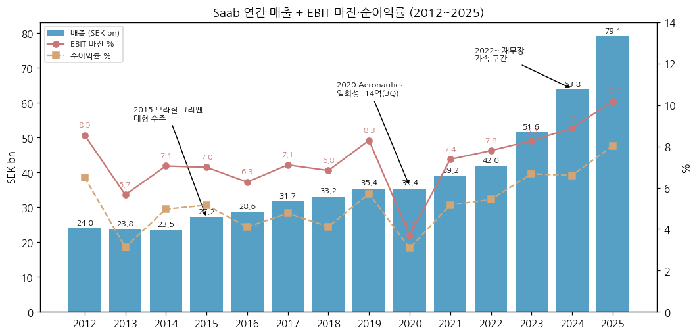

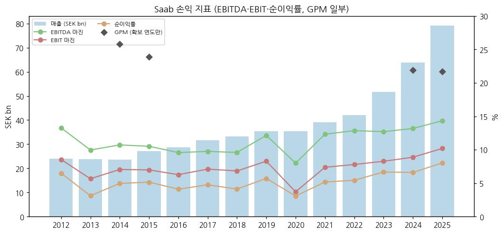

---

## ② 회사 개요

(1) 기본 정보

- **법인명** — Saab AB (publ), 등록번호 556036-0793
- **본사** — Stockholm / 주요 사업장 Linköping (항공), Karlskoga (Dynamics), Gothenburg (레이더), Karlskrona·Malmö·Landskrona (Naval)
- **상장** — Nasdaq Stockholm (A주 의결권 10표, B주 1표), 총발행 543,383,388주 (A 9,535,612 + B 533,847,776, 2025말)
- **사업 한 줄 정의** — 전투기·조기경보기·레이더·미사일·잠수함까지 "한 나라 군의 핵심 장비 세트"를 자체 설계·생산하는 기업
- **CEO** — Micael Johansson (2020~) / **CFO** — Anna Wijkander / **Deputy CEO** — Anders Carp (2026-10~ Dynamics BA장 겸임)
- **임직원** — FTE 30,649명 (2026-09말), 2025말 27,865명

(2) 핵심 KPI (2025 실적 + 3Q26 + 9M26)

| 항목 | 2025 | 3Q26 | 9M26 | 9M26 YoY |
|---|---|---|---|---|
| 수주 (MSEK) | 168,519 | 65,825 | 152,461 | +123% |
| 수주잔고 (MSEK) | 274,532 | 364,223 | — | +80% |
| 매출 (MSEK) | 79,146 | 20,553 | 65,170 | +27% (유기적 +27.5%) |
| EBIT (MSEK) | 8,066 (조정 7,730) | 1,945 | 6,659 | +39% |
| EBIT 마진 | 10.2% | 9.5% | 10.2% | +0.9%p |
| 순이익 (MSEK) | 6,356 | 1,432 | 5,068 | +34% |
| 희석 EPS (SEK) | 11.70 | 2.57 | 9.18 | +32% |
| 영업현금흐름(operational) | 5,273 | 6,785 | 7,740 | — |
| 순현금 (MSEK) | 3,989 | — | 8,679 (9월말) | — |

(3) 주요 연혁

**1기 (1937~1999) — 스웨덴 국영 항공기 제작사**
→ **1937** — Svenska Aeroplan AB 설립 (스웨덴 공군 자립 목적)
→ **1950~1980년대** — Draken·Viggen 전투기, 1947 자동차 사업 시작 (1990 Saab Automobile 분리)
→ **1988** — JAS 39 그리펜 첫 비행 (1996 스웨덴 공군 실전 배치)

**2기 (2000~2021) — 방산 종합 기업화**
→ **2000** — Celsius 인수 (Bofors 미사일·지상무기 등) → 현 Dynamics의 뿌리
→ **2006** — Ericsson Microwave Systems 인수 → 레이더(Surveillance) 강화
→ **2013~2015** — 스웨덴 그리펜 E 60대, Kockums 인수 (2014), 브라질 그리펜 E/F 36대 (2015 수주)
→ **2018-09** — 보잉과 미 공군 고등훈련기 T-X(T-7A Red Hawk) 수주 — KAI T-50(록히드 컨소시엄) 탈락
→ **2020 3Q** — Aeronautics 프로젝트 재평가 일회성, 연간 EBIT 1.3bn으로 급감

**3기 (2022~현재) — 재무장 슈퍼사이클**
→ **2022-02** — 러시아 우크라이나 침공 → 북유럽·동유럽 방공·대전차 수요 폭증, 2022-05 스웨덴 NATO 가입 신청
→ **2024-03** — 스웨덴 NATO 정식 가입 / 2024 4:1 액면분할
→ **2025** — 태국 그리펜 E/F 4대, **콜롬비아 그리펜 E/F 17대 (EUR 3.1bn)**, 프랑스 GlobalEye 2대 (SEK 12.3bn), A26 완성 (9.6bn), 수주 168.5bn (사상 최대)
→ **2026-02** — 중기 성장 목표 18% → 22% 상향, 2026년 단년 가이던스는 미제시
→ **2026-04-01** — Naval BA 신설 (Kockums + Naval Combat Systems)
→ **2026-05** — 캐나다 GlobalEye 선정 → 9월 6대 term sheet
→ **2026-06** — **폴란드 A26 잠수함 3척 (약 SEK 47bn, 최종 인도 2038)** — 한화오션 KSS-III와 경쟁 끝 수주, **우크라이나 그리펜 E 16대 (24.6bn, 인도 2029~30)**
→ **2026-07** — NATO GlobalEye 최대 10대 공식 협상 개시 / 미공개 신규 고객 GlobalEye 2대 (10.1bn) / 독일 MEKO A-200 프리깃 4척 전투체계 (8.7bn)
→ **2026-10-23** — 3Q26: 수주 65.8bn (B/B 3.2x), 잔고 364bn, EBIT +42%
→ **2027-05-12 (예정)** — Capital Markets Day (Linköping)

(4) 회사 주가 역사

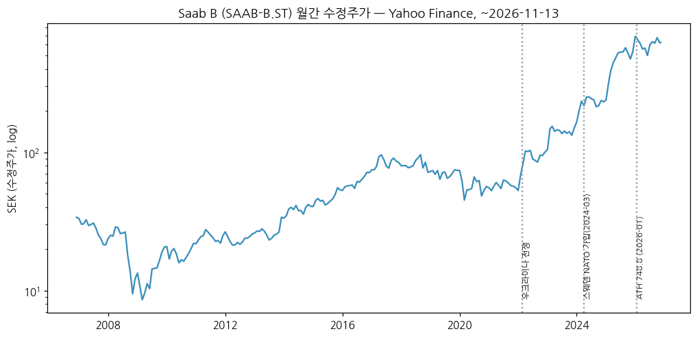

- 2022-02 이전: SEK 50~100대 박스 (분할 조정 기준) — 저성장 방산
- 2022-02 우크라이나 전쟁 → 재평가 시작
- **ATH: 2026-01-19 장중 SEK 748.8** (종가 고점 729.8, 2026-01-20) [Yahoo Finance]
- 2026-07-17 2Q26 발표일 +9.7% (516.7 → 567.0) — 폴란드 잠수함·EBIT 컨센 상회
- 현재: **SEK 622.5 (2026-11-13 종가)**, ATH 대비 −17% [계산] / 시총 약 SEK 338bn [계산]

---

## ③ 비즈니스 모델

(1) 실적 추이 통합 표 (MSEK)

| 항목 | 2021 | 2022 | 2023 | 2024 | 2025 | 9M26 |
|---|---|---|---|---|---|---|
| **수주** | 43,569 | 63,116 | 77,811 | 96,798 | 168,519 | 152,461 |
| **수주잔고 (기말)** | 105,177 | 127,676 | 153,409 | 187,223 | 274,532 | 364,223 |
| **매출** | 39,154 | 42,006 | 51,609 | 63,751 | 79,146 | 65,170 |
| └ Aeronautics | 12,263 | 12,942 | 13,754 | 16,689 | 19,133 | 15,856 |
| └ Dynamics | 8,690 | 8,663 | 11,160 | 14,605 | 20,665 | 15,161 |
| └ Surveillance | 13,373 | 14,616 | 18,559 | 22,014 → 신 18,560* | 신 21,256 | 19,235 |
| └ Kockums → Naval | 3,388 | 4,114 | 6,314 | 8,364 → 신 —* | 신 15,513 | 13,162 |
| └ Combitech | 3,116 | 3,399 | 3,922 | 4,306 | 4,977 | 3,769 |
| **EBIT (마진)** | 2,888 (7.4%) | 3,274 (7.8%) | 4,272 (8.3%) | 5,662 (8.9%) | 8,066 (10.2%) | 6,659 (10.2%) |
| └ Aeronautics | 746 (6.1%) | 694 (5.4%) | 710 (5.2%) | 977 (5.9%) | 1,177 (6.2%) | 996 (6.3%) |
| └ Dynamics | 1,113 (12.8%) | 1,600 (18.5%) | 1,758 (15.8%) | 2,565 (17.6%) | 3,735 (18.1%) | 2,696 (17.8%) |
| └ Surveillance | 917 (6.9%) | 1,176 (8.0%) | 2,034 (11.0%) | 1,991 (9.0%) | 신 2,991 (14.1%)** | 2,304 (12.0%) |
| └ Kockums → Naval | 208 (6.1%) | 264 (6.4%) | 432 (6.8%) | 639 (7.6%) | 신 829 (5.3%) | 794 (6.0%) |
| └ Combitech | 265 (8.5%) | 267 (7.9%) | 340 (8.7%) | 442 (10.3%) | 478 (9.6%) | 399 (10.6%) |
| 국방 매출 비중 | 90% | 89% | 90% | 92% | 93% | — |
| 해외 매출 비중 | 62% | 58% | 58% | 59% | 59% | 60% |

> 2021~2024 사업부 값은 분기 보고서 분기값 합산 [계산] (구 기준). 2025·9M26은 신 기준 (Naval 신설, 2025 restated). \* 2024 신 기준은 4Q24만 공시 (Surveillance 4,622·Naval 4,428). \*\* 2025 Surveillance EBIT은 TransponderTech 매각익 336 포함 (제외 시 2,655, 12.5%) [계산].
> 4Q20 이전 구조: Aeronautics·Dynamics·Surveillance·Support and Services·Industrial Products and Services·Kockums 6개 BA (2022 재편으로 S&S·IPS가 각 BA·Combitech로 흡수).

**9M26 지역별 매출 (MSEK)**: 스웨덴 25,959 (40%) · 유럽 기타 18,873 (29%, +53%) · 북미 4,662 · 중남미 3,767 · 아시아 5,471 · 아프리카 296 · 호주 등 2,033 · 미공개 국가 4,109

**수주잔고 인도 시점 (3Q26말, SEK bn)**: 2026 27.9 · 2027 102.1 · 2028 89.2 · 2029 62.0 · 2030 이후 83.0 — 해외 비중 79%

(2) 사업부별 개요 (매출 비중 큰 순)

**Surveillance (29%)** — "하늘·땅·바다를 보는 눈(레이더·조기경보기)과 전투기의 두뇌(항전·전자전)를 만드는 사업부"
- **GlobalEye** — 봄바디어 Global 6000/6500 기체 + Erieye ER 레이더 조기경보통제기. 고객: UAE, 스웨덴, 프랑스(2대), 미공개 1개국(2026), 캐나다 6대 term sheet, NATO 최대 10대 협상, 네덜란드 1대 의향
- **Giraffe 레이더** — Giraffe 1X(소형 방공), 4A, AMB, Sea Giraffe — 2026 "연 수백 대" 생산 체제 (컨콜)
- 전자전(EW) 자체보호, 그리펜 항전(Fighter Core Capabilities), C2 디지털 전장 솔루션

**Aeronautics (24%)** — "그리펜 전투기를 만들고, 미 공군 훈련기 T-7A 동체 일부를 만드는 사업부"
- **JAS 39 Gripen E/F** — 고객 스웨덴(60), 브라질(36, 현지 생산 허브), 태국(4), 콜롬비아(17), 우크라이나(16, 2029~). C/D형 운용국 헝가리·체코·남아공·태국
- **T-7A Red Hawk** — 보잉 파트너, 미국 West Lafayette 공장에서 후방동체 생산. 램프업 손실 연 약 SEK 5억 (컨콜, 2026-10)
- 생산능력: 연 약 15대 → 25~30대로 확대 중 / 차세대 무인 전투기 컨셉 A3, FMV 미래 전투기 컨셉 계약 (2.9bn, 2026-09)

**Dynamics (23%)** — "보병이 쏘는 대전차 무기, 단거리 방공 미사일, 훈련 장비를 만드는 사업부"
- **Carl-Gustaf** (84mm 다목적 무반동포), **AT4**, **NLAW** (대전차) — 미 육군 등 장기 고객
- **RBS 70 NG / Bolide** (단거리 방공), IRIS-T SLS/SLM (독일 Diehl 협력), RBS 15 대함미사일, **Taurus KEPD 350** (독일 MBDA와 합작)
- 지상전 장비(Barracuda 위장), 훈련·시뮬레이션 / 미국 Grayling(미시간)·인도 공장 신설 / 신규 BU: 드론형 일회성 효과기·대드론
- 마진이 분기마다 배치 인도에 따라 14~21%로 출렁임

**Naval (20%)** — "잠수함·함정과 함정 전투체계를 만드는 사업부"
- **A26 잠수함** — 스웨덴 2척(건조 완성 9.6bn, 2025), **폴란드 3척 (약 47bn, 2026-06, 인도 ~2038)**
- 9LV 함정 전투체계(CMS)·센서 — 독일 MEKO A-200 DEU 프리깃 4척 (8.7bn, TKMS 경유), F123 개량
- Visby 코르벳, 전투정(Docksta), 수중무인체(LUUV 시연 2026)
- Karlskrona·Landskrona 증설, 북부 스웨덴 전투정 신공장

**Combitech (6%)** — IT·사이버보안·시스템 통합 컨설팅 (국방·통신·민간)

(3) 사업부별 디테일 (3Q26 기준)

**현재 가장 잘나가는 것**
- **Surveillance**: 3Q 매출 +65%, EBIT +111%, 마진 13.7% — Giraffe 1X 대량 인도 + GlobalEye 진행
- **Naval**: 3Q 매출 +41% — 폴란드 잠수함 착수 (선수금으로 3Q 영업현금 5,981)
- **Aeronautics 수주**: 3Q 28.8bn (우크라이나 그리펜), 잔고 102.5bn

**성장 기대**
- GlobalEye 연 2대 → 6대 생산 (캐나다 현지 허브 포함), NATO 10대 협상
- 그리펜 캠페인: 캐나다(F-35 혼합 운용 제안), 기타 다수 진행 (회사: "several campaigns ongoing")
- 수주잔고 중 2027 인도분 102.1bn — 2026 인도분(27.9bn, 4Q만) 이후 2027 매출 가시성 큼

**이익 outlier**
- Aeronautics: T-7 손실 연 약 5억 제외 시 "high single-digit" 마진 (CEO, 2026-10-23)
- Naval: 수중무인체·전투체계 1~2개 프로젝트가 마진 희석, 잠수함은 "마진 증가 요인" (CEO)

(4) 주요 경쟁사 (사업부별) — **한국 5사 겹침 굵게**

- **Aeronautics (전투기·훈련기)** — Lockheed Martin (F-16 Block 70·F-35), Dassault (Rafale), Boeing, **KAI (FA-50·KF-21)** — 중남미·동남아·동유럽의 "F-35를 살 수 없거나 비싼" 경량·중형 전투기 수요가 겹치는 구간 [판단]. **T-7A(Saab-보잉) vs KAI T-50/TF-50** — 2018 미 공군 APT 직접 경쟁 이력
- **Surveillance (조기경보·레이더)** — Northrop Grumman (E-2D), Boeing (E-7 Wedgetail), L3Harris (한국 공중조기경보기 2차 사업 2023 선정), Thales (Ground Master), Hensoldt (TRML-4D), Leonardo, Elta(ESLT) / **한화시스템 (지상·함정 레이더, 다기능 레이더)** · **LIG D&A (국지방공·대포병 레이더)**
- **Dynamics (대전차·방공 미사일)** — MBDA (Akeron·Mistral), Raytheon (Javelin·Stinger·NASAMS), Rafael (Spike), Diehl (IRIS-T, 협력·경쟁), Kongsberg (NSM·NASAMS) / **LIG D&A (현궁 대전차, 신궁 휴대용 방공, 천궁-II 중거리)** · **한화에어로스페이스 (지상 무기체계)**
- **Naval (잠수함·전투체계)** — TKMS (Type 212CD·214), Naval Group (Scorpène), Navantia, Hanwha Ocean (KSS-III — **폴란드 Orka 잠수함 입찰에서 Saab에 패배**, 조선 섹터) / 함정 전투체계: Thales (TACTICOS), Lockheed (Aegis), **한화시스템 (함정 전투체계·통합마스트)**
- **Combitech** — 북유럽 IT 컨설팅 (CGI, Sopra Steria 등)

**한국 5사와의 경쟁 구도 요약** [판단]
→ 직접 경쟁은 **KAI (경전투기·훈련기)** 와 **LIG D&A (휴대용·단거리 방공, 대전차)** 가 가장 크다. 한화시스템은 레이더·함정 전투체계에서 제품군이 겹친다
→ 차이: Saab은 "NATO 내부 공급자" 지위로 유럽 SAFE 등 역내 조달 블록화의 수혜 쪽, 한국 5사는 역외 공급자라 현지 생산·JV로 대응해야 하는 쪽

(5) 주요 매출처

> 단일 고객 10% 이상 공시 없음. 아래는 보고서 등장 고객 + 지역 매출 기반 [추정] 순서.

- **1. 스웨덴 국방조달청 (FMV)** — 9M26 매출의 40% (스웨덴 전체), 그리펜·GlobalEye·A26·우크라이나 그리펜 계약 창구(정부 간 거래)
- **2. 유럽 국방부** — 폴란드(A26·SIGINT함), 독일(프리깃·IRIS-T·Taurus), 핀란드(RBS 70 NG), 리투아니아(RBS 70 Bolide), 프랑스(GlobalEye), 네덜란드 — 9M26 29%
- **3. 미국** — 미 공군(T-7A, 보잉 경유), 미 육군(Carl-Gustaf·AT4) — 북미 7%
- **4. 중남미** — 브라질(그리펜), 콜롬비아(그리펜) — 6%
- **5. 아시아·중동** — 태국(그리펜·GlobalEye 계열 Erieye), UAE(GlobalEye), 인도(Carl-Gustaf 현지 생산) — 아시아 8%

(6) 생산 CAPA + 임직원

- 연간 capacity 투자 **SEK 80억+ (R12)**, 2026~2027이 정점일 가능성 (CEO, 2026-10-23)
- 그리펜 연 15대 → 25~30대 / GlobalEye 연 2대 → 6대 / 레이더 연 수백 대 / T-7 목표 연 50~80대 (보잉 발주 연동)
- FTE: 2016 15,474 → 2021 18,011 → 2025 27,865 → **2026-09 30,649**

---

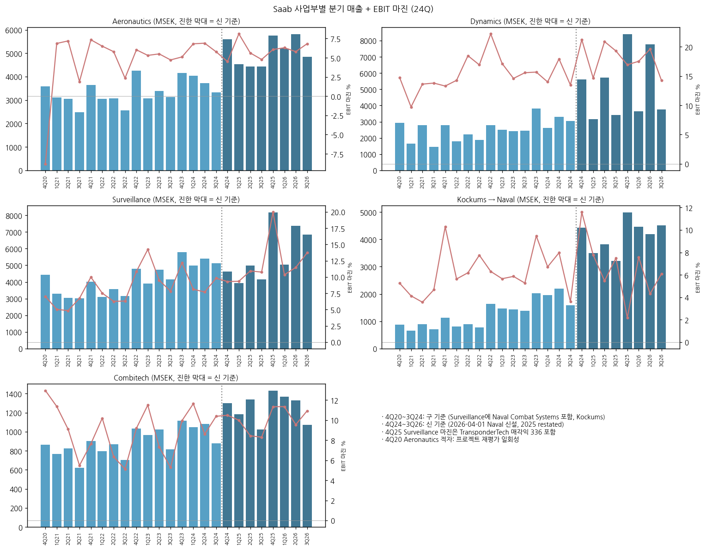

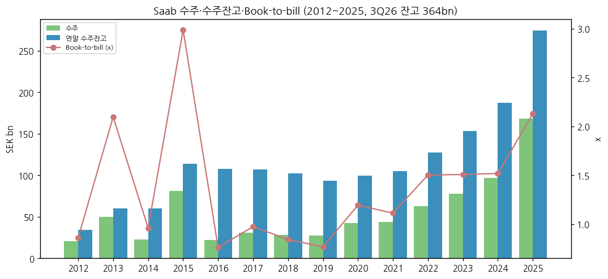

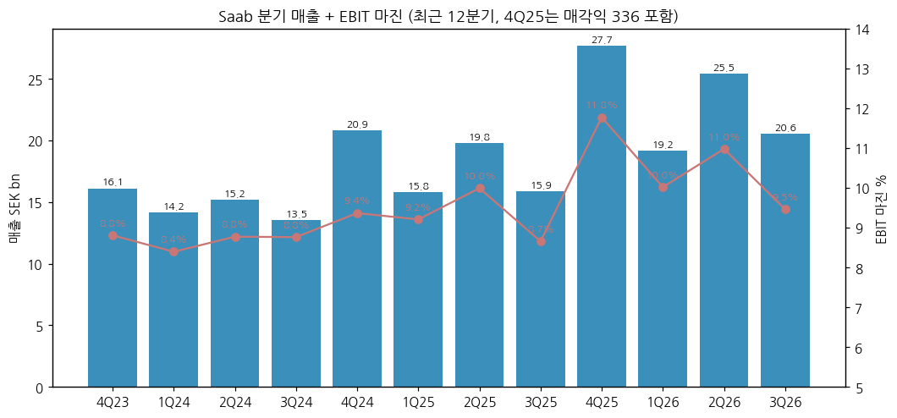

**그룹 분기 시계열 (MSEK, 최근 12분기)**

| 분기 | 4Q23 | 1Q24 | 2Q24 | 3Q24 | 4Q24 | 1Q25 | 2Q25 | 3Q25 | 4Q25 | 1Q26 | 2Q26 | 3Q26 |
|---|---|---|---|---|---|---|---|---|---|---|---|---|
| 매출 | 16,122 | 14,185 | 15,170 | 13,546 | 20,850 | 15,792 | 19,786 | 15,871 | 27,697 | 19,164 | 25,453 | 20,553 |
| EBIT | 1,420 | 1,191 | 1,331 | 1,187 | 1,953 | 1,454 | 1,977 | 1,374 | 3,261 | 1,920 | 2,794 | 1,945 |
| 마진 | 8.8% | 8.4% | 8.8% | 8.8% | 9.4% | 9.2% | 10.0% | 8.7% | 11.8% | 10.0% | 11.0% | 9.5% |

> 4Q가 연중 최대 (인도·마일스톤 집중), 3Q가 휴가철로 최소인 계절성. 4Q25 EBIT은 매각익 336 포함 (조정 2,925, 10.6%).

---

## ④ 재무 구조

(1) 손익계산서 (14년, MSEK)

| 연도 | 매출 | EBITDA | EBITDA% | EBIT | EBIT% | 순이익 | 순이익률 | ROE |
|---|---|---|---|---|---|---|---|---|
| 2012 | 24,010 | 3,186 | 13.3% | 2,050 | 8.5% | 1,560 | 6.5% | 12.8% |
| 2013 | 23,750 | 2,367 | 10.0% | 1,345 | 5.7% | 742 | 3.1% | 6.3% |
| 2014 | 23,527 | 2,523 | 10.7% | 1,659 | 7.1% | 1,168 | 5.0% | 9.9% |
| 2015 | 27,186 | 2,859 | 10.5% | 1,900 | 7.0% | 1,402 | 5.2% | 11.5% |
| 2016 | 28,631 | 2,743 | 9.6% | 1,797 | 6.3% | 1,175 | 4.1% | 9.0% |
| 2017 | 31,666 | 3,089 | 9.8% | 2,250 | 7.1% | 1,508 | 4.8% | 10.9% |
| 2018 | 33,156 | 3,182 | 9.6% | 2,266 | 6.8% | 1,366 | 4.1% | 8.1% |
| 2019 | 35,433 | 4,305 | 12.1% | 2,937 | 8.3% | 2,025 | 5.7% | 10.0% |
| 2020 | 35,431 | 2,833 | 8.0% | 1,315 | 3.7% | 1,092 | 3.1% | 5.1% |
| 2021 | 39,154 | 4,826 | 12.3% | 2,888 | 7.4% | 2,025 | 5.2% | 9.0% |
| 2022 | 42,006 | 5,401 | 12.9% | 3,274 | 7.8% | 2,283 | 5.4% | 8.6% |
| 2023 | 51,609 | 6,558 | 12.7% | 4,272 | 8.3% | 3,443 | 6.7% | 11.1% |
| 2024 | 63,751 | 8,402 | 13.2% | 5,662 | 8.9% | 4,210 | 6.6% | 12.4% |
| **2025** | **79,146** | **11,347** | **14.3%** | **8,066** | **10.2%** | **6,356** | **8.0%** | **16.0%** |
| 9M26 | 65,170 | 9,338 | 14.3% | 6,659 | 10.2% | 5,068 | 7.8% | 16.3% (R12) |

> GPM (확보 연도): 2014 25.8% · 2015 23.9% · 2019 22.7% · 2020 16.0% · 2024 21.4% · 2025 21.7% · 9M26 23.1%. 9M26 판관비(마케팅+관리) 매출 대비 7.1% (전년 8.7%) — 영업레버리지.

(2) 재무상태표 (MSEK)

| 연도 | 자산총계 | 자본총계 | 부채총계 [계산] | 자기자본비율 | 순현금(+)/순부채(−) |
|---|---|---|---|---|---|
| 2016 | 41,211 | 13,301 | 27,910 | 32.3% | −1,836 |
| 2018 | 56,128 | 19,633 | 36,495 | 35.0% | −1,460 |
| 2020 | 60,568 | 21,644 | 38,924 | 35.7% | −4,273 |
| 2022 | 72,365 | 29,876 | 42,489 | 41.3% | +2,432 |
| 2024 | 99,823 | 35,812 | 64,011 | 35.9% | +2,211 |
| **2025** | **124,704** | **43,676** | **81,028** | **35.0%** | **+3,989** |
| 2026-09 | — | — | — | 34.6% | **+8,679** |

> 2018 신주인수권 증자(rights issue)로 2018 자본 +37% [계산]. 순현금은 리스부채·연금 포함 회사 정의. 3Q26 현금·유동투자 SEK 26.1bn, 미사용 RCF 6bn, 2026 3Q 첫 유로 채권 EUR 300m (7년). S&P **BBB+** (2025 확인, AR 2025).

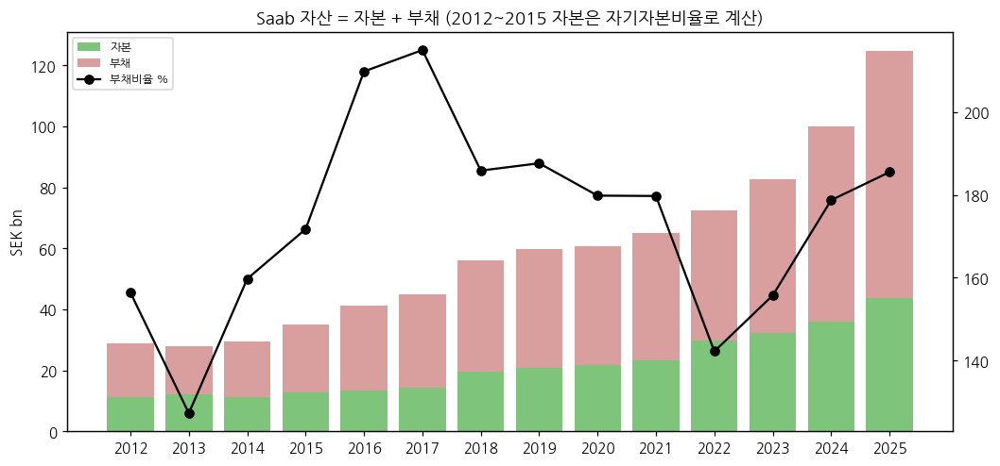

(3) 현금흐름 (10년, MSEK)

| 연도 | 영업활동 CF | 유형 CapEx | FCF (회사 정의) |
|---|---|---|---|
| 2016 | 4,154 | 807 | 2,359 |
| 2017 | 3,164 | 1,093 | 852 |
| 2018 | −490 | 1,481 | −3,195 |
| 2019 | 1,194 | 1,213 | −2,036 |
| 2020 | 5,800 | 1,269 | 3,753 |
| 2021 | 5,713 | 1,223 | 2,737 |
| 2022 | 4,654 | 1,624 | 1,871 |
| 2023 | 6,462 | 2,507 | 1,566 |
| 2024 | 6,732 | 4,012 | 993 |
| **2025** | **12,105** | **6,112** | **4,206** |
| 9M26 | — | 5,897 | 5,053 |

→ 2018~2019 FCF 적자: 그리펜 E 개발·운전자본 / 2025~2026: 대형 계약 선수금(폴란드 잠수함·GlobalEye)으로 OCF 급증 — 수주 둔화 시 역방향 위험
→ 누적 cash conversion 2023~3Q26 **77%** (목표 >60%, CFO)

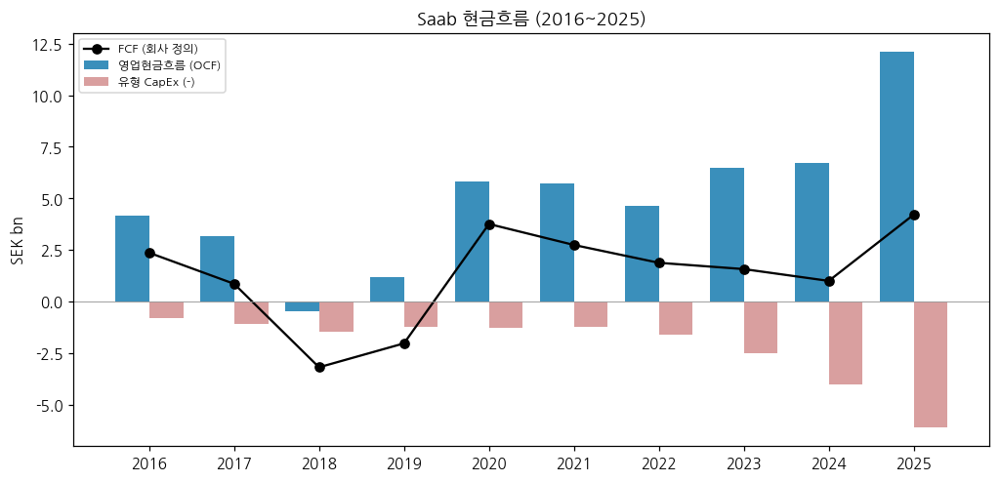

(4) CapEx

→ 유형 CapEx 2016 0.8bn → 2022 1.6bn → **2025 6.1bn (매출 7.7%)** → 9M26 5.9bn [계산]
→ capacity 투자 R12 SEK 8bn+ (Karlskoga 미사일·Linköping 그리펜·Gothenburg 레이더·Karlskrona/Landskrona 잠수함·미국 Grayling·인도), 2026~2027 정점 가능 (CEO)

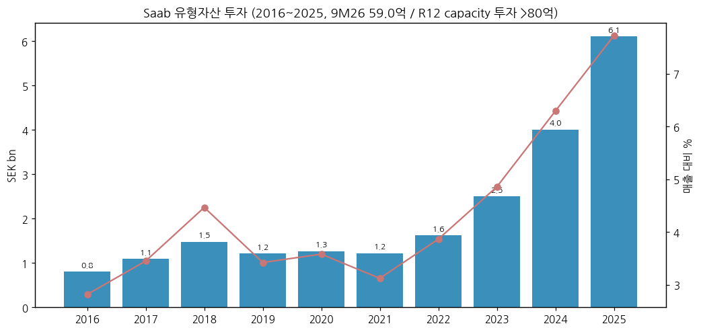

(5) 부채 구조

- 순현금 전환 2022 (순부채 2021 −2,125 → 2022 +2,432) [AR 2025]
- EMTN 채권 프로그램, 2026 3Q 첫 EUR 채권 / 순부채/EBITDA −0.6x (3Q26)
- 부채의 큰 부분은 계약부채(고객 선수금)와 연금 — 이자부 차입 부담 낮음

(6) 배당·자사주

| 항목 | 2019 | 2020 | 2021 | 2022 | 2023 | 2024 | 2025 |
|---|---|---|---|---|---|---|---|
| DPS (SEK, 분할 조정) | 0.00 | 1.18 | 1.23 | 1.33 | 1.60 | 2.00 | 2.40 |
| 배당성향 [계산] | 0% | 59% | 34% | 32% | 25% | 26% | 21% |

→ 2019분 배당은 COVID로 취소. 2025분 2.40은 2회 분할 지급 (2026-04·10)
→ 자사주는 인센티브용 소규모 (자기주식 3,177,742주, 2026-09) — 대규모 환원보다 증설 투자 우선

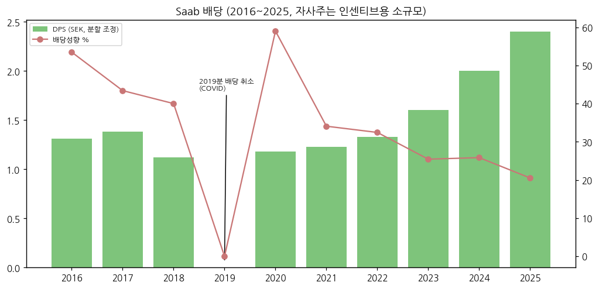

(7) 재무비율

| 연도 | ROE | ROCE | 자기자본비율 | 이자보상배율 | CapEx/매출 |
|---|---|---|---|---|---|
| 2021 | 9.0% | 8.1% | 35.7% | 6.9x | 3.1% |
| 2022 | 8.6% | 8.8% | 41.3% | 5.3x | 3.9% |
| 2023 | 11.1% | 11.9% | 39.1% | 8.0x | 4.9% |
| 2024 | 12.4% | 13.6% | 35.9% | 6.7x | 6.3% |
| 2025 | 16.0% | 16.5% | 35.0% | 11.6x | 7.7% |
| 3Q26 R12 | 16.3% | 16.7% | 34.6% | — | — |

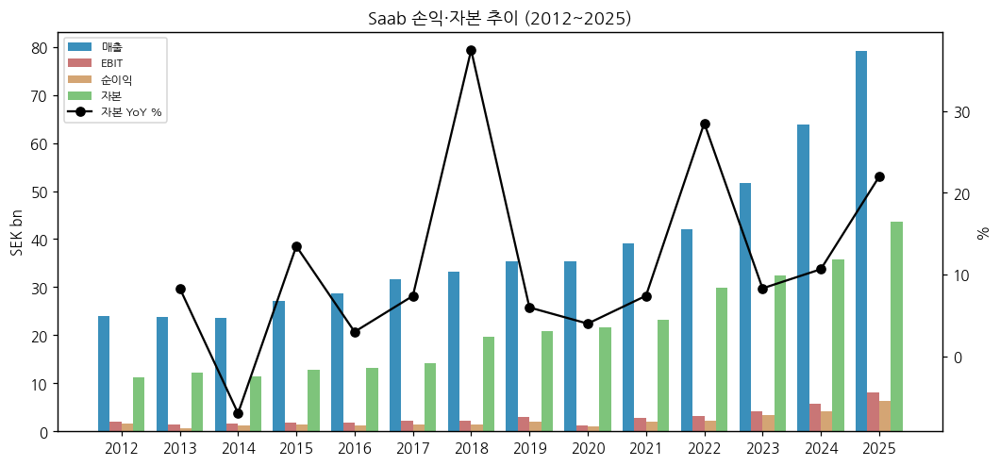

---

## ⑤ 지배 구조

(1) 그룹·계열 관계

- **Investor AB (Wallenberg 그룹 지주)** — 최대주주, 자본 30.2% / 의결권 39.9% — A주(10표) 대부분 보유
- **Wallenberg Investments (Wallenberg 재단)** — 8.7% / 7.6% → Wallenberg 계 합산 의결권 약 47.5% [계산]
- 주요 자회사·합작: Saab Dynamics, Saab Kockums, Saab North America, Saab Aeronáutica Montagens (브라질), Taurus Systems (MBDA Deutschland 합작), Helsing 지분 투자, Comand AI 10% (2026-06)
- 스웨덴 정부 지분 없음 — 다만 FMV가 최대 고객이고 수출은 스웨덴 정부 허가 사항

(2) 주주 구분 (2026-09-30, Modular Finance)

| 주주 | 자본 % | 의결권 % |
|---|---|---|
| Investor AB | 30.2 | 39.9 |
| Wallenberg Investments | 8.7 | 7.6 |
| BlackRock | 3.7 | 3.2 |
| Vanguard | 2.6 | 2.2 |
| Alecta Tjänstepension | 1.3 | 1.1 |
| Norges Bank IM | 1.3 | 1.1 |
| VanEck | 1.2 | 1.0 |
| WisdomTree | 1.1 | 1.0 |

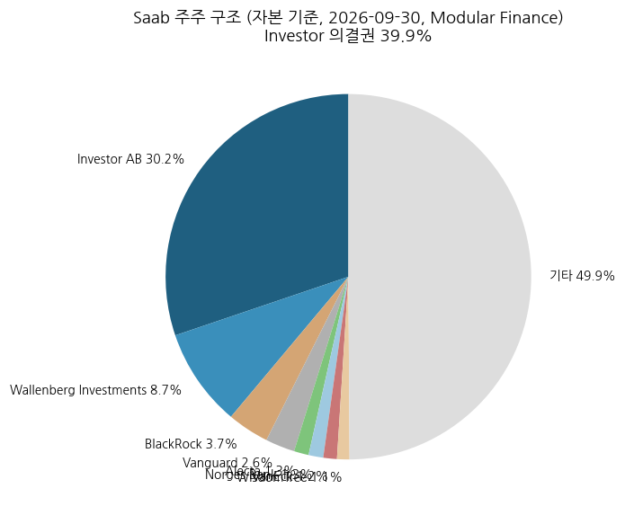

(3) 경영진·이사회

- **CEO Micael Johansson** — 2020~, 이전 Surveillance BA장·Deputy CEO
- **CFO Anna Wijkander**
- **Deputy CEO Anders Carp** — 2026-10부터 Dynamics BA장 겸임
- **Aeronautics BA장 Marcus Wandt** (2026-10~, 전 전략 담당·ESA 우주인)
- **이사회 의장 Marcus Wallenberg** (AR 2025 Chairman's letter, 2026-03)

---

## ⑥ 기타 팩트

(1) 시가총액·밸류에이션 스냅샷 (2026-11-13 종가 기준)

- 주가 SEK 622.5 / 시총 약 SEK 338bn [계산] / 순현금 8.7bn (9월말)
- 2026E P/E 약 42배, 2027E 약 32배 [계산: 컨센 EPS 19.22] / 컨센 평균 TP SEK 648 (13명, 범위 330~760, Simply Wall St 2026-10-28)

(2) R&D

→ 총 R&D 지출(고객 펀딩 포함) 2016 7.4bn → 2021 6.9bn → **2025 12.6bn (매출 15.9%)** [계산]
→ 자체 R&D 비용 9M26 **3,723 (+47%)** — 드론형 효과기·대드론·A3 무인기·차세대 전투기 컨셉
→ AI: Helsing 협력, Sferical AI 데이터센터 컨소시엄

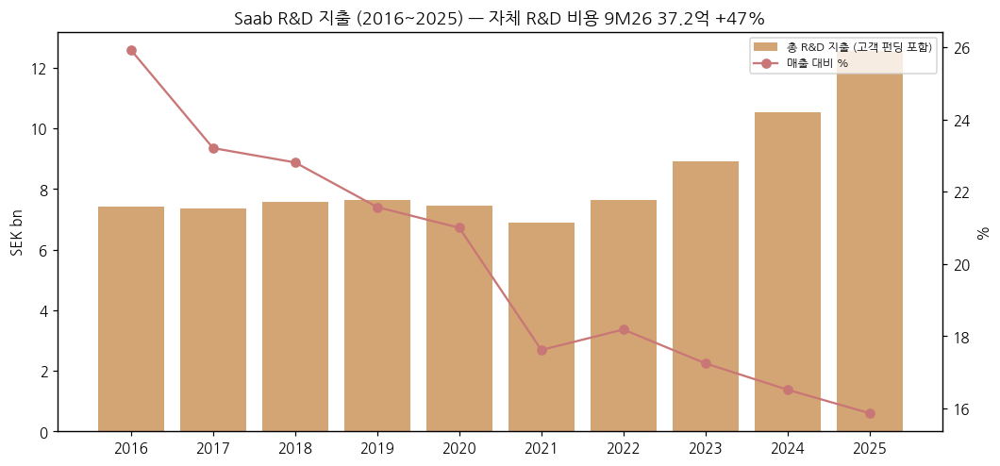

(3) 진행 중 corporate action

- Public Safety Solutions 사업 Omda AS에 매각 (4Q26 완료 예정)
- Comand AI 지분 10% (EUR 11.1m, 2026-06)
- 2027-05-12 CMD — capacity 확대·미래 역량 중심, 2028~ 중기 목표는 2027년 초에 별도 제시 예정 (CEO)

(4) 주요 리스크

- **T-7A 램프업 손실** — 연 약 5억, 보잉 인도 속도 의존
- **증설 실행 리스크** — 대규모 동시 증설·고용 (FTE 1년 +3천 명 수준)
- **공급망** — 희토류·반도체 가격, 엔진 단일 공급(GE F414) (컨콜)
- **수주 시점** — 재정·정치로 계약 이연 가능 (회사 리스크 고지)
- **미 법무부 조사** — 2014 브라질 그리펜 36대 조달 관련 소환장 (2024-10), 회사 협조 중
- **밸류에이션** — 셀사이드 다수 "가격 부담" (3Q26 후 Pareto·Inderes 하향)

(5) ESG

- 2026 TIME·Statista "세계에서 가장 지속가능한 항공우주·방산 기업" 선정 (3Q26 보고서)
- 2026 3Q Climate Transition Plan 발표, 2020 대비 배출 −34% (컨콜)

(6) 인증·라이선스

- 무기 수출은 스웨덴 전략물자감독청(ISP) 허가 필요
- 미국 ITAR 부품 의존 (그리펜 GE F414 엔진) — 수출 시 미국 동의 변수 [판단]

---

## Activity 보고 (v1.0)

### ✅ 확보 자료
- 분기 보고서 9건 + YE2015 + AR 2020·2025 + 3Q26 발표자료·트랜스크립트 + Yahoo 주가

### ❌ 누락
- 일부 연도 GPM, 2012~2015 현금흐름·CapEx, 상세 주주명부, 최근 CMD 자료

### ⚠️ 추정·계산 표시
- [계산]: CAGR, 마진, 사업부 연간 합산, 시총, P/E, 배당성향, 2012~2015 자본
- [추정]: 매출처 순서
- [판단]: 한국 5사 경쟁 구도

### 🔗 핵심 source URL
- 3Q26 보고서: https://mb.cision.com/Main/183/4413197/4335520.pdf
- 3Q26 트랜스크립트: https://www.saab.com/globalassets/corporate/investor-relations/transcripts/saab-q3-report-transcript.pdf
- Annual Report 2025: https://www.saab.com/globalassets/corporate/investor-relations/annual-report/2026/saab-ar25-eng.pdf
- Year-End Report 2025: https://www.saab.com/globalassets/cision/documents/2026/20260205-saab-year-end-report-2025record-order-bookings-building-for-growth-en-0-5300016.pdf

### Data Quality Confidence: **90%**

---

## Version Log

- **v1.0** (2026-11-14) — 초안. 연간 14년 (2012~2025) + 9M26, 그룹 분기 32Q, 사업부 분기 24Q (Naval 신설 전후 2개 기준), 13종 차트 + 다크 .html. 한국 5사 겹침(KAI 경전투기·훈련기, LIG D&A 방공·대전차, 한화시스템 레이더·함정 전투체계) 반영
- **잔여 보완 (v1.1, 2027-02-05 4Q26·연간 발표 후)**: 2026 연간 확정, 2027 이후 가이던스·중기 목표, 누락 연도 GPM 보강
