> 종목: SK온 (비상장 / 에스케이온㈜ / SK On Co., Ltd.) — 모회사 SK이노베이션(096770.KS, DART corp_code 00631518) 지분 90.3%
> 섹터: 배터리 (워치리스트 섹터 T2) / 서브섹터: 배터리 셀 (한국 셀 확장 종목)
> 작성 시각: 2026-11-14 20:30 KST (**v1.0** — 첫 작성. SK이노베이션 반기보고서 2026.06(2026-08-14 공시)·3Q26 실적발표(2026-10-29)까지 반영. SK이노 3Q26 분기보고서는 작성 시점 미공시)
> 적용 구조: v4.8 (6개 섹션 + 표준 차트 13종. chart2는 AMPC분기·분기장기·합병법인·CAPA 4종 분할 2·2b·2c·2d. chart7 R&D·chart9 주주환원은 데이터 부재로 제외, chart11은 시가총액 대신 비상장 주당가치 지표)
> 데이터: 9년 연간 배터리 부문 손익(2017~2025, SK이노베이션 연결 영업부문) + **35분기 배터리 부문 매출·영업이익(1Q18~3Q26)** + **15분기 AMPC 포함/제외 영업이익(1Q23~3Q26)** + SK온 연결 요약재무 2022~2024(SK이노 비지배지분 주석) + 생산능력·가동률 2021~1H26 + 증자·PRS 주당가치 시계열
> 출처: **SK이노베이션 DART 정기보고서 43건(2016.12 사업~2026.06 반기, OpenDART document.xml, 본문 + 감사·연결감사보고서 첨부)** — 핵심: 사업보고서 2025(rcept 20260316000827)·2024(20250318000862)·2023(20240320000950)·2022(20230322000906), 반기보고서 2026.06(20260814002500), 분기보고서 2026.03(20260515001455) / **SK이노베이션 IR 실적발표 PDF 26건(4Q19~3Q26, irgo 경유)** / OpenDART SK이노 연결 재무 JSON(2015~2Q26)·주요정보(2025 FY) / 보도: 뉴스토마토(2026-10-29)·디지털데일리(2026-07-30, 2026-08-05)·뉴시스(2026-07-30)·SBS Biz(2026-08-03)·CEO스코어데일리(2026-01-28, 2026-06-01)·IB토마토(2026-01-29, 2026-07-06)·한경비즈니스(2026-08-26)·헤럴드경제(2025-09-03, 2026-07-14)·아이뉴스24(2026-09-01)·더팩트(2026-11-04)·비즈워치·지디넷(2026-10-29)·이투데이(2025-03 닛산 계약)
> **SK온 자체 DART 공시(분기·감사보고서)는 이번 작업 도구로 접근 불가** — company-data MCP가 종목코드(상장사) 기반이고 OpenDART·DART 웹 직접 호출이 차단됨. SK온 연결 재무는 SK이노 공시 주석·보도 인용으로 대체 [v1.1 보완 대상]
> **Fact verify cutoff**: 2026-11-14

# SK온 기업 개요 (v1.0 — 배터리 T2, 9년 연속 영업적자의 파우치 셀 메이커가 JV 재편·ESS 전환으로 '생존형 리밸런싱' 중)

> ⚠️ **시계열 단절·표시 변경 5건 — 모든 표·차트 해석 시 주의**
> ① **2021.10.01 물적분할** — SK이노베이션 배터리 사업 일체를 물적분할해 SK온 신설. **본 리포트의 1차 시계열은 'SK이노베이션 연결 영업부문 배터리'(SK이노 계열 내부거래 제거 후)** → 분할 전·후 같은 기준으로 연결됨. 단, 실제 SK온 법인 재무(연결)와는 다름(SK이노 IR 주석 "실제 SK온(합병법인) 실적과 차이")
> ② **2024.11.01~2025.11.01 비배터리 3사 흡수합병** — SK트레이딩인터내셔널(2024.11.01)·SK엔텀(2025.02.01)·SK엔무브(2025.11.01) → SK온 '합병법인'에 석유 트레이딩·탱크터미널·윤활기유 사업이 들어옴. **본 리포트의 '배터리 사업' 숫자는 합병법인이 아닌 배터리 부문만** (합병법인 영업이익은 chart2c에 별도)
> ③ **2023.2Q~ IRA 45X AMPC 인식** — 2023~2025는 '기타영업수익'(매출 외, 영업이익 내)으로 표시
> ④ **2026.1Q~ AMPC를 매출에 병합 표시** (SK이노 반기보고서 2026.06 주석 '재무제표 표시 변경') → SK이노 IR은 2025년 분기도 같은 기준으로 재작성(예: 3Q25 1.808조 → **1.981조**). 본 리포트는 2023~2025에 AMPC를 더한 **'재작성 기준' 매출을 별도 병기**하고 YoY는 재작성 기준으로 계산
> ⑤ **2026년 AMPC 분기 금액 미공시** — 2Q26부터 회사가 AMPC·고객보상금을 따로 밝히지 않음(SBS Biz 2026-08-03 "SK온만 보조금 효과 미공개"). 1Q26 AMPC는 SK이노 1Q26 분기보고서 영업부문 주석(790억), 2Q26은 반기 누적 '기타영업수익' 1.22조에서 1Q 차감한 **AMPC+보상금+파생이익 합계 1.14조(⚠️계산)**, 3Q26은 [미확보 — SK이노 3Q26 분기보고서 공시 후 보완]
> 부가: 2014~2016 배터리 손익은 SK이노 '기타' 부문에 포함되어 분리 공시 없음 [미공시] → 연간 시계열은 2017년부터

---

## ① 기업 분류

(1) Primary / Secondary 분류

**⚠️ Boundary Case — 매출은 8년 48배 성장(고성장형), 이익은 9년 연속 적자(사업화 미완성)**

연간 배터리 부문 OPM range **-159.3%(2017) ~ -4.5%(2023)**, 흑자 연도 **0회**. 분기 흑자는 35분기 중 **2회**(3Q24 +240억, 2Q26 +8,218억 — 둘 다 AMPC·고객보상금 등 기타영업수익 영향)

**Primary 분류: 꿈(적자 성장) → 사이클 진입 전환기 — 규모는 갖췄지만 흑자 구조는 미증명**

→ 매출 2017 1,457억 → 2023 **12.90조**(정점) → 2024 6.27조(-51.4%) → 2025 6.98조 — 정점 이후 EV 캐즘으로 반토막, 회복 미약

→ 2017~2025 누적 영업손실 **-5.68조** (2023~2025 AMPC 1.63조 포함 후) — AMPC 제외 시 2023~2025 3년만 -4.27조

→ 가동률(DART, 부하시간÷조업시간) 2023 87.7% → 2024 **43.8%** → 2025 48.7% → 1H26 **36.4%** (2024부터 산정 방식 변경·소급)

**Secondary 노트: 사이클(북미 EV 수요·정책) + ESS 신사업 형성 초기**

→ ESS: 2025.09 첫 수주(Flatiron 1GWh, 우선협상 6.2GWh) → 2026.02 국내 중앙계약시장 2차 284MW(낙찰 50.3%) → 2026.08 **NeoVolta 9GWh**(2027~2031, LFP 파우치) — 2026 목표 20GWh 수주(2Q26 컨콜)

→ 북미 JV 재편: Ford JV(BlueOval SK) 종료(2026.05) → 테네시 공장 100% 단독, 현대차 JV(HSBMA, 조지아 35GWh) 2026.06 양산 개시

**Entity 구조 (2026.06말, SK이노 반기보고서)**

→ **SK온㈜ (본사·서산공장)** — 배터리 + 합병된 석유 트레이딩(구 SKTI)·탱크터미널(구 SK엔텀)·윤활기유(구 SK엔무브) 사업. SK이노 지분 90.3%, 나머지 9.7%는 PRS 계약 투자자 SPC 3곳

→ **연결 생산법인** — SK Battery America(조지아 1·2공장), SK Battery Manufacturing Kft.(헝가리 코마롬 1·2), SK On Hungary Kft.(헝가리 이반차 3공장), SK On Jiangsu(옌청 SKOJ, 2026.1Q EVE 지분 30% 인수로 100%), SK On Yancheng(옌청 SKOY), **SK On Tennessee, LLC**(구 BlueOval SK, 2026.05 감자 후 100%)

→ **공동기업(지분법, Capa 제외)** — HSBMA LLC(현대차그룹 50:50, 조지아 바토우), Beijing BESK(BAIC JV, 창저우). Huizhou EVE United Energy(EVE JV, 후이저우) 지분 49%는 2026.1Q 지분 Swap으로 처분

→ **사업부 공시**: SK이노 연결 영업부문은 2024.11 SK E&S 합병 이후 '배터리 및 소재'(SK아이이테크놀로지 분리막 포함)로 통합 → **배터리 단독 분기 숫자는 SK이노 IR '회사별 실적'의 'SK온(배터리 사업)' 행이 1순위**. EV·ESS 제품별 매출은 미공시

(2) Summary Box (9년 시계열 + 사이클 통계)

| 지표 | 9년 평균 (2017~2025) | 정점 | 저점 | 2025년 | 9M26 (누적, AMPC 포함) |
|---|---|---|---|---|---|
| 매출 (억원, AMPC 제외 표시) | 43,993 | **128,972 (2023)** | 1,457 (2017) | 69,782 (재작성 76,968) | 63,424 |
| 영업이익 (억원) | -6,313 | -2,321 (2017, 최소 적자) | **-11,268 (2024)** | -9,313 | **+3,921** |
| AMPC 제외 영업이익 (억원) | — | -11,988 (2023) | **-16,499 (2025)** | -16,499 | [미확보 — 3Q26 AMPC 미공시] |
| OPM (%) | **-43.8%** (2021~25 평균 -14.5%) | -4.5% (2023) | -159.3% (2017) | -13.3% (재작성 -12.1%) | 6.2% |
| SK온 연결 순이익 (억원, 2022~) | — | -7,566 (2023) | **-20,617 (2024)** | [미확보] | [미확보] |

```
[SK온 배터리 부문 9년 손익 (억원) — 2017~2021.9 SK이노베이션 배터리사업 / 2021.10~ SK온 (모두 SK이노 연결 영업부문 기준)]
연도     매출       YoY      OP       OPM      AMPC    OP(AMPC제외)
2017     1,457       -     -2,321  -159.3%     -        -        ← 부문 첫 분리 공시 (서산 4.7GWh, 다임러·현대기아 공급)
2018     3,482   +139.0%   -3,175   -91.2%     -        -        ← 서산 증설(2018.09), 헝가리·중국 투자 착수
2019     6,903    +98.2%   -3,091   -44.8%     -        -        ← LG화학 영업비밀 소송 제기(2019.04)
2020    16,102   +133.3%   -4,265   -26.5%     -        -        ← 헝가리 1공장·창저우 BEST 가동
2021    30,397    +88.8%   -6,840   -22.5%     -        -        ← LG 합의금(현금 1조) / 10월 물적분할 → SK온 출범
2022    76,177   +150.6%  -10,727   -14.1%     -        -        ← 조지아 1·2·헝가리 2·옌청 2 동시 가동, 메탈가 판가 연동
2023   128,972    +69.3%   -5,818    -4.5%   6,170  -11,988      ← 매출 정점 / AMPC 개시 (재작성 매출 13.51조)
2024    62,666    -51.4%  -11,268   -18.0%   2,924  -14,192      ← EV 캐즘·메탈가 하락, 매출 반토막 (최대 적자)
2025    69,782    +11.4%   -9,313   -13.3%   7,186  -16,499      ← 美 30D 폐지(2025.09) / BOSK 종료 계약(12월)
9M26    63,424     +3.3%*  +3,921    +6.2%  [부분]  [미확보]      ← AMPC 매출 병합. 2Q26 고객보상금 포함 +8,218억 → 3Q26 -805억
* 9M26 YoY는 9M25 재작성(AMPC 포함 6.14조) 대비

OPM range: -159.3% ~ -4.5% (전 구간 적자 → 정량 룰상 '꿈/적자 성장' 영역)
누적 영업손실(2017~2025): -5.68조 / AMPC 제외 시 2023~2025만 -4.27조
```

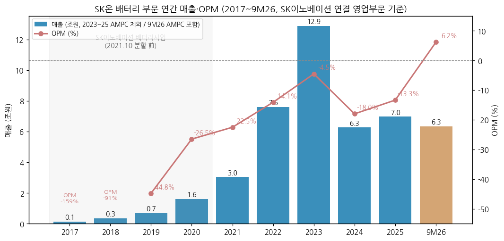

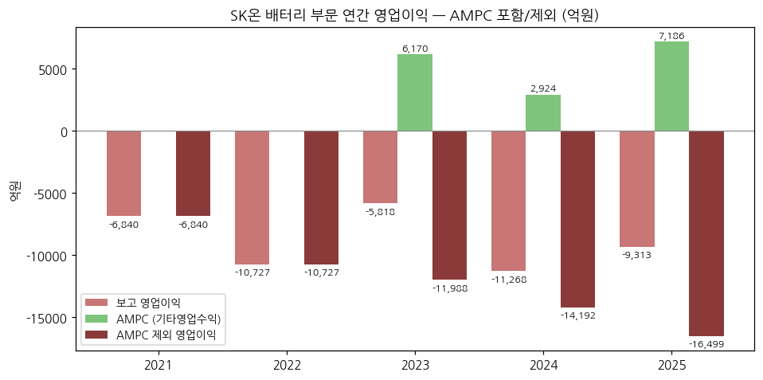

**📊 사이클 통계 (9년)**

| 지표 | 값 |
|---|---|
| 매출 CAGR (8년, 2017→2025) | **+62.2%** |
| 매출 CAGR (6년, 2017→2023 정점) | **+111%** |
| OPM 평균 (9년 / 2021~25) | **-43.8% / -14.5%** |
| 흑자 연도 | **0회** (분기 흑자 2회: 3Q24·2Q26) |
| 정점→저점 | 매출 2023 12.90조 → 2024 6.27조 (-51.4%) |
| 사이클 회수 | 이익 사이클 미형성 (1회도 흑자 정점 없음) |

**글로벌 배터리 피어 마진·점유율 비교**

→ **SK온** — 3Q26 OPM **-5.3%** (AMPC 포함, AMPC 금액 미공시) / 2025 연간 -13.3% (AMPC 제외 -23.6%)

→ **LG에너지솔루션** — 3Q26 OP 7,560억(OPM 7.8%), AMPC 제외 3.5% (BT `LG에너지솔루션_기업개요.md`)

→ **삼성SDI** — 3Q26 영업이익 4,078억 (뉴스토마토 2026-10-29) → **3Q26 K-배터리 3사 중 SK온만 적자**

→ **글로벌 EV 배터리 사용량 (SNE리서치)** — SK온 1H26 **19.0GWh, -6.7% YoY, 점유율 3.1%(전년 4.0%), 8위** (디지털데일리 2026-08-05; 순위는 BT 섹터 브리프) / CATL 242.7GWh 39.9%, LGES 52.6GWh 8.6%

→ **비중국 시장** — 2026.1~9월 SK온 **28.2GWh, -17.9% YoY, 점유율 10.0% → 6.6%** (북미 -46.7%, 유럽 -2.2%) / LGES 16.4%, 삼성SDI 3.5%, CATL 33.7% (더팩트 2026-11-04)

(3) 정량적 분류 근거

→ **이익의 정책·일회성 의존** — 2023~2025 누적 AMPC 1.63조 vs 보고 영업손실 -2.64조 → AMPC 없었다면 -4.27조. 2026년 유일한 흑자 분기(2Q26 +8,218억)는 반기 기타영업수익 1.22조(AMPC+고객보상금+파생이익) 중 2Q 귀속분 약 1.14조(⚠️계산)가 만든 것 → 기타영업수익 제외 시 약 **-3,217억**

→ **고객·지역 구조** — 주요 고객 현대차그룹·메르세데스-벤츠·폭스바겐·포드 (DART 2026.06 '주요 매출처'). 판매경로: 해외매출 84.6%(본사·해외 생산법인 직판 78.6%), 국내 15.4% (1H26)

→ **CapEx 사이클 종료** — 배터리·소재 투자 실적 2022 7.48조 → 2023 8.18조 → 2024 **9.43조**(정점) → 2025 **2.10조**(-78%) → 1H26 0.58조. 신규 공장 대신 기존 EV 라인의 ESS 전환 원칙 (3Q26 컨콜)

→ **재무 레버리지** — SK온 연결 부채비율 2022 258% → 2023 190% → 2024 199% → 1Q26 **257.9%**(BOSK 관련 손상 4.7조 반영) → 1H26 **212%**(켄터키 관련 차입금 5.38조 포드 이전) (IB토마토 2026-07-06, 한경비즈니스 2026-08-26)

(4) 산업 분류

→ DART(모회사 SK이노): 배터리/소재 사업 — SK온㈜ 업종 '리튬전지 제조' / 비상장(장외 거래 없음)

→ 워치리스트: 섹터 **배터리(T2)**, 서브섹터 **배터리 셀** (피어: LG에너지솔루션·삼성SDI) — 상장 매매 대리변수는 **SK이노베이션(096770)**

→ 글로벌 피어: CATL(300750.SZ), BYD, LG에너지솔루션(373220.KS), Panasonic Energy(6752.T), 삼성SDI(006400.KS), CALB·Gotion·EVE

(5) 분류 결정 논리

(1) **가장 매출 큰 사업 기준** — 매출의 대부분이 EV 하이니켈 파우치(NCM). ESS는 2026년 국내 소규모·북미 Flatiron 초도 공급 단계, 본격 매출은 2027(NeoVolta)부터 → 현재 실적은 EV 수요(북미·유럽 고객 판매)에 종속

(2) **이익 sub-rule** — 연간 흑자 0회. 고성장 분류에 필요한 '이익의 증명'이 없음 → 고성장(Primary) 불가. 사이클 분류도 '정점 OPM'이 플러스여야 의미 → 현재는 **꿈(적자 성장) 말기 → 사이클 진입 대기**로 판단

(3) **Boundary case 처리** — 대안: AMPC 포함 분기 흑자가 4개 분기 연속 + AMPC 제외 OPM -5% 이내 진입 시 Primary '사이클'로 재분류

(4) **국내외 피어 비교** — LGES·삼성SDI는 북미 ESS 매출이 2026년 의미 있는 비중(LGES 3Q26 ESS 30% 초반)으로 올라와 흑자 전환. SK온은 ESS 공급 개시가 1~2년 늦고 EV 파우치 고객(포드·현대차·VW) 판매 변동성에 노출 — BT 섹터 메모리 가설(LGES 사이클 진입, 삼성SDI 사이클 회복)과 비교하면 **SK온은 '구조조정 후 회복 대기'** 단계

(6) 적정 밸류에이션 방법

**비상장 → 시장가 없음. 가치 지표는 ① 모회사 SK이노베이션 SOTP 내 SK온 지분가치 ② 증자·PRS 주당가치 ③ 피어 EV/EBITDA·PBR 대입**

| mix 요소 | 성격 | 적합 지표 | 근거 |
|---|---|---|---|
| EV 파우치 (매출 대부분) | 사이클·장치산업, 적자 | **PBR / EV/Capa(GWh)** | 순이익·EBITDA 적자 또는 불안정 → 이익 멀티플 산출 불가. 자산(설비)·Capa 기반 |
| ESS (2027~ 본격) | 수주 기반 성장 | 포워드 EV/EBITDA (수주 확정 후) | NeoVolta 9GWh 등 수주 → 2027~28 매출 가시성 |
| 합병 비배터리(윤활기유·트레이딩) | 현금창출 | EV/EBITDA | SK엔무브 연 영업이익 6,876억(2024)~1조(2022) — 배터리 적자 완충 |

**비상장 주당가치 시계열 (시가총액 대체)**

| 시점 | 지표 | 주당 가치 | 출처 |
|---|---|---|---|
| 2023 | MBK 컨소시엄(블랙록·QIA·힐하우스) CPS 발행가 | 55,000원 | IB토마토 2026-01-29 |
| 2024.10 / 2024.11 | 3자배정 증자 1조 / 0.5조 (PRS 1·2차, 1,803만주·902만주) | **약 55,459원** | ⚠️계산 (DART 증자액 ÷ PRS 약정주식수) |
| 2025.08 | 3자배정 증자 2조 (PRS 3차, 4,143만주) | **약 48,273원** | ⚠️계산 |
| 2025.10.31 | SK이노, 1차 투자자 CPS 5,108만주 전량 매입 (연 7.5% 보장수익 반영) | 70,245원 | IB토마토 2026-01-29 |
| 2025.12말 | PRS 공정가치 평가 '주당 기초자산 가치' | **45,014원** | SK이노 사업보고서 2025 공정가치 주석 |
| 2026.06말 | 같은 평가 | **28,591원 (-36.5% 반기)** | SK이노 반기보고서 2026.06 |

→ 지분가치 환산: SK이노 보유 638,841,250주 = 90.3% → 총발행주식 약 7.07억주(⚠️계산) × 28,591원 ≈ **20.2조원**(1H26) / 45,014원 기준 31.8조 / 3차 증자가 기준 34.2조 ⚠️추정

→ **함의**: SK이노가 PRS로 투자자 손실을 보전하는 구조 → 주당가치 하락 = SK이노 파생상품부채 증가(PRS 부채 2025말 5,814억 → 1H26 **1.62조**) → SK온 가치 하락이 모회사 손익에 직결

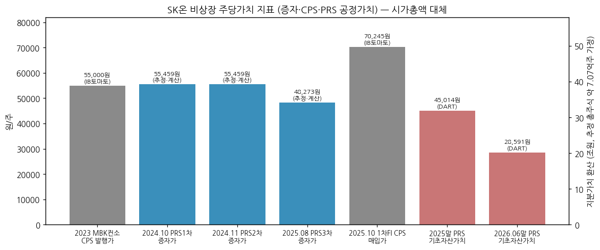

**우선순위: ① PRS 공정가치(회사 공시 가치, 반기 갱신) → ② PBR(SK온 자본 대비 지분가치) → ③ 피어 EV/EBITDA(흑자 전환 후)**

(7) 분기 재평가 트리거 (**분류 변경 조건만**)

→ **Primary '사이클' 재분류 조건**: AMPC 포함 분기 영업흑자 4개 분기 연속 + AMPC 제외 OPM -5% 이내 + 가동률 60% 이상 회복

→ **구조 하향 조건**: 2026~27년 IPO·추가 증자 없이 차입 의존 지속(부채비율 250%+ 재진입), PRS 기초자산 가치 추가 하락(2026말 공정가치 < 28,591원)

→ **구조 변경 조건**: AMPC 분기 금액 재공시 여부, 테네시 공장 용도 확정(EV vs ESS, 2028 상업가동 계획), HSBMA 가동률, SK이노와의 추가 합병·IPO(2025.07 회사 "현재 IPO 계획 없음")

---

## ② 회사 개요

(1) 기본 사항

| 항목 | 내용 |
|---|---|
| 회사명 | 에스케이온 주식회사 (SK On Co., Ltd.) |
| 설립 | 2021-10-01 (SK이노베이션 배터리 사업 물적분할, SK어스온과 동시) |
| 상장 | **비상장** (2025.07 SK이노 "현재 IPO 계획 없음" — MTN 2025-07-30) |
| 본사 | 서울특별시 종로구 (SK이노 반기보고서 '사업장 현황') |
| 대표이사 | **이용욱** 사장 (2025.11 선임 → 2026.06 단독대표, 이석희 사장 2026.05말 사임 — CEO스코어데일리 2026-06-01) |
| 최대주주 | SK이노베이션 **90.3%** (638,841,250주, 2025말·1H26 동일) → SK이노 최대주주 SK㈜ 52.09% |
| 소수주주 | PRS 계약 투자자 SPC 3곳 약 9.7% (에스프로젝트이노 등 1,803만주 / 엠에스에너지제일차 등 902만주 / 뉴젠에너지제1호 4,143만주) |
| 지분가치 | 시장가 없음 — PRS 기초자산 가치 **28,591원/주**(2026.06말) → 약 20.2조원 ⚠️추정 |
| 사업 한 줄 정의 | EV·ESS용 하이니켈 파우치(NCM) 리튬이온 셀·모듈 + (합병) 석유 트레이딩·윤활기유 |
| 생산능력 | 연결법인 94.3GWh(1H26, JV 제외) / IR 기준 2026E **179GWh**(HSBMA JV 포함, 테네시 45GWh 제외) |
| 신용 | 기업어음 **A2+**(한기평·한신평·NICE, 2026.01) / 외화 공모채 Moody's **Aa3**(2023.05·2026.05 발행분, 등급 표기 그대로 인용) |
| 임직원 | [미확보 — SK온 자체 공시 미접근] |

(2) 손익·자본 추이

**(2-1) 배터리 부문 9년 손익 (SK이노 연결 영업부문 = 1차 시계열)** — 위 Summary Box 시계열 참조

**(2-2) SK온 연결 요약 재무 (SK이노 '비지배지분이 중요한 종속기업' 주석, 내부거래 제거 前)**

| 연도 | 매출 (억원) | 영업이익 | 순이익 | 자산 | 부채 | 자본(비지배 포함) | 부채비율 | SK이노 지분율 |
|---|---|---|---|---|---|---|---|---|
| 2021 (분할 후) | [미공시 — 비지배지분 미미] | — | — | — | — | — | — | 100.0% |
| 2022 | 76,178 | -10,727 | -10,641 | 212,750 | 153,389 | 59,361 | 258% | 96.5% |
| 2023 | 128,972 | -5,818 | -7,566 | 332,507 | 217,842 | 114,665 | 190% | 89.5% |
| 2024 | 140,347* | -10,866 | **-20,617** | 483,742 | 321,698 | 162,044 | 199% | 86.6% |
| 2025 | [미확보 — 표시 기준 변경] | — | — | — | — | — | — | 90.3% |
| 1Q26 | — | — | — | — | 총차입금 21.59조·순차입금 16.93조 | — | **257.9%** | 90.3% |
| 1H26 | — | — | — | — | 켄터키 차입금 5.38조 포드 이전 | — | **212%** | 90.3% |

\* 2024는 SK트레이딩인터내셔널 합병(11~12월분) 포함

→ 2025 주석은 SK온과 **BlueOval SK(비지배 50%)를 분리 표시** — SK온: 매출 44,574억·영업손실 -12,015억·순손실 -15,269억·자산 27.23조·부채 10.35조 / BlueOval SK: 순손실 **-44,820억**(켄터키 관련 손상), 자산 17.31조·부채 12.03조 → SK온 연결 합산치는 내부거래·지분 구조상 단순 합산 불가 [v1.1: SK온 감사보고서로 확정]

→ 1Q26·1H26 수치 출처: IB토마토 2026-07-06(SK온 1Q26 재무, 2차전지 유형자산 손상 4.7조 반영), 한경비즈니스 2026-08-26(1H26 부채비율 242%→212%, 켄터키 손상 3조4,667억, 포드 지분 감자로 현금 4조7,498억 유출)

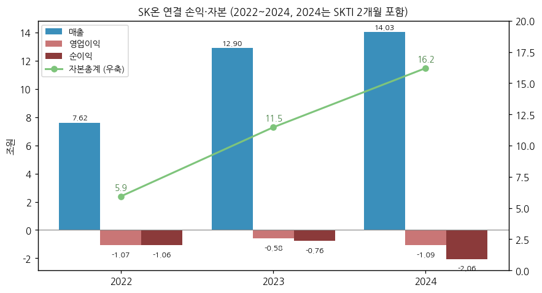

(3) 주가 역사 (비상장 — 시가총액 시계열 없음)

→ **대체 지표**: ① 위 ①-(6) 주당가치 표·chart11 ② 상장 모회사 SK이노베이션 주가 (SK온 지분가치가 SK이노 SOTP의 핵심 변수)

| 국면 | 기간 | 가치 동인 |
|---|---|---|
| 분할·고성장 기대 | 2021.10~2022 | 분할 당시 SK이노 장부가 3.93조 출자 → 2022.12 증자(SK이노 2조 포함 2.82조)로 EV 수주잔고 기반 성장 기대 |
| FI 유치 정점 | 2023 | MBK 컨소 CPS 55,000원, 연 7.5% 보장수익 + 2026년 IPO 조건 |
| 캐즘 하락 | 2024~2025 | 매출 반토막, PRS 구조로 증자(55,459원 → 48,273원), IPO 대신 SK이노의 1차 FI 매입(2025.10) |
| JV 재편·가치 재평가 | 2026 | BOSK 손상(1Q26 4.7조), PRS 기초자산 가치 45,014원 → **28,591원** |

(4) 주요 연혁

| 시점 | 내용 |
|---|---|
| 2005 | (SK이노 전신 SK㈜) 전기차용 대용량 리튬이온 배터리 상용화 착수, 대전 R&D 센터·서산 초기 설비 (DART 사업의 내용) |
| 2018.09 | 서산 공장 증설 완료 (4.7GWh) |
| 2019.04 | LG화학·LGES, ITC·델라웨어 법원에 영업비밀 침해 소송 제기 → 2021.02 ITC 10년 수입금지 결정 |
| 2020.1Q / 2Q | 헝가리 코마롬 1공장 가동 / 창저우 BEST(BAIC JV) 양산 |
| 2021.1Q | 옌청 SKOJ(EVE JV) 1공장·후이저우 EUE 양산 |
| 2021.04.11 | LG와 합의 — 현금 1조원(2021~22) + 2023년부터 매출 일정비율 로열티 최대 1조원, 10년 부제소 (SK온이 분할로 승계 이행 중) |
| 2021.10.01 | **물적분할로 SK온 출범** (분할 시 SK이노 장부가 3.93조) |
| 2022.1Q / 3Q | 헝가리 2공장·조지아 1공장 / 조지아 2공장·옌청 2공장 가동 |
| 2022 | BlueOval SK(포드 50:50, 켄터키 1·2·테네시, 계획 129GWh) 설립 |
| 2022.12 | 3자배정 증자 2.82조 (SK이노 2조 + 1차 FI) |
| 2023.03 / 06 | 3자배정 증자 3,757억 / 1.61조 (MBK 컨소 등) |
| 2023.04 | 현대차그룹과 북미 JV 35GWh 합의 (조지아 바토우, USD 50억) |
| 2023.05 | USD 외화 공모채 1.16조원(5.375%, 2026.05 만기) |
| 2024.2Q | 헝가리 이반차 3공장 부분 가동 (20GWh) |
| 2024.10 / 11 | 3자배정 증자 1조 / 5,000억 — SK이노가 투자자와 **PRS 1·2차** 체결 |
| 2024.11.01 | **SK트레이딩인터내셔널 흡수합병** |
| 2025.02.01 | SK엔텀(탱크터미널) 흡수합병 |
| 2025.03 | 닛산 북미 EV 배터리 공급 계약 (약 99.4GWh, 2028~2033, 하이니켈 파우치 — 이투데이·KED Global 보도) |
| 2025.08 | 3자배정 증자 2조 (**PRS 3차**, 뉴젠에너지제1호) / BOSK 켄터키 1공장 생산 개시 |
| 2025.09 | 첫 ESS 수주 — Flatiron Energy 1GWh + 6.2GWh 우선협상권 (LFP 파우치, 조지아 라인 전환) |
| 2025.10.31 | SK이노, 1차 투자자 CPS 51,079,105주 전량 매입 → 동반매도요구권·풋옵션 소멸 |
| 2025.11.01 | **SK엔무브 흡수합병** → SK이노 지분 81.7% → 90.3% |
| 2025.11 | 대표 교체 — 유정준 부회장 사임, 이용욱 사장 선임 (이석희 사장과 각자대표) |
| 2025.12.09 | **포드와 BlueOval SK 합작 종료 계약** — 켄터키 1·2공장 자산·부채 포드 이전, 포드 지분 감자 |
| 2025.4Q | 옌청 3공장 부분 가동 (2.75GWh) |
| 2026.02 | 국내 ESS 중앙계약시장 2차 284MW 낙찰(565MW 중 50.3%) / EVE 지분 Swap 완료(EUE 49% 처분·SKOJ 30% 인수) |
| 2026.05 | BOSK 종료 완료 → **SK On Tennessee 100%** / 외화 공모채 7,708억원(4.375%, 2029) + 사모 녹색채 등 |
| 2026.06 | **HSBMA(현대차 JV) 조지아 양산 개시** (35GWh) / 이용욱 단독대표 |
| 2026.08.27 | **NeoVolta 9GWh LFP ESS 셀** 공급 계약 (2027~2031, 약 1.5조 — 한경비즈니스 보도) |
| 2026.3Q | ESS용 LFP 양극재 공급 계약 (엘앤에프·포스코퓨처엠 — 비즈워치 2026-10-29) |

→ (출처: SK이노 사업보고서 2021~2025·반기보고서 2026.06 '회사의 개요'·'우발부채'·'매각예정자산' 주석, SK이노 IR 4Q25·1Q26~3Q26, 보도 인용 표기 항목)

---

## ③ 비즈니스 모델

(1) 실적 추이 통합 표 (5년 연간 — 3단계 위계: 배터리 부문 / AMPC 분해 / 합병법인·생산)

**⚠️ EV·ESS 제품별, 지역별(배터리 단독) 매출·영업이익은 미공시 [미확보].** 아래는 공시된 범위의 최대 분해

| 항목 (억원) | 2021 | 2022 | 2023 | 2024 | 2025 | 9M26 |
|---|---|---|---|---|---|---|
| **배터리 매출 (DART·IR 표시)** | 30,397 | 76,177 | 128,972 | 62,666 | 69,782 | 63,424 (AMPC 포함) |
| (+) AMPC (기타영업수익) | — | — | 6,170 | 2,924 | 7,186 | 1Q 790 / 2Q 11,435*(⚠️) / 3Q [미확보] |
| **배터리 매출 (AMPC 포함 재작성)** | 30,397 | 76,177 | 135,142 | 65,590 | 76,968 | 63,424 |
| 배터리 영업이익 | -6,840 | -10,727 | -5,818 | -11,268 | -9,313 | 3,921 |
| ㄴ **AMPC 제외 영업이익** | -6,840 | -10,727 | **-11,988** | **-14,192** | **-16,499** | [미확보] |
| AMPC 제외 OPM (AMPC 제외 매출 대비) | -22.5% | -14.1% | -9.3% | -22.6% | -23.6% | — |
| SK온 '합병법인' 영업이익 (SK이노 IR) | — | — | — | 4Q만 -3,111 | -2,742 | **+30,437** |
| 생산능력 (GWh, 연결법인·JV 제외) | 22.5 | 71.7 | 71.5 | 71.5** | 94.6 | 94.3 (1H) |
| 평균 가동률 | 92.3% (4Q) | 86.8% | 87.7% | 43.8% | 48.7% | 36.4% (1H) |
| 생산실적 (천 Cell) | 28,688 (4Q) | 149,861 | 220,851 | 121,488 | 168,230 | 89,475 (1H) |

\* 2Q26 '기타영업수익' = SK이노 반기보고서 SK온 매출실적 표의 1H26 기타영업수익 1,222,433백만원 − 1Q26 AMPC 78,953백만원. AMPC 외 **고객보상금·파생상품이익 포함** (영업부문 주석 '수익에 대한 기술')
\** 2024 사업보고서 원공시 81.5GWh → 2026 반기보고서에서 71.5GWh로 재기재. 2025는 BOSK 켄터키 1공장 3.1GWh 포함, 2026은 제외

→ (출처: SK이노 정기보고서 영업부문 주석·'매출실적'·'생산능력' 표, SK이노 IR 4Q24~3Q26 '배터리 사업' 페이지)

(2) 분기 시계열

**(2-1) AMPC 포함/제외 영업이익 15분기 (배터리 섹터 핵심 변수)**

| 분기 | 매출 (재작성, 억원) | 영업이익 | AMPC | AMPC 제외 OP | OPM | AMPC 제외 OPM | 합병법인 OP |
|---|---|---|---|---|---|---|---|
| 1Q23 | 33,053 | -3,447 | 0* | -3,447 | -10.4% | -10.4% | — |
| 2Q23 | 38,631 | -1,315 | 1,670 | -2,985 | -3.4% | -8.1% | — |
| 3Q23 | 33,826 | -861 | 2,099 | -2,960 | -2.5% | -9.3% | — |
| 4Q23 | 29,633 | -186 | 2,402 | -2,588 | -0.6% | -9.5% | — |
| 1Q24 | 17,221 | -3,315 | 385 | -3,700 | -19.2% | -22.0% | — |
| 2Q24 | 16,653 | -4,601 | 1,118 | -5,719 | -27.6% | -36.8% | — |
| 3Q24 | 14,915 | **240** | 607 | -367 | 1.6% | -2.6% | — |
| 4Q24 | 16,800 | -3,594 | 813 | -4,407 | -21.4% | -27.6% | -3,111 |
| 1Q25 | 17,762 | -2,993 | 1,708 | -4,701 | -16.9% | -29.3% | -1,633 |
| 2Q25 | 23,811 | -664 | 2,734 | -3,398 | -2.8% | -16.1% | 609 |
| 3Q25 | 19,810 | -1,248 | 1,731 | -2,979 | -6.3% | -16.5% | 179 |
| 4Q25 | 15,585 | -4,408 | 1,013 | -5,421 | -28.3% | -37.2% | -1,897 |
| 1Q26 | 18,701 | -3,492 | 790 | -4,282 | -18.7% | -23.9% | -1,451 |
| 2Q26 | 29,460 | **8,218** | 11,435** | -3,217** | 27.9% | -17.8%** | 18,269 |
| **3Q26** | **15,263** | **-805** | **[미확보]** | **[미확보]** | **-5.3%** | — | **13,619** |

\* 1Q23 SK이노 분기보고서 영업부문 표에 기타영업수익 행 없음 → 2Q23에 상반기분 1,670억 일괄 인식으로 처리
\** 2Q26 = AMPC + 고객보상금 + 파생이익 등 기타영업수익 전체(⚠️계산). 순수 AMPC는 미공시

→ (출처: 매출·영업이익 = SK이노 IR(4Q23~3Q26 '배터리 사업'·'회사별 실적'), 1Q23~3Q23은 SK이노 분기보고서 영업부문 누적 차감. AMPC = SK이노 정기보고서 영업부문 주석 '기타영업수익' 누적 차감 — 2025 분기값(1,708·2,734·1,731·1,013억)은 CEO스코어데일리 2026-01-28 보도치·SK이노 IR 재작성 매출 차이(2Q25 273.4십억, 3Q25 173.1십억)와 일치 확인)

→ **2Q26 흑자의 실체**: 회사(김영광 재무관리실장) "일회성 요인(고객사 보상금)을 제외하더라도 전분기 대비 손익 개선"(디지털데일리 2026-07-30). 기타영업수익 전체를 빼면 -3,217억(⚠️)으로 1Q26 AMPC 제외 -4,282억 대비 개선은 맞음

→ **3Q26**: 판매량 감소로 매출 -48.2% QoQ, 영업손실 -805억(전년 -1,248억 대비 443억 축소). 회사 "일회성 요인을 제외한 본원적 수익성 측면에서는 개선 흐름"(지디넷 2026-10-29) — AMPC 미공시로 검증 불가

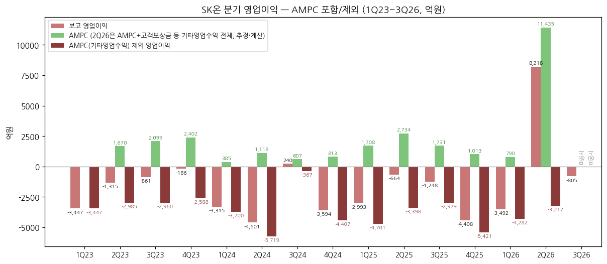

**(2-2) 배터리 부문 35분기 장기 시계열 (1Q18~3Q26)**

| 분기 | 1Q | 2Q | 3Q | 4Q | 연간 | 연간 OP |
|---|---|---|---|---|---|---|
| 2018 매출 / OP | 473 / -507 | 717 / -604 | 849 / -957 | 1,443 / -1,107 | 3,482 | -3,175 |
| 2019 | 1,295 / -869 | 1,459 / -671 | 1,899 / -427 | 2,250 / -1,124 | 6,903 | -3,091 |
| 2020 | 2,888 / -1,049 | 3,382 / -1,137 | 4,860 / -989 | 4,973 / -1,089 | 16,102 | -4,265 |
| 2021 | 5,263 / -1,767 | 6,302 / -979 | 8,168 / -988 | 10,664 / -3,107 | 30,397 | -6,840 |
| 2022 | 12,599 / -2,734 | 12,880 / -3,266 | 21,942 / -1,347 | 28,756 / -3,381 | 76,177 | -10,727 |
| 2023 | 33,053 / -3,447 | 36,961 / -1,315 | 31,727 / -861 | 27,231 / -186 | 128,972 | -5,818 |
| 2024 | 16,836 / -3,315 | 15,535 / -4,601 | 14,308 / 240 | 15,987 / -3,594 | 62,666 | -11,268 |
| 2025 | 16,054 / -2,993 | 21,077 / -664 | 18,079 / -1,248 | 14,572 / -4,408 | 69,782 | -9,313 |
| 2026 (AMPC 포함) | 18,701 / -3,492 | 29,460 / 8,218 | 15,263 / -805 | — | 63,424 (9M) | 3,921 (9M) |

→ (출처: 2018~3Q23 SK이노 분기·반기·사업보고서 영업부문 '배터리' 누적 차감(4Q = 연간 − 3Q 누적), 4Q23~3Q26 SK이노 IR. 2023~2025 매출은 AMPC 제외 표시. 4Q22 IR 잠정 -2,566억 → 감사 후 DART -3,381억으로 차이, DART 채택. 4Q23은 IR -186억(DART 차감 -195억))

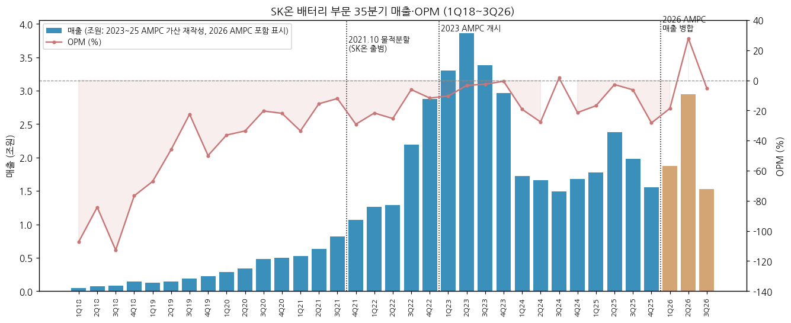

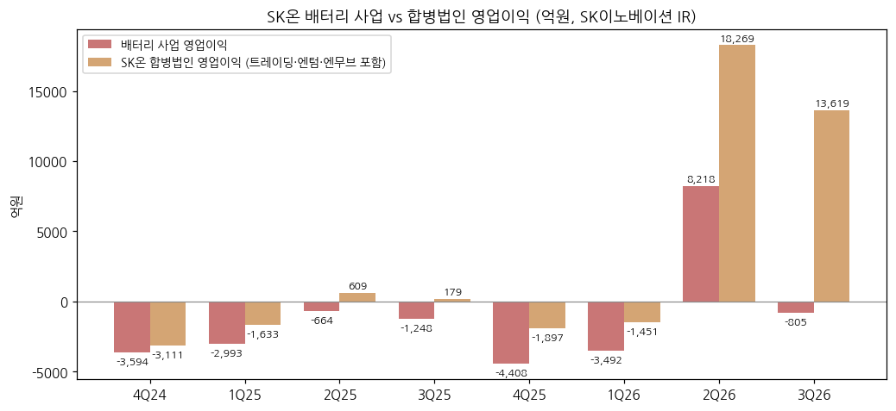

→ 합병법인 영업이익(트레이딩·탱크터미널·윤활기유 포함)은 2026년 중동발 정제·기유 스프레드 급등으로 **2Q26 1.83조·3Q26 1.36조** — 배터리 적자를 비배터리 사업이 메우는 구조 (SK이노 IR 3Q26 p.6 주석)

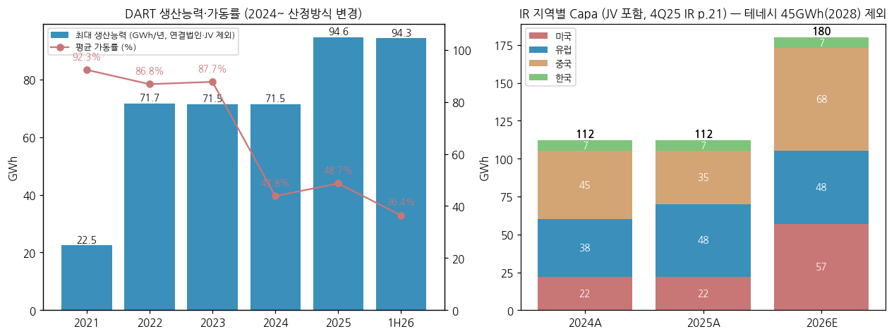

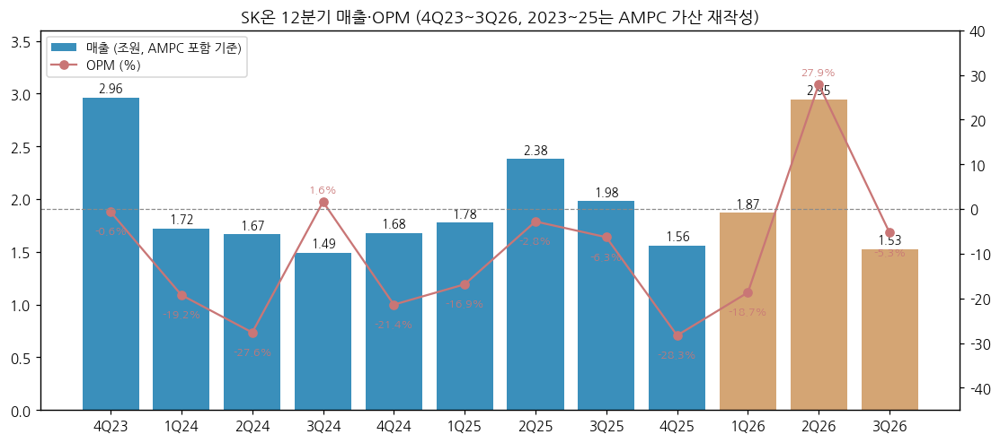

(3) 사업별 디테일 (매출 비중 큰 순서 — 정성)

(3-1) **EV 배터리 (하이니켈 NCM 파우치) — 매출 대부분**

→ 고객: 현대차그룹(HSBMA JV, 조지아 단독공장 공급), 포드(BOSK 종료 후 테네시 단독 체제 — 공급 조건 변경 내용 미공시), 폭스바겐(조지아·유럽), 메르세데스-벤츠(유럽), 닛산(2028~ 북미, 계약 보도), Slate Auto(2025.04 보도)

→ 2026년 흐름: 1Q 북미 판매량 소폭 증가·유럽/아시아 일부 회복 → 2Q 아시아 판매 확대 + 고객 보상금 + AMPC 증가 → 3Q **판매량 감소**(EV 고객 물량 조정) → 4Q "주요 고객사 물량 증가에 따라 일부 판매 회복 기대" (SK이노 IR 1Q26~3Q26 Look-back)

→ 미국 EV 구매보조금(30D) 2025.09.30 조기 폐지 → 비중국 북미 사용량 2026.1~9월 -46.7%(SNE)

(3-2) **ESS 배터리 (LFP 파우치) — 2026년 초도, 2027년 본격**

→ 수주: Flatiron 1GWh(확정)+6.2GWh(우선협상), 국내 중앙계약 2차 284MW(2027말 공급), 장주기 ESS 약 1.8GWh(2026.02, 서산 생산·2027.3Q 공급 — 디지털데일리 2026-07-30), **NeoVolta 9GWh(2027~2031)** + 추가 9GWh 연내 추진 (아이뉴스24 2026-09-01)

→ 생산: 서산 일부 LFP ESS 전용 라인 전환(2026말 약 3GWh), 조지아 EV 라인 일부 ESS 전환 — 신규 공장 없이 라인 전환 원칙, 추가 투자는 수주 규모에 연동 (3Q26 컨콜)

→ 회사 시장 전망: 북미 ESS 2026 수요 80~100GWh, 2030년까지 2배 이상 / "기존 중국산 셀 사용 업체들로부터 사양·물량·가격·장기계약 문의 증가"(3Q26 컨콜, 비즈워치 2026-10-29)

(3-3) **합병 비배터리 사업 (참고 — 배터리 숫자에서 제외)**

→ 석유 트레이딩(구 SKTI), 탱크터미널(구 SK엔텀), 윤활기유·윤활유(구 SK엔무브, Group-III 'YUBASE' 글로벌 1위 Capa). 3Q26 SK엔무브 영업이익 1.09조(분기 최대), SK트레이딩 3,518억 — SK이노 IR은 여전히 회사별로 구분 표시

(4) 주요 경쟁사

| 사업 | 경쟁사 | 비고 |
|---|---|---|
| EV 배터리 (글로벌) | CATL, BYD, LGES, CALB, Panasonic, Gotion, 삼성SDI, EVE | SK온 1H26 3.1%·8위, 상위권 중국계가 대부분 |
| EV 배터리 (비중국) | CATL 33.7%, LGES 16.4%, SK온 6.6%, 삼성SDI 3.5% | 2026.1~9월 SNE (더팩트 2026-11-04) |
| 북미 ESS | LGES(북미 ESS Capa 50GWh+), 삼성SDI(각형 LFP), Tesla, Fluence, 중국계(관세·PFE 규제) | SK온은 LFP 파우치로 후발 진입 |
| 파우치 폼팩터 | LGES | 각형(삼성SDI·CATL)·원통형 대비 ESS 적용 사례 적음 |

(5) 주요 매출처

→ DART(SK이노 반기보고서 2026.06) 배터리사업 주요 고객: **현대자동차그룹, 메르세데스-벤츠 그룹, 폭스바겐, 포드 모터 컴퍼니** (순서는 공시 원문, 매출 순위 아님) + ESS·전기상용차 고객 확대

→ 고객별 매출액·비중 미공시 [미확보]. SK이노 연결 기준 "매출 10% 이상 거래처 없음"

→ 판매경로(1H26): 해외 판매법인 경유 6.0% / 본사·해외 생산법인 직접 판매 78.6% / 국내 본사 직접 15.4%

→ 원재료 매입처: 에코프로비엠, 유미코아, 인지컨트롤스, 디와이덕양 / 양극재 단가 2024 36,624원/kg → 2025 30,717 → 1H26 49,131원/kg (메탈가 반등)

(6) 생산 CAPA + 임직원 추이

| 거점 | 생산능력 (GWh, IR 최대가동 기준) | 상업가동 | 비고 |
|---|---|---|---|
| 한국 서산 1·2동 | 7.0 | 3Q18 | 일부 LFP ESS 전환 / 3공장 14.0 미정 |
| 헝가리 코마롬 1·2 | 7.5 / 10.0 | 1Q20 / 1Q22 | |
| 헝가리 이반차 3 | 30.0 | 2Q24 | 1H26 20.0GWh 확보(66.7%) |
| 미국 조지아 1·2 (SKBA) | 10.0 / 12.0 | 1Q22 / 4Q22 | ESS 라인 일부 전환 (Flatiron·NeoVolta) |
| 미국 HSBMA (현대차 JV) | 35.0 | 2026 (6월 양산) | 지분법, DART Capa 제외 |
| 미국 SK On Tennessee | 45.0 | 2028 계획 | 구 BOSK, 2026.05 100% |
| 중국 BEST 창저우 (BAIC JV) | 7.5 | 2Q20 | 지분법 |
| 중국 SKOJ 옌청 1+2 | 27.0 | 1Q21 | 2026.1Q 100% |
| 중국 SKOY 옌청 3 | 33.0 | 2026 | 4Q25 부분 가동 |
| **합계 (2026E, 테네시 제외)** | **179** | | 2024A 112 → 2025A 112 |

→ (출처: SK이노 IR 4Q25(2026-01-28) p.21 'Battery 생산능력'. DART 기준(연결법인·JV 제외) Capa·가동률은 위 (1) 표)

→ 임직원: [미확보 — SK온 자체 공시 필요]

---

## ④ 재무 구조 (SK온 연결 — SK이노 비지배지분 주석·보도 인용)

> SK온 자체 연결재무제표(감사보고서·분기보고서)를 이번 도구로 받을 수 없어, SK이노 사업보고서 '비지배지분이 중요한 종속기업 요약 재무정보'(내부거래 제거 전)와 보도 인용으로 구성. 손익계산서 세부(매출총이익·판관비), 차입금 상세는 [미확보 — v1.1]

(1) 손익계산서 — 위 ②-(2-2) 표

(2) 재무상태표

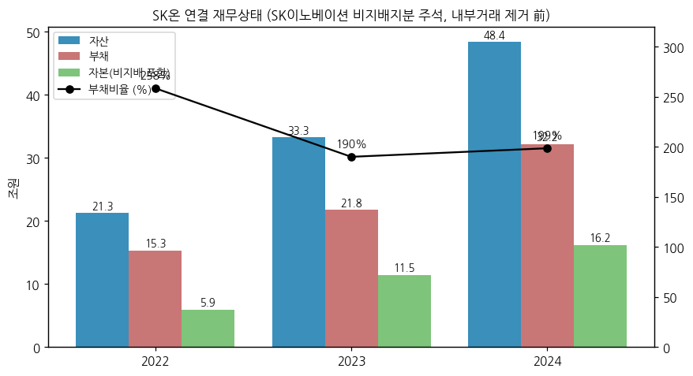

| 구분 (억원) | 2022 | 2023 | 2024 |
|---|---|---|---|
| 유동자산 | 88,862 | 93,773 | 121,407 |
| 비유동자산 | 123,887 | 238,734 | 362,335 |
| 유동부채 | 98,656 | 130,261 | 157,894 |
| 비유동부채 | 54,733 | 87,581 | 163,804 |
| 지배지분 | 45,999 | 62,209 | 75,875 |
| 비지배지분 (BOSK 포드 지분·FI 등) | 13,362 | 52,456 | 86,169 |

→ 비지배지분 급증(2023~2024)은 BlueOval SK 포드 지분 50% + 1차 FI CPS → 2025.10 FI 매입, 2026.05 포드 감자로 대부분 해소

(3) 현금흐름표

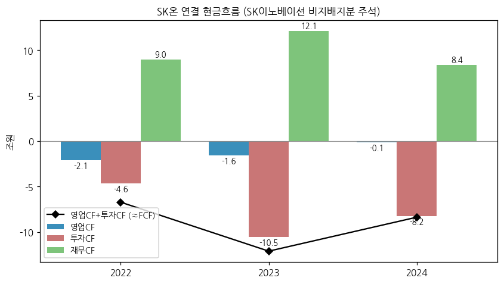

| 구분 (억원) | 2022 | 2023 | 2024 | 1Q26 (보도) |
|---|---|---|---|---|
| 영업CF | -20,955 | -15,583 | -1,200 | -3,639 |
| 투자CF | -46,151 | -105,315 | -82,394 | CAPEX 5,308 |
| 재무CF | 89,733 | 120,877 | 83,611 | — |
| 영업+투자 (≈FCF) | -67,106 | -120,898 | -83,594 | FCF -8,947 |

→ 2022~2025 3년간 FCF 부족 누적 **27.6조** (IB토마토 2026-07-06) — 증자·차입으로 메움

(4) CapEx

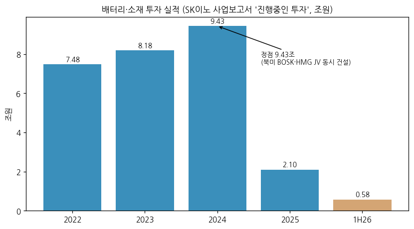

→ SK이노 사업보고서 '진행중인 투자'(배터리 및 소재 — Battery 국내/해외 설비 + LiBS) 기투자액 차감: 2018~2021 누적 7.47조 → 2022 **7.48조** → 2023 **8.18조** → 2024 **9.43조**(정점, 총 소요 41.4조 계획) → 2025 **2.10조** → 1H26 0.58조

→ 2026 향후 시설투자 계획 3.13조 (IB토마토 2026-07-06) / "신규 ESS 라인 전환 과정에 따라 설비투자 규모 변동성은 있으나 폼팩터 변경이 아니면 크지 않을 것"(2Q26 컨콜)

(5) 부채구조 + 채무증권 발행 history

→ 1Q26: 총차입금 **21.59조**(전년 20.79조), 순차입금 16.93조, 단기성차입금 8.27조 vs 현금성 4.66조(커버리지 56.4%), 금융원가 1.52조(전년동기 3,909억) (IB토마토 2026-07-06)

→ 2026.05 켄터키 공장 관련 장기차입금 **5.38조 포드 이전** + BOSK 고정비(감가상각 연 3,000억·이자 연 2,000억) 절감 (한경비즈니스 2026-08-26, 디지털데일리 2026-07-30)

| 발행일 | 종류 | 금액 (백만원) | 금리 | 등급 | 만기 |
|---|---|---|---|---|---|
| 2023.05.11 | 외화 공모채 | 1,160,460 | 5.375% | Aa3 (Moody's) | 2026.05.11 |
| 2026.01.16 | 기업어음 (사모, 2건) | 50,000 × 2 | 3.85% | A2+ (한기평·한신평·NICE) | 2026.12.23 |
| 2026.03.04 | 기업어음 | 50,000 | 3.45% | A2+ | 2026.06.04 (상환) |
| 2026.05.07 | 외화 공모채 | 770,750 | 4.375% | Aa3 (Moody's) | 2029.05.07 |
| 2026.05.07 | 외화 사모 녹색채 | 385,375 | 5.307% | — | 2027.05.07 |
| 2026.05.07 | 외화 사모채 | 308,300 | 5.257% | — | 2027.05.07 |

→ 분할 승계 원화사채: 에스케이온 1-2회(구 SK이노 3-3회, 2,100억, 2028.09)·2-2회(800억, 2030.09) 등 (SK이노 사업보고서 2022)

→ 모회사 보증: SK이노가 SKBA AMPC 크레딧 매각거래 관련 USD 3.97억 한도 이행보증, 헝가리 공장 현지정부 이행보증 HUF 440억 (SK이노 반기보고서 2026.06)

(6) 배당·자사주 — **해당 없음** (비상장·적자, 배당 이력 없음. chart9 생략)

(7) 재무비율 (SK온 연결)

| 지표 | 2022 | 2023 | 2024 | 1Q26 | 1H26 |
|---|---|---|---|---|---|
| 부채비율 | 258% | 190% | 199% | 257.9% | 212% |
| ROE (순이익/기말자본) | -17.9% | -6.6% | -12.7% | — | — |
| 영업이익률 (SK온 연결) | -14.1% | -4.5% | -7.7% | — | — |

---

## ⑤ 지배 구조

(1) 그룹·계열 관계

→ **SK㈜ (52.09%) → SK이노베이션 (90.3%) → SK온** (SK이노 사업보고서 2025 최대주주 현황·종속기업 표)

→ SK온 자회사: 에스케이온테크플러스(국내 리튬전지), 행복믿음, SK Battery America, SK On Hungary, SK Battery Manufacturing, SK On Jiangsu, SK On Yancheng, SK On Tennessee, SK On (Shanghai), Voltcycle On(헝가리 폐배터리, 85%) 등 / 공동기업: HSBMA(현대차 50%), Beijing BESK

→ 합병으로 SK온 산하 비배터리: 구 SKTI(트레이딩), 구 SK엔텀(터미널), 구 SK엔무브(윤활기유, SK엔무브 해외법인 포함)

(2) 주주 구분

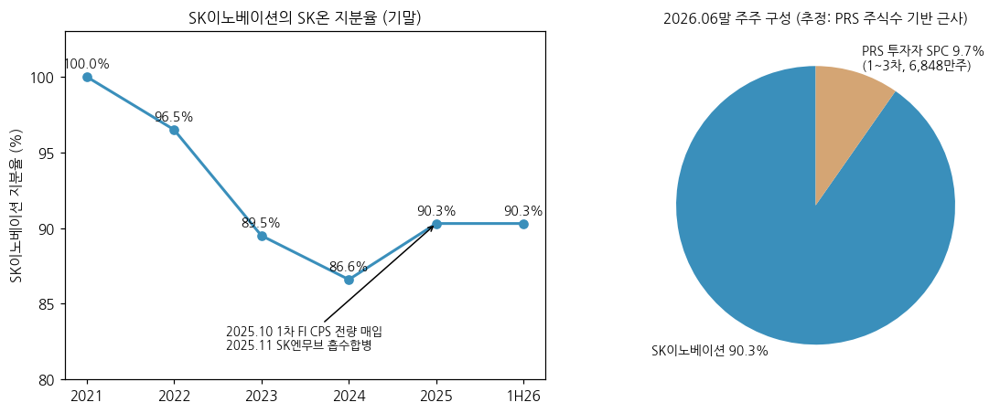

| 시점 | SK이노 지분율 | 변동 사유 |
|---|---|---|
| 2021.10 | 100.0% | 물적분할 |
| 2022말 | 96.5% | 2022.12 3자배정 증자 2.82조 (SK이노 2조 + 1차 FI) |
| 2023말 | 89.5% | 2023.03·06 증자 (MBK 컨소 등 1차 FI) |
| 2024말 | 86.6% | 2024.10·11 증자 1.5조 (PRS 1·2차) |
| 2025 중 | 87.0% → 81.7% → **90.3%** | SK엔텀 합병 → 2025.08 증자 2조(PRS 3차) → 1차 FI CPS 매입(10.31) + SK엔무브 합병(11.01) |
| 2026.06말 | 90.3% | — |

→ **잔여 9.7%는 PRS 투자자 SPC**: 1차 에스프로젝트이노 등 18,031,337주(2024.10.15~2027.10.15) / 2차 엠에스에너지제일차 등 9,015,667주(2024.11.25~2027.11.25) / 3차 뉴젠에너지제1호 41,431,027주(2025.08.18~2028.08.18) — 매각 시 공정가치와 정산가 차액을 SK이노와 상호 정산 (SK이노 사업보고서 2025 주석)

→ **PRS 만기 2027.10~2028.08** — 그 전 IPO·제3자 매각·SK이노 매입 중 하나가 필요한 구조 [판단]

(3) 임원·이사회

| 직책 | 인물 | 비고 |
|---|---|---|
| 대표이사 사장 | **이용욱** | 2025.11 선임, 2026.06 단독대표 (CEO스코어데일리 2026-06-01) |
| 전 대표 | 이석희 (2023~2026.05), 유정준 부회장 (2024~2025.11), 최재원 수석부회장 (2021~2024), 지동섭 (2021~2023) | 출범 후 '투톱' 체제 종료 |
| 재무관리실장 | 김영광 | 2026 컨콜 발언자 |

→ 이사회 구성·등기임원: [미확보 — SK온 자체 공시]

---

## ⑥ 기타 팩트

(1) R&D 인프라

→ 대전 R&D 센터(배터리 연구개발 인프라) — SK온 단독 R&D 비용 [미확보]. SK이노 연결 연구개발비 2023 4,175억(0.54%)·2024 4,802억(0.64%)·2025 3,681억(0.46%) (배터리 외 포함, chart7 생략)

(2) 진행 중 corporate action (설립 이후)

| 시점 | 거래 | 규모·상태 |
|---|---|---|
| 2022.12~2025.08 | 3자배정 증자 6회 | 2.82조 / 0.38조 / 1.61조 / 1.0조 / 0.5조 / 2.0조 = **누적 8.31조** |
| 2024.11~2025.11 | SKTI·SK엔텀·SK엔무브 흡수합병 | 완료 — EBITDA·자본 보강 (SK이노 2025.07 '8조 자본조달' 계획의 일부) |
| 2025.10.31 | SK이노, 1차 FI CPS 매입 | 51,079,105주 — 주주간 계약 권리 소멸 |
| 2025.12~2026.05 | BlueOval SK 종료 | 켄터키 → 포드, 테네시 → SK온 100%, 손상 1Q26 약 4.7조·1H26 켄터키 3.47조 (보도) |
| 2025.11~2026.1Q | EVE JV 지분 Swap | EUE 49% 처분 + SKOJ 30% 취득 |
| 2026.1Q | 매각예정자산·손상 | BOSK 켄터키 자산 매각예정 분류 후 이전 완료(2026.05) |

(3) R&D·사업 마일스톤

→ ESS: LFP 파우치 셀 상용화(Flatiron·NeoVolta), SK텔레콤 등 그룹 계열과 AI 데이터센터용 통합 ESS 개발(3Q26 컨콜), SK이노 환경과학기술원의 ESS 액침냉각 장치 개발(SK이노 반기보고서 R&D 현황)

→ EV: 하이니켈 NCM 파우치 중심. 원통형·각형·전고체 등 차세대 폼팩터 개발 현황은 공개 범위 제한 [미확보]

(4) 주요 리스크

→ **정책**: IRA 45X AMPC — OBBBA로 FEOC/PFE 요건 강화(중국 지분 회사 배제 → 비중국 셀 반사이익 기대), 30D 소비자 보조금 2025.09.30 폐지

→ **고객 집중·물량**: 포드·현대차·VW 북미·유럽 EV 계획 조정 → 3Q26 판매량 감소. SNE 비중국 점유율 10.0% → 6.6%

→ **재무**: 부채비율 200%대, 단기성차입금 8.27조(1Q26), 금융원가 급증 / PRS 만기(2027~28) 정산 리스크는 SK이노 부담

→ **소송·우발**: LGES 합의 로열티(2023~, 총 1조 한도) 지급 의무 승계, SKBA 화재 관련 손해배상(캘리포니아 2026.01 관할 각하)

→ **표시 리스크**: AMPC·보상금 미공시로 펀더멘털 이익 검증 불가 (투자자 비교 가능성 저하 — SBS Biz 2026-08-03)

(5) ESG 등급 — [미확보 — SK이노 그룹 등급만 존재, SK온 단독 등급 v1.1 확인]

(6) 인증·라이선스

→ 그룹 '상호출자제한기업집단'(SK) 소속 — 계열 간 상호출자·채무보증 제한 / 헝가리 Voltcycle On 폐배터리 수집·처리 / SK On Certification Center(Jiangsu) 배터리 인증·평가

---

## Version Log

| 버전 | 일자 | 작업 내역 |
|---|---|---|
| v1.0 | 2026-11-14 | 첫 작성 — v4.8 표준 6섹션 + 차트 13종. Source 점검: ① SK이노 DART 정기보고서 43건(2016.12~2026.06, 본문·감사보고서) ② SK이노 IR 실적발표 26건(4Q19~3Q26; 2023~2024 일부 PDF는 폰트 인코딩으로 텍스트 추출 실패 → 해당 분기는 DART 영업부문·후속 IR 비교 컬럼으로 대체) ③ OpenDART SK이노 연결 재무·주요정보 ④ 보도(컨콜 발언·AMPC·SNE·ESS 수주·재무) ⑤ SK온 자체 DART 공시 — **도구 미지원으로 미확보** ⑥ 시장가 — 비상장으로 PRS 공정가치·증자가로 대체 |

**잔여 보완 후보 (v1.1)**

→ **SK이노 3Q26 분기보고서(2026-11-16 전후 공시)** — 3Q26 AMPC(기타영업수익) 확정 → 3Q26 AMPC 제외 OP 채우기

→ SK온 자체 정기보고서·감사보고서(DART, corp_code 확인) — 연결 손익계산서 세부·차입금·임직원·이사회·2025 연결 재무

→ SK온 SNE 연간 점유율 2021~2025 시계열, ESS 수주 누적(GWh) 공식 집계

→ 2023~2024 IR PDF OCR → 분기별 판매량·지역 코멘트

→ 4Q26 실적(2027-01말 예정) 시 AMPC 포함 흑자 지속 여부·HSBMA 가동·테네시 용도로 분류 재평가
