# SK텔레콤 — 기업 개요 (v1.0)

> 마지막 update: 2026-11-25 (v1.0 — 첫 작성. 3Q26 분기보고서(2026-11-16 제출)·IR 3Q26(2026-11-05) 반영)
> 입력 source: OpenDART fnlttSinglAcntAll (연결 CFS, 2015 사업보고서\~3Q26, 44개 JSON — 2014는 2015 사업보고서 전기 컬럼, 2019·2020 계속영업 재작성치는 2021 사업보고서 비교표시) + DART 정기공시 원문 XML 62건 (사업보고서 2015\~2025·감사보고서 첨부, 분기·반기 1Q16\~3Q26, 기재정정본 우선) + OpenDART 기업개황·주주·임원·직원·배당·자기주식·주식총수 (2025 사업보고서) + SK텔레콤 IR 실적발표 PDF 33건 (1Q18\~3Q26, irgo 경유 — 1Q24·2Q24·4Q24·1Q25\~4Q25 8건은 이미지 PDF라 후속 분기 PDF의 시계열 표로 대체) + SK텔레콤 Sustainability Report 2025 (brief) + Yahoo Finance (017670.KS, 월간 2000-01\~2026-11, 일간 2024-11\~2026-11-24) + 언론 (디지털데일리·헤럴드경제·뉴스토마토·스페셜타임스·톱스타뉴스·CEO스코어데일리·코리안센터·더팩트·MTN·다음/뉴시스, 2025-07\~2026-11)
> 갱신 주기: 매분기 (실적 리뷰 모드 호출 시)
> 워치리스트: **통신 섹터 / 서브섹터: 통신 (SK텔레콤·KT·LG유플러스)** (`earnings/watchlist.md` 101행) — 2순위 섹터, 4Q26부터 리뷰
> **Fact verify cutoff**: 2026-11-24 (주가 2026-11-24 종가 **67,200원** [Yahoo Finance 017670.KS 일간], 발행주식 214,790,053주 [DART 사업보고서(2025.12)·분기보고서(2026.09)] → 시가총액 **14.43조원** [계산]. 2021-11 분할 재상장 이후("신 SKT") 사상 최고 종가 **125,200원 (2026-06-02)**, 장중 최고 139,500원 (같은 날, Yahoo — 뉴스토마토 2026-06-22는 "장중 14만300원" 표기) → 당시 시총 **26.89조원** [계산]. 고점 대비 **-46.3%**, YTD **+25.6%** (2025말 53,500원), 1년 +24.2% (2025-11-24 54,100원). 2026-11-20 하루 **-13.1%** (앤트로픽 나스닥 상장(현지 11-19) 직후 차익실현 구간 — 11-19에도 -2.9% [스페셜타임스 2026-11-19]). 분할 전 구 SKT(SK하이닉스 지분 포함) 월말 시총 최고는 2021-04 약 24.3조 [계산])

---

## 1. 기업 분류

- **Primary 분류: 지속성장 — 배당 유틸리티형 (Defensive Yield)** — 국내 이동통신 3사 과점, 매출 변동 ±5% 이내, 이익은 경기 사이클이 아니라 규제(요금·주파수)·투자(4G/5G)·사고(2025 USIM 해킹) 이벤트로만 흔들림
- **Secondary 노트: AI 인프라(AI 데이터센터) + 투자자산(앤트로픽 지분) 옵션** — AI DC·AI B2B/B2C 매출은 3Q26 연결 매출의 4.4%에 불과하지만, 2026년 주가는 이익보다 앤트로픽 지분가치·AI DC 기대에 연동 (2026-06 신고가 → 11월 -46%)

### ① 정량 근거

**📊 Summary Box (12년, 2014\~2025 연결):**

| 지표 | 값 |
|------|-----|
| 매출 CAGR (2014→2025, 11년, 보고 기준) | **-0.0%** (17.16조 → 17.10조) — 2021 SK스퀘어 인적분할로 비통신(11번가·ADT캡스 등) 매출이 빠져 단순 비교 불가 |
| 매출 CAGR (계속영업 비교 가능 기준) | **+1.7%** (2019 재작성 15.42조 → 2025 17.10조, 6년) / 2021→2024 +2.3% (해킹 전) [계산] |
| OPM 평균 | **8.6%** (12년 단순평균, 최고 10.6% 2014 · 최저 6.3% 2019·2025) |
| OPM 정점 평균 | **N/A — 규제·성숙 산업** (참고: 상위 3개년 2014·2015·2024 평균 10.3%) |
| OPM 저점 평균 | **N/A — 규제·성숙 산업** (참고: 하위 2개년 2019(5G 상용화)·2025(해킹) 평균 6.3% — 둘 다 이벤트성) |
| 사이클 주기 | **N/A** — 이동통신 세대교체(3G 2003 → LTE 2011 → 5G 2019, 약 8년) 투자 주기는 있으나 OPM range 4.3%p로 "사이클 분류" 기준 미달 |
| 사이클 회수 (12년) | **N/A** — 감익 이벤트 3회 (2018 선택약정 25% · 2019 5G 투자 · 2025 USIM 해킹) |

```
[전사 손익 시계열 (12년, 연결, DART)]
연도   매출(조)  영업이익  순이익   OPM    NPM    지배순이익  비고
2014    17.16     1.83     1.80   10.6   10.5     1.80   ← 분할 전 연결 (SK플래닛·11번가·SK하이닉스 지분법 포함)
2015    17.14     1.71     1.52   10.0    8.8     1.52   ← SK플래닛 적자 확대(기타부문 OP -786억)
2016    17.09     1.54     1.66    9.0    9.7     1.68   ← 11번가 오픈마켓 투자, 커머스 OP -3,652억
2017    17.52     1.54     2.66    8.8   15.2     2.60   ← SK하이닉스 지분법이익 2.25조 → 순이익 2.66조
2018    16.87     1.20     3.13    7.1   18.6     3.00   ← 무선 요금할인 25%(2017-09) 반영 + 지분법 3.27조 (순이익 정점)
2019    17.74     1.11     0.86    6.3    4.9     0.89   ← 5G 상용화(2019-04) 마케팅·감가 증가, OPM 저점
2020    18.62     1.35     1.50    7.2    8.1     1.50   ← ADT캡스·SK브로드밴드-티브로드 합병(2020-04) 연결
2021    16.75     1.39     2.42    8.3   14.4     2.41   ← 2021-11 SK스퀘어 인적분할, 계속영업 재작성 (순이익에 중단영업 1.15조)
2022    17.30     1.61     0.95    9.3    5.5     0.91   ← "신 SKT" 첫해, 5G 가입자 1,339만
2023    17.61     1.75     1.15   10.0    6.5     1.09   ← 영업이익 1.75조
2024    17.94     1.82     1.39   10.2    7.7     1.25   ← 영업이익 1.82조 (분할 후 정점)
2025    17.10     1.07     0.38    6.3    2.2     0.41   ← USIM 해킹: 고객감사패키지·과징금 1,348억, OPM 6.3%

계속영업 재작성: 2019 매출 15.42조 / 영업이익 1.04조, 2020 매출 16.09조 / 영업이익 1.25조 (2021 사업보고서 비교표시)
OPM range: 6.3 ~ 10.6% = 4.3%p  (매출 변동 ±5% 이내 — 사이클이 아닌 "이벤트성 감익"만 존재)
```

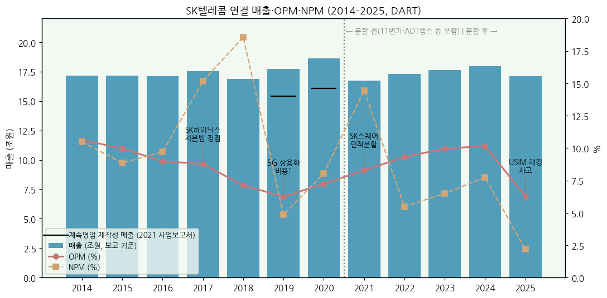

(2014 수치는 2015 사업보고서의 전기 컬럼. 2014\~2020은 분할 전 보고 기준 — 커머스(11번가)·보안(ADT캡스)·SK플래닛·원스토어 등 비통신 자회사와 SK하이닉스(20.1%, 146,100,000주 [DART 분기보고서(2021.09)]) 지분법이 포함됨. 2021은 분할 후 계속영업 기준으로 재작성된 수치(매출 16.75조)이고 순이익 2.42조에는 중단영업이익 1.15조가 포함 [DART 사업보고서(2021.12)])

### ② 산업 분류

- 산업: **이동통신 (MNO) + 유선·미디어(SK브로드밴드) + AI 인프라** — 과학기술정보통신부 허가 기간통신사업, SKT·KT·LG유플러스 3사 과점
- DART 업종: 61220 무선 및 위성 통신업 / KRX 통신업
- 워치리스트 섹터: **통신** / 서브섹터: **통신** (SK텔레콤·KT·LG유플러스)
- 시장 지위: 이동전화 점유율 (MVNO 제외) 46.7% (2023말) → 45.3% (2024말) → **42.7% (2025말, 해킹 이탈)**, 5G 점유율 45.5%, 초고속인터넷 28.7%, IPTV 31.8% [DART 사업보고서(2025.12) II, 과기정통부 통계]

### ③ 분류 결정 논리

(1) **가장 매출 큰 사업부 기준** 적용 시: 무선통신사업 = 외부 매출의 73% (2025, 12.55조), 유선 25%, 기타 2% [DART 사업보고서(2025.12) II-1]. 무선 매출은 가입자 × ARPU의 구독형 매출 — 2016\~2025 무선 부문 매출 13.8\~14.9조 범위(±4%) → **지속성장(저성장 구독형)**
(2) **이익 비중 sub-rule**: 무선 부문 영업이익이 부문합의 73\~117% (2015\~2025, 2016\~2018은 비통신 적자로 100% 초과). 무선 OPM은 5.8\~12.3%로, 하락 구간은 모두 규제·투자·사고 이벤트(2017-09 선택약정 25% → 2018, 2019 5G, 2025 해킹)로 설명됨 → 경기 사이클 아님 → **지속성장 유지**. 유선(SKB) OPM은 3.4% (2015) → 7.0% (2024)로 꾸준히 개선
(3) **Boundary case 처리 — AI 비중**: IR 기준 AI DC + AI B2B/B2C 매출 1,961억 (3Q26) = 연결 매출의 **4.4%** [IR 3Q26, 계산]. 회사 목표 "2030년 총매출 30조, AI 비중 35%" [IR 3Q24 기업가치 제고 계획] 대비 거리가 멀다. AI DC 사업(데이터센터 8개소 + 울산·구로 신규, 318MW)은 SK브로드밴드 인적분할로 **SK호라이즌**(SKT 51% / KKR 29% / IMM 컨소 20%, 2027-1Q 분할 완료 목표)으로 이관 예정이고, 이관 사업 2025 매출은 3,477억 (연결의 2.0%) [MTN 2026-08-27]. 그리고 2026 주가를 움직인 앤트로픽 지분은 **영업이익이 아니라 투자자산(기타포괄손익)** — 6월말 장부가 약 3.5조 [CEO스코어데일리 2026-11-19] → **AI는 Secondary(옵션) 유지, Primary 변경 사유 아님**
(4) **국내 통신 3사 + 글로벌 피어 cross-ref**:
→ **KT / LG유플러스**: 같은 규제·과점 구조. 3사 모두 무선 매출 비중이 가장 크고 배당이 핵심 주주가치 → 3사 공통으로 "지속성장·배당 유틸리티형" 분류가 기본값 (각 사 기업개요 `KT_기업개요.md`, `LG유플러스_기업개요.md`와 교차 확인 필요 — 같은 날 병렬 작성)
→ 차별점: SKT는 ① 무선 점유율 1위(42.7%)로 무선 의존도가 가장 높고, ② 2021 분할로 비통신 자회사를 떼어낸 "순수 통신 + AI" 구조이며, ③ 앤트로픽·SK하이퍼·SK호라이즌 등 AI 투자 노출이 가장 큼
→ 글로벌: Verizon·AT&T(미국), NTT·KDDI·SoftBank Corp(일본) 등 선진국 통신사도 저성장·고배당 구조 — 단, 이번 버전에서는 피어 수치를 검증하지 않음 (다음 버전 보강)

### ④ 적정 밸류에이션 방법

- **배당수익률 + EV/EBITDA 우선** — 매출·EBITDA가 안정적이고(EBITDA 4.3\~5.4조, 2014\~2025 [계산]) 주주환원 정책이 "연결 조정 당기순이익의 50% 이상"으로 명시 [IR 3Q26]
→ 연말 시가배당률 (DART): 3.5\~4.6% (2014\~2020) → **5.7\~7.1% (2021\~2024)** → 3.1% (2025, 4Q 배당 미실시)
→ 현재: 최근 4개 분기 지급 DPS 2,490원 (4Q25 0원 + 1Q\~3Q26 각 830원) / 67,200원 = **3.7%** [계산]. 2024 수준 연 3,540원 회복 시 5.3%
→ EV/EBITDA (연말, [계산] = (시총 + 차입금·사채 − 현금) / (영업이익 + 감가상각비)): 2014\~2020 5.3\~6.9배 → **2022\~2024 3.4\~3.5배** → 2025 4.2배. 현재 약 **3.9배** (시총 14.43조 + 순차입금 약 6.33조(3Q26 차입금·사채 8.54조 − 현금 및 단기금융상품 2.21조) / 최근 4분기 IR EBITDA 5.32조)
- **PBR은 보조** — 연말 PBR (지배지분 기준) 0.80배(2020) \~ 1.48배(2014), 분할 후 0.89\~1.09배. 현재 0.93배 (3Q26 지배지분 15.44조). 2026 고점 1.74배
- **PER은 이벤트에 왜곡** — 2025 EPS 1,825원(해킹 감익) 기준 PER 36.8배는 의미 없음. 최근 4분기 지배순이익 1.32조 (4Q25 1,125억 + 9M26 1.21조 [IR, 계산]) 기준 PER 약 10.9배
- **SOTP 보조 필요 (2026 신규)**: 앤트로픽 지분 — IPO 공모가 $83 적용 시 약 4.27조 추산 [CEO스코어데일리 2026-11-19] = 현재 시총의 약 30%. SK호라이즌 지분 일부 매각대금 1.88조 (2027-03-04 처분 예정) [DART 분기보고서(2026.09) II-6]. 통신 본업 EV/EBITDA에 투자자산을 별도로 더하는 구조
- **피어 차별화**: KT·LG유플러스와 같은 배당수익률·EV/EBITDA 프레임을 쓰되, SKT만 투자자산(앤트로픽) SOTP 항목이 추가됨 → 2026 주가 변동성이 피어보다 큼

#### ④-1 통신 3사 공통 비교 박스 (통일 기준, 2026-11-25 통합 검수)

> 세 문서(SK텔레콤·KT·LG유플러스)에 **같은 표**를 넣었다. 본문 ④의 회사별 수치는 각 사 고유 정의(IR 순차입금 등)라 이 표와 소수점 차이가 날 수 있음 — **3사 비교는 이 표 기준**.

| 지표 (2026-11-24 종가, 3Q26 말 기준) | SK텔레콤 | KT | LG유플러스 |
|---|---|---|---|
| 시가총액 (조원, 발행주식총수 기준) | 14.43 | 11.34 | 6.35 |
| LTM 매출 (조원, 4Q25\~3Q26) | 17.58 | 27.30 | 15.33 |
| LTM 영업이익 (조원) / OPM | 1.78 / 10.1% | 1.86 / 6.8% | 1.08 / 7.1% |
| LTM EBITDA (조원, IR 분기 합산) / 매출 대비 | 5.32 / 30.2% | 5.66 / 20.7% | 3.84 / 25.1% |
| 순차입금 (조원, 차입금·사채 − 현금및현금성자산, 리스 제외) | 6.97 | 8.06 | 4.69 |
| 비지배지분 (조원) | 0.06 | 1.91 | 0.20 |
| EV (조원) = 시총 + 순차입금 + 비지배지분 | 21.46 | 21.31 | 11.24 |
| **EV/EBITDA (LTM)** | **4.0배** | **3.8배** | **2.9배** |
| **PBR** (시총 / 3Q26 지배기업 소유주지분) | **0.93배** | **0.62배** | **0.70배** |
| PER (시총 / LTM 연결 당기순이익, 비지배 포함) | 11.2배 | 8.5배 | 9.7배 |
| **배당수익률** (2025 사업연도 DPS / 종가) | 2.5% (1,660원 — 해킹 감배) | 5.3% (2,400원) | 4.4% (660원) |
| 배당수익률 참고 (최근 지급 기준) | 3.7% (4Q25 무배당 + 1Q\~3Q26 830원×3) | 5.3% (FY26 최소 2,400원) | 4.4% (2025 DPS 유지 가정) |
| 일회성 (LTM 구간) | 4Q25 해킹 후속비용 | 2026 대전 둔산 분양이익 (기타부문, 반영 분기 미특정) | 3Q26 희망퇴직 비용 |

(출처: 시총·종가 = Yahoo Finance 일간 × DART 발행주식총수(자기주식 포함). 매출·영업이익·순이익 = OpenDART fnlttSinglAcntAll 분기(4Q = 연간 − 3Q 누적). EBITDA = 각 사 3Q26 IR 분기 EBITDA 4개 합산 (SKT 1,019.7+1,416.2+1,442.3+1,437.5 / KT 1,197.3+1,440.0+1,589.4+1,428.3 / LGU 859.4+958.8+1,034.8+991.6, 십억원). 차입금·사채·현금·지배지분·비지배지분 = DART 3Q26 연결 재무상태표. 단기금융상품·기타금융자산은 회사마다 계정 구성이 달라(KT는 금융업 자산 포함) 순차입금에서 일괄 제외 — 보수적 기준. 모두 [계산])

→ **읽는 법**: 3사 모두 EV/EBITDA 3\~4배·PBR 1배 미만의 "배당 유틸리티" 밸류 구간. 차이는 ① **SKT** = 이익률 최상위(EBITDA 마진 30%)지만 해킹 감배로 2025 배당수익률이 3사 최저 + 앤트로픽 지분 SOTP 변수, ② **KT** = 매출 규모 최대·마진 최저(비통신 그룹사 mix), 배당수익률 최고, 외국인 한도 49% 소진, ③ **LG유플러스** = EV/EBITDA 최저(2.9배) — 3사 중 가장 싼 본업 현금흐름.

### ⑤ 분기 재평가 트리거 (분류 변경 조건)

- **AI 매출(AI DC + AI B2B/B2C) 비중이 연결 매출의 15%+** 이고 2개 연도 연속 매출 YoY +5% 이상 시 → 지속성장(유틸리티) → 성장주(AI 인프라) transition 검토. 단 SK호라이즌 분할(2027-1Q) 후 연결 유지 여부(51% 지배) 확인 필요
- **투자자산(앤트로픽 등) 공정가치가 지배지분의 50%+** 로 커져 주가가 본업 이익과 분리 시 → "통신 + 투자지주" 혼합형 분류 추가 (현재 장부가 3.5조 / 지배지분 15.44조 ≈ 23%)
- **주주환원 정책 변경** (조정 순이익 50% 미만으로 하향, 또는 배당 2개 분기 이상 추가 미실시) 시 → 배당 유틸리티 프레임 재검토
- **무선 OPM 2개 연도 연속 5% 미만** (요금 규제 강화·제4이통 진입·대규모 보상) 시 → 지속성장 → 규제 리스크형 하향 검토

---

## 2. 회사 개요

### ① 기본 사항

- **회사명**: SK텔레콤(주) (SK Telecom Co., Ltd.) / KRX 017670 (유가증권시장 1989-11-07 상장), NYSE ADR (SKM) [DART 사업보고서(2025.12) I]
- **본사**: 서울특별시 중구 을지로 65 (SK T-타워)
- **설립**: 1984-03-29 한국이동통신서비스(주) 설립 (차량전화·무선호출) → 1989-11-07 유가증권시장 상장 → 1997-03 SK텔레콤(주)로 사명 변경 [DART 사업보고서(2025.12) I-2] (OpenDART 기업개황 est_dt는 1984-04-20 — 등기일 차이로 추정)
- **지배구조**: SK(주) 30.57% 최대주주 (2025말·3Q26말 동일) [DART 분기보고서(2026.09) VII]. 기간통신사업자 외국인 지분 한도 49% (전기통신사업법)
- **사업 한 줄 정의**: 국내 1위 이동통신사업자(MNO 3,094만 회선, 5G 1,809만 — 3Q26 [IR]) + 100% 자회사 SK브로드밴드(초고속인터넷 738만·IPTV 676만)로 유무선을 결합 판매하고, AI 데이터센터(SK호라이즌 분할 예정·SK하이퍼 신설)와 AI 서비스(에이닷 등)로 확장 중
- **대표이사**: 정재헌 CEO (2025-10-30 선임 — 법조인 출신, 전임 유영상 → SK수펙스추구협의회 AI위원회 위원장) [더팩트 2025-11-01]
- **신용등급**: 회사채 AAA(Stable) — 한국기업평가·한국신용평가·NICE (2025-08/09 정기평정, 해킹 이후에도 유지) / 외화채 Moody's A3(Stable, 2025-04)·S&P A-(Stable, 2025-02) [DART 사업보고서(2025.12) I-4]

### ② 최근 12년 손익·자본 추이 (조원, 연결, DART)

| 연도 | 매출 | YoY | 영업이익 | 순이익 | 자본총계 | 자본 YoY |
|---|---|---|---|---|---|---|
| 2014 | 17.16 | - | 1.83 | 1.80 | 15.25 | - |
| 2015 | 17.14 | -0.2% | 1.71 | 1.52 | 15.37 | +0.8% |
| 2016 | 17.09 | -0.3% | 1.54 | 1.66 | 16.12 | +4.8% |
| 2017 | 17.52 | +2.5% | 1.54 | 2.66 | 18.03 | +11.9% |
| 2018 | 16.87 | -3.7% | 1.20 | 3.13 | 22.35 | +24.0% |
| 2019 | 17.74 | +5.2% | 1.11 | 0.86 | 22.82 | +2.1% |
| 2020 | 18.62 | +5.0% | 1.35 | 1.50 | 24.40 | +6.9% |
| 2021 | 16.75 | -10.1% | 1.39 | 2.42 | 12.34 | -49.4% |
| 2022 | 17.30 | +3.3% | 1.61 | 0.95 | 12.16 | -1.5% |
| 2023 | 17.61 | +1.8% | 1.75 | 1.15 | 12.23 | +0.6% |
| 2024 | 17.94 | +1.9% | 1.82 | 1.39 | 11.83 | -3.3% |
| 2025 | 17.10 | -4.7% | 1.07 | 0.38 | 12.96 | +9.5% |

(연결 기준, OpenDART fnlttSinglAcntAll. 2021 이후는 SK스퀘어 분할 후 "신 SKT" — 2021 자본총계 급감(24.40조 → 12.34조)은 인적분할에 따른 자본 이전. 9M26: 매출 13.25조 (+3.7% YoY), 영업이익 1.66조 (+73.6%), 지배순이익 1.21조 [DART 분기보고서(2026.09)])

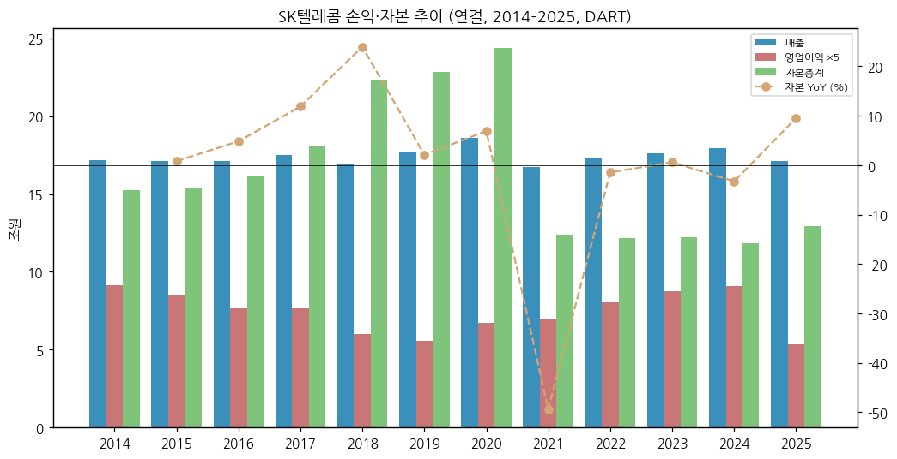

### ③ 회사 주가 역사 ★ narrative 영역

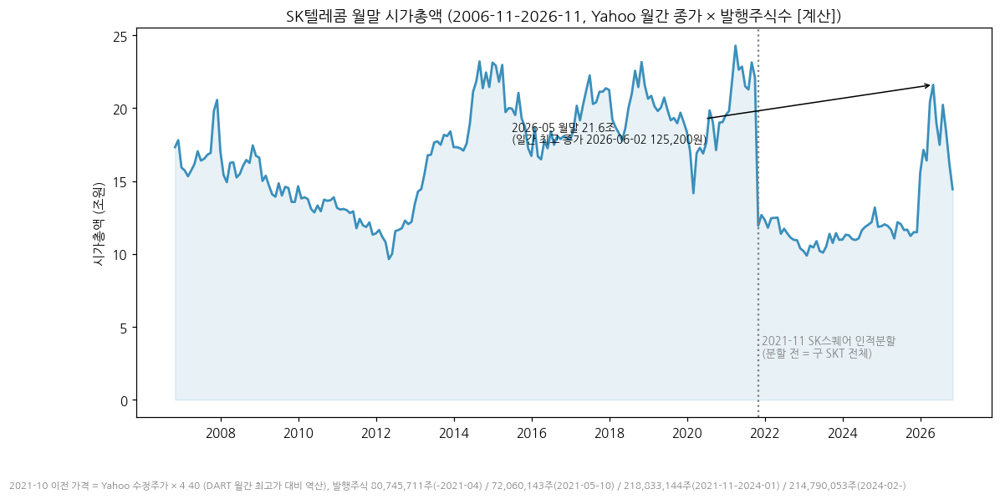

> 가격 처리: Yahoo 017670.KS의 2021-10 이전 가격은 액면분할(2021-10, 1:5)과 인적분할(2021-11, 존속 0.6073625 : 신설 0.3926375)을 함께 반영한 수정주가. DART 사업보고서 "최근 6개월 주가" 월간 최고가와 Yahoo 월간 고가를 대조해 계수 **4.40**(10개월 중앙값, 범위 4.34\~4.62)을 역산하고, 2021-10 이전 원주가 ≈ Yahoo × 4.40으로 환산 [계산]. 2014말 환산 265,600원 vs 2014 배당수익률 역산 약 268,600원 (DPS 9,400원 / 3.5%) — 오차 약 1%

(1) 2006\~2012: 성숙기 박스권 + 스마트폰 경쟁
→ 2006-11 월말 시총 약 17.3조 [계산] → 2012-05 약 9.7조 (20년 최저권) — 3G→LTE 전환기 마케팅 경쟁, 요금 인하 압박

(2) 2013\~2015: LTE 수익화 → 1차 재평가
→ LTE 가입자 확대로 ARPU 상승, 2014-09 월말 시총 약 23.2조 [계산] (2018-11에도 23.2조로 같은 수준 재도달)
→ 2014 영업이익 1.83조, DPS 9,400원

(3) 2016\~2021-10: 지분법(SK하이닉스) + 5G + "중간지주" 기대
→ 2017\~2018 SK하이닉스 지분법이익 2.25조·3.27조로 순이익 2.66조·3.13조 (영업이익은 1.2\~1.5조로 감소)
→ 2017-09 선택약정 할인율 20% → 25% 상향 → 2018 무선 OPM 9.3% (2017 11.5%)
→ 2019-04 세계 최초 5G 상용화 → 2019 OPM 6.3% (마케팅·감가상각 증가)
→ 2021-02 SK(주) 지분 26.79% → 2021-05 자사주 소각 후 30.02% [DART 사업보고서(2025.12) I-5]
→ 2021-04 월말 시총 약 24.3조 [계산] — 분할 전 구 SKT 최고권. 2021-05 자사주 8,685,568주 소각(발행주식 80,745,711 → 72,060,143주) [DART 사업보고서(2025.12) I-3]

(4) 2021-11 \~ 2025: 인적분할 → "신 SKT" 배당주
→ 2021-10-28 액면분할 1:5, 2021-11-01 분할기일 (SK스퀘어 0.3926375주 배정), 2021-11-29 변경·재상장 [DART 사업보고서(2021.12)] → 2021-11 월말 54,500원 (시총 11.93조)
→ 2022\~2024 연 DPS 3,320\~3,540원, 시가배당률 6.1\~7.1% → 시총 10\~13조 박스권. 신 SKT 월말 최저 2023-02 45,150원 (9.88조)
→ 2024-02-05 자사주 4,043,091주 소각 (218,833,144 → 214,790,053주)
→ 2025-04 USIM 해킹 사고 → 2025 영업이익 1.07조 (-41.1%), 2025-3Q·4Q 배당 미실시 → 2025말 53,500원

(5) 2026: 앤트로픽·AI 재평가 → 사상 최고 → 반락
→ 2026-01 외국인 순매수 + 웰링턴매니지먼트 지분 5.01% 확보(1/21\~22), "26년 만의 최고가 가시권" [헤럴드경제 2026-01-26]
→ 앤트로픽 지분(2023 첫 투자, 누적 약 2,720억원 / $2.04억) 가치 상승 [CEO스코어데일리·코리안센터 2026-11-19]
→ 2026-06-01 엔비디아 핵심 파트너 소개(GTC 타이베이) → 6/1 종가 112,200원(+11.5%, 시총 24.10조) [디지털데일리 2026-06-02] → **2026-06-02 종가 125,200원 / 장중 139,500원 — 사상 최고** [Yahoo]
→ 2026-06-15 워싱턴포스트 "앤트로픽 접근 명단에 중국 연계 의심 한국 통신사" 보도 → SKT 부인, 5거래일 연속 하락, ADR $47.17 → $33.76 [뉴스토마토 2026-06-22]
→ 2026-08-27 SK브로드밴드 인적분할로 SK호라이즌 설립 결정 + KKR·IMM 3.08조 투자 유치 [MTN 2026-08-27]
→ 2026-11-19 (현지) 앤트로픽 나스닥 상장, 공모가 $83 (첫날 종가 $97.17) [톱스타뉴스 2026-11-19] → SKT 11-19 -2.9%, **11-20 -13.1%**, 11-24 67,200원 (시총 14.43조)

### ④ 회사의 주요 연혁

```
1984-03      한국이동통신서비스(주) 설립 (차량전화·무선호출)
1989-11-07   유가증권시장 상장
1996-01      CDMA 세계 최초 상용화 (미검증 — 비공식 출처: 일반 연혁)
1997-03      SK텔레콤(주)로 사명 변경
2008-03      하나로텔레콤(현 SK브로드밴드) 인수
2011-07      LTE 상용화 (미검증 — 비공식 출처: 일반 연혁)
2018-05      사이렌홀딩스코리아 주식 취득 → ADT캡스 인수
2019-04      5G 상용화 (세계 최초 상용화 경쟁)
2020-04      SK브로드밴드-티브로드 합병
2020-12      티맵모빌리티 분사
2021-05-06   자사주 8,685,568주 소각
2021-10-28   액면분할 1:5 (500원 → 100원)
2021-11-01   인적분할 — SK스퀘어 신설 (SK하이닉스 20.1%·11번가·ADT캡스(SK쉴더스)·원스토어·티맵 등 이관)
2023         앤트로픽 첫 투자 (약 1,321억원)
2024-02-05   자사주 4,043,091주 소각 (발행주식 214,790,053주)
2025-04      USIM 해킹 사고 (2025-04-22 개인정보위 신고, 2,324만 명 정보 유출)
2025-07-04   후속조치 발표 — 고객감사패키지 5,000억 + 정보보호 투자 5년 7,000억
2025-08-27   개인정보위 과징금 1,347.91억원 (역대 최대)
2025-10-30   정재헌 CEO 선임
2026-07      AIDC 개발 전담 SK하이퍼 출범 (SKT 100%)
2026-08-27   SK브로드밴드 인적분할 → SK호라이즌 설립 결정, KKR·IMM 3.08조 유치
2026-11-19   앤트로픽 나스닥 상장 (공모가 $83)
```

(출처: DART 사업보고서(2025.12) I-2 연혁, I-3 자본금 변동 / DART 분기보고서(2021.09)·사업보고서(2021.12) 분할 / 다음(머니투데이 계열) 2025-08-28·더팩트 2025-07-04·2025-11-01 / MTN 2026-08-27 / 디지털데일리 2026-08-30 / CEO스코어데일리 2026-11-19)

---

## 3. 비즈니스 모델

### ① 실적 추이 (연결 → 부문 → 제품군 3단계 위계)

**구 부문 → 신 부문 매핑 (2021-11 인적분할 + 2019 보안 부문 신설):**

| 기간 | DART 보고부문 | 분할 후 처리 | 비고 |
|---|---|---|---|
| 2015\~2016 | 무선통신 / 유선통신 / 기타(SK플래닛·커머스 포함) | 무선·유선 유지, 기타 대부분 SK스퀘어 | 2016 사업보고서부터 커머스(11번가) 별도 |
| 2017\~2018 | 무선 / 유선 / 커머스 / 기타 | 커머스·기타 → SK스퀘어 | ADT캡스(2018-10 연결)는 2018 기타 |
| 2019\~3Q21 | 무선 / 유선 / 보안 / 커머스 / 기타 | 보안(ADT캡스·SK인포섹)·커머스(11번가)·기타 → SK스퀘어 (중단영업) | 2019 사업보고서에서 보안 신설·기타 재분류 → 4Q19 부문값 왜곡 |
| 2021(재작성)\~ | 무선 / 유선 / 기타(SK스토아 등) | — | 2021 계속영업 재작성, SK스토아는 커머스 → 기타 재분류 [DART 사업보고서(2022.12) 재작성 유의사항] |

→ **무선·유선 부문 값은 분할 전후 동일** (2020 무선 13.85조·유선 4.47조 = 2021 사업보고서 재작성 비교표시와 일치 [DART]) — 차이는 "기타(비통신)"에만 있음. 따라서 무선·유선 시계열은 1Q16\~3Q26 그대로 연결 가능, 전사 합계는 2020↔2021에서 단절

**연간 부문 통합 표 (억원, DART 연결 주석 "부문정보" — 부문 매출은 부문간 거래 포함):**

| 항목 | 2015 | 2016 | 2017 | 2018 | 2019 | 2020 | 2021 | 2022 | 2023 | 2024 | 2025 |
|---|---|---|---|---|---|---|---|---|---|---|---|
| 무선 매출 | 149,627 | 146,357 | 148,735 | 139,618 | 137,819 | 138,533 | 142,144 | 144,969 | 146,642 | 148,662 | 141,553 |
| 유선 매출 | 31,627 | 33,499 | 35,869 | 39,735 | 39,524 | 44,679 | 47,906 | 48,958 | 50,957 | 52,717 | 54,213 |
| 기타 매출 (비통신) | 21,135 | 19,037 | 18,807 | 18,732 | 29,800 | 33,326 | 3,630 | 5,922 | 6,035 | 6,140 | 3,901 |
| 부문 매출 합계 | 202,389 | 198,893 | 203,412 | 198,085 | 207,142 | 216,538 | 193,680 | 199,848 | 203,634 | 207,520 | 199,667 |
| **연결 매출** | **171,367** | **170,918** | **175,200** | **168,740** | **177,437** | **186,247** | **167,486** | **173,050** | **176,085** | **179,406** | **170,992** |
| 무선 OP | 16,783 | 17,991 | 17,141 | 12,999 | 9,141 | 10,319 | 11,231 | 13,343 | 14,639 | 15,300 | 8,179 |
| 유선 OP | 1,083 | 1,325 | 1,675 | 2,282 | 1,392 | 2,590 | 2,941 | 3,112 | 3,291 | 3,665 | 3,084 |
| 기타 OP | -786 | -3,958 | -3,450 | -3,263 | 567 | 1,275 | 146 | -21 | -428 | -649 | -306 |
| **연결 OP** | **17,080** | **15,357** | **15,366** | **12,018** | **11,100** | **13,493** | **13,872** | **16,121** | **17,532** | **18,234** | **10,732** |
| 무선 OPM | 11.2% | 12.3% | 11.5% | 9.3% | 6.6% | 7.4% | 7.9% | 9.2% | 10.0% | 10.3% | 5.8% |
| 유선 OPM | 3.4% | 4.0% | 4.7% | 5.7% | 3.5% | 5.8% | 6.1% | 6.4% | 6.5% | 7.0% | 5.7% |
| 무선 OP 비중 (부문합 대비) | 98% | 117% | 112% | 108% | 82% | 73% | 78% | 81% | 84% | 84% | 75% |

(2015\~2020 기타 = 분할 전 비통신(SK플래닛·11번가·ADT캡스 등), 2021\~ = SK스토아 등. 2021은 계속영업 재작성. 외부 매출 기준 비중(2025): 무선 73% / 유선 25% / 기타 2% [DART 사업보고서(2025.12) II-1])

**제품군별 매출 (IR, 억원 — 2025 이후 7개 분기):**

| 항목 | 1Q25 | 2Q25 | 3Q25 | 4Q25 | 1Q26 | 2Q26 | 3Q26 | 3Q26 YoY |
|---|---|---|---|---|---|---|---|---|
| SKT 이동통신매출 | 26,615 | 26,121 | 21,134 | 25,258 | 25,677 | 25,634 | 25,697 | +21.6% |
| SKT 마케팅비용 | 6,917 | 7,251 | 7,194 | 7,635 | 7,408 | 7,477 | 7,508 | +4.4% |
| SKB 유선통신 (초고속 등) | 2,891 | 2,859 | 2,845 | 2,957 | 2,958 | 2,968 | 3,055 | +7.4% |
| SKB 유료방송 (IPTV·CATV) | 4,781 | 4,749 | 4,775 | 4,747 | 4,715 | 4,711 | 4,762 | -0.3% |
| Enterprise (전용회선·기업솔루션 등) | 2,795 | 2,906 | 2,777 | 2,808 | 2,746 | 2,801 | 2,788 | +0.4% |
| **AI DC** | 694 | 707 | 1,188 | 1,291 | 1,314 | 1,362 | 1,261 | +6.2% |
| **AI B2B/B2C** (클라우드·AICC·에이닷 등) | 502 | 493 | 550 | 536 | 450 | 613 | 700 | +27.3% |
| AI 합계 / 연결 매출 [계산] | 2.7% | 2.8% | 4.4% | 4.2% | 4.0% | 4.5% | 4.4% | |
| CapEx (SKT+SKB) | 1,060 | 6,350 | 4,571 | 9,311 | 1,365 | 4,870 | 4,614 | |

(출처: IR 2026-05-07(1Q26)·2026-08-05(2Q26)·2026-11-05(3Q26) Business Highlights, 4Q25 이동통신매출 = IR 3Q26 SKT 손익계산서 이동전화수익. 2Q26부터 인증 관련 수익을 이동전화수익 → 기타수익으로 재분류(1Q24부터 소급) — 1Q25는 재분류 전 값(1Q26 IR 기준), 1Q26은 재분류 후 값(2Q26 IR). AI DC 3Q25 QoQ +68% 급증의 원인은 IR에 미기재 — 2026-1Q IR은 "DC 가동률 상승", 3Q26 IR은 "GPUaaS 신규 장기계약 전환 과정의 매출 공백"을 언급 → GPUaaS 포함 시점 확인 필요. 3Q26 CapEx 외 SK하이퍼DC 사업개발 CapEx 1,486억 별도 집행 [IR 3Q26])

**사업부별 분기 시계열 (억원, DART 연결 부문정보, 1Q16\~3Q26 43개 분기):**

> 1Q = 1분기보고서, 2Q = 반기 누적 − 1Q, 3Q = 3분기 누적 − 반기 누적, 4Q = 사업보고서 연간 − 3분기 누적 [계산]. 연결 매출·OP·순이익은 dart_quarterly_summary(CFS)와 동일 — 단 **2021 4개 분기(*)는 계속영업 재작성치로 교체**: 1Q21\~3Q21 = 2022 분기·반기보고서의 전기 비교표시(3개월), 4Q21 = 2021 연간(계속영업) − 재작성 9M. dart_quarterly_summary의 보고 기준 4Q21(매출 21,824억·OP 2,018억)은 "계속영업 연간 − 분할 전 9M 누적"이라 왜곡된 값이며, 같은 이유로 보고 기준 4Q22 YoY(+101.4%)·1Q22\~3Q22 YoY(-10\~-13%)도 왜곡. 재작성 기준 2021 분기 순이익 = 계속영업이익 (1Q21 3,558 / 2Q21 4,407 / 3Q21 2,635 / 4Q21 2,114억). 2016\~2020 분기는 분할 전 보고 기준(비통신 포함). 부문 OP 합계와 연결 OP의 차이 = 연결조정(내부거래 제거)

| 분기 | 연결 매출 | 연결 OP | OPM | 순이익 | 무선 매출 | 무선 OP | 무선 OPM | 유선 매출 | 유선 OP | 유선 OPM | 기타 매출 | 기타 OP | 부문합 OP | 연결조정 OP |
|---|---|---|---|---|---|---|---|---|---|---|---|---|---|---|
| 1Q16 | 42,285 | 4,021 | 9.5% | 5,723 | 36,476 | 4,358 | 11.9% | 8,090 | 305 | 3.8% | 4,803 | -642 | 4,021 | 0 |
| 2Q16 | 42,673 | 4,074 | 9.5% | 2,910 | 36,453 | 4,847 | 13.3% | 8,206 | 338 | 4.1% | 4,482 | -1,112 | 4,074 | 0 |
| 3Q16 | 42,438 | 4,243 | 10.0% | 3,221 | 36,308 | 4,836 | 13.3% | 8,529 | 389 | 4.6% | 4,661 | -982 | 4,243 | 0 |
| 4Q16 | 43,523 | 3,020 | 6.9% | 4,747 | 37,120 | 3,951 | 10.6% | 8,674 | 292 | 3.4% | 5,091 | -1,223 | 3,020 | 0 |
| 1Q17 | 42,344 | 4,105 | 9.7% | 5,835 | 36,211 | 4,456 | 12.3% | 8,222 | 344 | 4.2% | 4,353 | -696 | 4,105 | 0 |
| 2Q17 | 43,456 | 4,233 | 9.7% | 6,205 | 36,826 | 4,702 | 12.8% | 8,277 | 448 | 5.4% | 4,610 | -917 | 4,233 | 0 |
| 3Q17 | 44,427 | 3,924 | 8.8% | 7,930 | 37,692 | 4,178 | 11.1% | 9,234 | 421 | 4.6% | 4,859 | -674 | 3,924 | 0 |
| 4Q17 | 44,973 | 3,104 | 6.9% | 6,606 | 38,006 | 3,805 | 10.0% | 10,135 | 462 | 4.6% | 4,986 | -1,162 | 3,104 | 0 |
| 1Q18 | 41,815 | 3,255 | 7.8% | 6,934 | 35,498 | 3,457 | 9.7% | 9,223 | 388 | 4.2% | 4,112 | -590 | 3,255 | 0 |
| 2Q18 | 41,543 | 3,469 | 8.4% | 9,143 | 34,898 | 3,682 | 10.6% | 9,579 | 336 | 3.5% | 4,234 | -549 | 3,469 | 0 |
| 3Q18 | 41,864 | 3,041 | 7.3% | 10,498 | 34,915 | 3,215 | 9.2% | 9,960 | 549 | 5.5% | 3,740 | -723 | 3,041 | 0 |
| 4Q18 | 43,517 | 2,253 | 5.2% | 4,745 | 34,307 | 2,645 | 7.7% | 10,973 | 1,010 | 9.2% | 6,647 | -1,402 | 2,253 | 0 |
| 1Q19 | 43,349 | 3,226 | 7.4% | 3,736 | 33,089 | 2,979 | 9.0% | 10,044 | 107 | 1.1% | 6,753 | 140 | 3,226 | 0 |
| 2Q19 | 44,370 | 3,228 | 7.3% | 2,591 | 34,088 | 2,936 | 8.6% | 10,480 | 147 | 1.4% | 7,003 | 145 | 3,228 | 0 |
| 3Q19 | 45,612 | 3,021 | 6.6% | 2,744 | 35,917 | 2,119 | 5.9% | 10,456 | 694 | 6.6% | 7,174 | 208 | 3,021 | 0 |
| 4Q19 | 44,106 | 1,625 | 3.7% | -452 | 34,725 | 1,107 | 3.2% | 8,544 | 444 | 5.2% | 8,870 | 74 | 1,625 | 0 |
| 1Q20 | 44,504 | 3,020 | 6.8% | 3,068 | 34,084 | 2,556 | 7.5% | 10,055 | 343 | 3.4% | 7,439 | 121 | 3,020 | 0 |
| 2Q20 | 46,028 | 3,595 | 7.8% | 4,322 | 34,326 | 2,692 | 7.8% | 11,126 | 660 | 5.9% | 8,019 | 242 | 3,595 | 0 |
| 3Q20 | 47,308 | 3,615 | 7.6% | 3,957 | 34,817 | 2,567 | 7.4% | 11,587 | 691 | 6.0% | 8,744 | 357 | 3,615 | 0 |
| 4Q20 | 48,406 | 3,263 | 6.7% | 3,659 | 35,306 | 2,504 | 7.1% | 11,911 | 895 | 7.5% | 9,125 | 554 | 3,953 | -691 |
| 1Q21* | 41,131 | 3,742 | 9.1% | 3,558 | 35,052 | 3,090 | 8.8% | 11,626 | 812 | 7.0% | 836 | -4 | 3,898 | -156 |
| 2Q21* | 41,251 | 3,957 | 9.6% | 4,407 | 34,853 | 3,323 | 9.5% | 11,803 | 727 | 6.2% | 917 | 66 | 4,116 | -159 |
| 3Q21* | 42,150 | 3,930 | 9.3% | 2,635 | 35,573 | 3,229 | 9.1% | 12,110 | 828 | 6.8% | 929 | 47 | 4,104 | -174 |
| 4Q21* | 42,953 | 2,242 | 5.2% | 2,114 | 36,666 | 1,589 | 4.3% | 12,367 | 574 | 4.6% | 947 | 36 | 2,199 | 43 |
| 1Q22 | 42,772 | 4,324 | 10.1% | 2,203 | 35,880 | 3,607 | 10.1% | 12,098 | 822 | 6.8% | 1,203 | 35 | 4,463 | -139 |
| 2Q22 | 42,899 | 4,596 | 10.7% | 2,581 | 35,777 | 3,858 | 10.8% | 12,143 | 804 | 6.6% | 1,481 | 5 | 4,667 | -71 |
| 3Q22 | 43,434 | 4,656 | 10.7% | 2,456 | 36,095 | 3,921 | 10.9% | 12,356 | 827 | 6.7% | 1,511 | -27 | 4,721 | -66 |
| 4Q22 | 43,945 | 2,545 | 5.8% | 2,237 | 37,216 | 1,957 | 5.3% | 12,360 | 659 | 5.3% | 1,727 | -35 | 2,582 | -37 |
| 1Q23 | 43,722 | 4,948 | 11.3% | 3,025 | 36,210 | 4,228 | 11.7% | 12,654 | 820 | 6.5% | 1,543 | -83 | 4,965 | -17 |
| 2Q23 | 43,064 | 4,634 | 10.8% | 3,478 | 35,750 | 3,821 | 10.7% | 12,694 | 889 | 7.0% | 1,463 | -84 | 4,626 | 8 |
| 3Q23 | 44,026 | 4,980 | 11.3% | 3,082 | 36,594 | 4,116 | 11.2% | 12,787 | 867 | 6.8% | 1,504 | -36 | 4,947 | 32 |
| 4Q23 | 45,273 | 2,971 | 6.6% | 1,874 | 38,088 | 2,474 | 6.5% | 12,822 | 715 | 5.6% | 1,525 | -224 | 2,964 | 6 |
| 1Q24 | 44,746 | 4,985 | 11.1% | 3,619 | 37,073 | 4,389 | 11.8% | 13,041 | 848 | 6.5% | 1,453 | -154 | 5,083 | -98 |
| 2Q24 | 44,224 | 5,375 | 12.2% | 3,502 | 36,528 | 4,565 | 12.5% | 13,015 | 883 | 6.8% | 1,492 | -147 | 5,301 | 74 |
| 3Q24 | 45,321 | 5,333 | 11.8% | 2,802 | 37,572 | 4,598 | 12.2% | 13,245 | 892 | 6.7% | 1,542 | -102 | 5,387 | -54 |
| 4Q24 | 45,115 | 2,541 | 5.6% | 3,948 | 37,489 | 1,749 | 4.7% | 13,415 | 1,043 | 7.8% | 1,654 | -247 | 2,545 | -3 |
| 1Q25 | 44,537 | 5,674 | 12.7% | 3,616 | 36,813 | 4,851 | 13.2% | 13,371 | 1,010 | 7.6% | 1,306 | -69 | 5,792 | -118 |
| 2Q25 | 43,388 | 3,383 | 7.8% | 832 | 36,000 | 2,565 | 7.1% | 13,388 | 1,010 | 7.5% | 879 | -48 | 3,528 | -145 |
| 3Q25 | 39,781 | 484 | 1.2% | -1,667 | 32,741 | -402 | -1.2% | 13,718 | 1,000 | 7.3% | 837 | -34 | 564 | -79 |
| 4Q25 | 43,287 | 1,191 | 2.8% | 970 | 35,998 | 1,165 | 3.2% | 13,737 | 63 | 0.5% | 879 | -154 | 1,074 | 117 |
| 1Q26 | 43,923 | 5,376 | 12.2% | 3,164 | 36,406 | 4,149 | 11.4% | 13,619 | 1,207 | 8.9% | 772 | 27 | 5,382 | -6 |
| 2Q26 | 43,591 | 5,660 | 13.0% | 4,660 | 35,789 | 4,329 | 12.1% | 13,605 | 1,330 | 9.8% | 759 | 25 | 5,684 | -24 |
| 3Q26 | 44,973 | 5,523 | 12.3% | 4,118 | 37,246 | 4,188 | 11.2% | 13,827 | 1,280 | 9.3% | 708 | -10 | 5,458 | 66 |

(연간 합 검증: 2016\~2025 매 연도 4개 분기 합 = DART 연간 매출·영업이익 (4Q를 연간 − 9M으로 산출하므로 항등). 2021 재작성 분기 합 = 167,486억 / 13,872억 = DART 2021 연간과 일치. 부문 주의: 4Q18 기타 매출 급증 = ADT캡스 연결(2018-10), 4Q19 유선·기타 = 2019 사업보고서 보안 부문 신설 재분류 영향, 4Q20 부문합 OP 3,953억 vs 연결 3,263억 = 연간 연결조정 -691억이 4Q에 집중)

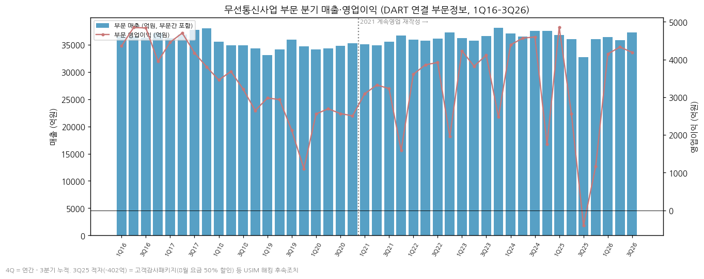
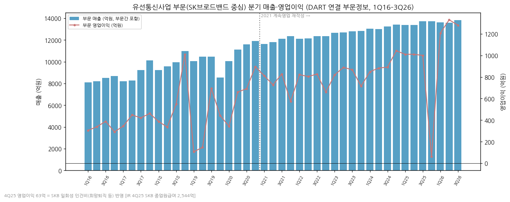
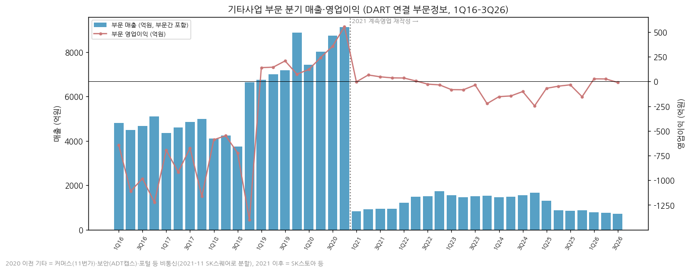

**IR 법인별 분기 (억원, SKT 별도 / SK브로드밴드 연결 — IR Appendix):**

| 분기 | SKT 별도 매출 | SKT 별도 OP | SKT OPM | SKB 매출 | SKB OP | SKB OPM | SKT+SKB 매출 | 연결 매출 (DART) | 연결 − (SKT+SKB) |
|---|---|---|---|---|---|---|---|---|---|
| 1Q21 | 29,807 | 3,073 | 10.3% | 9,670 | 754 | 7.8% | 39,477 | 41,131 | 1,654 |
| 2Q21 | 30,216 | 3,284 | 10.9% | 9,971 | 642 | 6.4% | 40,187 | 41,251 | 1,064 |
| 3Q21 | 30,274 | 3,196 | 10.6% | 10,244 | 786 | 7.7% | 40,518 | 42,150 | 1,632 |
| 4Q21 | 30,731 | 1,591 | 5.2% | 10,606 | 574 | 5.4% | 41,337 | 42,953 | 1,616 |
| 1Q22 | 30,774 | 3,569 | 11.6% | 10,260 | 761 | 7.4% | 41,034 | 42,772 | 1,738 |
| 2Q22 | 31,182 | 3,809 | 12.2% | 10,328 | 782 | 7.6% | 41,510 | 42,899 | 1,389 |
| 3Q22 | 31,226 | 3,887 | 12.4% | 10,442 | 797 | 7.6% | 41,668 | 43,434 | 1,766 |
| 4Q22 | 30,963 | 1,946 | 6.3% | 10,533 | 718 | 6.8% | 41,496 | 43,945 | 2,449 |
| 1Q23 | 31,173 | 4,157 | 13.3% | 10,615 | 761 | 7.2% | 41,788 | 43,722 | 1,934 |
| 2Q23 | 31,192 | 3,791 | 12.2% | 10,683 | 827 | 7.7% | 41,875 | 43,064 | 1,189 |
| 3Q23 | 31,484 | 4,071 | 12.9% | 10,692 | 832 | 7.8% | 42,176 | 44,026 | 1,850 |
| 4Q23 | 32,043 | 2,540 | 7.9% | 10,801 | 672 | 6.2% | 42,844 | 45,273 | 2,429 |
| 1Q24 | 31,887 | 4,364 | 13.7% | 10,917 | 781 | 7.2% | 42,804 | 44,746 | 1,942 |
| 2Q24 | 31,915 | 4,504 | 14.1% | 10,934 | 836 | 7.6% | 42,849 | 44,224 | 1,375 |
| 3Q24 | 32,032 | 4,570 | 14.3% | 11,049 | 879 | 8.0% | 43,081 | 45,321 | 2,240 |
| 4Q24 | 31,907 | 1,794 | 5.6% | 11,211 | 1,021 | 9.1% | 43,118 | 45,115 | 1,997 |
| 1Q25 | 31,675 | 4,824 | 15.2% | 11,136 | 960 | 8.6% | 42,811 | 44,537 | 1,726 |
| 2Q25 | 31,351 | 2,509 | 8.0% | 11,197 | 918 | 8.2% | 42,548 | 43,388 | 840 |
| 3Q25 | 26,647 | -522 | -2.0% | 11,426 | 892 | 7.8% | 38,073 | 39,781 | 1,708 |
| 4Q25 | 30,837 | 1,308 | 4.2% | 11,573 | 118 | 1.0% | 42,410 | 43,287 | 877 |
| 1Q26 | 31,058 | 4,095 | 13.2% | 11,498 | 1,166 | 10.1% | 42,556 | 43,923 | 1,367 |
| 2Q26 | 31,170 | 4,277 | 13.7% | 11,603 | 1,325 | 11.4% | 42,773 | 43,591 | 818 |
| 3Q26 | 31,563 | 4,135 | 13.1% | 11,728 | 1,347 | 11.5% | 43,291 | 44,973 | 1,682 |

(출처: IR 실적발표 Appendix 손익계산서 — 1Q21\~4Q21 = IR 2023-02-08, 2022 = IR 2023-08-08, 2023\~3Q24 = IR 2024-11-06, 4Q24 = IR 2026-05-07의 2024 연간 − 1Q\~3Q24 [계산], 1Q25 = IR 2026-08-05, 2Q25\~3Q26 = IR 2026-11-05. 연결 − (SKT+SKB) = PS&M·SK텔링크·SK오앤에스·SK스토아 등 기타 자회사 − 내부거래 [계산]. DART 무선 부문(3Q26 37,246억)은 SKT 별도(31,563억)에 PS&M 단말 유통 등이 더해진 값, DART 유선 부문(13,827억)은 SKB 연결(11,728억)에 SK텔링크 등이 더해진 값)

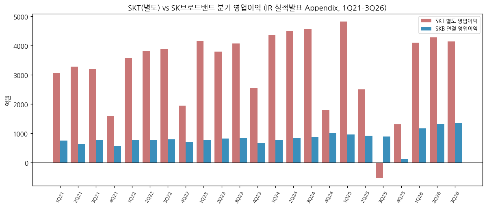

**3Q26 핵심 박스 (DART 분기보고서 2026-11-16, IR 2026-11-05):**

| 항목 | 3Q26 | YoY | 9M26 | YoY |
|---|---|---|---|---|
| 연결 매출 | 44,973억 | +13.1% | 132,486억 | +3.7% |
| 연결 영업이익 | 5,523억 | +1,040% (3Q25 484억) | 16,559억 | +73.6% |
| 연결 OPM | 12.3% | +11.1%p | 12.5% | +5.0%p |
| 연결 순이익 | 4,118억 | 흑전 (3Q25 -1,667억) | 11,942억 | - |
| 지배순이익 | 4,133억 | 흑전 | 12,063억 | - |
| EBITDA (IR) | 14,375억 | +51.9% | 42,960억 | - |
| SKT 별도 OP | 4,135억 | 흑전 (3Q25 -522억) | 12,507억 | - |
| SKB 연결 OP | 1,347억 | +51.0% | 3,838억 | - |

→ 3Q26 YoY 급증은 **기저효과**: 3Q25에 해킹 후속 "고객감사패키지"(8월 통신요금 50% 할인, 연말까지 월 50GB 데이터) 반영 → 3Q25 이동통신매출 21,134억(-19.1% QoQ), SKT 별도 영업손실 -522억, ARPU 23,999원 [IR 3Q26, 더팩트 2025-07-04]
→ 해킹 전(3Q24) 대비로는 매출 -0.8%, 영업이익 +3.6% — 본업은 "해킹 전 수준 복귀", 성장 재개는 아님 [계산]
→ 1Q\~3Q26 OPM 12.2\~13.0%로 분할 후 최고 수준 — 마케팅비 7,400\~7,500억대 유지, 감가상각비 감소(3Q24 9,206억 → 3Q26 8,852억 [IR])
→ 9M26 순이익 개선에는 지분법손익 흑전(2Q26 469억·3Q26 536억 [IR])도 기여
→ 배당: 1Q\~3Q26 분기 DPS 830원 (2025 3Q·4Q 미실시 후 재개) [IR 3Q26]

**12분기 시계열 (연결, 매출 + OPM):**

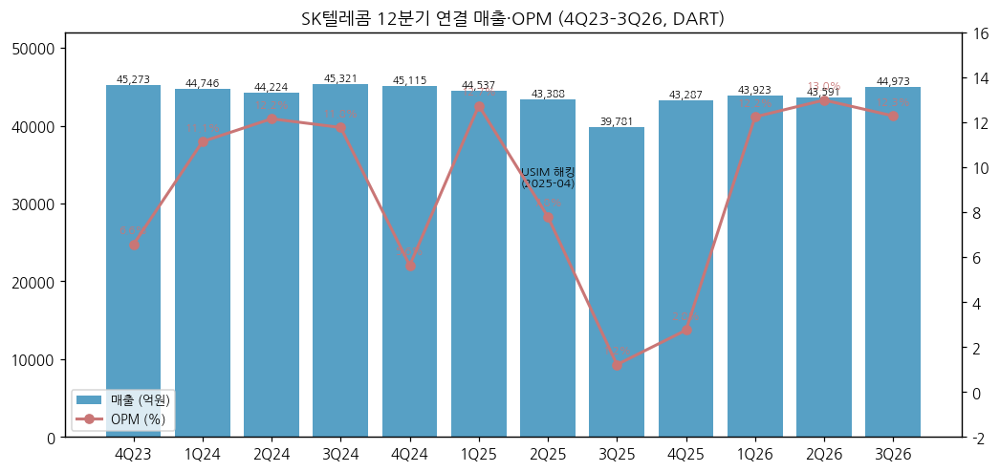

### ② 사업부별 개요 (매출 비중 큰 순서)

| 부문 | 주체 | 2025 부문매출 | 외부매출 비중 | 2025 부문 OP | 사업 모델 |
|---|---|---|---|---|---|
| 무선통신 | SK텔레콤(별도)·피에스앤마케팅·SK오앤에스·서비스에이스·서비스탑 | 14.16조 | 73% | 0.82조 | 이동전화(5G·LTE) 요금 구독, 단말 유통(PS&M), 기지국 유지보수, 고객센터. AI DC(SKT 보유분)·AI B2B 포함 |
| 유선통신 | SK브로드밴드·홈앤서비스·SK텔링크 | 5.42조 | 25% | 0.31조 | 초고속인터넷·IPTV·CATV·기업 전용회선·IDC, MVNO(SK텔링크) |
| 기타 | 에스케이스토아·SAPEON Inc.·Atlas Investment·Astra AI Infra 등 | 0.39조 | 2% | -0.03조 | T커머스(데이터방송 쇼핑), 투자회사 |

(DART 사업보고서(2025.12) II-1·연결 주석 4. 기타 부문 매출은 2024 6,140억 → 2025 3,901억 → 3Q26 분기 708억으로 축소 중 — 연결범위 변동(네이트커뮤니케이션즈·행복한울 제외 등) 영향 [DART 분기보고서(2026.09) 주석 1])

### ③ 사업부별 디테일

(1) 무선통신 — "가입자 × ARPU − 마케팅비 − 감가상각"의 구독 사업

| 항목 | 2023 | 2024 | 2025 | 3Q26 |
|---|---|---|---|---|
| MNO 가입자 (천 명, MVNO 제외) | 31,276 | 31,786 | 30,853 | 30,942 |
| 5G 가입자 (천 명) | 15,500 | 16,917 | 17,492 | 18,094 |
| 5G 보급률 (핸드셋) | - | - | 80% | 83% |
| 월평균 해지율 | 0.9% | 0.8% | 0.9% (연말) | 0.9% |
| 청구기준 ARPU (원, 연간) | 29,874 | 29,355 | 27,845 (-5.1%) | 27,314 (3Q26, MVNO 포함 청구기준) |
| 이동전화 점유율 (MVNO 제외, 연말) | 46.7% | 45.3% | 42.7% | - |

(DART 사업보고서(2025.12) II-1 영업실적, IR 3Q26 Operating Data. 3Q26 ARPU(SKT 이동전화수익 기준) 29,297원 — 2Q26 재분류 소급 적용)

→ 2025 해킹 영향: 2Q25 MNO 가입자 -879천 순감, 해지율 1.6% (평시 0.7\~0.8%) [IR 3Q26]. 이후 3Q25 +76천, 1Q26 +122천으로 회복했으나 3Q26 가입자는 해킹 전(1Q25 31,885천) 대비 -3.0% [계산]
→ 마케팅비용 (SKT 별도): 2023 연 2.87조 → 2025 2.78조 (IR "마케팅수수료"), 분기 7,000억대 — 이동통신매출의 약 29% [IR, 계산]
→ 단통법 폐지(2025-07 시행) 이후 보조금 경쟁 여부가 2026 마케팅비 변수 (미검증 — 비공식 출처, 시행일 확인 필요)

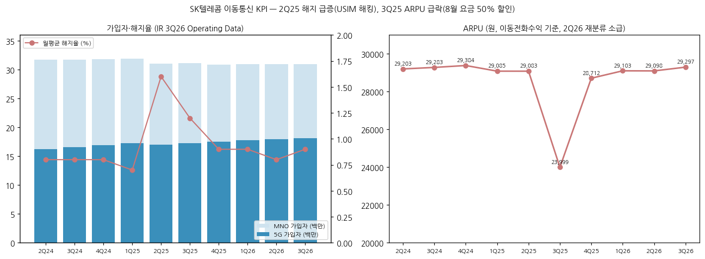

(2) 유선통신 (SK브로드밴드) — 결합상품 + 기업 전용회선
→ SKB 매출 3.71조(2020) → 4.53조(2025), 영업이익 2,309억 → 2,888억 (2025 4Q 일회성 인건비로 4Q25 OP 118억) [IR]
→ 3Q26 초고속 7,383천·IPTV 6,762천·CATV 2,647천 [IR 3Q26]. 시장점유율 초고속 28.7%, IPTV 31.8%, CATV 22.9% [DART 사업보고서(2025.12)]
→ 2020-04 티브로드 합병으로 CATV 확보, 2026-08 SK호라이즌 인적분할 결정 — SKB의 데이터센터·해저케이블 사업이 분리됨 (분할 후 SKB = 순수 유선·미디어)

(3) AI 인프라 — 데이터센터 (SK호라이즌 / SK하이퍼) + GPUaaS

| 법인 | 설립·구조 | 사업 | 규모 |
|---|---|---|---|
| SK호라이즌 | SK브로드밴드 인적분할 신설 (2026-08-27 결정, 2027-02 출범 목표). 분할 후 SKT 51% / KKR 29% / IMM 컨소 20% — 투자 유치 총 3.08조 | 기존 DC 8개소(서초·일산·분당·가산·센텀·양주·판교 등) + 울산·구로 AIDC 건설 + 해저케이블 | 318MW, 2025 매출 3,477억, 장부 자산 2.06조(2026-03말) [MTN 2026-08-27] |
| SK하이퍼 | 2026-07 출범, SKT 100% | 신규 AIDC 개발 (SK하이퍼DC) | 3Q26 사업개발 CapEx 1,486억 [IR 3Q26] |

→ SKT 보유 SK호라이즌 주식 24,481,427주를 KKR·IMM에 약 1.88조에 처분 예정 (2027-03-04) [DART 분기보고서(2026.09) II-6]
→ Penguin Solutions 전환우선주 200,000주를 SK하이닉스 자회사에 약 $380.3M에 매각 계약 (2026-07-27, 미종결) [DART 분기보고서(2026.09) II-6]
→ 장기 목표: "2030년 총매출 30조, AI 비중 35%" [IR 3Q24]

(4) 투자자산 — 앤트로픽 (Anthropic)
→ 2023 첫 투자 약 1,321억원 + 시리즈H 약 1,399억원 = 누적 2,720억원 ($2.04억) [CEO스코어데일리·코리안센터 2026-11-19]
→ 보유 386만330주 (2026-06말, 우선주) → 2026-09 앤트로픽 10:1 주식분할 반영 시 약 3,860만주. 2026-06말 장부가 약 3.505조 [CEO스코어데일리 2026-11-19]
→ 2026-11-19 나스닥 상장 (공모가 $83, 첫날 종가 $97.17) — 공모가 기준 지분가치 약 4.27조 추산 (우선주 전환비율에 따라 변동) [CEO스코어데일리·톱스타뉴스 2026-11-19]
→ 회계: 연결 BS "장기투자자산" 5.18조 (3Q26, 2025말 3.19조), 기타포괄손익누계 2025말 2.03조 → 2Q26 4.05조 → 3Q26 3.65조 [DART, IR] — 공정가치 변동이 **영업이익이 아닌 자본(OCI)**으로 반영

(5) 기타 — SK스토아(T커머스), SAPEON Inc.(AI 반도체), Atlas Investment·Astra AI Infra(투자회사) [DART 사업보고서(2025.12) II-1]

### ④ 주요 경쟁사 (사업부별)

| 부문 | 국내 | 해외 비교 |
|---|---|---|
| 무선통신 | KT·LG유플러스 (3사 과점) + MVNO (SK텔링크 등 자회사 포함). 2025말 점유율 SKT 42.7% | Verizon·AT&T·T-Mobile(미국), NTT도코모·KDDI·SoftBank(일본) — 수치 미검증 |
| 유선·미디어 | KT(초고속 1위)·LG유플러스, 케이블 SO | - |
| AI DC | KT(KT클라우드)·LG유플러스, 네이버클라우드·삼성SDS 등 | 하이퍼스케일러(AWS·MS·Google) — SKT는 협력 관계 |
| AI 서비스 | KT·LG유플러스 AI 에이전트, 네이버·카카오 | - |

(국내 통신 3사 상세 비교는 `KT_기업개요.md`·`LG유플러스_기업개요.md` 참조)

### ⑤ 주요 매출처

> DART 사업보고서: 무선통신사업은 "대한민국 전국민"을 대상으로 하는 B2C 구독 매출 — 단일 고객 10% 이상 매출처 없음 [DART 사업보고서(2025.12) II-4]

| 구분 (외부 매출, 2025) | 매출 (억원) | 비중 |
|---|---|---|
| 무선통신사업 | 125,525 | 73% |
| 유선통신사업 | 41,911 | 25% |
| 기타사업 | 3,556 | 2% |
| 합계 | 170,992 | 100% |

(DART 사업보고서(2025.12) II-1. 2024: 무선 133,182 / 유선 40,754 / 기타 5,470억, 2023: 무선 131,232 / 유선 39,280 / 기타 5,573억)

### ⑥ 네트워크 CAPA + 임직원

- **주파수·네트워크**: 5G·LTE 전국망, 기지국 유지보수 SK오앤에스 [DART 사업보고서(2025.12) II-3] — 주파수 보유 대역·재할당 대가 상세는 다음 버전 보강
- **데이터센터**: 318MW (기존 8개소 + 울산·구로 건설 중, SK호라이즌 이관 예정) [MTN 2026-08-27]
- **임직원 (SKT 별도, 2025말)**: 5,316명 (남 4,047 / 여 1,269), 평균 근속 15.2년(남)·8.9년(여), 1인 평균 급여 1.78억원(남)·1.15억원(여) [OpenDART empSttus 2025]

---

## 4. 재무 구조

> **재무제표 수치: OpenDART fnlttSinglAcntAll (연결 CFS), 2026-11-25 조회.** 2014 = 2015 사업보고서 전기 컬럼. 4Q = 연간 − 3Q 누적 [dart_quarterly_summary]. 2021 분기는 계속영업 재작성치 사용 (3장 ① 참조). 차입금·사채 = BS 단기차입금 + 유동성사채 및 장기차입금 + 사채 + 장기차입금 (리스부채 제외) [계산]. EBITDA = 영업이익 + 손익계산서 감가상각비 [계산] (IR EBITDA는 R&D 관련 감가상각 포함으로 소폭 다름). 시장 데이터 = Yahoo Finance (2026-11-24 종가). **2014\~2020은 분할 전 연결이므로 2021 이후와 자산·자본 규모가 직접 비교되지 않음**

### ① 손익계산서 (12년 연결, 억원)

| 연도 | 매출 | 영업비용 | 지급수수료(마케팅 포함) | 감가상각비 | 영업이익 | OPM | 지분법손익 | 세전이익 | 순이익 | NPM | 지배순이익 | EPS(원) |
|---|---|---|---|---|---|---|---|---|---|---|---|---|
| 2014 | 171,638 | 153,387 | 56,927 | 27,147 | 18,251 | 10.6% | 9,063 | 22,538 | 17,993 | 10.5% | 18,012 | 25,154 |
| 2015 | 171,367 | 154,287 | 52,070 | 28,453 | 17,080 | 10.0% | 7,861 | 20,354 | 15,159 | 8.8% | 15,186 | 20,988 |
| 2016 | 170,918 | 155,561 | 53,767 | 29,419 | 15,357 | 9.0% | 5,445 | 20,961 | 16,601 | 9.7% | 16,760 | 23,497 |
| 2017 | 175,200 | 159,834 | 54,863 | 30,975 | 15,366 | 8.8% | 22,457 | 34,032 | 26,576 | 15.2% | 25,972 | 36,582 |
| 2018 | 168,740 | 156,722 | 50,026 | 31,261 | 12,018 | 7.1% | 32,709 | 39,760 | 31,320 | 18.6% | 30,005 | 44,066 |
| 2019 | 177,437 | 166,337 | 50,022 | 37,715 | 11,100 | 6.3% | 4,495 | 11,627 | 8,619 | 4.9% | 8,899 | 12,144 |
| 2020 | 186,247 | 172,753 | 53,471 | 39,911 | 13,493 | 7.2% | 10,284 | 18,770 | 15,005 | 8.1% | 15,044 | 20,463 |
| 2021 | 167,486 | 153,614 | 54,261 | 36,726 | 13,872 | 8.3% | 4,463 | 17,182 | 24,190 | 14.4% | 24,075 | 7,191 |
| 2022 | 173,050 | 156,929 | 55,188 | 36,213 | 16,121 | 9.3% | -817 | 12,362 | 9,478 | 5.5% | 9,124 | 4,118 |
| 2023 | 176,085 | 158,553 | 55,499 | 36,148 | 17,532 | 10.0% | 109 | 14,882 | 11,459 | 6.5% | 10,936 | 4,954 |
| 2024 | 179,406 | 161,172 | 55,643 | 35,604 | 18,234 | 10.2% | 3,218 | 17,618 | 13,871 | 7.7% | 12,502 | 5,780 |
| 2025 | 170,992 | 160,260 | 54,947 | 34,671 | 10,732 | 6.3% | -636 | 7,223 | 3,751 | 2.2% | 4,084 | 1,825 |

(SKT는 영업비용을 성격별로 공시 — 매출원가·판관비 구분 없음 → GPM/CIR 대신 "지급수수료(대리점 마케팅수수료 포함)"와 "감가상각비"를 핵심 원가로 표시. 지분법손익 = 종속·관계기업투자 관련 손익 (2017\~2018 SK하이닉스 지분법이 대부분). 2021 순이익 24,190억 = 계속영업 12,714억 + 중단영업 11,476억. EPS: 2020 이전 액면 500원 기준(분할 전 주식수), 2021 이후 액면 100원·분할 후 기준 — 2021 EPS 7,191원 중 계속영업 3,614원 [DART])

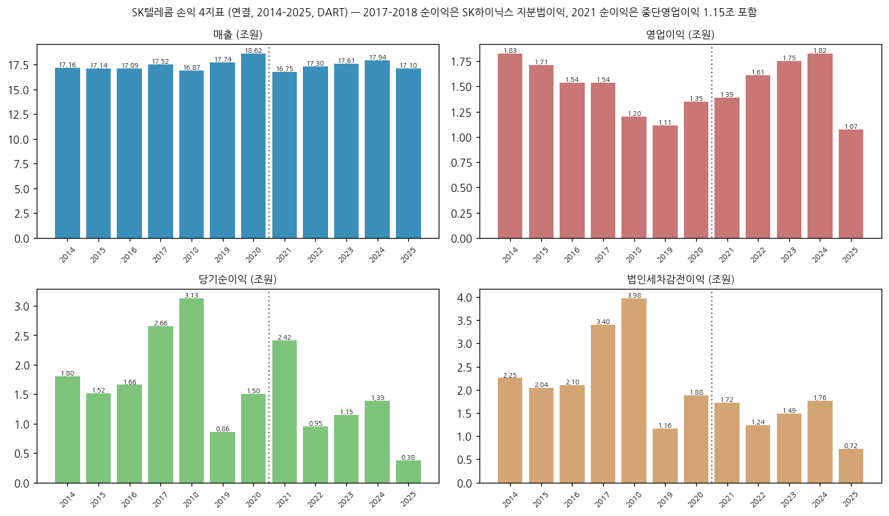

**별도(SKT) 핵심 지표 (IR, 억원):** 2023 매출 125,892 / OP 14,559 → 2024 127,741 / 15,232 → 2025 120,511 / 8,118 → 9M26 93,791 / 12,507 [IR 2024-11-06·2026-05-07·2026-11-05, 계산]

### ② 재무상태표 (12년 연결, 조원)

| 연도 | 자산총계 | 유동자산 | 유형자산 | 무형자산+영업권 | 부채총계 | 유동부채 | 자본총계 | 지배지분 | 차입금·사채 | 현금성자산 | 부채비율 | 유동비율 |
|---|---|---|---|---|---|---|---|---|---|---|---|---|
| 2014 | 27.94 | 5.08 | 10.57 | 4.40 | 12.69 | 5.42 | 15.25 | 14.51 | 6.76 | 0.83 | 83.2% | 93.8% |
| 2015 | 28.58 | 5.16 | 10.37 | 4.21 | 13.21 | 5.26 | 15.37 | 15.25 | 7.52 | 0.77 | 85.9% | 98.2% |
| 2016 | 31.30 | 6.00 | 10.37 | 5.71 | 15.18 | 6.44 | 16.12 | 15.97 | 7.37 | 1.51 | 94.2% | 93.1% |
| 2017 | 33.43 | 6.20 | 10.14 | 5.50 | 15.40 | 7.11 | 18.03 | 17.84 | 7.47 | 1.46 | 85.4% | 87.2% |
| 2018 | 42.37 | 7.96 | 10.72 | 8.45 | 20.02 | 6.85 | 22.35 | 22.47 | 9.65 | 1.51 | 89.6% | 116.2% |
| 2019 | 44.61 | 8.10 | 12.33 | 7.82 | 21.79 | 7.79 | 22.82 | 22.96 | 10.26 | 1.27 | 95.5% | 104.0% |
| 2020 | 47.91 | 8.78 | 13.38 | 7.79 | 23.51 | 8.18 | 24.40 | 23.74 | 10.72 | 1.37 | 96.4% | 107.3% |
| 2021 | 30.91 | 6.35 | 12.87 | 5.94 | 18.58 | 6.96 | 12.34 | 11.58 | 8.83 | 0.87 | 150.6% | 91.3% |
| 2022 | 31.31 | 7.22 | 13.32 | 5.40 | 19.15 | 8.05 | 12.16 | 11.32 | 9.30 | 1.88 | 157.6% | 89.7% |
| 2023 | 30.12 | 6.59 | 13.01 | 4.94 | 17.89 | 6.99 | 12.23 | 11.39 | 9.04 | 1.45 | 146.3% | 94.2% |
| 2024 | 30.52 | 7.48 | 12.62 | 4.27 | 18.69 | 9.22 | 11.83 | 11.70 | 9.13 | 2.02 | 158.0% | 81.1% |
| 2025 | 30.11 | 6.73 | 11.90 | 3.78 | 17.15 | 6.53 | 12.96 | 12.86 | 8.85 | 1.49 | 132.4% | 103.0% |

(3Q26말: 자산 32.68조 / 부채 17.19조 / 자본 15.50조 / 지배지분 15.44조, 차입금·사채 8.54조 (단기 0.13 + 유동성 1.95 + 사채 6.46조), 장기투자자산 5.18조 [DART 분기보고서(2026.09)])

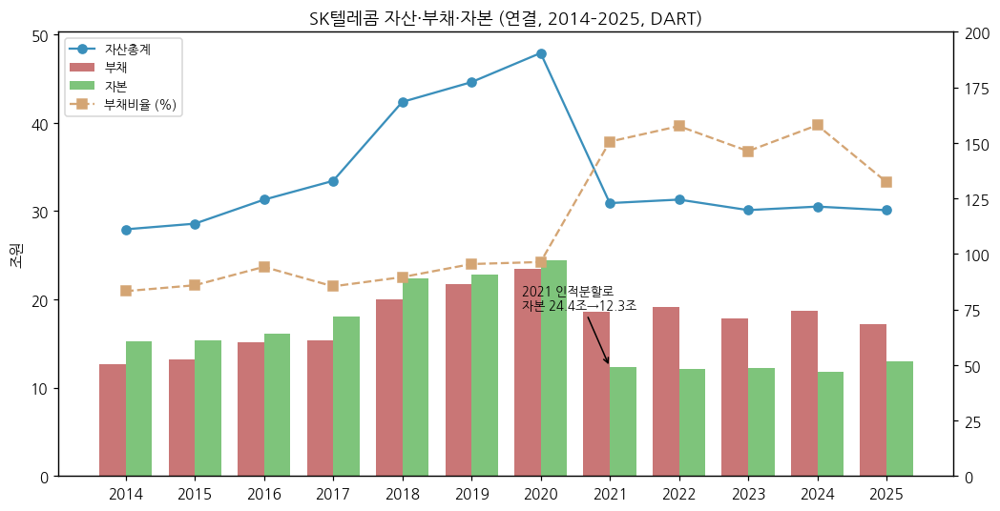

### ③ 현금흐름표 (12년 연결, 억원)

| 연도 | 영업CF | 투자CF | 재무CF | CapEx(유형) | CapEx(무형) | FCF | 배당금 지급 | 자기주식 취득 | 감가상각비 |
|---|---|---|---|---|---|---|---|---|---|
| 2014 | 36,774 | -36,832 | -5,594 | 30,080 | 1,307 | 5,387 | 6,668 | 0 | 27,147 |
| 2015 | 37,781 | -28,805 | -9,646 | 24,788 | 1,279 | 11,714 | 6,685 | 4,902 | 28,453 |
| 2016 | 42,432 | -24,622 | -10,448 | 24,905 | 6,354 | 11,173 | 7,061 | 0 | 29,419 |
| 2017 | 38,558 | -30,706 | -8,266 | 27,159 | 1,457 | 9,942 | 7,061 | 0 | 30,975 |
| 2018 | 43,326 | -40,477 | -2,383 | 27,924 | 5,032 | 10,370 | 7,061 | 0 | 31,261 |
| 2019 | 39,861 | -35,825 | -6,368 | 33,759 | 1,410 | 4,692 | 7,187 | 0 | 37,715 |
| 2020 | 58,219 | -42,504 | -14,576 | 35,578 | 1,300 | 21,341 | 7,421 | 4,267 | 39,911 |
| 2021 | 50,313 | -34,862 | -20,536 | 29,159 | 3,926 | 17,228 | 10,285 | 761 | 36,726 |
| 2022 | 51,593 | -28,078 | -13,499 | 29,083 | 1,381 | 21,129 | 9,040 | 0 | 36,213 |
| 2023 | 49,472 | -33,529 | -20,210 | 29,739 | 1,068 | 18,666 | 7,738 | 2,855 | 36,148 |
| 2024 | 50,873 | -27,118 | -18,099 | 24,874 | 719 | 25,281 | 8,043 | 158 | 35,604 |
| 2025 | 39,238 | -17,371 | -27,118 | 22,066 | 1,167 | 16,006 | 6,284 | 0 | 34,671 |

(FCF = 영업CF − 유·무형자산 취득 [계산]. 배당금 지급 = 연결 CF 지급액(비지배 포함, 결산배당 시차 있음). 자기주식 취득 = 연결 CF — 2018·2019는 해당 계정 없음(0). 9M26: 영업CF 37,082억, 유형 13,762억·무형 1,021억 취득, 배당 지급 3,537억 [DART 분기보고서(2026.09)])

→ 영업CF 3.7\~5.8조, FCF는 12년 내내 흑자 (최저 2019 4,692억 — 5G 투자 정점, 최고 2020 21,341억) [계산]
→ 2025 영업CF 3.92조 (-22.9%) — 해킹 보상·과징금·법인세 납부(5,003억) 영향

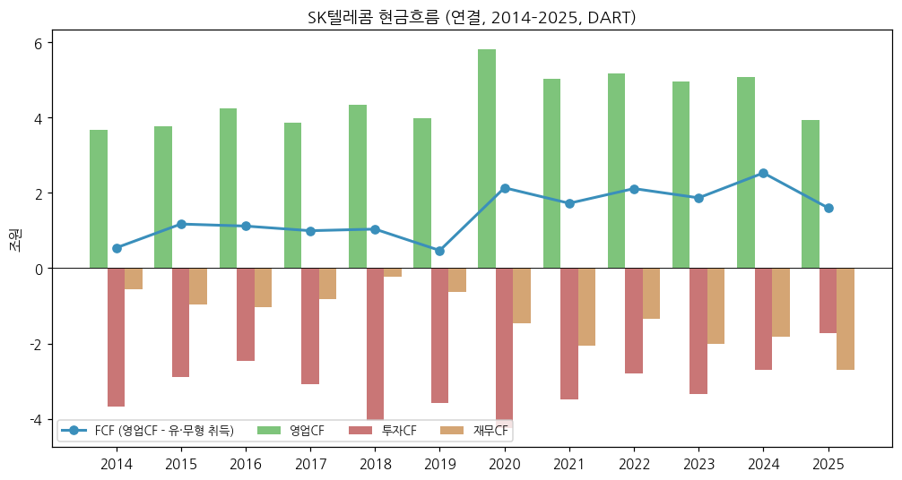

### ④ CapEx 추이 (12년, 억원)

| 연도 | 유형 | 무형(주파수 포함) | 총 CapEx | CapEx/매출 | 감가상각비 | CapEx/감가상각 | EBITDA [계산] | (EBITDA−CapEx) |
|---|---|---|---|---|---|---|---|---|
| 2014 | 30,080 | 1,307 | 31,387 | 18.3% | 27,147 | 1.16x | 45,398 | 14,011 |
| 2015 | 24,788 | 1,279 | 26,067 | 15.2% | 28,453 | 0.92x | 45,533 | 19,466 |
| 2016 | 24,905 | 6,354 | 31,258 | 18.3% | 29,419 | 1.06x | 44,776 | 13,518 |
| 2017 | 27,159 | 1,457 | 28,616 | 16.3% | 30,975 | 0.92x | 46,341 | 17,725 |
| 2018 | 27,924 | 5,032 | 32,956 | 19.5% | 31,261 | 1.05x | 43,279 | 10,323 |
| 2019 | 33,759 | 1,410 | 35,169 | 19.8% | 37,715 | 0.93x | 48,815 | 13,646 |
| 2020 | 35,578 | 1,300 | 36,878 | 19.8% | 39,911 | 0.92x | 53,404 | 16,526 |
| 2021 | 29,159 | 3,926 | 33,084 | 19.8% | 36,726 | 0.90x | 50,597 | 17,513 |
| 2022 | 29,083 | 1,381 | 30,464 | 17.6% | 36,213 | 0.84x | 52,334 | 21,870 |
| 2023 | 29,739 | 1,068 | 30,806 | 17.5% | 36,148 | 0.85x | 53,680 | 22,873 |
| 2024 | 24,874 | 719 | 25,592 | 14.3% | 35,604 | 0.72x | 53,838 | 28,246 |
| 2025 | 22,066 | 1,167 | 23,233 | 13.6% | 34,671 | 0.67x | 45,403 | 22,171 |

- **통신 CapEx는 세대교체 주기**: LTE 고도화(2014 3.14조) → 5G 구축 정점(2019 3.52조, 2020 3.69조 — 분할 전 연결) → 분할 후 2.6\~3.3조 → 2025 2.32조 (CapEx/매출 13.6%)
- 무형자산 취득 급증 연도 = 주파수 할당: 2016 6,354억 (2016 주파수 경매), 2018 5,032억 (5G 주파수), 2021 3,926억 (LTE 재할당 추정 — 미검증)
- IR "CapEx (SKT+SKB)" 2025 연 2.13조 (1Q 1,060 / 2Q 6,350 / 3Q 4,571 / 4Q 9,311억) — 연결 CF 기준(2.32조)과 범위 차이 [IR]. 9M26 IR CapEx 1.08조 + SK하이퍼DC 1,486억 [IR 3Q26]
- EBITDA − CapEx: 분할 전 1.0\~1.9조 → 분할 후 1.8\~2.8조 (2024 정점 2.82조) — 배당(연 0.7조)과 자사주를 감당하는 현금 창출력 [계산]

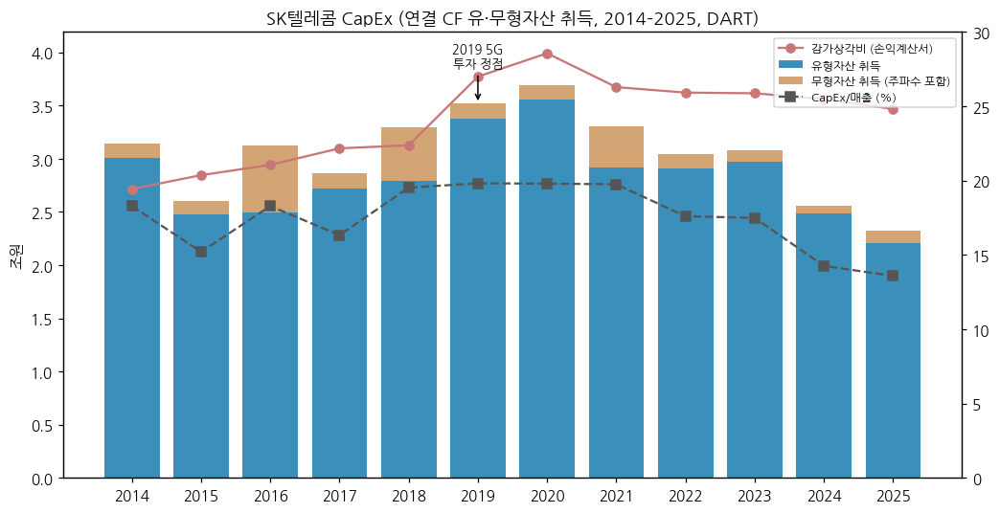

### ⑤ 부채구조 + 채무증권 발행 history

| 연도 | 차입금·사채 (연결, 조원) | YoY | 금융비용 (억원) | 사채 발행 | 사채 상환 | 장기차입 | 장기차입 상환 | 순조달 (억원) |
|---|---|---|---|---|---|---|---|---|
| 2014 | 6.76 | - | 3,867 | 12,555 | 10,399 | 626 | 233 | +2,549 |
| 2015 | 7.52 | +11.4% | 3,501 | 13,750 | 6,200 | 0 | 219 | +7,331 |
| 2016 | 7.37 | -2.0% | 3,268 | 7,767 | 7,700 | 490 | 334 | +223 |
| 2017 | 7.47 | +1.3% | 4,336 | 9,733 | 8,427 | 1,200 | 327 | +2,179 |
| 2018 | 9.65 | +29.2% | 3,852 | 18,096 | 14,880 | 19,201 | 17,807 | +4,610 |
| 2019 | 10.26 | +6.3% | 4,298 | 16,334 | 9,400 | 0 | 899 | +6,035 |
| 2020 | 10.72 | +4.4% | 4,972 | 14,210 | 9,755 | 19,478 | 19,509 | +4,424 |
| 2021 | 8.83 | -17.6% | 3,156 | 8,732 | 8,900 | 3,500 | 2,869 | +463 |
| 2022 | 9.30 | +5.3% | 4,563 | 12,001 | 13,900 | 4,400 | 415 | +2,086 |
| 2023 | 9.04 | -2.8% | 5,274 | 17,851 | 18,692 | 500 | 1,250 | -1,591 |
| 2024 | 9.13 | +0.9% | 6,059 | 12,365 | 12,358 | 2,000 | 4,025 | -2,018 |
| 2025 | 8.85 | -3.1% | 4,820 | 18,753 | 21,215 | 3,000 | 3,125 | -2,587 |

(차입금·사채 = BS 합산 [계산], 리스부채 별도(2025말 유동 4,080 + 비유동 11,178억). 사채·장기차입 = 연결 CF "사채의 발행/상환", "장기차입금의 차입/상환". 2018·2020 장기차입 1.9조 내외 = 차입·상환 동시 발생(차환))

- **3Q26말**: 차입금·사채 8.54조, 현금 및 단기금융상품 2.21조 → 순차입금 약 6.33조, 순차입금/최근 4분기 EBITDA(5.32조) 약 1.2배 [DART, IR, 계산]
- **신용등급**: 회사채 AAA(Stable) 3사 유지 — 해킹 이후 2025-08/09 정기평정에서도 유지. 외화 Moody's A3 / S&P A- [DART 사업보고서(2025.12)]
- 신종자본증권 이자 지급 연 198억 (2024·2025) [DART CF]

### ⑥ 배당·자사주 추이 (12년)

| 사업연도 | DPS(원) | 현금배당총액(억원) | 자기주식 취득(억원, CF) | 총 주주환원(억원) | 지배순이익(억원) | 배당성향(DART) | 총환원율 [계산] | 시가배당률(DART) |
|---|---|---|---|---|---|---|---|---|
| 2014 | 9,400 | 6,668 | 0 | 6,668 | 18,012 | 37.0% | 37.0% | 3.5% |
| 2015 | 10,000 | 7,081 | 4,902 | 11,983 | 15,186 | 46.6% | 78.9% | 4.6% |
| 2016 | 10,000 | 7,061 | 0 | 7,061 | 16,760 | 42.5% | 42.1% | 4.3% |
| 2017 | 10,000 | 7,061 | 0 | 7,061 | 25,972 | 27.2% | 27.2% | 3.6% |
| 2018 | 10,000 | 7,174 | 0 | 7,174 | 30,005 | 22.9% | 23.9% | 3.7% |
| 2019 | 10,000 | 7,301 | 0 | 7,301 | 8,899 | 82.0% | 82.0% | 4.1% |
| 2020 | 10,000 | 7,151 | 4,267 | 11,417 | 15,044 | 47.5% | 75.9% | 4.1% |
| 2021 | 3,295 | 7,170 | 761 | 7,931 | 24,075 | 29.8% | 32.9% | 5.7% |
| 2022 | 3,320 | 7,238 | 0 | 7,238 | 9,124 | 79.3% | 79.3% | 6.8% |
| 2023 | 3,540 | 7,656 | 2,855 | 10,511 | 10,936 | 70.0% | 96.1% | 7.1% |
| 2024 | 3,540 | 7,536 | 158 | 7,694 | 12,502 | 60.3% | 61.5% | 6.1% |
| 2025 | 1,660 | 3,536 | 0 | 3,536 | 4,084 | 86.6% | 86.6% | 3.1% |

(DPS·배당총액·배당성향·시가배당률 = DART 사업보고서 "배당에 관한 사항" (2016·2019·2022·2025 사업보고서 3개년 표, 2014·2015는 2016 사업보고서). 배당총액 = 해당 사업연도 귀속(분기·중간배당 + 결산배당). DPS: 2020 이전 = 액면 500원 기준(중간 1,000원 + 결산 9,000원 등), 2021 이후 = 액면분할·인적분할 후 기준 (2021 3,295원은 DART, IR은 3,320원 표기). 자기주식 취득 = 연결 CF. 총환원율 = (배당총액 + 자사주 취득) / 지배순이익 [계산])

- **주주환원 정책 (FY2024\~2026)**: 매년 **연결 기준 조정 당기순이익의 50% 이상** 환원 (일회성 비경상 손익 제외 지배주주순이익 기준), 상한 제거 [IR 3Q24·3Q26]
- **분기배당**: 2021-2Q부터 분기배당 (2021 이전 = 중간 + 결산). 2024 기말배당부터 "배당금 확정 후 배당기준일 설정" [IR 3Q26]
- **2025 해킹 여파**: 1Q·2Q25 각 830원 지급 후 **3Q·4Q25 미실시** → 연 1,660원 (2024 3,540원 대비 -53%). 2026 1Q\~3Q 각 830원 재개 (배당기준일 5/31·8/31·11/30) [IR 3Q26]
- **자사주 소각**: 2021-05 8,685,568주, 2024-02 4,043,091주. 2023-07 신탁 계약(3,000억 규모 추정 — 미검증)으로 2023 CF 자기주식 취득 2,855억. 2025말 보유 1,807,778주 (0.84%) → 3Q26말 1,731,081주 [DART]

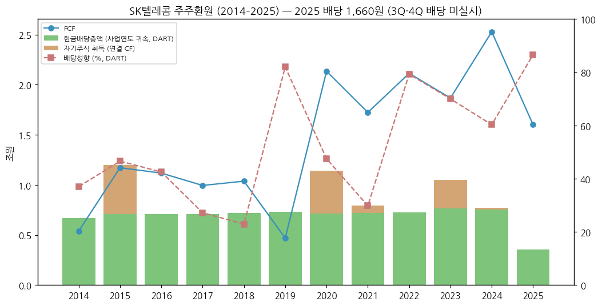

### ⑦ 재무 비율 (12년)

| 연도 | ROE(지배) | ROA | 부채비율 | 순차입금(조) | 순차입금/EBITDA | 연말 시총(조) | PBR | PER | EV/EBITDA |
|---|---|---|---|---|---|---|---|---|---|
| 2014 | - | - | 83.2% | 5.92 | 1.30x | 21.45 | 1.48 | 11.9 | 6.0 |
| 2015 | 10.2% | 5.4% | 85.9% | 6.75 | 1.48x | 17.25 | 1.13 | 11.4 | 5.3 |
| 2016 | 10.7% | 5.5% | 94.2% | 5.86 | 1.31x | 17.93 | 1.12 | 10.7 | 5.3 |
| 2017 | 15.4% | 8.2% | 85.4% | 6.01 | 1.30x | 21.37 | 1.20 | 8.2 | 5.9 |
| 2018 | 14.9% | 8.3% | 89.6% | 8.15 | 1.88x | 21.57 | 0.96 | 7.2 | 6.9 |
| 2019 | 3.9% | 2.0% | 95.5% | 8.99 | 1.84x | 19.05 | 0.83 | 21.4 | 5.7 |
| 2020 | 6.4% | 3.2% | 96.4% | 9.35 | 1.75x | 19.05 | 0.80 | 12.7 | 5.3 |
| 2021 | 13.6% | 6.1% | 150.6% | 7.96 | 1.57x | 12.67 | 1.09 | 5.3 | 4.1 |
| 2022 | 8.0% | 3.0% | 157.6% | 7.42 | 1.42x | 10.37 | 0.92 | 11.4 | 3.4 |
| 2023 | 9.6% | 3.7% | 146.3% | 7.59 | 1.41x | 10.96 | 0.96 | 10.0 | 3.5 |
| 2024 | 10.8% | 4.6% | 158.0% | 7.10 | 1.32x | 11.86 | 1.01 | 9.5 | 3.5 |
| 2025 | 3.3% | 1.2% | 132.4% | 7.36 | 1.62x | 11.49 | 0.89 | 28.1 | 4.2 |

**주요 비율 의미:**
- **ROE**: 지배순이익 / 평균 지배지분. 2017\~2018 15%대는 SK하이닉스 지분법 효과, 2021 13.6%는 중단영업이익 + 분할로 평균 자본 왜곡. 분할 후 정상 구간 8\~11% (2022\~2024), 2025 3.3% (해킹). 회사 목표 "2026년 ROE 10% 이상" [IR 3Q24]
- **순차입금/EBITDA**: 1.3\~1.9배 (12년), 분할 후 1.3\~1.6배 — 통신 인프라 업종 내 보수적 레버리지. 3Q26 약 1.2배
- **PBR·PER·EV/EBITDA**: 연말 시총 = 12월 말 종가 × 발행주식 [Yahoo, 계산]. 2021 이전 종가는 Yahoo 수정주가 × 4.40 환산치(오차 ±1%)
- **현재 (2026-11-24)**: 시총 14.43조, PBR 0.93배 (3Q26 지배지분), EV/EBITDA 약 3.9배 (최근 4분기 IR EBITDA), 배당수익률 3.7% (최근 4분기 DPS 2,490원) [계산]

---

## 5. 지배 구조

### ① 그룹·계열 관계

```
SK㈜ (30.57%, 최대주주)  ── 최태원 회장 (SK㈜ 최대주주)
        │
  SK텔레콤 (017670)  ── 국민연금 6.67% · Citibank(ADR) 6.25% · 카카오인베스트먼트 1.79%
   ┌────────┬──────────┬──────────┬───────────┬─────────────┐
 SK브로드밴드   PS&M      SK오앤에스   SK텔링크     SK스토아 등     SK하이퍼
 (100%)      (100%)     (100%)     (100%)      (기타)        (100%, 2026-07)
  유선·미디어   단말 유통    기지국 유지   MVNO·국제전화  T커머스        신규 AIDC 개발
   └─ (인적분할 예정) SK호라이즌: DC 318MW + 해저케이블 — 분할 후 SKT 51% / KKR 29% / IMM 20%
 투자자산: 앤트로픽(우선주 386만330주, 2026-06말) 등
```

(DART 분기보고서(2026.09) 주석 1 종속기업 — SK브로드밴드 지분 99.1%(2025말) → 100.0%(3Q26말, 홈앤서비스 감자·지분 정리 영향 추정). MTN 2026-08-27, 디지털데일리 2026-08-30)

- **SK스퀘어(402340)와의 관계**: 2021-11 인적분할 신설 — SK하이닉스 지분(20.1%)·11번가·SK쉴더스·원스토어·티맵모빌리티 등을 보유. 분할 후 SKT와 지분 관계 없음 (형제 회사, 둘 다 SK㈜ 자회사)
- **SK하이닉스와의 거래**: Penguin Solutions 우선주 매각 (2026-07), 앤트로픽 5월 라운드에 SK하이닉스 별도 참여 [코리안센터 2026-11-19]

### ② 주주 구분

| 주주 | 주식수 | 지분율 | 기준 |
|---|---|---|---|
| SK㈜ (최대주주 본인) | 65,668,397 | 30.57% | 2025말·3Q26말 동일 |
| 특수관계인 (계열·발행회사 임원) | 소량 (각 0.01% 이하) | 0.0x% | 3Q26말 |
| 국민연금 | 14,332,207 | 6.67% | 2025말 (5% 이상 주주) |
| Citibank (ADR 예탁) | 13,417,253 | 6.25% | 2025말 |
| 웰링턴매니지먼트 | - | 5.01% | 2026-01-22 장내매수 [헤럴드경제 2026-01-26] |
| (주)카카오인베스트먼트 | 3,846,487 | 1.79% | 2025말·3Q26말 |
| 자기주식 | 1,807,778 → 1,731,081 | 0.84% → 0.81% | 2025말 → 3Q26말 |
| 소액주주 | 117,492,479 | 55.2% (유통주식 대비) | 2025말, 267,803명 |

(DART 사업보고서(2025.12) VII 주식 소유현황·소액주주현황, 분기보고서(2026.09) VII. 웰링턴·ADR·국민연금은 상호 중복 가능. 외국인 지분 한도 49% (전기통신사업법 제8조 — 조문 번호 미검증), 외국인 지분율 시계열은 미수집)

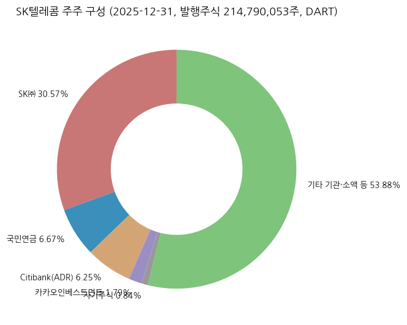

### ③ 임원·이사회

- **대표이사 CEO: 정재헌** — 서울대 법대, 사법연수원 29기, 서울중앙지법 부장판사·법원행정처 전산정보국장. 2020 SKT 합류(법무그룹장) → SK스퀘어 창립 멤버 → SKT 대외협력 사장 → SK수펙스 거버넌스위원장. 2025-10-30 CEO 선임 (법조인 출신 최초) [더팩트 2025-11-01]. 3Q26말 보유 1,518주 [DART 분기보고서(2026.09)]
- 이사회 (2025말): 사내이사 2(유영상·김양섭) + 기타비상무이사 1(강동수) + 사외이사 5(김용학·김준모·오혜연·노미경·김창보) [DART 사업보고서(2025.12) I-2]. 2026-03 정기주총에서 정재헌·한명진 신규 선임 (3Q26 임원 주식 "신규선임" 표기) [DART 분기보고서(2026.09)]
- 역대 대표: 박정호 (\~2021-11, SK스퀘어로 이동) → 유영상 (2021-11-01\~2025-10) → 정재헌 (2025-10\~) [DART 사업보고서(2025.12) I-2, 더팩트]

---

## 6. 기타 팩트

### ① R&D 인프라

| 연도 | 연구개발비용 (억원, 연결) | 매출 대비 |
|---|---|---|
| 2014 | 3,978 | 2.32% |
| 2015 | 3,227 | 1.88% |
| 2016 | 3,511 | 2.05% |
| 2017 | 4,146 | 2.37% |
| 2018 | 4,135 | 2.45% |
| 2019 | 4,055 | 2.29% |
| 2020 | 3,640 | 1.95% |
| 2021 | 3,737 | 2.23% |
| 2022 | 3,744 | 2.16% |
| 2023 | 3,918 | 2.23% |
| 2024 | 3,928 | 2.19% |
| 2025 | 3,558 | 2.08% |

(DART 사업보고서 2015·2017·2019·2021·2023·2025 "연구개발비용(연결 기준)" 3개년 표. 2019는 2019 사업보고서 원값 4,055억 (2021 사업보고서 재작성 3,379억), 2020은 2021 사업보고서 계속영업 재작성값 3,640억 — 2020 원값 미확보. 연구개발비 중 감가상각비 비중 약 35\~45%)

- 조직: AI R&D 센터, 미래R&D Lab 등 [DART 사업보고서(2025.12) II-6]
- AI 모델: 에이닷(A.) 개인 AI 에이전트, 자체 LLM A.X, 멀티 LLM(Perplexity·ChatGPT·Claude 등) 탑재 [IR 3Q24]

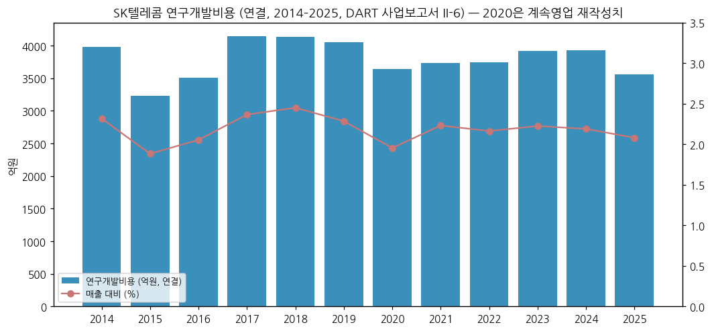

### ② 진행 중 corporate action — 10년치 주요 이벤트

| 시점 | 이벤트 | 출처 |
|---|---|---|
| 2018-05 | ADT캡스 인수 (사이렌홀딩스코리아 주식 취득) | DART 사업보고서(2025.12) I-2 |
| 2018-12 | SK인포섹 포괄적 주식교환 | DART 사업보고서(2025.12) I-2 |
| 2020-04 | SK브로드밴드-티브로드 합병 | DART 사업보고서(2025.12) I-2 |
| 2020-12 | 티맵모빌리티 분사 | DART 사업보고서(2025.12) I-2 |
| 2021-05 | 자사주 8,685,568주 소각 | DART 사업보고서(2025.12) I-3 |
| 2021-11-01 | 인적분할 (SK스퀘어 신설, 0.6073625 : 0.3926375) | DART 사업보고서(2021.12) |
| 2022-07 | 하나카드 지분 전량 하나금융지주에 3,300억 처분 → 하나금융 주식 매수 | DART 사업보고서(2022.12) 감사보고서 주석 |
| 2024-02-05 | 자사주 4,043,091주 소각 | DART 사업보고서(2025.12) I-3 |
| 2025-04\~08 | USIM 해킹 — 위약금 면제(7/14까지), 고객감사패키지 5,000억, 정보보호 7,000억(5년), 과징금 1,347.91억 | 더팩트 2025-07-04, 다음 2025-08-28 |
| 2026-07 | SK하이퍼 출범 / Penguin Solutions 우선주 매각($380.3M) 계약 | 디지털데일리 2026-08-30, DART 분기보고서(2026.09) |
| 2026-08-27 | SK브로드밴드 인적분할 → SK호라이즌, KKR·IMM 3.08조 | MTN 2026-08-27 |
| 2027-03-04 (예정) | SK호라이즌 주식 24,481,427주 처분 (약 1.88조) | DART 분기보고서(2026.09) II-6 |

### ③ 기술·네트워크 마일스톤 — 10년치

- 2019-04 5G 상용화, 5G 가입자 1,339만(2022말) → 1,550만(2023말) → 1,749만(2025말, 보급률 80%) → 1,809만(3Q26, 83%) [DART 사업보고서(2022.12)·(2025.12), IR 3Q26]
- 2023 에이닷 출시 → 2024-08 전면 개편, Perplexity Pro 1년 무료 제공 [IR 3Q24]
- 2026-06 엔비디아 GTC 타이베이 — SK하이닉스 팹 디지털 트윈(Omniverse) 소개 [디지털데일리 2026-06-02]
- 데이터센터 318MW (기존 8개소 + 울산·구로 AIDC 건설) [MTN 2026-08-27]

### ④ 주요 리스크

(1) 보안·규제 리스크 (2025 현실화)
→ 2025-04 USIM 해킹: 2,324만 명 정보 유출(25종, 9.82GB), 해커 내부망 최초 침입 2021-08 추정, 과징금 1,347.91억 (매출 3% 법정상한 체계) [다음 2025-08-28]. 정보보호 투자 5년 7,000억 [더팩트 2025-07-04]
(2) 투자자산·AI 기대 변동성
→ 2026 주가가 앤트로픽 지분가치에 연동 — 6월 "중국 연계 의심 통신사" 보도(SKT 부인)로 5거래일 하락, 11월 상장 직후 -13.1% [뉴스토마토 2026-06-22, Yahoo]
(3) 요금 규제·경쟁
→ 선택약정 25%(2017-09) 이후 무선 OPM 하락 선례. 단통법 폐지 이후 보조금 경쟁 재개 가능성 (미검증)
(4) 가입자 이탈 후유증
→ 이동전화 점유율 45.3% → 42.7% (2024말→2025말), 3Q26 MNO 가입자 해킹 전 대비 -3.0%
(5) AI DC 실행 리스크
→ SK호라이즌 분할·투자 유치(정부 인가·임시주총 필요, 2027-1Q 완료 목표), AI DC 매출 3Q26 QoQ -7.4% (GPUaaS 계약 전환 공백) [IR 3Q26, MTN 2026-08-27]
(6) 배당 신뢰도
→ 2025 3Q·4Q 배당 미실시 선례 — "조정 순이익 50%" 정책은 일회성 손실을 제외한다고 명시했지만 실제로 배당이 끊겼음

### ⑤ ESG 등급

- **MSCI ESG: A**, **KCGS(한국ESG기준원) 종합: A** [SK Telecom Sustainability Report 2025 (brief) — 평가 연도 표기 없음, 2024 평가로 추정]
- WBA Digital Inclusion Benchmark 아시아 1위 (글로벌 ICT 200개사 중) [Sustainability Report 2025]
- 2050 Net Zero 목표, RE100 이행 [Sustainability Report 2025]
- 해킹 사고 이후(2025-04\~) ESG 등급 변동 여부: 미확인 (다음 버전 보강)

### ⑥ 인증·라이선스

- 사업 근거법: 전기통신사업법 (기간통신사업 허가 — 과기정통부), 인터넷 멀티미디어 방송사업법·방송법 (SKB) [DART 사업보고서(2025.12) II-1]
- NYSE ADR 상장 (SKM), 국내 회사채 AAA

---

## Version Log

- **2026-11-25 v1.0 통합 검수**: 통신 3사(SK텔레콤·KT·LG유플러스) 동시 작성 후 교차 검수 — 1장 ④-1 '통신 3사 공통 비교 박스'(EV/EBITDA·PBR·PER·배당수익률 통일 정의) 3문서 동일 삽입, 피어 교차참조 문구 정리

- **v1.0 (2026-11-25)**: 첫 작성 — Phase 1 source 전수 점검 (OpenDART 재무 JSON 44개, 정기공시 XML 62건(EUC-KR 인코딩 13건 포함 디코딩), 기업개황·주주·임원·직원·배당·자기주식·주식총수, IR PDF 33건(이미지 PDF 8건은 후속 분기 표로 대체), Sustainability Report 2025 brief, Yahoo 월간·일간) + v4.8 6개 섹션 + 차트 16종 (12종 표준 + chart2 부문 3종(무선·유선·기타) + chart13 이동통신 KPI + chart14 SKT·SKB 분기 영업이익)
- **데이터 처리 결정**: ① 2021 분기는 계속영업 재작성치로 교체 (dart_quarterly_summary 4Q21 21,824억 왜곡 보정) ② 2014\~2020 연간은 분할 전 보고 기준 유지 + 2019·2020 재작성치 병기 ③ 부문은 DART 3부문(무선·유선·기타), 분할 전 커머스·보안·기타는 "기타(비통신)"로 합산 ④ 2021-10 이전 주가 = Yahoo × 4.40 역산 ⑤ CapEx = 연결 CF 유형 + 무형 취득(주파수 포함) ⑥ 배당 = DART 사업연도 귀속 현금배당총액
- 잔여 보완 후보: ① 1Q14\~4Q15 분기 부문 시계열 (2014·2015 분기보고서 XML 미수집) → 60+분기 표준 충족 ② 외국인 지분율 시계열 (KRX) ③ 주파수 보유·재할당 대가 ④ 글로벌 피어(Verizon·NTT 등) 수치 검증 ⑤ 해킹 비용의 계정별 인식(과징금 반영 분기) ⑥ AI DC 3Q25 급증 사유(GPUaaS 편입 시점) ⑦ 2020 연구개발비 원값 ⑧ KT·LG유플러스 기업개요와 분류·밸류 프레임 정합성 확인
