> Ticker: **NYSE: SPOT — Spotify Technology S.A.**  
> Entity: **Spotify Technology S.A.** (룩셈부르크 법인, 본사·R&D 스웨덴 스톡홀름) — 2006년 Daniel Ek·Martin Lorentzon 창업, 2008-10 서비스 출시. 2018-04-03 NYSE **직상장(Direct Listing)**. 세계 최대 오디오 스트리밍 플랫폼 (음악·팟캐스트·오디오북)  
> Sector: 엔터 — 서브섹터 **음원 글로벌 (핵심)** (함께 보는 종목: Universal Music(UMG, 권리자) · Tencent Music(TME, 중국 플랫폼) / 한국 기획사 4사의 스트리밍 단가 선행지표)  
> 작성 시각: **2026-11-15 KST** (**v1.0** — Phase 1 Source 전수 수집 + 13종 차트(12종 + KPI) + v4.8 6개 섹션)  
> 데이터 범위: **연간 12년 (FY2014\~FY2025, 12월 결산, IFRS)** + **FY26 9M (1Q\~3Q26, 6-K 2026-10-22)** + **세그먼트·KPI 분기 43Q (1Q16\~3Q26)** + **주가 2018-04 \~ 2026-11-13 (직상장 이후 전 기간)**  
> 출처: **SEC EDGAR 20-F 8건 (FY2018\~FY2025) · F-1 (2018-02-28, FY2014\~2017 손익) · 6-K 분기 실적 (1Q18\~3Q26)**, **SEC XBRL companyfacts**, **Yahoo Finance SPOT (월간·일간)**  
> 단위: **€M (유로, IFRS)** — 주가·시총만 US$. 세그먼트 단절: **회사는 세그먼트 영업이익을 공시하지 않음** (매출총이익까지만). 2026-1Q부터 일부 비용 재분류로 세그먼트 GPM 단절 [회사 공시]. FY2014 손익은 F-1 기준 (IFRS 15 소급 미적용)  

# Spotify Technology 기업 개요 (v1.0 — 음원 글로벌 / 세계 최대 오디오 구독 플랫폼 / 2024년 흑자 전환한 고성장 플랫폼)

> **Fact verify cutoff**: 2026-11-15 (주가 2026-11-13 종가 **$612.63** [Yahoo Finance], 유통주식 205,525,454주 [6-K 2026-10-22: 발행 210,741,268 − 자사주 5,215,814] → 시가총액 **약 $125.9B** [계산]. 사상 최고 종가권 **2025-06 ($772.6, Yahoo 월간 종가 / 차트 표기 $775.90 2025-06-26 일간)** → 고점 대비 약 **-21%**. 52주 범위 $405.00\~$644.57 [Yahoo meta]. 2022-10 저점 $71.05 [Yahoo 월간])  

---

## 1. 기업 분류

> **Summary Box (FY2014\~FY2025, 12년)**
> - 매출 CAGR **28.5%** (€1,085M → €17,186M, 15.8배)
> - OPM 12년 평균 **-3.6%** — 2014\~2023 10년 중 9년 영업적자, **2024 OPM 8.7% → 2025 12.8% → FY26 9M 14.3%**
> - 사이클형 아님: 매출은 12년 연속 증가 (역성장 0회). 이익은 **"적자 성장 → 가격 인상·비용 구조조정 → 흑자 전환"**의 1회성 국면 전환
> - 순이익 첫 연간 흑자 **FY2024 (€1,138M)**, FCF 첫 €2B 돌파 FY2024 (€2,284M) [계산]

### ① 정량 근거

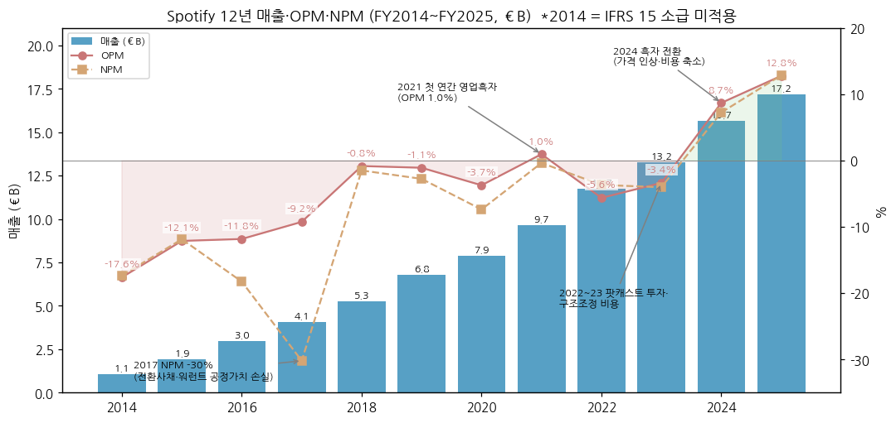

- 매출: 2014\~2019 연 +27\~+75% → 2020\~2025 연 +10\~+23%로 성장률 정상화. 2026 9M 매출 €14,279M (+10% YoY)
- 이익: 2014\~2023 누적 영업손실 약 €2.6B [계산]. 2023 하반기 인력 17% 감축(2023-12) + 2023-07부터 연속 가격 인상 → 2024 매출총이익률 30.1% (2023 25.6%) → OPM 흑자 고착
- 순이익 변동성 원인: 교환사채·워런트 공정가치 평가, 장기투자(TME 지분) 평가, 주식보상 관련 사회보장세(Social Charges, 주가 연동) — **영업이익과 순이익 괴리가 큰 구조**

### ② 산업 분류

- 업종: 인터넷 서비스 / 디지털 오디오 스트리밍 (SIC 7370)
- 워치리스트: **엔터 섹터 (대분류: 소비재) — 서브섹터 음원 글로벌 핵심** (2026-11-15 편입)
- 엔터 섹터 안에서의 역할: K-pop 4사 음원 매출의 **글로벌 DSP 단가(ARPU)·구독자 증가율** 선행지표. UMG와는 "플랫폼 vs 권리자" 짝으로 Streaming 2.0(가격 인상분 배분) 협상 축

### ③ 분류 결정 논리

- **Primary: 고성장 (플랫폼형)** — 매출 두 자릿수 성장 지속 (FY26 9M +10%, 고정환율 기준 회사 공시 +14% 3Q26), 구독자 +9% YoY
- **Secondary: 지속성장 전환 초입** — 2024년부터 OPM·FCF가 매년 개선. 마진 확장(매출총이익률 25% → 33%)이 이익 성장의 주 동력
- "사이클"로 분류하지 않는 이유: 수요가 경기·재고 사이클과 무관한 월정액 구독 (매출의 약 90%가 Premium 구독)

### ④ 적정 밸류에이션 방법

| 우선순위 | 지표 | 이유 |
|---|---|---|
| 1 | **EV/FCF, P/FCF** | 회사가 FCF를 핵심 지표로 공시 (FY26 9M FCF €2,356M), 순이익은 공정가치 평가로 왜곡 |
| 2 | **EV/영업이익 (Forward)** | 2024년 이후 영업흑자 고착, 마진 확장 국면 |
| 3 | PER | 순이익 변동성(금융손익·사회보장세) 때문에 보조 지표 |
| 참고 | EV/구독자 · EV/MAU | 성장 단계 플랫폼 비교 시 (TME 비교) |

### ⑤ 분기 재평가 트리거

- 구독자 순증 분기 500만 명 하회 지속 → 고성장 → 지속성장 하향 검토
- 매출총이익률 30% 하회 (가격 인상 효과 소멸 또는 레이블 로열티율 인상) → 분류 재검토
- OPM 2개 분기 연속 하락 + 마케팅·AI 비용 확대 (3Q26 영업비용 +19% YoY, 회사 공시: 마케팅·클라우드·AI)

---

## 2. 회사 개요

### ① 기본 사항

| 항목 | 내용 |
|---|---|
| 회사명 | Spotify Technology S.A. (NYSE: SPOT) |
| 설립 / 서비스 출시 | 2006 (스웨덴) / 2008-10 |
| 법인 소재지 | 룩셈부르크 (지주사), 운영 본사 스톡홀름 |
| 상장 | 2018-04-03 NYSE 직상장 (신주 발행 없음, 기준가 $132) |
| 미션 | "인간의 창의성을 해방한다 — 수백만 창작자가 작품으로 생계를 꾸리고, 수십억 팬이 즐기도록" (회사 미션 요지) |
| 사업 한 줄 | 음악·팟캐스트·오디오북을 Freemium(광고형 무료 + 유료 구독)으로 제공하는 세계 최대 오디오 스트리밍 플랫폼 |
| 규모 (3Q26) | MAU **7.88억**, Premium 구독자 **3.06억**, 180여 개 시장 |
| 경영진 | 창업자 Daniel Ek → **2026-01-01부 Executive Chairman**. **공동 CEO: Alex Norström (사업) · Gustav Söderström (제품·기술)**. CFO Christian Luiga |
| 임직원 | 7,287명 (2025 말) — 2023 9,123명 정점 대비 -20% |

### ② 12년 손익·자본 추이

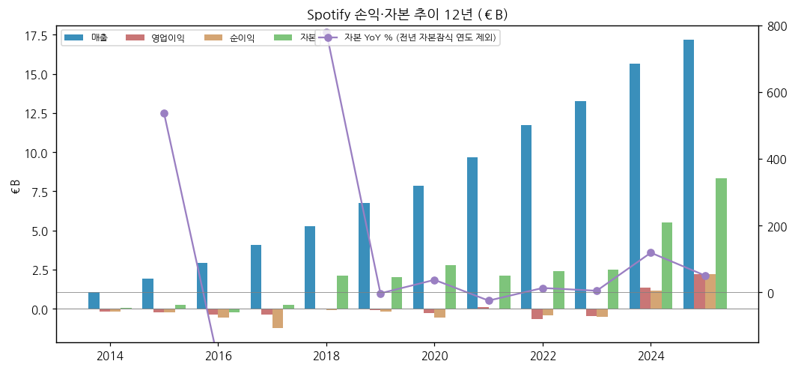

| 연도 | 매출 | 영업이익 | 순이익 | 자본총계 | 자본 YoY |
|---|---|---|---|---|---|
| 2014 | 1,085 | -191 | -188 | 36 | - |
| 2015 | 1,940 | -235 | -230 | 229 | 536.1% |
| 2016 | 2,952 | -349 | -539 | -240 | -204.8% |
| 2017 | 4,090 | -378 | -1,235 | 238 | - |
| 2018 | 5,259 | -43 | -78 | 2,094 | 779.8% |
| 2019 | 6,764 | -73 | -186 | 2,037 | -2.7% |
| 2020 | 7,880 | -293 | -581 | 2,805 | 37.7% |
| 2021 | 9,668 | 94 | -34 | 2,119 | -24.5% |
| 2022 | 11,727 | -659 | -430 | 2,401 | 13.3% |
| 2023 | 13,247 | -446 | -532 | 2,523 | 5.1% |
| 2024 | 15,673 | 1,365 | 1,138 | 5,525 | 119.0% |
| 2025 | 17,186 | 2,198 | 2,212 | 8,329 | 50.8% |

→ 자본총계는 2016년 전환사채 손실로 **자본잠식(-€240M)** → 2018 직상장 시 전환사채 주식 전환으로 회복 → 2024\~2025 순이익 누적으로 €8.3B까지 확대

### ③ 회사 주가 역사

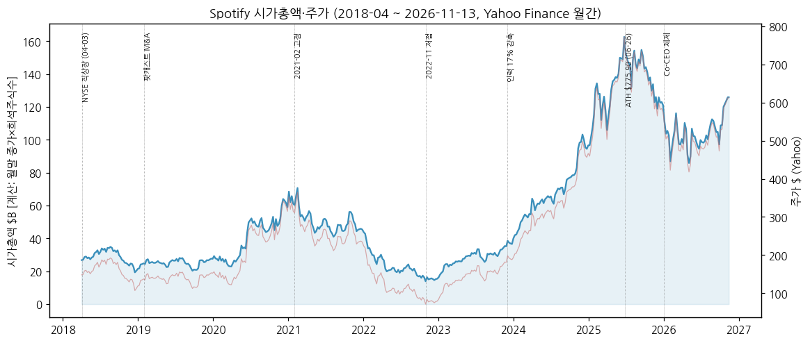

- 2018-04 직상장 (첫날 종가 $149) → 2021-02 고점권 (팟캐스트 투자 기대, $360대)
- 2022 성장주 급락 + 팟캐스트 적자 → **2022-10 저점 $71 (월간 종가)**, 시총 약 $14B [계산]
- 2023-07 첫 가격 인상, 2023-12 인력 17% 감축 → 2024 흑자 전환과 함께 재평가
- **2025-06 사상 최고 종가권 $770대** (시총 약 $160B [계산]) → 2026-02 저점 $412.75 (일간 종가, 4Q25 실적·CEO 교체 직후) → 2026-11-13 $612.63 (시총 약 $125.9B [계산])
- 2026 연중 주가는 약 -6% (Hypebot, 3Q26 실적 발표일 기준)

### ④ 주요 연혁

| 연도 | 사건 |
|---|---|
| 2006 | Daniel Ek·Martin Lorentzon 스톡홀름에서 창업 |
| 2008 | 유럽 일부 국가 서비스 출시 (메이저 레이블 라이선스) |
| 2011 | 미국 진출 |
| 2014 | The Echo Nest 인수 (음악 추천 데이터) |
| 2017 | Tencent Music과 상호 지분 교환 (Spotify가 TME 지분 약 9%, Tencent·TME가 Spotify 지분 약 8% 보유) |
| 2018 | NYSE 직상장 |
| 2019 | Gimlet Media·Anchor 인수 → 팟캐스트 진출 |
| 2020 | The Ringer·Megaphone 인수, Joe Rogan 독점 계약 |
| 2021 | 교환사채 $1.5B 발행 (0%, 2026 만기) |
| 2022 | Findaway 인수 → 오디오북 진출, Podsights·Sonantic 인수 |
| 2023 | 가격 인상 개시 (7월, 미국 $9.99→$10.99), 인력 17% 감축 (12월) |
| 2024 | 연간 첫 순이익 흑자 (€1,138M) |
| 2025 | 자사주 매입 프로그램 확대 (7월 이사회 승인), 연간 OPM 12.8% |
| 2026 | 1월 공동 CEO 체제 출범, 교환사채 €1,304M 만기 상환 (1Q26) → 무차입 |

---

## 3. 비즈니스 모델

### ① 실적 추이 통합 (5년 연간 + FY26 9M, 세그먼트별)

| 연도 | 전사 매출 | Premium 매출 (비중) | Ad-Supported 매출 (비중) | Premium GPM | Ad GPM | 영업이익 (OPM) |
|---|---|---|---|---|---|---|
| 2021 | **9,668** | 8,460 (88%) | 1,208 (12%) | 29.2% | 9.7% | 94 (1.0%) |
| 2022 | **11,727** | 10,251 (87%) | 1,476 (13%) | 28.3% | 2.0% | -659 (-5.6%) |
| 2023 | **13,247** | 11,566 (87%) | 1,681 (13%) | 28.8% | 3.7% | -446 (-3.4%) |
| 2024 | **15,673** | 13,819 (88%) | 1,854 (12%) | 32.5% | 12.4% | 1,365 (8.7%) |
| 2025 | **17,186** | 15,350 (89%) | 1,836 (11%) | 33.7% | 18.0% | 2,198 (12.8%) |
| 2026 9M | **14,279** | 12,966 (91%) | 1,313 (9%) | 34.7% | 17.1% | 2,042 (14.3%) |

- **세그먼트 2개**: Premium (유료 구독) / Ad-Supported (무료 이용자 대상 광고). **회사는 세그먼트 영업이익을 공시하지 않음** → 매출총이익률까지만 비교
- Premium이 매출의 약 90%, 매출총이익의 약 95% → 사실상 구독 단일 사업

#### 세그먼트 분기 시계열 (43분기)

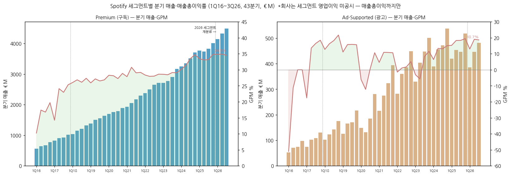

#### 핵심 KPI — MAU · 구독자 · ARPU

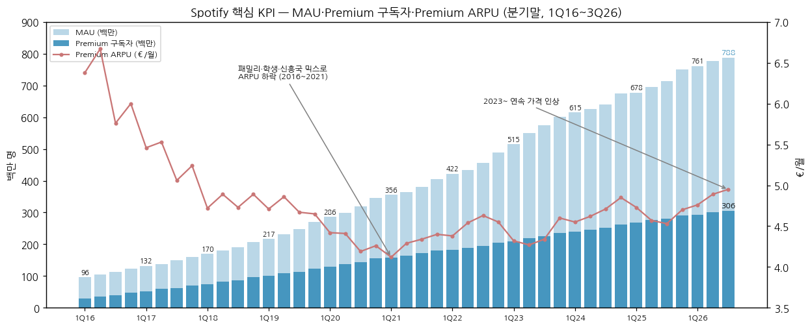

| 시점 | MAU (M) | Premium 구독자 (M) | Ad-Supported MAU (M) | 유료 전환율 [계산] | Premium ARPU (€/월) |
|---|---|---|---|---|---|
| 4Q16 | 123 | 48 | 77 | 39.0% | 6.00 |
| 4Q17 | 159 | 71 | 92 | 44.7% | 5.24 |
| 4Q18 | 207 | 96 | 116 | 46.4% | 4.89 |
| 4Q19 | 271 | 124 | 153 | 45.8% | 4.65 |
| 4Q20 | 345 | 155 | 199 | 44.9% | 4.26 |
| 4Q21 | 406 | 180 | 236 | 44.3% | 4.40 |
| 4Q22 | 489 | 205 | 295 | 41.9% | 4.55 |
| 4Q23 | 602 | 236 | 379 | 39.2% | 4.60 |
| 4Q24 | 675 | 263 | 425 | 39.0% | 4.85 |
| 4Q25 | 751 | 290 | 476 | 38.6% | 4.70 |
| 3Q26 | 788 | 306 | 499 | 38.8% | 4.95 |

→ ARPU는 2016 €6.0 → 2021 €4.1로 하락 (패밀리·학생 요금제, 신흥국 비중 확대) → **2023년부터 연속 가격 인상으로 반등, 3Q26 €4.95 (+9.3% YoY)**. 유료 전환율은 40% 안팎에서 안정 — 신흥국 무료 이용자 유입이 분모를 계속 키우는 구조

#### 최근 12분기

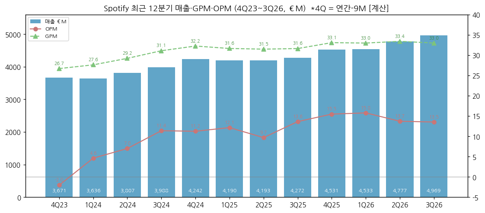

| 분기 | 매출 | YoY | Premium | Ad-Sup. | GPM | 영업이익 | OPM | 순이익 | MAU (M) | Premium 구독자 (M) | ARPU (€/월) |
|---|---|---|---|---|---|---|---|---|---|---|---|
| 4Q23 | 3,671 | +16.0% | 3,170 | 501 | 26.7% | -75 | -2.0% | -70 | 602 | 236 | 4.60 |
| 1Q24 | 3,636 | +19.5% | 3,247 | 389 | 27.6% | 168 | 4.6% | 197 | 615 | 239 | 4.55 |
| 2Q24 | 3,807 | +19.8% | 3,351 | 456 | 29.2% | 266 | 7.0% | 274 | 626 | 246 | 4.62 |
| 3Q24 | 3,988 | +18.8% | 3,516 | 472 | 31.1% | 454 | 11.4% | 300 | 640 | 252 | 4.71 |
| 4Q24 | 4,242 | +15.6% | 3,705 | 537 | 32.2% | 477 | 11.2% | 367 | 675 | 263 | 4.85 |
| 1Q25 | 4,190 | +15.2% | 3,771 | 419 | 31.6% | 509 | 12.1% | 225 | 678 | 268 | 4.73 |
| 2Q25 | 4,193 | +10.1% | 3,740 | 453 | 31.5% | 406 | 9.7% | -86 | 696 | 276 | 4.57 |
| 3Q25 | 4,272 | +7.1% | 3,826 | 446 | 31.6% | 582 | 13.6% | 899 | 713 | 281 | 4.53 |
| 4Q25 | 4,531 | +6.8% | 4,013 | 518 | 33.1% | 701 | 15.5% | 1,174 | 751 | 290 | 4.70 |
| 1Q26 | 4,533 | +8.2% | 4,148 | 385 | 33.0% | 715 | 15.8% | 721 | 761 | 293 | 4.76 |
| 2Q26 | 4,777 | +13.9% | 4,331 | 446 | 33.4% | 655 | 13.7% | 545 | 777 | 300 | 4.89 |
| 3Q26 | 4,969 | +16.3% | 4,487 | 482 | 33.0% | 672 | 13.5% | 518 | 788 | 306 | 4.95 |

### ② 사업부별 개요 (매출 비중 순)

| 사업부 | 3Q26 매출 | 비중 | 매출총이익률 | 수익원 |
|---|---|---|---|---|
| **Premium** | €4,487M (+17% YoY) | 90.3% | 34.5% | 개인·Duo·Family·Student 요금제, 오디오북 이용 시간 포함 번들 |
| **Ad-Supported** | €482M (+10% YoY) | 9.7% | 18.7% | 음악·팟캐스트 광고, Spotify Audience Network(SPAN), 자동화 광고 판매 |

### ③ 사업부별 디테일

- **Premium**: 3Q26 구독자 3.06억 (+9% YoY, 순증 600만). 매출 성장 17% 중 ARPU 상승 기여가 절반 수준 — 회사 표현: "ARPU 성장은 가격 인상 효과, 상품·지역 믹스가 일부 상쇄" (2개 분기 연속 같은 문구). 4Q26 가이던스: MAU 8.18억, 구독자 3.16억, 매출 €5.2B, 매출총이익률 33.8%, 영업이익 €820M
- **Ad-Supported**: 광고 MAU 4.99억 (+12% YoY). 노출량은 늘었지만 광고 단가는 약세 (회사 공시). 팟캐스트 콘텐츠 상각이 컸던 2020\~2023 매출총이익률 적자 → 2024년부터 흑자 고착
- **신규 포맷**: 비디오 팟캐스트 (2025 3Q 기준 3.9억 명 이상 시청), 오디오북 (Premium에 월 15시간 포함, 미국·영국 등), AI DJ·AI 플레이리스트

### ④ 주요 경쟁사

| 영역 | 경쟁사 |
|---|---|
| 음악 스트리밍 (글로벌) | Apple Music, YouTube Music, Amazon Music |
| 중국 | Tencent Music(QQ뮤직·쿠거우) — Spotify 미진출, 상호 지분 관계 |
| 한국 | 멜론(카카오), YouTube Music, 지니 |
| 팟캐스트·비디오 | YouTube, Apple Podcasts |
| 오디오북 | Audible (Amazon) |

### ⑤ 주요 매입처 (콘텐츠 권리자)

- 음원: **Universal Music Group · Sony Music · Warner Music Group + Merlin(인디 레이블 연합)** — 레이블 공급 음원 스트리밍의 **약 72%** (FY2025, 20-F). 다년 계약·자동 갱신 없음·최혜국(MFN) 조항 존재
- 출판(작곡) 권리: 미국 MLC(기계적 복제권 관리단체), 각국 저작권 단체
- 매출원가의 대부분이 로열티 → **레이블 협상력이 매출총이익률 상한을 결정**하는 구조

### ⑥ 인력 추이

| 연도 | 2016 | 2017 | 2018 | 2019 | 2020 | 2021 | 2022 | 2023 | 2024 | 2025 |
|---|---|---|---|---|---|---|---|---|---|---|
| 임직원 (명, 연말) | 2,084 | 2,960 | 3,651 | 4,405 | 5,584 | 6,617 | 8,359 | 9,123 | 7,691 | 7,287 |

- 지역별 (2025 평균, 20-F): 미국 3,466명 · 스웨덴 1,271명 · 영국 887명 · 기타 약 1,663명

---

## 4. 재무 구조 (12년 시계열)

### ① 손익계산서

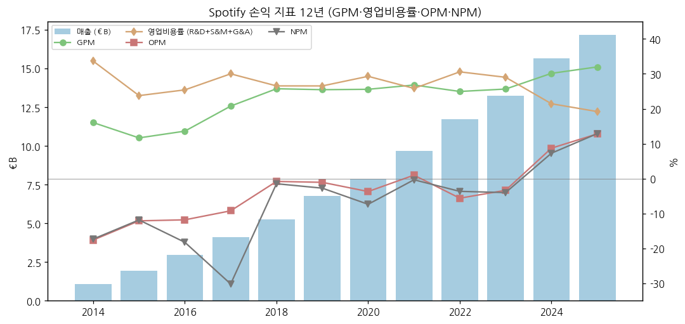

| 항목 (€M) | 2014 | 2015 | 2016 | 2017 | 2018 | 2019 | 2020 | 2021 | 2022 | 2023 | 2024 | 2025 |
|---|---|---|---|---|---|---|---|---|---|---|---|---|
| 매출 | 1,085 | 1,940 | 2,952 | 4,090 | 5,259 | 6,764 | 7,880 | 9,668 | 11,727 | 13,247 | 15,673 | 17,186 |
| 매출원가 | 911 | 1,714 | 2,551 | 3,241 | 3,906 | 5,042 | 5,865 | 7,077 | 8,801 | 9,850 | 10,949 | 11,690 |
| 매출총이익 | 174 | 226 | 401 | 849 | 1,353 | 1,722 | 2,015 | 2,591 | 2,926 | 3,397 | 4,724 | 5,496 |
| R&D | 114 | 136 | 207 | 396 | 493 | 615 | 837 | 912 | 1,387 | 1,725 | 1,486 | 1,393 |
| S&M | 184 | 219 | 368 | 567 | 620 | 826 | 1,029 | 1,135 | 1,572 | 1,533 | 1,392 | 1,426 |
| G&A | 67 | 106 | 175 | 264 | 283 | 354 | 442 | 450 | 626 | 585 | 481 | 479 |
| 영업이익 | -191 | -235 | -349 | -378 | -43 | -73 | -293 | 94 | -659 | -446 | 1,365 | 2,198 |
| 금융손익 | 9 | 10 | -186 | -855 | -130 | -58 | -416 | 155 | 289 | -59 | -24 | 26 |
| 세전이익 | -182 | -225 | -535 | -1,233 | -173 | -131 | -709 | 249 | -370 | -505 | 1,341 | 2,224 |
| 법인세 | 6 | 5 | 4 | 2 | -95 | 55 | -128 | 283 | 60 | 27 | 203 | 12 |
| 순이익 | -188 | -230 | -539 | -1,235 | -78 | -186 | -581 | -34 | -430 | -532 | 1,138 | 2,212 |
| GPM | 16.0% | 11.6% | 13.6% | 20.8% | 25.7% | 25.5% | 25.6% | 26.8% | 25.0% | 25.6% | 30.1% | 32.0% |
| OPM | -17.6% | -12.1% | -11.8% | -9.2% | -0.8% | -1.1% | -3.7% | 1.0% | -5.6% | -3.4% | 8.7% | 12.8% |
| NPM | -17.3% | -11.9% | -18.3% | -30.2% | -1.5% | -2.7% | -7.4% | -0.4% | -3.7% | -4.0% | 7.3% | 12.9% |
| 매출 YoY | - | 78.8% | 52.2% | 38.6% | 28.6% | 28.6% | 16.5% | 22.7% | 21.3% | 13.0% | 18.3% | 9.7% |
| 희석 EPS (€) | -1.40 | -1.62 | -3.63 | -8.14 | -0.51 | -1.03 | -3.10 | -1.03 | -2.93 | -2.73 | 5.50 | 10.51 |

- 지역별 매출 (FY2025, 20-F): 미국 €6,470M (38%), 기타 €10,703M (62%), 룩셈부르크 €13M
- FY26 9M: 매출 €14,279M (+10%), 영업이익 €2,042M (OPM 14.3%) [분기 합산]

### ② 재무상태표

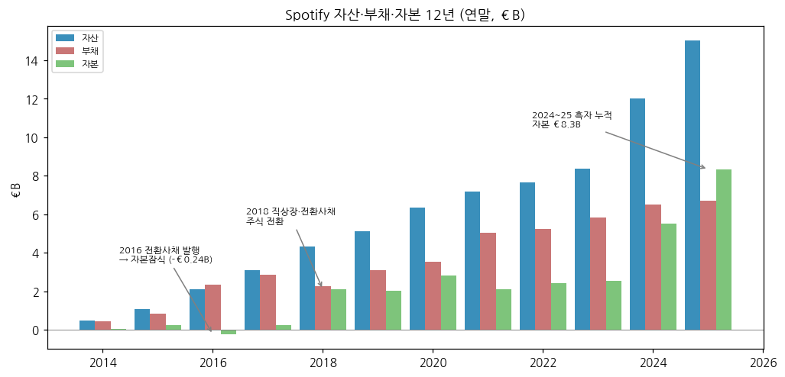

| 재무상태 (€M) | 2014 | 2015 | 2016 | 2017 | 2018 | 2019 | 2020 | 2021 | 2022 | 2023 | 2024 | 2025 |
|---|---|---|---|---|---|---|---|---|---|---|---|---|
| 자산총계 | 474 | 1,051 | 2,100 | 3,107 | 4,336 | 5,122 | 6,326 | 7,170 | 7,636 | 8,346 | 12,005 | 15,015 |
| 부채총계 | 438 | 822 | 2,340 | 2,869 | 2,242 | 3,085 | 3,521 | 5,051 | 5,235 | 5,823 | 6,480 | 6,686 |
| 자본총계 | 36 | 229 | -240 | 238 | 2,094 | 2,037 | 2,805 | 2,119 | 2,401 | 2,523 | 5,525 | 8,329 |
| 현금성자산 | 206 | 597 | 755 | 477 | 891 | 1,065 | 1,151 | 2,744 | 2,483 | 3,114 | 4,781 | 5,258 |
| 단기투자 | 0 | 0 | 830 | 1,032 | 915 | 692 | 596 | 756 | 867 | 1,100 | 2,667 | 4,209 |
| 유동자산 | - | - | - | 1,898 | 2,246 | 2,231 | 2,366 | 4,372 | 4,352 | 5,260 | 8,379 | 10,496 |
| 유동부채 | - | - | - | 1,860 | 2,149 | 2,439 | 2,900 | 3,226 | 3,516 | 4,090 | 4,450 | 6,085 |
| 영업권 | - | - | - | - | 146 | 478 | 736 | 894 | 1,168 | 1,137 | 1,201 | 1,083 |
| 교환사채(공정가치) | - | - | 1,106 | 944 | 339 | 138 | 135 | 1,308 | 1,149 | 1,220 | 1,559 | 1,468 |
| 리스부채 | - | - | - | - | 541 | 628 | 608 | 623 | 613 | 558 | 537 | 498 |

- 3Q26 말: 자산 €14,312M · 부채 €5,571M · 현금 €6,032M + 단기투자 €3,856M (6-K 2026-10-22). **교환사채 1Q26 상환 후 차입금 없음** (리스부채만)

### ③ 현금흐름표

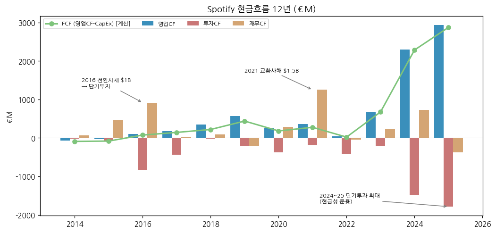

| 현금흐름 (€M) | 2014 | 2015 | 2016 | 2017 | 2018 | 2019 | 2020 | 2021 | 2022 | 2023 | 2024 | 2025 |
|---|---|---|---|---|---|---|---|---|---|---|---|---|
| 영업CF | -74 | -38 | 101 | 179 | 344 | 573 | 259 | 361 | 46 | 680 | 2,301 | 2,933 |
| 투자CF | -21 | -67 | -827 | -435 | -22 | -218 | -372 | -187 | -423 | -217 | -1,486 | -1,785 |
| 재무CF | 65 | 476 | 916 | 34 | 92 | -203 | 285 | 1,250 | -40 | 234 | 729 | -381 |
| CapEx(유형) | 16 | 44 | 27 | 36 | 125 | 135 | 78 | 85 | 25 | 6 | 17 | 61 |
| FCF [계산: 영업CF−CapEx] | -90 | -82 | 74 | 143 | 219 | 438 | 181 | 276 | 21 | 674 | 2,284 | 2,872 |
| M&A 지출 | - | - | - | 49 | 9 | 331 | 336 | 103 | 295 | 0 | 0 | 9 |
| 자사주 매입 | 0 | 0 | 0 | 0 | 72 | 438 | 0 | 89 | 2 | 0 | 0 | 439 |
| 주식보상비용(SBC) | - | - | 53 | 65 | 88 | 122 | 176 | 223 | 381 | 321 | 267 | 248 |
| 감가·상각 | 19 | 30 | 38 | 54 | 32 | 87 | 111 | 127 | 171 | 158 | 121 | 102 |

- FY26 9M: 영업CF €2,392M, **FCF €2,356M (+€316M YoY, 회사 공시)**

### ④ CapEx

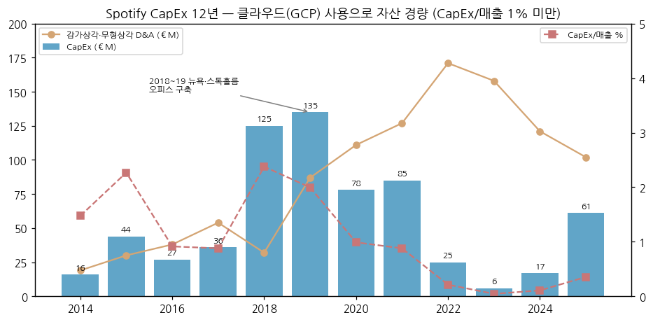

- 자산 경량 구조: CapEx는 매출의 0.1\~2.4% (2018\~2019 사옥·인프라 정점 €125\~135M). 클라우드는 Google Cloud 사용 → 비용으로 처리 (매출원가·R&D)
- FY26 9M CapEx €39M

### ⑤ 부채 구조

| 시기 | 조달 | 내용 |
|---|---|---|
| 2016 | 전환사채 $1B | 상장 전 조달. 2017 공정가치 손실 €855M(금융손익) → 2018 직상장 때 주식 전환 |
| 2021-03 | **교환사채 $1.5B (0%, 2026-03 만기)** | 자사주로 교환 가능. 공정가치 평가 → 순이익 변동 원인 |
| 2026-1Q | **교환사채 €1,304M 현금 상환** | 이후 무차입 (리스부채 약 €0.5B만) |

### ⑥ 배당·자사주

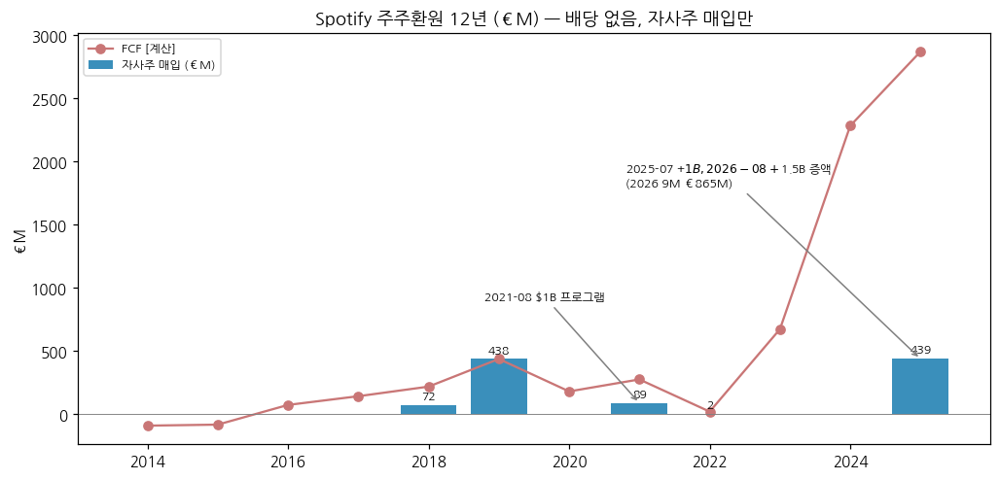

- **배당 없음** (상장 이후 무배당)
- 자사주 매입: 2018 €72M · 2019 €438M · 2021 €89M · 2025 €439M · **FY26 9M €851M** (분기 €241\~318M 페이스). 2021-08 $1.0B 프로그램 → 2025-07 이사회 추가 승인
- 주식보상비용(SBC): 2022 €381M 정점 → 2025 €248M

### ⑦ 재무비율

| 연도 | ROE | ROA | 부채비율 | 유동비율 | 순현금 [계산: 현금+단기투자−교환사채] |
|---|---|---|---|---|---|
| 2017 | - | -39.7% | 1205% | 102% | 565 |
| 2018 | -6.7% | -1.8% | 107% | 105% | 1,467 |
| 2019 | -9.0% | -3.6% | 151% | 91% | 1,619 |
| 2020 | -24.0% | -9.2% | 126% | 82% | 1,612 |
| 2021 | -1.4% | -0.5% | 238% | 136% | 2,192 |
| 2022 | -19.0% | -5.6% | 218% | 124% | 2,201 |
| 2023 | -21.6% | -6.4% | 231% | 129% | 2,994 |
| 2024 | 28.3% | 9.5% | 117% | 188% | 5,889 |
| 2025 | 31.9% | 14.7% | 80% | 172% | 7,999 |

---

## 5. 지배 구조

### ① 그룹·계열 관계

- 지주사 Spotify Technology S.A.(룩셈부르크) 아래 Spotify AB(스웨덴, 운영), Spotify USA Inc. 등 지역 법인
- **Tencent 관계**: Tencent·TME가 Spotify 지분 약 8.1% 보유 (의결권은 Daniel Ek에게 취소 불가 위임), Spotify는 TME 지분 보유 (장기투자, 공정가치 평가)

### ② 주주 구성

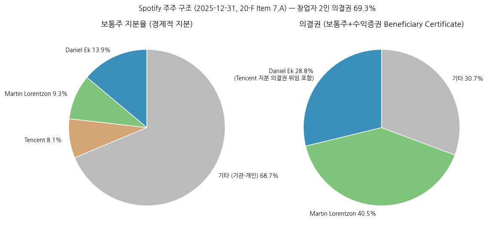

| 주주 (2025-12-31, 20-F) | 보유 주식 | 지분율 | 의결권 |
|---|---|---|---|
| Daniel Ek (D.G.E. Investments 경유) | 11,993,298 | 약 5.8% | **28.8%** (Tencent 보유분 위임 + 수익증권 포함) |
| Martin Lorentzon (Rosello 경유) | 19,006,383 | 9.2% | **40.5%** |
| Tencent 계열 (TME HK·Image Frame·Tencent Mobility 등) | 16,631,969 | 약 8.1% | Ek에게 위임 |
| 창업자 2인 합계 의결권 | | | **69.3%** |

- **차등의결권 장치**: 수익증권(Beneficiary Certificate) — 경제적 권리 없이 1주당 1\~20개 의결권 부여, 최대 14억 개 발행 승인. 창업자 지배력 유지 수단

### ③ 임원·이사회

| 이름 | 직위 | 약력 |
|---|---|---|
| Daniel Ek (42) | 창업자 · Executive Chairman | 2025-12-31까지 CEO. 장기 전략 담당 |
| Alex Norström (49) | 공동 CEO · 이사 | 2011 입사, Chief Business Officer(구독·광고·콘텐츠) 출신. 이전 King.com |
| Gustav Söderström (49) | 공동 CEO · 이사 | 2009 입사, Chief Product & Technology Officer 출신. Kenet Works 창업(Yahoo 매각) |
| Martin Lorentzon | 공동 창업자 · 이사 | TradeDoubler 공동 창업 |
| Christian Luiga | CFO | 2024 입사 (前 Saab CFO) |

---

## 6. 기타 팩트

### ① R&D

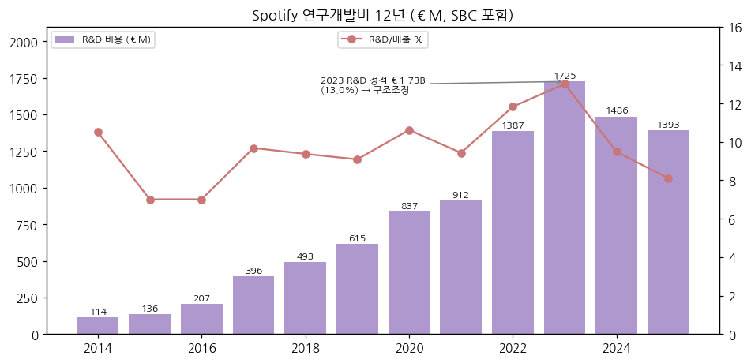

| 연도 | 2014 | 2015 | 2016 | 2017 | 2018 | 2019 | 2020 | 2021 | 2022 | 2023 | 2024 | 2025 |
|---|---|---|---|---|---|---|---|---|---|---|---|---|
| R&D (€M) | 114 | 136 | 207 | 396 | 493 | 615 | 837 | 912 | 1,387 | 1,725 | 1,486 | 1,393 |
| R&D/매출 | 10.5% | 7.0% | 7.0% | 9.7% | 9.4% | 9.1% | 10.6% | 9.4% | 11.8% | 13.0% | 9.5% | 8.1% |

- R&D/매출 2023 13.0% 정점 → 2025 8.1%. 인력 감축 효과. 3Q26 R&D €417M (+분기 증가세, 회사: 클라우드·AI 투자)

### ② 주요 M&A (10년)

| 연도 | 대상 | 목적 |
|---|---|---|
| 2017 | TME 지분 교환 | 중국 시장 간접 노출 |
| 2019 | Gimlet Media, Anchor, Parcast | 팟캐스트 제작·호스팅 (약 €331M) |
| 2020 | The Ringer, Megaphone | 팟캐스트 콘텐츠·광고 기술 (약 €336M) |
| 2022 | Findaway, Podsights, Sonantic, Kinzen | 오디오북 유통, 광고 측정, AI 음성, 콘텐츠 안전 (약 €295M) |
| 2023\~2025 | 대형 M&A 없음 | 수익성 우선 기조 |

### ③ 제품 마일스톤

- 2015 Discover Weekly (개인화 추천) → 2023 AI DJ → 2024 AI 플레이리스트
- 2020\~2022 팟캐스트 독점 전략 → 2024 비디오 팟캐스트 크리에이터 수익화 프로그램
- 2023 오디오북 Premium 번들 (미국·영국·호주 등)
- 2023\~2026 연속 가격 인상 (150개 이상 시장, 2025-08 기준 회사 발언)

### ④ 주요 리스크

- **레이블 집중도**: 메이저 3사 + Merlin이 레이블 스트리밍의 72% — 계약 갱신 시 로열티율 인상 압력 (UMG는 Apple과 Streaming 2.0 미체결 상태, 2026 3Q 기준)
- **MLC 소송 (미국)**: Premium 번들 처리 방식 관련. 패소 시 2024-03\~2025-12 부담 약 **€358M** + 이자·벌금 (20-F 우발부채)
- **앱스토어 수수료·규제**: Apple 결제 정책 (EU 디지털시장법으로 일부 완화)
- **환율**: 유로 보고, 매출 38%가 미국 달러 → 달러 약세 시 유로 환산 매출 감소 (3Q26 매출 성장 +16% vs 고정환율 +14%)
- **주가 연동 사회보장세**: 스웨덴 SBC 관련 비용이 주가에 따라 분기 수천만 유로 변동
- **지배구조**: 창업자 의결권 69% — 소수주주 영향력 제한

### ⑤ ESG

- 2025 지속가능성 보고서 기준 탄소 목표 운영 (상세 등급 미수집)

### ⑥ 라이선스

- 국가별 음원·출판 라이선스 (다년 계약), 오디오북 출판사 계약

---

## Phase 1 Source Audit

| # | 소스 | 상태 | 비고 |
|---|---|---|---|
| 1 | 20-F (FY2018\~FY2025) 8건 | 확보 | 손익·재무상태·현금흐름·주주·임원·리스크 |
| 2 | F-1 (2018-02-28) | 확보 | FY2014\~2017 손익 보강 |
| 3 | 6-K 분기 실적 1Q18\~3Q26 | 확보 | 세그먼트·KPI 분기 시계열. 1Q16\~4Q17은 F-1·20-F 분기 표 |
| 4 | SEC XBRL companyfacts | 확보 | 교차 검증 |
| 5 | Yahoo Finance 월간·일간 | 확보 | chart11 |
| 6 | 회사 IR 덱(Shareholder Deck) | 미확보 | 외부망 제한 — 6-K 본문으로 대체 |

## 데이터 공백·추정

- **[계산]** 표시: 시가총액, FCF(연간), 순현금, 재무비율, 유료 전환율 — 공시 숫자로 직접 계산
- FY2014\~2015 재무상태표 일부 항목(유동자산·유동부채·영업권) 미확보 → '-'
- 세그먼트 영업이익 미공시 → 매출총이익까지만
- 2026-1Q 세그먼트 비용 재분류로 1Q26 이후 세그먼트 GPM은 이전과 단절
- ESG 등급, 지역별 MAU 비중 미수집

## Version Log

- **v1.0 (2026-11-15)**: 최초 작성. 13종 차트(chart1·1b·2·3(KPI)·4·5·6·7·8·9·10·11·12). chart5 주주 지분율 수정 (Ek 직접 보유 5.8%와 Tencent 8.1% 분리 — 20-F 13.9%는 Tencent 위임분 포함 수치)
- 다음 보완: 4Q26 실적 (2027-02) 반영, 회사 Shareholder Deck 확보 시 지역별 MAU·구독자 추가, ESG 등급
