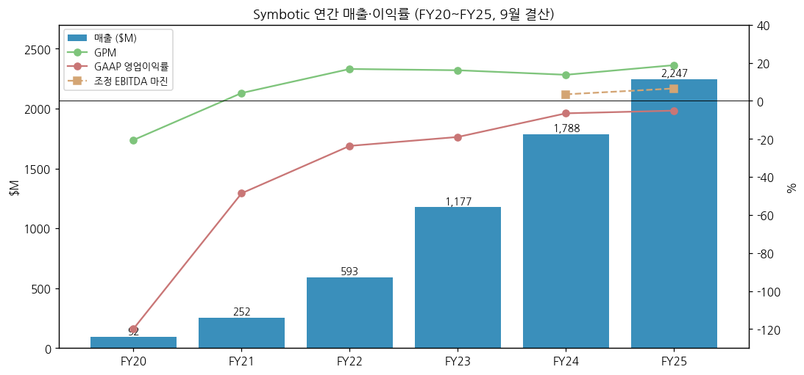
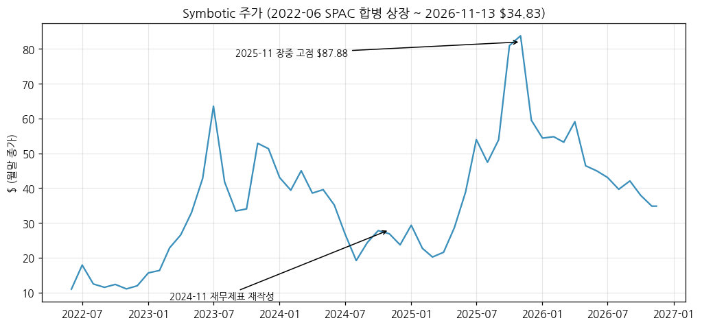
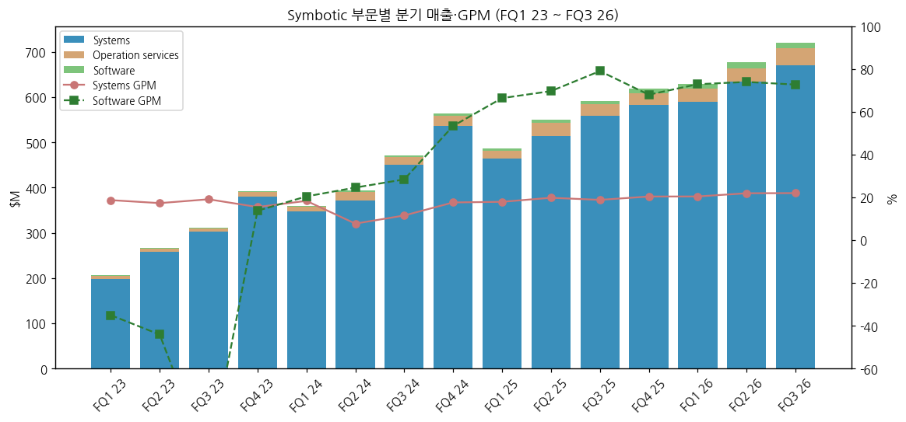
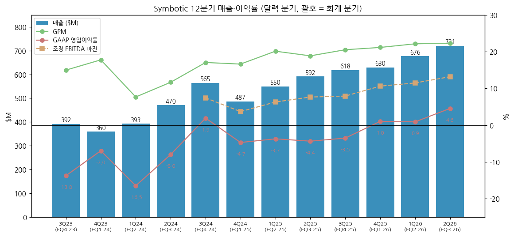
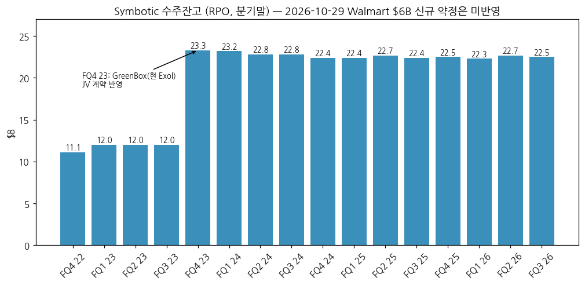
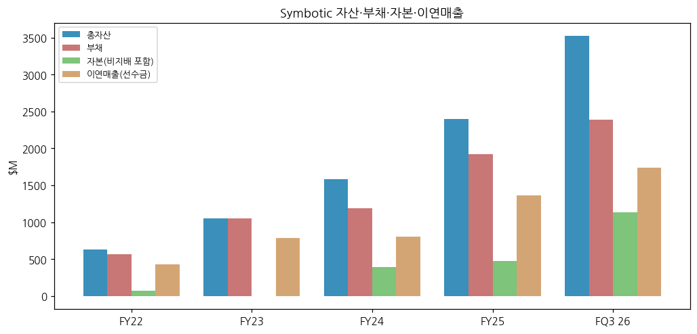
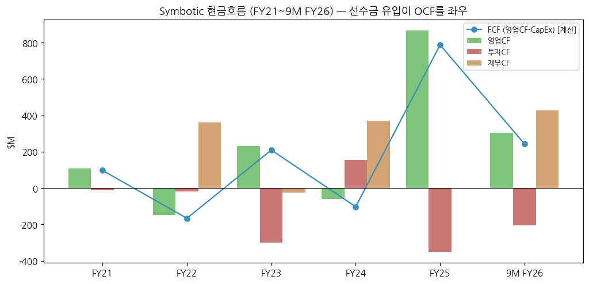

> Ticker: **SYM (NASDAQ)** / Symbotic Inc. — 미국 매사추세츠주 윌밍턴
> Sector: 로봇 — 서브섹터: 산업·물류 자동화 (핵심, 글로벌 피어)
> 작성 시각: 2026-11-14 20:10 KST (**v1.0**)
> 적용 구조: v4.8 (6개 섹션) — 12종 차트 중 데이터로 만들 수 있는 7종 작성 (chart1·2·3·4·6·10·11)
> 데이터: 연간 6년(FY20~FY25, 2022-06 SPAC 상장 전 FY20~FY21 포함) + 분기 15개(FQ1 23 ~ FQ3 26) + 부문 3개(Systems·Software·Operation services) + 수주잔고(RPO) 16개 분기 + 월간 주가(2022-06~)
> 출처: **SEC EDGAR 원문** — 10-K(FY22~FY25), 10-Q(FY23~FY26 각 분기), 8-K Ex.99.1 실적 보도자료(FQ4 25 ~ FQ3 26), 8-K(2026-10-29 Walmart 계약) / **SEC XBRL companyfacts API**(재무 시계열 — 원문과 대조) / **Yahoo Finance v8 월간 주가** / 시총: companiesmarketcap.com(2026-11), 실적 일정: Earnings Whispers
> 단위: **$M**(백만달러). 회계연도는 9월 마지막 토요일 종료 — FQ1 = 10~12월. 본문 분기 표는 **달력 분기(회계 분기 괄호 병기)**
> 기준 단절: ① 2024-11 FY24 1~3분기 재작성(8-K Item 4.02, 매출·원가 인식 오류) ② FY26부터 주식보상비용 배분 방식 변경(가속 → 정액, 소급 적용) — FY25 1~3분기는 변경 후 수치, FQ4 25(3Q25)는 변경 전 10-K 기준 [계산]

# Symbotic (SYM) 기업 개요 (v1.0 — AI 창고 자동화, Walmart 물류센터 전면 자동화 사업자)
> **Fact verify cutoff**: 2026-11-14 (주가 11/13 종가 $34.83 [Yahoo Finance], 시총 $21.45B [companiesmarketcap.com, 2026-11], 총주식 6.04억주(Class A + V-1 + V-3, 2026-06-27 [10-Q XBRL]))

## ① 기업 분류

(1) Primary / Secondary 분류

**Primary 분류: 고성장 (흑자 전환 초입) — 매출 CAGR 89.4%(FY20→FY25), FY25 +25.7%, 9M FY26 +24.5%**

→ GAAP 영업이익률이 FY20 -119.9% → FY25 -5.1% → FQ3 26(2Q26) **+4.6%**로 처음 의미 있는 흑자 구간에 들어왔다. 조정 EBITDA 마진은 FY24 3.5% → FY25 6.5% → FQ3 26 13.2% [계산]

→ 매출은 "시스템 배치 진행률"로 인식한다 — 동시에 배치 중인 시스템 수(FQ3 26 77개, 전년 46개)가 매출을 정한다 (10-Q)

**Secondary 노트: 단일 고객 집중 (Walmart 매출 비중 84.6%, FY25)**

→ 고객 A(Walmart) 매출 비중 FY23 88.4% → FY24 86.9% → FY25 84.6% → FQ3 26 90.5% (10-K·10-Q). 수주잔고 $22.5B의 "대부분"이 Walmart와 Exol(SoftBank 합작 JV, 구 GreenBox) 계약이다

(2) Summary Box (6년, $M)

| 지표 | 6년 평균 (FY20~FY25) | 정점 | 저점 | FY25 |
|---|---|---|---|---|
| 매출 | 1,024.9 [계산] | 2,246.9 (FY25) | 92.1 (FY20) | **2,246.9** |
| 매출 YoY | — | +173.6% (FY21) | +25.7% (FY25) | **+25.7%** |
| 매출총이익률 | 8.2% [계산] | 18.8% (FY25) | -20.5% (FY20) | **18.8%** |
| GAAP 영업이익률 | -37.1% [계산] | -5.1% (FY25) | -119.9% (FY20) | **-5.1%** |
| 조정 EBITDA | — | 147 (FY25) | 62 (FY24) | **147** |

```
[Symbotic 6년 손익 ($M, 9월 결산)]
연도   매출      GPM     GAAP영업이익  영업이익률  순손익(비지배 포함)
FY20     92.1   -20.5%     -110.4     -119.9%      -109.5
FY21    251.9     4.1%     -122.4      -48.6%      -122.3
FY22    593.3    16.8%     -140.4      -23.7%      -139.1   ← 2022-06 SPAC 합병 상장
FY23  1,176.9    16.1%     -223.2      -19.0%      -207.9   ← 53주. GreenBox JV
FY24  1,788.2    13.7%     -116.7       -6.5%       -84.7   ← 재작성(2024-11)
FY25  2,246.9    18.8%     -115.0       -5.1%       -91.0   ← 조정 EBITDA 147
9M26  2,027.3    21.9%       45.5        2.2%        77.8   ← GAAP 영업흑자 전환
```



(3) 정량적 분류 근거

→ 매출 YoY: +173.6%(FY21) → +135.5% → +98.4% → +51.9% → +25.7%(FY25) → 9M26 +24.5%. 성장률은 매년 내려왔지만 20%대에서 바닥을 다지는 중 [계산]

→ 이익은 매출총이익률(FY24 13.7% → 9M26 21.9%) 개선과 연구개발비 정체(FY25 216.0, 9M26 138.1)로 레버리지가 나기 시작했다

→ 수주잔고 $22.5B(2026-06) = FY25 매출의 10.0배 [계산]. 그 뒤 2026-10-29 Walmart가 $6B 신규 약정(RPO 미반영)을 했다

(4) 산업 분류

→ SIC 3569 (General Industrial Machinery) / 창고 자동화(Warehouse automation, AS/RS)

→ 워치리스트 섹터: 로봇 / 서브섹터: 산업·물류 자동화 (핵심) — 같은 칸: 두산로보틱스, 현대오토에버, Teradyne(Universal Robots 부문, 트래킹)

(5) 분류 결정 논리

→ 매출의 93%(FQ3 26)가 Systems(시스템 설계·제작·설치) — 신규 물류센터 자동화 배치 물량이 성장을 정한다. 소프트웨어(2%)·운영 서비스(5%)는 설치 기반이 쌓일수록 커지는 반복 매출

→ 고객 집중은 리스크지만 계약이 대부분 해지 불가(10-K: "termination for convenience 조항 없음") — 사이클보다는 프로젝트 실행 리스크 [판단]

(6) 적정 밸류에이션 방법

→ 1차 — EV/매출: 시총 $21.45B − 현금 $1.75B(2026-06) = EV 약 $19.7B. FY26 매출 추정 약 $2.80B(9M $2,027.3 + FQ4 가이던스 중간값 $770M) → **EV/매출 약 7.0배** [계산]

→ 2차 — EV/조정 EBITDA: FQ4 26 가이던스 중간값 $102.5M × 4 = 연환산 $410M → 약 48배 [계산]. 회사는 조정 EBITDA를 주 지표로 쓴다

(7) 분기 재평가 트리거 (분류 변경 조건)

→ ① 분기 매출 YoY 20% 미만 2개 분기 연속 → "고성장" 해제 검토

→ ② GAAP 영업이익률 10% 이상 2개 분기 연속 → 이익 성장주로 밸류 기준을 PER로 전환

→ ③ Walmart 비중 70% 미만(고객 다변화) 또는 대형 계약 해지 → Secondary 재검토

## ② 회사 개요

① 기본 사항

→ 회사명: Symbotic Inc. (Nasdaq: SYM). 2006년 리처드 코언(Richard B. Cohen, 현 회장 겸 CEO)이 창업 — C&S Wholesale Grocers(미국 최대 식품 도매) 운영 경험에서 출발 (10-K)

→ 지배 구조: Up-C 구조. 코언 가족·관계 신탁이 Class V-3 보유로 **의결권 69.3%** (10-K FY25). 상장사(Class A)는 Symbotic Holdings LLC의 일부 지분만 보유해 손익의 대부분이 비지배지분으로 간다(FQ3 26 순이익 55.0 중 지배주주 귀속 11.7)

→ 사업 한 줄: AI 소프트웨어로 움직이는 자율 로봇(SymBot)·고밀도 랙·로봇 팔로 물류센터의 입고·보관·출고를 통째로 자동화한다. 대형 유통사 물류센터(RDC) 전체를 바꾸는 "엔드투엔드" 시스템

→ 규모(FY25): 매출 $2,246.9M, 총자산 $2,395.7M, 임직원 약 2,000명(미국 1,950명)

→ **한국 물류 자동화·로봇 업체와의 경쟁 지점 (어디서 맞붙나)**

| 영역 | Symbotic | 한국·글로벌 경쟁 | 경쟁 구도 [판단] |
|---|---|---|---|
| 대형 유통 물류센터 AS/RS (케이스 단위) | Walmart 42개 RDC 전면 자동화, Target·Albertsons·C&S | 글로벌: Dematic(KION), Swisslog(KUKA), Knapp, AutoStore, Ocado / 한국: 현대무벡스 등 | 미국 대형 유통 전면 교체는 사실상 Symbotic 독점 [판단]. 한국 업체와 직접 경쟁 거의 없음 |
| 낱개 피킹·매장 픽업(APD) | Walmart ASR 인수(2025-01), 매장 400개 APD 시스템 | Ocado, AutoStore, Exotec | 신규 영역, 경쟁 치열 |
| 창고-서비스(WaaS) | Exol(구 GreenBox, SoftBank 합작) | — | 독자 모델 |
| 로봇 팔·AI 소프트웨어 | 자체 개발 | 두산로보틱스(협동로봇), 현대오토에버(물류 SW) | 고객층이 달라 간접 비교 대상 |

② 6년 손익·자본 추이 ($M)

| 회계연도 | 매출 | 매출 YoY | GPM | 연구개발비 | 판관비 | GAAP 영업이익 | 영업이익률 | 순손익 | 조정 EBITDA | 자본(비지배 포함) |
|---|---|---|---|---|---|---|---|---|---|---|
| FY20 | 92.1 | — | -20.5 | 55.9 | 35.6 | -110.4 | -119.9 | -109.5 | — | -844.5 |
| FY21 | 251.9 | +173.6 | 4.1 | 73.4 | 59.4 | -122.4 | -48.6 | -122.3 | — | -1,113.2 |
| FY22 | 593.3 | +135.5 | 16.8 | 124.1 | 115.9 | -140.4 | -23.7 | -139.1 | — | 68.9 |
| FY23 | 1,176.9 | +98.4 | 16.1 | 195.0 | 217.9 | -223.2 | -19.0 | -207.9 | — | -2.7 |
| FY24 | 1,788.2 | +51.9 | 13.7 | 173.5 | 188.9 | -116.7 | -6.5 | -84.7 | 62 | 390.1 |
| FY25 | 2,246.9 | +25.7 | 18.8 | 216.0 | 298.7 | -115.0 | -5.1 | -91.0 | 147 | 477.7 |

→ (출처: 10-K FY22~FY25 손익계산서, XBRL companyfacts. FY24는 재작성 후. 조정 EBITDA는 8-K Ex.99.1 보도자료(non-GAAP). FY20~FY21 자본 마이너스는 상장 전 상환우선 지분 구조 때문. FY25 구조조정비 22.9 별도)

③ 회사 주가 역사

→ 2022-06 SoftBank 계열 SPAC(SVF Investment Corp. 3)과 합병해 상장, 공모가 $10 수준

→ 2023-07 GreenBox JV 발표 후 급등(2023 연말 시총 $28.60B), 2024-11 FY24 재무제표 재작성 공시로 급락(2024 연말 $14.14B)

→ 2025년 Walmart ASR 인수·흑자 기대로 재평가 → **2025-11 장중 고점 $87.88** (월간 고가, Yahoo) → 시총 약 $52B [계산, 5.91억주 기준] → 2026-11-13 $34.83(고점 대비 -60%)

→ 연말 시총 (companiesmarketcap.com): 2022 $6.64B / 2023 $28.60B / 2024 $14.14B / 2025 $34.37B / 2026-11 $21.45B



④ 주요 연혁

| 시점 | 사건 |
|---|---|
| 2006 | 리처드 코언 창업 (10-K) |
| 2022-05~06 | Walmart 42개 RDC 전면 자동화 계약 확대(MAA), Walmart 워런트 / SVF 3 SPAC 합병, 나스닥 상장 |
| 2023-07 | SoftBank와 창고-서비스 JV GreenBox 설립 (현 Exol), 수주잔고 $12.0B(FQ3 23) → $23.3B(FY23 말) |
| 2024-11 | FY24 1~3분기 재무제표 재작성 (8-K Item 4.02, 매출·원가 인식 오류) — 내부통제 중대한 취약점 |
| 2025-01 | Walmart Advanced Systems & Robotics(ASR) 사업 인수 + 매장 400개 APD 시스템 계약(실행 시 RPO $5B+ 추가 가능) |
| 2025 | Walmart Mexico(Walmex) 상업 계약, Medline 수주(첫 헬스케어 고객) |
| 2025-12 | 유상증자 순조달 $424M |
| 2026-10-29 | **Walmart Enterprise Master Automation Agreement — 초기 약정 약 $6B**, 미국 25개 RDC 추가 자동화(BreakPack 낱개 피킹·SymMicro 마이크로 풀필먼트) + 차세대 랙 개발비 $125M (8-K) |

## ③ 비즈니스 모델

① 실적 추이 통합 (부문별 매출, $M / GPM %)

| 부문 | FY21 | FY22 | FY23 | FY24 | FY25 | 9M FY25 | 9M FY26 | 9M YoY |
|---|---|---|---|---|---|---|---|---|
| Systems | 227.6 (4.8) | 568.0 (18.3) | 1,138.1 (17.4) | 1,705.4 (14.0) | 2,118.9 (19.3) | 1,536.5 (18.9) | **1,895.7 (21.5)** | +23.4% |
| Software maintenance & support | 4.0 (26.1) | 3.7 (-17.5) | 6.6 (-39.7) | 14.2 (36.9) | 29.6 (71.1) | 20.3 (72.5) | **36.6 (73.2)** | +79.9% |
| Operation services | 20.3 (-7.8) | 21.6 (-16.3) | 32.2 (-17.4) | 68.6 (2.7) | 98.5 (-7.0) | 71.6 (-1.2) | **95.0 (11.4)** | +32.7% |
| 합계 | 251.9 (4.1) | 593.3 (16.8) | 1,176.9 (16.1) | 1,788.2 (13.7) | 2,246.9 (18.8) | 1,628.5 (18.6) | **2,027.3 (21.9)** | +24.5% |
| 지역: 미국 | — | — | — | — | — | 1,594.7 | **1,870.9** | +17.3% |
| 지역: 해외 | — | — | — | — | — | 33.8 | **156.4 (8%)** | +363% |

→ (출처: 10-K FY22~FY25, 10-Q FQ3 26 부문 손익. 9M FY25는 FQ3 26 10-Q 비교 열(주식보상 방식 변경 후))



① 12분기 시계열 ($M, %) — 달력 분기 (회계 분기)

| 분기 | 3Q23 (FQ4 23) | 4Q23 (FQ1 24) | 1Q24 (FQ2 24) | 2Q24 (FQ3 24) | 3Q24 (FQ4 24) | 4Q24 (FQ1 25) | 1Q25 (FQ2 25) | 2Q25 (FQ3 25) | 3Q25 (FQ4 25) | 4Q25 (FQ1 26) | 1Q26 (FQ2 26) | 2Q26 (FQ3 26) |
|---|---|---|---|---|---|---|---|---|---|---|---|---|
| 매출 | 391.9 | 359.9 | 393.3 | 470.3 | 564.6 | 486.7 | 549.7 | 592.1 | 618.5 | 630.0 | 676.5 | **720.8** |
| GPM | 15.0 | 17.8 | 7.7 | 11.7 | 17.1 | 16.6 | 20.2 | 18.9 | 20.6 | 21.2 | 22.2 | **22.3** |
| GAAP 영업이익 | -53.9 | -25.1 | -64.9 | -37.6 | 10.9 | -23.0 | -20.5 | -25.8 | -21.8 | 6.5 | 6.1 | **32.9** |
| GAAP 영업이익률 | -13.8 | -7.0 | -16.5 | -8.0 | 1.9 | -4.7 | -3.7 | -4.4 | -3.5 | 1.0 | 0.9 | **4.6** |
| 조정 EBITDA | — | — | — | — | 42 | 18 | 34.7 | 45.4 | 49 | 67 | 77.8 | **95.2** |
| 매출 YoY | +60.4 | +74.5 | +47.4 | +50.8 | +44.1 | +35.2 | +39.7 | +25.9 | +9.5 | +29.4 | +23.1 | **+21.7** |

→ (출처: 10-Q·10-K, XBRL companyfacts, 8-K Ex.99.1. 4Q 단독(FQ4) = 10-K 연간 − FQ1~FQ3 [계산]. 3Q23(FQ4 23)은 14주. 3Q25(FQ4 25)는 주식보상 방식 변경 전 기준 — 보도자료 순손실 $19M과 일치. FY24 분기는 재작성 후)



→ 다음 분기 FQ4 26(달력 3Q26, 7~9월) 가이던스: 매출 $760~780M(YoY +22.9~26.1% [계산]), 조정 EBITDA $100~105M(+104~114%) — 발표 예정 2026-11-23 장 마감 후 (Earnings Whispers, 회사 공식 공지 미확인)

(1) 수주잔고 (RPO, $B)

| 시점 | FY22 말 | FY23 말 | FY24 말 | FY25 말 | FQ1 26 | FQ2 26 | **FQ3 26** |
|---|---|---|---|---|---|---|---|
| RPO | 11.1 | 23.3 | 22.4 | 22.5 | 22.3 | 22.7 | **22.5** |

→ (출처: 10-K·10-Q "Remaining Performance Obligations". 별도로 Exol 관련 RPO $11.6B 공시(합산 포함 여부는 주석상 지분법 비례분 포함). 향후 12개월 인식 약 15%, 13~60개월 약 62% (FQ3 26 10-Q))

→ 미반영 잠재 잔고: ① Walmart 매장 400개 APD 시스템 조건부 약정(실행 시 $5B+) ② 2026-10-29 Walmart 신규 초기 약정 약 $6B



② 부문별 개요 (매출 비중 순)

→ **Systems (93%, FQ3 26)**: 물류센터 자동화 시스템 설계·제작·설치. 배치 진행률로 매출 인식. 배치 중 시스템 77개(FQ3 26, 전년 46). GPM 22.0%(FQ3 26, 전년 18.8%) — 회사: "고객 가치 증가분 확보, 실행 개선, 관세 비용 일부 상쇄" (10-Q)

→ **Operation services (5%)**: 설치 후 시스템 운영 대행. GPM 변동 큼(FQ3 26 11.5%)

→ **Software maintenance & support (2%)**: 설치 기반 소프트웨어 구독. GPM 72.7%(FQ3 26), 매출 +57% — 설치 기반이 늘수록 커지는 반복 매출

③ 이익 디테일

→ 주식보상비용 FY25 174.4 → 9M26 142.9(매출의 7.0%) — GAAP과 조정 EBITDA 차이의 주원인

→ FQ3 26 순이익 55.0에는 전략투자 공정가치 평가이익 19.4, 이자수익 11.3이 들어 있다. Exol 지분법 손실 -9.6 (보도자료 조정표)

④ 주요 경쟁사

→ 창고 자동화: Dematic(KION Group), Swisslog(KUKA/Midea), Knapp(비상장), AutoStore(AUTO.OL), Ocado Technology(OCDO.L), Exotec(비상장) [판단]

→ 한국 워치리스트 비교: 두산로보틱스(협동로봇), 현대오토에버(물류·제조 SW)

⑤ 주요 매출처

→ Walmart 84.6%(FY25), 고객명은 10-K 본문 "Walmart, Albertsons, C&S Wholesale Grocers(관계사), GreenBox(현 Exol), Target" 열거. 2025년 Medline(헬스케어) 추가

→ 해외 매출 비중 8%(9M26, 전년 2%) — Walmex(멕시코) 시스템 배치 시작

⑥ 생산 CAPA + 임직원

→ 임직원 1,120명(FY22) → 1,300 → 1,650 → 2,000명(FY25) (10-K). 본사 윌밍턴에 30%

→ 핵심 부품 자체 설계, 조립·설치는 외주 협력사 활용. 공급사 1곳이 매입의 10% 초과($198.9M, FY25)

## ④ 재무 구조

① 손익계산서 — ② 표 참고. FY25 비용 구조: 매출원가 81.2%, 판관비 13.3%, 연구개발비 9.6%, 구조조정 1.0% [계산]

② 재무상태표 ($M)

| 시점 | 총자산 | 부채 | 자본(비지배 포함) | 지배주주 자본 | 현금 | 이연매출(선수금) | 재고 | 유형자산 |
|---|---|---|---|---|---|---|---|---|
| FY22 말 | 631.3 | 562.3 | 68.9 | 7.2 | 353.5 | 425.7 | 91.9 | 24.9 |
| FY23 말 | 1,050.7 | 1,053.4 | -2.7 | 0.1 | 258.8 (+유가증권 286.7) | 787.2 | 136.1 | 34.5 |
| FY24 말 | 1,578.6 | 1,188.4 | 390.1 | 197.2 | 727.3 | 805.5 | 106.1 | 97.1 |
| FY25 말 | 2,395.7 | 1,918.0 | 477.7 | 220.2 | 1,245.0 | 1,367.2 | 164.4 | 117.6 |
| FQ3 26 | 3,524.1 | 2,390.2 | 1,134.0 | 708.8 | 1,746.4 | 1,736.6 | 220.8 | 158.6 |

→ (출처: XBRL companyfacts, 10-K·10-Q. 차입금 없음. 부채의 73%(FQ3 26)가 고객 선수금(이연매출) — 고객 돈으로 운전자본을 돌리는 구조 [계산])



③ 현금흐름표 ($M)

| 회계연도 | 영업CF | 투자CF | 재무CF | CapEx | FCF [계산] |
|---|---|---|---|---|---|
| FY21 | 109.6 | -12.2 | 0.0 | 12.2 | 97.4 |
| FY22 | -148.2 | -17.9 | 362.4 | 17.9 | -166.1 |
| FY23 | 230.8 | -299.5 | -24.1 | 21.3 | 209.5 |
| FY24 | -58.1 | 156.5 | 371.0 | 44.4 | -102.5 |
| FY25 | 866.9 | -350.7 | 0.7 | 79.0 | 787.9 |
| 9M FY26 | 305.6 | -206.2 | 427.0 | 62.8 | 242.8 |

→ (출처: XBRL companyfacts, 10-K FY25(CapEx = 유형자산 + 내부사용 SW 자본화). FY25 FCF $788M은 보도자료와 일치. 분기 FCF: FQ1 26 $189M, FQ2 26 $218M, FQ3 26 -$165M — 선수금 유입 시점에 따라 크게 출렁인다)



④ CapEx — FY23 21.3 → FY25 79.0 → 9M26 62.8. 매출 대비 3% 수준의 경자산 모델

⑤ 부채구조 — 차입금·회사채 없음. 2025-12 유상증자 $424M, 2024 증자 $258M으로 자금 조달

⑥ 배당·자사주 — 배당 없음. 자사주 매입 없음(RSU 세금 원천징수분 제외)

⑦ 재무비율: 부채/자산 67.8%(FQ3 26, 대부분 선수금), 현금/총자산 49.6% [계산]. ROE는 적자 누적으로 의미 없음

## ⑤ 지배 구조

① 그룹 관계: 코언 가족 → Symbotic Holdings LLC(Class V-3 경유) / C&S Wholesale Grocers(코언 가족 다수 지분)는 관계사 고객. SoftBank는 SPAC 출자·GreenBox(Exol) JV 파트너. Walmart는 워런트 보유·이사회 옵서버 권리 (10-Q)

② 주주: 코언 가족 의결권 69.3%(10-K FY25). 총주식 6.04억주(2026-06-27) 중 Class A(상장주) 약 1.28억주(FQ3 26 가중평균) [10-Q]. 기관 지분 구성 시계열 미확보 → chart5 미작성

③ 임원: 회장 겸 CEO 리처드 코언, CFO 이자벨(Izzy) 마틴스. 2026-08 스티븐 팔리우카(Bain Capital 전 공동회장) 이사 선임 (8-K 2026-08-05)

## ⑥ 기타 팩트

① R&D: FY20 55.9(매출 60.7%) → FY23 195.0(16.6%) → FY25 216.0(9.6%) → 9M26 138.1(6.8%). Walmart가 차세대 랙 기술 개발비 $125M을 부담(2026-10 DPA)

② Corporate action: 2022 SPAC 상장, 2023 GreenBox JV, 2025-01 Walmart ASR 인수, 2025-12 유상증자, 2026-10 Walmart $6B 약정

③ 제품 마일스톤: SymBot 자율 로봇·고밀도 구조물(케이스 단위 AS/RS), BreakPack(낱개 피킹), SymMicro(마이크로 풀필먼트), 매장 APD(온라인 픽업·배송, Walmart ASR 기반)

④ 주요 리스크
→ Walmart 의존도 85~90% — 계약 조건 변화가 곧 실적
→ 내부통제 중대한 취약점 개선 진행 중(2024-11 재작성 이후) (보도자료 위험요인)
→ 관세 비용 증가가 Systems 마진을 일부 상쇄 (10-Q)
→ Exol JV 지분법 손실·자금 지원 (VIE)
→ 코언 가족 의결권 69.3% — 소수주주 견제 제한

⑤ ESG 등급: 미확보

⑥ 인증·라이선스: 미정리

## Version Log

→ **v1.0 (2026-11-14)**: 최초 작성. 로봇 섹터 글로벌 피어(서브섹터: 산업·물류 자동화, 핵심) 편입. SEC 10-K 4건·10-Q 13건·8-K(보도자료 4건 + Walmart 계약) + XBRL companyfacts + Yahoo 월간 주가. 차트 7종(chart1·2·3·4·6·10·11)
→ 잔여 보완 후보: ① **FY26 10-K·FQ4 26 실적(2026-11-23 예정) 반영 — FY25 분기 주식보상 소급 기준 통일** ② FY19 이전 연간(SPAC 투자설명서) ③ 주주 구성(chart5) ④ 배치 완료 시스템 누적 수 시계열 ⑤ Walmart $6B 약정의 RPO 반영 시점 ⑥ ESG
