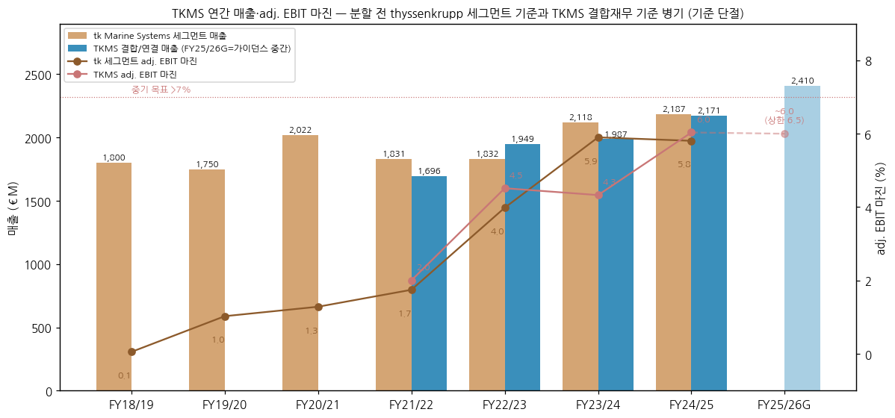
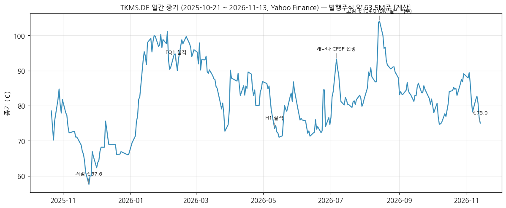
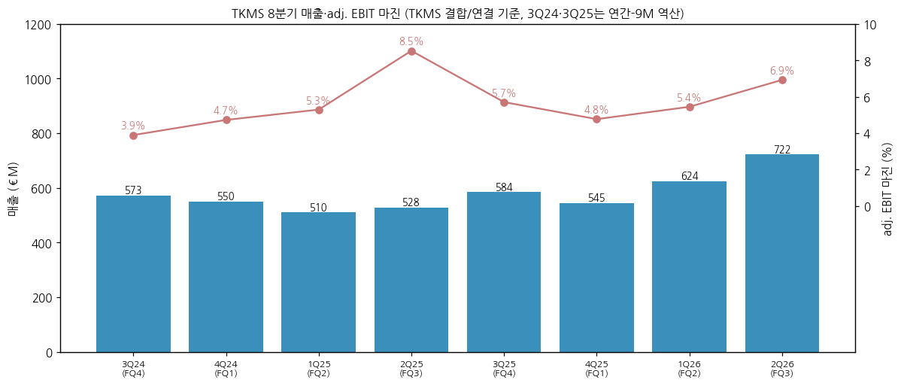
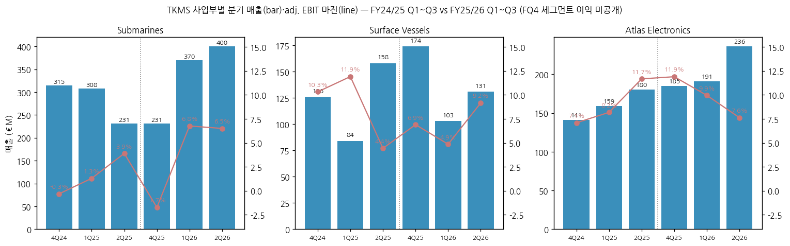
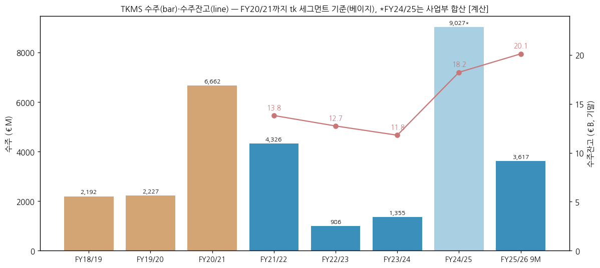
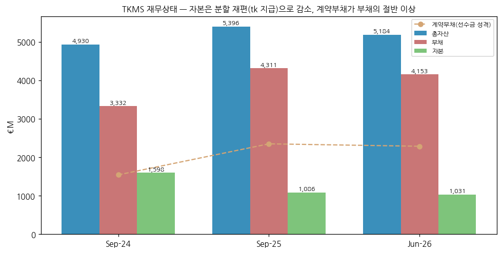
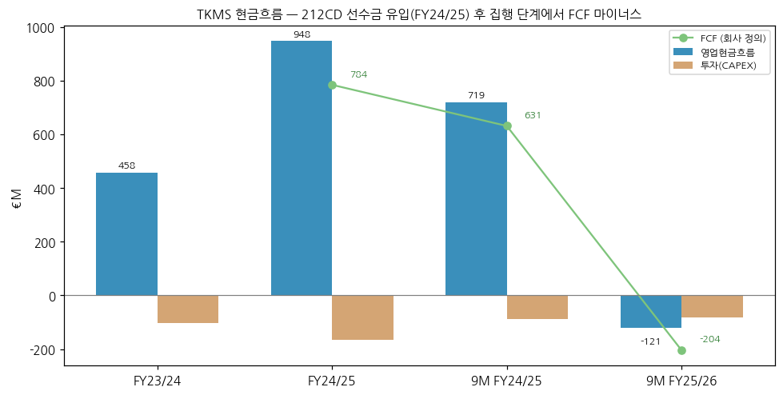

> Ticker: **Frankfurt (XETRA): TKMS — TKMS AG & Co. KGaA** (ISIN DE000TKMS001, Bloomberg TKMS:GR, Reuters TKMS.DE / 파일 키 `TKMS.DE`) / OTC ADR TKMCY
> Entity: **TKMS AG & Co. KGaA** (본사 Kiel, Germany) — 구 thyssenkrupp Marine Systems. **2025-10-20 thyssenkrupp AG에서 분할(spin-off) 상장**, 2025-12 MDAX 편입. 비핵(재래식) 잠수함·수상함(호위함)·해양 전자/무장(Atlas Electronics) 일괄 공급
> Sector: **조선 (섹터 T2 주도 후보)** — 서브섹터 **조선 글로벌** / 피어: 한화오션·HD현대중공업·삼성중공업(한국), Fincantieri·HII·Naval Group·Saab·Navantia(해외)
> 작성 시각: **2026-11-14 KST** (**v1.0**)
> 적용 구조: v4.8 (6개 섹션) — 해외(유럽) 종목·분할 상장 1년차라 12년 시계열 대신 **분할 전 thyssenkrupp 세그먼트 7년 + TKMS 결합재무 4년 + 분기 8개**로 구성
> 데이터 범위: 연간 **FY18/19~FY24/25 (thyssenkrupp Marine Systems 세그먼트 기준)** + **FY21/22~FY24/25 (TKMS Combined/연결 기준)** + **FY25/26 9M** / 분기 **8Q (FQ4 23/24 ~ FQ3 25/26)**, 사업부 6Q / 주가 2025-10-21 ~ 2026-11-13
> 회계연도: **10월~9월 (9월 결산)**. 캘린더 분기 표기 + 회계분기 병기 — 예: `2Q26 (FQ3 25/26)` = 2026-04~06
> 출처: **TKMS IR (ir.tkmsgroup.com)** — Quarterly Statement Q1·9M 25/26, Half-year Report H1 25/26, Earnings Presentation Q1·H1·9M, Investor Presentation (2026-11), CMD Presentation (2025-09-30), Combined Financial Statements 2022-2024, Condensed Combined Interim FS Q3/2025, IR 홈페이지(주주구조·컨센서스·재무일정). **thyssenkrupp AG** — Annual Report 2021/22·2023/24·2024/25 (Marine Systems in figures), Marine Systems Factsheet 2019/20. **Yahoo Finance** TKMS.DE. 보도(캐나다 총리실, dpa·Börse Express·Naval News 등, "보도 인용" 표시)
> ⚠️ **FY25/26 연간(캘린더 3Q26 포함) 실적은 2026-12-07 Annual Financial Report로 발표 예정 — v1.0 미반영. 발표 후 v1.1 갱신**

# TKMS 기업 개요 (v1.0 — 조선 T2 주도 후보 / 조선 글로벌 / 분할 상장 1년차, 레거시 소진 마진 개선기)

> **Fact verify cutoff**: 2026-11-14 (주가 2026-11-13 종가 €75.0 [Yahoo Finance], 발행주식 63,523,647주 [IR], 시가총액 약 €4.76B [계산], 상장 후 고점 2026-08-14 €104.0 / 저점 2025-11-24 €57.55 [Yahoo 종가])

## Phase 1 Source Audit

```
=== 자료 수집 audit (TKMS AG & Co. KGaA) ===
✅ 확보 (저장: company-overview-source/TKMS.DE_TKMS/, 텍스트 추출본 txt/)
- Quarterly Statement Q1 25/26 (2026-02-11), Half-year Financial Report H1 25/26 (2026-05-11), Quarterly Statement 9M 25/26 (2026-08-12)
- Earnings Presentation Q1·H1·9M 25/26, Investor Presentation (2026-11, 분기 사업부 표·FY24/25 연결 재무제표 포함)
- CMD Presentation (2025-09-30) — FY21/22~FY23/24 + LTM Q3 24/25 Combined 기준 손익·수주·잔고
- Combined Financial Statements 2022-2024, Condensed Combined Interim FS Q3/2025 (9M 23/24·9M 24/25)
- thyssenkrupp AG Annual Report 2021/22·2023/24·2024/25 (tk_group/) + Marine Systems Factsheet 2019/20 — 분할 전 세그먼트 7년
- Yahoo Finance v8 TKMS.DE 일간 (yahoo_TKMS.DE_daily.json)
❌ 누락
- FY24/25 Annual Report(TKMS 첫 연차보고서는 FY25/26분, 12/7 발표), FY24/25 사업부별 adj. EBIT, FQ1~FQ3 23/24 TKMS 기준 분기 숫자
- thyssenkrupp 기준 FY17/18 이전 Marine Systems 단독 숫자(FY19/20 이전은 세그먼트 구조 상이), 분할 전 분기 세그먼트 시계열(FQ4·FQ1 23/24 일부만)
- Prospectus(13.10.2025) 원문 정밀 판독, 컨콜 트랜스크립트, 셀사이드 리포트
```

---

## ① 기업 분류

(1) Primary / Secondary 분류

**Primary 분류: 지속성장 (장기 수주잔고형 방산 조선 — 잔고/매출 8배)**

→ 수주잔고 **€20.1B (2026-06말)** = LTM 매출 €2.48B의 약 8.1배 [계산]. 잠수함 건조 3~10년, 수상함 3~4년 프로젝트라 매출이 잔고에서 수년에 걸쳐 인식된다
→ 매출 FY21/22 €1.70B → FY24/25 €2.17B (3년 CAGR +8.6% [계산]), 중기 목표 **매출 CAGR 약 10%**, FY25/26 가이던스 +10~12%

**Secondary 노트: 마진 턴어라운드 후반 (레거시 수주 소진)**

→ adj. EBIT 마진 **FY21/22 2.0% → FY24/25 6.0% (3배)**, 중기 목표 **>7%**. 2021년 7월 이전 저마진 레거시 수주가 2028년경까지 소진되고, 신규 수주는 수주 시점 총이익률이 레거시 대비 +7%p 높다 (Investor Presentation p.49)
→ 분할 전 thyssenkrupp 세그먼트 기준으로 보면 FY18/19 마진 0.0%·FY19/20 1.0%의 바닥에서 출발한 회복이다

**3개 사업부 구조 (9M FY25/26, 연결조정 전 사업부 합계 €2,021M 기준)**

→ **(1) 잠수함 (Submarines)** — 매출 €1,001M (50%), adj. EBIT €46M, 마진 4.6% — HDW 212CD·214·209·218SG, Kiel·Wismar 조선소. **잔고의 대부분**
→ **(2) Atlas Electronics** — 매출 €612M (30%), adj. EBIT €59M, 마진 9.6% — 소나·센서·전투체계·어뢰(SeaHake)·대어뢰(SeaSpider)·기뢰대항·무인체계. **이익 1위**
→ **(3) 수상함 (Surface Vessels)** — 매출 €408M (20%), adj. EBIT €30M, 마진 7.4% — MEKO 호위함(A-100/A-200/A-400), 쇄빙연구선 New Polarstern, Wismar·브라질 Itajai 조선소

(2) Summary Box

| 지표 | 값 |
|------|-----|
| 매출 CAGR | tk 세그먼트 FY18/19→FY24/25 **+3.3%/yr** · TKMS 기준 FY21/22→FY24/25 **+8.6%/yr** [계산] → FY25/26 가이던스 +10~12% |
| adj. EBIT 마진 평균 | tk 세그먼트 7년 평균 **2.8%** · TKMS 4년 평균 **4.2%** [계산] |
| 마진 정점 | **6.0% (FY24/25, TKMS)** — 9M FY25/26 5.8%, 분기 최고 8.5% (2Q25) |
| 마진 저점 | **0.1% (FY18/19, tk 세그먼트, adj. EBIT €1M)** — 레거시 손실 |
| 사이클 | 수주는 대형 프로그램 단위로 극단적 변동 (Book-to-bill 0.5~5.4) — 이익은 잔고 덕에 단조 개선. 전통적 업황 사이클보다 **국방예산·대형 입찰 사이클** |
| 수주잔고 | Sep-22 €13.8B → Sep-24 €11.8B (저점) → Sep-25 €18.2B → **Jun-26 €20.1B (사상 최대)** |

```
[TKMS 연간 손익 시계열 (€M, 9월 결산)]  * 이익 = adj. EBIT (회사 기준)
                ── thyssenkrupp Marine Systems 세그먼트 ──   ── TKMS Combined/연결 ──
연도         수주     매출   adj.EBIT  마진      수주     매출   adj.EBIT  마진   순이익
FY18/19     2,192   1,800       1    0.1%       —        —       —       —      —   ← 바닥: 레거시 손실
FY19/20     2,227   1,750      18    1.0%       —        —       —       —      —
FY20/21     6,662   2,022      26    1.3%       —        —       —       —      —   ← 2021-07 212CD 독일2+노르웨이4척 수주
FY21/22     4,232   1,831      32    1.7%   4,326    1,696      34     2.0%     13
FY22/23       952   1,832      73    4.0%     986    1,949      88     4.5%     63   ← 수주 공백, Wismar 조선소 인수(2022)
FY23/24     1,459   2,118     125    5.9%   1,355    1,987      86     4.3%     88   ← 잔고 저점 €11.8B
FY24/25     8,759   2,187     127    5.8%  약 9,027  2,171     131     6.0%    108   ← 212CD 독일 +4척, 싱가포르 218SG +2척, New Polarstern
FY25/26 9M     —        —       —      —    3,617    1,890     110     5.8%     56   ← 분할 상장, 노르웨이 +2척, 중어뢰 DM2A5
FY25/26 G      —        —       —      —      —   2,388~2,432 130~160 최대 6.5%  —   ← 가이던스 2차 상향 (2026-08)

* 기준 단절: 두 기준은 회계정책 변경·carve-out 조정으로 다르다 (회사 각주). FY24/25 TKMS 수주는 사업부 합(연결조정 전) [계산]
```

(3) 분류 결정 논리
→ 수주는 대형 프로그램 하나(212CD, 218SG, A-200 DEU, CPSP)에 따라 연간 €1B~€9B로 움직이지만, 매출과 이익은 잔고 소진 속도(조선소 능력)에 묶여 있어 변동이 작다. 이 구조는 "사이클"보다 "잔고형 지속성장"에 가깝다
→ 다만 이익률 3배 개선의 대부분이 레거시 소진이라는 일회성 성격의 이동이라, 2028년 이후에는 "신규 수주 마진 자체"가 마진을 결정한다 → Secondary로 턴어라운드 후반을 둔다

(4) 산업 분류
→ GICS 성격: Industrials / Aerospace & Defense (해군 방산 조선)
→ 지수: MDAX (2025-12 편입, Prime Standard)
→ 워치리스트: 섹터 **조선 (T2 주도 후보)** / 서브섹터 **조선 글로벌** (중국선박공업·양쯔장조선·Seatrium·HII·Fincantieri와 함께 편입)

(5) 한국 조선 3사와의 경쟁 지점
→ **잠수함 수출 입찰이 정면 경쟁 지점이다.** 회사가 꼽은 잠수함 경쟁사는 Naval Group·한화오션·Fincantieri·Navantia·Saab Kockums·BAE, 수상함 경쟁사는 Naval Group·**HD현대**·Fincantieri·Navantia·Damen·BAE다 (Investor Presentation p.33)

| 입찰 | 결과·상태 | TKMS | 한국 |
|---|---|---|---|
| 캐나다 CPSP (최대 12척) | 2026-07-06 TKMS 우선협상자 선정, **한화오션 예비 공급자**. 계약 늦어도 2027년 말(캐나다 정부), 첫 4척 2034년 인도 | 212CD, 잠재가치 €15B+ (회사), 최종 서명 "CY26 말 예상" | 한화오션 KSS-III 탈락 — 협상 실패 시 재지정 가능 |
| 폴란드 Orka (3척) | 2026-06-29 Saab A26 계약 (SEK 47B, 보도 인용) | 탈락 | 한화오션 탈락 |
| 그리스 신형 잠수함 (4척) + 214급 성능개량 | 미결정. 2026-04 Naval Group 제안, 2026-03 한화오션-ONEX 팀 구성 (보도 인용) | 214급 성능개량은 Skaramangas와 협력 계약(2026-06, 보도 인용), 신형 경쟁 | 한화오션 KSS-III 그리스 공동 건조 제안 |
| 사우디 잠수함 | 진행 중 (세부 미확보) | — | 한화오션·HD현대중공업 거론 (한화오션 리뷰: 미래에셋·NH가 상방 요인으로 언급) |
| 인도 P-75I (6+3척) | TKMS-MDL 단독 입찰, 최종 협상, 2026-09 기준 미서명 (보도 인용) | AIP 214 기반, 설계 착수 계약 수주 | 경쟁 없음 |
| 수상함 (호위함) | A-200 DEU 4척 약 €5B 수주(2026-07), F127 단독 입찰 | MEKO 모듈 설계 | HD현대·한화오션은 동남아·중남미·중동 호위함에서 경쟁 |

→ 시사점 [판단]: 2026년 두 번의 대형 잠수함 입찰(캐나다·폴란드)에서 한화오션이 모두 졌다. TKMS의 무기는 NATO 상호운용성(독일·노르웨이와 같은 212CD 공동 함대)과 기존 설치 기반이고, 한국의 무기는 가격·납기·현지 생산이다. 남은 그리스·사우디에서 한국이 이기면 한국 특수선 내러티브가 회복되고, TKMS가 이기면 "유럽 잠수함 = TKMS" 구도가 굳어진다

(6) 적정 밸류에이션 방법
→ 1순위 **EV/adj. EBIT** — 순현금 + 잔고 선수금 구조라 EV 기준이 맞다. 시총 €4.76B − 순금융자산 €834M = EV 약 €3.93B (연금 €348M 포함 시 €4.28B) → **FY25/26E 컨센 adj. EBIT €163M 기준 24~26배, FY26/27E €201M 기준 20~21배** [계산]
→ 2순위 **EV/수주잔고** — EV/잔고 약 0.2배 [계산]. 대형 수주(CPSP) 반영 전후 비교용
→ PBR은 분할 재편으로 자본이 줄어(€1,031M) 4.6배 [계산]로 왜곡 — 보조 지표

(7) 분기 재평가 트리거 (분류 변경 조건)
→ ① adj. EBIT 마진 2개 회계연도 연속 7% 이상 + 잠수함 마진 7% 이상 → Secondary 턴어라운드 졸업
→ ② 캐나다 CPSP 본계약 + 잔고 €35B 이상 → 성장률 가정 상향 (매출 CAGR 10% → 15% 검토)
→ ③ 2개 분기 연속 adj. EBIT YoY 마이너스 또는 대형 프로젝트 원가 초과(충당금) → "지속성장" 재검토

---

## ② 회사 개요

① 기본 사항
→ 회사명: TKMS AG & Co. KGaA (주식합자회사, KGaA). 슬로건 "Your Maritime Powerhouse"
→ 사업 한 줄 정의: **비핵 잠수함 글로벌 1위(회사 주장, 2015~2024 접근 가능 시장 신규 인도 기준) + 독일 1위 중형 수상함 + 해양 소나·전투체계·어뢰를 한 회사에서 공급하는 유럽 유일의 수직계열 해군 OEM**
→ 직원: 9,115 FTE (2026-06말, 2025-09말 8,407) — Kiel 약 3,300, Bremen(Atlas) 약 1,800, Itajai(브라질) 약 900, Hamburg+Emden 약 800, Dorset(영국) 약 600, Munich 약 300, Wismar 램프업 중 (Investor Presentation p.51, Q3 24/25 기준)

② 손익·자본 추이 (단위: €M)

| 항목 | FY21/22 | FY22/23 | FY23/24 | FY24/25 | 9M FY25/26 |
|---|---|---|---|---|---|
| 매출 | 1,696 | 1,949 | 1,987 | 2,171 | 1,890 |
| 매출총이익 | — | — | 313 | 383 | 335 |
| adj. EBIT | 34 | 88 | 86 | 131 | 110 |
| 영업이익 (IFRS) | — | — | 78 | 112 | 98 |
| 순이익 | 13 | 63 | 88 | 108 | 56 |
| 자본총계 (기말) | — | — | 1,598 | 1,086 | 1,031 (Jun-26) |
| 수주잔고 (€B) | 13.8 | 12.7 | 11.8 | 18.2 | 20.1 |

→ (출처: CMD 2025 p.131, Investor Presentation 2026-11 FY24/25 재무제표, 9M Statement. FY24/25 자본 감소는 분할 재편 과정의 tk 지급·이익이전 정산 때문)


→ (출처: thyssenkrupp AR·Factsheet(베이지), TKMS CMD·Investor Presentation(파랑). FY25/26G는 가이던스 중간값)

③ 주가 역사 (상장 후 1년)
→ 2025-10-20 분할 상장 (tk 주주에게 현물 배정, 공모 없음). 첫 거래 데이터 10/21 종가 €78.5 → 2025-11-24 저점 €57.55 → 2026-01 고점 약 €100 (보도 인용) → 5/11 H1 실적 후 -6.6%(€78.7 → €73.5) → 7/6 캐나다 CPSP 선정 → 8/12 9M 실적 +8.5%, 8/14 상장 후 고점 **€104.0** → 11/13 **€75.0** (고점 대비 -28%)
→ 10/20 thyssenkrupp 지분(51%) 12개월 락업 해제. 11월 하락은 유럽 방산 섹터 약세 동반 (보도 인용)
→ 회사 집계 애널리스트 의견 Buy 70% / Hold 30% / Sell 0%, TP 중간값 €102.5 (2026-11-02, IR). 커버리지 10곳 (MWB·Bernstein·Deutsche Bank·Metzler·ODDO BHF·BofA·Citi·Kepler·Stifel·MP Capital Markets)


→ (출처: Yahoo Finance v8 TKMS.DE 일간 종가)

④ 주요 연혁
→ 2019/20 — thyssenkrupp "Marine Systems" 독립 세그먼트 보고 (FY19/20 매출 €1,750M: 잠수함 630·수상함 527·NES Atlas 436·서비스 158, Factsheet)
→ 2021-07 — 독일·노르웨이 212CD 6척(독일 2·노르웨이 4) 수주 (tk FQ4 20/21 수주 €5,846M)
→ 2022 — 독일 Wismar 조선소 인수 (잠수함·수상함 하이브리드 조선소로 전환, 확장 CAPEX €200M+ 대부분 고객 부담)
→ 2024-09 — thyssenkrupp Transrapid GmbH를 Marine Systems에 편입 (Atlas 사업부)
→ 2024-12 — 212CD 독일 4척 추가 (FQ1 24/25 수주 €5,440M), 이후 독일 6·노르웨이 4척
→ 2025 — 싱가포르(동남아 기밀 고객) 218SG 2척 추가, 독일 해군 212A 6척 성능개량·지원(회사 사상 최대 서비스 계약), New Polarstern 수주
→ 2025-08-08 — thyssenkrupp 임시주총 분할 승인 / 2025-09-30 CMD / **2025-10-20 프랑크푸르트 상장** / 2025-12 MDAX 편입
→ 2026-01 — 노르웨이 212CD 2척 추가 (노르웨이 6척, 212CD 합계 12척)
→ 2026-04 — 브라질 Tamandaré 4척 추가 MoU (Embraer와)
→ 2026-06~07 — 독일 F126 취소 → **MEKO A-200 DEU 4척(+옵션 4척) 약 €5B 계약 (7/14)**, Navantia와 2차 MoU, German Naval Yards Kiel 인수 입찰 철회
→ **2026-07-06 — 캐나다 CPSP 우선협상자 (최대 12척 212CD)**
→ 2026-09 — 이스라엘 INS DRAKON 인도 (9/2), Fincantieri와 수중 분야 협력 프레임 추진 (9/1)

---

## ③ 비즈니스 모델

① 실적 추이 — 사업부별 (단위: €M)

| 사업부 | 항목 | FY23/24 | FY24/25 | 9M FY24/25 | 9M FY25/26 | 9M YoY |
|---|---|---|---|---|---|---|
| 잠수함 | 수주 | 429 | 7,115 | 7,202 | 2,186 | -70% |
| 잠수함 | 매출 | 976 | 1,142 | 854 | 1,001 | +17% |
| 잠수함 | 매출총이익률 | 7.4% | 12.2% | — | — | |
| 잠수함 | adj. EBIT (마진) | — | — | 11 (1.3%) | 46 (4.6%) | +318% |
| 수상함 | 수주 | 57 | 1,226 | 1,183 | 36 | -97% |
| 수상함 | 매출 | 571 | 503 | 368 | 408 | +11% |
| 수상함 | 매출총이익률 | 16.7% | 16.7% | — | — | |
| 수상함 | adj. EBIT (마진) | — | — | 30 (8.1%) | 30 (7.4%) | 0% |
| Atlas Electronics | 수주 | 893 | 685 | 235 | 1,950 | +730% |
| Atlas Electronics | 매출 | 590 | 701 | 480 | 612 | +28% |
| Atlas Electronics | 매출총이익률 | 24.3% | 22.6% | — | — | |
| Atlas Electronics | adj. EBIT (마진) | — | — | 45 (9.4%) | 59 (9.6%) | +31% |
| 그룹 | 매출 | 1,987 | 2,171 | 1,587 | 1,890 | +19% |
| 그룹 | adj. EBIT (마진) | 86 (4.3%) | 131 (6.0%) | 98 (6.1%) | 110 (5.8%) | +13% |

→ (출처: Investor Presentation 2026-11 p.69 FY 사업부 표(€k → €M), 9M Statement. FY 사업부별 adj. EBIT은 미공개 — 회사는 FY24/25까지 사업부를 매출총이익으로 관리했고 FY25/26 Q1부터 adj. EBIT 관리로 바꿨다)

② 분기 시계열 — 그룹 8분기 (단위: €M)

| 분기 | 3Q24 (FQ4 23/24) | 4Q24 (FQ1 24/25) | 1Q25 (FQ2) | 2Q25 (FQ3) | 3Q25 (FQ4) | 4Q25 (FQ1 25/26) | 1Q26 (FQ2) | 2Q26 (FQ3) |
|---|---|---|---|---|---|---|---|---|
| 수주 | 미확보 | 5,440 | 157 | 3,001 | 약 447 [계산] | 904 | 2,505 | 208 |
| 매출 | 573 | 550 | 510 | 528 | 584 | 545 | 624 | 722 |
| adj. EBIT | 22 | 26 | 27 | 45 | 33 | 26 | 34 | 50 |
| 마진 | 3.9% | 4.7% | 5.3% | 8.5% | 5.7% | 4.8% | 5.4% | 6.9% |
| 매출 YoY | — | — | — | — | +2.0% | -0.9% | +22.4% | +36.7% |
| adj. EBIT YoY | — | — | — | — | +49.4% | 0.0% | +25.9% | +11.1% |
| 잔고 (€B) | 11.8 | 미확보 | 미확보 | 18.6 | 18.2 | 18.7 | 20.6 | 20.1 |

→ (출처: Quarterly Statement·Half-year Report·Investor Presentation 2026-11. 3Q24·3Q25는 연간 − 9M 역산 [계산])
→ 분할 전 tk 세그먼트 분기(기준 상이, 참고): FQ1 22/23 매출 507·adj. EBIT 19, FQ1 23/24 433·17, FQ4 20/21 572·27, FQ4 21/22 567·20, FQ4 22/23 349·27, FQ4 23/24 715·53, FQ4 24/25 585·42 (tk AR·보도)


→ (출처: 위 표)

③ 사업부별 분기 시계열 (단위: €M)

| 사업부 | 항목 | 4Q24 (FQ1 24/25) | 1Q25 (FQ2) | 2Q25 (FQ3) | 4Q25 (FQ1 25/26) | 1Q26 (FQ2) | 2Q26 (FQ3) |
|---|---|---|---|---|---|---|---|
| 잠수함 | 매출 / adj. EBIT | 315 / -1 | 308 / 4 | 231 / 9 | 231 / -4 | 370 / 25 | 400 / 26 |
| 수상함 | 매출 / adj. EBIT | 126 / 13 | 84 / 10 | 158 / 7 | 174 / 12 | 103 / 5 | 131 / 12 |
| Atlas | 매출 / adj. EBIT | 141 / 10 | 159 / 13 | 180 / 21 | 185 / 22 | 191 / 19 | 236 / 18 |
| Others/연결 | 매출 / adj. EBIT | -32 / 4 | -41 / 0 | -42 / 8 | -45 / -4 | -40 / -15 | -44 / -6 |

→ (출처: Investor Presentation 2026-11 "Quarterly details year-to-date". FQ4 24/25 사업부 adj. EBIT 미공개 — 매출만: 잠수함 288·수상함 135·Atlas 224)


→ (출처: 위 표)

④ 수주·잔고


→ (출처: tk AR·Factsheet(FY18/19~FY20/21), CMD 2025·9M Statement(FY21/22~). FY24/25 수주는 사업부 합(연결조정 전) [계산])
→ 잔고 구성(회사 언급): 독일·노르웨이 212CD 12척(2030년대 인도), 218SG 6척, MEKO 수상함, New Polarstern, Atlas 중어뢰 DM2A5·212CD용 체계. **A-200 DEU 약 €5B는 FQ4 반영 예정, CPSP는 미반영**
→ 회사 제시 파이프라인: CPSP(최대 12척, €15B+), P-75I(6+3척, 자재 패키지 방식), F127(5+1+2척), A-200 DEU 옵션 4척, 브라질 Tamandaré 4척, 포르투갈 Vasco da Gama 대체 3척, Atlas MCM(2027~28)·SeaSpider(2027~30)

⑤ 사업부별 개요·디테일

(1) 잠수함 (매출 비중 약 50%)
→ 제품: HDW Class 212CD(독일·노르웨이 공동, 다이아몬드형 선체 저신호), 214(AIP 연료전지, 수출형), 209/209NG(디젤전기 수출형), 218SG(싱가포르 맞춤형), 대형 무인잠수정 Stargazer
→ 조선소: Kiel(압력선체 라인), Wismar(2번째 압력선체 라인 구축 중). 파트너 조선소·자재 패키지 방식(튀르키예·인도) 병행
→ 디테일: 9M adj. EBIT 4배. 레거시 214(튀르키예, 자재 패키지)·동남아·지중해 기밀 고객 인도로 레거시 비중 축소. FY24/25 매출총이익률 12.2%(FY23/24 7.4%)

(2) Atlas Electronics (매출 비중 약 30%, 이익 1위)
→ 제품: 잠수함 소나(ISUS 100·CSU 100), 기뢰대항(SeaFox·SeaCat·IMCMS), 대잠(ACTAS·ASO 7x3), 중어뢰 SeaHake mod4, 대어뢰 SeaSpider(OCCAR 인증 2027), 통신, AI 소나 보조
→ 40여 개 해군 고객, FY23/24 매출의 약 73%가 비(非)TKMS 플랫폼 (Investor Presentation p.39). 프로젝트 기간이 짧아 수주가 매출로 빨리 넘어온다
→ 디테일: 9M 매출 +28%, 마진 9.6%. 4Q25 BAAINBw 중어뢰 DM2A5 프레임 계약으로 9M 수주 €1,950M

(3) 수상함 (매출 비중 약 20%)
→ 제품: MEKO A-100(경호위함)·A-200(호위함)·A-400 AMD(방공, F127 기반)·S-X(무인), 특수선 New Polarstern
→ 조선소: Wismar, 브라질 Itajai(Tamandaré 4척, 인수 비용은 초도 계약으로 회수). 파트너 조선소 모델로 CAPEX를 줄인다
→ 디테일: 9M 매출 +11%, adj. EBIT 보합. A-200 DEU 약 €5B로 FY25/26 수주가 크게 늘 예정. "A-200 타입 36개월 내 건조"

⑥ 주요 경쟁사 (회사 제시, Investor Presentation p.33)
→ 잠수함: Naval Group, **한화오션**, Fincantieri, Navantia, Saab Kockums, BAE Systems
→ 수상함: Naval Group, **HD현대**, Fincantieri, Navantia, Damen, BAE Systems
→ Atlas Electronics: Thales, Saab, Kongsberg, Lockheed Martin, Indra, Leonardo

⑦ 주요 고객
→ 독일 연방군(BAAINBw — 212CD·A-200 DEU·중어뢰·212A 성능개량), 노르웨이(212CD 6척), 싱가포르(218SG 6척, 회사는 "기밀 고객" 표기), 이스라엘(INS DRAKON 2026-09 인도), 브라질(Tamandaré), 튀르키예(214 자재 패키지), 그리스(214 성능개량), 캐나다(CPSP 협상 중), 인도(P-75I 협상 중)
→ 분할 전 지역 매출(FY19/20, tk Factsheet): 중동·아프리카 50%, 아시아태평양 21%, 독일어권 18%, 서유럽 7%, 기타 3% — 이후 독일·노르웨이 비중이 커졌다(최신 지역 매출 미확보)

⑧ 생산 CAPA·인력
→ 주요 조선소: Kiel(잠수함), Wismar(잠수함+수상함, 램프업), Itajai(브라질 수상함). Atlas: Bremen·Flintbek·Dorset 등 5곳
→ CAPEX FY23/24 약 €104M → FY24/25 €164M → FY25/26 계획 약 €200M(Wismar) → 중기 매출의 약 4%
→ 협력으로 능력 확장: Navantia(스페인) 잠수함 협력 프레임(연내 목표), Fincantieri 수중 분야 협력(연내 목표), German Naval Yards Kiel 인수 입찰은 철회
→ 인력: tk 세그먼트 기준 6,534명(FY20/21) → 6,943(FY21/22) → 7,745(FY22/23) → 8,041(FY23/24) → TKMS 8,407 FTE(Sep-25) → 9,115 FTE(Jun-26)

---

## ④ 재무 구조

① 손익계산서 (단위: €M)

| 항목 | FY23/24 | FY24/25 | 9M FY24/25 | 9M FY25/26 |
|---|---|---|---|---|
| 매출 | 1,987 | 2,171 | 1,587 | 1,890 |
| 매출원가 | -1,673 | -1,788 | -1,313 | -1,556 |
| 매출총이익 (GPM) | 313 (15.8%) | 383 (17.6%) | 274 (17.3%) | 335 (17.7%) |
| 연구개발비 | -48 | -55 | -35 | -42 |
| 판매비 | -71 | -79 | -55 | -62 |
| 일반관리비 | -115 | -140 | -97 | -129 |
| 영업이익 (IFRS) | 78 | 112 | 85 | 98 |
| adj. EBIT (마진) | 86 (4.3%) | 131 (6.0%) | 98 (6.1%) | 110 (5.8%) |
| 금융손익 | 50 | 41 | 29 | 20 |
| 법인세 | -41 | -45 | -39 | -62 |
| 순이익 (NPM) | 88 (4.4%) | 108 (5.0%) | 75 (4.7%) | 56 (3.0%) |

→ (출처: Investor Presentation 2026-11 p.59·66, 9M Statement. 9M FY25/26 법인세 증가는 브라질 원천세 일시 납부, 순이익 감소는 금융수익 감소(전년 212CD 선수금 이자)·세금 때문)
→ adj. EBIT 조정 항목(FY24/25): 영업이익 €112.5M + tk 브랜드 수수료 €4.1M + 지분법 €1.3M + 기타 특수항목 €4.4M + 거래비용 €8.6M = €130.8M

② 재무상태표 (단위: €M)

| 항목 | Sep-24 | Sep-25 | Jun-26 |
|---|---|---|---|
| 총자산 | 4,930 | 5,396 | 5,184 |
| 현금성자산 | 122 | 1,722 | 1,218 |
| 계약자산 | 401 | 300 | 399 |
| 계약부채 | 1,543 | 2,349 | 2,286 |
| 연금충당부채 | 367 | 344 | 335 |
| 부채총계 | 3,332 | 4,311 | 4,153 |
| 자본총계 | 1,598 | 1,086 | 1,031 |
| 순금융자산 | — | 1,313 | 834 |
| 순운전자본 | — | -1,330 | -1,070 |

→ (출처: Investor Presentation 2026-11 p.61·68, 9M Statement. Sep-24 현금이 작은 것은 tk 캐시풀(기타금융자산 €1,346M)에 묶여 있었기 때문)
→ 계약부채(고객 선수금 성격)가 부채의 절반 이상 — 조선 특유의 마이너스 운전자본 구조. 무차입(tk의 €300M RCF 미사용)


→ (출처: 위 표)

③ 현금흐름 (단위: €M)

| 항목 | FY23/24 | FY24/25 | 9M FY24/25 | 9M FY25/26 |
|---|---|---|---|---|
| 영업현금흐름 | 458 | 948 | 719 | -121 |
| 투자(CAPEX) | 약 -104 | -164 | -88 | -83 |
| FCF (회사 정의) | — | 784 | 631 | -204 |
| 감가상각비 | 72 | 77 | 54 | 67 |

→ (출처: Investor Presentation 2026-11 p.60·67, 9M Statement. FY23/24 CAPEX는 유형 €83.7M + 무형 €20.0M [계산])
→ FCF는 수주 선수금 타이밍을 따른다: FY24/25 212CD 선수금으로 €784M, 9M FY25/26은 집행 단계로 -€204M. 연간 FY25/26 플러스 예상(회사), 3년 누적 FCF >€400M 목표


→ (출처: 위 표)

④ CapEx
→ FY23/24 약 €104M(매출의 5.2%) → FY24/25 €164M(7.6%) → FY25/26 계획 약 €200M (Wismar 2번째 압력선체 라인, 디지털화) → 중기 매출의 약 4%로 하향. Wismar 확장 €200M+는 대부분 고객 직접 부담 (Investor Presentation p.52)

⑤ 부채 구조
→ 금융부채는 리스부채(€37M)와 소액 차입뿐, 회사채 발행 이력 없음. 연금 등 장기종업원급여 €348M (Jun-26)

⑥ 배당·자사주
→ 배당정책: IFRS 지배주주 순이익의 30~50%, FCF로 커버되는 범위 (HGB 배당가능이익 조건). **FY25/26분부터, 2027년 첫 지급**. 자사주 매입 이력 없음

⑦ 재무비율 [계산]
→ FY24/25 ROE(기말 자본) 약 9.9%, 9M FY25/26 연환산 약 7.2% / 부채비율 397% (Sep-25, 계약부채 포함) / 자기자본비율 19.9% (Jun-26) / 이자보상배율: 이자비용 €6M(FY24/25 현금 기준) 대비 의미 없음 (순현금)

---

## ⑤ 지배 구조

① 그룹·계열 관계
→ 법적 형태 AG & Co. KGaA — 일반 주주는 KGaA 주식을 갖고, 경영은 무한책임사원(General Partner)이 맡는 구조. 분할 후에도 thyssenkrupp가 51%로 지배
→ 분할(2025-10-20) 시 thyssenkrupp 주주에게 지분 49%를 현물 배정, thyssenkrupp AG 51% 보유(12개월 락업, 2026-10-20 해제). tk 쪽 회계상 TKMS는 계속 연결 대상

② 주주 구분 (2025-10-20 분할 시점, IR)

| 주주 | 지분 |
|---|---|
| thyssenkrupp AG | 51.00% |
| Alfried Krupp von Bohlen und Halbach-Stiftung | 10.00% |
| 유동주식 (Free float) | 39.00% |

→ 발행주식 63,523,647주 (무액면 무기명 보통주), Prime Standard, 결제대행 Commerzbank
→ 2026-07 공매도 순포지션 0.50% 1건 (보도 인용)

③ 임원 (Management Board)
→ CEO **Oliver Burkhard** (2022~) / CFO **Paul Glaser** (2021~) / COO Dr. Andreas Görgen (2026~) / CHRO Angelika Kambeck (2025~) / CTO Dr. Dirk Steinbrink (2023~) (Investor Presentation p.25)
→ 보상: STI = EBT 40%·매출 인식 30%·개인 30%, LTI(4년) = 상대 TSR 80%·재해율 20%, 경영진은 연봉 1년치 주식 보유 의무
→ 감사회 구성 세부: 미확보

---

## ⑥ 기타 팩트

① R&D
→ 연구개발비 FY23/24 €48M(매출의 2.4%) → FY24/25 €55M(2.5%) → 9M FY25/26 €42M(2.2%) — 고객 개발비 펀딩으로 자체 부담을 줄이는 구조 (CMD)
→ 개발 중: IDAS(잠수함 발사 대공·대함 미사일, 2030년대), SeaHake mod5(2029 기본형), SeaSpider(OCCAR 인증 2027), MEKO S-X(무인 수상함), Stargazer(대형 UUV), AI 소나 보조(2026 계약), AI 허브(Munich)

② 진행 중 corporate action
→ Navantia 잠수함 협력 프레임(2차 MoU, 연내 목표), Fincantieri 수중 분야 협력 프레임(연내 목표), F127 JV(과반 지분, 단독 입찰), German Naval Yards Kiel 입찰 철회(2026-08), thyssenkrupp 락업 해제 후 지분 정책

③ 주요 리스크 (회사 리스크 보고 + [판단])
→ 공급망 가용성(장기 프로젝트 지연), 소프트웨어 라이선스 비용·모델 변화 (9M에 신규 중점 리스크로 추가)
→ 사이버 공격·드론 정찰·인력 접근 등 보안 위협 증가
→ 대형 고정가 프로젝트 원가 초과 (레거시 손실 이력), Wismar 램프업 실행
→ 독일 수출 통제 정책 변화(수출 허가) [판단], 고객 집중(독일 정부)
→ 대주주 thyssenkrupp 지분 매각 물량 [판단]

④ 비재무
→ Sustainability Report 2024/25 발간 (2025-12-08). ESG 등급 미확보

---

## Activity 보고 (v1.0 finalize)

### 확보 자료
→ TKMS IR 원문 10건(분기·반기 보고서, 발표자료, CMD, Combined FS), thyssenkrupp AR 3건 + Factsheet, Yahoo 주가, IR 홈페이지(주주·컨센·재무일정)

### 누락 자료
→ FY24/25 사업부별 adj. EBIT, FQ1~FQ3 23/24 TKMS 기준 분기, 분할 전 분기 세그먼트 시계열 전체, FY17/18 이전 Marine Systems 단독, 감사회·ESG 등급, 셀사이드 리포트, 컨콜 트랜스크립트

### 추정·계산 데이터 표시
→ 3Q24·3Q25 분기 = 연간 − 9M 역산, FY24/25 수주 = 사업부 합, 밸류에이션·비율은 모두 [계산]

### Data Quality Confidence: **80%** (분할 1년차라 장기 시계열이 두 기준으로 끊김)

---

## Version Log

| 버전 | 일자 | 내용 |
|---|---|---|
| v1.0 | 2026-11-14 | 최초 작성 — tk 세그먼트 7년 + TKMS 4년 + 9M FY25/26, 분기 8Q·사업부 6Q, 차트 7종(chart1·2·3·4·6·10·11), 한국 조선 3사 경쟁 지점(잠수함 수출 입찰) |

**v1.1 갱신 예정 (2026-12-07 FY25/26 Annual Financial Report 이후)**
→ FY25/26 연간 확정 + FQ4(캘린더 3Q26) 분기 추가, 사업부별 연간 adj. EBIT
→ FY26/27 가이던스·첫 배당 반영, A-200 DEU 수주·연말 잔고
→ 캐나다 CPSP 계약 여부, 인도 P-75I·그리스 입찰 결과에 따라 ① (5) 경쟁 표 갱신
→ 첫 Annual Report의 세그먼트·지역·고객 공시로 ③ ⑦ 보강
