> Ticker: **NYSE: TME (ADS, 1 ADS = Class A 2주) / HKEX: 1698** — Tencent Music Entertainment Group
> Entity: **Tencent Music Entertainment Group** (케이맨 설립, 운영 본사 중국 선전) — 중국 최대 온라인 음악·오디오 플랫폼 (QQ Music·Kugou Music·Kuwo Music·WeSing·Ximalaya)
> Sector: 엔터 — 서브섹터 **음원 글로벌** (UMG·Spotify와 묶음. 중국 스트리밍 단가·SVIP 프리미엄화 + 디어유 버블 QQ뮤직 협업의 read-through)
> 작성 시각: **2026-11-15 KST** (**v1.0** — Phase 1 Source 수집 + audit + 차트 12종(대체 포함))
> 적용 구조: v4.8 (6개 섹션) + v1.5 ① 기업 분류 표준 (서술 간결판)
> 데이터 범위: **연간 10년 (2016\~2025, 12월 결산, IFRS)** — 2016은 CMC 합병(7월) 이후 연결 / **분기 16Q (3Q22\~2Q26)** 사업부 매출·매출총이익·영업비용·이익 / KPI(가입자·ARPPU·MAU)는 **4Q25까지만** (2026년부터 공시 중단)
> 출처: **SEC 20-F** (FY2018·FY2020·FY2022·FY2024·FY2025), **SEC XBRL companyfacts** (FY2016\~FY2024 연간), **HKEX 실적 발표문** (3Q23·4Q23·1Q24·3Q25·4Q25·1Q26·2Q26), Yahoo Finance (월간·일간 주가)
> ⚠️ **3Q26 실적은 2026-11-17 (미국 장전, 웨비나 ET 06:00 / KST 20:00) 발표 예정** — 발표 후 v1.1 갱신. 이 문서의 최신 분기는 **2Q26**

# Tencent Music 기업 개요 (v1.0 — 음원 글로벌 / 중국 음악 스트리밍 1위 / 구조전환형 지속성장)
> **Fact verify cutoff**: 2026-11-15 (ADS 2026-11-13 종가 **$9.05** [Yahoo] / 52주 범위 $7.74(2026-10-02)\~$18.93(2025-11-14) [Yahoo 일간] / 시가총액 **약 $14.2bn** [계산: 보통주 3,147.8백만주(2026-03-31, 20-F) ÷ 2 = 1,573.9백만 ADS × $9.05] / 월말 종가 기준 고점 **2021-01 $26.60**, 저점 **2022-10 $3.61** [Yahoo 월간])

## Phase 1 Source Audit

```
=== 자료 수집 audit (Tencent Music Entertainment Group) ===

✅ 확보
- SEC 20-F 8건 (FY2018~FY2025) — 사업 개요·연간 손익·KPI·주주·임원·현금흐름
- SEC XBRL companyfacts — FY2016~FY2024 연간 손익·재무상태·현금흐름·CapEx·자사주
- HKEX 실적 발표문 PDF 7건 (3Q23·4Q23·1Q24·3Q25·4Q25·1Q26·2Q26) — 분기 손익·사업부 매출·KPI
- Yahoo Finance 월간 주가 (2019-01~) + 일간 1년

❌ 누락
- SEC 6-K 실적 보도자료 본문(Ex-99.1): SEC가 403 차단 → HKEX PDF로 대체
- 2Q24·2Q25·3Q24·4Q24 단독 PDF (전년 동기·누적 칸으로 역산/보강)
- 3Q22 이전 분기 시계열 (2018~2Q22) — 연간으로만 표기
- 2018~2020 임직원 수, ESG 등급
- ir/2024-08-14_2Q24_results.pdf 는 Tencent Holdings 반기보고서(오다운로드) → 미사용, _to_delete 이동

⚠️ 결과 영향
- 분기 시계열 16Q (v4.8 표준 60Q 대비 짧음) — 2016~2022 흐름은 연간 표로 보완
- KPI(MAU·유료 가입자·ARPPU·SVIP)는 4Q25가 마지막 공시치 → 2026 이후는 경영진 정성 코멘트만
- '영업이익'은 회사 공시(이자수익·기타손익 포함)와 핵심 영업이익(매출총이익−영업비용)을 병기

Source 6종 audit:
[V] (1) 정기 보고서 — 20-F 8건 ✓
[V] (2) 실적 발표문 — 분기 7건 + 전년 동기·누적 칸 보강 ✓
[ ] (3) Sustainability — 미수집
[V] (4) 주가 — 월간 2019~ / 일간 1년 ✓
[ ] (5) CMD — 해당 없음 (투자자의 날 자료 미수집)
[△] (6) 12년 시계열 — 회사 출범(2016) 이후 10년 ✓ (12년 불가)
→ 최신 분기 2Q26 (2026-08-11 발표) 확보. 3Q26은 11/17 발표 예정.
```

---

## ① 기업 분류

(1) Primary / Secondary 분류

**Primary 분류: 지속성장 (구조전환형 — 구독 프리미엄화)**

→ 매출 2017 RMB 109.8억 → 2025 RMB 329.0억 (8년 CAGR **+14.7%** [계산]) — 다만 2019→2025는 CAGR **+4.4%** [계산]: 고성장 → 정체(2021\~2023) → 재가속(2024\~2025)

→ 2021\~2023 소셜 엔터(라이브 스트리밍·노래방) 매출 반토막 + 음악 매출 2배 → **사업 믹스 전환**. 음악 비중 2021 36.7% → 2025 81.2% [계산]

→ 핵심 영업이익률(매출총이익−영업비용) 2021 **8.7%** → 2025 **29.4%** [계산] — 구독 단가(ARPPU)·SVIP·저마진 소셜 축소가 동시에 작동

**Secondary 노트: 규제·플랫폼 경쟁 민감**

→ 2021 반독점 처분(독점 판권 해제), 숏폼(Douyin·Soda Music) 경쟁, 2026 KPI 공시 중단 이후 주가 디레이팅(2026-03-17 하루 −24.7%)

(2) Summary Box (10년, 2016\~2025)

| 항목 | 값 |
|---|---|
| 매출 CAGR | 2017→2025 **+14.7%** / 2019→2025 **+4.4%** [계산] |
| 핵심 OPM 평균 | 2017\~2025 평균 **16.7%** [계산] (2016 합병 첫해 1.9% 제외) |
| 핵심 OPM 정점 / 저점 | **29.4% (2025)** / 8.7% (2021) |
| 사이클 | 경기 사이클보다 **규제·믹스 전환 사이클** — 2018\~2020 확장 → 2021\~2022 규제 조정 → 2023\~ 프리미엄화 |
| 분류 결정 | 지속성장 (구독 단가 주도) + 규제 디스카운트 |

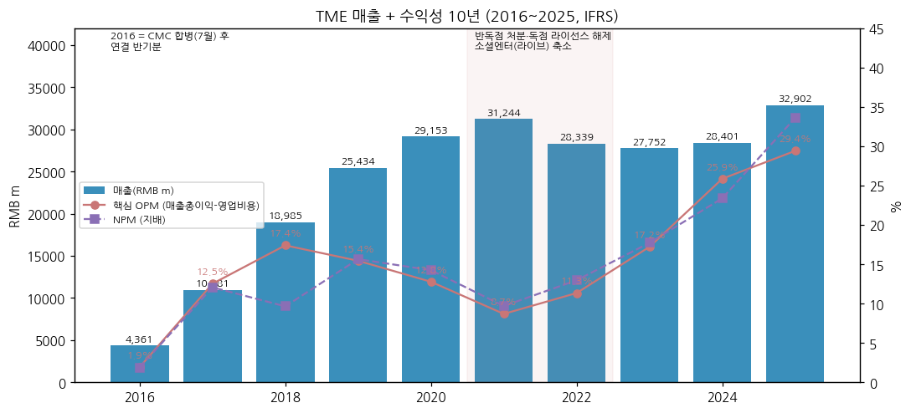

(3) 정량 근거 — 10년 손익 (RMB 백만)

| 연도 | 매출 | 음악 | 소셜·기타 | 매출총이익 | GPM | 영업비용 | 핵심 영업이익 | 핵심 OPM | 공시 영업이익 | 순이익(지배) | NPM |
|---|---:|---:|---:|---:|---:|---:|---:|---:|---:|---:|---:|
| 2016* | 4,361 | 2,144 | 2,217 | 1,232 | 28.3% | 1,148 | 84 | 1.9% | 103 | 82 | 1.9% |
| 2017 | 10,981 | 3,149 | 7,832 | 3,810 | 34.7% | 2,434 | 1,376 | 12.5% | 1,593 | 1,326 | 12.1% |
| 2018 | 18,985 | 5,536 | 13,449 | 7,277 | 38.3% | 3,972 | 3,305 | 17.4% | 2,039 | 1,833 | 9.7% |
| 2019 | 25,434 | 7,152 | 18,282 | 8,673 | 34.1% | 4,744 | 3,929 | 15.4% | 4,622 | 3,982 | 15.7% |
| 2020 | 29,153 | 9,349 | 19,804 | 9,302 | 31.9% | 5,576 | 3,726 | 12.8% | 4,710 | 4,155 | 14.3% |
| 2021 | 31,244 | 11,467 | 19,777 | 9,404 | 30.1% | 6,687 | 2,717 | 8.7% | 3,800 | 3,029 | 9.7% |
| 2022 | 28,339 | 12,483 | 15,856 | 8,773 | 31.0% | 5,557 | 3,216 | 11.3% | 4,443 | 3,677 | 13.0% |
| 2023 | 27,752 | 17,325 | 10,427 | 9,795 | 35.3% | 5,018 | 4,777 | 17.2% | 6,059 | 4,920 | 17.7% |
| 2024 | 28,401 | 21,742 | 6,659 | 12,025 | 42.3% | 4,676 | 7,349 | 25.9% | 8,710 | 6,644 | 23.4% |
| **2025** | **32,902** | **26,726** | **6,176** | **14,535** | **44.2%** | **4,857** | **9,678** | **29.4%** | **13,364** | **11,056** | **33.6%** |

※ *2016은 2016-07 CMC(Kugou·Kuwo) 합병 이후 연결분 포함. 2018 공시 영업이익은 IPO 관련 주식보상 등으로 핵심 대비 낮음.
※ 공시 영업이익 = 매출총이익 − 영업비용 + 이자수익 + 기타손익. 2025는 **1Q25 관계회사 간주처분이익 RMB 23.7억** 포함(관계회사로부터 UMG 지분 2%를 현물배당으로 수령) → 핵심 영업이익 기준 판단 권장.
※ Non-IFRS 순이익(지배): 2024 RMB 76.7억 → 2025 **RMB 95.9억** [4Q25 발표문]. 출처: 2016\~2024 XBRL·20-F, 2025 4Q25 발표문.

(4) 산업 분류

→ 워치리스트: 대분류 **소비재** / 섹터 **엔터** / 서브섹터 **음원 글로벌** (핵심: UMG·Spotify·TME)
→ 성격: 중국 디지털 음악 DSP(스트리밍 플랫폼) + 오디오(롱폼, Ximalaya) + 오프라인 공연·MD

(5) 분류 결정 논리

→ 성장 엔진이 **가입자 수 → 단가(ARPPU)·SVIP**로 이동 (유료 가입자 YoY 2023 +20% → 4Q25 +5.3%, ARPPU는 4Q25 +7.2%)
→ 소셜 엔터 축소가 거의 끝나(2025 매출 비중 18.8%) 2026부터 전사 성장률 = 음악 성장률에 수렴
→ 순현금(2025말 약 RMB 345억 [계산])·FCF 90억대로 주주환원 여력이 큼 → 지속성장형 현금창출 구조

(6) 적정 밸류에이션 방법

→ 1순위 **PER (Non-IFRS 순이익 기준)** — 일회성 투자손익이 커서 IFRS 순이익 왜곡
→ 2순위 **EV/핵심 영업이익** — 순현금·투자자산(FVOCI 2025말 RMB 262억)이 시총의 1/3 이상
→ 참고(시점 2026-11-13): TTM 순이익(지배, 3Q25\~2Q26) RMB 89.2억 / 시총 약 RMB 996억(환율 6.99) → **PER 약 11.2배** [계산] / 순현금 차감 EV 약 RMB 650억 → **EV/TTM 핵심 영업이익(99.8억) 약 6.5배** [계산]

(7) 분기 재평가 트리거

→ 음악 관련 서비스 매출 YoY 10% 유지 여부 (2Q26 +11.0%)
→ 멤버십(구독) 매출 성장률 (2Q26 +8.1%, Ximalaya 포함) — 한 자릿수 초반 둔화 시 디레이팅
→ 핵심 OPM 30% 안착 vs Ximalaya 통합 비용
→ KPI 공시 재개 여부, SVIP 정성 코멘트 / 숏폼·Soda Music 경쟁
→ 자사주 매입 속도 (2Q26 $4억)

---

## ② 회사 개요

① 기본 사항

| 항목 | 내용 |
|---|---|
| 회사명 | Tencent Music Entertainment Group (腾讯音乐娱乐集团) |
| 설립·출범 | 2016-07 Tencent가 QQ Music과 China Music Corporation(Kugou·Kuwo)을 합병해 출범 |
| 상장 | **NYSE 2018-12-12** (공모가 $13/ADS) / **HKEX 2022-09-21** 소개 상장(2차, 코드 1698) |
| 사업 한 줄 | 중국 최대 음악 스트리밍(QQ Music·Kugou·Kuwo) + 롱폼 오디오(Ximalaya) + 소셜 엔터(WeSing·라이브) 플랫폼 |
| Executive Chairman | Cussion Kar Shun Pang (彭迦信, 2021-04\~, 2016\~2021 CEO) |
| CEO | Zhu Liang (Ross Liang, 梁柱, 2021-04\~) |
| 지배주주 | **Tencent Holdings** — 지분 57.2% / 의결권 93.6% (2026-03-31, 20-F) |
| 임직원 | 5,185명(2023) → 5,353명(2024) → **5,690명(2025)** [20-F] |
| 배당 정책 | 2024년(FY2023분)부터 연간 현금배당 — FY2025분 **ADS당 $0.24 (보통주 $0.12), 총 약 $3.68억** |

② 10년 손익·자본 추이

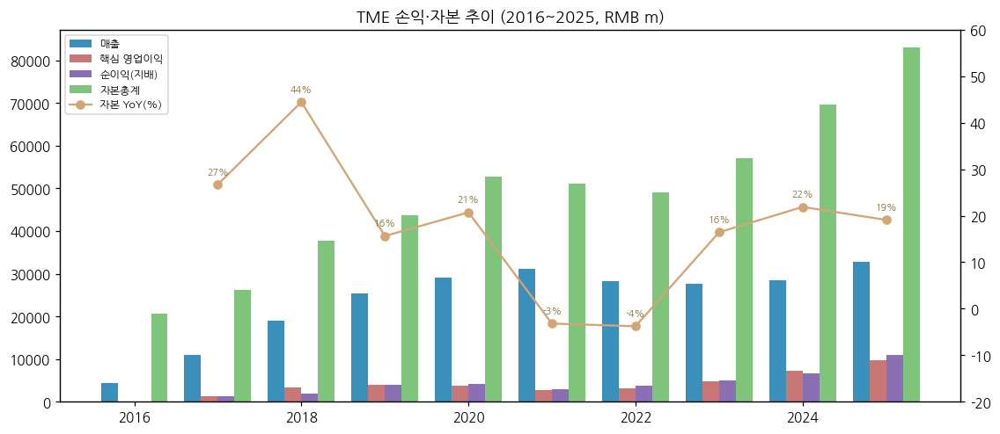

→ 자본총계 2016 RMB 206억 → 2025 **RMB 830.5억** (9년간 4배 [계산]) — 무차입에 가까운 이익잉여 + 투자자산(UMG·Spotify 등) 평가이익 누적

③ 회사 주가 역사 (narrative)

→ **2018-12 NYSE 상장 $13** → 2019\~2020 $10\~16 박스권
→ **2021-01 월말 $26.60 고점** (시총 약 $40bn+) → 2021-03 아케고스(Archegos) 블록딜 매도 + 2021-07 반독점 처분(독점 판권 해제) + 중국 플랫폼 규제 → **2022-10 $3.61 저점** (−86%)
→ 2022-09 HKEX 2차 상장 → 2023\~2025 구독 프리미엄화·마진 확대로 재평가, **2025-08 월말 $24.52** (2021 고점 근접)
→ 2025-11 3Q25 실적 직후 $18.9 → **2026-03-17 4Q25 실적 다음 날 −24.7% ($15.09→$11.37)**, 이틀간 −31.7% [Yahoo 일간] — 구독 성장 둔화(4Q25 구독 매출 +13.2%), KPI 공시 중단, 숏폼 경쟁 우려가 거론
→ 2026-10-02 52주 저점 $7.74 → **2026-11-13 $9.05** (시총 약 $14.2bn)

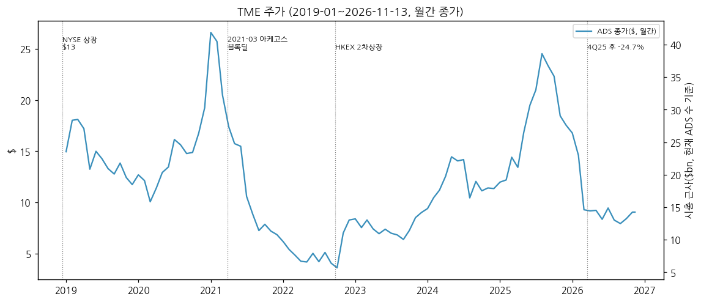

④ 주요 연혁

| 시점 | 사건 |
|---|---|
| 2003\~2005 | QQ Music 출시(Tencent), Kugou·Kuwo 설립 |
| 2016-07 | Tencent, China Music Corp(Kugou·Kuwo)과 QQ Music 합병 → **TME 출범** |
| 2017-12 | **Spotify와 지분 교환** (TME 지분 ↔ Spotify 지분) |
| 2018-12-12 | NYSE 상장 ($13/ADS) |
| 2020-03 | Tencent 컨소시엄(TME 참여)이 UMG 지분 10% 인수, 2021-01 추가 10% |
| 2021-07 | 중국 SAMR 반독점 처분 — 음악 독점 판권 30일 내 해제 명령 |
| 2022-09-21 | HKEX 소개 상장 |
| 2023 | 라이브 스트리밍 규제 강화 → 소셜 엔터 매출 −34% / 음악 +39% |
| 2024 | 첫 연간 현금배당, SVIP(超级会员) 확대 |
| 2025-03 | 관계회사로부터 **UMG 지분 2% 현물 수령** (간주처분이익 RMB 23.7억) |
| 2025\~ | 디어유 **bubble QQ Music 입점**, Weverse DM 도입(HYBE 등 약 170명 아티스트, 4Q25) |
| 2025-12 | SVIP 가입자 **2,000만 돌파** (연말 기준) |
| 2026-03 | 4Q25 발표부터 MAU·유료 가입자·ARPPU 정기 공시 중단 |
| 2026-05-18 | **Ximalaya(喜马拉雅) 인수 완료** — 2Q26부터 연결 |
| 2026 1Q | '온라인 음악 서비스' → **'음악 관련 서비스'**로 명칭 변경(롱폼 오디오 포함) |

---

## ③ 비즈니스 모델

① 실적 추이 통합 표 (5년, RMB 백만)

| 항목 | 2021 | 2022 | 2023 | 2024 | 2025 | 2025 비중 |
|---|---:|---:|---:|---:|---:|---:|
| **음악 관련 서비스 (구 온라인 음악)** | 11,467 | 12,483 | 17,325 | 21,742 | 26,726 | 81.2% |
| └ 음악 구독 | 7,320 [역산] | 8,700 [역산] | 12,100 | 15,230 | 17,660 | 53.7% |
| └ 음악 구독 외 (광고·공연·MD·라이선스) | 4,147 [역산] | 3,783 [역산] | 5,225 [계산] | 6,512 [계산] | 9,066 | 27.6% |
| **소셜 엔터·기타** (WeSing·라이브) | 19,777 | 15,856 | 10,427 | 6,659 | 6,176 | 18.8% |
| **합계** | **31,244** | **28,339** | **27,752** | **28,401** | **32,902** | 100% |
| 매출총이익 | 9,404 | 8,773 | 9,795 | 12,025 | 14,535 | GPM 44.2% |
| 핵심 영업이익 | 2,717 | 3,216 | 4,777 | 7,349 | 9,678 | 29.4% |

※ 음악 구독: 2023 RMB 121.0억(+39.1%), 2024 152.3억, 2025 176.6억(+16.0%) [발표문]. 2021·2022 구독은 2023 성장률(+39.1%)로 2022를 역산(약 87억), 2021은 [역산·추정치] — 정확한 원문 수치는 v1.1에서 20-F로 교체.
※ 회사는 사업부별 영업이익을 공시하지 않음 → 사업부 표는 매출만.

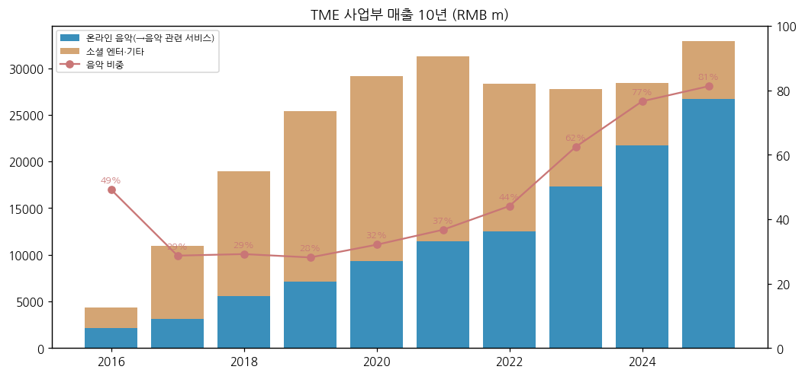

① 16분기 시계열 (RMB 백만)

| 분기 | 매출 | YoY | 음악 | 소셜·기타 | 매출총이익 | GPM | 핵심 영업이익 | 핵심 OPM | 공시 영업이익 | 순이익(지배) | 비고 |
|---|---:|---:|---:|---:|---:|---:|---:|---:|---:|---:|---|
| 3Q22 | 7,365 | — | 3,430 | 3,935 | 2,403 | 32.6% | 966 | 13.1% | 1,261 | 1,061 | |
| 4Q22 | 7,425 | — | 3,559 | 3,866 | 2,447 | 33.0% | 1,086 | 14.6% | 1,388 | 1,151 | |
| 1Q23 | 7,004 | — | 3,501 | 3,503 | 2,315 | 33.1% | 1,086 | 15.5% | 1,381 | 1,148 | |
| 2Q23 | 7,286 | — | 4,249 | 3,037 | 2,497 | 34.3% | 1,242 | 17.0% | 1,539 | 1,298 | [9M−1Q−3Q 역산] |
| 3Q23 | 6,569 | −10.8% | 4,553 | 2,016 | 2,342 | 35.7% | 1,074 | 16.3% | 1,425 | 1,168 | |
| 4Q23 | 6,893 | −7.2% | 5,022 | 1,871 | 2,641 | 38.3% | 1,375 | 19.9% | 1,714 | 1,306 | |
| 1Q24 | 6,768 | −3.4% | 5,007 | 1,761 | 2,771 | 40.9% | 1,635 | 24.2% | 1,959 | 1,422 | |
| 2Q24 | 7,160 | −1.7% | 5,424 | 1,736 | 3,010 | 42.0% | 1,862 | 26.0% | 2,198 | 1,682 | [FY−1Q−3Q−4Q 역산] |
| 3Q24 | 7,015 | +6.8% | 5,480 | 1,535 | 2,991 | 42.6% | 1,773 | 25.3% | 2,144 | 1,583 | |
| 4Q24 | 7,458 | +8.2% | 5,831 | 1,627 | 3,253 | 43.6% | 2,079 | 27.9% | 2,409 | 1,957 | |
| 1Q25 | 7,356 | +8.7% | 5,804 | 1,552 | 3,242 | 44.1% | 2,099 | 28.5% | 4,836 | 4,291 | 간주처분이익 23.7억 |
| 2Q25 | 8,442 | +17.9% | 6,854 | 1,588 | 3,749 | 44.4% | 2,593 | 30.7% | 2,978 | 2,409 | |
| 3Q25 | 8,463 | +20.6% | 6,969 | 1,494 | 3,682 | 43.5% | 2,371 | 28.0% | 2,710 | 2,153 | |
| 4Q25 | 8,641 | +15.9% | 7,099 | 1,542 | 3,862 | 44.7% | 2,615 | 30.3% | 2,840 | 2,203 | |
| 1Q26 | 7,895 | +7.3% | 6,514 | 1,381 | 3,546 | 44.9% | 2,335 | 29.6% | 2,647 | 2,091 | 명칭 '음악 관련 서비스' |
| **2Q26** | **8,933** | **+5.8%** | **7,605** | **1,328** | **3,949** | **44.2%** | **2,654** | **29.7%** | **3,035** | **2,471** | Ximalaya 5/18 연결(매출 407) |

※ 출처: HKEX 분기 발표문 당분기·전년 동기 칸. 역산 분기는 누적(9M·FY)에서 차감 [역산].

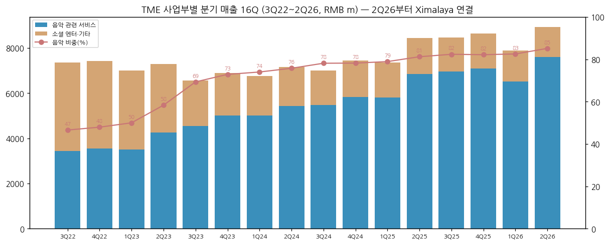

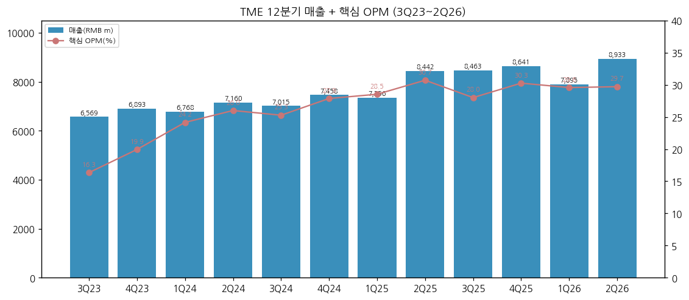

**2Q26 핵심 박스 (2026-08-11 발표, 최신)**
- 매출 RMB 89.3억 (+5.8%) — 음악 관련 76.1억(**+11.0%**), 소셜·기타 13.3억(−16.4%)
- 멤버십 매출 47.9억(+8.1%, Ximalaya 연결 포함) / 마케팅·소비(광고·공연·MD) 28.1억(+16.2%) [계산]
- 핵심 OPM 29.7% (전년 30.7% 대비 −1.0pp), 순이익(지배) 24.7억 (+2.6%)
- 자사주 매입 **4,350만 ADS, 약 $4억 (평균 $9.2)** — 분기 기준 최대급

**KPI (마지막 공시 4Q25까지 — 이후 공시 중단)**

| 분기 | 3Q22 | 4Q22 | 1Q23 | 3Q23 | 4Q23 | 1Q24 | 3Q24 | 4Q24 | 3Q25 | **4Q25** |
|---|---:|---:|---:|---:|---:|---:|---:|---:|---:|---:|
| 음악 유료 가입자(백만) | 85.3 | 88.5 | 94.4 | 103.0 | 106.7 | 113.5 | 119.0 | 121.0 | 125.7 | **127.4** |
| 월 ARPPU(RMB) | 8.8 | 8.9 | 9.2 | 10.3 | 10.7 | 10.6 | 10.8 | 11.1 | 11.9 | **11.9** |
| 음악 모바일 MAU(백만) | 620 | 601 | 592 | 594 | 576 | 578 | 576 | 556 | 551 | **528** |

→ 연평균 유료 가입자: 2018 24.4 → 2020 49.4 → 2022 84.2 → 2024 117.6 (백만) [20-F]
→ **SVIP 가입자: 2024-3Q 1,000만 → 2025-2Q 1,500만 → 2025말 2,000만+** (SVIP 월 요금 약 RMB 40 vs 일반 약 RMB 8\~15) [발표문·MBW]
→ 유료 전환율(유료/MAU) 4Q25 약 24% [계산] — Spotify(약 39%) 대비 낮아 추가 전환 여지

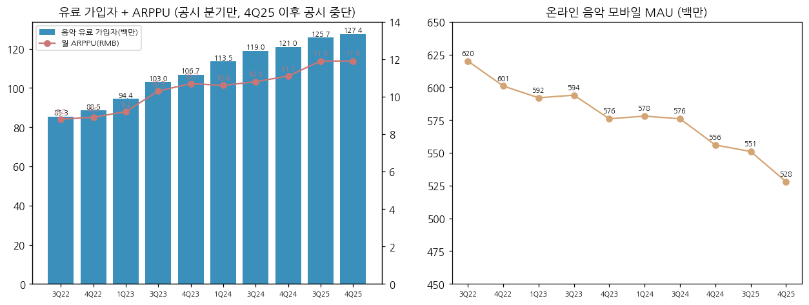

② 사업부별 개요 (매출 비중 순)

- **음악 관련 서비스 (81.2%)** — ① **멤버십(구독)**: QQ Music·Kugou·Kuwo 유료 회원, SVIP(고음질·아티스트 특전·디지털 앨범·공연 선예매), bubble·Weverse DM·팬클럽 멤버십, 2026부터 Ximalaya 롱폼 오디오 회원 / ② **마케팅·소비**: 광고(광고형 무료 요금제 포함), 오프라인 공연(TMElive), 아티스트 MD, 디지털 앨범 / ③ 음원 서브라이선스
- **소셜 엔터·기타 (18.8%)** — WeSing(온라인 노래방), Kugou·Kuwo 라이브 스트리밍(가상 선물). 2021 이후 규제·수익배분율 상승으로 축소 지속, 2Q26 −16.4%

③ 사업부별 디테일

- **프리미엄화가 성장의 중심**: 3Q25 ARPPU +10.2%의 주 원인이 SVIP 확대 [발표문] / 2026 1Q·2Q는 bubble·Weverse DM·팬클럽 멤버십 등 신규 멤버십이 구독 매출 성장에 기여 [1Q26 발표문]
- **K-pop 연결고리**:
  - **디어유 bubble — QQ Music 입점** (중국판 bubble, TME가 운영·로열티 정산). 3Q25 국내 레이블 아티스트 15명 추가, 2025\~2026 C-pop 아티스트 입점 확대 (디어유 측: 2025-11 15명 → 2026-02 35명 [한경 2026-02]) — 디어유의 중국 로열티 매출로 연결
  - QQ Music **Weverse DM** 도입 — HYBE 등 약 170명 아티스트 (4Q25) [발표문]
  - SVIP 특전에 aespa·RIIZE·RENJUN 등 K-pop 디지털 앨범·기프트 패키지 (2Q26) / G-DRAGON 중국 6개 도시 공연 주최(3Q25)
- **오프라인 공연·MD 고성장**: 2025 음악 구독 외 매출 RMB 90.7억 (+39.2%) [4Q25 발표문]
- **Ximalaya**: 중국 1위 롱폼 오디오(팟캐스트·오디오북). 2Q26 매출 기여 RMB 4.07억(약 6주), 백엔드 통합 진행 중 — 멤버십 매출 증가 요인
- **비용 구조**: 영업비용/매출 2021 21.4% → 2025 14.8% [계산]. 판관비 내 R&D 약 23억(2025)

④ 주요 경쟁사

| 영역 | 경쟁사 |
|---|---|
| 음악 스트리밍(중국) | **NetEase Cloud Music** (HKEX 9899), **ByteDance 汽水音乐(Soda Music)**·Douyin 숏폼 음악, Apple Music China |
| 롱폼 오디오 | Lizhi, 喜马拉雅 인수로 1위 확보 / ByteDance 番茄畅听 |
| 라이브·소셜 | Douyin·Kuaishou 라이브, Huya·DouYu |
| 글로벌 비교 | Spotify (유료 전환율·ARPU 벤치마크) |

⑤ 주요 매출처 / 공급처

→ 매출처: 개인 가입자·광고주 (특정 고객 의존 없음)
→ **콘텐츠 공급처(원가의 핵심)**: Universal·Sony·Warner 3대 메이저 + 중국·한국·일본 레이블 (2021 반독점 처분 이후 비독점 라이선스) — 매출원가의 대부분이 라이선스 비용·수익배분 [20-F 서술]
→ 관계: Tencent(모회사·결제·트래픽), Spotify(상호 지분)

⑥ 생산 CAPA + 임직원

→ 제조 설비 없음 (플랫폼) / 임직원 5,185(2023) → 5,353(2024) → 5,690(2025) — 대부분 중국 [20-F]

---

## ④ 재무 구조

① 손익계산서 — ① (3) 10년 표 참조

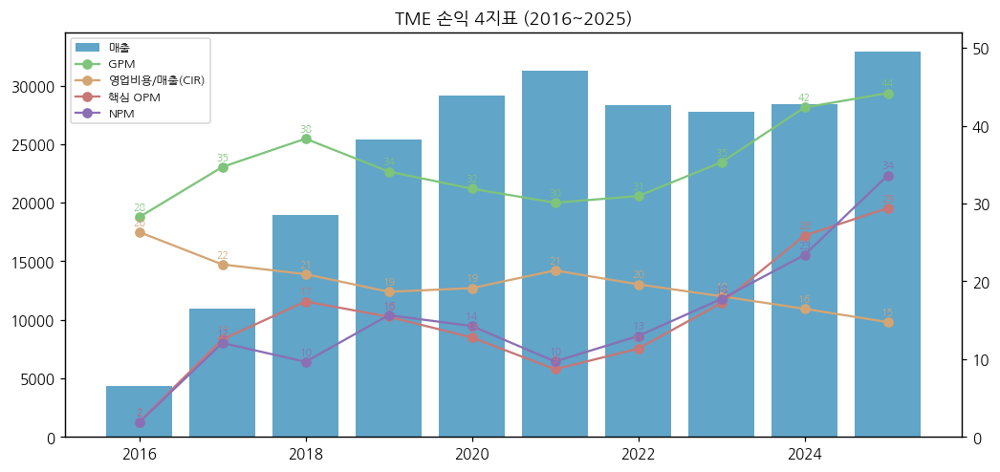

→ GPM 2021 30.1% → 2025 44.2%: 저마진 라이브 축소 + 구독 단가 상승 + 라이선스 비용 효율화
→ 영업비용/매출(CIR) 2021 21.4% → 2025 14.8%

② 재무상태표 (RMB 백만)

| 연도 | 자산 | 유동자산 | 부채 | 유동부채 | 자본총계 | 지배주주 자본 | 현금 | 단기 정기예금 | 부채비율 |
|---|---:|---:|---:|---:|---:|---:|---:|---:|---:|
| 2017 | 30,000 | 7,467 | 3,852 | 3,527 | 26,148 | 26,141 | 5,174 | — | 14.7% |
| 2018 | 44,605 | 20,778 | 6,833 | 6,238 | 37,772 | 37,721 | 17,356 | — | 18.1% |
| 2019 | 52,678 | 26,914 | 9,000 | 8,490 | 43,678 | 43,590 | 15,426 | 7,000 | 20.6% |
| 2020 | 68,273 | 31,687 | 15,542 | 9,602 | 52,731 | 52,245 | 11,128 | 14,858 | 29.5% |
| 2021 | 67,254 | 26,791 | 16,199 | 10,450 | 51,055 | 50,317 | 6,591 | 12,769 | 31.7% |
| 2022 | 67,009 | 26,559 | 17,882 | 11,717 | 49,127 | 48,099 | 9,555 | 11,291 | 36.4% |
| 2023 | 75,536 | 29,936 | 18,334 | 12,014 | 57,202 | 55,907 | 13,567 | 9,937 | 32.1% |
| 2024 | 90,444 | 34,544 | 20,718 | 16,550 | 69,726 | 67,863 | 13,164 | 13,999 | 29.7% |
| **2025** | **102,522** | **32,458** | **19,472** | **14,589** | **83,050** | **80,287** | **8,470** | **15,763** | **23.4%** |

※ 2025 부채·유동부채는 자산 − 자본, 부채 − 비유동부채(4,883)로 계산 [계산]. 2025말 장기 정기예금 13,810 / FVOCI 금융자산(UMG·Spotify 등 상장 지분 포함) **26,231** / 영업권 20,521.

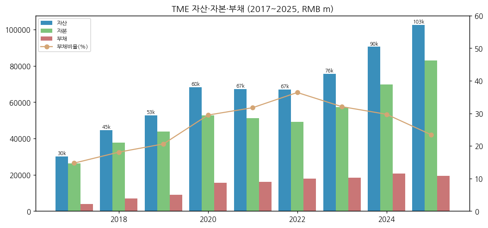

③ 현금흐름표 (RMB 백만)

| 연도 | 영업CF | 투자CF | 재무CF | 유형 CapEx | 무형 CapEx | FCF [계산] |
|---|---:|---:|---:|---:|---:|---:|
| 2016 | 873 | 496 | 1,712 | 41 | — | 832 |
| 2017 | 2,500 | (483) | 99 | 75 | 2 | 2,423 |
| 2018 | 5,632 | (1,190) | 7,741 | 132 | 12 | 5,488 |
| 2019 | 6,200 | (8,102) | (31) | 95 | 191 | 5,914 |
| 2020 | 4,885 | (14,206) | 5,292 | 108 | 393 | 4,384 |
| 2021 | 5,239 | (5,999) | (3,710) | 159 | 1,095 | 3,985 |
| 2022 | 7,481 | (1,446) | (3,419) | 85 | 442 | 6,954 |
| 2023 | 7,337 | (1,863) | (1,538) | 165 | 456 | 6,716 |
| 2024 | 10,275 | (6,818) | (3,830) | 319 | 713 | 9,243 |
| **2025** | **10,231** | **(10,227)** | **(4,649)** | **305** | **883** | **9,043** |

※ 2025 투자CF는 정기예금 신규 RMB 178.8억·단기투자 38억·사업결합 10.6억 등 (만기 125.9억 상계) [20-F]. 재무CF는 회사채 상환 21.3억·배당 19.8억·자사주 3.9억.

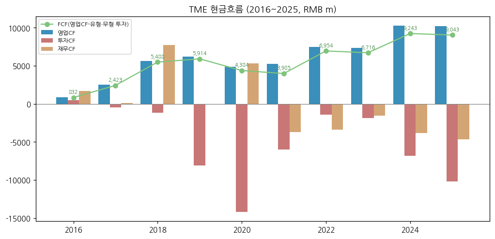

④ CapEx

→ 자산경량형 — 유형+무형 CapEx 매출 대비 2\~4% (2025 RMB 11.9억, 3.6%) [계산]. 무형자산은 음원·콘텐츠 라이선스 성격

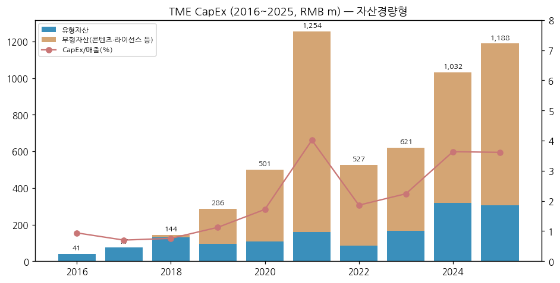

⑤ 부채구조 + 채무증권

→ 2020-09 달러 선순위 무담보채 **$8억 발행** (2025·2030 만기 2개 트렌치) [20-F 서술 기반] → 2025 **RMB 21.3억 상환**(2025년물), 잔액 RMB 34.97억(2030년물) [4Q25 발표문]
→ 2025말 순현금 [계산]: 현금 84.7 + 단기 정기예금 157.6 + 장기 정기예금 138.1 − 회사채 35.0 = **약 RMB 345억**

⑥ 배당·자사주 (RMB 백만, 현금 지급 기준)

| 연도 | 자사주 매입 | 배당 | 합계 | FCF 대비 |
|---|---:|---:|---:|---:|
| 2020 | 134 | — | 134 | 3% |
| 2021 | 3,479 | — | 3,479 | 87% |
| 2022 | 3,127 | — | 3,127 | 45% |
| 2023 | 1,249 | — | 1,249 | 19% |
| 2024 | 1,925 | 1,508 | 3,433 | 37% |
| 2025 | 390 | 1,981 | 2,371 | 26% |
| 2026 H1 | 2Q26만 약 $4억(약 RMB 28억) | FY2025분 약 $3.68억 | — | — |

※ 배당: FY2023분 ADS당 $0.14(2024 지급), FY2024분 $0.18, FY2025분 **$0.24** (2026 지급) → 현재가 기준 배당수익률 약 2.7% [계산]. FY2023·FY2024 ADS당 금액은 [미재검증].

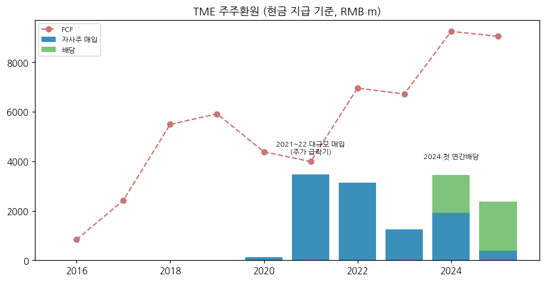

⑦ 재무비율 [계산]

| 지표 | 2021 | 2022 | 2023 | 2024 | 2025 |
|---|---:|---:|---:|---:|---:|
| ROE (지배, 평균자본) | 5.9% | 7.5% | 9.5% | 10.7% | **14.9%** |
| ROA (평균자산) | 4.5% | 5.5% | 6.9% | 8.6% | 11.6% |
| 부채비율 | 31.7% | 36.4% | 32.1% | 29.7% | 23.4% |
| 유동비율 | 2.56 | 2.27 | 2.49 | 2.09 | 2.22 |
| 이자보상배율 (핵심 OP/금융비용) | 22.5 | 29.8 | 33.9 | 78.2 | 75.0 |

※ 2025 ROE·ROA는 1Q25 일회성 이익 포함(제외 시 ROE 약 11.7%).

---

## ⑤ 지배 구조

① 그룹·계열 관계

→ **Tencent Holdings 자회사** (지분 57.2%, 의결권 93.6%) — Class B(1주 15표)를 Min River Investment 등 Tencent 계열이 보유 [20-F]
→ 중국 내 사업은 VIE(변동지분실체) 구조로 운영 — 미국 상장 중국 플랫폼 공통 리스크
→ Spotify AB가 Class A 2.83억주(9.0%) 보유, Spotify도 TME 지분 보유 (2017-12 교환)

② 주주 구분 (2026-03-31, 보통주 3,147.8백만주 기준)

| 주주 | 지분 | 의결권 | 비고 |
|---|---:|---:|---|
| Tencent (Class A 1.60억 + Class B 16.40억) | **57.2%** | **93.6%** | 지배주주 |
| Spotify AB | 9.0% | 1.1% | 2017 지분 교환 |
| 임원 합산 | 1% 미만 | — | Pang 0.1% 등 |
| 기타 유통 (ADS·HKEX) | 약 33.8% | 약 5.3% | — |

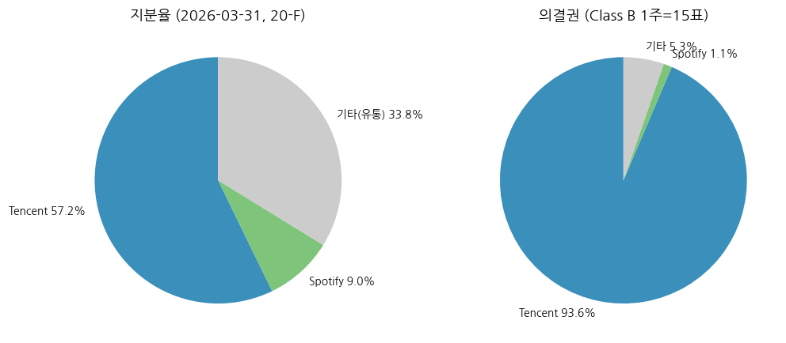

③ 임원·이사회

→ **Cussion Kar Shun Pang** — Executive Chairman (2021-04\~), 2014-05 이사 / 2016-07\~2021-04 CEO. Tencent 출신
→ **Zhu Liang (Ross Liang)** — CEO (2021-04\~), QQ Music·Kugou·Kuwo·WeSing·롱폼 오디오 총괄
→ 이사회에 Tencent 측(James Mitchell 등)·독립이사 3인 구성 (2023 기준 발표문 명단)

---

## ⑥ 기타 팩트

① R&D 인프라

| 연도 | 2016 | 2017 | 2018 | 2019 | 2020 | 2021 | 2022 | 2023 | 2024 | 2025 |
|---|---:|---:|---:|---:|---:|---:|---:|---:|---:|---:|
| R&D 비용(RMB m) | 449 | 797 | 937 | 1,159 | 1,667 | 2,339 | 2,580 | 2,525 | 2,280 | 2,317 |
| R&D/매출 | 10.3% | 7.3% | 4.9% | 4.6% | 5.7% | 7.5% | 9.1% | 9.1% | 8.0% | 7.0% |

→ AI 기능(AI 현지화 자막·AI 보이스 연말결산·추천), 음질 기술(QQ Music DTS 이머시브, Kugou Viper Ultra Sound 2.0) — SVIP 전환 수단 [발표문]

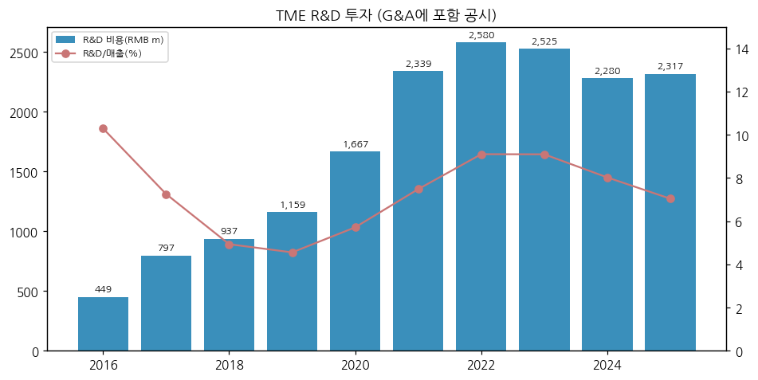

② 진행 중 corporate action (10년)

| 시점 | 내용 |
|---|---|
| 2016-07 | CMC 합병 (TME 출범) |
| 2017-12 | Spotify 지분 교환 |
| 2020-03 / 2021-01 | Tencent 컨소시엄 UMG 10% + 10% (TME 컨소시엄 참여) |
| 2021\~2022 | 대규모 자사주 매입 (RMB 66억) |
| 2025-03 | UMG 지분 2% 현물 수령 |
| 2025 (발표) → **2026-05-18 완료** | **Ximalaya 인수** (보도 기준 총 약 $24억, 현금+주식) [MBW] |
| 2026 2Q | 자사주 $4억 매입 |

③ 전략 마일스톤

→ 콘텐츠·플랫폼 '듀얼 엔진' 전략 — 음원(라이선스·자체 제작) + 플랫폼(SVIP·광고형 요금제·팬덤 멤버십)
→ 광고형 구독 요금제 도입(2025) — 무료 이용자 유료화 중간 단계
→ 2026 '음악 관련 서비스'로 재분류 — 음악+롱폼 오디오 통합 성장 서사

④ 주요 리스크

- **규제**: 중국 반독점·콘텐츠·데이터 규제, VIE 구조, 미·중 상장 리스크(HFCAA)
- **경쟁**: ByteDance(Soda Music·Douyin) 숏폼 음악 소비 잠식 — MAU 4Q25 −5.0%
- **공시 투명성**: 2026부터 KPI 미공시 → 시장 신뢰 하락(2026-03 급락)
- **라이선스 비용**: 메이저 레이블 재계약 시 원가율 상승
- **투자자산 평가**: FVOCI(UMG·Spotify 등) 주가 변동 → 자본·순이익 변동
- **Ximalaya 통합**: 롱폼 오디오 수익성·통합 비용

⑤ ESG / ⑥ 인증

→ ESG 보고서·등급 미수집 — v1.1에서 보강

---

## Activity 보고 (v1.0)

### ✅ 확보 — 20-F 8건, XBRL 연간(2016\~2024), HKEX 분기 발표문 7건, Yahoo 월간·일간 주가, 주주·임원(20-F 2026)
### ❌ 누락 — 3Q22 이전 분기, 6-K 보도자료 본문(SEC 403), 2026 KPI(회사 미공시), ESG, Ximalaya 인수 원문 조건
### ⚠️ 추정·계산 — [계산] 핵심 영업이익·마진·CAGR·비율·시총·멀티플·순현금 / [역산] 2Q23·2Q24 분기, 2021·2022 구독 매출 / [미재검증] FY2023·FY2024 ADS당 배당, 2020 회사채 발행 조건, Ximalaya 인수가(보도 기준)

### 🔗 핵심 source
- SEC EDGAR 20-F (FY2025, 2026-04-17 제출) / XBRL companyfacts (CIK 1744676)
- HKEX 실적 발표문: 2Q26(2026-08-11), 1Q26(2026-05-12), 4Q25(2026-03-17), 3Q25(2025-11-12)
- Yahoo Finance TME 월간·일간 시세
- 원본 폴더: `earnings\company-overview-source\TME_Tencent Music Entertainment Group\`

### Data Quality Confidence: **85%** (손익·재무상태·KPI 회사 원문, 분기 시계열 16Q로 짧음, 일부 역산)

---

## Version Log

- **v1.0 (2026-11-15)**: 최초 작성 — 엔터 섹터 확장(음원 글로벌) 편입. 10년 연간 손익·재무상태·CF, 16Q 분기 시계열, KPI(4Q25까지), 주주·지배구조, 차트 12종(chart2를 연간·분기 2장, chart3 KPI로 구성)
- 잔여 보완 후보 (v1.1): **3Q26 실적(2026-11-17) 반영**, 2018\~2Q22 분기 시계열(20-F·HKEX 과거 발표문), 2021·2022 구독 매출 원문 교체, Ximalaya 인수 조건 원문, ESG, FY2023·2024 배당 ADS당 금액 검증
