> Ticker: **NYSE: TSM (ADR, 1 ADR = 보통주 5주) / TWSE: 2330 — Taiwan Semiconductor Manufacturing Company Limited (TSMC)**
> Entity: **Taiwan Semiconductor Manufacturing Company Limited** (1987-02-21 설립, 본사 대만 신주과학단지) — 세계 최대 전용 파운드리(순수 위탁생산), 2Q26 파운드리 점유율 72.5% [TrendForce 2026-09-09]
> Sector: 반도체 — 서브섹터 **파운드리** (핵심 종목, 2026-11 워치리스트 편입)
> 작성 시각: **2026-11-15 KST** (**v1.0** — Phase 1 Source 수집 + audit + 15종 차트)
> 적용 구조: v4.8 (6개 섹션) — 해외 상장사(Foreign Private Issuer) 20-F·6-K + 회사 보도자료 기반, **IFRS·NT$ 보고**
> 데이터 범위: **연간 12년 (FY2014\~FY2025, 12월 결산)** / **분기 43Q (1Q16\~3Q26)** 매출·마진·노드·플랫폼 / 월매출 2026-10까지 / 4Q26 가이던스
> 출처: **SEC EDGAR** — XBRL companyfacts(FY2015\~FY2024 IFRS 손익·재무상태·현금흐름), 20-F 13건(2014-04\~2026-04-16, FY2014·FY2025 수치와 노드·플랫폼·지역 연간 표), 6-K 표지(2025\~2026) / **TSMC 보도자료(pr.tsmc.com)** 분기 실적·이사회 결의·월매출 / 컨콜 요약·뉴스(Futurum, Focus Taiwan, TrendForce, Zacks 등) / stockanalysis.com·companiesmarketcap.com·macrotrends.net(주가·시총)
> 환율: 분기 US$ 매출은 회사 보도자료 병기치(분기 평균환율 기준). 연간 US$ 매출은 분기 US$ 합 [계산]. 20-F의 2025년 편의환산 환율은 **NT$31.37/US$** (총자산 NT$7,932,843M ÷ US$252,880M [계산])
> ⚠️ **회계 기준 주의**: 연간 표는 20-F(IASB 기준 IFRS) 수치라 대만 IFRS(T-IFRS) 기준 보도자료와 순이익·EPS가 소폭 다르다 (예: FY2025 순이익 20-F NT$1,697.6B / EPS NT$65.47 vs 보도자료 NT$1,717.9B / NT$66.25). 분기 표는 보도자료(T-IFRS) 기준
> ⚠️ **4Q26·FY2026 실적은 2027-01 중순 발표 예정** (전년 4Q25 발표 2026-01-15) — 발표 후 v1.1 갱신

# TSMC 기업 개요 (v1.0 — 반도체 파운드리 / 세계 1위 전용 파운드리 / 지속성장형 + 재고 사이클)
> **Fact verify cutoff**: 2026-11-15 (ADR 2026-11-13 종가 **$398.73** × 보통주 25,932,524,521주 ÷ 5 = 시가총액 **약 $2.07T** [companiesmarketcap.com 2026-11-14 표기 $2.068T, 세계 6위] / 종가 기준 사상 최고 **2026-10-05 $485.80** (장중 $487.47, 시총 약 $2.52T [계산]) [stockanalysis.com 일간, 2026-09-04\~11-13 조회 + macrotrends 2026-06-18 기준 ATH $462.12 대비 상회] — 2026-06-19\~09-03 일간은 미조회 / 파운드리 점유율 2Q26 **72.5%** (2위 Samsung 5.9%, 3위 SMIC 5.4%) [TrendForce 2026-09-09])

## Phase 1 Source Audit

```
=== 자료 수집 audit (Taiwan Semiconductor Manufacturing Company Limited) ===

✅ 확보
- SEC XBRL companyfacts (ifrs-full): FY2015~FY2024 손익·재무상태·현금흐름
- 20-F 13건 (FY2013~FY2025): FY2014·FY2025 재무제표, 노드별 웨이퍼 매출(2012~2025),
  플랫폼별(2018~2025)·용도별(2015~2017) 매출, 지역별(2018~2025), 고객 집중도, 주주·이사회·임직원
- TSMC 보도자료 (pr.tsmc.com) 분기 실적 43건(1Q16~3Q26): 매출(NT$·US$)·GPM·OPM·순이익·EPS·노드 비중·다음 분기 가이던스
- 이사회 결의(2026-02-10/05-12/08-11/11-10), 2026-10 월매출(2026-11-10)
- stockanalysis.com: 4Q21~3Q26 분기 손익·현금흐름 교차 확인, 2026-09-04~11-13 일간 주가, 밸류에이션 지표
- companiesmarketcap.com: 연말 시가총액 1997~2026

❌ 누락
- investor.tsmc.com (분기 Management Report, 403 차단) → 플랫폼 비중 다수 분기가 컨콜 요약·뉴스 기반
- SEC 6-K 첨부(Ex-99) 원문 (sec.gov Archives 403) → 6-K 표지만 확보
- 분기 지역별 매출, 1Q25 이후 웨이퍼 출하량, 4Q26 이후 월매출
- 분기 재무상태·현금흐름 원문 (stockanalysis 교차값만)

⚠️ 주의
- 20-F(IASB-IFRS) vs 보도자료(T-IFRS) 순이익·EPS 차이 (FY2025 EPS 65.47 vs 66.25)
- "첨단 공정" 정의 변경: 28nm 이하(~2018) → 16nm 이하(2019~2020) → 7nm 이하(2021~)
- 2016년 이전은 용도별(통신·컴퓨터·소비자·산업) 분류, 2019부터 플랫폼별(HPC·스마트폰·IoT·자동차·DCE)
- 2017부터 패키징·테스트 매출이 웨이퍼 매출에서 비웨이퍼 매출로 재분류
```

---

## ① 기업 분류

### Primary: **지속성장형** (첨단 공정 독점 + AI·HPC 수요) / Secondary: **반도체 재고 사이클형** (2019·2023 재고조정)

| Summary Box (FY2014\~FY2025, 12년) | 값 |
|---|---|
| 매출 CAGR | **+15.7%** (2014 NT$762.8B → 2025 NT$3,809.1B) / US$ 기준 2016→2025 +17.2% [계산] |
| OPM 평균 | **41.6%** (12년 단순평균) |
| OPM 정점 평균 | **49.9%** (2022 49.5%·2025 50.2%) |
| OPM 저점 평균 | **38.7%** (2019 34.8%·2023 42.6%) |
| 사이클 주기 | 약 3\~4년 (재고조정 저점 2019 → 2023, 정점 2022 → 2025) — 단 저점에서도 OPM 35% 이상, 매출 역성장은 12년 중 1회 |
| 사이클 회수 (12년) | 정점 2회 (2022·2025) / 저점 2회 (2019·2023) |

#### 12년 손익 (사이클 annotation, NT$십억)

| 연도 | 매출 (NT$십억) | YoY | 매출 (US$십억)* | 영업이익 | OPM | 순이익(지배) | NPM | 희석 EPS (NT$) | 비고 |
|---|---|---|---|---|---|---|---|---|---|
| 2014 | 762.8 | - | - | 295.9 | 38.8% | 254.3 | 33.3% | 9.81 | ← 20nm 첫 매출 (웨이퍼 매출 9%) |
| 2015 | 843.5 | 10.6% | - | 320.0 | 37.9% | 302.9 | 35.9% | 11.68 | ← 16/20nm 20% |
| 2016 | 947.9 | 12.4% | 29.4 | 378.0 | 39.9% | 331.7 | 35.0% | 12.79 | ← 16/20nm 28%, 매출 +12% |
| 2017 | 977.4 | 3.1% | 32.1 | 385.6 | 39.4% | 345.0 | 35.3% | 13.30 | ← 10nm 첫 매출(10%), 매출 +3% 정체 |
| 2018 | 1,031.5 | 5.5% | 34.2 | 383.6 | 37.2% | 363.1 | 35.2% | 14.00 | ← 7nm 첫 매출(9%), OPM 하락 시작 |
| 2019 | 1,070.0 | 3.7% | 34.6 | 372.7 | 34.8% | 353.9 | 33.1% | 13.65 | ← **재고조정 저점** (OPM 34.8%, 12년 최저) |
| 2020 | 1,339.3 | 25.2% | 45.5 | 566.8 | 42.3% | 510.7 | 38.1% | 19.70 | ← 5nm 첫 매출(8%), 매출 +25% |
| 2021 | 1,587.4 | 18.5% | 56.8 | 650.0 | 40.9% | 592.4 | 37.3% | 22.84 | ← 7nm 이하 50%, 매출 +19% |
| 2022 | 2,263.9 | 42.6% | 75.9 | 1,121.3 | 49.5% | 992.9 | 43.9% | 38.29 | ← **사이클 정점1** (OPM 49.5%) |
| 2023 | 2,161.7 | −4.5% | 69.3 | 921.5 | 42.6% | 851.7 | 39.4% | 32.85 | ← **재고조정 저점** (매출 −4.5%, 12년 유일 역성장), 3nm 첫 매출 |
| 2024 | 2,894.3 | 33.9% | 90.1 | 1,322.1 | 45.7% | 1,158.4 | 40.0% | 44.67 | ← HPC 51%로 1위 굳힘, 매출 +34% |
| 2025 | 3,809.1 | 31.6% | 122.4 | 1,910.3 | 50.2% | 1,697.6 | 44.6% | 65.47 | ← **AI 정점2** (OPM 50.2%, 매출 +32%) |

> *연간 US$ 매출은 보도자료 분기 US$ 매출 합 [계산]. FY2014\~FY2015는 분기 US$ 미수집 → "-". 영업이익·순이익·EPS는 20-F(IASB-IFRS).

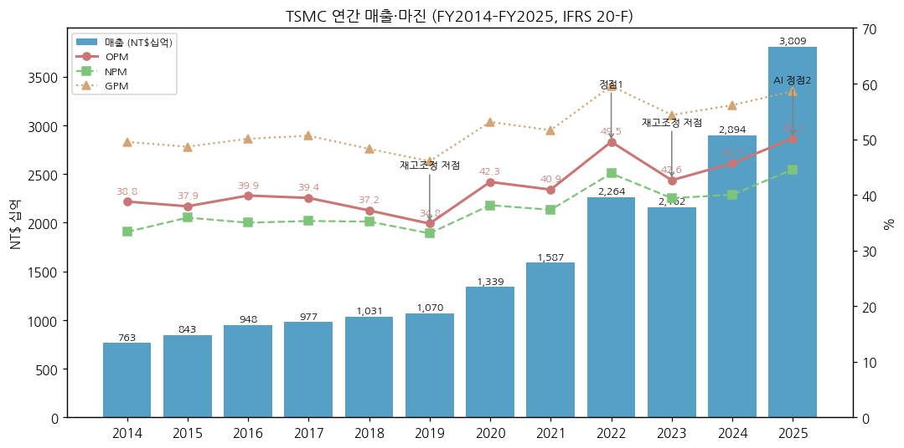

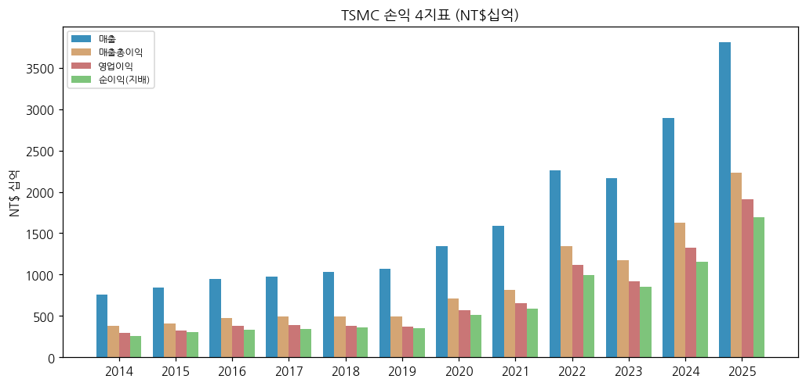

### ② 산업 분류
- SEC SIC 3674 (Semiconductors & Related Devices) / GICS 정보기술 — 반도체
- 워치리스트: **반도체 섹터 — 서브섹터 "파운드리"** (핵심 종목). 같은 반도체 섹터의 메모리(삼성전자·SK하이닉스·Micron)와 소부장(ASML·LRCX)의 수요처이자, AI 가속기(Nvidia·Broadcom·AMD)의 생산 기지
- 글로벌 점유: 파운드리 상위 10사 매출 기준 **72.5%** (2Q26, 2위 Samsung 5.9%, 3위 SMIC 5.4%, 4위 UMC 3.9%, 5위 GlobalFoundries 3.2%) [TrendForce 2026-09-09]

### ③ 분류 결정 논리
(1) **가장 큰 사업부 기준**: 단일 사업(웨이퍼 위탁생산)이지만 매출의 58%가 HPC(2025, 20-F) — AI 가속기·서버 CPU·네트워크 칩. HPC 매출은 2018 NT$341.9B → 2025 NT$2,192.9B로 6.4배 [계산]. 스마트폰(29%)은 성숙기 → 성장 축이 HPC로 이동.
(2) **사이클 사업부 이익 비중 sub-rule**: 사업부 이익 공시 없음. 대신 노드 mix로 판단 — 7nm 이하 첨단 공정이 웨이퍼 매출의 74%(2025)·79%(3Q26). 첨단 공정은 경쟁자가 사실상 없는 구간이라 재고조정기에도 가격이 유지됐다 (2023 매출 −4.5%에도 OPM 42.6%). 28nm 이상 성숙 공정(2025 18%)이 경기·재고 사이클에 노출되는 부분.
(3) **Boundary case**: 2019·2023 두 번의 재고조정에서 매출이 정체·역성장했고 OPM이 7\~8%p 출렁였다 → 순수 secular로 보기 어려워 **Secondary "재고 사이클형"** 병기. 다만 정점·저점이 계단식으로 올라가고(저점 OPM 34.8% → 42.6%), 12년 중 역성장 1회 → Primary는 지속성장.
(4) **글로벌 피어 대비**: Samsung 파운드리·Intel Foundry는 첨단 공정 수율·고객 확보에서 뒤처져 적자 또는 저마진(점유율 5.9%·미공시). UMC·GlobalFoundries·SMIC는 성숙 공정 중심 → 가격 경쟁·중국 증설에 노출된 **사이클형**. TSMC만 "첨단 공정 + 규모 + 패키징(CoWoS)" 3개를 동시에 가진 구조 → 피어와 분류가 갈린다.

### ④ 적정 밸류에이션 방법
- **PER 우선** — 단일 사업, 12년 평균 ROE 28.5%·순현금 구조로 이익이 곧 주주가치. 2026-11-13 기준 **trailing PER 26.9배 / forward PER 19.0배** [stockanalysis.com]. 분기말 PER은 4Q22 11.7배(사이클 정점 이익 + 주가 저점) → 3Q26 25.4배 [stockanalysis 분기 비율]
- **PBR 보조(하단 확인용)** — 자본집약 산업(CapEx/매출 30\~50%)이라 저점 국면에서 장부가 지지선 확인용. 현재 PBR 8.4배 [stockanalysis.com] — ROE 35%대(2025)가 높은 PBR을 설명
- **EV/EBITDA 참고** — 감가상각이 매출의 18%(2025)로 커서 EBITDA 기준 비교가 유용. 15.5배 [stockanalysis.com]
- **피어와의 차이**: 메모리(삼성전자·SK하이닉스)·성숙 파운드리(UMC·GF)는 이익 변동이 커서 PBR 밴드가 기본, TSMC는 이익 가시성(분기 가이던스 상단 이상 달성 다수 — ③-① 표)과 AI 수요로 PER이 기본. 다만 재고조정 국면(2019·2023)에는 PER이 정점 이익 기준으로 낮아지는 "사이클 PER 함정"이 있어 정점 이익에는 낮은 배수를 적용

### ⑤ 분기 재평가 트리거 (분류 변경 조건)
- **7nm 이하 첨단 공정 비중이 2개 분기 연속 65% 미만** (3Q26 79%) → 첨단 독점 약화 = 사이클형 비중 확대 검토
- **경쟁사(Samsung·Intel) 2nm급 공정이 대형 고객 양산 수주를 2개 이상 확보하고 TSMC 점유율이 60% 아래로** (2Q26 72.5%) → 독점 프리미엄 해제, Primary 재검토
- **연간 매출 역성장 + OPM 40% 미만 동시 발생** → 2019급 이상의 재고조정 = Secondary를 Primary로 격상 검토
- **HPC 비중이 50% 아래로 회귀** (3Q26 68%) → AI 성장 축 약화, 스마트폰 사이클 의존 복귀
- 대만 지정학 이벤트로 **대만 내 생산 차질**이 발생 → 분류와 별도로 "지정학 리스크형" Secondary 추가

---

## ② 회사 개요

### ① 기본 사항
- 회사명: Taiwan Semiconductor Manufacturing Company Limited (台灣積體電路製造股份有限公司), 1987-02-21 설립 (20-F)
- 사업 한 줄 정의: **자체 칩을 만들지 않고 고객(팹리스·IDM·시스템 기업) 설계를 받아 웨이퍼를 생산하는 전용 파운드리 + 첨단 패키징(CoWoS 등 3DFabric)**
- 규모 (20-F FY2025): 연간 생산능력 12인치 환산 1,700만 장 이상, 2025 매출 NT$3,809.1B(US$122.4B [계산]), 상위 10대 고객 매출 비중 78%
- 공장: 대만(신주·타이난·타이중·가오슝 등), 중국(상하이 Fab 10·난징 Fab 16), 미국(워싱턴주 WaferTech, 애리조나 Fab 21), 일본(구마모토 Fab 23 = JASM), 독일(드레스덴 ESMC, 건설 중)
- 임직원: 정규직 **90,557명** (2025-12-31, 20-F) — 2023 76,478명 → 2024 83,825명
- 회장 겸 CEO **C.C. Wei(웨이저자)** (재직 28년), CFO **Wendell Huang** (6-K 서명)

### ② 12년 손익·자본 추이 (NT$십억)

| 연도 | 매출 | 영업이익 | 순이익(지배) | 자본총계 | 지배주주 자본 | 총자산 | ROE |
|---|---|---|---|---|---|---|---|
| 2014 | 762.8 | 295.9 | 254.3 | 1,022.4 | 1,022.2 | 1,494.9 | - |
| 2015 | 843.5 | 320.0 | 302.9 | 1,195.0 | 1,194.0 | 1,657.4 | 27.3% |
| 2016 | 947.9 | 378.0 | 331.7 | 1,359.8 | 1,359.1 | 1,886.3 | 26.0% |
| 2017 | 977.4 | 385.6 | 345.0 | 1,495.7 | 1,493.7 | 1,991.7 | 24.2% |
| 2018 | 1,031.5 | 383.6 | 363.1 | 1,661.1 | 1,660.4 | 2,090.0 | 23.0% |
| 2019 | 1,070.0 | 372.7 | 353.9 | 1,614.4 | 1,613.7 | 2,264.7 | 21.6% |
| 2020 | 1,339.3 | 566.8 | 510.7 | 1,835.8 | 1,834.8 | 2,760.6 | 29.6% |
| 2021 | 1,587.4 | 650.0 | 592.4 | 2,151.7 | 2,149.3 | 3,725.3 | 29.7% |
| 2022 | 2,263.9 | 1,121.3 | 992.9 | 2,917.8 | 2,903.0 | 4,964.5 | 39.3% |
| 2023 | 2,161.7 | 921.5 | 851.7 | 3,453.9 | 3,429.5 | 5,532.2 | 26.9% |
| 2024 | 2,894.3 | 1,322.1 | 1,158.4 | 4,279.3 | 4,244.3 | 6,691.8 | 30.2% |
| 2025 | 3,809.1 | 1,910.3 | 1,697.6 | 5,396.2 | 5,355.0 | 7,932.8 | 35.4% |

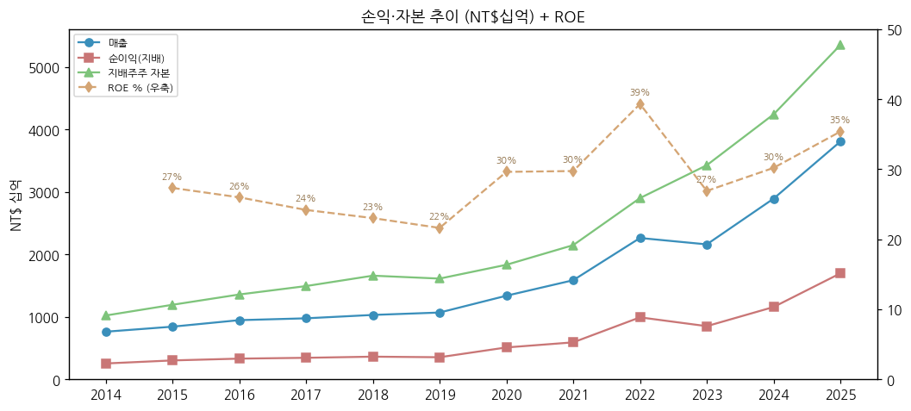

### ③ 회사 주가 역사

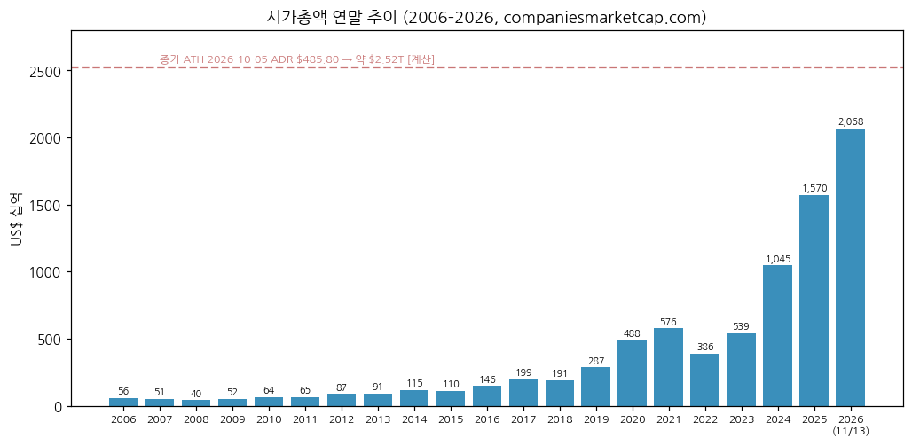

- 1994 대만 증시 상장, 1997 NYSE ADR 상장 — 1997년말 시총 $14.8B [companiesmarketcap]
- 2008년말 $40.5B (금융위기) → 2014년말 $115.3B (첫 $100B 돌파) → 2019년말 $286.6B
- 2020년말 $488.1B (5nm·코로나 IT 수요) → 2021년말 $575.9B → **2022년말 $386.3B (−33%, 재고조정)** → 2023년말 $539.4B
- 2024년말 **$1.045T (첫 $1T 돌파)** → 2025년말 $1.570T → **2026-10-05 ADR 종가 $485.80 사상 최고 (시총 약 $2.52T [계산])** [stockanalysis.com 일간]
- 이후 2026-11-05 하루 −10.8%(종가 $353.10, 원인 미확인) 등 조정 → **2026-11-13 종가 $398.73, 시총 $2.068T (ATH 대비 −17.9% [계산])**, 1년 수익률 +40.0% [companiesmarketcap]
- 참고: 대만 본주는 2026-10-05 종가 NT$2,575 사상 최고 보도 (단일 출처, 확인 필요)

### ④ 주요 연혁
| 시기 | 이벤트 |
|---|---|
| 1987-02 | 대만 정부(행정원 개발기금)·필립스 등 출자로 설립 — 세계 첫 전용 파운드리 |
| 1994 / 1997 | 대만증권거래소 상장 / NYSE ADR 상장 |
| 2014 | 20nm 양산(웨이퍼 매출 9%) |
| 2015\~2016 | 16nm FinFET 본격 매출 (16/20nm 2015 20% → 2016 28%) |
| 2018 | 7nm 양산 (2018 9% → 2019 27%) |
| 2019 | 플랫폼별(HPC·스마트폰 등) 매출 공시 시작, 재고조정으로 OPM 34.8% |
| 2020 | 5nm 양산 (8%), 미국 애리조나 팹 건설 발표 |
| 2021\~2022 | 반도체 공급 부족 → 2022 OPM 49.5% 정점, 일본 JASM(구마모토) 설립 |
| 2023 | 3nm 양산 (6%), 재고조정 매출 −4.5%, 독일 ESMC 합작 결정(지분 70%) |
| 2024 | HPC 매출 51%, 시총 $1T 돌파, 애리조나 Fab 1(N4) 양산 (4Q24) |
| 2025 | 2nm 양산 개시(4Q25), 미국 투자 약속 US$165B로 확대(2025-03), FY2025 매출 +32% |
| 2026-07 | 미국 투자 US$100B 추가 → 총 US$265B, 2026 CapEx 가이던스 US$60\~64B로 상향 |
| 2026-10-15 | 3Q26 매출 NT$1,494.2B(+51% YoY), 2nm 비중 8%, 4Q26 가이던스 US$52.3\~54.3B |

---

## ③ 비즈니스 모델

### ① 실적 추이 통합 표 — 플랫폼별 매출 비중 (20-F 연간)

| 연도 | HPC | 스마트폰 | IoT | 자동차 | DCE | 기타 | HPC 매출 (NT$십억) |
|---|---|---|---|---|---|---|---|
| 2018 | 33% | 45% | 6% | 5% | 6% | 5% | 341.9 |
| 2019 | 30% | 49% | 8% | 4% | 5% | 4% | 315.8 |
| 2020 | 33% | 48% | 8% | 3% | 4% | 4% | 439.8 |
| 2021 | 37% | 44% | 8% | 4% | 4% | 3% | 587.8 |
| 2022 | 41% | 39% | 9% | 5% | 3% | 3% | 932.4 |
| 2023 | 43% | 38% | 8% | 6% | 2% | 3% | 934.8 |
| 2024 | 51% | 35% | 6% | 5% | 1% | 2% | 1,476.9 |
| 2025 | 58% | 29% | 5% | 5% | 1% | 2% | 2,192.9 |

> 출처: 20-F 2021(2018\~2020), 2024(2021\~2023), 2026(2023\~2025). 2015\~2017은 용도별 분류 — 통신 60.7%/61.9%/59.0%, 컴퓨터 7.9%/7.9%/9.6%, 소비자 8.0%/9.3%/8.1%, 산업·표준 23.4%/20.9%/23.3% (20-F 2018).
> 2025 HPC NT$2,192.9B(+48% YoY), 스마트폰 NT$1,110.8B(+11%) (20-F 2026).

### ① 기술 노드별 웨이퍼 매출 비중 (20-F 연간)

| 연도 | 3nm | 5nm | 7nm | 10nm | 16/20nm | 28nm | 40–90nm | 0.11um+ | 16nm 이하 합 |
|---|---|---|---|---|---|---|---|---|---|
| 2014 | - | - | - | - | 9% | 33% | 37% | 21% | 0% |
| 2015 | - | - | - | - | 20% | 28% | 33% | 19% | 20% |
| 2016 | - | - | - | - | 28% | 26% | 30% | 16% | 28% |
| 2017 | - | - | - | 10% | 25% | 23% | 26% | 16% | 32% |
| 2018 | - | - | 9% | 11% | 23% | 20% | 23% | 14% | 41% |
| 2019 | - | - | 27% | 3% | 21% | 16% | 21% | 12% | 50% |
| 2020 | - | 8% | 33% | - | 18% | 13% | 16% | 12% | 58% |
| 2021 | - | 19% | 31% | - | 14% | 11% | 14% | 11% | 64% |
| 2022 | - | 26% | 27% | - | 13% | 10% | 14% | 10% | 66% |
| 2023 | 6% | 33% | 19% | - | 11% | 10% | 13% | 8% | 68% |
| 2024 | 18% | 34% | 17% | - | 8% | 7% | 9% | 7% | 77% |
| 2025 | 24% | 36% | 14% | - | 7% | 7% | 8% | 4% | 81% |

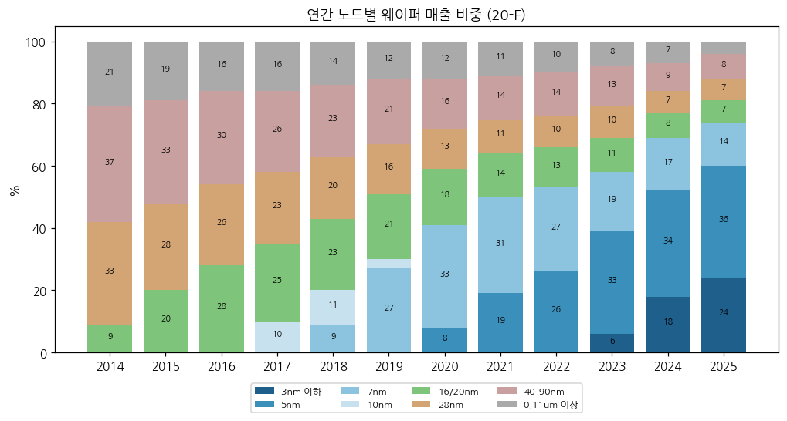

### ① 분기 시계열 — 노드·플랫폼 (1Q16\~3Q26)

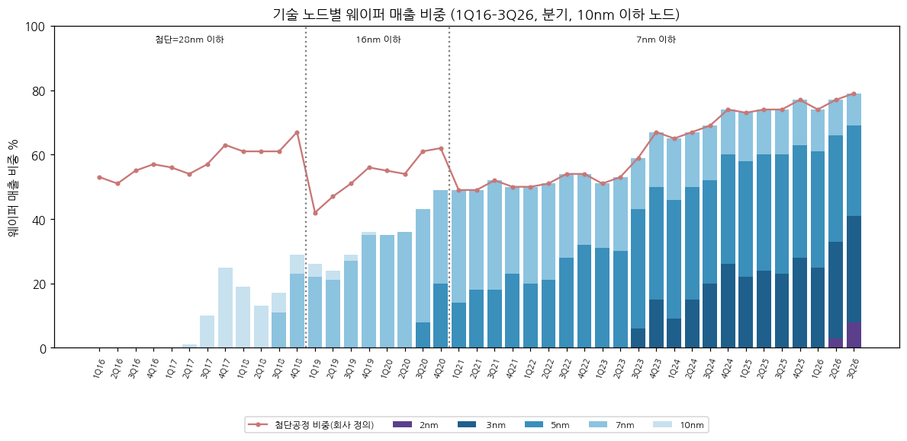

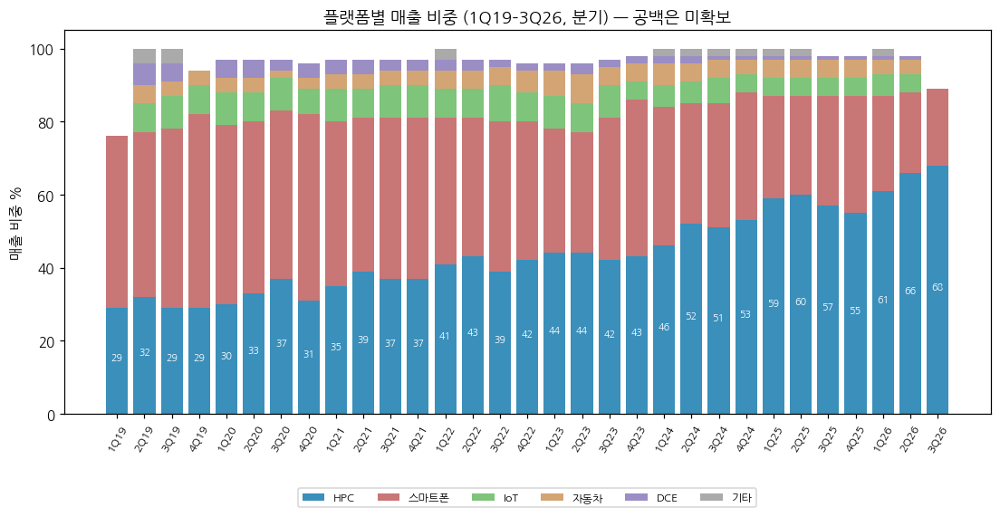

> 노드 비중은 각 분기 보도자료(웨이퍼 매출 대비). 플랫폼 비중은 Management Report가 investor.tsmc.com(403)에 있어 **컨콜 녹취·요약·뉴스 기반** — 1Q24·3Q25·4Q25·2Q26 IoT/자동차 등은 요약 출처라 신뢰도 중간, 3Q26은 HPC·스마트폰만 확보. 2016\~2018 분기는 용도별 분류라 차트 미표시.

<details><summary>분기 원자료 (1Q16\~3Q26, 43분기)</summary>

| 분기 | 매출 (NT$십억) | 매출 (US$십억) | YoY | GPM | OPM | 순이익 | EPS | 2nm | 3nm | 5nm | 7nm | 첨단 비중 | HPC | 스마트폰 | IoT | 자동차 |
|---|---|---|---|---|---|---|---|---|---|---|---|---|---|---|---|---|
| 1Q16 | 203.5 | 6.14 | - | 44.9% | 34.6% | 64.8 | 2.50 | - | - | - | - | 53 | - | - | - | - |
| 2Q16 | 221.8 | 6.84 | - | 51.5% | 41.2% | 72.5 | 2.80 | - | - | - | - | 51 | - | - | - | - |
| 3Q16 | 260.4 | 8.20 | - | 50.7% | 40.8% | 96.8 | 3.73 | - | - | - | - | 55 | - | - | - | - |
| 4Q16 | 262.2 | 8.25 | - | 52.3% | 41.9% | 100.2 | 3.86 | - | - | - | - | 57 | - | - | - | - |
| 1Q17 | 233.9 | 7.51 | 14.9% | 51.9% | 40.8% | 87.6 | 3.38 | - | - | - | - | 56 | - | - | - | - |
| 2Q17 | 213.9 | 7.06 | −3.6% | 50.8% | 38.9% | 66.3 | 2.56 | - | - | - | - | 54 | - | - | - | - |
| 3Q17 | 252.1 | 8.32 | −3.2% | 49.9% | 38.9% | 89.9 | 3.47 | - | - | - | - | 57 | - | - | - | - |
| 4Q17 | 277.6 | 9.21 | 5.8% | 50.0% | 39.2% | 99.3 | 3.83 | - | - | - | - | 63 | - | - | - | - |
| 1Q18 | 248.1 | 8.46 | 6.1% | 50.3% | 39.0% | 89.8 | 3.46 | - | - | - | - | 61 | - | - | - | - |
| 2Q18 | 233.3 | 7.85 | 9.1% | 47.8% | 36.2% | 72.3 | 2.79 | - | - | - | - | 61 | - | - | - | - |
| 3Q18 | 260.4 | 8.49 | 3.3% | 47.4% | 36.6% | 89.1 | 3.44 | - | - | - | 11 | 61 | - | - | - | - |
| 4Q18 | 289.8 | 9.40 | 4.4% | 47.7% | 37.0% | 100.0 | 3.86 | - | - | - | 23 | 67 | - | - | - | - |
| 1Q19 | 218.7 | 7.10 | −11.8% | 41.3% | 29.4% | 61.4 | 2.37 | - | - | - | 22 | 42 | 29 | 47 | - | - |
| 2Q19 | 241.0 | 7.75 | 3.3% | 43.0% | 31.7% | 66.8 | 2.57 | - | - | - | 21 | 47 | 32 | 45 | 8 | 5 |
| 3Q19 | 293.1 | 9.40 | 12.6% | 47.6% | 36.8% | 101.1 | 3.90 | - | - | - | 27 | 51 | 29 | 49 | 9 | 4 |
| 4Q19 | 317.2 | 10.39 | 9.5% | 50.2% | 39.2% | 116.0 | 4.47 | - | - | - | 35 | 56 | 29 | 53 | 8 | 4 |
| 1Q20 | 310.6 | 10.31 | 42.0% | 51.8% | 41.4% | 117.0 | 4.51 | - | - | - | 35 | 55 | 30 | 49 | 9 | 4 |
| 2Q20 | 310.7 | 10.38 | 28.9% | 53.0% | 42.2% | 120.8 | 4.66 | - | - | - | 36 | 54 | 33 | 47 | 8 | 4 |
| 3Q20 | 356.4 | 12.14 | 21.6% | 53.4% | 42.1% | 137.3 | 5.30 | - | - | 8 | 35 | 61 | 37 | 46 | 9 | 2 |
| 4Q20 | 361.5 | 12.68 | 14.0% | 54.0% | 43.5% | 142.8 | 5.51 | - | - | 20 | 29 | 62 | 31 | 51 | 7 | 3 |
| 1Q21 | 362.4 | 12.92 | 16.7% | 52.4% | 41.5% | 139.7 | 5.39 | - | - | 14 | 35 | 49 | 35 | 45 | 9 | 4 |
| 2Q21 | 372.1 | 13.29 | 19.8% | 50.0% | 39.1% | 134.4 | 5.18 | - | - | 18 | 31 | 49 | 39 | 42 | 8 | 4 |
| 3Q21 | 414.7 | 14.88 | 16.3% | 51.3% | 41.2% | 156.3 | 6.03 | - | - | 18 | 34 | 52 | 37 | 44 | 9 | 4 |
| 4Q21 | 438.2 | 15.74 | 21.2% | 52.7% | 41.7% | 166.2 | 6.41 | - | - | 23 | 27 | 50 | 37 | 44 | 9 | 4 |
| 1Q22 | 491.1 | 17.57 | 35.5% | 55.6% | 45.6% | 202.7 | 7.82 | - | - | 20 | 30 | 50 | 41 | 40 | 8 | 5 |
| 2Q22 | 534.1 | 18.16 | 43.5% | 59.1% | 49.1% | 237.0 | 9.14 | - | - | 21 | 30 | 51 | 43 | 38 | 8 | 5 |
| 3Q22 | 613.1 | 20.23 | 47.9% | 60.4% | 50.6% | 280.9 | 10.83 | - | - | 28 | 26 | 54 | 39 | 41 | 10 | 5 |
| 4Q22 | 625.5 | 19.93 | 42.8% | 62.2% | 52.0% | 295.9 | 11.41 | - | - | 32 | 22 | 54 | 42 | 38 | 8 | 6 |
| 1Q23 | 508.6 | 16.72 | 3.6% | 56.3% | 45.5% | 207.0 | 7.98 | - | - | 31 | 20 | 51 | 44 | 34 | 9 | 7 |
| 2Q23 | 480.8 | 15.68 | −10.0% | 54.1% | 42.0% | 181.8 | 7.01 | - | - | 30 | 23 | 53 | 44 | 33 | 8 | 8 |
| 3Q23 | 546.7 | 17.28 | −10.8% | 54.3% | 41.7% | 211.0 | 8.14 | - | 6 | 37 | 16 | 59 | 42 | 39 | 9 | 5 |
| 4Q23 | 625.5 | 19.62 | 0.0% | 53.0% | 41.6% | 238.7 | 9.21 | - | 15 | 35 | 17 | 67 | 43 | 43 | 5 | 5 |
| 1Q24 | 592.6 | 18.87 | 16.5% | 53.1% | 42.0% | 225.5 | 8.70 | - | 9 | 37 | 19 | 65 | 46 | 38 | 6 | 6 |
| 2Q24 | 673.5 | 20.82 | 40.1% | 53.2% | 42.5% | 247.8 | 9.56 | - | 15 | 35 | 17 | 67 | 52 | 33 | 6 | 5 |
| 3Q24 | 759.7 | 23.50 | 39.0% | 57.8% | 47.5% | 325.3 | 12.54 | - | 20 | 32 | 17 | 69 | 51 | 34 | 7 | 5 |
| 4Q24 | 868.5 | 26.88 | 38.8% | 59.0% | 49.0% | 374.7 | 14.45 | - | 26 | 34 | 14 | 74 | 53 | 35 | 5 | 4 |
| 1Q25 | 839.2 | 25.53 | 41.6% | 58.8% | 48.5% | 361.6 | 13.94 | - | 22 | 36 | 15 | 73 | 59 | 28 | 5 | 5 |
| 2Q25 | 933.8 | 30.07 | 38.6% | 58.6% | 49.6% | 398.3 | 15.36 | - | 24 | 36 | 14 | 74 | 60 | 27 | 5 | 5 |
| 3Q25 | 989.9 | 33.10 | 30.3% | 59.5% | 50.6% | 452.3 | 17.44 | - | 23 | 37 | 14 | 74 | 57 | 30 | 5 | 5 |
| 4Q25 | 1,046.1 | 33.73 | 20.5% | 62.3% | 54.0% | 505.7 | 19.50 | - | 28 | 35 | 14 | 77 | 55 | 32 | 5 | 5 |
| 1Q26 | 1,134.1 | 35.90 | 35.1% | 66.2% | 58.1% | 572.5 | 22.08 | - | 25 | 36 | 13 | 74 | 61 | 26 | 6 | 4 |
| 2Q26 | 1,270.4 | 40.20 | 36.0% | 67.7% | 60.3% | 706.6 | 27.25 | 3 | 30 | 33 | 11 | 77 | 66 | 22 | 5 | 4 |
| 3Q26 | 1,494.2 | 46.72 | 50.9% | 66.4% | 58.7% | 763.1 | 29.43 | 8 | 33 | 28 | 10 | 79 | 68 | 21 | - | - |

> 첨단 비중 = 회사 정의 (\~4Q18: 28nm 이하 / 1Q19\~4Q20: 16nm 이하 / 1Q21\~: 7nm 이하). 4Q22·4Q23 매출이 NT$625.53B로 같은 것은 두 보도자료 원문 확인값.

</details>

### ① 12분기 시계열 (4Q23\~3Q26)

| 분기 | 매출 (NT$십억) | 매출 (US$십억) | YoY | QoQ | GPM | OPM | 영업이익 [계산] | 순이익 | 희석 EPS (NT$) | 비고 |
|---|---|---|---|---|---|---|---|---|---|---|
| 4Q23 | 625.5 | 19.62 | 0.0% | 14.4% | 53.0% | 41.6% | 260.2 | 238.7 | 9.21 | 3nm 15% 첫 두 자릿수 |
| 1Q24 | 592.6 | 18.87 | 16.5% | −5.3% | 53.1% | 42.0% | 248.9 | 225.5 | 8.70 |  |
| 2Q24 | 673.5 | 20.82 | 40.1% | 13.6% | 53.2% | 42.5% | 286.2 | 247.8 | 9.56 | HPC 52%로 스마트폰 추월 확대 |
| 3Q24 | 759.7 | 23.50 | 39.0% | 12.8% | 57.8% | 47.5% | 360.9 | 325.3 | 12.54 |  |
| 4Q24 | 868.5 | 26.88 | 38.8% | 14.3% | 59.0% | 49.0% | 425.5 | 374.7 | 14.45 | 3nm 26%, OPM 49% |
| 1Q25 | 839.2 | 25.53 | 41.6% | −3.4% | 58.8% | 48.5% | 407.0 | 361.6 | 13.94 | HPC 59% |
| 2Q25 | 933.8 | 30.07 | 38.6% | 11.3% | 58.6% | 49.6% | 463.2 | 398.3 | 15.36 |  |
| 3Q25 | 989.9 | 33.10 | 30.3% | 6.0% | 59.5% | 50.6% | 500.9 | 452.3 | 17.44 |  |
| 4Q25 | 1,046.1 | 33.73 | 20.5% | 5.7% | 62.3% | 54.0% | 564.9 | 505.7 | 19.50 | 2nm 양산 개시 분기, GPM 62.3% |
| 1Q26 | 1,134.1 | 35.90 | 35.1% | 8.4% | 66.2% | 58.1% | 658.9 | 572.5 | 22.08 | GPM 66%대 진입 |
| 2Q26 | 1,270.4 | 40.20 | 36.0% | 12.0% | 67.7% | 60.3% | 766.0 | 706.6 | 27.25 | **2nm 3% 첫 공시**, OPM 60.3% 사상 최고 |
| 3Q26 | 1,494.2 | 46.72 | 50.9% | 17.6% | 66.4% | 58.7% | 877.1 | 763.1 | 29.43 | **분기 매출 NT$1.49조 (+51% YoY)**, 2nm 8% |

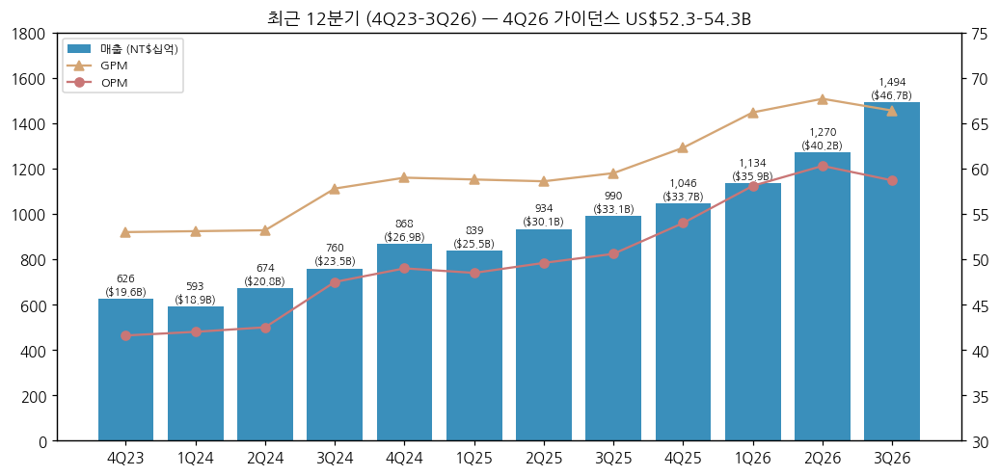

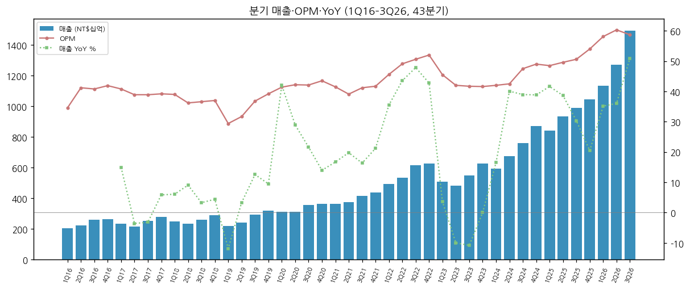

#### 가이던스 vs 실제 (최근 9개 분기)

| 발표 분기 | 다음 분기 매출 가이던스 (US$십억) | GPM 가이던스 | OPM 가이던스 | 환율 가정 (NT$/US$) | 실제 다음 분기 매출 (US$십억) | 결과 |
|---|---|---|---|---|---|---|
| 3Q24 | 26.1–26.9 | 57–59% | 46.5–48.5% | 32 | 26.88 | 범위 내 |
| 4Q24 | 25.0–25.8 | 57–59% | 46.5–48.5% | 32.8 | 25.53 | 범위 내 |
| 1Q25 | 28.4–29.2 | 57–59% | 47–49% | 32.5 | 30.07 | 상회 |
| 2Q25 | 31.8–33.0 | 55.5–57.5% | 45.5–47.5% | 29 | 33.10 | 상회 |
| 3Q25 | 32.2–33.4 | 59–61% | 49–51% | 30.6 | 33.73 | 상회 |
| 4Q25 | 34.6–35.8 | 63–65% | 54–56% | 31.6 | 35.90 | 상회 |
| 1Q26 | 39.0–40.2 | 65.5–67.5% | 56.5–58.5% | 31.7 | 40.20 | 범위 내 |
| 2Q26 | 44.6–45.8 | 65–67% | 56–58% | 32 | 46.72 | 상회 |
| 3Q26 | 52.3–54.3 | 65–67% | 56.5–58.5% | 31.8 | 4Q26 발표 예정 | - |

- **4Q26 가이던스 (2026-10-15)**: 매출 US$52.3\~54.3B (중간값 YoY +58%, QoQ +14% [Focus Taiwan]), GPM 65\~67%, OPM 56.5\~58.5%, 환율 가정 NT$31.8/US$ [pr.tsmc.com/english/news/3346]
- **2026 연간**: US$ 매출 성장률 가이던스 약 +44% (1월 약 +30% → 7월 "40% 초반" → 10월 약 +44%) [Focus Taiwan 2026-11-10, TNW 2026-10-17]
- **10월 월매출**: NT$586.89B (+14.7% MoM, **+59.7% YoY**, 월 사상 최대), 1\~10월 누적 NT$4,485.62B (+43.3% YoY) [pr.tsmc.com/english/news/3349, 2026-11-10]
- 9M26 매출 NT$3,898.7B vs 9M25 NT$2,763.0B = +41.1% [계산]
- 2027: 회장 "소비자·가격 민감 부문이 부품가 상승·거시 불확실성에 부담 — 2027 사업 계획은 신중하게(prudent)", AI 수요는 여전히 공급 초과 [TNW 2026-10-17, 컨콜 요약]

### ② 사업 구조 (플랫폼 비중 순)
**HPC (2025 매출 58% / 3Q26 68%)** — AI 가속기(GPU·ASIC), 서버 CPU, 네트워크 칩. AI 가속기 매출은 2025 매출의 "10% 후반(high-teens)", 2024\~2029 AI 가속기 매출 CAGR 가이던스 "50% 중후반"으로 상향 [Futurum 4Q25·3Q26 컨콜 요약]. 3nm·5nm·2nm와 CoWoS 패키징을 함께 쓰는 고객이 대부분.

**스마트폰 (29% / 21%)** — 모바일 AP·모뎀. 신규 노드의 첫 고객이 되는 경우가 많다(3nm·2nm). 비중은 2019 49% → 2025 29%로 축소.

**IoT (5%) · 자동차 (5%) · DCE (1%) · 기타 (2%)** — 주로 성숙 공정(28nm 이상)·특수 공정(임베디드 메모리, RF, CIS, 전력반도체). 재고 사이클 영향이 가장 큰 부분.

**첨단 패키징 (CoWoS·SoIC 등)** — 별도 매출 공시 없음. 3Q26 컨콜 "CoWoS 수요 매우 강하고 계속 증가". CoWoS 매출 비중 약 10%는 애널리스트 추정 [추정, Creative Strategies]

### ③ 노드별 디테일
- **2nm (N2)**: 4Q25 양산 개시, 웨이퍼 매출 비중 2Q26 3% → 3Q26 8% (보도자료). 2027 N2 계열 생산능력 2배 이상 확대 [컨콜 요약, 미확인]
- **3nm (N3)**: 2023 6% → 2025 24% → 3Q26 33%. 타이난 신규 3nm 팹 2028 상반기 가동 보도 [The Information via TNW]
- **5nm·4nm (N5/N4)**: 2025 36%로 최대 노드였으나 3Q26 28%로 3nm에 1위 내줌. 애리조나 Fab 1 생산 노드
- **A16**: 2026-04 기술 심포지엄에서 양산을 2027로 제시(2026 하반기에서 지연) [Tom's Hardware 2026-04]
- **7nm 이하 합**: 2021 50% → 2025 74% → 3Q26 79%
- 3Q26 GPM 66.4%(QoQ −1.3%p)는 2nm 초기 램프 희석 [컨콜 요약, 미확인]

### ④ 주요 경쟁사
| 구분 | 경쟁사 | 2Q26 점유율 [TrendForce] |
|---|---|---|
| 첨단 로직 (5nm 이하) | Samsung Foundry (SF2), Intel Foundry (18A·14A) | Samsung 5.9% (Intel Foundry 점유율 미확인) |
| 성숙·특수 공정 | SMIC, UMC, GlobalFoundries, Hua Hong, Tower, VIS(관계사) | SMIC 5.4%, UMC 3.9%, GF 3.2% |
| 첨단 패키징 | ASE·Amkor(OSAT), Intel(Foveros·EMIB), Samsung | - |

### ⑤ 주요 매출처
- **고객 집중도 (20-F)**: 상위 10대 고객 매출 비중 2023 70% → 2024 76% → **2025 78%**. 최대 고객 2023 25% → 2024 22% → **2025 19%**, 2위 고객 11% → 12% → **17%**
- 고객명은 20-F 미공시. 언론 보도로는 2025 최대 고객 Nvidia 약 19%, 2위 Apple 약 17% [추정 — Taiwan News, Igor's Lab], 2024 최대 고객 Apple 약 22% [추정]
- 지역별 (고객 본사 기준, 20-F):

| 연도 | 북미 | 중국 | 아시아태평양 | 일본 | EMEA |
|---|---|---|---|---|---|
| 2018 | 62% | 17% | 9% | 5% | 7% |
| 2019 | 60% | 20% | 9% | 5% | 6% |
| 2020 | 62% | 17% | 11% | 5% | 5% |
| 2021 | 65% | 10% | 14% | 5% | 6% |
| 2022 | 68% | 11% | 11% | 5% | 5% |
| 2023 | 68% | 12% | 8% | 6% | 6% |
| 2024 | 70% | 11% | 10% | 5% | 4% |
| 2025 | 75% | 9% | 9% | 4% | 3% |

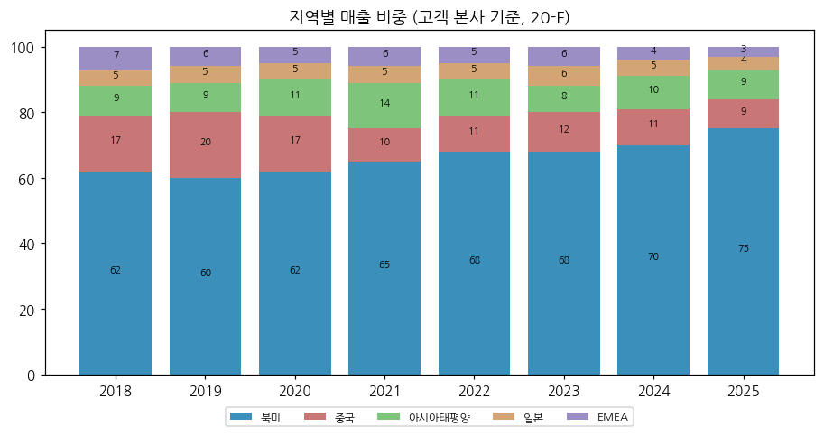

### ⑥ CAPA · 해외 팹
- 연간 생산능력: 12인치 환산 **1,700만 장 이상** (2025, 20-F) — 2024 약 1,700만 장
- 웨이퍼 출하(12인치 환산, 분기): 2022 합계 15,253천 장, 4Q24 3,418천 장 [Management Report 검색 스니펫, 미확인] / 1Q25 이후 미확보

| 지역 | 법인·팹 | 지분 | 공정 | 상태 (2026-11 기준) |
|---|---|---|---|---|
| 미국 애리조나 | TSMC Arizona (Fab 21) | 100% | Fab1 N4 / Fab2 N3 / Fab3 N2·A16 예정 | Fab1 4Q24 양산, Fab2 건설 완료·2027 3분기 양산 예정, Fab3 2026 말 장비 반입, Fab4·패키징 인허가 신청 [Focus Taiwan·TNW·TrendForce]. 2026-05-12 이사회 최대 US$20B 증자 승인 |
| 미국 투자 총액 | - | - | 팹 + 첨단 패키징 + R&D | US$65B → US$165B(2025-03) → **US$265B(2026-07)** [KJZZ 2026-07-16] |
| 일본 구마모토 | JASM (Fab 23) | 약 72.6% (20-F) | Fab1 12/16/22/28nm, Fab2 3nm 전환 보도 | Fab1 2024 말 양산, 2025 적자 → 1Q26 흑자(NT$951M) [Focus Taiwan]. Fab2 가동 시점 2028/2029 출처 상충 |
| 독일 드레스덴 | ESMC | 70.0% (20-F) | 28/22nm, 16/12nm | 2024 착공, 양산 시점은 고객 수요에 연동 [4Q25 컨콜] |
| 중국 | Fab 10(상하이)·Fab 16(난징) | 100% | 성숙 공정·16nm | 가동 중 |

- 애리조나 수익성: 2025 순이익 약 NT$16.1B, 1H26 NT$36.1B [TrendForce, 미확인]. 해외 팹 GPM 희석 2026 약 2%p, 향후 수년 3\~4%p [컨콜 요약, 출처 간 표현 차이]

---

## ④ 재무 구조 (12년, NT$십억)

### ① 손익계산서

| 연도 | 매출 | 매출원가 | 매출총이익 | 영업비용 | 영업이익 | R&D | 법인세 | 순이익(지배) | 희석 EPS | GPM | OPM | NPM | R&D/매출 |
|---|---|---|---|---|---|---|---|---|---|---|---|---|---|
| 2014 | 762.8 | 385.1 | 377.7 | 81.9 | 295.9 | 56.8 | 47.9 | 254.3 | 9.81 | 49.5% | 38.8% | 33.3% | 7.4% |
| 2015 | 843.5 | 433.1 | 410.4 | 90.3 | 320.0 | 65.5 | 47.6 | 302.9 | 11.68 | 48.7% | 37.9% | 35.9% | 7.8% |
| 2016 | 947.9 | 473.1 | 474.8 | 96.9 | 378.0 | 71.2 | 54.1 | 331.7 | 12.79 | 50.1% | 39.9% | 35.0% | 7.5% |
| 2017 | 977.4 | 482.6 | 494.8 | 109.3 | 385.6 | 80.7 | 51.1 | 345.0 | 13.30 | 50.6% | 39.4% | 35.3% | 8.3% |
| 2018 | 1,031.5 | 533.6 | 497.9 | 114.2 | 383.6 | 85.9 | 34.4 | 363.1 | 14.00 | 48.3% | 37.2% | 35.2% | 8.3% |
| 2019 | 1,070.0 | 577.3 | 492.7 | 120.0 | 372.7 | 91.4 | 35.8 | 353.9 | 13.65 | 46.0% | 34.8% | 33.1% | 8.5% |
| 2020 | 1,339.3 | 628.1 | 711.1 | 144.3 | 566.8 | 109.5 | 73.7 | 510.7 | 19.70 | 53.1% | 42.3% | 38.1% | 8.2% |
| 2021 | 1,587.4 | 767.9 | 819.5 | 169.6 | 650.0 | 124.7 | 70.2 | 592.4 | 22.84 | 51.6% | 40.9% | 37.3% | 7.9% |
| 2022 | 2,263.9 | 915.5 | 1,348.4 | 227.1 | 1,121.3 | 163.3 | 150.8 | 992.9 | 38.29 | 59.6% | 49.5% | 43.9% | 7.2% |
| 2023 | 2,161.7 | 986.6 | 1,175.1 | 253.6 | 921.5 | 182.4 | 128.3 | 851.7 | 32.85 | 54.4% | 42.6% | 39.4% | 8.4% |
| 2024 | 2,894.3 | 1,270.0 | 1,624.4 | 302.3 | 1,322.1 | 204.2 | 248.3 | 1,158.4 | 44.67 | 56.1% | 45.7% | 40.0% | 7.1% |
| 2025 | 3,809.1 | 1,575.6 | 2,233.5 | 323.2 | 1,910.3 | 246.4 | 346.5 | 1,697.6 | 65.47 | 58.6% | 50.2% | 44.6% | 6.5% |

> 출처: FY2015\~FY2024 SEC XBRL(ifrs-full), FY2014·FY2025 20-F 본문. 영업비용 = 매출총이익 − 영업이익(판관비·R&D·기타영업손익 포함) [계산]. FY2025 법인세 = 세전이익 2,041.7 − 순이익(연결) 1,695.1.

### ② 재무상태표

| 연도말 | 총자산 | 유동자산 | 현금성자산 | 유동부채 | 부채총계 | 회사채+차입금** | 자본총계 | 지배주주 자본 |
|---|---|---|---|---|---|---|---|---|
| 2014 | 1,494.9 | 626.6 | 358.4 | 224.8 | 472.5 | 213.7 | 1,022.4 | 1,022.2 |
| 2015 | 1,657.4 | 746.7 | 562.7 | 239.8 | 462.4 | 192.0 | 1,195.0 | 1,194.0 |
| 2016 | 1,886.3 | 817.7 | 541.3 | 348.3 | 526.5 | 249.2 | 1,359.8 | 1,359.1 |
| 2017 | 1,991.7 | 857.2 | 553.4 | 386.9 | 497.3 | 214.0 | 1,495.7 | 1,493.7 |
| 2018 | 2,090.0 | 951.7 | 577.8 | 356.8 | 428.9 | 180.6 | 1,661.1 | 1,660.4 |
| 2019 | 2,264.7 | 822.6 | 455.4 | 598.4 | 650.3 | 175.4 | 1,614.4 | 1,613.7 |
| 2020 | 2,760.6 | 1,092.2 | 660.2 | 631.9 | 924.8 | 347.2 | 1,835.8 | 1,834.8 |
| 2021 | 3,725.3 | 1,607.1 | 1,065.0 | 758.4 | 1,573.6 | 732.7 | 2,151.7 | 2,149.3 |
| 2022 | 4,964.5 | 2,052.9 | 1,342.8 | 986.6 | 2,046.6 | 857.2 | 2,917.8 | 2,903.0 |
| 2023 | 5,532.2 | 2,194.0 | 1,465.4 | 942.8 | 2,078.3 | 925.3 | 3,453.9 | 3,429.5 |
| 2024 | 6,691.8 | 3,088.4 | 2,127.6 | 1,308.7 | 2,412.5 | 1,015.6 | 4,279.3 | 4,244.3 |
| 2025 | 7,932.8 | 3,817.1 | 2,767.9 | 1,522.4 | 2,536.6 | 896.1 | 5,396.2 | 5,355.0 |

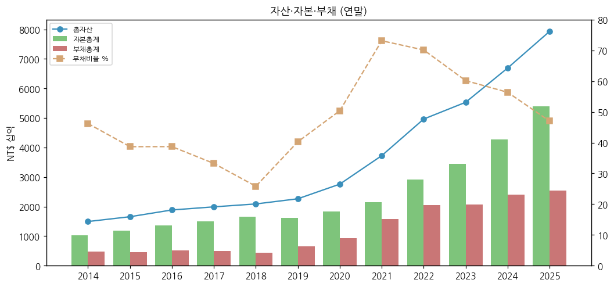

> **회사채+차입금: 2016\~2024는 비유동 회사채 + 유동성 회사채 + 장·단기 차입금(XBRL), 2014\~2015는 회사채만, 2025는 비유동 회사채 856.2 + 장기 은행차입 39.8 (유동성 부분 미포함) — 기준 차이 주의. stockanalysis 기준 총차입(리스 포함) 3Q26 NT$818.4B, 순현금 NT$3,198.6B.

### ③ 현금흐름표 · ④ CapEx

| 연도 | 영업CF | 투자CF | 재무CF | CapEx(유형자산 취득) | 감가상각비 | FCF (영업CF−CapEx) | 현금배당 지급 | CapEx/매출 |
|---|---|---|---|---|---|---|---|---|
| 2014 | 421.5 | −282.4 | −32.3 | 288.5 | 197.6 | 133.0 | 77.8 | 37.8% |
| 2015 | 529.9 | −217.2 | −116.7 | 257.5 | 219.3 | 272.4 | 116.7 | 30.5% |
| 2016 | 539.8 | −395.4 | −157.8 | 328.0 | 220.1 | 211.8 | 155.6 | 34.6% |
| 2017 | 585.3 | −336.2 | −215.7 | 330.6 | 255.8 | 254.7 | 181.5 | 33.8% |
| 2018 | 574.0 | −314.3 | −245.1 | 315.6 | 288.1 | 258.4 | 207.4 | 30.6% |
| 2019 | 615.1 | −458.8 | −269.6 | 460.4 | 281.4 | 154.7 | 259.3 | 43.0% |
| 2020 | 822.7 | −505.8 | −88.6 | 507.2 | 324.5 | 315.4 | 259.3 | 37.9% |
| 2021 | 1,112.2 | −836.4 | 136.6 | 839.2 | 414.2 | 273.0 | 265.8 | 52.9% |
| 2022 | 1,610.6 | −1,190.9 | −200.2 | 1,082.7 | 428.5 | 527.9 | 285.2 | 47.8% |
| 2023 | 1,242.0 | −906.1 | −204.9 | 949.8 | 522.9 | 292.2 | 291.7 | 43.9% |
| 2024 | 1,826.2 | −864.8 | −346.3 | 956.0 | 653.6 | 870.2 | 363.1 | 33.0% |
| 2025 | 2,275.0 | −1,144.4 | −440.3 | 1,272.4 | 679.7 | 1,002.6 | 466.8 | 33.4% |

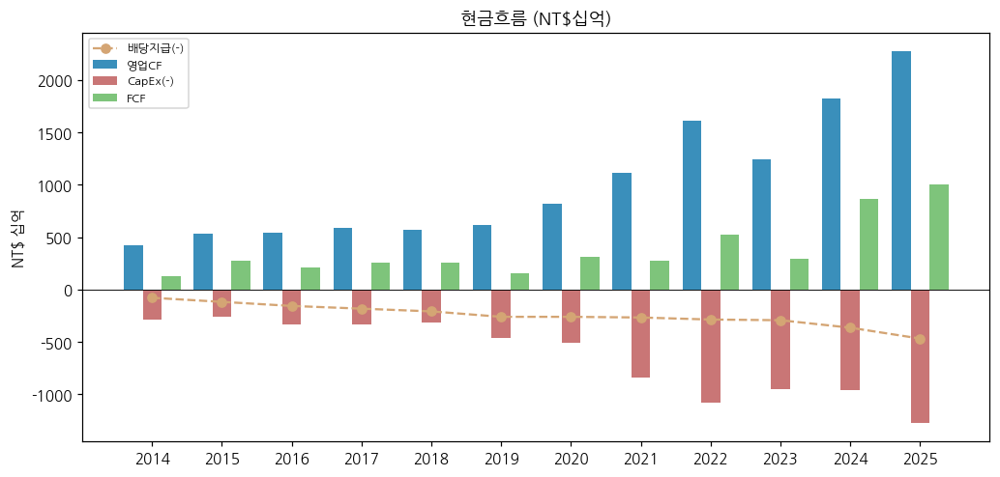

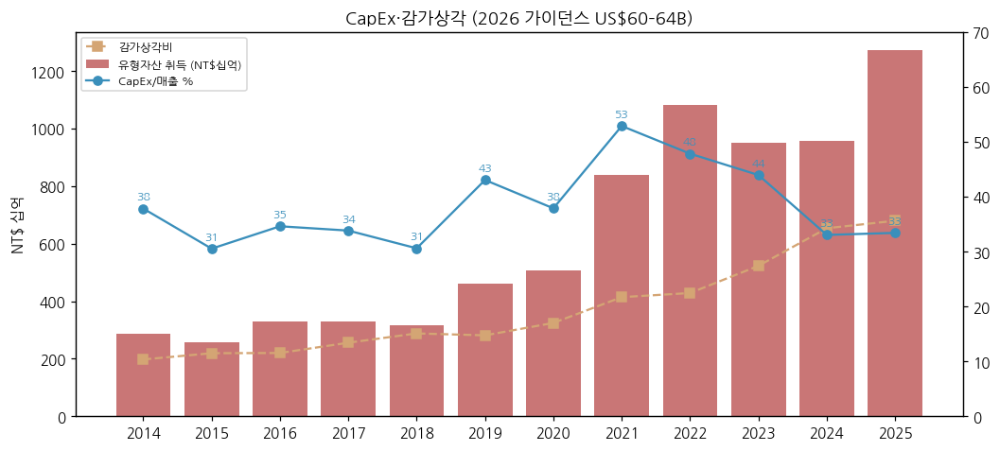

- **CapEx (US$, 회사 발표)**: 2024 US$29.8B → 2025 US$40.9B → **2026 가이던스 US$52\~56B(1월) → US$60\~64B(7월 상향, 10월 유지)**. 구성 70\~80% 첨단 공정, 약 10% 특수 공정, 10\~20% 패키징·마스크 등 [pr.tsmc.com 4Q25, Zacks 2026-08-21, TNW 2026-10-17]
- CFO: "2026\~2028 CapEx는 직전 3년보다 상당히 높을 것" — 2027 수치 가이던스 없음
- 2026 이사회 자본 예산 승인: US$44.96B(02-10) / US$31.28B(05-12) / US$29.44B(08-11) / US$40.93B(11-10, 2027 R&D·유지보수 포함) [이사회 결의]
- 분기 CapEx: 2Q26 약 US$15.7B, 3Q26 US$13.8B [컨콜 요약, 미확인]

### ⑤ 부채 구조
- 무차입에 가까운 순현금 구조 — 2025말 현금성자산 NT$2,767.9B vs 회사채+장기차입 NT$896.1B
- 회사채는 대만 국내 무보증 사채 + TSMC Arizona·TSMC Global 발행 미 달러 사채 (2026-02 이사회 NT$600억 국내 사채 발행 승인)
- 2026-02 이사회: TSMC Global에 US$30B 증자 (환헤지 비용 절감 목적)

### ⑥ 배당·자사주
- **분기 배당** (2019부터). 분기 주당 배당(NT$, 해당 실적 분기 기준): 2024 4.0/4.0/4.5/4.5 [미확인] → 2025 5.0/5.0/6.0/6.0 → 2026 1Q 7.0 / 2Q 7.0 / **3Q 9.0 (2026-11-10 이사회, 배당락 2027-03-11)**
- 2Q26 배당부터 해외 투자자 US$ 수령 선택 가능 [이사회 결의 2026-08-11]
- **자사주 매입 프로그램 없음** — 주식 수 25,932,524,521주 거의 불변
- 배당 지급액 2014 NT$77.8B → 2025 NT$466.8B (6.0배), 배당성향(지급/당해 순이익) 2019 73% 정점 → 2025 27.5%

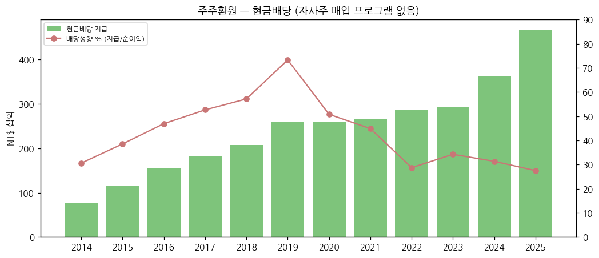

### ⑦ 재무비율

| 연도 | 유동비율 | 부채비율(부채/자본) | 순현금 (현금−회사채·차입) | ROA | ROE | 배당성향 (지급/순이익) |
|---|---|---|---|---|---|---|
| 2014 | 2.79 | 46% | 144.8 | - | - | 30.6% |
| 2015 | 3.11 | 39% | 370.7 | 19.2% | 27.3% | 38.5% |
| 2016 | 2.35 | 39% | 292.1 | 18.7% | 26.0% | 46.9% |
| 2017 | 2.22 | 33% | 339.4 | 17.8% | 24.2% | 52.6% |
| 2018 | 2.67 | 26% | 397.3 | 17.8% | 23.0% | 57.1% |
| 2019 | 1.37 | 40% | 280.0 | 16.3% | 21.6% | 73.3% |
| 2020 | 1.73 | 50% | 312.9 | 20.3% | 29.6% | 50.8% |
| 2021 | 2.12 | 73% | 332.3 | 18.3% | 29.7% | 44.9% |
| 2022 | 2.08 | 70% | 485.6 | 22.9% | 39.3% | 28.7% |
| 2023 | 2.33 | 60% | 540.1 | 16.2% | 26.9% | 34.3% |
| 2024 | 2.36 | 56% | 1,112.0 | 19.0% | 30.2% | 31.3% |
| 2025 | 2.51 | 47% | 1,871.8 | 23.2% | 35.4% | 27.5% |

> ROE·ROA = 순이익(지배) / 기초·기말 평균. 순현금 = 현금성자산 − 회사채·차입금(②의 기준) [계산]. 금융상품(단기 투자) 포함 시 순현금은 더 크다 — stockanalysis 기준 3Q26 현금+투자 NT$4,017.0B.

---

## ⑤ 지배 구조

### ① 그룹·계열 관계
- 지배주주 없음. 최대주주 **대만 행정원 국가발전기금(National Development Fund)** 6.38% — 설립 이후 이사 1석 보유 (2025-09부터 대표 Chun-Hsien Yeh)
- 주요 관계사: **VIS(세계선진)** — 1994 공동 설립 파운드리, 2026-05 지분 일부 매각 공시(6-K "TSMC to sell 8.1% of Vanguard") / JASM(72.6%) / ESMC(70.0%) / TSMC Arizona(100%)
- 2026-11-10 이사회: 전략투자회사 설립(최대 US$500M), Anthropic 보통주(IPO 가격, 최대 US$500M)·OpenAI 우선주(최대 US$500M) 투자 승인

### ② 주주 구분

| 주주 | 보유 주식 | 지분율 | 출처 |
|---|---|---|---|
| National Development Fund, Executive Yuan | 1,653,709,980 | **6.38%** | 20-F (2026-02-28) |
| ADR 예탁 (Citibank 명의, 1,062,690,167 ADS) | 5,313,450,863 | 20.5% [계산] | 20-F (2026-02-28) |
| 이사·임원 (국가발전기금 제외) | 60,237,681 | 0.23% | 20-F |
| 기타 (대만·해외 기관·개인) | — | 약 72.9% [계산] | - |
| 발행주식 총수 | 25,932,524,521 | 100% | 20-F |

> 기관 보유율 48.89% (stockanalysis, ADR 기준 집계 방식 상이)

### ③ 임원·이사회
- **C.C. Wei** — 회장 겸 CEO (재직 28년), 이사 임기 2027
- **Y.P. Chyn / Y.J. Mii** — EVP·공동 COO / **Wendell Huang** — SVP·CFO
- 이사회 10명 중 독립이사 7명 (Sir Peter Bonfield, Michael Splinter, Moshe Gavrielov, L. Rafael Reif, Ursula Burns, Lynn Elsenhans, Chuan Lin) + F.C. Tseng + 국가발전기금 대표 (20-F 2026-02-28)

---

## ⑥ 기타 팩트

### ① R&D

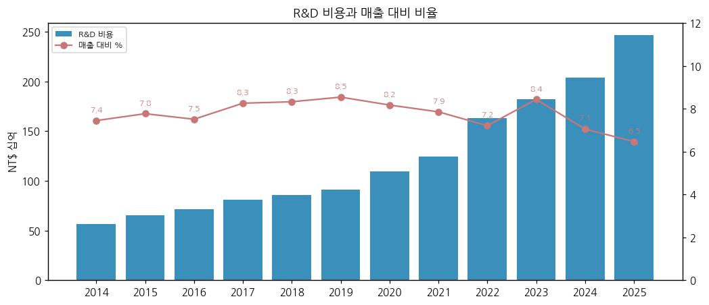

- R&D 비용 2014 NT$56.8B → 2025 NT$246.4B(US$7.86B, 20-F), 매출 대비 2023 8.5% → 2025 6.5% (매출 증가 속도가 더 빠름)
- 로드맵: N2(2025 양산) → A16(2027 양산) → N2U(2028) → A13·A12(2029) [Tom's Hardware 2026-04]

### ② 진행 중 Corporate Action (10년)
| 연도 | 내용 |
|---|---|
| 2020-05 | 미국 애리조나 팹 건설 발표 |
| 2021\~2022 | JASM(일본, Sony·Denso 등 소수 지분) 설립 |
| 2023-08 | ESMC(독일, Bosch·Infineon·NXP 각 10%) 합작 결정 |
| 2025-03 | 미국 투자 US$100B 추가 (총 US$165B) |
| 2026-05 | VIS 지분 일부 매각, TSMC Arizona 최대 US$20B 증자 승인 |
| 2026-07 | 미국 투자 US$100B 추가 (총 US$265B, 팹 4개 + 패키징) |
| 2026-08 | Sony Semiconductor Solutions와 이미지센서 합작 (최대 ¥282B 출자) 승인 |
| 2026-11 | Anthropic·OpenAI 지분 투자 및 전략투자회사 설립 승인 |

### ③ 주요 리스크
- **지정학 (최대 리스크)**: 생산능력 대부분이 대만에 집중. 미·중 수출 통제(첨단 공정 중국 고객 제한), 양안 관계
- **관세**: 2026-01 미·대만 무역 합의 — 상호관세 20% → 15%, 대만 기업 미국 투자 US$250B + 신용보증 US$250B, 반도체 Section 232 관세는 미국 내 증설 규모에 연동한 면세 쿼터(건설 중 계획 용량의 2.5배, 가동 후 1.5배). Section 232 반도체 최종 세율 미확인 [TrendForce 2026-01-16]
- **해외 팹 마진 희석**: 애리조나·구마모토·드레스덴 원가 → GPM 2\~4%p 희석 가이던스
- **고객 집중**: 상위 10대 78%, 상위 2개 고객 36%(2025) — AI 가속기 수요 둔화 시 직접 영향
- **2027 수요 신중론**: 회장 "2027 계획은 신중하게" (3Q26 컨콜)
- **보안 사고**: 2026-11 임직원 개인정보 무단 접근 공시 (stockanalysis 뉴스 헤드라인, 세부 미확인)
- **환율**: 매출 대부분 US$, 보고 통화 NT$ — NT$ 1% 절상 시 GPM 약 0.4%p 하락(회사가 컨콜에서 반복 언급하는 민감도, 이번 수집 자료로는 미확인)

### ④ ESG
- 미수집 (Data gap) — esg.tsmc.com 별도 보고서. 2026 미국·일본·독일·중국 정부 보조금 사상 최대 NT$167.6B 보도 [Focus Taiwan 2026-11-14 헤드라인, 세부 미확인]

### ⑤ 인증·라이선스
- 미국 상무부 수출 통제(Validated End User 등)·대만 경제부 해외 투자 승인 대상 — 세부 미수집

---

## Activity 보고 (v1.0)

### ✅ 확보 — SEC XBRL FY2015\~FY2024 + 20-F 13건 + 보도자료 분기 43건 + 2026 이사회 결의·월매출 + 주가·시총
### ❌ 누락 — Management Report 원문(분기 플랫폼·지역·출하량), 6-K 첨부 원문, 분기 재무상태·현금흐름 원문, ESG, 1Q25 이후 출하량, 2026-06-19\~09-03 일간 주가
### ⚠️ 추정·계산 — [계산] CAGR·마진·비율·연간 US$ 매출·ATH 시총 / [추정] 고객명(Nvidia·Apple 비중), CoWoS 매출 비중 / 플랫폼 비중 다수 분기는 컨콜 요약 출처
### 🔗 핵심 source
- SEC EDGAR TSM (CIK 0001046179): 20-F 2026-04-16(FY2025), XBRL companyfacts, 6-K 2026-10-15(3Q26)
- pr.tsmc.com: 분기 실적 보도자료(3Q26 = news/3346), 월매출(news/3349), 이사회 결의
- TrendForce 2Q26 파운드리 순위(2026-09-09) / companiesmarketcap.com/tsmc/marketcap / stockanalysis.com/stocks/tsm (history·statistics·financials)

### Data Quality Confidence: **82%** (연간 손익·재무 20-F·XBRL 원문, 분기 손익·노드 보도자료 원문 / 플랫폼·출하량·해외 팹 손익은 2차 출처 비중이 높음)

---

## Version Log
- **v1.0 (2026-11-15)**: 최초 작성 — FY2014\~FY2025 12년 + 1Q16\~3Q26 43분기 + 15종 차트. 3Q26 실적·4Q26 가이던스·10월 월매출·2026 CapEx 상향·미국 투자 US$265B 반영
- 잔여 보완 후보: 4Q26·FY2026 실적(2027-01 중순) / Management Report 원문 확보 후 분기 플랫폼 비중 검증(1Q24·3Q25·4Q25·2Q26·3Q26)과 분기 지역·출하량 / 2024 분기 배당 원문 확인 / 2026-06-19\~09-03 일간 주가로 ATH 재확인 / 2014\~2015·2025 회사채 유동성 부분 / Section 232 반도체 최종 세율 / ESG / FY2014·FY2015 US$ 매출
