> Ticker: **Euronext Amsterdam: UMG — Universal Music Group N.V.** (ISIN NL0015000IY2, AEX 편입) / OTC ADR UMGNF·UNVGY
> Entity: **Universal Music Group N.V.** (법적 본사 Hilversum, 네덜란드 / 운영 본사 Santa Monica, 미국) — 세계 최대 음반(Recorded Music)·음악 출판(Publishing)·머천다이징 그룹
> Sector: 엔터 — 서브섹터 **음원 글로벌** (Spotify·Tencent Music과 묶음. 한국 기획사 4사의 글로벌 유통·스트리밍 단가 read-through)
> 작성 시각: **2026-11-15 KST** (**v1.0** — Phase 1 Source 수집 + audit + 12종 차트(대체 포함))
> 적용 구조: v4.8 (6개 섹션) + v1.5 ① 기업 분류 표준 (서술 간결판)
> 데이터 범위: **연간 12년 (2014\~2025, 12월 결산)** — 2014\~2020은 Vivendi 사업부 기준(매출·EBITA), 2021\~는 UMG IFRS(조정 EBITDA) / **분기 12Q (4Q23\~3Q26)** 매출·조정 EBITDA / 재무상태·현금흐름 5년(2021\~2025)
> 출처: **UMG 실적 보도자료** (FY2022·FY2024·FY2025, Q1 2024, Q3 2025, Q2·H1 2026, Q3 2026 — PR Newswire 전재본), Music Business Worldwide·Music Week 실적 기사(2014·2017·2018·2020 Vivendi 시기), StockAnalysis(AMS:UMG 재무상태·현금흐름 집계), debelegger.nl(주가), MBW·Reuters 인용 기사(주주·Pershing 제안)
> ⚠️ **FY2026 연간 실적은 2027-03 초 발표 예정** (전년 2026-03-05 발표) — 발표 후 v1.1 갱신

# Universal Music Group 기업 개요 (v1.0 — 음원 글로벌 / 음반·출판 메이저 1위 / 지속성장형)
> **Fact verify cutoff**: 2026-11-15 (주가 2026-11-13 종가 **€17.63**, 52주 범위 €13.70\~€22.49 [debelegger.nl, Euronext 종가] / 시가총액 **€31.42bn** [동일 출처] / 종가 기준 고점 **2024-03 €27.89** [HITS Daily Double "UMG stock hits record high"] — 이후 갱신 여부 미확인)

## Phase 1 Source Audit

```
=== 자료 수집 audit (Universal Music Group N.V.) ===

✅ 확보
- 연간 실적 보도자료: FY2022(2021 비교)·FY2024(2023 비교)·FY2025(2024 비교) — 매출 라인·세그먼트 조정 EBITDA·순이익·FCF·순차입금
- 분기 보도자료: Q1 2024(Q1 2023 비교)·Q3 2025(Q3 2024 비교)·Q2/H1 2026(2025 비교)·Q3 2026(MBW·securities.io 전재)
- Vivendi 시기 UMG 실적: 2014 EBITA·2017·2018·2020 (MBW 기사)
- 재무상태표·현금흐름표 2021~2025 (StockAnalysis 집계)
- 주가: 2026-11-13 종가·시총·52주 범위 / 주요 시점 가격(상장일·2024-03 고점·Pershing 매각가)
- 주주·지배구조: MBW(2026-02·2026-05), razomua(2026-06, Reuters 인용)

❌ 누락
- investors.universalmusic.com 직접 다운로드: 이 세션은 원격 PC·컨테이너 모두 외부망 차단 → 보도자료 전재본(PR Newswire 배포처)으로 대체
- 2025 Annual Report (임직원·이사회·세부 주주 명부·지역별 매출) 미수집
- 월간 주가 시계열 (Yahoo UMG.AS) — 네트워크 차단으로 chart11은 보도 시점값 연결 차트로 대체
- 2019~2020 UMG IFRS(조정 EBITDA) 기준 연간, 2015·2016·2019 EBITA 원문
- 분기 세그먼트 조정 EBITDA (회사가 분기별로 일관 공시하지 않음 — Q2·Q3 2026만 확보)

⚠️ 결과 영향
- 2014~2020(Vivendi EBITA) ↔ 2021~(UMG 조정 EBITDA) 이익 지표 단절 → chart1에 구분 표기, 12년 마진 평균은 구간별로 따로 계산
- 2015·2016·2019 EBITA, 2014~2016 매출은 Vivendi 연차보고서 수치를 기억치로 기재 [미재검증] 표기
- 재무상태·CF는 5년만 (12년 불가)

Source 6종 audit:
[△] (1) 정기 보고서 — Annual Report 2025 ✗ (보도자료로 손익·CF 핵심 대체)
[V] (2) 실적 보도자료 (연간 3·분기 4) ✓
[ ] (3) Sustainability — 미수집
[△] (4) 주가 — 현재가·주요 시점 ✓ / 월간 시계열 ✗
[ ] (5) CMD — 2024-09 CMD 목표(구독 매출 CAGR 8~10%, 매출 7%+ CAGR ~2028)는 2차 인용
[△] (6) 12년 시계열 — 매출 12년 ✓ / 이익 지표 혼합 / 재무상태·CF 5년
→ 최신 분기(3Q26, 2026-10-29 발표) 확보.
```

---

## ① 기업 분류

(1) Primary / Secondary 분류

**Primary 분류: 지속성장 (스트리밍 구독 기반 로열티 플랫폼)**

→ 매출 2014 €4.56bn → 2025 €12.51bn (11년 CAGR **+9.6%**), 이익률은 Vivendi EBITA 12% → UMG 조정 EBITDA 22%대로 구조적 상승

→ 매출의 절반 이상이 **DSP(Spotify·Apple·Amazon·YouTube·TME 등) 구독·스트리밍 정산** — 가입자 증가 + 요금 인상(Streaming 2.0 도매가 인상)이 성장의 두 축

**Secondary 노트: 소비 경기·이벤트 민감 일부 (피지컬·머천다이즈·싱크)**

→ 피지컬(€1.48bn, 2025)은 K-pop·Taylor Swift 등 팬덤 앨범 판매로 오히려 증가 중이나 히트 의존도 높음 / 머천다이즈(€0.81bn)는 투어 사이클 따라 변동, 마진 2%대

| Summary Box (12년, 2014\~2025) | 값 |
|---|---|
| 매출 CAGR | **+9.6%** (2014\~2025) / +10.1% (2021\~2025) |
| 이익률 평균 | Vivendi EBITA 마진 **14.2%** (2014\~2020) / 조정 EBITDA 마진 **21.6%** (2021\~2025) |
| 이익률 정점 | 조정 EBITDA 마진 **22.5%** (2024·2025) |
| 이익률 저점 | EBITA 마진 **12.3%** (2015) — 다운로드 붕괴·스트리밍 전환 초입 |
| 사이클 주기 | **N/A — secular 성장** (매출 감소 연도 없음, 2014는 직전 대비 −6.7%가 마지막 역성장) |
| 사이클 회수 (12년) | 정점·저점 반복 없음 — 2015 저점 이후 마진 단조 상승, 2026 상반기 일시 하락(Downtown 연결·믹스) |

(2) 손익 표 — 사이클 history

| 연도 | 매출(€m) | 이익(€m) | 마진 | 비고 |
|---|---:|---:|---:|---|
| 2014 | 4,557 | EBITA 565 | 12.4% | ← 다운로드 감소, 매출 −6.7% (마지막 역성장) |
| 2015 | 5,108 | EBITA 626 | 12.3% | ← 마진 저점 [미재검증] |
| 2016 | 5,267 | EBITA 687 | 13.0% | ← 스트리밍 성장 본격화 [미재검증] |
| 2017 | 5,673 | EBITA 761 | 13.4% | ← 스트리밍 €1.97bn(+35%) |
| 2018 | 6,023 | EBITA 902 | 15.0% | ← Vivendi 지분 매각 절차 착수 |
| 2019 | 7,159 | EBITA 1,124 | 15.7% | ← +14% 성장 [EBITA 미재검증] |
| 2020 | 7,432 | EBITA 1,334 | 17.9% | ← COVID — 머천 −40%에도 이익 +20% / Tencent 컨소시엄 지분 인수 |
| 2021 | 8,504 | 조정 EBITDA 1,788 | 21.0% | ← **2021-09-21 분리 상장**, 지표 변경 |
| 2022 | 10,340 | 2,135 | 20.6% | ← 환율 효과 포함 +21.6% |
| 2023 | 11,108 | 2,369 | 21.3% | ← Streaming 2.0(아티스트 중심 로열티) 착수 |
| 2024 | 11,834 | 2,661 | 22.5% | ← 비용절감 €250m 프로그램, 마진 정점 |
| 2025 | 12,507 | 2,810 | 22.5% | ← 구독 +8.6%(cc), 피지컬 +11% |

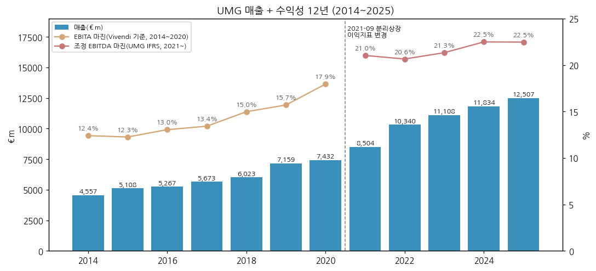

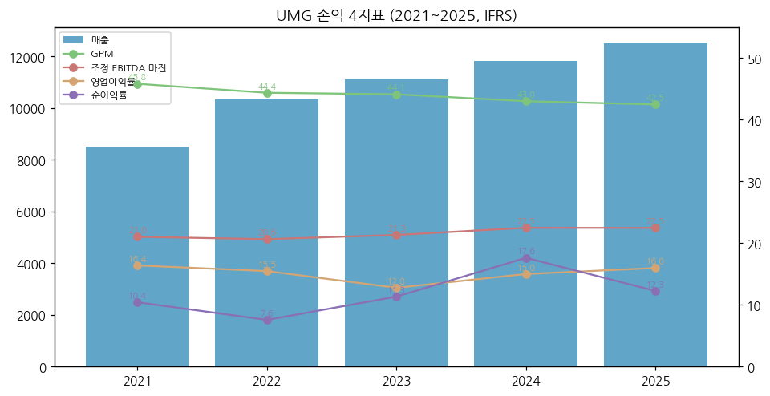

(3) 분류 결정 논리

(1) 가장 큰 사업부 기준: Recorded Music이 매출 75%·조정 EBITDA 81%(2025) → 구독·스트리밍 비중이 RM의 67% → **구독 경제 = 지속성장**

(2) 이익 비중 sub-rule: 사이클성 사업(머천)은 조정 EBITDA 0.5%에 불과 → 분류에 영향 없음

(3) Boundary case: 스트리밍 가입자 성장이 둔화되는 국면에서 성장이 **요금 인상(가격)** 의존으로 바뀌는 중 — 3Q26 유기적 구독 성장의 1/3 이상이 가격 효과(회사 설명). 가격 인상이 멈추면 성장률이 한 자릿수 초반으로 낮아질 수 있어 '지속성장 → 성숙 배당주' 전환 경계에 있음

(4) 피어 cross-reference: Spotify(플랫폼, 고성장·마진 확대 국면) / Tencent Music(중국 플랫폼, SVIP 업셀) / Warner Music(메이저 2위, 같은 지속성장) — UMG는 **콘텐츠 권리 보유자**라 플랫폼 요금 인상의 수혜를 로열티로 받는 위치

(4) 적정 밸류에이션 방법

- **PER (조정 EPS) 1순위** — 회사가 조정 순이익 50% 배당 정책을 쓰고 시장 컨센서스도 조정 EPS 기준. 2025 조정 희석 EPS €1.03 → 현재가 €17.63 기준 **약 17.1배** [계산]
- **EV/조정 EBITDA 보조** — 순차입금 €4.13bn(2026-06) 포함 EV 약 €35.5bn / LTM 조정 EBITDA €2,849m → **약 12.5배** [계산]
- **배당수익률 체크** — DPS €0.52 → **약 2.9%** [계산]
- 리포트 순이익(IFRS)은 Spotify·TME 등 상장 지분 평가손익이 크게 흔들어(2024 €2,086m → H1 2026 €222m) 밸류에이션에 쓰지 않음
- 피어: Spotify는 EV/매출·FCF 수익률, UMG는 PER·EV/EBITDA — 권리 보유자는 이익 안정성이 높아 PER이 맞음

(5) 분기 재평가 트리거 (분류 변경 조건)

- 유기적(Downtown 제외) 구독 매출 성장률이 **2개 분기 연속 5% 미만(cc)** → 지속성장 → 성숙(배당) 재분류 검토
- 조정 EBITDA 마진(Downtown 제외)이 **2개 분기 연속 21% 미만** → Streaming 2.0 효과 소진 여부 재평가
- 피지컬+머천 비중이 매출 **25% 이상**으로 상승 → Secondary(팬덤 이벤트 사이클) 격상

---

## ② 회사 개요

① 기본 사항

| 항목 | 내용 |
|---|---|
| 회사명 | Universal Music Group N.V. |
| 상장 | Euronext Amsterdam, **2021-09-21** (Vivendi의 현물배당 분할 상장, 기준가 €18.50 → 첫날 종가 €25.25) |
| 사업 한 줄 | 녹음 원본(마스터)과 작곡 저작권(퍼블리싱)을 보유·발굴하고 DSP·피지컬·라이선스로 수익화하는 세계 최대 음악 회사 |
| CEO | Sir Lucian Grainge (Chairman & CEO) |
| CFO | Matt Ellis |
| 주요 레이블 | Republic, Interscope Geffen A&M, Capitol, Island, Def Jam, Decca, Deutsche Grammophon, Virgin Music Group(유통), Motown 등 / 출판 UMPG |
| 배당 정책 | 조정 순이익의 50% 이상 (중간·결산 연 2회) |

② 12년 손익·자본 추이 — ① (2) 표 참조 + 재무상태 5년 (④)

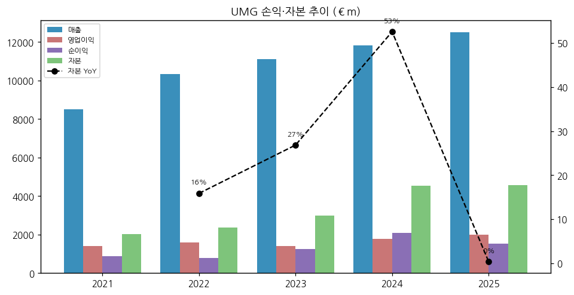

③ 주가 역사 (narrative)

→ **2021-09-21 상장일 종가 €25.25** (기준가 대비 +36%, 시총 약 €45bn) [Digital Music News·Music in Africa 보도]

→ **2024-03 종가 고점 €27.89** (시총 €50bn+) [HITS Daily Double] — 이후 같은 해 TikTok 분쟁 해소·Streaming 2.0 기대

→ 2025-03 Pershing Square가 약 2.7%를 **€26.60**에 매각 [MBW, 2026-02]

→ **2026-04 Pershing Square 인수 제안 €30.40/주 (총 €55.8bn, 2026-04-02 종가 대비 +78%)** → 2026-05-29 이사회 만장일치 거절 [MBW] — 제안 직전 주가는 €17 수준으로 고점 대비 −40%

→ 2026-06 Pershing 잔여 4.7% 블록 매각(€17.66\~€18.62), UMG가 그중 €250m 자사주로 매입 [razomua, Reuters 인용]

→ 2026-10-30 3Q26 구독 성장 서프라이즈로 **+7.9%** [MBW] / **2026-11-13 종가 €17.63, 시총 €31.42bn** (52주 저점 €13.70)

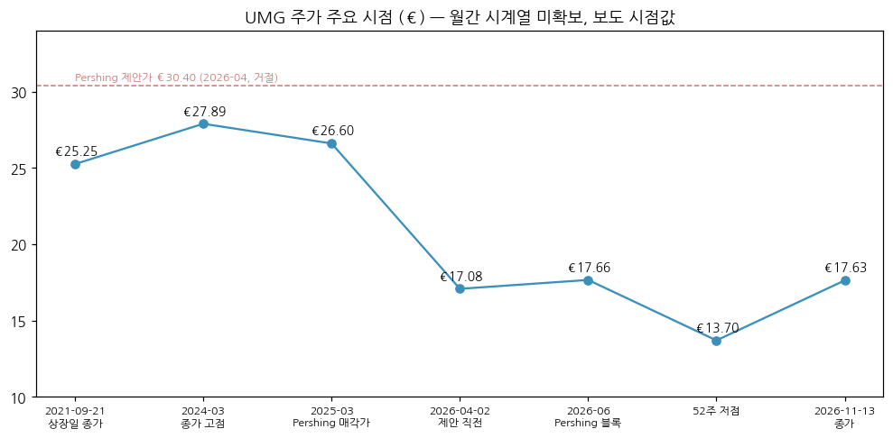

④ 주요 연혁

| 시점 | 사건 |
|---|---|
| 1934 | Decca Records (US) 설립 — UMG 계보 시작 |
| 1998 | Seagram이 PolyGram 인수, MCA Music과 합병해 **Universal Music Group** 출범 |
| 2006 | Vivendi 100% 지배 |
| 2012 | EMI Recorded Music 인수 (EU 조건부 승인) |
| 2020-03 | Tencent 컨소시엄 10% 인수 (EV €30bn), 2021-01 추가 10% |
| 2021-09 | Euronext Amsterdam 분리 상장, Pershing Square 10% 인수 |
| 2023-09 | 'Artist-centric' 로열티 모델(Streaming 2.0) Deezer와 첫 도입 |
| 2024-02\~05 | TikTok 라이선스 분쟁 → 재계약 |
| 2026-02-20 | **Downtown Music Holdings 인수 완료** (Virgin Music Group 산하, 연결 편입) |
| 2026-03 | 미국 상장 추진 보류 (이사회 "지금은 적기 아님") |
| 2026-04\~06 | Pershing 인수 제안 → 거절 → Pershing 완전 exit, 자사주 매입 €734m(2Q) |

---

## ③ 비즈니스 모델

① 실적 추이 통합 표 (5년, €m)

| 항목 | 2021 | 2022 | 2023 | 2024 | 2025 | 2025 비중 |
|---|---:|---:|---:|---:|---:|---:|
| **Recorded Music** | 6,822 | 7,937 | 8,461 | 8,901 | 9,456 | 75.6% |
| └ 구독 (Subscription) | 3,295 | 3,901 | 4,275 | 4,624 | 4,884 | 39.0% |
| └ 광고형 스트리밍 | 1,186 | 1,420 | 1,425 | 1,414 | 1,435 | 11.5% |
| └ 피지컬 | 1,121 | 1,207 | 1,380 | 1,358 | 1,475 | 11.8% |
| └ 라이선스·기타 | 896 | 1,072 | 1,174 | 1,325 | 1,428 | 11.4% |
| └ 다운로드·기타 디지털 | 324 | 337 | 207 | 180 | 234 | 1.9% |
| **Music Publishing** | 1,335 | 1,799 | 1,956 | 2,121 | 2,260 | 18.1% |
| **Merchandising & Other** | 363 | 618 | 706 | 842 | 811 | 6.5% |
| 내부거래 제거 | (16) | (14) | (15) | (30) | (20) | — |
| **합계** | **8,504** | **10,340** | **11,108** | **11,834** | **12,507** | 100% |
| 조정 EBITDA — RM | 1,614 | 1,900 | 2,042 | 2,275 | 2,423 | 마진 25.6% |
| 조정 EBITDA — Publishing | 307 | 410 | 470 | 511 | 549 | 마진 24.3% |
| 조정 EBITDA — Merch | 16 | 36 | 47 | 43 | 16 | 마진 2.0% |
| 조정 EBITDA — 본사 등 | (149) | (211) | (190) | (168) | (178) | [역산] |
| **조정 EBITDA 합계** | **1,788** | **2,135** | **2,369** | **2,661** | **2,810** | **22.5%** |

※ 내부거래 제거·본사 비용은 합계 − 세그먼트 합으로 역산 [계산]. 2023 조정 EBITDA는 FY2024 보도자료의 재작성치(2,369).

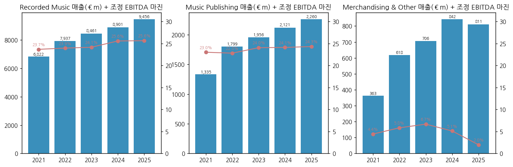

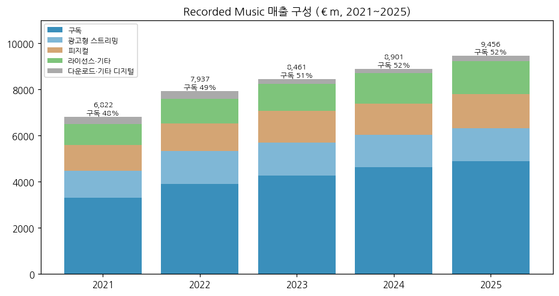

① 12분기 시계열 (€m)

| 분기 | 매출 | YoY | 조정 EBITDA | 마진 | 비고 |
|---|---:|---:|---:|---:|---|
| 4Q23 | 3,208 | — | 677 | 21.1% | |
| 1Q24 | 2,594 | +5.8% | 591 | 22.8% | |
| 2Q24 | 2,932 | — | 650 | 22.2% | [H1 − 1Q 역산] |
| 3Q24 | 2,870 | — | 621 | 21.6% | |
| 4Q24 | 3,439 | +7.2% | 799 | 23.2% | |
| 1Q25 | 2,901 | +11.8% | 660 | 22.8% | [H1 − 2Q 역산] |
| 2Q25 | 2,980 | +1.6% | 676 | 22.7% | |
| 3Q25 | 3,021 | +5.3% | 664 | 22.0% | |
| 4Q25 | 3,605 | +4.8% | 810 | 22.5% | |
| 1Q26 | 2,900 | 0.0% | 636 | 21.9% | [H1 − 2Q 역산], 2/20부터 Downtown 연결 |
| 2Q26 | 3,294 | +10.5% | 674 | 20.5% | Downtown 매출 €202m·EBITDA €10m |
| **3Q26** | **3,394** | **+12.3%** | **729** | **21.5%** | Downtown 제외 마진 22.4% (+0.4pp) |

※ 유로 강세(달러 약세)로 2025\~2026 reported 성장률이 cc 대비 3\~6%pt 낮음 (예: 1Q26 reported 0.0%, H1 cc +10.8%).

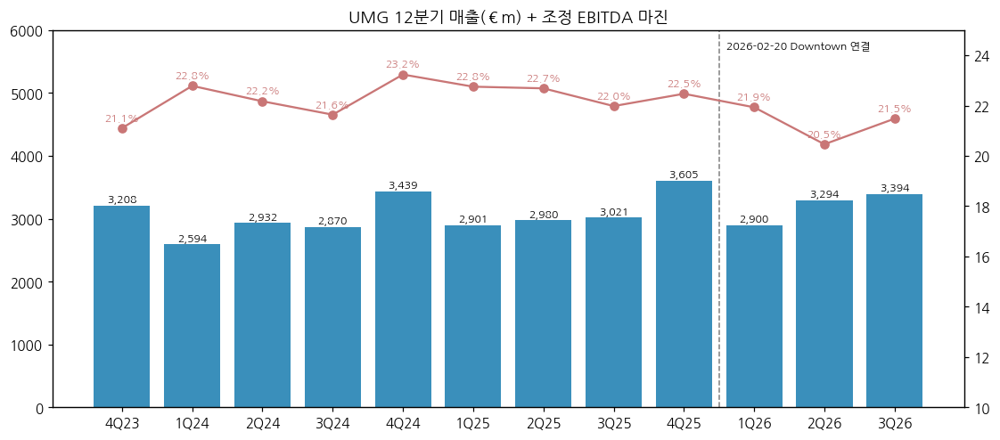

**3Q26 핵심 박스 (2026-10-29 발표)**
- 매출 €3,394m (+12.3%, cc +11.7%, Downtown 제외 cc +5.3%) / 조정 EBITDA €729m (+9.8%), 마진 21.5%
- **구독 매출 €1,422m (+20.7%, Downtown 제외 cc +9.5%)** — 컨센 8.2% 상회(ING), 성장의 1/3 이상이 도매가 인상 [MBW]
- RM 조정 EBITDA €640m (Downtown 제외 마진 26.2%, +1.2pp) / Publishing €136m (−2.9%) / Merch €11m
- 주가 당일 +7.9% [MBW]

② 사업부별 개요 (매출 비중 순)

- **Recorded Music (75.6%)** — 아티스트와 녹음 계약을 맺고 마스터를 소유, DSP 스트리밍·피지컬·싱크/라이선스로 수익화. 카탈로그(발매 3년+)가 매출의 과반 수준(업계 일반) → 안정성의 원천
- **Music Publishing (18.1%)** — UMPG. 작곡가 저작권(공연권·기계적 복제·디지털·싱크) 관리. 디지털이 61%
- **Merchandising & Other (6.5%)** — Bravado. 아티스트 굿즈·D2C·투어 MD. 마진 2\~5%로 낮음

③ 사업부별 디테일

- **구독 성장의 두 축**: (1) DSP 가입자 증가(Spotify 3Q26 프리미엄 3.06억, +9%) (2) **Streaming 2.0 도매가 인상** — Spotify·Amazon 등과 신규 계약, Apple Music과는 아직 미체결(3Q26 콜) [MBW]
- **피지컬 역주행**: 2025 €1,475m(+8.6%), 3Q26 +15% — 팬덤형 앨범(K-pop·일본 Mrs. GREEN APPLE·Taylor Swift) 다중 버전 판매
- **K-pop 연결**: Stray Kids(JYP-Republic Records 파트너십)가 3Q26 상위 판매 아티스트 [Music Week] / HYBE 아티스트의 해외 유통·Geffen 공동 프로젝트(KATSEYE) — **한국 기획사 해외 매출과 UMG 피지컬·구독이 같이 움직이는 구조**
- **Downtown**: 독립 아티스트·레이블 대상 유통·권리관리. 3Q26 매출 €195m, 마진 6.7% — 매출은 키우지만 그룹 마진을 약 0.9pp 희석
- **머천 부진**: 2025 −3.7%, H1 2026 −12.1%, 조정 EBITDA 적자(H1 −€14m)

④ 주요 경쟁사

| 사업부 | 경쟁사 |
|---|---|
| Recorded Music | Sony Music (Sony Group), Warner Music Group (WMG), 독립(Believe·BMG·Concord) |
| Publishing | Sony Music Publishing, Warner Chappell, BMG, Kobalt |
| Merch | Warner(EMP), Live Nation 계열, 아티스트 D2C |
| 유통(독립) | Believe, The Orchard(Sony), ADA(Warner) — Downtown 인수로 강화 |

⑤ 주요 매출처 (공시 기준 개별 비중 미공개)

→ Spotify, Apple Music, Amazon Music, YouTube, Tencent Music, TikTok/Meta(라이선스) 순으로 추정 [추정 — DSP 시장점유율 기반]

→ UMG는 Spotify·Tencent Music 지분도 보유 (2025 상장 지분 평가이익 반영, H1 2026 Spotify 일부 매각 €379m)

⑥ 생산 CAPA + 임직원

→ 제조 설비 없음(피지컬 생산 외주) / 임직원 수: Annual Report 미수집으로 미기재

---

## ④ 재무 구조

① 손익계산서 (€m)

| 항목 | 2021 | 2022 | 2023 | 2024 | 2025 |
|---|---:|---:|---:|---:|---:|
| 매출 | 8,504 | 10,340 | 11,108 | 11,834 | 12,507 |
| 매출총이익 | 3,896 | 4,587 | 4,900 | 5,088 | 5,311 |
| GPM | 45.8% | 44.4% | 44.1% | 43.0% | 42.5% |
| EBITDA | 1,686 | 2,028 | 1,808 | 2,332 | 2,538 |
| 조정 EBITDA | 1,788 | 2,135 | 2,369 | 2,661 | 2,810 |
| 영업이익 | 1,394 | 1,600 | 1,418 | 1,775 | 1,998 |
| 순이익(지배) | 886 | 782 | 1,259 | 2,086 | 1,533 |
| 조정 순이익 | 1,271 | 1,454 | 1,626 | 1,782 | 1,907 |
| EPS 희석 (€) | 0.49 | 0.43 | 0.68 | 1.13 | 0.83 |
| 조정 EPS 희석 (€) | 0.70 | 0.80 | 0.88 | 0.96 | 1.03 |

※ 매출총이익은 StockAnalysis 집계, 나머지는 회사 보도자료. 2023 조정 순이익은 재작성치. **H1 2026 순이익 €222m (−84.5%)** — 상장 지분 평가손익 변동 때문, 조정 순이익은 €863m(−2.2%)

② 재무상태표 (€m, 연말 — StockAnalysis)

| 항목 | 2021 | 2022 | 2023 | 2024 | 2025 |
|---|---:|---:|---:|---:|---:|
| 자산총계 | 12,094 | 11,639 | 13,091 | 17,320 | 17,456 |
| 유동자산 | 3,334 | 3,604 | 4,056 | 4,573 | 4,575 |
| 부채총계 | 10,064 | 9,287 | 10,108 | 12,769 | 12,888 |
| 유동부채 | 5,392 | 6,520 | 6,267 | 7,624 | 7,206 |
| 총차입금 | 3,096 | 2,673 | 2,514 | 3,192 | 3,407 |
| 자본총계 | 2,030 | 2,352 | 2,983 | 4,551 | 4,568 |
| 순차입금 (회사) | 2,010 | 1,810 | 1,689 | 2,098 | 2,390 |

→ **2026-06 순차입금 €4,131m** (+73% vs 2025말): Downtown 인수 등 투자 €806m + 자사주 €734m + 배당 €514m − Spotify 지분 매각 €379m

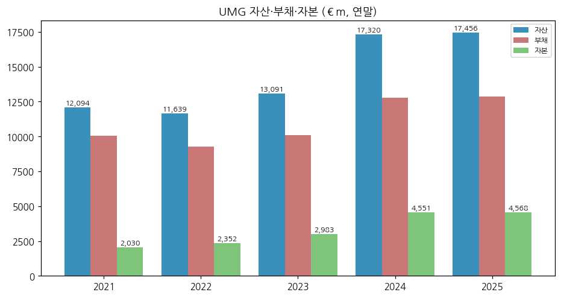

③ 현금흐름표 (€m)

| 항목 | 2021 | 2022 | 2023 | 2024 | 2025 |
|---|---:|---:|---:|---:|---:|
| 영업CF | 1,140 | 1,732 | 1,885 | 1,755 | 1,739 |
| 투자CF | (391) | (520) | (622) | (1,051) | (854) |
| 재무CF | (1,346) | (1,347) | (1,280) | (552) | (988) |
| **FCF (회사 정의)** | 638 | 1,086 | 1,082 | 523 | 702 |

※ 회사 FCF = 영업CF − CapEx − 아티스트 선급금·카탈로그 투자 순액 등. 2026부터 정의 변경(H1 2026 €24m vs H1 2025 €163m 재작성). StockAnalysis 단순 FCF(영업CF − CapEx)는 2025 €1,669m로 크게 다름 — **음악 회사는 선급금(royalty advance)이 사실상 CapEx**

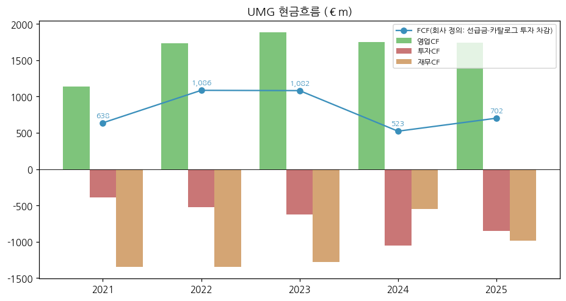

④ CapEx

→ 유·무형 CapEx는 €13\~91m로 매출 대비 1% 미만 (2025 €70m) / 실질 투자는 **아티스트 선급금·카탈로그 매입** (H1 2026 선급금 €292m vs €377m) + M&A (Downtown 2026)

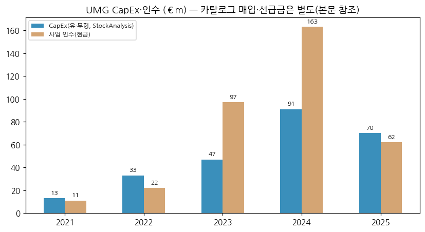

⑤ 부채 구조

→ 총차입금 €3.4bn(2025말) — 유로 회사채 중심 [세부 만기 Annual Report 미수집] / 2026 상반기 자사주·인수로 순차입금/조정 EBITDA 약 **1.45배** [계산: 4,131 / LTM 2,849]

⑥ 배당·자사주

| 항목 | 2021 | 2022 | 2023 | 2024 | 2025 |
|---|---:|---:|---:|---:|---:|
| DPS (€) | 0.40 | 0.51 | 0.51 | 0.52 | 0.52 |
| 배당 지급 (€m) | 785 | 798 | 929 | 933 | 953 |

→ 2026: 중간배당 €0.24 (€432m, 10/27 지급) / **자사주 €734m (2026-03-31\~06-30)**, 그중 €250m은 Pershing 블록에서 €17.66에 매입

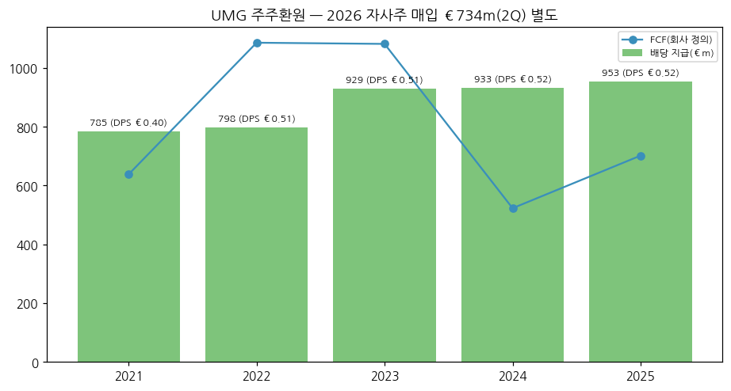

⑦ 재무비율 (2025, [계산])

| 지표 | 값 |
|---|---:|
| ROE (순이익/평균자본) | 33.6% (평가이익 포함 — 변동 큼) |
| 조정 ROE (조정 순이익/평균자본) | 41.8% |
| 부채비율 (부채/자본) | 282% |
| 유동비율 | 63% |
| 순차입금/조정 EBITDA | 0.85배 (2025말) → 1.45배 (2026-06, LTM) |

→ 유동비율이 낮은 건 아티스트·저작권자에게 줄 로열티 미지급금이 유동부채에 쌓이는 업종 구조

---

## ⑤ 지배 구조

① 그룹 관계

→ **Bolloré 그룹이 직접 지분 + Vivendi 경유로 약 28\~32% 실질 지배** (MBW 2026-05: 약 28%, razomua/Reuters 2026-06: 약 32%) — 2026 Pershing 제안은 2/3 주주 승인이 필요해 Bolloré가 사실상 거부권 행사

② 주주 구분

| 주주 | 지분 | 기준·출처 |
|---|---:|---|
| Bolloré 가문 (직접) | 18.5% | 2024말, Bolloré 그룹 웹사이트 [MBW 2026-02] |
| Vivendi | 14.59% (순 경제적 노출 \~10%) | 2024-12, 일부 선도매도·스왑 [MBW 2026-02] |
| Tencent 컨소시엄 | 약 20% | 2026-02 기준 유지 [MBW] |
| Independent Franchise Partners | 3.01% | 2026-02-09 [MBW] |
| Pershing Square | **0%** (2026-06 완전 매각) | [razomua, Reuters 인용] |
| 기타 유통 | 잔여 | — |

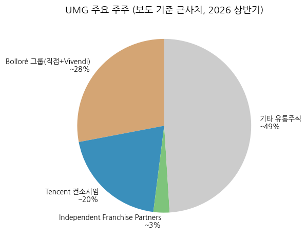

③ 임원·이사회

→ **Sir Lucian Grainge** — Chairman & CEO (2011 CEO 취임, 업계 최장수 메이저 CEO) / **Matt Ellis** — CFO / Bill Ackman은 2025-05 이사회 사임 [MBW]

---

## ⑥ 기타 팩트

① R&D 인프라

→ 해당 없음 (R&D 대신 A&R·선급금 투자). chart7 생략

② 진행 중 corporate action (10년)

| 시점 | 내용 |
|---|---|
| 2020-03 / 2021-01 | Tencent 컨소시엄 10% + 10% 인수 |
| 2021-09 | 분리 상장, Pershing 10% |
| 2024-12 (발표) | Downtown Music Holdings 인수 합의 ($775m 보도, EU 심사) → **2026-02-20 완료** |
| 2025-03 | Pershing 2.7% 매각 (€26.60) |
| 2025말\~2026 | Excel Entertainment(인도) 소수 지분 투자 |
| 2026-03 | 미국 상장 보류 |
| 2026-04-07 | Pershing Square 인수 제안 (€30.40/주, NYSE 이전·Nevada 법인) |
| 2026-05-29 | 이사회 만장일치 거절 |
| 2026-06 | Pershing 잔여 4.7% 매각, UMG €250m 자사주 매입 / H1 Spotify 지분 일부 매각 €379m |

③ 전략 마일스톤

→ Streaming 2.0 (2023\~): 아티스트 중심 로열티(소액 스트림·노이즈 콘텐츠 배제) + DSP 도매가 인상 — Spotify·Amazon·Deezer 등 체결, Apple 미체결(2026-10 기준)
→ AI: AI 음악 기업과 라이선스·파트너십 체결, 무단 학습 대응 [세부 계약명 미검증]
→ 2024 CMD 목표: 구독 매출 CAGR 8\~10%, 총매출 CAGR 7%+ (\~2028) [2차 인용]

④ 주요 리스크

- **환율**: 매출의 상당 부분이 USD — 2025\~2026 유로 강세로 reported 성장률 3\~6%pt 손실
- **DSP 가격 정책 의존**: Apple Music 등 Streaming 2.0 미체결, 가입자 성장 둔화 시 가격 의존 심화
- **상장 지분 평가손익**: Spotify·TME 주가에 따라 순이익 급변
- **지배구조**: Bolloré 실질 지배 — 경영권 프리미엄 거래(인수 제안) 차단 사례
- **AI 생성 음악**: 스트리밍 풀 희석·저작권 소송
- **Downtown 통합**: 저마진 유통 사업 확대로 그룹 마진 희석

⑤ ESG / ⑥ 인증

→ Sustainability Report 미수집 — v1.1에서 보강

---

## Activity 보고 (v1.0)

### ✅ 확보 — 연간 PR 3건(FY2022·2024·2025) + 분기 PR 4건 + Vivendi 시기 기사 4건 + 재무상태·CF 5년 + 주가·주주 보도
### ❌ 누락 — Annual Report 2025(임직원·부채 만기·지역 매출), 월간 주가, 분기 세그먼트 EBITDA, ESG
### ⚠️ 추정·계산 — [계산] CAGR·마진·멀티플·비율 / [역산] 2Q24·1Q25·1Q26 분기 / [미재검증] 2014\~2016 매출·2015·2016·2019 EBITA / [추정] DSP 매출처 순서

### 🔗 핵심 source URL
- FY2025 보도자료: https://www.bolsamania.com/nota-de-prensa_print/mercados/universal-music-group-nv-reports-financial-results-for-the-fourth-quarter-and-full-year-ended-december-31-2025--21946174.html
- Q2/H1 2026 보도자료: https://www.webull.com/news/15317032069243904
- Q3 2026: https://www.securities.io/universal-music-group-q3-revenue-rises-12-3-as-downtown-adds-195-million/
- Pershing 제안 거절: https://www.musicbusinessworldwide.com/umg-rejects-bill-ackmans-64b-takeover-bid/
- 재무상태: https://stockanalysis.com/quote/ams/UMG/financials/balance-sheet/

### Data Quality Confidence: **82%** (손익 2021\~ 회사 원문, 2014\~2020은 일부 미재검증)

---

## Version Log

- **v1.0 (2026-11-15)**: 최초 작성 — 엔터 섹터 확장(음원 글로벌) 편입. 12년 매출 + 이익(지표 혼합), 5년 세그먼트·RM 라인, 12Q 시계열, 재무상태·CF 5년, 주주·Pershing 제안 경과
- 잔여 보완 후보 (v1.1): Annual Report 2025 (임직원·부채 만기·지역별 매출·이사회), 월간 주가 시계열(Yahoo UMG.AS)로 chart11 교체, 2019\~2020 UMG IFRS 조정 EBITDA, 2015·2016·2019 원문 검증, FY2026 실적(2027-03) 반영
