> Ticker: **NYSE:VRT — Vertiv Holdings Co**
> Entity: **Vertiv Holdings Co** (Delaware 법인, 본사 505 N. Cleveland Ave., Westerville, Ohio, USA) — 데이터센터 전력·열관리(냉각) 인프라 전문 기업
> Sector: 전력 인프라 / 서브섹터 배전·DC 전력관리 — 글로벌 편입 종목 (Eaton·Schneider·ABB·LS일렉트릭과 비교)
> 작성 시각: 2026-11-15 KST (**v1.0** — SEC XBRL·10-K 8건·DEF 14A·Yahoo 월간 주가 수집 + 12종 차트 + v1.5 표준 ① 기업 분류)
> 적용 구조: v4.8 (6개 섹션) + v1.5 ① 기업 분류 표준 (Summary Box·손익 narrative·분류 4단계 논리·밸류 다이얼·분류 변경 조건)
> 데이터: **연간 FY18~FY25 (8년) + FY26 9M·가이던스** / **분기 27개 (1Q20~3Q26)** / **주가 2018-09~2026-11 (월간)**
> 출처: SEC EDGAR XBRL companyfacts (CIK 1674101), 10-K 8건 (2019~2026 제출), 8-K 114건, DEF 14A 2026 (4/24), Q4 2023 실적 보도자료 (8-K Ex.99.1, 2024-02-21), Yahoo Finance VRT 월간, `2026-Q3_VRT_리뷰.md`, 셀사이드 3건 (신한·SK·삼성 10/30, 맥락 참고)

# Vertiv Holdings 기업 개요 (v1.0 — 전력 인프라 / 배전·DC 전력관리 / AI 데이터센터 전력·냉각 pure-play)
> **Fact verify cutoff**: 2026-11-15 (주가·시가총액·컨센은 작성일 기준. 다음 갱신 시 재확인)
> **기준 단절 주의**: Vertiv는 2016년 Emerson Network Power에서 분사, 2020-02-07 SPAC(GS Acquisition Holdings) 합병으로 상장했다. 공개 재무는 FY18부터이고, FY19 이전 영업이익·조정 영업이익은 공시 기준이 달라 일부 비운다. FY23부터 본사 비용 일부를 지역 세그먼트에 배분하도록 세그먼트 기준이 바뀌었다 (FY24 10-K 재작성)


## ① 기업 분류

### Phase 1 Source Audit

```
=== 자료 수집 audit (Vertiv Holdings Co) ===

✅ 확보 (총 8종):
- SEC XBRL companyfacts — FY18~FY25 연간 손익·재무상태·현금흐름 + 1Q19~3Q26 분기 매출·GAAP 영업이익·순이익
- 10-K 8건 (2019~2026 제출) — 지역 세그먼트 매출·영업이익, 제품/서비스 매출, 수주잔고, 임직원, 사업 설명, 경쟁사
- 8-K 114건 — 실적 발표·인수·임원 변경 (Ex.99 본문은 Q4 2023 보도자료 1건만 직접 확인)
- Q4 2023 실적 보도자료 (2024-02-21) — FY22·FY23 조정 영업이익 원문 확인 ($439.2M / $1,053.5M)
- DEF 14A 2026 (4/24) — 5% 이상 주주·이사회·임원
- Yahoo Finance VRT 월간 종가 (2018-09 GSAH 시절 ~ 2026-11)
- 2026-Q3 실적 리뷰 (11/15) — 11개 분기 조정 영업이익·지역 실적·가이던스
- 셀사이드 3건 (신한·SK·삼성 10/30) — 800V DC·액체냉각 맥락

❌ 누락 (4):
- FY19 이전 조정 영업이익 — SPAC 합병 전 기준이 달라 미기재
- 분기 조정 영업이익 1Q20~3Q23 (4Q22·4Q23 제외) — 분기 보도자료 Ex.99 미수집
- 제품군별(전력·열관리·랙·IT관리) 매출 — 회사가 FY24부터 "제품 vs 서비스" 2분류로만 공시
- 13F 기관별 보유 상위 — Proxy의 5% 이상 주주(BlackRock)만 확보

⚠️ 결과 영향:
- 연간 매출·GAAP 손익·재무상태·현금흐름은 XBRL 정확값 (FY19~FY25)
- 조정 영업이익은 FY20~FY23 = 10-K 세그먼트 영업이익 − 본사 비용 (Q4 2023 보도자료와 FY22·FY23 일치 확인), FY24·FY25 = 회사 발표 분기 합
- 주주 구성은 5% 이상 주주·임원 합계만 정확값
```

---

(1) Primary / Secondary 분류

**Primary 분류: 고성장 (High Growth)** — AI 데이터센터 전력·냉각 수요를 가장 직접적으로 받는 pure-play. 매출 YoY FY23 +20.6% → FY24 +16.7% → FY25 +27.7% → FY26 가이던스 +43%, 2026년 3분기 유기적 수주 +100% 이상

→ **매출 4년 2.9배 경로** — FY22 $5.7B → FY26 가이던스 $14.65B. 수주잔고 FY22 $4.75B → FY25 $15.0B (3.2배)

→ **이익 레버리지가 매출보다 빠르다** — 조정 영업이익 FY22 $439M → FY25 $2,090M (4.8배), FY26 가이던스 $3,515M. 조정 영업이익률 7.7% → 20.4% → 24.0%(가이던스)

→ **매출의 대부분이 데이터센터** — 하이퍼스케일·코로케이션·네오클라우드·엔터프라이즈 데이터센터가 핵심 고객. 통신망·상업·산업은 저성장 보조 시장

**Secondary 노트: 사이클 (데이터센터 설비투자 사이클 노출 + 2020~22년 마진 붕괴 이력)**

→ **조정 영업이익률 범위 12.7%p** (FY22 저점 7.7% ↔ FY25 20.4%) — 사이클 cutoff ±10%p를 넘는다

→ **2022년 마진 붕괴** — 원자재·물류 인플레이션을 고정가 계약이 흡수하지 못해 GAAP 영업이익률 3.9%까지 하락. 2023년 CEO 교체와 가격 재설정(VOS)으로 회복

→ **고객 설비투자 의존** — 하이퍼스케일러 capex가 꺾이면 수주가 바로 흔들리는 구조. 2026-11 중간선거 후 텍사스 데이터센터 모라토리엄 우려에 주가 1주 -23%

**사업 구조 (FY25 실적, 3개 지역 세그먼트)**

→ **(1) Americas** — 매출 $6,386M, 비중 62%, 세그먼트 마진 26.8% — **최대 세그먼트, 미국 AI 데이터센터 수요의 중심**

→ **(2) Asia Pacific** — 매출 $2,019M, 비중 20%, 마진 11.0% — 중국·인도·동남아. 마진이 가장 낮다

→ **(3) EMEA** — 매출 $1,824M, 비중 18%, 마진 20.7% — 코로케이션 중심, FY25 매출 +1.7%로 정체

(2) Summary Box (사이클 통계 — 공개 재무 8년, FY18~FY25)

| 지표 | 값 |
|------|-----|
| 매출 CAGR | **+13.2%/yr** (FY18→FY25 7년) — FY21→FY25 4년은 +19.6%/yr로 가속 |
| 조정 OPM 평균 | **13.2%** (FY20~FY25 6년) |
| OPM 정점 평균 | **20.4%** (FY25, 진행 중 — FY26 가이던스 24.0%) |
| OPM 저점 평균 | **7.7%** (FY22) |
| 사이클 주기 | 상장 후 1회 저점만 관측 — 주기 산정 불가 (N/A, 6년 표본) |
| 사이클 회수 (상장 후) | 정점 0회 (진행 중) / 저점 1회 (FY22) |

| 지표 | FY18 | FY20 | FY22 | FY23 | FY24 | FY25 | FY26E |
|---|---|---|---|---|---|---|---|
| 매출 ($B) | 4.29 | 4.37 | 5.69 | 6.86 | 8.01 | **10.23** | 14.65 |
| 조정 영업이익 ($M) | — | 368 | 439 | 1,054 | 1,552 | **2,090** | 3,515 |
| **조정 OPM** | — | 8.4% | 7.7% | 15.3% | 19.4% | **20.4%** | 24.0% |
| 순이익 ($M) | -314 | -327 | 77 | 460 | 496 | **1,333** | — |
| 희석 EPS ($) | — | -1.07 | 0.20 | 1.19 | 1.28 | **3.41** | 조정 7.15 |

```
[Vertiv 연간 손익 시계열 (USD $M, XBRL 정확값 / 조정 영업이익은 각주 기준)]
연도    매출       GAAP OP   조정 OP   조정OPM   순이익
FY18    4,285.6      —         —        —      -314.0   ← Platinum Equity 소유 시절, 레버리지 인수 구조로 적자
FY19    4,431.2    206.1       —        —      -140.8   ← 이자비용 $310M이 이익을 삼킴, 자본잠식(-$705M)
FY20    4,370.6    213.5     368.2     8.4%    -327.3   ← SPAC 상장(2/7), 코로나, 부채 상환·워런트 평가손
FY21    4,998.1    259.9     407.4     8.2%     119.6   ← 첫 흑자, E&I 인수($1.2B), 원자재 인플레 시작
FY22    5,691.5    223.4     439.2     7.7%      76.6   ← 마진 저점: 고정가 수주 vs 원가 급등, CEO 교체 발표
FY23    6,863.2    872.2   1,053.5    15.3%     460.2   ← 턴어라운드: Albertazzi CEO·가격 재설정·VOS, AI 수요 시작
FY24    8,011.8  1,367.4   1,551.6    19.4%     495.8   ← AI 데이터센터 본격화, 잔고 $7.2B, 자사주 $600M
FY25   10,229.9  1,829.7   2,090.0    20.4%   1,332.8   ← 매출 $10B 돌파, 잔고 $15.0B (2배), PurgeRite·Great Lakes 인수
FY26E  14,650     —        3,515      24.0%      —      ← 가이던스 (10/28, 세 번째 상향), 3Q 유기적 수주 +100%+

매출 CAGR (FY18→FY25): +13.2%/yr / FY21→FY25: +19.6%/yr
조정 OPM range: 7.7% ~ 20.4% = 12.7%p → 사이클 cutoff(±10%p) 초과
단, 저점 이후 3년 연속 단조 상승 + 매출 성장률 20% 안팎 → Primary 고성장, Secondary 사이클
```
→ (출처: SEC XBRL companyfacts. 조정 영업이익 FY20~FY23 = 10-K 세그먼트 영업이익 합 − 본사·기타 비용 (FY22 $439.2M·FY23 $1,053.5M은 Q4 2023 보도자료 원문과 일치), FY24·FY25 = 회사 분기 발표 합 (FY25 10-K 세그먼트 기준은 $2,030M — 구조조정비 처리 차이). FY26E = 회사 가이던스 중간값 (10/28). 희석 EPS = 순이익 ÷ 희석 주식수 [계산])

**글로벌 피어 비교 (3Q26 영업이익률, 회사 주 지표 기준)**

- **Eaton**: 25.3% (세그먼트 영업이익) — 배전·DC, 사상 최고
- **Vertiv**: **25.2% (조정 영업이익)** — 배전·DC, 3Q26 매출 +61%
- **HD현대일렉트릭**: 24.1% (영업이익) — 송변전
- **ABB**: 20.8% (Op EBITA) — 배전·DC
- **Schneider Electric**: 약 20% (2H26 Adj. EBITA 가이던스 내재) — 배전·DC
- **Hitachi Energy**: 15.9% (Adj. EBITA, 달러) — 송변전
- **GE Vernova**: 15.4% (Adj. EBITDA) — 발전
- **효성중공업**: 14.0% — 송변전
- **LS일렉트릭**: 12.4% — 배전·DC
- **Siemens Energy**: 12.0% (PbSI) — 발전

**피어 비교 시사점**

→ Vertiv는 **Eaton과 같은 25%대 마진**에 올라섰다. 4년 전(FY22 7.7%)에는 피어 최하위권이었다

→ **성장률은 피어 중 압도적 1위** — 3Q26 매출 YoY +61%로 Eaton(+28%)·ABB(+14%)·Schneider(+18%)의 2~4배

→ **사업이 데이터센터 하나에 집중** — Eaton(항공·유틸리티)·ABB(로봇·모션)·Schneider(산업 자동화)와 달리 분산이 없다. 업사이드도 다운사이드도 가장 크다

(3) 정량적 분류 근거

→ **FY18~FY22** = Platinum Equity 레버리지 구조 + 코로나 + 인플레이션 → 매출 연 +7%, 조정 OPM 7~8%대 정체, 순이익 적자·소폭 흑자

→ **FY23~FY26E** = 턴어라운드 + AI 데이터센터 → 매출 연 +17~43%, 조정 OPM 15% → 24% 단조 상승

→ FY23이 변곡점이다. 변곡 이후 4년 연속 매출·마진 동반 상승이라 "고성장" 기준(매출 성장 20% 안팎 지속 + 수주 선행)을 충족한다

**시장 지위**

→ **데이터센터 전력·열관리 통합 공급자** — UPS·스위치기어·버스바·항온항습기·액체냉각(CDU)·랙·PDU·모듈형 데이터센터를 한 회사가 모두 공급하는 몇 안 되는 업체. 10-K는 "가장 완전한 포트폴리오"로 표현

→ **열관리(냉각) 강자** — 1965년 최초의 전산실 항온항습기(Liebert)를 만든 회사. AI 서버 발열로 액체냉각 수요가 커지면서 전력보다 냉각에서 차별화가 크다

→ **NVIDIA 파트너** — 800V DC 전력 아키텍처·차세대 랙(Rubin 세대) 레퍼런스 설계 협력. 800V DC 매출은 2027년 일부 시작, 본격 배치는 2028년 [셀사이드 인용]

**FY26 가이던스 (2026-10-28, 올해 세 번째 상향)**

→ 매출 **$14.65B** (유기적 +38%)

→ 조정 영업이익 **$3,515M** (마진 24.0%)

→ 조정 EPS **$7.15**

→ 4Q26: 매출 $4,413M, 조정 영업이익 $1,138M (YoY +70%), 마진 25.8%

(4) 산업 분류

→ **GICS** — Electrical Components & Equipment (Industrials)

→ **SEC SIC** — 3585 (Air-Cond & Warm Air Heating Equipment) — 냉각 사업 뿌리를 반영

→ **워치리스트 섹터** — 전력 인프라 / 서브섹터 배전·DC 전력관리 (핵심 종목, 2026-11-15 편입)

(5) 분류 결정 논리

(1) **가장 매출 큰 사업부 기준** — 세그먼트가 지역 단위라 사업부 기준이 의미 없다. 제품 기준으로는 데이터센터용 전력·열관리 제품이 매출 80%(서비스·스페어 20%)다 → 데이터센터 단일 노출

(2) **사이클 vs 고성장 sub-rule**
   - 조정 OPM range 12.7%p → 사이클 cutoff(±10%p) 초과
   - 그러나 range의 대부분이 FY22 저점 이후 단방향 상승이고, 하락 구간은 상장 후 1회(FY20~FY22 인플레이션)뿐
   - 매출 성장 FY23~FY26E 연평균 약 +26%, 수주잔고 3년 3.2배
   → **고성장 Primary**, 사이클은 Secondary로 둔다

(3) **Boundary case 처리**
   - 서비스·스페어 매출 비중 FY20 30% → FY25 20%로 하락 — 성장이 장비(제품)에 쏠려 있어 사이클 민감도가 오히려 커졌다
   - 성장률이 15% 아래로 내려오고 마진이 꺾이면 Primary가 사이클로 넘어간다 (분류 변경 조건 ①)

(4) **글로벌 피어 대비**
   - **Eaton** (지속성장) — 마진은 같지만 항공·유틸리티로 분산, 성장률은 Vertiv의 절반
   - **Schneider·ABB** (지속성장) — 데이터센터 비중이 일부라 사이클 노출이 작다
   - **LS일렉트릭** — 미국 데이터센터 배전반으로 같은 수요를 받지만 마진은 절반(12.4%)
   - Vertiv는 같은 서브섹터에서 **유일한 데이터센터 pure-play** — 분류가 피어와 다르다

(6) 적정 밸류에이션 방법

→ **1차 — Forward PER (고성장 분류 표준)**: 이익이 매년 40~60% 늘어 순이익 기준 PER이 가장 직접적이다. 2026-11 주가 $202 기준 FY26 조정 EPS $7.15 → 28.3배, 2027 컨센 EPS $9.45 → 21.4배. 5년 평균 Fwd P/E 약 27배, 2026-05 고점 약 55배 [TIKR 11/10 인용]

→ **2차 — PEG (성장 대비 멀티플)**: 2027 컨센 EPS 성장 약 +32%에 Fwd P/E 21배 → PEG 약 0.7. 피어(Eaton Fwd P/E 27~29배, EPS 성장 10%대)보다 성장 대비 싸다

→ **3차 — EV/EBITDA (부채 비교)**: 순차입 약 $1.2B (FY25), 순차입/조정 EBITDA 약 0.5배로 부채 부담은 작다. 자본구조보다 이익 성장이 밸류를 정한다

→ **PBR 미사용** — FY19까지 자본잠식, FY25 자본 $3.9B에 시가총액 $60~130B라 P/B 밴드가 의미 없다

→ **삼성전자 대비**: 삼성전자는 메모리 사이클이라 PBR 밴드 단독, Vertiv는 고성장이라 Forward PER·PEG 단독. 다만 Secondary 사이클이라 데이터센터 capex 정점 우려가 커지면 멀티플이 이익보다 먼저 꺾인다 (2026-11 TP 하향 = 멀티플 하향)

(7) 분기 재평가 트리거 (**분류 변경 조건** — 실적 추적 변수는 ⑥ 섹션)

→ ① **매출 YoY 15% 미만 + 조정 OPM 2개 분기 연속 하락** → 고성장 → **사이클 Primary 전환** (데이터센터 capex 정점 통과 판정)

→ ② **서비스·스페어 매출 비중 25% 이상 회복 + 조정 OPM 22% 이상 4개 분기 유지 (성장률 15% 안팎으로 둔화된 상태)** → 고성장 → **지속성장 전환** (설치 기반 서비스로 이익이 안정되는 Eaton·Schneider형)

→ ③ **800V DC·액체냉각 신규 플랫폼 매출화(2028~) 후 매출 YoY 30% 이상 + 조정 OPM 25% 이상 4개 분기 유지** → **Secondary 사이클 해제** (고성장 단독 — 신규 아키텍처가 capex 사이클을 넘어서는 구조적 점유율 확대로 확인)

---

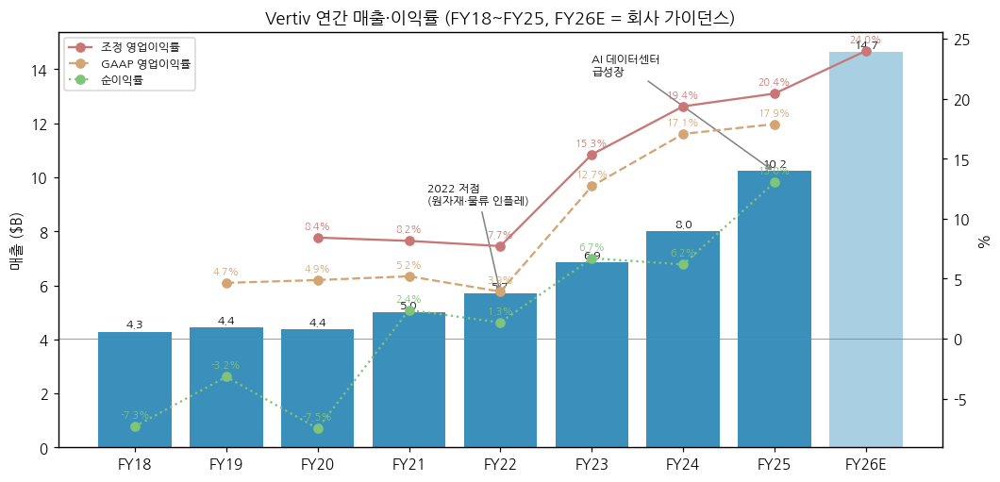
→ (출처: SEC XBRL, 조정 영업이익은 10-K 세그먼트·회사 발표. FY26E = 가이던스)

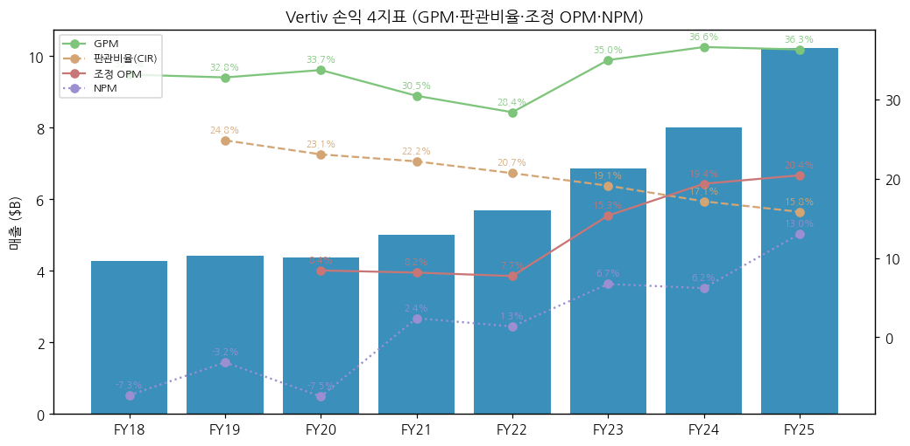
→ (출처: SEC XBRL. 판관비율 = SG&A ÷ 매출)

---

## ② 회사 개요

(1) 기본 사항

→ **회사명**: Vertiv Holdings Co (NYSE: VRT)

→ **본사**: 미국 오하이오주 Westerville (콜럼버스 인근, Liebert 본사 자리)

→ **사업 한 줄 정의**: 데이터센터·통신망·산업 시설의 "전기가 끊기지 않고, 장비가 과열되지 않게" 만드는 전력·냉각 인프라를 설계·제조·설치·정비한다

→ **슬로건**: "The world depends on data we power and cool™"

→ **규모 (FY25)**: 매출 $10.2B, 임직원 약 34,000명 (41%가 제조), 40여 개국 약 300개 거점, 서비스센터 300곳 이상, 서비스 엔지니어 약 5,000명, 영업 인력 약 3,000명

→ **시가총액**: 약 $77.6B (2026-11 종가 $202.07 × 384.1M주) — 고점 약 $128.6B (2026-06, $334.82)

(2) 손익·자본 추이 (USD $M)

| 연도 | 매출 | 매출 YoY | GAAP 영업이익 | 조정 영업이익 | 조정 OPM | 순이익 | 자본 |
|---|---|---|---|---|---|---|---|
| FY18 | 4,285.6 | — | — | — | — | -314.0 | -540.3 |
| FY19 | 4,431.2 | +3.4% | 206.1 | — | — | -140.8 | -704.8 |
| FY20 | 4,370.6 | -1.4% | 213.5 | 368.2 | 8.4% | -327.3 | 512.1 |
| FY21 | 4,998.1 | +14.4% | 259.9 | 407.4 | 8.2% | 119.6 | 1,417.7 |
| FY22 | 5,691.5 | +13.9% | 223.4 | 439.2 | 7.7% | 76.6 | 1,441.9 |
| FY23 | 6,863.2 | +20.6% | 872.2 | 1,053.5 | 15.3% | 460.2 | 2,014.9 |
| FY24 | 8,011.8 | +16.7% | 1,367.4 | 1,551.6 | 19.4% | 495.8 | 2,434.3 |
| **FY25** | **10,229.9** | **+27.7%** | **1,829.7** | **2,090.0** | **20.4%** | **1,332.8** | **3,941.3** |
| FY26 9M | 10,236.6 | +38.7% | 2,061.8 | 2,376 | 23.2% | 1,652.4 | — |

→ (출처: SEC XBRL. FY18·FY19 자본은 SPAC 합병 전 Vertiv 기준(자본잠식). FY26 9M 조정 영업이익 = 1Q~3Q 회사 발표 합 $551M + $738M + $1,087M)

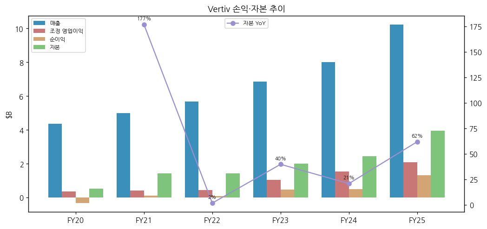
→ (출처: SEC XBRL, 회사 발표)

(3) 회사 주가 역사

→ **2018-09 ~ 2020-01 (GSAH 시절)** — SPAC 주가 $10 안팎 (신탁 가치)

→ **2020-02 상장 ~ 2021** — 상장 직후 코로나로 $8대까지 하락 → 2021년 $28 고점. 데이터센터·5G 기대

→ **2022 (저점)** — 인플레이션으로 마진이 무너지고 가이던스를 잇따라 낮추며 $8대로 회귀. 상장가 아래

→ **2023 ~ 2024** — Albertazzi CEO 취임(2023-01)·가격 재설정·AI 데이터센터 수요로 2023년 +238%, 2024년 +137%. 2023년 말 $48 → 2024년 말 $114

→ **2025** — 연초 DeepSeek 충격·관세 우려로 4월 $72까지 급락 후 반등, 연말 $162

→ **2026** — 6월 사상 최고 $335 (시가총액 약 $129B) → 2분기 공급 차질·품질 루머로 조정 → 3Q 대폭 비트에도 11/3 중간선거 후 텍사스 데이터센터 모라토리엄 우려로 11월 $202 (고점 대비 -40%)

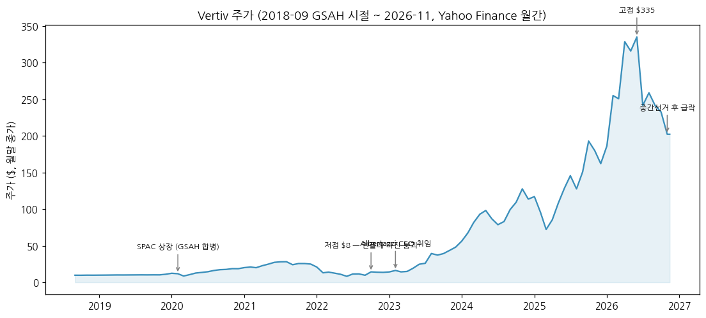
→ (출처: Yahoo Finance VRT 월말 종가. 2020-02 이전은 GS Acquisition Holdings 주가)

(4) 주요 연혁

**1946 ~ 1986 — Liebert 시대 (전산실 냉각의 시작)**

→ 1946: Ralph Liebert가 전신 회사 창업

→ 1965: Liebert Corporation 설립 — 세계 최초 전산실 항온항습기(CRAC) 제조사

**1987 ~ 2015 — Emerson Network Power 시대**

→ 1987: Emerson Electric이 Liebert 인수

→ 2000: Emerson이 Network Power 사업부 출범 — Liebert(냉각·UPS)와 ASCO(전원 절체 스위치) 통합

→ 2000년대: Avansys, Marconi 외부 설비·전원 시스템, Knurr(랙·인클로저), Avocent(IT 관리·KVM) 인수로 포트폴리오 확장

**2016 ~ 2019 — Platinum Equity 시대 (분사·레버리지 인수)**

→ 2016: Emerson이 Network Power를 사모펀드 Platinum Equity에 매각 (약 $4B [보도 인용]), 회사명 Vertiv 출범

→ 2017: ASCO Power Technologies를 Schneider Electric에 매각 [보도 인용]

→ 2018: Energy Labs(맞춤형 공조), Geist(랙 PDU), ERS(전기 설비 신뢰성 서비스) 인수

→ 2019: 레버리지 구조로 이자비용 $310M, 순손실 -$141M, 자본잠식 -$705M

**2020 ~ 2022 — 상장과 인플레이션**

→ 2020-02-07: GS Acquisition Holdings(골드만삭스 SPAC)와 합병해 NYSE 상장. 조달 자금으로 부채 $1.46B 상환

→ 2021-11: E+I Engineering(아일랜드, 스위치기어·버스바·모듈형 전원) 인수 — 현금 약 $1.16B. 데이터센터 전력 배전(화이트 스페이스 밖)까지 확장

→ 2022: 원자재·물류 인플레이션을 고정가 수주가 흡수하지 못해 조정 OPM 7.7%로 저점. 9~10월 주가 $8대

→ 2022-11: Rob Johnson CEO 퇴임 발표, Giordano Albertazzi(EMEA 사장 출신) 후임 지명

**2023 ~ 현재 — 턴어라운드와 AI 데이터센터**

→ 2023-01: Albertazzi CEO 취임, Executive Chairman David Cote(전 Honeywell CEO)와 Vertiv Operating System(VOS, 린 운영 체계) 도입. 가격 재설정으로 마진 회복

→ 2023: 조정 OPM 15.3%로 두 배. 액체냉각 CDU 업체 CoolTera 인수

→ 2024: Platinum Equity 잔여 지분 정리, 자사주 $600M 매입. 수주잔고 $7.2B

→ 2025-08: Great Lakes(랙·캐비닛, 미국·유럽 공장) 약 $200M 인수

→ 2025-12: PurgeRite(액체냉각 배관 세정·유체 관리 서비스) 인수 — 약 $1.0B [투자CF 역산]. 수주잔고 $15.0B로 1년 새 2배

→ 2026: NVIDIA 800V DC 레퍼런스 설계 협력, Oklo(소형원전)와 데이터센터 전력 협력. 10월 3Q 실적과 함께 수주 공시 중단 발표

---

## ③ 비즈니스 모델

(1) 실적 추이 통합 표 (USD $M)

**지역 세그먼트 (보고 세그먼트)**

| 세그먼트 | 항목 | FY21 | FY22 | FY23 | FY24 | FY25 |
|---|---|---|---|---|---|---|
| Americas | 매출 | 2,187.4 | 2,728.6 | 3,844.5 | 4,500.6 | **6,386.3** |
| Americas | 세그먼트 영업이익 | 441.2 | 426.1 | 762.4 | 1,097.8 | **1,714.3** |
| Americas | 마진 | 20.2% | 15.6% | 19.8% | 24.4% | **26.8%** |
| Asia Pacific | 매출 | 1,609.0 | 1,601.3 | 1,527.8 | 1,717.8 | **2,019.2** |
| Asia Pacific | 세그먼트 영업이익 | 253.4 | 274.4 | 147.4 | 175.2 | **222.1** |
| Asia Pacific | 마진 | 15.7% | 17.1% | 9.6% | 10.2% | **11.0%** |
| EMEA | 매출 | 1,201.7 | 1,361.6 | 1,490.9 | 1,793.4 | **1,824.4** |
| EMEA | 세그먼트 영업이익 | 217.6 | 234.6 | 297.7 | 439.4 | **377.4** |
| EMEA | 마진 | 18.1% | 17.2% | 20.0% | 24.5% | **20.7%** |
| 본사·기타 | 비용 | -504.8 | -495.9 | -154.0 | -160.8 | **-283.7** |

→ (출처: 10-K 각 연도 Business Segments. **FY23부터 본사 비용 일부를 지역에 배분하는 새 기준** — FY23은 FY24 10-K 재작성치(구 기준 Americas 958.8·APAC 248.5·EMEA 380.0·본사 -533.8). FY21·FY22는 구 기준이라 지역 마진이 상대적으로 높게 보인다)

**제품 vs 서비스**

| 구분 | FY20 | FY21 | FY22 | FY23 | FY24 | FY25 |
|---|---|---|---|---|---|---|
| 제품 (전력·열관리·랙·모듈형) | 3,045.8 | 3,093.6 | 4,210.9 | 5,271.2 | 6,245.2 | **8,207.0** |
| 서비스 & 스페어 | 1,324.8 | 1,438.7 | 1,480.6 | 1,592.0 | 1,766.6 | **2,022.9** |
| 서비스 비중 | 30% | 29% | 26% | 23% | 22% | **20%** |

→ (출처: 10-K 매출 분해 주석. FY20~FY23 제품 = "핵심 인프라 & 솔루션" + "통합 랙 솔루션" 합산 [계산]. FY24부터 회사가 제품/서비스 2분류로 공시)

→ **성장은 제품이 끈다** — FY20→FY25 제품 매출 2.7배, 서비스 1.5배. 서비스 비중 30% → 20%

**3Q26 지역 실적 (최신 분기)**

→ Americas: 매출 $2,989M (+74.5%, 비중 69%), 조정 영업이익 $877M, 마진 29.4%

→ Asia Pacific: 매출 $779M (+49.9%), 조정 영업이익 $132M, 마진 17.0%

→ EMEA: 매출 $545M (+22.8%), 조정 영업이익 $152M, 마진 28.0%

→ (출처: `2026-Q3_VRT_리뷰.md` 1번 ②, 3Q26 보도자료)

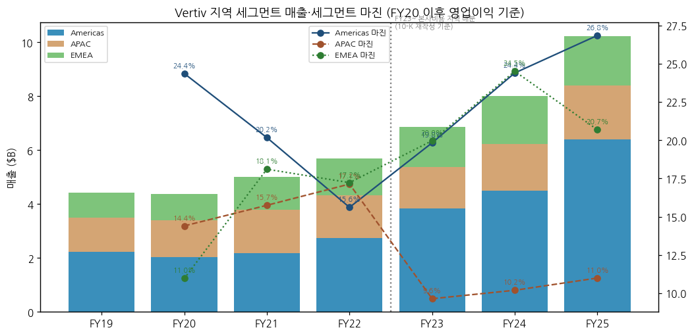
→ (출처: 10-K 각 연도. 점선 = FY23 세그먼트 기준 변경)

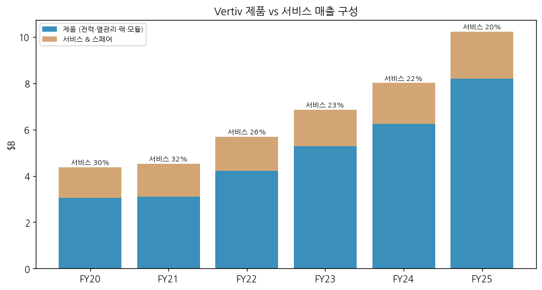
→ (출처: 10-K 매출 분해 주석)

(1-1) 분기 시계열 (USD $M, 27개 분기)

| 분기 | 매출 | GAAP 영업이익 | GAAP OPM | 조정 영업이익 | 조정 OPM | 매출 YoY |
|---|---|---|---|---|---|---|
| 1Q20 | 897.3 | -12.2 | -1.4% | — | — | — |
| 2Q20 | 1,005.7 | 70.6 | 7.0% | — | — | — |
| 3Q20 | 1,162.0 | 35.1 | 3.0% | — | — | — |
| 4Q20 | 1,305.5 | 120.0 | 9.2% | — | — | — |
| 1Q21 | 1,098.4 | 79.8 | 7.3% | — | — | +22.4% |
| 2Q21 | 1,260.3 | 102.2 | 8.1% | — | — | +25.3% |
| 3Q21 | 1,228.9 | 81.8 | 6.7% | — | — | +5.8% |
| 4Q21 | 1,410.5 | -3.9 | -0.3% | — | — | +8.0% |
| 1Q22 | 1,156.4 | -45.2 | -3.9% | — | — | +5.3% |
| 2Q22 | 1,399.4 | 26.2 | 1.9% | — | — | +11.0% |
| 3Q22 | 1,481.1 | 80.0 | 5.4% | — | — | +20.5% |
| 4Q22 | 1,654.6 | 162.4 | 9.8% | 210.5 | 12.7% | +17.3% |
| 1Q23 | 1,521.1 | 130.3 | 8.6% | — | — | +31.5% |
| 2Q23 | 1,734.1 | 205.8 | 11.9% | — | — | +23.9% |
| 3Q23 | 1,742.6 | 250.9 | 14.4% | — | — | +17.7% |
| 4Q23 | 1,865.4 | 285.2 | 15.3% | 330.4 | 17.7% | +12.7% |
| 1Q24 | 1,639.1 | 202.6 | 12.4% | 249 | 15.2% | +7.8% |
| 2Q24 | 1,952.8 | 336.0 | 17.2% | 382 | 19.6% | +12.6% |
| 3Q24 | 2,073.5 | 371.6 | 17.9% | 417 | 20.1% | +19.0% |
| 4Q24 | 2,346.4 | 457.2 | 19.5% | 504 | 21.5% | +25.8% |
| 1Q25 | 2,036.0 | 290.7 | 14.3% | 337 | 16.6% | +24.2% |
| 2Q25 | 2,638.1 | 442.4 | 16.8% | 489 | 18.5% | +35.1% |
| 3Q25 | 2,675.8 | 516.7 | 19.3% | 596 | 22.3% | +29.0% |
| 4Q25 | 2,880.0 | 579.9 | 20.1% | 668 | 23.2% | +22.7% |
| 1Q26 | 2,649.5 | 440.1 | 16.6% | 551 | 20.8% | +30.1% |
| 2Q26 | 3,274.3 | 637.9 | 19.5% | 738 | 22.6% | +24.1% |
| **3Q26** | **4,312.8** | **983.8** | **22.8%** | **1,087** | **25.2%** | **+61.2%** |
| 4Q26 가이던스 | 4,413 | 1,073.6 | 24.3% | 1,138 | 25.8% | +53.2% |

→ (출처: SEC XBRL 분기 (4Q = 연간 − 9M [계산]), 조정 영업이익 4Q22·4Q23 = Q4 2023 보도자료, 1Q24~3Q26 = `2026-Q3_VRT_리뷰.md` (회사 발표·신한투자증권 표). 1Q20~3Q23 분기 조정 영업이익은 미수집)

→ 계절성: 1분기가 매년 가장 약하고 4분기가 가장 강하다 (프로젝트 납품 집중)

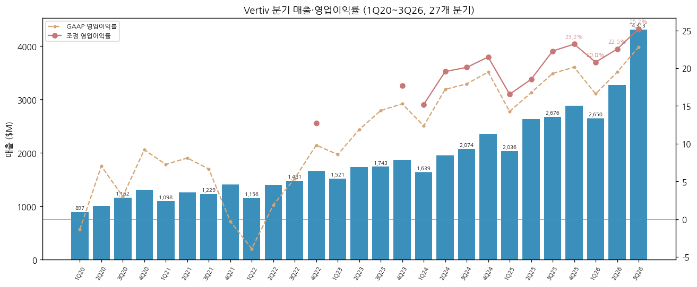
→ (출처: SEC XBRL, 회사 발표)

(2) 사업 개요 — 무엇을 파는가 (매출 비중 큰 순서)

**① 전력 관리 (AC·DC Power Management)** — 데이터센터에 "끊기지 않는 전기"를 공급하는 장비

→ **UPS (무정전 전원 장치)**: 한전 전기가 순간이라도 끊기거나 흔들리면 서버가 멈춘다. UPS는 배터리로 수 분~수십 분 버티면서 발전기가 돌아갈 때까지 전기를 이어준다. 데이터센터 전력 체인의 핵심 장비. 브랜드 Liebert

→ **스위치기어·버스바 (저압·중압)**: 건물로 들어온 전기를 층·구역별로 나누고 차단하는 배전반(스위치기어)과, 전선 대신 구리판으로 큰 전류를 나르는 버스바. 2021년 E+I Engineering 인수로 확보

→ **DC 전원 (NetSure)**: 통신 기지국·데이터센터용 직류 전원. 2027년부터 NVIDIA 800V DC 아키텍처(랙에 고압 직류를 바로 공급해 변환 손실을 줄이는 방식)로 확장 예정

→ **랙 PDU (Geist)**: 서버 랙 안에서 개별 서버로 전기를 나눠 주는 멀티탭형 분배기. 전력 측정·원격 제어 기능

**② 열관리 (Thermal Management)** — 서버가 내는 열을 빼는 장비. Vertiv의 뿌리이자 AI 시대 최대 차별화 영역

→ **공랭 (항온항습기·칠러)**: 전산실 공기를 식히고 습도를 맞추는 정밀 공조기(CRAC/CRAH)와, 건물 단위로 냉수를 만드는 칠러. 1965년 Liebert가 최초 개발. 2026년 칠러 생산능력 2배 증설

→ **액체냉각 (CDU·후면 도어 열교환기)**: AI GPU 랙 하나가 100kW 이상을 쓰면서 공기로는 열을 못 뺀다. 냉각수를 서버 칩 바로 위까지 돌리는 직접 액체냉각(DLC)이 필요한데, CDU(냉각수 분배 장치)가 그 심장이다. CoolTera(2023) 인수로 강화

→ **액체냉각 서비스 (PurgeRite)**: 액체냉각 배관을 처음 채우고 세정하고 유체를 관리하는 서비스. 냉각수가 오염되면 GPU가 망가지므로 필수 작업. 2025-12 인수

**③ 통합 인프라 (Integrated Solutions·랙·모듈형)** — 위 장비를 공장에서 미리 조립해 보내는 사업

→ **랙·캐비닛 (Knurr·Great Lakes)**: 서버를 꽂는 철제 프레임. AI 랙은 무게·전력·배관이 복잡해 맞춤형 수요가 늘었다

→ **모듈형 데이터센터 (SmartRun·MegaMod 등)**: 전력·냉각·랙을 공장에서 컨테이너·스키드 단위로 조립해 현장에 꽂기만 하면 되게 만든 제품. 현장 공사 기간을 줄여 준다. NVIDIA와 Pod 단위 레퍼런스 설계

**④ 서비스 & 스페어 (FY25 매출 20%)**

→ 예방 정비, 프로젝트 관리, 시운전·인수 시험, 원격 모니터링, 부품 공급. 서비스센터 300곳 이상, 엔지니어 약 5,000명, 긴급 출동 1회 해결률 90% 이상

→ 설치 기반이 쌓일수록 매출이 반복되는 구조 — 마진이 제품보다 높고 사이클 방어 역할

**⑤ IT 관리 (Avocent)**

→ 데이터센터 서버를 원격으로 접속·관리하는 KVM 스위치·관리 소프트웨어. 매출 비중은 작다

(3) 사업 디테일

→ **Top-seller**: 데이터센터 UPS·열관리 (Americas 매출 69%가 대부분 데이터센터향)

→ **성장 엔진**: 액체냉각 (회사: 비중이 "훨씬 커지고 있다", 수치 미공개), 스위치기어·버스바, 모듈형. 3Q26 유기적 수주 +100% 이상, 미주 파이프라인 분기 증가 속도 사상 최고

→ **이익 아웃라이어**: Americas 마진 29.4% (3Q26) vs APAC 17.0% — 미국 AI 데이터센터 가격·물량이 이익을 끈다. EMEA는 FY25 마진 하락(24.5% → 20.7%) 후 3Q26 28.0%로 회복

→ **선행지표**: 수주잔고 FY22 $4.75B → FY23 $5.53B → FY24 $7.18B → FY25 $15.0B. 선수금(유동 계약부채) FY25 $1.81B → 3Q26 $4.12B. **3Q26부터 수주 공시 중단** — 다음 분기부터는 선수금과 가이던스로 수요를 읽어야 한다

(4) 주요 경쟁사 (10-K 기준 + 제품별)

**대형 글로벌 경쟁사**

→ Schneider Electric — UPS(APC·Galaxy)·냉각(Uniflair·Motivair)·배전 전 영역에서 가장 직접적인 경쟁자

→ Eaton — UPS·배전·버스바, Boyd(액체냉각) 인수로 냉각까지 확장

→ Legrand — 랙·PDU·케이블

→ Huawei — UPS·모듈형 데이터센터 (중국·신흥국)

**제품별 니치 경쟁사**

→ 전력: Delta Electronics, ABB, Socomec

→ 열관리: Stulz, Johnson Controls(Silent-Aire), Carrier, Trane

→ 액체냉각: CoolIT, nVent, Boyd(Eaton), Motivair(Schneider)

→ 차별화 (회사 주장): 가장 완전한 포트폴리오, 신뢰성, 글로벌 생산·서비스망, 고객과의 공동 설계

(5) 주요 매출처

→ **하이퍼스케일·클라우드**: Microsoft, AWS, Google Cloud (10-K 예시)

→ **코로케이션**: Digital Realty, Equinix, Compass, QTS

→ **네오클라우드**: CoreWeave, Nebius — AI 전용 클라우드, 가장 빠르게 성장

→ **엔터프라이즈**: 대형 금융·유통 (Goldman Sachs, JPMorgan, Walmart, Allianz 등) — 3년째 정체

→ **통신망·상업·산업**: 유무선 통신사, 교통·제조·석유가스 — 저성장

→ 판매 채널: 직판 중심 (영업 약 3,000명) + 채널 파트너·유통·OEM

→ 10% 이상 단일 고객 공시는 확인되지 않음 (10-K 본문 기준)

(6) 생산 CAPA + 임직원

→ 40여 개국 약 300개 사무소·공장 (Americas·APAC·EMEA 모두 대형 생산 거점)

→ 2024~2026 증설: 칠러 생산능력 2배, Great Lakes(미국·유럽 랙 공장) 인수, 미국 내 생산 확대 — 2Q26 공급 차질 이후 3Q 생산 정상화 [셀사이드 인용]

| 연도 | FY21 | FY22 | FY23 | FY24 | FY25 |
|---|---|---|---|---|---|
| 임직원 (명) | 약 24,000 | 약 27,000 | 약 27,000 | 약 31,000 | 약 34,000 |
| 1인당 매출 ($K) | 208 | 211 | 254 | 258 | 301 |

→ (출처: 10-K Human Capital. 1인당 매출 [계산])

---

## ④ 재무 구조

(1) 손익계산서 (USD $M)

| 연도 | 매출 | 매출원가 | 매출총이익 | GPM | 판관비 | 판관비율 | ER&D | GAAP 영업이익 | 이자비용 | 순이익 | NPM |
|---|---|---|---|---|---|---|---|---|---|---|---|
| FY18 | 4,285.6 | 2,865.2 | 1,420.4 | 33.1% | — | — | — | — | — | -314.0 | -7.3% |
| FY19 | 4,431.2 | 2,978.2 | 1,453.0 | 32.8% | 1,100.8 | 24.8% | 229.4 | 206.1 | 310.4 | -140.8 | -3.2% |
| FY20 | 4,370.6 | 2,896.9 | 1,473.7 | 33.7% | 1,008.4 | 23.1% | 228.6 | 213.5 | 150.4 | -327.3 | -7.5% |
| FY21 | 4,998.1 | 3,475.4 | 1,522.7 | 30.5% | 1,109.0 | 22.2% | 266.4 | 259.9 | 90.6 | 119.6 | 2.4% |
| FY22 | 5,691.5 | 4,075.4 | 1,616.1 | 28.4% | 1,178.3 | 20.7% | 282.0 | 223.4 | 147.3 | 76.6 | 1.3% |
| FY23 | 6,863.2 | 4,462.7 | 2,400.5 | 35.0% | 1,312.3 | 19.1% | 303.5 | 872.2 | 180.1 | 460.2 | 6.7% |
| FY24 | 8,011.8 | 5,077.6 | 2,934.2 | 36.6% | 1,374.0 | 17.1% | 367.6 | 1,367.4 | 150.4 | 495.8 | 6.2% |
| **FY25** | **10,229.9** | **6,514.7** | **3,715.2** | **36.3%** | **1,617.8** | **15.8%** | **441.7** | **1,829.7** | **86.1** | **1,332.8** | **13.0%** |

→ (출처: SEC XBRL. ER&D는 판관비·매출원가에 포함된 연구개발 지출)

→ **FY22 → FY23 턴어라운드의 정체**: GPM 28.4% → 35.0% (+6.6%p). 매출이 늘어서가 아니라 가격 재설정으로 원가 상승분을 넘긴 효과가 컸다

→ **FY23 이후**: GPM은 35~37%로 안정, 판관비율이 20.7% → 15.8%로 내려가며 영업 레버리지가 이익률을 올렸다

→ **FY24 순이익 정체**: 워런트·부채 관련 영업외 손실 [10-K]로 순이익률 6.2%. FY25 이자비용 감소와 함께 13.0%


(2) 재무상태표 (USD $M, 연말)

| 연도 | 자산 | 유동자산 | 재고 | 영업권 | 무형자산 | 부채 | 유동부채 | 장기차입 | 현금 | 자본 |
|---|---|---|---|---|---|---|---|---|---|---|
| FY19 | 4,657.4 | 2,017.4 | 401.0 | 605.8 | 1,441.6 | 5,362.2 | 1,519.7 | 3,467.3 | 223.5 | -704.8 |
| FY20 | 5,073.8 | 2,518.8 | 446.6 | 607.2 | 1,302.5 | 4,561.7 | 1,741.6 | 2,152.5 | 534.6 | 512.1 |
| FY21 | 6,939.6 | 2,698.6 | 616.3 | 1,330.1 | 2,138.2 | 5,521.9 | 1,854.8 | 2,972.3 | 439.1 | 1,417.7 |
| FY22 | 7,095.7 | 3,158.7 | 822.0 | 1,284.7 | 1,816.1 | 5,653.8 | 1,897.9 | 3,190.9 | 260.6 | 1,441.9 |
| FY23 | 7,998.5 | 4,001.5 | 884.3 | 1,330.3 | 1,672.9 | 5,983.6 | 2,305.4 | 2,940.9 | 780.4 | 2,014.9 |
| FY24 | 9,132.5 | 5,101.8 | 1,244.4 | 1,321.1 | 1,487.1 | 6,698.2 | 3,097.0 | 2,928.2 | 1,227.6 | 2,434.3 |
| **FY25** | **12,212.4** | **6,819.5** | **1,456.5** | **2,033.7** | **1,894.8** | **8,271.1** | **4,407.0** | **2,913.0** | **1,728.4** | **3,941.3** |

→ (출처: SEC XBRL. 장기차입 = 장기차입 총액(유동분 포함))

→ **영업권·무형자산이 자산의 32%** (FY25) — Emerson 분사·Platinum 인수 당시 재평가와 E&I·PurgeRite 인수 몫

→ **계약부채(선수금)**: FY19 $161M → FY25 $1,815M → 3Q26 $4.12B — 고객이 납기를 잡으려 미리 돈을 낸다. 운전자본이 부채로 조달되는 구조

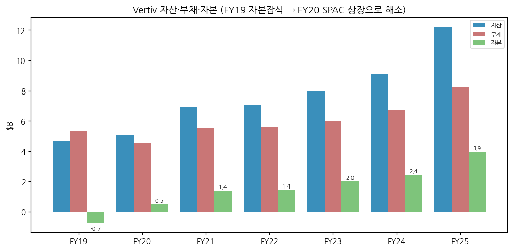

(3) 현금흐름표 (USD $M)

| 연도 | 영업CF | 투자CF | 재무CF | CapEx | FCF | FCF/매출 |
|---|---|---|---|---|---|---|
| FY19 | 57.5 | -65.3 | 14.8 | 47.6 | 9.9 | 0.2% |
| FY20 | 208.9 | -45.7 | 140.7 | 44.4 | 164.5 | 3.8% |
| FY21 | 210.9 | -1,216.8 | 914.9 | 73.4 | 137.5 | 2.8% |
| FY22 | -152.8 | -112.1 | 100.2 | 100.0 | -252.8 | -4.4% |
| FY23 | 900.5 | -139.1 | -247.5 | 127.9 | 772.6 | 11.3% |
| FY24 | 1,319.3 | -201.7 | -652.1 | 167.0 | 1,152.3 | 14.4% |
| **FY25** | **2,113.8** | **-1,500.8** | **-72.3** | **220.0** | **1,893.8** | **18.5%** |

→ (출처: SEC XBRL. FCF = 영업CF − 유형자산 취득 [계산])

→ FY22 영업CF 마이너스 — 재고·매출채권 증가 + 마진 붕괴. FY23부터 선수금 유입으로 FCF가 이익보다 빨리 회복

→ FY21·FY25 투자CF = 인수 (E&I $1,164M / PurgeRite·Great Lakes $1,185M)

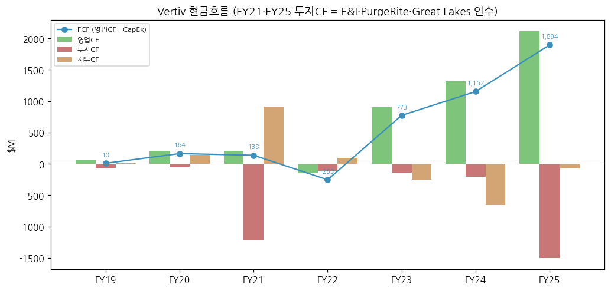

(4) CapEx

| 연도 | FY19 | FY20 | FY21 | FY22 | FY23 | FY24 | FY25 |
|---|---|---|---|---|---|---|---|
| CapEx ($M) | 47.6 | 44.4 | 73.4 | 100.0 | 127.9 | 167.0 | 220.0 |
| CapEx/매출 | 1.1% | 1.0% | 1.5% | 1.8% | 1.9% | 2.1% | 2.2% |
| 감가상각비 (무형 상각 제외) | 57.1 | 60.3 | 69.1 | 72.0 | 74.3 | 81.6 | 97.1 |

→ (출처: SEC XBRL. 감가상각비 = 감가상각·상각 합계 − 무형자산 상각 [계산])

→ **자산 경량형** — 매출 대비 CapEx 2% 안팎. 조립·통합 위주 제조라 증설 비용이 작고, 생산능력은 공장 임차·인수로 빠르게 늘린다. 매출 2.3배(FY19→FY25)에 CapEx 4.6배

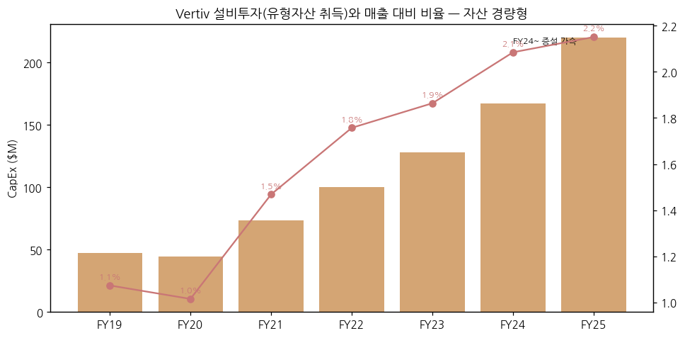

(5) 부채 구조

→ **구성**: 텀론(Term Loan Facility, 변동금리 — 일부 금리스왑 헤지) + 선순위 담보채(Notes) + ABL 리볼빙 한도 (10-K 부채 주석)

→ **장기차입 추이**: FY19 $3.47B (Platinum 레버리지) → FY20 $2.15B (상장 자금으로 상환) → FY22 $3.19B (E&I 인수) → FY25 $2.91B

→ **순차입**: FY19 $3.24B → FY22 $2.93B → FY25 $1.18B. 순차입/조정 EBITDA 약 0.5배 (FY25, 조정 EBITDA ≈ 조정 영업이익 + 감가상각 [추정])

→ **이자비용**: FY19 $310M → FY25 $86M (부채 상환 + 금리 재조정)

(6) 배당·자사주

| 연도 | FY20 | FY21 | FY22 | FY23 | FY24 | FY25 |
|---|---|---|---|---|---|---|
| 배당 ($M) | 3.3 | 3.8 | 3.8 | 9.5 | 42.2 | 66.6 |
| 자사주 매입 ($M) | — | — | — | — | 599.9 | — |
| 주주환원 / FCF | 2% | 3% | — | 1% | 56% | 4% |

→ (출처: SEC XBRL 현금흐름표)

→ 배당은 상징적 수준 (FY25 FCF의 4%). 2024년 자사주 $600M은 Platinum Equity 보유 잔여 지분 정리 성격

→ 현금 우선순위: 증설·인수(액체냉각·서비스) > 부채 감축 > 주주환원

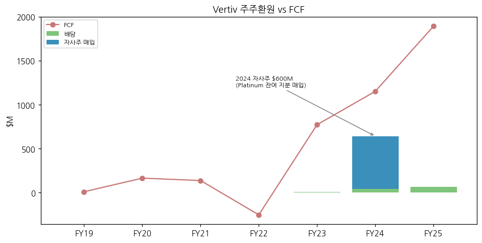

(7) 재무비율

| 연도 | ROE | ROA | 부채비율 (부채/자본) | 유동비율 | 이자보상배율 (조정 영업이익/이자) |
|---|---|---|---|---|---|
| FY20 | — | -6.7% | 891% | 1.45 | 2.4배 |
| FY21 | 12.4% | 2.0% | 390% | 1.45 | 4.5배 |
| FY22 | 5.4% | 1.1% | 392% | 1.66 | 3.0배 |
| FY23 | 26.6% | 6.1% | 297% | 1.74 | 5.8배 |
| FY24 | 22.3% | 5.8% | 275% | 1.65 | 10.3배 |
| **FY25** | **41.8%** | **12.5%** | **210%** | **1.55** | **24.3배** |

→ (출처: SEC XBRL [계산]. ROE·ROA는 기초·기말 평균 자본·자산 기준. FY20 ROE는 기초 자본잠식으로 산정 불가)

→ ROE가 높은 이유의 절반은 이익, 절반은 얇은 자본(영업권·과거 자본잠식 영향). 부채비율은 선수금(계약부채) 증가로 높게 보인다

---

## ⑤ 지배 구조

(1) 그룹·계열 관계

→ **독립 상장사** — 지배주주 없음. 2016~2019 Platinum Equity 소유 → 2020 SPAC 상장 → 2024까지 Platinum 지분 정리 완료

→ 자회사: Vertiv Group Corporation(미국 운영), E+I Engineering(아일랜드), PurgeRite, Great Lakes 등 (10-K Ex.21)

(2) 주주 구분 (2026-04-15, DEF 14A — 발행주식 384,107,272주)

| 주주 | 주식수 | 지분 |
|---|---|---|
| BlackRock, Inc. | 21,308,858 | 5.55% |
| 임원·이사 합계 (20명) | 4,214,011 | 1.10% |
| 기타 기관·개인 (5% 미만 분산) | — | 약 93.35% |

→ 5% 이상 주주는 BlackRock 1곳뿐 — 지분이 넓게 분산된 기관 중심 주주 구조

→ 13F 기준 기관별 상위 보유 내역은 미수집 (v1.1 보완 후보)

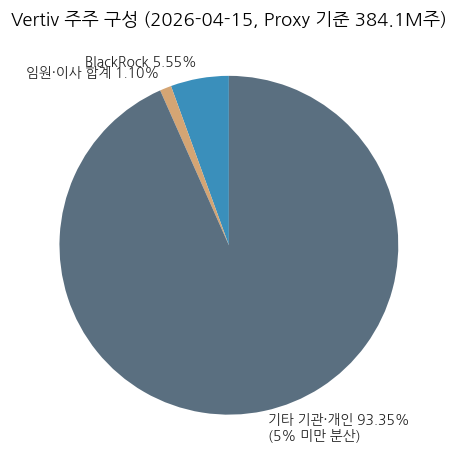

(3) 임원·이사회

**경영진**

→ **Giordano Albertazzi — CEO** (2023-01~, 60세). Emerson Network Power 출신, Vertiv EMEA 사장(2016~2022)·Americas 사장(2022~2023)·COO(2022-10~) 역임. 턴어라운드(가격 재설정·VOS)를 이끌었다

→ **David M. Cote — Executive Chairman** (2020-02~, 73세). 전 Honeywell 회장·CEO(2002~2017), GSAH(SPAC) CEO·회장으로 Vertiv 상장을 주도. Honeywell식 운영 체계를 VOS로 이식

→ **Craig Chamberlin — CFO** (2025-11~). 전 Wabtec 사업부 CFO, GE 출신. 전임 David Fallon은 2025-05 전환·자문 합의

→ Scott Armul — Chief Product and Technology Officer (2026-01~, 열관리·전력·IT·서비스 사업부와 R&D 총괄)

→ Anand Sanghi — President, Americas

→ Paul Ryan — President, EMEA

→ Wei Shen — President, Greater China

→ Stephanie Gill — Chief Legal Officer

**이사회 (11명, 2026 주총 후보 기준)**

→ David M. Cote (의장), Giordano Albertazzi, Jacob Kotzubei·Matthew Louie (Platinum Equity 출신), Roger Fradin (전 Honeywell), Steven S. Reinemund (전 PepsiCo CEO), Joseph van Dokkum, Edward L. Monser (전 Emerson COO), Joseph J. DeAngelo, Jakki L. Haussler, Krishna Mikkilineni

→ 포이즌필 없음, 임원·이사 지분 보유 가이드라인 운영 (Proxy)

---

## ⑥ 기타 팩트

(1) R&D 인프라

| 연도 | FY19 | FY20 | FY21 | FY22 | FY23 | FY24 | FY25 |
|---|---|---|---|---|---|---|---|
| ER&D ($M) | 229.4 | 228.6 | 266.4 | 282.0 | 303.5 | 367.6 | 441.7 |
| 매출 대비 | 5.2% | 5.2% | 5.3% | 5.0% | 4.4% | 4.6% | 4.3% |

→ (출처: SEC XBRL, 10-K Engineering, Research and Development)

→ 글로벌 제품 리더가 제품군별 엔지니어링을 맡고, 지역 엔지니어링·컨피규레이션 센터가 현지 맞춤 설계를 한다

→ 중점: 액체냉각, 800V DC, 모듈형 AI Pod, 고밀도 랙 전력

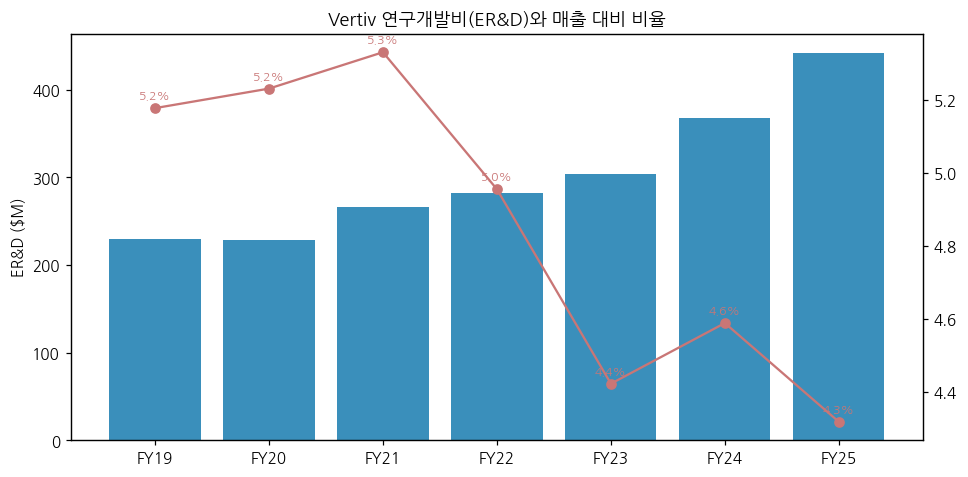

(2) Corporate action (10년)

→ 2016: Emerson → Platinum Equity 매각, Vertiv 출범

→ 2017: ASCO Power Technologies 매각 (Schneider) [보도 인용]

→ 2018: Energy Labs·Geist·ERS 인수

→ 2020-02: GS Acquisition Holdings 합병 상장

→ 2021-11: E+I Engineering 인수 (현금 약 $1.16B)

→ 2023: CoolTera (액체냉각 CDU) 인수

→ 2024: 자사주 $600M 매입 (Platinum 잔여 지분)

→ 2025-08: Great Lakes (랙·캐비닛) 약 $200M

→ 2025-12: PurgeRite (액체냉각 유체 관리 서비스) 약 $1.0B [투자CF 역산]

(3) R&D·제품 마일스톤

→ 1965: 최초 전산실 항온항습기 (Liebert)

→ 2023~2024: AI용 고밀도 액체냉각 CDU·후면 도어 열교환기 라인업, NVIDIA GB200 NVL72 레퍼런스 설계 참여 [보도 인용]

→ 2025: NVIDIA 800V DC 전력 아키텍처 협력 발표, 모듈형 AI 인프라(Pod 단위 공장 조립) 출시

→ 2027 (예정): 800V DC 사이드카 방식 첫 매출 / 2028 (예정): 네이티브 800V DC 배치 [셀사이드 인용]

(4) 주요 리스크

→ **데이터센터 capex 사이클** — 고객 투자가 꺾이면 수주가 바로 흔들린다 (분류 Secondary 사이클의 근거)

→ **정책·정치** — 2026-11 중간선거 후 텍사스 데이터센터 모라토리엄 우려, 12월 FERC·ERCOT 대형부하 접속 결론, 1/19 텍사스 주지사 취임

→ **공급망·실행력** — 2Q26 공급 차질로 매출 $100~150M이 3Q로 이연. 핵심 부품 부족 시 스팟 구매·특급 운송 비용

→ **관세·통상** — FY25 GPM 정체의 원인으로 관세 비용 명시 (10-K)

→ **수주 공시 중단** — 3Q26부터 수주를 공시하지 않아 선행지표 가시성 하락

→ **내부통제** — 10-K 리스크 요인에 "내부통제 중요한 취약점 해소 실패" 항목 유지

→ **경쟁** — Schneider·Eaton이 액체냉각 인수(Motivair·Boyd)로 같은 영역에 진입

(5) ESG

→ 별도 ESG 등급은 미수집. 10-K 리스크 요인에 "ESG 목표 미달성" 항목. 제품 측면에서 액체냉각·800V DC는 데이터센터 전력효율(PUE) 개선 수단

(6) 인증·라이선스

→ 제품 인증(UL·CE 등)과 Lean Six Sigma 기반 VOS 인증 프로그램 운영 (세부 미수집)

---

## Activity 보고 (v1.0 finalize)

### 확보 자료 (8종)
→ SEC XBRL companyfacts, 10-K 8건, 8-K 114건, Q4 2023 보도자료, DEF 14A 2026, Yahoo 월간 주가, 2026-Q3 실적 리뷰, 셀사이드 3건

### 누락 자료
→ FY19 이전 조정 영업이익, 1Q20~3Q23 분기 조정 영업이익 (4Q22·4Q23 제외), 2Q26 지역 손익
→ 제품군별(전력·열관리·랙) 매출 — 회사 미공시
→ 13F 기관별 보유, ESG 등급

### 추정 데이터 표시
→ FY26E = 회사 가이던스 / PurgeRite 인수가 = 투자CF 역산 / 순차입/EBITDA = 감가상각 추정 포함 / 연혁 일부 [보도 인용]

### Data Quality Confidence: **90%**
→ 연간 손익·재무상태·현금흐름은 XBRL 정확값. 조정 영업이익은 FY22·FY23 보도자료 원문 대조 완료. 분기 조정 영업이익과 연혁 일부는 2차 자료

---

## Version Log

- **v1.0 (2026-11-15)** — 최초 작성. FY18~FY25 연간 + 27개 분기 + 12종 차트, v1.5 ① 기업 분류 표준 (Primary 고성장 / Secondary 사이클)
- 잔여 보완 후보 (v1.1): 4Q26 실적(2/10) 반영 + 첫 2027 가이던스, 분기 보도자료 Ex.99 일괄 수집으로 1Q20~3Q23 분기 조정 영업이익 채우기, 13F 기관 보유, 분류 변경 조건 ① 점검 (2027 성장률)
