> Ticker: **NYSE: VST — Vistra Corp.**  
> Entity: **Vistra Corp.** (본사 Irving, Texas, USA) — 2016-10-03 Energy Future Holdings(EFH, 옛 TXU)의 경쟁 발전·소매 부문 TCEH가 파산(Chapter 11)에서 졸업하며 출범한 미국 최대 경쟁(비규제) 발전·소매 전력사. 2018-04 Dynegy 합병(PJM·MISO·뉴잉글랜드 가스·석탄), **2024-03 Energy Harbor 인수**(PJM 원전 3개 단지 약 4GW)로 원전 6기·6.4GW 보유. 2025말 설비 43,641MW + **2026-10-30 Cogentrix 5,500MW** 인수 완료  
> Sector: 원전 — 서브섹터 **원전 운영 (핵심: 한국전력·Constellation / 확장: Vistra)** — 원전 비중이 Constellation보다 훨씬 낮은 **가스·석탄·원전·소매 종합 발전사**라 '확장' 피어로 편입  
> 작성 시각: **2026-11-15 KST** (**v1.0** — Phase 1 Source 전수 수집 + 15종 차트(12종 표준 + 원전 운영·세그먼트 연간·가이던스 이력) + v1.5 ① 기업 분류 표준)  
> 적용 구조: v4.8 (6개 섹션) + v1.5 ① 기업 분류 표준 (Summary Box · 손익 narrative · 분류 sub-logic · 밸류에이션 · 분류 변경 조건)  
> 데이터 범위: **연간 12년 (FY2014\~FY2025, 12월 결산)** — **FY2014\~FY2016-10-02 = 전신 TCEH(Texas Competitive Electric Holdings, EFH 자회사, 파산 중) 연결** [Vistra 10-K Selected Financial Data·손익계산서 'Predecessor'] / FY2016-10-03\~ Vistra (Successor) + **9M26 (1Q\~3Q26, 10-Q 2026-11-09 제출)** + **전사 분기 39Q (1Q17\~3Q26, 조정 EBITDA는 1Q18\~)** + **세그먼트 분기 7Q (1Q25\~3Q26, 현행 체계)** + **세그먼트 연간 7년 (2019\~2025, 재작성 기준)** + **주가 2016-11 \~ 2026-11-13**  
> 출처: **SEC EDGAR VST 10-K 9건 (FY2017\~FY2025) · 10-Q 30건 (1Q17\~3Q26) · DEF 14A 2026 (2026-03-18)**, **SEC XBRL companyfacts (CIK 0001692819)**, **회사 실적 보도자료** (3Q26 2026-11-06 [finviz 전재], 4Q25 2026-02-26 [investor.vistracorp.com], 3Q24 2024-11-07 [Seeking Alpha 전재], 3Q23 2023-11-07·3Q21 2021-11-05 [8-K Ex-99.1, capedge 전재], 3Q19 2019-11-05 [PR Newswire]), Yahoo Finance VST, 언론 (XTB 2026-11-06)  
> 세그먼트 기준: **현행 5개 — Retail · Texas · East · West · Asset Closure** (+ Eliminations/Corporate). 회사 핵심 성과지표 = **조정 EBITDA (Adjusted EBITDA)**, 가이던스는 Asset Closure를 뺀 **"Ongoing Operations" 조정 EBITDA**. 세그먼트 매출은 세그먼트 간 거래(발전 → 소매 판매) 포함. 단위 $M  

# Vistra 기업 개요 (v1.0 — 원전 운영 확장 피어 / 텍사스 1위 발전·소매 통합 + 원전 6.4GW(하이퍼스케일러 PPA 52%) + 가스 대형 함대 / 사이클 → 계약형 전환기)
> **Fact verify cutoff**: 2026-11-15 (주가 2026-11-13 종가 **$133.01** [Yahoo Finance], 발행주식 339,394,683주 [10-Q 표지, 2026-11-02] → 시가총액 **$45.1B** [계산]. 사상 최고 종가 **$217.92 (2025-09-22)**, 같은 날 장중 최고 $219.82 [Yahoo 일간] → 당시 시총 약 **$73.9B** [계산: 약 339M주]. 고점 대비 **-39.0%**, YTD -17.6% (2025말 $161.33), 1년 -22.5% (2025-11-13 $171.56). 52주 최저 종가 $112.89 (2026-11-05) → 3Q26 발표 다음 날(11-06) +10.5% 반등 [Yahoo, XTB 2026-11-06])  

## Phase 1 Source Audit (메모리 룰)

```
=== 자료 수집 audit (Vistra) ===

✅ 확보 (저장: company-overview-source/VST_Vistra Corp/)
- VST 10-K 9건 (2018-02 ~ 2026-02 제출, FY2017~FY2025) + 10-Q 30건 (1Q17~3Q26, 3Q26 = 2026-11-09 제출) — sec_edgar_download_reports
- DEF 14A 2건 (2025-03-19, 2026-03-18) — 5% 주주·임원·이사회
- SEC XBRL companyfacts.json (CIK 0001692819 — FY2017~FY2025, 분기 1Q17~3Q26) + submissions.json
- Yahoo Finance v8 VST 월간 (2016-11~) + 일간 2년 (2026-11-13까지)
- 회사 보도자료 (웹 전재본): 3Q26·4Q25·3Q24·3Q23·3Q21·3Q19 — Ongoing Ops 조정 EBITDA 가이던스 이력

❌ 누락 (5)
- 전신 TCEH 2014 상세 손익(연료비·운영비 분해) — FY2017 10-K Selected Financial Data에 매출·영업손익·순손익만
- 8-K 실적 보도자료 원본 (www.sec.gov 아카이브 403) → 웹 전재본으로 대체, 2017·2018·2022 최초 가이던스 미확보
- 2018 이전 분기 조정 EBITDA (10-Q에 세그먼트 조정 EBITDA 표 없음)
- 연료원별 조정 EBITDA (원전 이익 기여도 미공시) / 원전 PTC 분기별 세부
- ESG 보고서·등급 미수집

⚠️ 결과 영향
- 연간 12년 = FY2014~FY2025. FY2014~2015 = TCEH(파산 중, 영업권·설비 손상 $6.3B·$4.7B로 대규모 적자), FY2016 = Predecessor 1/1~10/2 + Successor 10/3~12/31 합산 [계산]. FY2016 순이익 $22.7B는 파산 채무 소멸 이익($22.1B) 때문 → 비율 계산에서 제외
- FY2018은 Dynegy 4/9 합병 이후분만 반영 → 2017→2018 매출 +68%는 대부분 합병 효과
- GAAP 영업이익·순이익은 미실현 헤지손익(선도 전력 매도 평가)으로 왜곡 큼 — 2022 미실현 손실 $2.51B, 9M26 미실현 이익 $810M. 회사 핵심 지표는 조정 EBITDA
- Ongoing Ops 조정 EBITDA = 연결 조정 EBITDA − Asset Closure (당시 공시치 기준) [계산, 2025 $5,912M 보도자료 일치]

Source 6종 audit:
[V] (1) 정기 보고서 (10-K 9 + 10-Q 30) ✓
[△] (2) IR 실적 자료 (보도자료 웹 전재본 6건, 원본 PDF·IR 덱 미수집)
[✗] (3) Sustainability Report ✗
[V] (4) 주가 (Yahoo 2016-11~) ✓
[V] (5) Proxy / 지배구조 ✓
[V] (6) 12년 정확값 시계열 (XBRL 2017~ + 10-K Selected Financial Data 2014~2016) ✓
→ 5/6 source 확보 (IR은 부분). 최신 분기(3Q26) 확보.
```

---

## ① 기업 분류

(1) Primary / Secondary 분류

**Primary 분류: 사이클 (텍사스·PJM 전력가격·용량가격·가스가격 연동 발전사) → 계약형(지속성장) 전환기**

→ 매출 FY2014 $6.0B → FY2025 **$17.7B**, **11년 CAGR +10.4%** [계산] — 단 대부분 M&A(2018 Dynegy, 2024 Energy Harbor, 2025-10 Lotus) 효과. Dynegy 합병 이후(FY18→FY25) CAGR +9.9% [계산]

→ GAAP OPM **-12.5% (FY2021) \~ 23.7% (FY2024)** (파산기 손상 FY14·15 제외), 진폭 36.2%p — 사이클 cutoff(±10%p) 크게 초과. 이익 변동의 원천은 ① 텍사스 극한 날씨(2021-02 Uri 한파: 1Q21 조정 EBITDA -$1,241M) ② 선도 헤지 평가손익 ③ PJM 용량가격

→ 그러나 회사 핵심 지표 **Ongoing Ops 조정 EBITDA는 Uri를 빼면 꾸준히 우상향**: $2,809M(2018) → $3,766M(2020) → $1,941M(2021, Uri) → $4,140M(2023) → **$5,912M(2025)** → 2026 가이던스 **$7.1\~7.5B** → 2027 가이던스 **$7.7\~8.5B** [10-K·보도자료]

**Secondary 노트: 지속성장 (원전 하이퍼스케일러 20년 PPA + 원전 PTC 하한 + 높은 헤지 비율) + 꿈 (원전 업레이트·데이터센터 직접 공급)**

→ **원전 20년 PPA**: AWS(Comanche Peak 1,200MW, 2025-09, 2027-4Q 개시 → 2032 전량) · **Meta(PJM 원전 2,609MW, 2026-01)** — Perry 1,268MW + Davis-Besse 908MW + 업레이트 433MW [3Q26 10-Q]. 가동 원전 6,448MW 중 **3,376MW(52%)가 20년 계약** [계산]

→ **원전 PTC(IRA 45U, 2024\~2032)**: 인식액 $545M(2024) → $220M(2025) → $162M(9M26) — 전력가격이 오르면 줄어드는 '하한 보험' 구조 [10-Q]

→ **헤지**: 2026년 예상 발전량 약 100%, 2027년 약 98%, 2028년 약 78% 헤지 (2026-10-30 기준, 보도자료) — 단기 이익 가시성은 매우 높음

**5개 세그먼트 구조 (9M26 기준, 세그먼트 조정 EBITDA 합계 $5,685M, Corp 제외)**

→ **(1) East** — 조정 EBITDA $2,422M (**42.6%**) — PJM·ISO-NE·NYISO·MISO 가스 + **PJM 원전 3개 단지(Beaver Valley·Perry·Davis-Besse, 3,948MW)** + 석탄. 22,254MW (2025말)

→ **(2) Texas** — $2,124M (37.4%) — ERCOT 가스·석탄 + **Comanche Peak 원전 2,400MW**. 19,858MW

→ **(3) Retail** — $939M (16.5%) — TXU Energy 등 소매 전력 (2025 판매 139TWh, ERCOT 79TWh + 북동·중서부 60TWh). 계절성: 2Q·4Q에 이익 집중

→ **(4) West** — $200M (3.5%) — CAISO Moss Landing 가스 등 1,529MW

→ **(5) Asset Closure** — $-60M — 폐쇄 발전소·광산 해체·복구 (가이던스 Ongoing Ops에서 제외)

(2) Summary Box (12년 시계열 + 사이클 통계)

| 지표 | 값 |
|------|-----|
| 매출 CAGR (FY14→FY25, 11년) | **+10.4%/yr** [계산] (M&A 포함) / Ongoing 조정 EBITDA CAGR FY18→FY25 **+11.2%/yr** [계산] / 9M26 매출 +21.7% YoY |
| OPM 평균 (12년) | **-8.2%** [계산] (FY14·15 손상 제외 10년 평균 **7.8%**) / RNF 마진 평균 45.1% (FY15\~25) / Ongoing 조정 EBITDA 마진 평균 **28.2%** (FY18\~25) |
| OPM 정점 평균 | **20.3%** (FY2019 16.9% · FY2024 23.7%) |
| OPM 저점 평균 | **-10.6%** (FY2021 -12.5% · FY2022 -8.6%) — 파산기 FY14·15(손상)는 별도 |
| 사이클 주기 | 약 5년 (peak-to-peak 2019 → 2024) — 텍사스 날씨·가스가격·헤지 평가 사이클 |
| 사이클 회수 (12년) | 정점 2회 / 저점 2회 (+ 파산 구조조정 1회, OPM 진폭 36.2%p) |

```
[Vistra 12년 손익 시계열 ($M, 12월 결산)]  *FY14~15 = 전신 TCEH, FY16 = Predecessor+Successor 합산 / RNF = 매출 − 연료·구매전력·송배전비 / 조정 EBITDA = Ongoing Ops
연도   매출     RNF   RNF마진  영업이익   OPM     순이익   조정EBITDA
FY14   5,978     —      —     -6,015  -100.6%  -6,229      —     ← 2014-04 EFH·TCEH 파산 신청, 영업권 $1.6B·설비 $4.67B 손상
FY15   5,370   2,678  49.9%   -4,091   -76.2%  -4,677      —     ← 셰일가스 저가 → 영업권 $2.2B·설비 $2.54B 추가 손상
FY16   5,164   2,362  45.7%      407     7.9%  22,688      —     ← 2016-10-03 파산 졸업·Vistra 출범 (채무 소멸 이익 $22.1B), 12월 특별배당 $2.32/주
FY17   5,430   2,495  45.9%      198     3.6%    -254      —     ← 2017-05 NYSE 상장, 세제개편 이연법인세 비용 → 순손실 (연결 조정 EBITDA $1,455M)
FY18   9,144   4,108  44.9%      491     5.4%     -54    2,809   ← 2018-04-09 Dynegy 합병(PJM·MISO·NE 진출), 텍사스 석탄 3개 4,167MW 폐쇄
FY19  11,809   6,067  51.4%    1,993    16.9%     928    3,393   ← OPM 1차 정점, 첫 정기배당($0.125/분기), Crius·Ambit 소매 인수
FY20  11,443   6,269  54.8%    1,519    13.3%     636    3,766   ← RNF 마진 정점(54.8%), Sunset(폐쇄 예정 석탄) 세그먼트 신설
FY21  12,077   2,908  24.1%   -1,515   -12.5%  -1,274    1,941   ← 2월 Uri 한파 (1Q21 조정 EBITDA -$1.24B) → 사이클 저점, 우선주 $2B·자사주 $2B 프로그램
FY22  13,728   3,327  24.2%   -1,177    -8.6%  -1,227    3,115   ← 가스·선도 전력가격 급등 → 미실현 헤지 손실 $2.51B, 자사주 $1.95B (주식수 -17%)
FY23  14,779   7,222  48.9%    2,661    18.0%   1,493    4,140   ← 2022 고가 선도매도 실현 → 이익 급반등, Energy Harbor 인수 합의(3월)
FY24  17,224   9,939  57.7%    4,081    23.7%   2,659    5,656   ← OPM 정점: Energy Harbor 원전 편입(3월)·원전 PTC $545M, Vistra Vision 15% 매입(12월)
FY25  17,738   8,637  48.7%    1,906    10.7%     944    5,912   ← 미실현 헤지 손실 $808M로 GAAP 감소, AWS Comanche Peak PPA(9월)·Lotus 2.6GW 인수(10월)
9M26  16,004   9,170  57.3%    3,758    23.5%   2,474    5,639   ← Meta PJM 원전 PPA(1월)·투자등급 전환, 3Q26 조정 EBITDA +51%, Cogentrix 5.5GW 인수(10-30)
```

→ (출처: FY2014\~2016 = FY2017·FY2018 10-K Selected Financial Data·손익계산서 (Predecessor), FY2017\~ = 10-K·XBRL, 9M26 = 3Q26 10-Q. RNF·마진 [계산]. FY15·16 RNF는 별도 표시된 '헤지·트레이딩 순이익'(FY15 $334M, FY16 $282M) 제외. 조정 EBITDA = 10-K MD&A 세그먼트 표, Ongoing = 연결 − Asset Closure [계산])

**Constellation(핵심 피어) 대비 원전 노출 — '원전 운영' 서브섹터에서 Vistra가 '확장'인 이유**

| 항목 | **Vistra (VST)** | **Constellation (CEG)** |
|---|---|---|
| 원전 설비 / 총 설비 | **6,448MW / 43,641MW = 14.8%** (2025말) → Cogentrix 후 약 13% [계산] | 약 22GW / 55GW = **40%** (Calpine 포함) |
| 원전 발전 비중 (자사 발전량) | **25.1% (2025) → 23.6% (9M26)** [계산] | 89% (2025) → 56% (9M26) |
| 원전 발전량 | 52.3TWh (2025) | 182.7TWh (2025) — Vistra의 약 3.5배 |
| 하이퍼스케일러 원전 PPA / 가동 원전 | **3,376MW / 6,448MW = 52%** (+ 업레이트 433MW) | 약 4.4GW (업레이트 포함) / 22GW ≈ 20% |
| 원전 외 사업 | 가스 27.0GW·석탄 8.7GW + 텍사스 1위 소매 | Calpine 가스·지열 23GW + 소매 |
| 시가총액 (2026-11-13) | **$45.1B** | $98.5B |

→ (출처: VST 10-K FY25·3Q26 10-Q [계산], CEG 수치는 `CEG_기업개요.md` v1.0 (2026-11-15) 인용)

→ **해석**: 원전 '물량' 비중은 CEG의 절반 이하지만, **원전 설비 대비 장기계약 비중은 CEG의 2배 이상** — Vistra는 원전을 "가스·석탄 사이클 위의 계약형 기반 이익"으로, CEG는 "원전 그 자체"로 보는 구조 [판단]

(3) 정량적 분류 근거

→ **원전 이용률** — Comanche Peak **93.6\~101.3%** (2018\~2025, 2017만 2기 동시 정비로 84.0%), PJM 원전 89.3%(2024) → 90.8%(2025) → 91.9%(9M26) [10-K·10-Q]

→ **용량가격 상승** — PJM 2028/29 BRA: 전 지역 **$325.00/MW-day (상한)**, Vistra 낙찰 **10,924MW** [3Q26 10-Q]. 9M26 East 조정 EBITDA +47% YoY ($1,651M → $2,422M) — 용량가격·Lotus 편입 [10-Q]

→ **조정 EBITDA 마진 회복** — Ongoing 마진 16.1%(2021) → 33.3%(2025) [계산]. 세그먼트 합계 조정 EBITDA 2021 $2,054M → 2025 $5,982M (+191%) [계산, 재작성 기준]

→ **사업 믹스 변화** — 원전 발전 비중 10\~11%(2019\~2023, Comanche Peak만) → **25%(2025)** (Energy Harbor). 2025-10 Lotus 2.6GW·2026-10 Cogentrix 5.5GW 가스 인수로 2026\~27은 가스 비중 재상승 예상 [판단]

**2026·2027 가이던스 (2026-11-06, 3Q26 발표)**

→ 2026 Ongoing Ops 조정 EBITDA **$7.1\~7.5B** (중간값 $7.3B — 최초 2025-11 $6.8\~7.6B에서 범위 축소, 중간값 $7.2B → $7.3B 상향 [계산]) / 조정 FCFbG(성장투자 전 FCF) **$4.3\~4.7B** [보도자료]

→ **2027 가이던스 신규: 조정 EBITDA $7.7\~8.5B** (중간값 $8.1B, +11% vs 2026 중간값 [계산]) / FCFbG $4.3\~5.1B — 2026-02 '2027 중간값 기회' $7.4\~7.8B(Cogentrix·Meta 제외)에서 상향 [보도자료]

→ 2025 실적: Ongoing 조정 EBITDA **$5,912M** (최초 가이던스 중간값 대비 +$112M), FCFbG $3,592M [4Q25 보도자료]

(4) 산업 분류

→ **GICS** — Utilities / Independent Power and Renewable Electricity Producers (독립 발전사)

→ **상장** — NYSE: VST (2017-05 NYSE 상장 [web 일반 사실], 이전 2016-10\~ 장외 거래). S&P 500 구성 종목 [web 일반 사실]

→ **워치리스트** — 섹터 원전 / 서브섹터 **원전 운영** (핵심: 한국전력·Constellation / **확장: Vistra**) (`earnings/watchlist.md` 59행)

(5) 분류 결정 논리

(1) **가장 큰 사업 기준**: 발전(Texas+East+West) — 가스 62%·석탄 20%·원전 15%(설비) — 판매가격이 ERCOT·PJM 도매·용량시장과 가스가격에 연동 → **사이클**

(2) **이익 비중 sub-rule**: 9M26 세그먼트 조정 EBITDA 중 East 43% + Texas 37% = 80%가 발전 — 원전 기여는 세그먼트 안에 섞여 미공시. 단, 원전 52%가 20년 계약·나머지는 PTC 하한이라 **원전분은 사이클 진폭이 작음**, 가스·석탄분은 스파크·다크 스프레드 사이클에 그대로 노출 → Primary 사이클 유지

(3) **Boundary case**: Primary 사이클 + Secondary "지속성장(원전 PPA·PTC·높은 헤지) + 꿈(업레이트·데이터센터 직접 공급·가스 신규 건설)". 2024 이후 주가는 Secondary가 결정 — 2023말 시총 $13.5B → 2025-09 $73.9B (5.5배). 단, 원전 비중이 낮아 "원전 PPA 뉴스 = 이익 대부분 고정"은 아님 — Uri형 날씨 이벤트(2021)·헤지 평가손익이 GAAP를 계속 흔듦

(4) **글로벌 피어 cross-ref**:
   - **Constellation (CEG, 핵심 피어)** — 원전 비중 40%(설비)·56\~89%(발전)의 '원전 대표주'. Calpine 인수(2026-01)로 Vistra와 사업 구성이 수렴 — 둘 다 "원전 + 대형 가스 + 소매". 차이는 원전 비중(CEG ≫ VST)과 지역(VST = ERCOT 비중 큼)
   - **한국전력** — 규제 요금 판매사(연료비 상승 = 이익 감소)로 Vistra와 사이클 방향이 반대. Vistra 소매(TXU)는 경쟁 시장 소매로 한전 독점 판매와 구조가 다름 [판단]
   - **NRG (Reliant)·Talen** — 텍사스 소매·발전(NRG), PJM 원전 co-location(Talen Susquehanna–Amazon) 선례 [판단]
   - **Cameco·Centrus (원전 연료)** — Vistra 원전 연료 공급망 상류. Vistra는 2030년까지 원전 연료 계약 확보, 러시아산 차질 대비 전략 재고 확대 [10-K FY25]

(6) 적정 밸류에이션 방법 (단위 밸류는 분기 실적 분석, Terminal 밸류는 테마 통합 모드)

→ **1차 — EV/조정 EBITDA (Ongoing Ops 가이던스)**: EV 약 **$66.0B** [계산: 시총 $45.1B + 순차입 $18.4B (장기차입 $21.1B − 현금 $2.74B, 3Q26말) + 우선주 $2.48B, Cogentrix 인수(10-30) 전 기준] → **2026 중간값 $7.3B 기준 9.0배 / 2027 중간값 $8.1B 기준 8.1배** [계산]. 회사·시장이 공통으로 쓰는 지표 (GAAP은 미실현 헤지로 왜곡)

→ **2차 — FCFbG 수익률**: 2026 중간값 $4.5B ÷ 시총 $45.1B = **FCF 수익률 약 10%** (P/FCFbG 10.0배) [계산]. 회사 정책상 FCF의 상당 부분이 자사주(2021-11 이후 누적 $6.7B, 주식수 -30%)로 환원

→ **3차 — P/E (GAAP)**: TTM 희석 EPS 약 $7.40 [계산: 4Q25 약 $0.54 + 9M26 $6.86] → **약 18배**. 미실현 헤지 이익(9M26 $810M) 포함이라 보조 지표로만

→ **PBR 보조**: 보통주 자본 $3.83B (3Q26, 우선주 제외) → **약 11.8배** [계산] — 누적 자사주 $7.8B(장부상 자기주식)로 자본이 작아 PBR은 의미 약함

→ **CEG 대비**: CEG는 Forward PER(조정 영업 EPS) 22배·EV/RNF가 1차, Vistra는 EV/EBITDA·FCF 수익률이 1차 — 원전 비중이 낮고 자본 환원 비중이 큰 구조 차이 [판단]

(7) 분기 재평가 트리거 (**분류 변경 조건**)

→ ① **장기 계약(20년 PPA·고정가) 물량이 총 발전량의 30%+** (현재 계약 3,376MW ≈ 연 약 27TWh(이용률 92% 가정) / 2025 발전량 208TWh ≈ 13% [계산]) → Primary 사이클 → 지속성장 전환, 밸류 기준을 인프라형 FCF 수익률로

→ ② **ERCOT·PJM 가격 하락 + 헤지 비율 하락 + 2개 분기 연속 Ongoing 조정 EBITDA YoY 감소** (Uri 같은 일회성 제외) → Secondary 약화, 순수 사이클로 재분류

→ ③ **원전 업레이트·신규 원전 PPA로 원전 발전 비중 35%+** 또는 반대로 **가스 추가 인수로 원전 비중 20% 미만** → 전자는 '원전 운영' 핵심 피어로 격상 검토, 후자는 '전력 인프라 — 발전' 서브섹터로 이관 검토

---

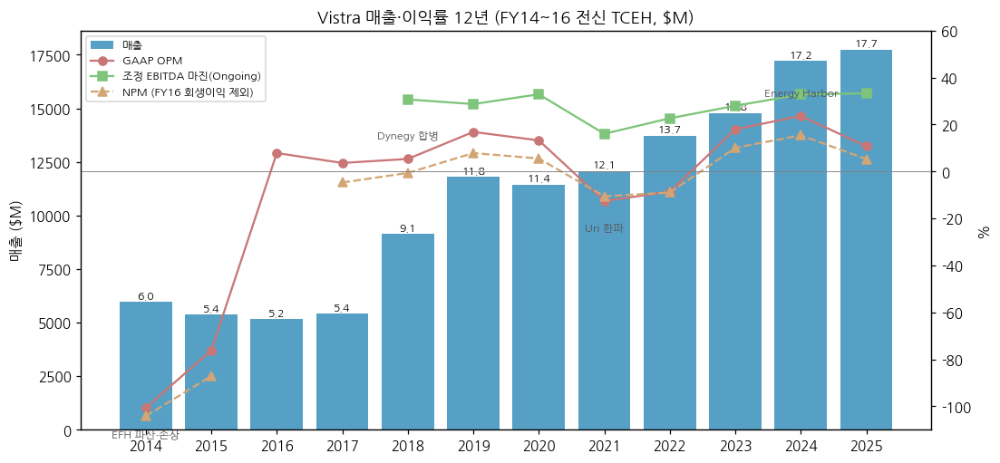

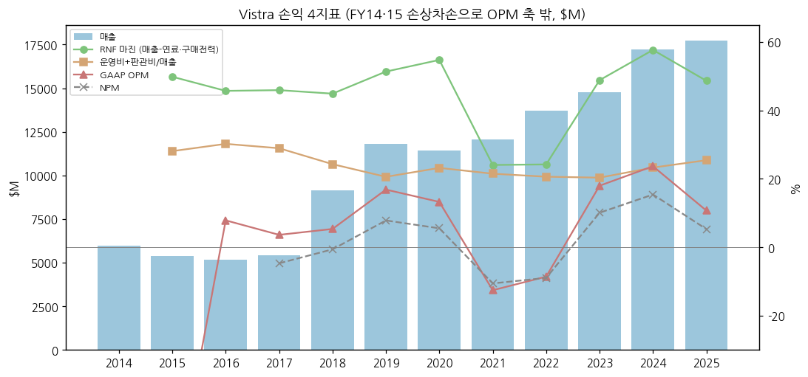

---

## ② 회사 개요

(1) 기본 정보

| 항목 | 내용 |
|---|---|
| 정식 명칭 | Vistra Corp. (Delaware 법인, 옛 Vistra Energy Corp.) — 핵심 사업 자회사 Vistra Operations Company LLC, 원전·소매·재생 지주 Vistra Vision LLC (100%) |
| 본사 | Irving, Texas |
| 뿌리 | TXU(Texas Utilities) → 2007 사모펀드 LBO로 Energy Future Holdings(EFH) [web 일반 사실] → 2014-04 EFH·TCEH 파산 신청 → **2016-10-03 TCEH가 Vistra Energy로 파산 졸업** (TCEH 채권자 소유) → **2018-04-09 Dynegy 합병** → **2024-03-01 Energy Harbor 인수** |
| 상장 | NYSE: VST |
| CEO | **James A. (Jim) Burke** — 사장 겸 CEO (2022-08-01\~) [DEF 14A], 전임 Curtis Morgan |
| CFO | Kristopher E. Moldovan (EVP·CFO) [DEF 14A] |
| 이사회 의장 | Scott B. Helm (Chairman) [10-K 서명란] |
| 임직원 | **6,390명** (2025말) [10-K FY25] — Energy Harbor 편입으로 4,870명(2023) → 6,850명(2024) |
| 설비 | **43,641MW** (2025말: 가스 26,989 · 석탄 8,743 · **원전 6,448** · 태양광/배터리 1,274 · 석유 187) → 2026-10 Cogentrix +5,500MW, 가스 3개 754MW 매각 [10-K FY25·10-Q] |
| 사업 한 줄 정의 | 텍사스(ERCOT)·PJM 등에서 가스·석탄·원전 발전소를 운영해 전력을 도매·용량시장과 자체 소매 브랜드(TXU Energy 등)로 팔고, 원전 출력을 하이퍼스케일러에 20년 계약으로 파는 미국 최대 경쟁 발전·소매 통합사 |
| 고객 구성 | 소매 — 텍사스 약 250만 고객 (2023말, 10-K FY23), 연 139TWh 판매(2025). 10% 이상 단일 고객 공시 없음. 원전 PPA: AWS·Meta / 태양광 PPA: Microsoft(Pulaski 405MW) |

(2) 핵심 KPI 요약 (FY25 + 3Q26 + 9M26 + 가이던스, $M)

| 지표 | FY25 | 3Q26 (YoY) | 9M26 (YoY) | 가이던스 |
|---|---|---|---|---|
| 매출 | 17,738 | 6,347 (+27.7%) | 16,004 (+21.7%) | — |
| RNF (매출 − 연료·구매전력) | 8,637 | 3,817 (+46.0%) | 9,170 (+44.1%) | — |
| GAAP 영업이익 (OPM) | 1,906 (10.7%) | 1,706 (26.9%) | 3,758 (23.5%) | — |
| 순이익 (Vistra 귀속) / 희석 EPS | 944 / $2.18 | 1,140 / $3.23 | 2,474 / $6.86 | — |
| 조정 EBITDA (연결) | 5,838 | 2,360 (+50.9%) | 5,579 (+35.7%) | — |
| **Ongoing Ops 조정 EBITDA** | **5,912** | **2,378 (+50.4%)** | **5,639 (+35.2%)** | **2026 $7.1\~7.5B / 2027 $7.7\~8.5B** |
| Ongoing Ops 조정 FCFbG | 3,592 | — | — | 2026 $4.3\~4.7B / 2027 $4.3\~5.1B |
| 원전 발전량 (TWh) | 52.3 | 13.6 | 39.2 | — |
| 영업CF / CapEx | 4,070 / 2,752 | — | 4,330 / 2,319 | — |
| 자사주 매입 | 1,028 | 208 | 918 | 잔여 한도 약 $2.5B (2028말까지) |

→ (출처: 10-K FY25, 3Q26 10-Q, 3Q26·4Q25 보도자료. Ongoing Ops·FCFbG는 회사 정의 non-GAAP. 3Q26 미실현 헤지 이익 $559M 포함으로 GAAP 순이익 급증)

(3) 주요 연혁 (시대별)

| 시기 | 사건 |
|---|---|
| 2007-10 | KKR·TPG·Goldman Sachs 컨소시엄 TXU LBO → Energy Future Holdings (EFH) [web 일반 사실] |
| 2014-04-29 | **EFH·TCEH 등 Chapter 11 파산 신청** — 셰일가스로 텍사스 도매 전력가격 하락, LBO 부채 약 $32B (TCEH 기준 화해 대상 부채 $31.9B) [10-K Selected Financial Data] |
| **2016-10-03** | **TCEH 파산 졸업 → Vistra Energy 출범** — 채무 소멸 등 회생이익 $22.1B, fresh-start 회계. 2016-12 특별배당 약 $1B ($2.32/주) [10-K FY17] |
| 2017-05 | NYSE 상장 [web 일반 사실] |
| 2018-01\~02 | 텍사스 석탄 3개(Monticello·Sandow·Big Brown) 4,167MW 폐쇄 [10-K FY17] |
| **2018-04-09** | **Dynegy 합병** — Dynegy 1주당 Vistra 0.652주 교환. PJM·MISO·NY/NE 가스·석탄 진출, 설비 약 40,500MW로 [10-K FY18] |
| 2019 | 첫 정기배당 (분기 $0.125, 2019-03), Crius·Ambit 소매 인수 [10-K FY19] |
| 2020 | Sunset 세그먼트 신설 (폐쇄 예정 석탄 분리), 사명 Vistra Corp. [10-K FY20] |
| **2021-02** | **Winter Storm Uri (텍사스 한파)** — 1Q21 조정 EBITDA -$1,241M, 2021 영업CF -$206M [10-Q] |
| 2021-10\~12 | 우선주 Series A·B 각 $1B 발행, 자사주 $2B 프로그램 + 2026년까지 주주환원 $7.5B 계획 [3Q21 보도자료] |
| 2022-08 | IRA 원전 PTC(45U, 2024\~2032) 법제화 [10-Q] |
| 2023-03-06 | Energy Harbor 인수 합의 [10-K FY24] |
| **2024-03-01** | **Energy Harbor 인수 완료 — 현금 $3.1B + Vistra Vision 지분 15%(공정가치 $1.5B)**. Beaver Valley 1·2·Perry·Davis-Besse 원전 4기 약 4GW 편입, Vistra Vision 출범 (원전+소매+재생) [10-K FY24] |
| 2024-09-18 | **Vistra Vision 소수지분 15% 매입 계약 (약 $3.2B, Nuveen·Avenue)** → 2024-12-31 완료, Nuveen 대금은 2026-12까지 분할 (2025년 $703M 지급) [10-K FY25] |
| 2024-11-27 | Martin Lake 1호기(815MW) 화재 → 2026-02 복귀 [10-Q] |
| 2025-01-16 | Moss Landing 300MW 배터리 화재 → 해당 설비 Asset Closure 이관 [10-K FY25] |
| 2025-07 | Perry 원전 면허 2046년까지 연장 (NRC) [10-Q] |
| **2025-09** | **Comanche Peak 1,200MW 20년 PPA — AWS (최대 20년 연장 옵션, 2027-4Q 개시 → 2032 전량)** [3Q26 10-Q] |
| 2025-10-22 | Lotus 가스발전 7개 2,600MW 인수 (기본가 $1.9B) [10-Q] |
| 2025-12 | S&P 투자등급 BBB- 상향 (12-02) / Cogentrix 인수 계약 (12-31) [10-Q·10-K] |
| **2026-01** | **Meta 20년 PPA — PJM 원전 2,609MW** (Perry 1,268 + Davis-Besse 908 + 업레이트 433) [10-Q] |
| 2026-03\~04 | Fitch BBB- (03-16) → 선순위 담보 전면 해제 (04-02), 텀론 $2.444B 상환 [10-Q] |
| 2026-06 | KKR Helix Fund(AI 인프라)에 최대 $1B 출자 약정 / 가스 3개 754MW 매각 합의 / TxEF 저리 대출 $583M (서부 텍사스 860MW 피커) [10-Q] |
| 2026-07 | PJM 2028/29 용량경매 $325.00/MW-day, 10,924MW 낙찰 [10-Q] |
| 2026-09 | Coleto Creek 석탄 가동 종료 (가스 600MW 전환 예정) / 후순위채 $1.5B 발행 [10-Q] |
| **2026-10-30** | **Cogentrix 인수 완료 — 가스 10개 약 5,500MW** (현금 약 $2.2B + 신주 500만주 @$185 + 부채 $1.7B 인수, 11-05 상환). 10-15 Series A 우선주 상환, 10-29 자사주 $1.5B 추가 승인 [10-Q] |
| 2026-11-06 | 3Q26 실적 — 2026 가이던스 범위 축소 $7.1\~7.5B, **2027 가이던스 $7.7\~8.5B 신규** [보도자료] |

(4) 회사 주가 역사 (narrative 영역)

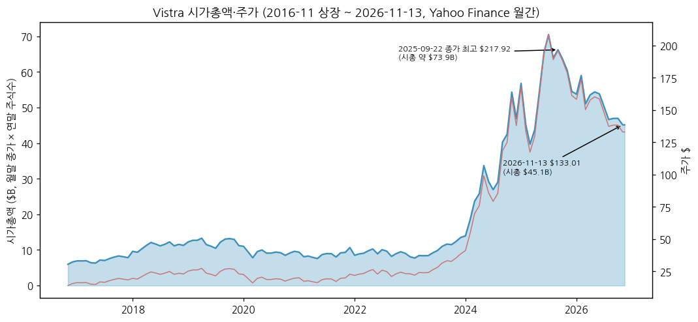

→ **2016-11 \~ 2023 ($14 → $39, '파산 졸업 저평가주')** — 상장 초기 월말 종가 $13.95 (2016-11). 2017\~2022 $11\~28 박스권 (시총 $8\~13B) — 텍사스 날씨·석탄 리스크로 낮은 멀티플. 2022 연말 $23.20 → 2023 연말 **$38.52 (+66%)**, Energy Harbor 인수 합의 [Yahoo]

→ **2024 AI 전력 랠리 ($38.5 → $137.9, +258%)** — 데이터센터 전력 수요 + Energy Harbor 원전 편입 + 원전 PTC. 연말 시총 약 $46.9B [계산: 340M주]

→ **2025 ATH ($137.9 → $217.9)** — Comanche Peak AWS PPA 기대 → **2025-09-22 사상 최고 종가 $217.92 (시총 약 $73.9B)** [Yahoo, 계산]. 2025말 $161.33 (시총 $54.5B)

→ **2026 조정 (-39% from ATH)** — Meta PPA(1월) 후 2026-01-15 52주 최고 종가 $180.18, 이후 PJM 용량시장 개편·가스 인수 확대(Cogentrix)·원전 PPA 추가 공백으로 하락 → 2026-11-05 $112.89 (52주 최저). 3Q26 실적·2027 가이던스 이후 +10.5% 반등, **2026-11-13 $133.01 (시총 $45.1B)** [Yahoo, XTB, 계산]

---

## ③ 비즈니스 모델

(1) 실적 추이 통합 표 (현행 세그먼트, $M, 세그먼트 매출은 세그먼트 간 거래 포함)

| 세그먼트 | 항목 | 2022 | 2023 | 2024 | 2025 | 9M26 |
|---|---|---|---|---|---|---|
| **Retail** | 매출 | 9,455 | 10,572 | 12,797 | 14,340 | 12,113 |
| | 조정 EBITDA | 923 | 1,105 | 1,463 | 1,622 | 939 |
| | 판매량 (TWh) | 98.1 | 97.4 | 133.4 | 139.1 | 100.3 |
| **Texas** | 매출 | 3,733 | 3,979 | 5,394 | 5,353 | 7,260 |
| | 조정 EBITDA | 1,438 | 1,834 | 2,032 | 1,834 | 2,124 |
| | 발전량 (TWh) / 원전 | 80.5 / 19.7 | 85.4 / 18.9 | 88.3 / 19.7 | 91.3 / 20.1 | 72.6 / 14.9 |
| **East** | 매출 | 3,706 | 5,890 | 5,661 | 6,174 | 5,044 |
| | 조정 EBITDA | 608 | 1,001 | 2,017 | 2,282 | 2,422 |
| | 발전량 (TWh) / 원전 | 79.1 / — | 77.1 / — | 103.8 / 26.5 | 114.8 / 32.2 | 91.2 / 24.4 |
| **West** | 매출 | 336 | 866 | 839 | 325 | 293 |
| | 조정 EBITDA | 152 | 263 | 225 | 244 | 200 |
| **Sunset** (2023까지) | 매출 / 조정 EBITDA | 956 / 42 | — | — | — | — |
| **Asset Closure** | 조정 EBITDA | -125 | -39 | -104 | -74 | -60 |
| **전사** | 매출 | 13,728 | 14,779 | 17,224 | 17,738 | 16,004 |
| | **Ongoing 조정 EBITDA** | **3,115** | **4,140** | **5,656** | **5,912** | **5,639** |

→ (출처: 각 연도 10-K·3Q26 10-Q 세그먼트 표. 2023 Texas·East는 FY24 10-K 재작성(Sunset 석탄 편입) 기준, 2022는 FY23 10-K 원 체계. 2024 West·Asset Closure는 FY25 10-K 재작성치(225·-104) — Ongoing 합계는 당시 공시 기준. 2022 East 발전량은 East+Sunset 석탄 일부 포함 [계산])

**세그먼트 체계 변경 이력 (매핑)**

→ **FY2017**: Wholesale Generation(Luminant) / Retail Electricity(TXU) 2개 → FY18 10-K에서 Retail / ERCOT / Asset Closure로 재작성

→ **FY2018\~FY2019 (Dynegy 후)**: Retail · ERCOT · PJM · NY/NE · MISO · Asset Closure

→ **4Q20\~FY2023**: Retail · **Texas**(=ERCOT, 석탄 Martin Lake·Oak Grove 포함) · **East**(=PJM+NY/NE+MISO 가스) · **West**(CAISO) · **Sunset**(폐쇄 예정 석탄) · Asset Closure

→ **FY2024\~**: Sunset 폐지 → 소재지 따라 Texas·East로 편입. Energy Harbor 원전은 East(발전)·Retail(소매)에 배분. **Vistra Vision은 법인 구조일 뿐 보고 세그먼트 아님**

**연간 세그먼트 조정 EBITDA (2017\~2021, $M, 당시 체계)**: 2017 Retail 779 · ERCOT 538 · Asset Closure 158 (연결 1,455) / 2018 Retail 845 · ERCOT 968 · PJM 592 · NY/NE 293 · MISO 66 (연결 2,760) / 2019 (재작성) Retail 807 · Texas 1,307 · East 925 · West 63 · Sunset 308 (연결 3,325) / 2020 Retail 983 · Texas 1,646 · East 849 · West 73 · Sunset 242 (연결 3,685) / 2021 Retail 1,312 · **Texas -236 (Uri)** · East 737 · West 93 · Sunset 148 (연결 1,908) [10-K]

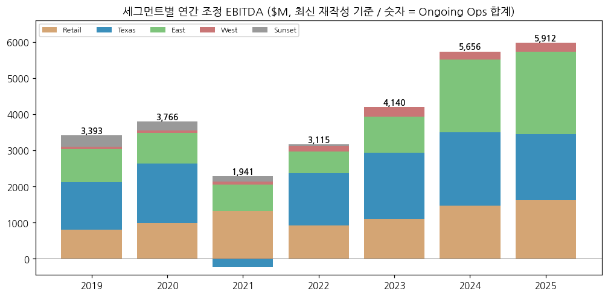

**원전 운영 지표 (연간)**

| 연도 | 2015 | 2016 | 2017 | 2018 | 2019 | 2020 | 2021 | 2022 | 2023 | 2024 | 2025 | 9M26 |
|---|---|---|---|---|---|---|---|---|---|---|---|---|
| 원전 설비 (MW) | 2,300 | 2,300 | 2,300 | 2,300 | 2,300 | 2,300 | 2,300 | 2,400 | 2,400 | 6,448 | 6,448 | 6,448 |
| 원전 발전량 (TWh) | 20.0 | 20.4 | 16.9 | 20.4 | 19.3 | 19.5 | 19.4 | 19.7 | 18.9 | 46.2 | 52.3 | 39.2 |
| Comanche Peak 이용률 (%) | 99.0 | — | 84.0 | 101.3 | 95.8 | 96.7 | 96.3 | 93.6 | 89.9 | 93.3 | 95.4 | 94.6 |
| PJM 원전 이용률 (%) | — | — | — | — | — | — | — | — | — | 89.3 | 90.8 | 91.9 |
| 자사 총 발전량 (TWh) | 62.5 | 77.6 | 86.9 | 163.3 | 186.4 | 172.2 | 183.7 | 171.4 | 168.0 | 196.3 | 208.2 | 166.2 |
| **원전 발전 비중 (%)** | 31.9 | 26.3 | 19.5 | 12.5 | 10.4 | 11.3 | 10.6 | 11.5 | 11.2 | **23.5** | **25.1** | **23.6** |

→ (출처: 각 연도 10-K·3Q26 10-Q 세그먼트 생산량 표 (가스·석탄·원전·태양광·Asset Closure 합산) [계산]. 2015\~2017은 TCEH/Luminant 텍사스 단독, 2018은 Dynegy 4/9 이후분. 2024 PJM 원전은 3/1 이후 10개월. 2015\~16 Comanche Peak 설비 2,300MW → 2023 10-K부터 2,400MW 표기. 2016 이용률은 기간 분할로 생략)

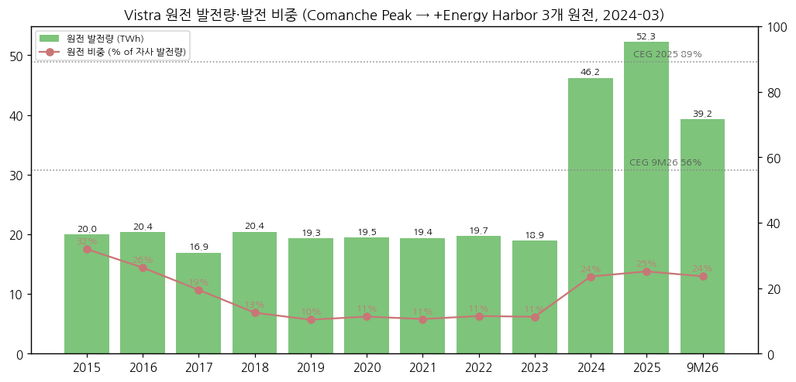

(2) 사업부별 개요 (9M26 세그먼트 조정 EBITDA 비중 큰 순서)

**East — 42.6%**

"PJM·뉴잉글랜드·뉴욕·MISO의 가스 함대 + PJM 원전 3개 단지 + 중서부 석탄." 22,254MW (2025말). **원전**: Beaver Valley 1·2 (PA, 939·933MW, 면허 2036·2047) · Perry (OH, 1,268MW, 2046) · Davis-Besse (OH, 908MW, 2037). 2025-10 Lotus(PJM·ISO-NE·NYISO·CAISO 2.6GW), 2026-10 Cogentrix(PJM·ISO-NE 가스) 편입. PJM 용량가격 상승의 최대 수혜 — 조정 EBITDA $608M(2022) → $2,282M(2025) → 9M26 $2,422M [10-K·10-Q]

**Texas — 37.4%**

"ERCOT 최대 발전 함대." 19,858MW — CCGT 7개 7.8GW, 피커 3.5GW, 석탄 Martin Lake(2,250MW)·Oak Grove(1,600MW), **Comanche Peak 원전 2기 2,400MW** (1990·1993 상업운전, 면허 2050·2053), 태양광. Comanche Peak 1,200MW는 AWS 20년 PPA. 서부 텍사스 860MW 피커(2028), Coleto Creek 가스 전환 600MW, 기존 가스 업그레이드 500MW+ 등 2GW 증설 계획 [10-Q]

**Retail — 16.5%**

"텍사스 1위 소매 전력 (TXU Energy) + 북동·중서부 소매." 브랜드: TXU Energy, Ambit, Dynegy Energy Services, Homefield, TriEagle, Public Power, U.S. Gas & Electric, Energy Harbor [10-K]. 발전 세그먼트로부터 전력을 사서 고객에게 파는 구조 → **발전 헤지의 자연 상대방** (도매가격 상승 시 발전 이익↑·소매 마진↓). 2025 판매 139.1TWh, 조정 EBITDA $1,622M

**West — 3.5%**

"캘리포니아 Moss Landing 가스 + 배터리." 1,529MW. Moss Landing 300MW 배터리 화재(2025-01) 후 해당 설비는 Asset Closure 이관

**Asset Closure — 음수**

"폐쇄 석탄·광산 해체·복구." 2018\~2022 Monticello·Big Brown·Sandow·Zimmer·Joppa·Edwards 등 폐쇄 [10-K]. 가이던스(Ongoing Ops)에서 제외

(3) 사업부별 디테일 (top-seller · growth · 이익 outlier)

→ **Top-seller**: East + Texas 발전 — 2025 조정 EBITDA $4,116M, 세그먼트 합계(Asset Closure 제외)의 69% [계산]

→ **Growth (East)**: 조정 EBITDA 2023 $1,001M → 2024 $2,017M (+101%, Energy Harbor 원전 10개월) → 2025 $2,282M → 9M26 +47% YoY (용량가격·Lotus). PJM West Hub 9M26 평균 $72.84/MWh (+53% YoY) [10-Q]

→ **Growth (Texas)**: 3Q26 조정 EBITDA $1,227M (+56% YoY) — 실현 전력가격 상승·Martin Lake 1호기 복귀·가스 유닛 최적 운전. 9M26 CCGT 이용률 64.8% (전년 58.6%) [10-Q]

→ **이익 outlier (긍정)**: 2024 OPM 23.7% — 원전 PTC $545M + 미실현 헤지 이익 $1,155M. 3Q24 영업이익 $2,588M (분기 최대, 미실현 이익)

→ **이익 outlier (부정)**: **1Q21 Uri 한파 — 조정 EBITDA -$1,241M, 영업손실 -$2,583M** (Texas 2021 연간 조정 EBITDA -$236M). 2Q22 영업손실 -$1,683M (선도 전력가격 급등 → 미실현 헤지 손실). 2025 East 순손실 -$91M (미실현 손실 +$1.1B, 원전 PTC -$264M)

→ **헤지 평가의 구조**: 발전 세그먼트는 선도 매도 → 가격 상승 시 미실현 손실, 소매는 반대 → 연결 GAAP 변동은 상쇄 후에도 연 수억\~수십억 달러 [10-K FY23 MD&A]

(4) 주요 경쟁사 (사업부별) — **한국 원전 운영(한국전력) 겹침 포함**

| VST 사업·시장 | 글로벌 경쟁사 | **한국 겹침** |
|---|---|---|
| ERCOT 발전 (Texas) | NRG, Constellation(Calpine·STP), Talen 일부, 재생 개발사 [판단] | — (시장 구조 상이) |
| PJM 원전·가스 (East) | Constellation(최대), Talen(Susquehanna), PSEG, Dominion(규제) [판단] | — |
| 데이터센터 장기 PPA | Constellation(Microsoft·Meta·Amazon·Google), Talen–Amazon, NRG, NextEra [판단] | 한국전력 — 국내 데이터센터 전력 공급 (규제 요금) |
| 소매 전력 (Retail) | NRG(Reliant·Direct Energy), Constellation, Calpine 소매(현 CEG) [판단] | 한국전력 (독점 판매) |
| 원전 업레이트 | Constellation(Google 890MW 업레이트), NextEra [web] | 한수원 — 계속운전(수명연장) |

→ (출처: 10-K 경쟁 환경 서술 + 공개 사례 [판단·web]. 한국 매핑은 워치리스트 "원전 운영" 서브섹터 기준)

(5) 주요 매출처 · 장기 계약

| 상대방 | 내용 | 시점 |
|---|---|---|
| **AWS (Amazon)** | **Comanche Peak 1,200MW 20년 PPA** (+최대 20년 연장 옵션) | 2025-09 발표, 2027-4Q 개시 → 2032 전량 [10-Q] |
| **Meta** | **PJM 원전 20년 PPA 2,609MW** — Perry 1,268 + Davis-Besse 908 (에너지·용량) + 업레이트 Perry 213·Davis-Besse 80·Beaver Valley 140 | 2026-01 발표, 가동분 2026말 일부 → 2027말 전량 / 업레이트 2031 일부 → 2034말 전량, 업레이트 CapEx 2028말까지 20% 미만 [10-Q] |
| Microsoft | Pulaski Solar (일리노이 405MW) PPA | 2026-3Q 상업운전 [3Q26 보도자료] |
| New Era Energy & Digital | 텍사스 Odessa 207MW 20년 PPA (데이터센터) | 2026-3Q [3Q26 보도자료] |
| 소매 고객 | 텍사스 약 250만 고객 (TXU 등), 2025 판매 139.1TWh | 상시 |

→ 하이퍼스케일러 원전 계약 합계 약 **3.8GW** (AWS 1,200 + Meta 2,609) [계산]. 계약 단가는 미공시

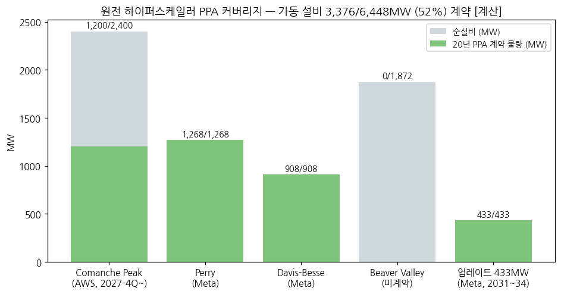

(6) 생산 CAPA + 임직원 추이

| 연말 | 2018 | 2019 | 2020 | 2021 | 2022 | 2023 | 2024 | 2025 |
|---|---|---|---|---|---|---|---|---|
| 총 설비 (MW) | 약 40,500 | 약 38,500 | 약 38,700 | 약 38,700 | 약 37,000 | 36,702 | 40,657 | 43,641 |
| 원전 (MW) | 2,300 | 2,300 | 2,300 | 2,300 | 2,400 | 2,400 | 6,448 | 6,448 |
| 원전 비중 (설비 %) | 5.7 | 6.0 | 5.9 | 5.9 | 6.5 | 6.5 | 15.9 | 14.8 |
| 임직원 (명) | 5,275 | 5,475 | 5,365 | 5,060 | 4,910 | 4,870 | 6,850 | 6,390 |

→ (출처: 각 연도 10-K Item 1 [원전 비중 계산]. 2017말 임직원 4,150명. 2025말 설비 구성: 가스 26,989(62%) · 석탄 8,743(20%) · 원전 6,448(15%) · 재생 1,274(3%) · 석유 187)

→ **2026 변화**: +Cogentrix 5,500MW (PJM CCGT 3·CT 2, ISO-NE CCGT 4, ERCOT 열병합 1) − Casco Bay·Beaver Falls·Syracuse 754MW − Coleto Creek 석탄 종료 → 약 48GW [계산, 근사]. 원전 설비 비중 약 13%

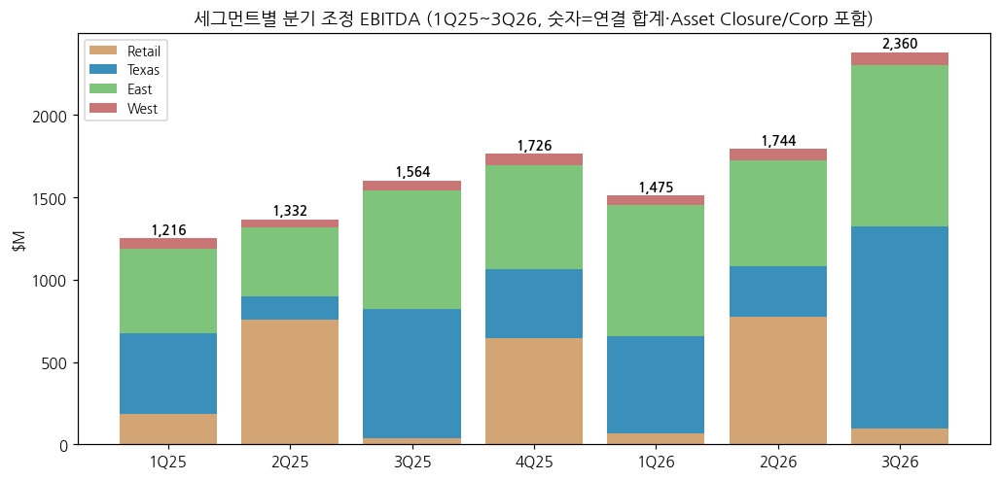

**세그먼트 분기 조정 EBITDA (1Q25\~3Q26, $M, 현행 체계)**

| 분기 | Retail | Texas | East | West | Asset Closure | Corp | 연결 | Ongoing |
|---|---|---|---|---|---|---|---|---|
| 1Q25 | 184 | 490 | 514 | 62 | -24 | -10 | 1,216 | 1,240 |
| 2Q25 | 756 | 142 | 418 | 49 | -17 | -16 | 1,332 | 1,349 |
| 3Q25 | 37 | 784 | 719 | 63 | -17 | -22 | 1,564 | 1,581 |
| 4Q25 | 645 | 418 | 631 | 70 | -16 | -22 | 1,726 | 1,742 |
| 1Q26 | 68 | 586 | 801 | 56 | -19 | -17 | 1,475 | 1,494 |
| 2Q26 | 773 | 311 | 642 | 68 | -23 | -27 | 1,744 | 1,767 |
| 3Q26 | 98 | 1,227 | 979 | 76 | -18 | -2 | 2,360 | 2,378 |

→ (출처: 각 분기 10-Q, 4Q25 = 10-K 연간 − 9M [계산]. **Retail은 2Q·4Q, Texas는 3Q(여름 피크)에 이익 집중** — Retail 3Q가 작은 것은 여름 고가 구매전력 비용 때문)

**전사 분기 시계열 (39Q, 1Q17\~3Q26, $M — XBRL·10-Q)**

| 연도 | 매출 Q1 / Q2 / Q3 / Q4 | 영업이익 Q1 / Q2 / Q3 / Q4 | 순이익 Q1 / Q2 / Q3 / Q4 | 조정 EBITDA(연결) Q1 / Q2 / Q3 / Q4 |
|---|---|---|---|---|
| 2017 | 1,357 / 1,296 / 1,833 / 943 | 155 / 53 / 452 / -460 | 78 / -26 / 273 / -579 | — |
| 2018 | 765 / 2,574 / 3,243 / 2,562 | -394 / 231 / 650 / 4 | -306 / 108 / 330 / -186 | 241 / 658 / 1,141 / 720 |
| 2019 | 2,923 / 2,832 / 3,194 / 2,860 | 490 / 729 / 440 / 334 | 225 / 356 / 113 / 234 | 802 / 692 / 1,060 / 771 |
| 2020 | 2,858 / 2,509 / 3,552 / 2,524 | 391 / 377 / 676 / 76 | 56 / 166 / 443 / -29 | 833 / 916 / 1,137 / 800 |
| 2021 | 3,207 / 2,565 / 2,991 / 3,314 | -2,583 / 62 / 119 / 886 | -2,043 / 36 / 7 / 726 | **-1,241** / 811 / 1,173 / 1,164 |
| 2022 | 3,125 / 1,588 / 5,146 / 3,869 | -288 / -1,683 / 894 / -98 | -285 / -1,365 / 668 / -246 | 541 / 737 / 981 / 736 |
| 2023 | 4,425 / 3,189 / 4,086 / 3,078 | 1,131 / 591 / 834 / 102 | 699 / 476 / 502 / -184 | 513 / 1,067 / 1,589 / 933 |
| 2024 | 3,054 / 3,845 / 6,288 / 4,037 | 86 / 808 / 2,588 / 599 | -35 / 365 / 1,888 / 441 | 790 / 1,388 / 1,427 / 1,934 |
| 2025 | 3,933 / 4,250 / 4,971 / 4,584 | -120 / 515 / 1,037 / 474 | -268 / 327 / 652 / 233 | 1,216 / 1,332 / 1,564 / 1,726 |
| 2026 | 5,640 / 4,017 / 6,347 / — | 1,499 / 553 / 1,706 / — | 1,029 / 305 / 1,140 / — | 1,475 / 1,744 / 2,360 / — |

→ (출처: XBRL companyfacts 3개월 값, 4Q = 연간 − 9M [계산]. 3Q26은 10-Q 본문. 조정 EBITDA = 10-Q MD&A, 4Q = 10-K 연간 − 9M [계산]. 2017 Q1 순이익 = 연간 − 2\~4Q [계산]. 순이익은 Vistra 귀속 기준, 2018 Q1 매출 $765M은 미실현 헤지 손실 차감 효과)

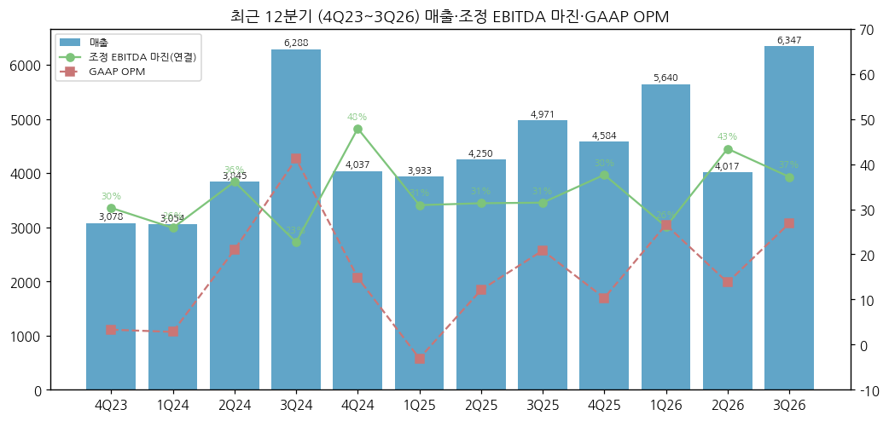

---

## ④ 재무 구조

(1) 손익계산서 (12년, $M) + chart1b

| 연도 | 매출 | 매출 YoY | 연료·구매전력 | RNF | RNF 마진 | 운영비 | D&A | 판관비 | 손상 | 영업이익 | OPM | 이자비용 | 순이익 | NPM | 희석 EPS ($) |
|---|---|---|---|---|---|---|---|---|---|---|---|---|---|---|---|
| 2014 | 5,978 | — | — | — | — | — | — | — | 6,270 | -6,015 | -100.6 | — | -6,229 | n/m | — |
| 2015 | 5,370 | -10.2 | 2,692 | 2,678 | 49.9 | 834 | 852 | 676 | 4,741 | -4,091 | -76.2 | 1,289 | -4,677 | n/m | — |
| 2016 | 5,164 | -3.8 | 2,802 | 2,362 | 45.7 | 872 | 675 | 690 | 0 | 407 | 7.9 | 1,109 | 22,688 | n/m | (0.38)* |
| 2017 | 5,430 | 5.2 | 2,935 | 2,495 | 45.9 | 973 | 699 | 600 | 25 | 198 | 3.6 | 193 | -254 | -4.7 | -0.59 |
| 2018 | 9,144 | 68.4 | 5,036 | 4,108 | 44.9 | 1,297 | 1,394 | 926 | 0 | 491 | 5.4 | 572 | -54 | -0.6 | -0.11 |
| 2019 | 11,809 | 29.1 | 5,742 | 6,067 | 51.4 | 1,530 | 1,640 | 904 | 0 | 1,993 | 16.9 | 797 | 928 | 7.9 | 1.86 |
| 2020 | 11,443 | -3.1 | 5,174 | 6,269 | 54.8 | 1,622 | 1,737 | 1,035 | 356 | 1,519 | 13.3 | 630 | 636 | 5.6 | 1.30 |
| 2021 | 12,077 | 5.5 | 9,169 | 2,908 | 24.1 | 1,559 | 1,753 | 1,040 | 71 | -1,515 | -12.5 | 384 | -1,274 | -10.5 | -2.69 |
| 2022 | 13,728 | 13.7 | 10,401 | 3,327 | 24.2 | 1,645 | 1,596 | 1,189 | 74 | -1,177 | -8.6 | 368 | -1,227 | -8.9 | -3.26 |
| 2023 | 14,779 | 7.7 | 7,557 | 7,222 | 48.9 | 1,702 | 1,502 | 1,308 | 49 | 2,661 | 18.0 | 740 | 1,493 | 10.1 | 3.58 |
| 2024 | 17,224 | 16.5 | 7,285 | 9,939 | 57.7 | 2,414 | 1,843 | 1,601 | 0 | 4,081 | 23.7 | 900 | 2,659 | 15.4 | 7.00 |
| 2025 | 17,738 | 3.0 | 9,101 | 8,637 | 48.7 | 2,803 | 1,986 | 1,714 | 228 | 1,906 | 10.7 | 1,179 | 944 | 5.3 | 2.18 |
| 9M26 | 16,004 | 21.7 | 6,834 | 9,170 | 57.3 | 2,236 | 1,640 | 1,267 | 269 | 3,758 | 23.5 | 829 | 2,474 | 15.5 | 6.86 |

→ (출처: FY2014 = FY2018 10-K Selected Financial Data (매출·영업손익·순손익만), FY2015\~2016 = FY2017 10-K 손익계산서 (Predecessor·Successor 합산 [계산]), FY2017\~2025 = 10-K·XBRL, 9M26 = 10-Q. *2016 EPS는 Successor 기간(10/3\~12/31)만. FY15·16은 '헤지·트레이딩 순이익'($334M·$282M)이 별도 행 → RNF 미포함. 손상 = 영업권 + 장기자산. 2017 순손실은 세제개편 이연법인세 비용(법인세 $504M). 2021\~22 순이익에서 우선주 배당 차감 후 보통주 귀속 -1,295 / -1,377)

(2) 재무상태표 (12년, 연말, $M) + chart4

| 연말 | 자산 | 부채 | 자본 (우선주 포함) | 우선주 | 현금 | 장기차입 (유동 포함) | 단기차입 | 순차입 | 순차입/Ongoing 조정 EBITDA | 유동비율 | 부채/자본 |
|---|---|---|---|---|---|---|---|---|---|---|---|
| 2014 | 21,343 | 39,552 | -18,209 | — | — | 화해 대상 31,856 | DIP 1,425 | — | — | — | n/m |
| 2015 | 15,658 | 38,542 | -22,884 | — | — | 화해 대상 31,668 | DIP 1,425 | — | — | — | n/m |
| 2016 | 15,167 | 8,570 | 6,597 | 0 | 843 | 4,623 | 0 | 3,780 | — | — | 130% |
| 2017 | 14,600 | 8,258 | 6,342 | 0 | 1,487 | 4,423 | 0 | 2,936 | — | — | 130% |
| 2018 | 26,024 | 18,161 | 7,863 | 0 | 636 | 11,065 | 0 | 10,429 | 3.7x | 0.95 | 231% |
| 2019 | 26,616 | 18,657 | 7,959 | 0 | 300 | 10,379 | 350 | 10,429 | 3.1x | 0.90 | 234% |
| 2020 | 25,208 | 16,837 | 8,371 | 0 | 406 | 9,330 | 0 | 8,924 | 2.4x | 1.13 | 201% |
| 2021 | 29,683 | 21,392 | 8,291 | 2,000 | 1,325 | 10,731 | 0 | 9,406 | 4.8x | 1.35 | 258% |
| 2022 | 32,787 | 27,885 | 4,902 | 2,000 | 455 | 11,971 | 650 | 12,166 | 3.9x | 1.08 | 569% |
| 2023 | 32,966 | 27,659 | 5,307 | 2,476 | 3,485 | 14,402 | 0 | 10,917 | 2.6x | 1.18 | 521% |
| 2024 | 37,770 | 32,200 | 5,570 | 2,476 | 1,188 | 16,298 | 0 | 15,110 | 2.7x | 0.96 | 578% |
| 2025 | 41,550 | 36,453 | 5,097 | 2,476 | 785 | 17,043 | 1,800 | 18,058 | 3.1x | 0.78 | 715% |
| 3Q26 | 45,029 | 38,566 | 6,306 | 2,476 | 2,743 | 21,146 | 0 | 18,403 | — | 1.16 | 612% |

→ (출처: FY2014\~2016 = 10-K Selected Financial Data (2014·15는 파산 중 '화해 대상 채무'·DIP 차입), FY2016\~ = 10-K·XBRL, 3Q26 = 10-Q. 부채 = 자산 − 자본 [계산], 순차입 = 장기차입 + 단기차입 − 현금 [계산, 매출채권 유동화·선도 재매입 의무 제외]. 2025말 매출채권 유동화 $1,225M 별도. 3Q26 장기차입 급증 = 후순위채 $1.5B + Lotus 인수 부채 등)

→ **자본이 작은 이유**: 2021-11 이후 자사주 누적 약 $6.7B + 2021\~22 순손실 → 보통주 자본 $8.4B(2020) → $2.6B(2025) → $3.8B(3Q26) [계산]. 자기주식 장부가 $7.83B (3Q26)

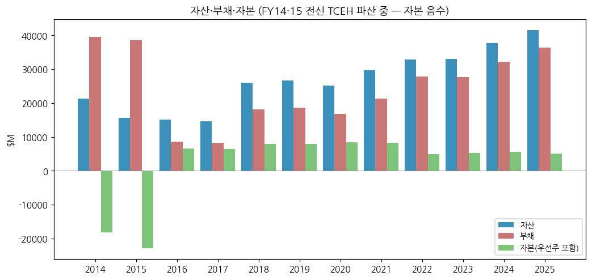

(3) 현금흐름표 (12년, $M) + chart6

| 연도 | 영업CF | 투자CF | 재무CF | CapEx (원전연료 포함) | FCF | FCF/순이익 | D&A |
|---|---|---|---|---|---|---|---|
| 2014 | 444 | — | — | — | — | — | — |
| 2015 | 237 | — | — | — | — | — | 852 |
| 2016 | -157 | — | — | — | — | — | 675 |
| 2017 | 1,386 | -727 | -201 | 176 | 1,210 | n/m | 699 |
| 2018 | 1,471 | -101 | -2,723 | 530 | 941 | n/m | 1,394 |
| 2019 | 2,736 | -1,717 | -1,237 | 713 | 2,023 | 218% | 1,640 |
| 2020 | 3,337 | -1,572 | -1,796 | 1,259 | 2,078 | 327% | 1,737 |
| 2021 | -206 | -1,153 | 2,274 | 1,033 | -1,239 | n/m | 1,753 |
| 2022 | 485 | -1,239 | -80 | 1,301 | -816 | n/m | 1,596 |
| 2023 | 5,453 | -2,145 | -294 | 1,676 | 3,777 | 253% | 1,502 |
| 2024 | 4,563 | -5,276 | -1,604 | 2,078 | 2,485 | 93% | 1,843 |
| 2025 | 4,070 | -4,396 | -74 | 2,752 | 1,318 | 140% | 1,986 |
| 9M26 | 4,330 | -2,023 | -353 | 2,319 | 2,011 | 81% | 1,640 |

→ (출처: FY2014\~2016 영업CF = 10-K Selected Financial Data (2016 = Predecessor -238 + Successor 81 [계산]), FY2017\~ = XBRL, 9M26 = 10-Q. FCF = 영업CF − CapEx [계산] — 회사 정의 FCFbG(성장투자 전·운전자본 조정)와 다름. 2017 CapEx = 설비 114 + 원전연료 62. 2021 영업CF 적자 = Uri, 2022 = 담보증거금(margin) 유출. 2024 투자CF = Energy Harbor 인수 $3.07B)

→ 회사 정의 **Ongoing Ops 조정 FCFbG**: 2025 $3,592M → 2026 가이던스 $4.3\~4.7B → 2027 $4.3\~5.1B [보도자료]. 2019 가이던스 $2.1\~2.3B 대비 약 2배

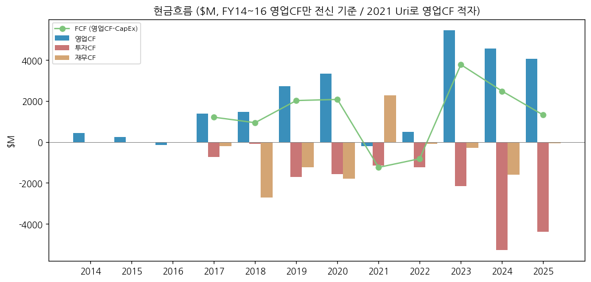

(4) CapEx + chart8

→ $176M(2017, 텍사스 단독) → $713M(2019, Dynegy 편입) → $1,676M(2023) → $2,078M(2024, Energy Harbor 원전 연료 포함) → **$2,752M(2025)** → 9M26 $2,319M (+21% YoY) [XBRL·10-Q]

→ 2025 유지 CapEx(성장 제외, 원전연료 포함) $2,104M = 세그먼트 $1,799M (Texas 954 · East 647 · West 186) + 원전 연료 순구매 $305M [10-K FY25 세그먼트 주석]

→ 성장 CapEx: 서부 텍사스 860MW 피커(2028 가동, TxEF 대출 $583M 3%), Coleto Creek 가스 전환 600MW, 가스 업그레이드 500MW+, Meta 업레이트 433MW(2026\~2034, 2028말까지 20% 미만 지출) [10-Q]

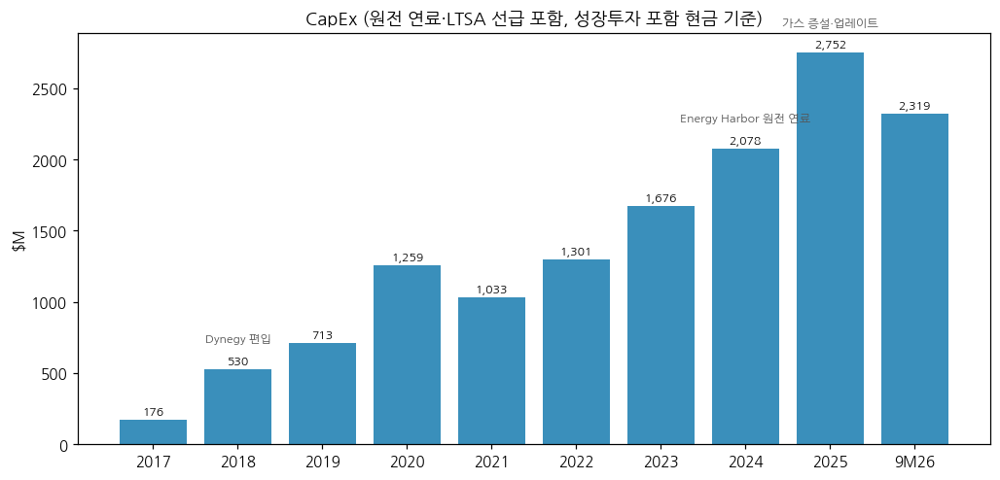

(5) 부채 구조 + 채권 history

→ **신용등급 투자등급 전환**: S&P BB+ → **BBB-** (Vistra Operations 발행자 2025-12-02, 선순위 무담보 2026-03-20) / Fitch BB+ → **BBB-** (2026-03-16) → 2026-04-02 선순위 담보부채권 담보 전면 해제 (등급 하락 시 원복 조건) [10-Q]

→ 3Q26말 장기차입 $21.1B (유동 $2.88B) — Vistra Operations 선순위채 중심 + **후순위채 $1.5B (Series A $850M·B $650M, 2026-09)** + 프로젝트 차입(BCOP·Vistra Zero) + TxEF $583M 중 $236M [10-Q]

→ 2026-04 텀론 B $2.444B 전액 상환, 2026-11-05 Cogentrix 인수 부채 $1.7B 상환 [10-Q]. 이자비용 $193M(2017) → $797M(2019) → $368M(2022) → **$1,179M(2025)** — 2023 이후 차입 확대(Energy Harbor·Vistra Vision 매입)

→ **우선주**: Series A $1B(2021-10) · B $1B(2021-12) · C $476M(2023) — 누적 $2.476B. **A는 2026-10-15 상환, B는 2026-12-15 상환 예정** (후순위채로 대체) [10-Q]. 우선주 배당 $192M/년(2024\~25)

→ **Vistra Vision 소수지분 매입 대금**: Nuveen 분할 지급 잔여분 2026-12-31까지 (부채 계상, 2025년 $703M 지급) [10-K FY25]

(6) 배당·자사주 + chart9

| 연도 | 1Q 분기 DPS ($) | 보통주 배당 ($M) | 우선주 배당 ($M) | 자사주 매입 ($M) | FCF ($M) | 환원/FCF | 연말 발행주식 (M) |
|---|---|---|---|---|---|---|---|
| 2016 | 특별 2.32 | 약 1,000 | — | 0 | — | — | 428 |
| 2017 | — | 0 | — | 0 | 1,210 | 0% | 428 |
| 2018 | — | 0 | — | 763 | 941 | 81% | 493 |
| 2019 | 0.125 | 243 | — | 656 | 2,023 | 44% | 488 |
| 2020 | 0.135 | 266 | — | 0 | 2,078 | 13% | 489 |
| 2021 | 0.150 | 290 | — | 471 | -1,239 | n/m | 469 |
| 2022 | 0.170 | 302 | 151 | 1,949 | -816 | n/m | 390 |
| 2023 | 0.1975 | 313 | 150 | 1,245 | 3,777 | 45% | 351 |
| 2024 | 0.215 | 305 | 192 | 1,266 | 2,485 | 71% | 340 |
| 2025 | 0.2235 | 306 | 192 | 1,028 | 1,318 | 101% | 338 |
| 9M26 | 0.2280 (4Q26 0.2310) | 231 | 144 | 918 | 2,011 | 57% | 334.7 (9/30) → 339.4 (11/2) |

→ (출처: XBRL·10-K·10-Q. 분기 DPS는 매년 2월 선언분 (연중 소폭 인상) [10-K]. 환원/FCF = (보통주 배당 + 자사주) / FCF [계산]. 2018 발행주식 증가 = Dynegy 주식 교환, 11/2 증가 = Cogentrix 대가 신주 500만주)

→ **자사주 프로그램**: 2021-10 이후 승인 누적 $7.75B (2021-10 $2.0B · 2022-08 $1.25B · 2023-03 $1.0B · 2024-02 $1.5B · 2024-10 $1.0B · 2025-10 $1.0B) + **2026-10 $1.5B 추가** → 2021-11 이후 약 $6.7B 매입, **주식수 약 -30%**, 잔여 약 $2.5B를 2028말까지 [10-Q·3Q26 보도자료]

→ 배당 수익률 약 0.7% ($0.231 × 4 ÷ $133.01) [계산] — 환원의 중심은 자사주

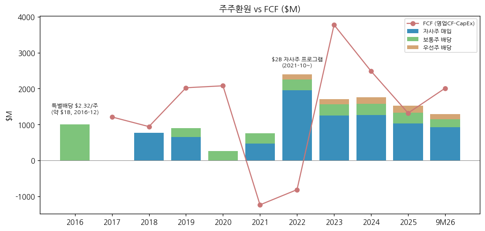

(7) 재무비율 (12년, [계산])

| 연도 | ROE (보통주 평균자본) | ROA (평균자산) | 부채비율 | 유동비율 | 이자보상배율 (세전+이자)/이자 | 실효세율 |
|---|---|---|---|---|---|---|
| 2014 | n/m (파산·자본잠식) | n/m | n/m | — | n/m | n/m |
| 2015 | n/m | n/m | n/m | — | n/m | n/m |
| 2016 | n/m (회생이익) | n/m | 130% | — | n/m | n/m |
| 2017 | -3.9% | -1.7% | 130% | — | 2.3x | 202% (세제개편) |
| 2018 | -0.8% | -0.3% | 231% | 0.95 | 0.8x | n/m |
| 2019 | 11.7% | 3.5% | 234% | 0.90 | 2.5x | 24% |
| 2020 | 7.8% | 2.5% | 201% | 1.13 | 2.4x | 30% |
| 2021 | -17.7% | -4.6% | 258% | 1.35 | n/m | n/m |
| 2022 | -30.0% | -3.9% | 569% | 1.08 | n/m | n/m |
| 2023 | 46.9% | 4.5% | 521% | 1.18 | 3.7x | 25% |
| 2024 | 83.3% | 7.5% | 578% | 0.96 | 4.9x | 19% |
| 2025 | 26.3% | 2.4% | 715% | 0.78 | 2.0x | 16% |

→ ROE가 극단적으로 높은 것은 자사주로 보통주 자본이 $2.6\~3.1B까지 줄었기 때문 — 수익성 지표로는 ROA·EV/EBITDA가 더 적합 [판단]. 부채비율 상승도 같은 원인 + 파생상품 부채(3Q26 $6.1B)

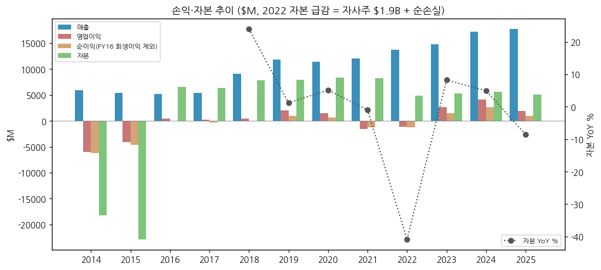

---

## ⑤ 지배 구조

(1) 그룹·계열 관계

→ 지배주주 없는 분산 소유 상장사. 파산 졸업 당시 TCEH 채권자(헤지펀드 등)가 주주로 출발 → 이후 지분 분산 [web 일반 사실]

→ 주요 자회사: **Vistra Operations Company LLC** (발전·소매 운영, 차입 주체) / **Vistra Vision LLC** (원전 4개 단지 + 소매 + Vistra Zero 재생·저장 — 2024-03 Energy Harbor 합병으로 출범, 2024-12-31부터 100%) / Luminant(텍사스 발전 브랜드), TXU Energy(소매) [10-K]

→ **Tax Receivable Agreement (TRA)**: 파산 졸업 시 옛 TCEH 채권자에게 세금 절감액 일부를 지급하는 약정 — 손익계산서 'TRA 영향' 행 (2023 -$164M, 2025 +$2M) [10-K]

(2) 주주 구분 + chart5

| 주주 | 보유 주식 | 지분율 |
|---|---|---|
| The Vanguard Group | 42,522,598 | 12.6% |
| BlackRock | 28,343,531 | 8.4% |
| **Qatar Investment Authority (Seismic Holding LLC)** | 18,675,188 | 5.5% |
| FMR (Fidelity) | 17,269,704 | 5.1% |
| 이사·임원 전체 (15명) | 3,103,579 | 1% 미만 |

→ (출처: 2026 DEF 14A, 2026-03-03 기준 338,549,292주. CEO Burke 151만주 보유)

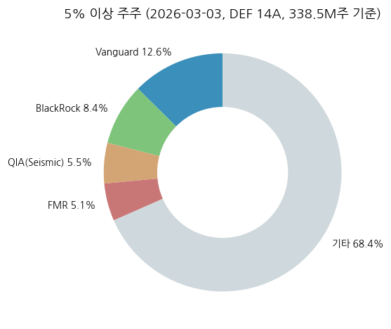

(3) 경영진·이사회

→ **James A. Burke** — 사장 겸 CEO (2022-08-01\~). 2025 총보상 약 $16.0M [DEF 14A]

→ **Kristopher E. Moldovan** — EVP·CFO / **Stacey Doré** — 최고전략·지속가능경영책임자 겸 EVP 대외협력 / **Scott A. Hudson** — EVP·Vistra Retail 사장 / **Stephanie Zapata Moore** — EVP·법무총괄 [DEF 14A]

→ **이사회**: 의장 Scott B. Helm. 이사 — Hilary Ackermann, Arcilia Acosta, Gavin Baiera, Paul Barbas, Lisa Crutchfield, Julie Lagacy, John (Bill) Pitesa, John R. (J.R.) Sult, Robert Walters 등 (CEO 외 독립 이사 중심) [DEF 14A]

---

## ⑥ 기타 팩트

(1) 시가총액·밸류에이션 스냅샷 (2026-11-13 종가 기준)

| 지표 | 값 |
|---|---|
| 주가 | $133.01 |
| 시가총액 | **$45.1B** [계산: 339.39M주] |
| 사상 최고 종가 (2025-09-22) | $217.92 ≈ 시총 약 $73.9B → 현재 **-39.0%** |
| 52주 범위 (종가) | $112.89 (2026-11-05) \~ $180.18 (2026-01-15) |
| EV | 약 $66.0B [계산, 3Q26말 순차입 $18.4B + 우선주 $2.48B, Cogentrix 전] |
| EV / 2026 Ongoing 조정 EBITDA 중간값 ($7.3B) | 약 9.0배 |
| EV / 2027 중간값 ($8.1B) | 약 8.1배 |
| P / 2026 FCFbG 중간값 ($4.5B) | 약 10.0배 (FCF 수익률 약 10%) |
| P/E (TTM GAAP 희석 EPS 약 $7.40) | 약 18배 |
| PBR (보통주 자본 $3.83B) | 약 11.8배 |
| 배당 수익률 | 약 0.7% |

→ 참고 (CEG 동일 기준일): 시총 $98.5B, EV $121.3B, 2026 조정 영업 EPS 기준 Forward PER 22.2배 (`CEG_기업개요.md`)

(2) R&D 인프라 + chart7

→ Vistra는 **R&D 비용을 별도 공시하지 않음** (10-K 손익·주석에 연구개발비 항목 없음) → chart7은 CEG와 동일하게 **원전 하이퍼스케일러 PPA 커버리지**로 대체

→ 기술 개발 성격 투자: **원전 업레이트 433MW** (Meta 계약, 2031\~2034), 배터리 저장(Moss Landing 750MW 중 300MW 화재), 태양광(Vistra Zero), KKR Helix Fund(AI 데이터센터 인프라 펀드, 최대 $1B) [10-Q]

(3) 진행 중 corporate action

(3-1) **Cogentrix 통합 (2026-10-30 완료)** — 가스 10개 약 5,500MW (PJM CCGT 3·CT 2, ISO-NE CCGT 4, ERCOT 열병합 1). 대가: 현금 약 $2.2B + 신주 500만주(@$185 합의가) + 부채 $1.7B 인수(11-05 상환) [10-Q]. 2027 가이던스에 반영

(3-2) **원전 PPA 실행** — AWS Comanche Peak 2027-4Q 개시 / Meta 가동분 2026말 개시 → 2027말 전량. 나머지 Beaver Valley 1,872MW는 미계약 [10-Q, 계산]

(3-3) **우선주 상환·자본 재편** — Series B $1B 2026-12-15 상환 예정, 후순위채 $1.5B로 대체 [10-Q]

(3-4) **텍사스 가스 증설** — 2GW 계획 (서부 텍사스 피커 860MW 2028, Coleto Creek 전환 600MW, 업그레이드 500MW+) [10-Q]

(4) 원전·정책 마일스톤 (10년치)

| 시기 | 마일스톤 |
|---|---|
| 2016-10 | 파산 졸업 — Comanche Peak가 Vistra 유일 원전 (2,300MW) |
| 2022-08 | IRA 원전 PTC (45U) — 2024\~2032, 최대 $15/MWh, 전력가격 상승 시 감액 |
| 2024-03 | Energy Harbor 원전 4기 (Beaver Valley 1·2, Perry, Davis-Besse) 편입 → 원전 6.4GW |
| 2024 | 원전 PTC 인식 $545M → 2025 $220M → 9M26 $162M (전력가격 상승으로 감소) |
| 2025-07 | Perry 면허 2046 연장 |
| 2025-09 | Comanche Peak 1,200MW AWS 20년 PPA |
| 2026-01 | Meta PJM 원전 2,609MW 20년 PPA (업레이트 433MW 포함) |
| 2026-07 | PJM 2028/29 용량가격 $325 (상한) — Vistra 10,924MW 낙찰 |

→ 원전 연료: 2030년까지 전 재장전 수요 계약 확보, 러시아산 차질 대비 전략 재고 [10-K FY25]

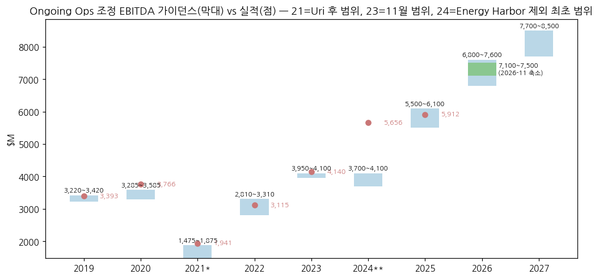

**Ongoing Ops 조정 EBITDA 가이던스 이력 ($M)**

| 연도 | 최초/공시 범위 | 갱신 범위 | 실적 (Ongoing) | 비고 |
|---|---|---|---|---|
| 2019 | 3,220\~3,420 | 3,320\~3,420 (2019-11) | 3,393 [계산] | FCFbG 2,100\~2,300 |
| 2020 | 3,285\~3,585 (2019-11) | — | 3,766 [계산] | 상단 초과 |
| 2021 | 1,475\~1,875 (2021-04, Uri 후) | 1,890\~2,090 (2021-11) | 1,941 [계산] | Uri 전 최초 범위 미확보 |
| 2022 | 2,810\~3,310 (2021-11) | — | 3,115 [계산] | |
| 2023 | 미확보 | 3,950\~4,100 (2023-11) | 4,140 [계산] | |
| 2024 | 3,700\~4,100 (2023-11, Energy Harbor 제외) | 5,000\~5,200 (2024-11, PTC 제외) | 5,656 [계산] | Energy Harbor·PTC 포함 실적 |
| 2025 | 5,500\~6,100 (2024-11, PTC 제외) | — | **5,912** | 중간값 +$112M (보도자료) |
| 2026 | 6,800\~7,600 (2025-11) | **7,100\~7,500 (2026-11)** | 9M 5,639 | 2026-02 재확인 시 Cogentrix 제외 |
| 2027 | '중간값 기회' 7,400\~7,800 (2026-02) | **7,700\~8,500 (2026-11 가이던스)** | — | FCFbG 4,300\~5,100 |

→ (출처: 2019-11-05 PR Newswire, 2021-11-05·2023-11-07 8-K Ex-99.1 (capedge 전재), 2024-11-07 Seeking Alpha 전재, 2026-02-26 investor.vistracorp.com, 2026-11-06 finviz 전재. 실적 Ongoing = 10-K 연결 조정 EBITDA − Asset Closure [계산]. 2017·2018 가이던스 미확보)

(5) 주요 리스크

→ **날씨·ERCOT 극한 이벤트** — Uri(2021-02)로 1Q21 조정 EBITDA -$1.24B. 여름 피크·겨울 한파 시 발전 차질 + 소매 고가 구매 위험

→ **헤지 평가손익·담보증거금** — 선도 매도 구조상 가격 급등 시 미실현 손실·증거금 유출 (2022 영업CF $485M). 3Q26말 파생상품 부채 $6.1B, 증거금 예치 $1.43B [10-Q]

→ **원전 PTC 축소** — 전력가격이 오르면 PTC가 줄어드는 구조 (2024 $545M → 2025 $220M). 재무부 'gross receipts' 해석 지침 미확정 [10-Q]

→ **설비 사고** — Martin Lake 1호기 화재(2024-11, 2026-02 복귀), Moss Landing 300MW 배터리 화재(2025-01, 소송·복구비) [10-K]

→ **석탄 규제·폐쇄** — EPA 규정으로 Coleto Creek 석탄 종료(2026-09). 석탄 8.7GW(설비 20%) 잔존

→ **PJM 용량시장 개편** — 용량가격 상한($325) 연장·규칙 변경 시 East 이익 변동 [판단]

→ **M&A·차입** — Energy Harbor·Lotus·Cogentrix 연속 인수로 순차입 $18.4B(3Q26), 이자비용 $1.18B(2025). 투자등급 유지 실패 시 담보 원복 조건 [10-Q]

→ **원전 연료** — 러시아산 농축 공급 차질 가능성 (전략 재고로 대응) [10-K]

→ **지정학·원자재** — 미국·이스라엘·이란 분쟁에 따른 가스·전력가격 변동 [3Q26 10-Q]

(6) ESG

→ Sustainability Report·등급 미수집 (Source Audit ❌). 석탄 비중(설비 20%)이 ESG 평가의 주요 감점 요인, 원전·태양광·배터리 확대가 상쇄 요인 [판단]

(7) 인증·라이선스

→ NRC 원전 운영 면허: Comanche Peak 1·2 (2050·2053), Beaver Valley 1·2 (2036·2047), Perry (2046), Davis-Besse (2037) [10-K FY25]. 텍사스 PUCT 소매 전력 사업자(REP) 등록, FERC 시장가격 판매 권한 [10-K 일반]

---

## Activity 보고 (v1.0 finalize)

### ✅ 확보 자료
→ 10-K 9 · 10-Q 30 · DEF 14A 2 · XBRL companyfacts · Yahoo 월간·일간 · 보도자료 웹 전재 6건 (가이던스 이력)

### ❌ 누락 자료 (5)
→ 전신 TCEH 2014 상세 손익 / 8-K 보도자료 원본(SEC 403) / 2018 이전 분기 조정 EBITDA / 연료원별(원전) 이익 기여도 / ESG 보고서

### ⚠️ 추정·계산 데이터 표시
→ 시총·EV·배수·FCF·비율·원전 발전 비중·PPA 커버리지·Ongoing 실적(연결 − Asset Closure)·4Q 값은 [계산]. FY2016은 Predecessor+Successor 합산. CEG 비교 수치는 `CEG_기업개요.md` v1.0 인용. NYSE 상장 시점·S&P 500 편입·2007 LBO는 [web 일반 사실]

### Data Quality Confidence: **87%**

---

## Version Log

**v1.0a (2026-11-16)** — 2026 가이던스 서술 정정: 최초 $6.8\~7.6B(중간값 $7.2B) → $7.1\~7.5B(중간값 $7.3B)는 '중간값 유지'가 아니라 '중간값 상향'

| 버전 | 일자 | 내역 |
|---|---|---|
| v1.0 | 2026-11-15 | 최초 작성 — 12년 연간(FY14\~25, FY14\~16 전신 TCEH)·전사 39분기·세그먼트 분기 7Q·세그먼트 연간 2017\~2025·15종 차트, 3Q26(2026-11-09 10-Q) 반영. 원전 노출 CEG 비교, 하이퍼스케일러 PPA(AWS·Meta), Vistra Vision 매입, 가이던스 이력 정리 |

→ 잔여 보완 후보: FY26 연간 확정(2027-02) 반영 + Cogentrix 편입 후 설비·세그먼트 갱신, 2024 이전 분기 세그먼트 조정 EBITDA(옛 체계) 60Q 확장, 2017·2018·2023 최초 가이던스, 13F 기관 보유, ESG 등급
