> Ticker: **XE (Nasdaq)** / X-Energy, Inc. — 미국 메릴랜드주 록빌(본사), 테네시주 오크리지(TRISO-X 연료공장)
> Sector: 원전 — 서브섹터: SMR·차세대 원자로 (핵심, 글로벌 피어) — **적자 개발사라 섹터 델타 합산 제외** (워치리스트 2026-11-14). 같은 칸: NuScale(SMR), Oklo
> 작성 시각: 2026-11-15 (**v1.0**) — 데이터 기준일 2026-11-14
> 적용 구조: v4.8 (6개 섹션) — 2026-04 상장 신규 종목이라 공시 연간 재무는 FY24·FY25 2개년(신생 성장기업 EGC 공시 기준) + 9M26, 분기 7개(1Q25\~3Q26). 12종 차트 중 11종 작성 (chart1·1b·2·4·5·6·8·10·11 + **chart13 현금·런웨이, chart14 주식수**). chart7(R&D — 연 $1.7M 수준이라 의미 없음)·chart9(주주환원 없음)·chart12(자본이 상장 전 음수라 YoY 무의미)는 생략
> 데이터: 연간 FY24·FY25(424B4 감사 재무제표) + 9M26 / 분기 1Q25\~3Q26(10-Q 3건, 4Q25 = FY25 − 9M25 [계산]) / 일간 주가(2026-04-24 상장 \~ 2026-11-13)
> 출처: **SEC EDGAR 원문** — S-1(2026-03-20)·S-1/A 4건·**424B4 최종 투자설명서(2026-04-27)**, 10-Q 1Q26(2026-06-04)·2Q26(2026-08-13)·**3Q26(2026-11-12)**, 8-K 4건 / **SEC XBRL companyfacts·submissions API** / **Yahoo Finance v8 일간 주가** / 시총 교차: stockanalysis.com / 뉴스: Finviz·Earnings Whispers(3Q 프리뷰), 2Q26 보도자료(재배포본), 이투데이·더구루(두산·DL 관련)
> 단위: **$M**(백만달러). 회계연도 = 달력 연도(12월 결산)
> 기준 단절: ① 2026-04-27 IPO 이전 숫자는 전신 X-Energy Reactor Company, LLC(XERC) 기준 ② **Up-C 구조** — 상장사(X-Energy, Inc.)가 XERC를 지배, 비지배지분(Class B = XERC 유닛) 별도 ③ 매출 = "용역 매출 + 보조금 수익(grant income)" 합산 표기(회사 공시 그대로) ④ 3Q26 실적 보도자료(8-K Ex.99.1)는 SEC 403 차단으로 미확보 — 10-Q 본문으로 대체

# X-energy (XE) 기업 개요 (v1.0 — 고온가스로 Xe-100 + 자체 TRISO-X 연료, Dow 건설허가 확보·Amazon 5GW 옵션의 정부 비용분담 개발사)
> **Fact verify cutoff**: 2026-11-14 (주가 2026-11-13 종가 **$11.08** [Yahoo Finance v8], 시총 약 **$4.50B** [계산: Class A 297,495,177 + Class B 108,710,889 = 4.062억주(2026-11-09, 3Q26 10-Q 표지) × $11.08 / stockanalysis.com 2026-10-28 기준 시총 $4.69B·주식수 4.0637억주와 정합], 52주(상장 후) 범위 장중 $8.68\~$37.10 [Yahoo], 공모가 $23.00 [424B4])

> **한 줄 요약**: X-energy는 SMR 3사 중 **유일하게 "정부 돈으로 첫 발전소를 짓는" 구조**다 — DOE ARDP가 설계·연료공장·Dow 1호기 비용의 50%를 대고(누적 상환 $618M / 약정 $1.2B), 2026-11-09 NRC가 Dow 시드리프트 4기 **건설허가를 예정(1Q27)보다 앞당겨 승인**했다. 매출은 3Q26 $66.3M(+118% YoY)로 늘고 있지만 대부분 DOE 비용분담분(9M26 86%)이고 직접원가가 매출보다 커서 영업손실 -$103.6M. 유동성 $1,805M·차입금 0, 분기 소진 약 $116M → **런웨이 약 15.5분기** [계산]. 시총 $4.50B − 유동성 = **EV 약 $2.70B** [계산] — NuScale(EV 약 $0.14B)과 달리 시장이 기술·파이프라인에 의미 있는 값을 매기고 있다. 주가는 상장 첫 주 고점 $35.98 → $11.08(-69%).

## ① 기업 분류

(1) Primary / Secondary 분류

**Primary 분류: 꿈 (Pre-commercial 개발사) — 원자로·연료 판매 매출은 0. 현재 매출(FY25 $109.1M, 9M26 $164.4M)은 DOE ARDP 비용분담·국방부·고객 엔지니어링 용역**

→ 2009년 창업 이래 Xe-100은 한 기도 건설·운전되지 않았고, 어떤 고객도 최종투자결정(FID)을 내리지 않았다 (424B4 위험요인). 첫 상업 인도 목표는 "2030년대 초" (3Q26 10-Q)

→ 영업손실 FY24 -123.5 → FY25 -170.3 → 9M26 -279.7(상장 관련 주식보상 $70.8M 포함) [424B4, 10-Q]

**Secondary 노트: ① 정부 비용분담(ARDP) 의존 매출 ② 원자로 + 자체 연료(TRISO-X) 수직계열화 ③ Amazon이 최대주주 겸 최대 잠재 고객**

→ 9M26 매출 중 DOE 비중 86.4% [계산: 141.95 / 164.36] (3Q26 10-Q 주석3). FY25는 미국 정부 87%, Dow 6% (424B4)

→ NuScale(원자로 OEM)·Oklo(자체 발전소 운영)와 달리 **연료 제조(TX-1 공장)까지 자기 자산으로 보유** — 연료는 60년 운전 기간 반복 매출 원천 (424B4)

(2) Summary Box (FY24\~9M26, $M)

| 지표 | 값 | 정점 | 저점 | FY25 / 9M26 |
|---|---|---|---|---|
| 매출+보조금 성장률 | FY25 -9.2% / 9M26 +126.0% YoY [계산] | 66.3 (3Q26, 분기) | 20.8 (1Q25, 분기) | 109.1 / **164.4** |
| 영업손실 | 연 -123.5 → -170.3 | -26.3 (1Q25, 최소) | -110.0 (2Q26, IPO 주식보상 포함) | -170.3 / **-279.7** |
| 영업이익률 | N/A — 직접원가가 매출 초과(ARDP 50:50 구조) | — | — | -156% / -170% [계산] |
| 누적 영업현금흐름 (FY24\~9M26) | **-461.8** [계산] | -20.0 (2Q25) | -97.3 (2Q26) | -149.9 / **-215.8** |
| 누적 재무현금흐름 (지분 조달) | **+2,415.6** [계산] | — | — | +726.1 / **+1,091.1** |
| 사이클 주기·회수 | N/A — 사이클 아닌 인허가·FID 마일스톤 주도 | — | — | — |

```
[X-energy 손익 ($M, 12월 결산) — 공시 가능 기간 전부]
기간    매출+보조금  직접원가  판관비   영업손실  순손실   마일스톤 메모
FY24      120.2     130.1    111.9   -123.5   -126.0  ← Amazon 지분투자·5GW 옵션(2024-10). TX-1 부지공사 착수
FY25      109.1     161.4    116.3   -170.3   -389.8  ← Dow 건설허가 신청(2025-03). 워런트 평가손 -223.5. 시리즈D $700M
1Q26       43.4      65.4     44.1    -66.1   -166.2  ← TRISO-X 연료공장 NRC 면허(2026-02). 워런트 평가손 -108.9
2Q26       54.6      86.7     77.7   -110.0   -105.3  ← IPO(2026-04, $1.1B). IPO 스톡옵션 즉시 비용 $33.5M
3Q26       66.3      93.6     76.0   -103.6    -83.7  ← AEP 12기 공동개발(2026-08). Dow 건설허가 승인(2026-11-09)
```

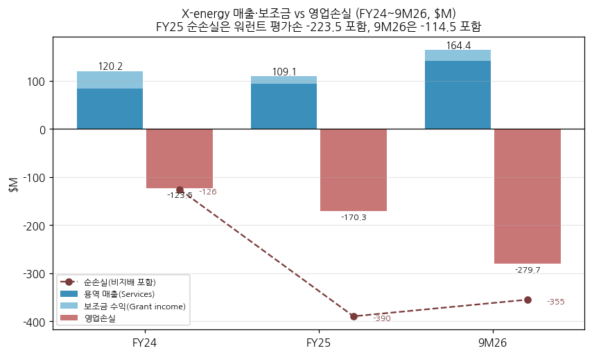

(3) 정량적 분류 근거

→ **매출 = 비용 상환**: ARDP는 설계·TX-1·Dow 1호기 비용의 50%를 DOE가 상환하는 구조. 회사는 상환분을 용역 매출·보조금 수익으로 잡고 원가는 100%를 잡는다 → 매출이 늘수록 직접원가가 더 크게 늘어 "매출총손실"이 커진다. 9M26 매출 164.4 vs 직접원가 245.6 [10-Q]

→ 매출 증가 요인도 ARDP: 3Q26 +$35.9M YoY 중 ARDP가 +$29.3M (3Q26 10-Q MD&A) — 수요(주문)가 아닌 **사업 진척(지출)**에 비례

→ 이자수익 3Q26 $19.7M가 영업손실의 19%를 메움 [계산] (3Q26 10-Q)

(4) 산업 분류

→ SEC SIC 3443(Fabricated Plate Work — Boiler Shops) 등록 (EDGAR submissions) / 4세대 고온가스로(HTGR) SMR 설계사 + 원자로 연료(TRISO) 제조사. 10-Q상 단일 영업부문(ASC 280)

→ 워치리스트 섹터: 원전 / 서브섹터: SMR·차세대 원자로 (핵심) — 같은 칸: NuScale(SMR), Oklo. 연료 글로벌(Cameco·Centrus)·기자재(BWXT·두산에너빌리티)와 공급망으로 연결 — Centrus는 HALEU 농축 공급계약 상대(2Q26 보도자료)

(5) 분류 결정 논리

→ (1) 매출 큰 사업 기준: 최대 매출원 ARDP 용역은 "정부가 개발비를 나눠 내는 것"이지 제품 판매가 아님 → 실적 기반 분류(고성장·사이클·지속성장) 적용 불가

→ (2) 이익 구조 sub-rule: 영업이익 흑자 이력 없음, 매출 증가 = 원가 증가 구조 → "꿈"

→ (3) Boundary case: ① Dow FID + 1호기 착공 → 장납기 기자재·엔지니어링 매출이 "고객 돈"으로 전환되기 시작 ② TX-1 연료 생산 개시 → 첫 제품 매출. 둘 중 하나가 확인되면 "고성장(초기)" 후보 [판단]. 건설허가 승인(2026-11-09)은 FID의 전제조건일 뿐 FID가 아님

→ (4) 피어 대비: NuScale은 NRC 설계승인 2건이 있으나 구속력 있는 주문 0건·EV ≈ 0. X-energy는 **설계승인 대신 실제 부지 건설허가**를 먼저 받은 경로(Part 50 건설허가 → 운영허가) — 인허가 단계로는 "첫 4세대 상업로 건설허가"라는 실물 진척이 앞선다 [판단]. 반면 매출의 정부 의존도는 셋 중 가장 높다

(6) 적정 밸류에이션 방법

→ 1차 — **EV(시총 − 순현금)**: 시총 $4.50B − 유동성 $1,805.5M(현금 1,044.1 + 단기 514.3 + 장기 247.1, 차입금 0) = **EV 약 $2.70B** [계산]

→ 2차 — **EV / 파이프라인 용량**: 회사 제시 파이프라인 11GWe·144기(고객 조건부 권리 전부 행사 가정, 3Q26 10-Q) → EV/kW 약 $245 [계산]. 구속력 있는 물량 기준(Dow 4기 320MWe)으로는 약 $8,400/kW [계산] — 시장 가격은 두 극단 사이 어딘가의 확률 가중

→ 3차 — **PBR**: 자본총계(비지배 포함) $2,037.9M → PBR 약 2.2배 [계산]. 자산의 81%가 현금·투자자산 [계산: 1,805.5 / 2,219.5]

→ PER·EV/EBITDA 적용 불가. 피어(NuScale·Oklo)와는 **"현금 대비 프리미엄(EV)"**으로 비교 [판단]

(7) 분기 재평가 트리거 (분류 변경 조건)

→ ① Dow(Long Mott Energy) 최종투자결정(FID) 공시 + 원자로 장납기 기자재 고객 자금 지급 개시 → "꿈" → "고성장(초기)" 재분류 검토

→ ② TX-1 연료 상업 생산·첫 연료 판매 매출 인식 → Secondary에 "연료 제조사" 이익 구조 추가

→ ③ ARDP 추가 배정(회사 "선정 통보 받음" — 금액 미공시) 계약 수정 체결 또는 반대로 예산 삭감·연장 거부 → 재무 구조(런웨이) 재평가

→ ④ Amazon 옵션 축소·Dow 계약 해지(Dow는 편의 해지 가능 — 424B4) → 상업화 경로 재평가

## ② 회사 개요

① 기본 사항

→ 회사명: X-Energy, Inc. (Nasdaq: XE). 2009년 카말 가파리안(Kamal Ghaffarian) 박사 창업(메릴랜드주 X-energy, LLC) → 2018-12 X-Energy Reactor Company, LLC(XERC) 설립 → 2026-04 IPO로 X-Energy, Inc.가 XERC 지배 (424B4)

→ 지배 구조: **Up-C**. 상장사가 XERC 지분을 보유하고, 기존 주주 일부는 XERC 유닛 + Class B(의결권만, 경제적 권리 없음)를 보유. 유닛은 Class A로 1:1 교환 가능 (3Q26 10-Q). 세금수취약정(TRA) 있음

→ 사업 한 줄: 80MWe(200MWt)급 고온가스로 **Xe-100**을 4기 1세트(320MWe)로 공급하고, 연료(우라늄을 3중 코팅한 TRISO 입자를 흑연 공에 박은 "페블" 연료)를 자체 공장에서 만든다. 고온 증기(산업용 열)와 전기 동시 공급이 강점 (3Q26 10-Q)

→ 규모: 임직원 916명(2026-03-17, 석사 317·박사 104명) (424B4). 3Q26 총자산 $2,219.5M

→ **한국 원전 기업과의 연결 지점 (어디서 만나나)**

| 영역 | X-energy | 한국 기업 | 관계 [판단] |
|---|---|---|---|
| 원자로 주기기 제작 | 설계·공급 | **두산에너빌리티** — "선호 전략 공급사"(원자로 압력용기·증기발생기·터빈 제작 역량). **2025-12 예약계약(Reservation Agreement)** — 11GWe 파이프라인 대응 신규 SMR 제작설비 구축 약정 (424B4) | 국내 보도: Xe-100 **16기분 단조 핵심소재** 예약(이투데이 2025-12-12), 2026-03 16기 핵심 기자재 제작·공급 구속력 계약 **(미검증 — 비공식 출처: 더구루 2026-08-14)**. 계약 금액 미공시 |
| 지분 투자 | — | 두산에너빌리티 — "X-energy 지분 투자자" (424B4) | 투자액 $5M(2023) **(미검증 — 비공식 출처: 더구루)**. 5% 미만이라 주요주주 표에 없음 |
| EPC·사업개발 | — | **DL이앤씨** — 지분 투자자, 글로벌 Xe-100 배치 협력 (424B4). 투자액 $20M(2023), 2026-03 표준설계 계약 **(미검증 — 비공식 출처: 더구루)** | EPC 후보 |
| 원전 운영·건설 | — | **한수원(KHNP)** — 2025-08 X-energy·Amazon·두산과 Amazon 물량 미국 배치 협력 공동협약 (424B4) | 비구속 |
| 경쟁 | 미국 HTGR | 한수원 i-SMR (개발 중) | 10-Q: "한국 경쟁사는 SMR 개발 중이나 상업 운전 SMR 없음" |

② 손익·자본 추이 ($M)

| 기간 | 용역 매출 | 보조금 수익 | 매출 합계 | 직접원가 | 판관비 | R&D | 영업손실 | 이자수익 | 기타손익(평가손 등) | 순손실(전체) | X-energy 귀속 | 자본(비지배 포함) |
|---|---|---|---|---|---|---|---|---|---|---|---|---|
| FY24 | 84.0 | 36.2 | 120.2 | 130.1 | 111.9 | 1.7 | -123.5 | 2.8 | -5.3 | -126.0 | — | -846.6 (메자닌 1,300.4 별도) |
| FY25 | 94.3 | 14.8 | 109.1 | 161.4 | 116.3 | 1.7 | -170.3 | 20.3 | -239.8 | -389.8 | — | -1,224.3 (메자닌 2,066.6 별도) |
| 9M26 | 141.6 | 22.8 | 164.4 | 245.6 | 197.9 | 0.7 | -279.7 | 39.7 | -115.2 | -355.2 | -118.5 (상장 후) | **2,037.9** |

→ (출처: 424B4 감사 재무제표(FY24·FY25), 3Q26 10-Q, XBRL companyfacts. 기타손익 = 순손실 − 영업손실 − 이자수익 [계산] — FY24 이자비용 -16.2·파생상품 평가익 포함, FY25 워런트 평가손 -223.5·C-2 전환사채 평가손 -13.0, 9M26 워런트 평가손 -114.5. 9M26 직접원가·판관비는 주식보상 포함(각 12.5·58.3). FY24 판관비에 비현금 판관비 $55.3M 포함)

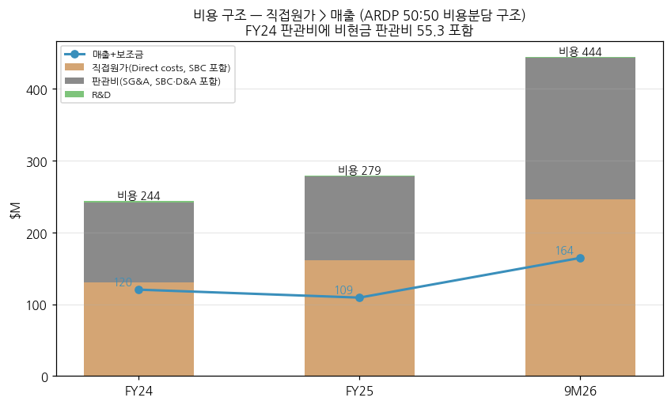

③ 회사 주가 역사

→ 2026-04-23 공모가 $23.00 확정(공모 4,425만주 + 초과배정 663.8만주 = 5,089만주, 순조달 약 $1.1B) → 2026-04-24 Nasdaq 상장, 시초가 $30.11·종가 $29.20 (424B4, 3Q26 10-Q, Yahoo)

→ **2026-04-27 종가 최고 $35.98** (장중 최고 2026-04-28 $37.10) → 당시 시총 약 $14.6B [계산, 4.062억주 기준] [Yahoo]

→ 하락 국면: 1Q 실적(2026-06-04) 후 $26 → $18, 7월 $13.83 저점 → 2Q 실적(2026-08-13) 장중 $23.99 반등 → 락업 종료(2026-09-01) 후 약세, 10월 $10대 → **2026-11-05 종가 최저 $9.00** (Yahoo). 3Q 프리뷰 시점 "직전 실적 이후 -52.5%" (Finviz/Earnings Whispers 2026-11-04 — 비공식 출처)

→ 2026-11-09 Dow 건설허가 승인 발표 → 11-09 종가 $11.16(+7.0%) → **2026-11-13 $11.08**, 공모가 대비 -51.8% [계산]

→ 시총: 공모가 기준 약 $9.3B [계산] → 고점 약 $14.6B → **2026-11-13 약 $4.50B** [계산] (stockanalysis.com 2026-10-28 $4.69B와 정합)

→ 애널리스트(stockanalysis.com, 2026-10-28 캐시): 10명 컨센서스 "Buy", 평균 목표가 $31.38. UBS Buy($34→$18), Morgan Stanley Overweight($41→$34), Piper Sandler Underweight($9→$8), Needham Hold 개시 **(미검증 — 비공식 출처)**

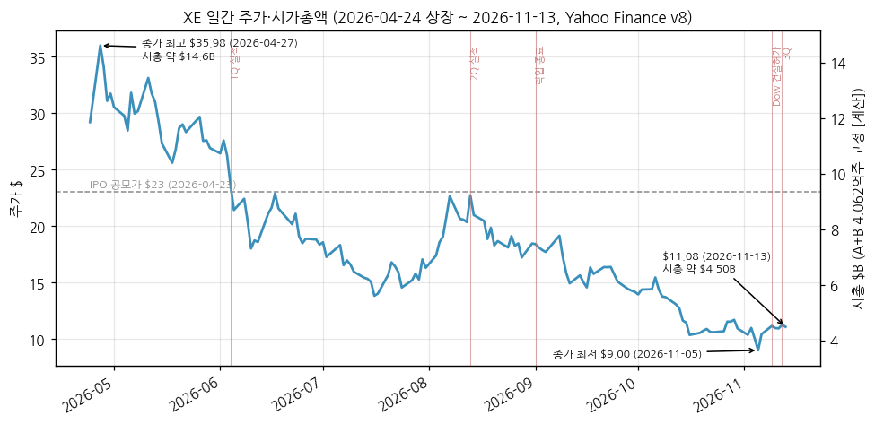

④ 주요 연혁

| 시점 | 사건 | 출처 |
|---|---|---|
| 2009 | 카말 가파리안 창업 (메릴랜드) | 424B4 |
| 2016 | TRISO-X 시범 연료공장(오크리지) 가동 | 424B4 |
| 2019-01 | 클레이 셀(J. Clay Sell, 전 미국 에너지부 부장관) CEO 취임 | 424B4 |
| **2020-12** | **DOE ARDP 실증사업자 선정(2개사 중 1곳) — 초기 $1.2B** → 2021-02 협약 체결(총사업비 $2.4B 50:50) | 3Q26 10-Q |
| 2022 | 국방부 Project Pele(소형로) 누적 약 $60M 계약, OPG(캐나다) 산업용 독점 협력, DOE·NASA 달 표면 원자로 연구 | 424B4 |
| 2022\~2023 | C-2 전환사채 $113.0M 발행 (2024-10·2025-09 전량 우선주 전환) | 3Q26 10-Q |
| 2024 | **Amazon 지분 투자(시리즈 C-1) + 2039년까지 5GWe 이상 Xe-100 옵션 발표**, Energy Northwest 첫 4기(320MWe, 최대 960MWe) | 424B4 |
| 2024-08-13 | Ultra Safe Nuclear(USNC)에 연료 제조 특허 침해 통지 → USNC 파산, 자산 매각에 이의 제기 | 424B4 |
| 2024-10 | TX-1 연료공장 부지공사 착수 | 3Q26 10-Q |
| **2025-03** | **Dow 자회사 Long Mott Energy, NRC 건설허가 신청(CPA)** → 2025-05 접수, 18개월 심사 일정 | 3Q26 10-Q |
| 2025-08 | 한수원·Amazon·두산과 Amazon 물량 미국 배치 공동협약 | 424B4 |
| 2025-09 | Centrica(영국)와 공동개발협약 — 하틀풀 우선부지, 영국 6GWe(76기) 계획 | 3Q26 10-Q |
| 2025-10-03 | 특수관계 고객에 "2025 워런트" 발행 — 고객 Xe-100 전량 가동 시 1,410만주 @$6.487 행사 가능 | 3Q26 10-Q |
| 2025-11-21 | 시리즈 D $700.0M 조달 | 424B4 |
| 2025-12 | 두산에너빌리티 예약계약 — 신규 SMR 제작설비 약정 | 424B4 |
| 2026-01 | SGL Carbon 10년 흑연 공급계약(첫 3년 $100M+) | 424B4 |
| **2026-02** | **TRISO-X, NRC 특수핵물질 면허(10 CFR Part 70, 40년) — 미국 최초 Category II 연료공장 면허** | 424B4, 3Q26 10-Q |
| 2026-03 | Talen Energy LOI(PJM 시장), IHI MOU, Amazon 2024 워런트 행사(3-18) | 424B4, 10-Q |
| **2026-04-23\~27** | **IPO — 5,089만주 @$23, 순조달 약 $1.1B, Up-C 전환** | 3Q26 10-Q |
| 2026-06 | 영국 일반설계평가(GDA) 신청 → 2026-09 접수 | 3Q26 10-Q |
| 2026-08 | HALEU 농축 장기계약 2건(Centrus·General Matter — 보도자료), **AEP 12기(960MWe) 공동개발협약**(인디애나 설리번 카운티, Amazon 자금), ARDP 예산기간 2027-03까지 연장 | 3Q26 10-Q, 2Q26 보도자료 |
| 2026-09 | TX-1 골조(수직) 공사 완료, 다음 단계 착수 / **락업 종료(2026-09-01)** | 3Q26 10-Q |
| **2026-11-09** | **NRC, Dow 시드리프트 Xe-100 4기 건설허가 승인 — 예정(1Q27)보다 조기** | 3Q26 10-Q |

## ③ 비즈니스 모델

① 실적 추이 통합 (고객 유형별, $M)

| 고객 유형 | FY24 | FY25 | 9M25 | 9M26 | 9M YoY | 비고 |
|---|---|---|---|---|---|---|
| DOE (ARDP 등) | 78.0 | 89.4 | 56.3 | **142.0** | +152% | 9M26 용역 119.2 + 보조금 22.8 |
| 국방부(DoD → DoW) | 10.7 | 5.4 | 4.3 | 3.2 | -25% | Project Pele 등 |
| 민간(Dow·Amazon·Energy Northwest 등) | 31.4 | 14.3 | 12.2 | 19.2 | +58% | 3Q26 10.3 (+138% YoY) |
| **합계** | 120.2 | 109.1 | 72.7 | **164.4** | **+126%** | |
| DOE 비중 | 64.9% | 81.9% | 77.3% | **86.4%** | | [계산] |

→ (출처: 424B4 주석3, 3Q26 10-Q 주석3. YoY·비중 [계산]. FY24→FY25 민간 매출 감소는 Dow 용역 -$19.9M(건설허가 신청 후 작업 감속) 때문 (424B4 MD&A))

→ 원자로·연료 판매 매출은 0 — v4.8 chart2(사업부별 매출+OPM)는 **분기 매출 원천(고객 유형)** 차트로 대체

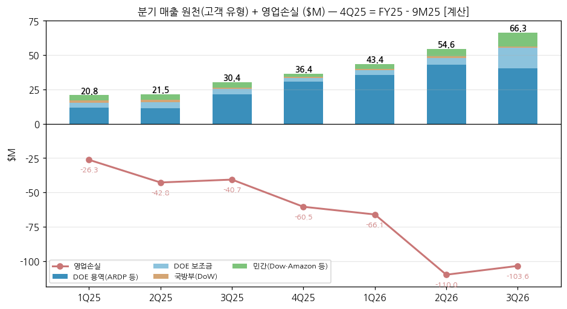

① 분기 시계열 ($M) — 마일스톤 & 현금 트래커

| 분기 | 1Q25 | 2Q25 | 3Q25 | 4Q25 | 1Q26 | 2Q26 | **3Q26** |
|---|---|---|---|---|---|---|---|
| 매출+보조금 | 20.8 | 21.5 | 30.4 | 36.4 | 43.4 | 54.6 | **66.3** |
| YoY | — | — | — | — | +109% | +154% | **+118%** |
| 직접원가(주식보상 포함) | 28.7 | 36.1 | 38.8 | 57.7 | 65.4 | 86.7 | **93.6** |
| 판관비(주식보상·D&A 포함) | 18.0 | 27.3 | 32.1 | 38.9 | 44.1 | 77.7 | **76.0** |
| 영업손실 | -26.3 | -42.8 | -40.7 | -60.5 | -66.1 | -110.0 | **-103.6** |
| 주식보상비용 | 0.1 | 6.4 | 4.2 | 3.5 | 4.3 | 39.7 | **26.9** |
| 조정 EBITDA (회사 Non-GAAP) | — | — | -36.7 | — | -61.5 | -70.5 | **-75.7** |
| 순손실 (전체) | -10.2 | -88.8 | -219.0 | -71.7 | -166.2 | -105.3 | **-83.7** |
| 영업현금흐름 | -41.9 | -20.0 | -30.8 | -57.2 | -67.3 | -97.3 | **-51.2** |
| CapEx 총액 / ARDP 상환 | 11.2 / 9.5 | 24.4 / 7.4 | 43.7 / 20.6 | 37.9 / 17.3 | 43.0 / 28.8 | 63.3 / 23.5 | **71.8 / 27.8** |
| 현금+단기·장기투자 (분기말) | — | — | — | 1,025.3 | 944.0 | 1,899.8 | **1,805.5** |
| ARDP 누적 상환 (분기말) | — | — | — | 438 | 508.0 | 546.7 | **618.0** |
| 주식수 A+B (백만주) | — | — | — | (상장 전) | (상장 전) | 406.4 | **406.2** |

→ (출처: 10-Q 3건, 424B4, XBRL companyfacts. 4Q25 = FY25 − 9M25, 분기 현금흐름 = 누적 차이 [계산]. 1Q26 조정 EBITDA = 9M26 − 2Q26 − 3Q26 [계산]. 상장 전 2025 분기말 현금은 미공시. 주식수는 10-Q 표지(2026-08-10, 2026-11-09))

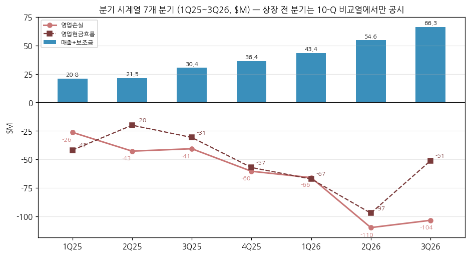

(1) 3Q26 핵심 (2026-11-12 발표, 3Q26 10-Q)

→ 매출+보조금 $66.3M(+118% YoY) — 용역 51.6 + 보조금 14.8. 보조금 급증(+267%)은 Dow 1호기 관련 ARDP 상환 증가(Dow 비용 총액 인식 $4.3M 포함)

→ 영업손실 -$103.6M, 순손실 -$83.7M(X-energy 귀속 -$59.4M, Class A EPS -$0.21, 조정 EPS -$0.14). 3Q 프리뷰 컨센서스 EPS -$0.10·매출 $62.4M (Finviz/Earnings Whispers 2026-11-04 — 비공식 출처) → 매출은 상회, GAAP EPS는 하회, 조정 EPS 기준으로는 근접 [계산]

→ 주식보상 $26.9M — IPO 때 기존 성과지분(PIU) 보유자에게 준 스톡옵션 비용이 이어짐

→ 순현금 $1,805.5M, 차입금 0. 무조건부 구매약정 $312.2M(흑연·우라늄 농축 등, 2026년 잔여 24.3·2027년 35.0) (3Q26 10-Q)

→ 내부통제 중대한 취약점(회계 인력 부족) 미해소 — FY23\~FY25부터 이어짐 (3Q26 10-Q)

(2) 마일스톤 트래커 (2026-11-14 기준)

| 마일스톤 | 상태 | 다음 확인 포인트 |
|---|---|---|
| **Xe-100 HTGR (80MWe·200MWt, 4기 1세트 320MWe)** | 설계 진행(예비설계 단계 — 10-Q "currently in preliminary design"). 표준설계승인(SDA) 경로가 아닌 **부지별 건설허가 경로** | 운영허가(OL) 신청, 설계 확정 |
| **Dow 시드리프트(Long Mott) 4기 320MWe** | ✅ **NRC 건설허가 승인(2026-11-09, 예정 1Q27보다 조기)** — 환경평가 "중대 영향 없음(FONSI)" + 최종 안전성평가보고서 발행 | **Dow 최종투자결정(FID)** — Dow는 편의 해지 가능, FID 전 X-energy 건설비 부담 의무 없음 |
| **DOE ARDP** | 약정 $1.2B(총사업비 $2.4B의 50%) 중 **누적 상환 $618.0M(3Q26)** → 잔여 약 $582M [계산]. 의회 배정 약 $1.1B. 추가 ARDP 예산 $3.1B 중 **"추가 배정 선정 통보"** — 계약 수정 전, 금액 미공시 (2Q 콜에서 최대 $1B 언급 **(미검증 — 비공식 출처: 더구루 2026-08-14)**) | 예산기간 2027-03 종료 → 연장 신청. 최대 이행기간 약 2030년(연장 3년 포함) — Dow 상업운전(2030년대 초)이 그 이후라 일부 건설비는 ARDP 대상 밖 |
| **Amazon 5GWe+ (2039년까지, 약 60기)** | 1호: **Energy Northwest(워싱턴주 중부) 4기 320MWe → 최대 960MWe** (Amazon 개발·자금 협약). 2호: **AEP 인디애나 12기 960MWe 공동개발협약(2026-08)** | Energy Northwest 건설허가 신청, AEP 타당성 결과. 프로젝트명 "Cascade"는 SEC 공시에 없음 |
| Amazon 계약 조건 | 2031\~2039 제조 대기열 우선 배정, 일부 물량 우선매수권, **최혜 가격**, 첫 프로젝트 상업운전 5년 후부터 원가 절감분을 Amazon에 지급 (424B4) | 마진 압박 요인 |
| **TRISO-X TX-1 (오크리지)** | ✅ NRC Part 70 면허(2026-02, 40년, TX-2 포함) / ✅ 골조 공사 완료(2026-09) → 내부 공사. 정상가동 시 Xe-100 11기분 연료 | 연료 생산 개시 시점. TX-2 설계 착수(판관비 반영) |
| HALEU 연료 원료 | ✅ 농축 장기계약 2건(2026-08, 최소구매·선급금 조건) | 미국 내 농축 설비 건설 진척 |
| **영국 (Centrica)** | 🟡 비구속 공동개발협약(2025-09), 하틀풀 최대 12기, 영국 6GWe(76기) 계획. **GDA 접수(2026-09)** | GDA 단계 진행, 구속력 계약 — 첫 발전 2030년대 중반 |
| 기타 파이프라인 | Talen LOI(2026-03, 비구속), OPG(캐나다) 산업용 협력 | — |
| **USNC 특허 분쟁** | 2024-08 침해 통지 → USNC 파산 → 자산 매각에 이의 제기 (424B4). **3Q26 10-Q 위험요인에서 USNC 언급 삭제**, "중대한 소송 없음" | 해결 내용 미공시 |
| 공급망 | 두산(예약계약), Curtiss-Wright(복수 계통 수주·지분 투자), SGL(흑연), IHI(MOU), DL이앤씨 | 두산 계약 금액·납기 미공시 |

② 사업 구조 개요

→ **제품 1 — Xe-100**: 헬륨 냉각·흑연 감속 고온가스로. 페블 연료를 운전 중에 계속 넣고 빼는 **온라인 재장전**, 이용률 95% 목표, 비상계획구역 400m(대형 원전 16km) — 산업단지·데이터센터 옆 배치 가능 (3Q26 10-Q). 4기 독립 운전으로 이중화

→ **제품 2 — TRISO-X 연료**: HALEU(15.5% 농축) 입자를 탄화규소·열분해탄소 3중 코팅 → 흑연 공(페블). "녹지 않는 연료"로 격납 구조 단순화 (424B4). 회사는 초기 **유일 공급자**를 가정 — 원자로 60년 수명 동안 반복 매출

→ **수익 구조(계획)**: ① Xe-100 설계 라이선스·기술료 ② 사업 계획·조립 조정·건설·인허가·조달 지원 용역 ③ 연료 공급 ④ 장기 운영 서비스 (424B4) — 현재는 ARDP·고객 엔지니어링 용역만 발생. 원자로 건설비는 대부분 고객 부담, **연료공장은 X-energy 부담** (3Q26 10-Q)

→ **기타**: XENITH 소형로(3\~10MWe, 국방·오지용, Pele 출신), 우주 원자로(IX LLC — Intuitive Machines 51%·X-energy 49% 합작) (424B4)

(1) ARDP 구조 (3Q26 10-Q)

→ 3개 구성: ① Xe-100 설계 엔지니어링 — X-energy 지출, 50% 상환 ② TRISO-X·TX-1 — X-energy 지출, 50% 상환(TX-2부터는 대상 아님) ③ Dow 1호기 건설 — Dow 지출, 50% 상환(X-energy 경유, 총액으로 보조금 수익·직접원가 인식)

→ DOE 상환 한도는 원래 추정 $2.4B의 50%인 $1.2B 고정 — "2020년 이후 총사업비 추정치는 증가" → 초과분은 X-energy·Dow가 자체 부담 (3Q26 10-Q)

③ 이익 디테일

→ 매출총손실 [계산: 매출 − 직접원가]: FY24 -9.9 / FY25 -52.3 / 9M26 -81.2 — ARDP 50% 자부담 + 상환 대상 아닌 비용

→ 9M26 판관비 +$120.4M YoY: 주식보상 +49.2, 인력 +29.4, 클라우드·상장 관련 전문가 비용 +23.8, TX-2 설계 등 외주 +12.0 (3Q26 10-Q)

→ R&D는 연 $1.7M — 개발비 대부분이 ARDP 원가(직접원가)로 잡히기 때문 [판단]

④ 주요 경쟁사

→ 미국 SMR·차세대 원자로: NuScale(경수형 77MWe, NRC 설계승인 2건), GE Vernova Hitachi BWRX-300, Oklo Aurora(고속로), TerraPower Natrium(ARDP 다른 1곳), Kairos Power(불화염 고온로), Holtec SMR-300, Westinghouse AP300 [판단]

→ 해외: 중국 HTR-PM(상업 운전 고온가스로 — 10-Q "중국·러시아 경쟁사는 상업 또는 준상업 SMR 운영"), 한수원 i-SMR, 롤스로이스 SMR(영국 경수형 SMR 선정) (3Q26 10-Q, 424B4)

→ TRISO 연료: BWXT, Standard Nuclear(USNC 연료 자산 인수 — **미검증 — 비공식 출처**) [판단]

→ 차별점: ① 산업용 고온 증기 ② 자체 연료 공장(미국 최초 Category II 면허) ③ ARDP 정부 50% 분담 ④ 4세대로 첫 상업 건설허가. 약점: HALEU 공급 제약, 첫 호기(FOAK) 원가 불확실, 정부 매출 의존

⑤ 주요 매출처

→ FY25: 미국 정부 87%, Dow 6% / FY24: 미국 정부 74%, Dow 22% (424B4). 9M26: DOE 86.4%, 국방부 2.0%, 민간 11.7% [계산]

→ 잠재 고객(파이프라인): Dow, Amazon(Energy Northwest·AEP 경유 — 실제 소유·운영은 전력사), Centrica, Talen, OPG

⑥ 생산 CAPA + 임직원

→ 원자로 주기기는 외주(두산·Curtiss-Wright 등). 자체 생산은 **연료**: TRISO-X 시범공장(2016\~) + TX-1(건설 중, Xe-100 11기분) + TX-2(계획). 오크리지 캠퍼스 약 180에이커, 테네시주 $11M 보조금 (2Q26 보도자료)

→ 유형자산(순) FY24말 5.8 → FY25말 50.1 → **3Q26 148.7** — TX-1 건설 (10-Q)

→ 임직원 916명(2026-03-17) — 인력 증가가 9M26 원가·판관비 증가의 주요인 (424B4, 3Q26 10-Q)

## ④ 재무 구조

① 손익계산서 — ② 회사 개요 표 참고. 영업이익률 FY24 -102.8% / FY25 -156.1% / 9M26 -170.2% [계산]. 비용 구성 9M26: 직접원가 55.3% + 판관비 44.6% + R&D 0.1% [계산]

② 재무상태표 ($M)

| 시점 | 총자산 | 현금+투자 | 유형자산 | 부채 | 워런트 부채 | 메자닌(상환전환우선) | 자본(비지배 포함) | 비지배지분 | 누적결손 |
|---|---|---|---|---|---|---|---|---|---|
| FY24 말 | 579.5 | 514.6 | 5.8 | 125.7 | 50.6 | 1,300.4 | -846.6 | — | -846.6 |
| FY25 말 | 1,211.3 | 1,025.3 | 50.1 | 369.0 | 274.2 | 2,066.6 | -1,224.3 | — | -1,236.3 |
| 1Q26 | 1,196.0 | 944.0 | 73.4 | 150.1 | — | 2,431.9 | -1,386.0 | — | -1,402.6 |
| 2Q26 | 2,255.2 | 1,899.8 | 119.1 | 159.6 | — | 0 | 2,095.6 | 280.9 | -59.1 |
| **3Q26** | **2,219.5** | **1,805.5** | **148.7** | **181.6** | — | 0 | **2,037.9** | **552.6** | -118.5 |

→ (출처: 424B4, 10-Q, XBRL companyfacts. 2026-04 IPO 재편 때 우선주(메자닌) 전부 보통주·유닛으로 전환 → 자본잠식 해소, 누적결손은 상장 후 X-energy 귀속분만 표시. 3Q26 비지배지분 증가는 지분 재배분. 워런트 부채는 2026-03 Amazon 2024 워런트 행사로 소멸)

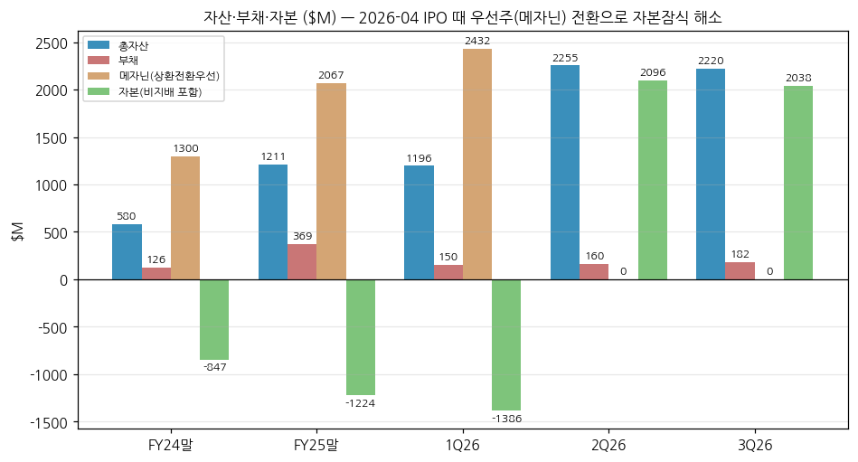

③ 현금흐름표 ($M)

| 기간 | 영업CF | 투자CF | 재무CF | CapEx 총액 | ARDP CapEx 상환 | 순 CapEx [계산] | FCF [계산] | 지분 조달 | 주식보상 |
|---|---|---|---|---|---|---|---|---|---|
| FY24 | -96.2 | -1.9 | 598.3 | 4.2 | 2.3 | 1.9 | -98.0 | 우선주 626.5 | 1.2 |
| FY25 | -149.9 | -628.3 | 726.1 | 117.2 | 54.8 | 62.4 | -212.3 | 우선주 752.9 (시리즈 D 700.0) | 14.1 |
| 9M26 | **-215.8** | -289.5 | **1,091.1** | 178.1 | 80.0 | 98.1 | **-313.9** | IPO 순 1,103.2 | 70.8 |

→ (출처: 424B4 현금흐름표, 3Q26 10-Q, XBRL. 투자CF는 투자자산 매입(FY25 566.0, 9M26 순 191.4) 포함. FCF = 영업CF − 순 CapEx [계산]. FY24 재무CF에 브리지론·신용한도 상환 포함)

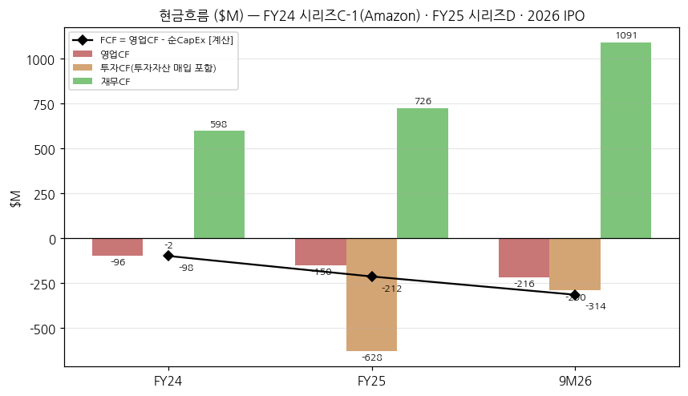

(1) 현금 런웨이 (Cash & runway tracker)

→ 유동성 $1,805.5M(3Q26) ÷ 최근 2분기 평균 소진(영업CF + 순CapEx) $116.2M/분기 = **약 15.5분기(약 3.9년)** [계산 — 2Q26 137.1, 3Q26 95.2]

→ 회사 입장: "현 현금·단기투자로 향후 1년 의무 충족 가능", 그러나 "영업손실·현금 유출은 과거보다 커질 수 있고 추가 자본 조달 필요" (3Q26 10-Q)

→ 소진 확대 요인: ① TX-1 내부 공사·TX-2 착수(TX-2는 ARDP 대상 아님) ② 장납기 기자재 선급(흑연·단조·농축 — 무조건부 약정 $312.2M) ③ ARDP 상환 한도($1.2B) 초과 비용 ④ 인력 확대

→ 소진 완화 요인: ① ARDP 추가 배정(선정 통보) ② Dow FID 후 고객 자금 ③ 이자수익 분기 약 $20M

→ 1주당 유동성 약 $4.44 [계산: 1,805.5 / 406.2] vs 주가 $11.08

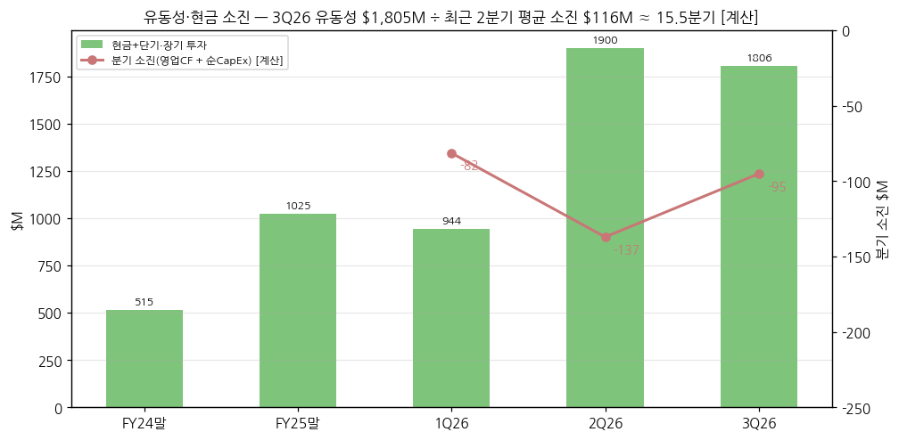

④ CapEx — **TX-1 연료공장이 핵심**. 분기 CapEx 1Q25 11.2 → 3Q26 71.8, ARDP가 약 40% 상환 [계산: 9M26 80.0 / 178.1]. 유형자산 3Q26 148.7

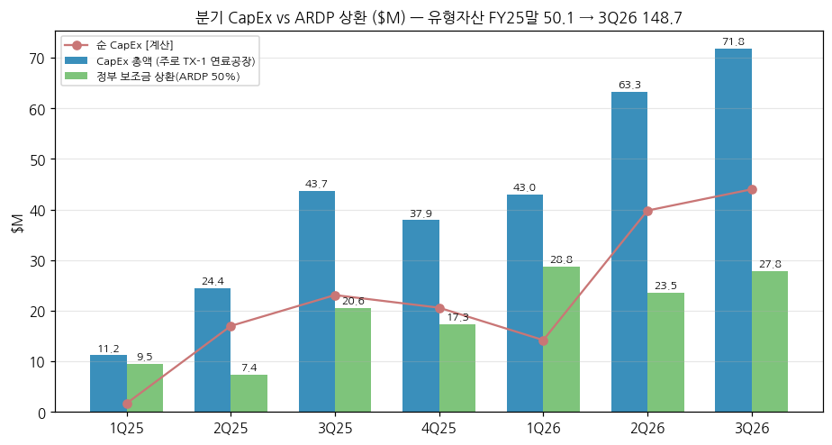

⑤ 부채구조 — 차입금 0 (3Q26 10-Q "no debt outstanding"). 과거: Live Oak 신용한도(2025-12 만기 소멸), C-2 전환사채 $113.0M(10% PIK, 2025-09까지 전량 전환). 우발 부담: ① 무조건부 구매약정 $312.2M ② 세금수취약정(TRA) ③ Amazon 원가절감분 지급 의무(상업운전 5년 후) ④ 성능보증 (10-Q, 424B4)

⑥ 배당·자사주 — 없음. **지분 희석·오버행이 핵심 변수** — 주식 구조:

| 시점 | Class A | Class B | 합계 (백만주) | 주요 이벤트 |
|---|---|---|---|---|
| 2026-06-02 (IPO 후 첫 10-Q 표지) | 287.5 | 118.9 | 406.4 | 공모 5,089만주 포함 |
| 2026-08-10 | 287.5 | 118.9 | 406.4 | 락업 중 |
| **2026-11-09** | **297.5** | **108.7** | **406.2** | 락업 종료(09-01) 후 B 1,020만주 → A 교환 [계산] |

→ (출처: 각 10-Q 표지. Class B는 XERC 유닛과 짝 — 경제적으로는 합계가 총주식수)

→ 완전희석 4.072억주(3Q26 가중: A 2.835억 + B 1.087억 + 옵션 750만 + 미가득 RSA·RSU 741만) — **별도로 조건부 "2025 워런트" 1,410만주(@$6.487, 해당 고객 Xe-100 전량 가동 시)** 미포함 (3Q26 10-Q)

→ **락업**: 424B4상 180일(→ 2026-10-20)이었으나 "블랙아웃 직전 조기 종료" 조항에 따라 **2026-09-01 종료** (424B4, 3Q26 10-Q). 2026 주식보상계획 4,542만주 예비 (424B4)

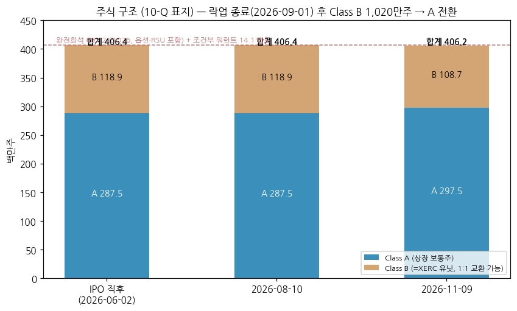

⑦ 재무비율: 부채/자산 8.2%, 유동비율 13.3배(유동자산 1,742.3 / 유동부채 131.2), 현금+투자/총자산 81.3% [계산, 3Q26]. ROE·이자보상배율은 적자로 의미 없음

## ⑤ 지배 구조

① 그룹·주요 주주 관계

→ **카말 가파리안(창업자·이사회 의장)**: X-Energy Holdings 등 계열 합산 Class A 836만 + Class B 8,429만주(B의 70.9%) — 최대 의결권 블록. Intuitive Machines·Axiom Space 공동창업자 (424B4)

→ **Amazon**: Class A 6,584만주(공모 후 A의 22.9%) — 최대 Class A 주주 겸 5GWe 옵션 고객. CFO 대니얼 그로스는 Amazon 기업개발(기후서약기금) 출신, 2024-10\~2025-12 Amazon 지명 이사 (424B4)

→ **Dow**: 첫 고객·ARDP 하위 수혜자, 특수관계자 (424B4 주석). **두산에너빌리티·DL이앤씨·Curtiss-Wright·OPG**: 지분 투자자 겸 공급·협력사 (424B4)

② 주주 구분 (5% 이상, 424B4 — 공모 후·초과배정 행사 가정)

| 주주 | Class A | Class B | A 지분율 | 비고 |
|---|---|---|---|---|
| Amazon.com NV Investment Holdings | 65,836,947 | — | 22.9% | |
| Ares 계열 | 13,844,585 | 24,418,756 | 4.8% | B의 20.5% |
| Segra 계열 | 13,673,571 | — | 4.8% | |
| XERC Holdings (Citadel 켄 그리핀 지배) | 16,219,322 | — | 5.6% | |
| Jane Street Global Trading | 536,657 | 10,196,485 | <1% | B의 8.6% (시리즈 D 참여) |
| 가파리안 계열 (X-Energy Holdings 등) | 8,362,979 | 84,292,133 | 2.9% | B의 70.9% |
| 이사·임원 전체 (15명) | 17,575,309 | 84,292,133 | 6.1% | 가파리안 포함 |

→ 2026-07\~11 Schedule 13G 7건 제출(최신 2026-11-13) — 상세 미확인. 락업 해제 후 지분 변동 가능 → 아래 chart5는 IPO 시점 기준

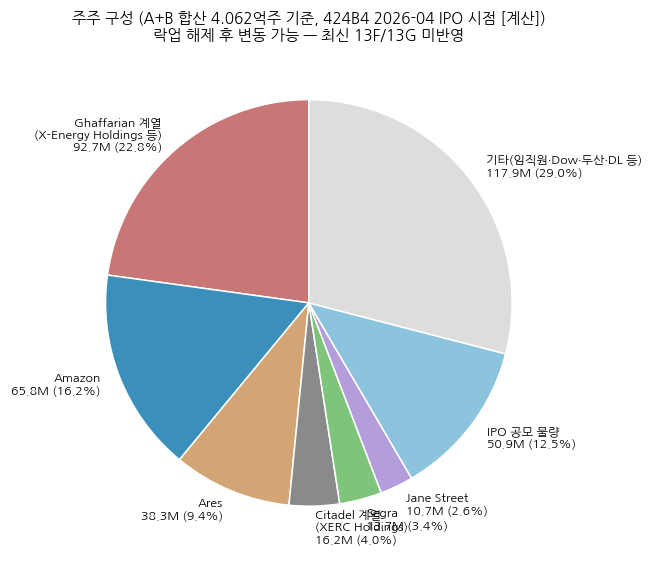

③ 임원·이사회 (424B4)

→ **CEO 클레이 셀(J. Clay Sell, 58)** — 2019-01 CEO, 2021-07 이사. 전 미국 에너지부 부장관(부시 행정부), Hunt Energy Horizons 사장(2008\~2018)

→ CFO 대니얼 그로스(2025-12\~, 전 Amazon), 글로벌 운영 드라간 포포비치(전 OPG SMR 사업 수석부사장 — G7 첫 SMR FID 경험), 최고상업책임자 딩카르 바티아, TRISO-X 사장 조엘 덜링(전 PNNL·BWXT), 법무·관리 스티븐 밀러(전 Constellation)

→ 이사회 의장 카말 가파리안. 이사: 에드워드 소넨샤인, 마이클 월리스, 캐슬린 하일, 크리스토퍼 긴더, 그레고리 고프, 데이비드 캐플런(Ares 공동창업자), 앨리슨 세이틴 — 시차임기(3개 클래스) 이사회

## ⑥ 기타 팩트

① R&D: 손익상 R&D는 FY24 1.7 / FY25 1.7 / 9M26 0.7 — 실제 개발비는 ARDP 직접원가로 처리. NRC 승인 TRISO-X 페블 연료 인증 방법론(DOE AGR 시험 데이터 기반), 현재 조사(照射) 시험 단계 (424B4) → chart7 생략

② Corporate action
→ 2022\~2023 C-2 전환사채 / 2024 시리즈 C-1(Amazon) / 2025-01 C-1 추가 $53.4M / 2025-11 시리즈 D $700M / 2026-03 Amazon 워런트 행사 / 2026-04 IPO·Up-C 재편 / 2026-09 락업 종료

③ R&D·인허가 마일스톤
→ 2016 TRISO-X 시범공장 → 2020-12 ARDP 선정 → 2025-03 Dow 건설허가 신청 → 2026-02 TX-1 Part 70 면허 → 2026-09 영국 GDA 접수·TX-1 골조 완료 → **2026-11 Dow 건설허가 승인**

④ 주요 리스크
→ **FID 리스크**: 어떤 고객도 최종투자결정 없음. Dow는 MPDA·CCA를 편의 해지 가능 (424B4)
→ **ARDP 리스크**: 상환 한도 $1.2B 고정 + 사업비 증가, 예산기간 연장은 DOE 재량, 이행기간 상한 약 2030년 — Dow 상업운전 이전 종료 가능 (3Q26 10-Q)
→ **HALEU 공급**: 미국 정부·소수 상업 농축사 의존, 선급·최소구매 약정 (3Q26 10-Q)
→ **고객 조건**: Amazon 최혜가격·우선 배정·원가절감분 지급 → 마진 압박 (424B4)
→ **희석·오버행**: 락업 종료, Class B 1.087억주 교환 가능, 조건부 워런트 1,410만주
→ **내부통제**: 중대한 취약점 미해소 (3Q26 10-Q)
→ **특허**: USNC 건 (해결 여부 미공시)

⑤ ESG 등급: 미확보

⑥ 인증·라이선스: NRC Part 70 특수핵물질 면허(TRISO-X TX-1·TX-2, 40년, 2026-02), Dow 시드리프트 Xe-100 4기 NRC 건설허가(2026-11-09, 허가 보유자 Long Mott Energy), NRC 승인 연료 인증 방법론, 영국 GDA 진행 중 (10-Q, 424B4)

## Version Log

→ **v1.0 (2026-11-15)**: 최초 작성. 원전 섹터 글로벌 피어(서브섹터: SMR·차세대 원자로, 핵심 — 섹터 델타 합산 제외). SEC S-1·S-1/A 4건·424B4·10-Q 3건·8-K 4건 + XBRL companyfacts·submissions + Yahoo 일간 주가. 3Q26 10-Q(2026-11-12) 반영. 차트 11종(chart1·1b·2·4·5·6·8·10·11·13·14 — chart7·9·12 제외). 분류 "꿈" — 마일스톤·현금 트래커 중심 (NuScale 기업개요 v1.0 구조 준용)
→ 잔여 보완 후보: ① **3Q26 실적 보도자료(8-K Ex.99.1)·콜 원문** — SEC 403으로 미확보, 콜 코멘트(FID 일정·ARDP 추가 배정액·"1GW 유틸리티 고객") 미반영 ② 두산에너빌리티 지분 투자액·계약 금액(두산 사업보고서 타법인출자 현황·공시로 확인) ③ 2025 워런트 보유 고객 실명 ④ USNC 분쟁 종결 여부 ⑤ FY26 10-K(2027-03 예상) — 연간 3개년으로 확장 ⑥ 13G 7건 반영한 최신 주주 구성 ⑦ Dow FID 시 즉시 갱신 ⑧ ESG
