# 강원랜드 — 기업 개요 (v1.0)

> 마지막 update: 2026-11-25 (v1.0 — 첫 작성. 3Q26 분기보고서(2026-11-16 제출)·3Q26 잠정실적(2026-11-06) 반영, IR 실적 PDF는 1Q26(2026-05-21)까지)
> 입력 source: OpenDART fnlttSinglAcntAll (연결 CFS, 2015 사업보고서\~3Q26, 44개 JSON — 2014는 2015 사업보고서 전기 컬럼) + DART 정기공시 원문 XML 65건 (사업보고서 2010\~2025 + 분기/반기 1Q11\~3Q26, 2013 사업보고서·3Q15 분기보고서는 기재정정본, 2020 사업보고서는 첨부정정본 — 2011\~2015 분기 손익은 "요약 연결 손익계산서" 누적값 역산) + OpenDART 기업개황·최대주주·임원·직원·배당·자기주식·주식총수 (2025 사업보고서) + 강원랜드 IR 실적 PDF 9건 (irgo 경유, 고유 6건: 1Q19·2Q19·1Q25·3Q25·4Q25·1Q26 — 2Q26·3Q26 IR 미게시) + Yahoo Finance (035250.KS 일간 2001-10-26\~2026-11-25) + 언론 (한국경제·뉴스토마토/IB토마토·뉴시스·MTN·Focus Gaming News·Investing.com, 2025-11\~2026-11)
> 갱신 주기: 매분기 (실적 리뷰 모드 호출 시)
> 워치리스트: **여행·레저·유통 섹터 / 서브섹터: 면세·카지노·여행** (`earnings/watchlist.md` 102·103행, 2순위 섹터 — 4Q26부터 리뷰, 2026-11-23 추가)
> **Fact verify cutoff**: 2026-11-25 (주가 2026-11-24 종가 **14,040원** [Yahoo Finance 035250.KS — Investing.com 52주 범위 13,500\~19,590원·1년 -19.5%(11-25 기준)로 교차 확인], 발행주식 213,940,500주 [DART 반기보고서(2026.06) 주식의 총수, 소각 이력 없음] → 시가총액 **3.00조원** [계산, 자기주식 15,746,696주 포함 기준 / 자기주식 제외 유통주식 기준 2.78조 — Investing.com 2.78T와 일치]. **사상 최고가: 2015-08-20 종가 45,250원** [Yahoo 일간 종가 최고, DART 사업보고서(2015.12) 월별 주가 '15.8월 최고 45,250원과 일치] → 당시 시총 **9.68조원** [계산, 213,940,500주]. 고점 대비 **-69.0%**, YTD **-25.9%** (2025-12-30 종가 18,950원), 1년 **-21.7%** (2025-11-24 종가 17,920원). 2026년 장중 최고 19,590원(2026-02-26)·최저 13,500원(2026-10-29) [Yahoo])

---

## 1. 기업 분류

- **Primary 분류: 지속성장(저성장) — 법정 독점 카지노 캐시카우 (성장 정체·고배당형)** — 내국인 출입 카지노를 법(폐광지역법, 시한 2045-12-31)으로 독점하지만 매출총량제·영업시간·출입일수·베팅한도 등 규제가 성장 상한을 정한다. 매출 CAGR(2014→2025) **-0.1%**, 코로나(2020\~2021)를 빼면 연 1.3\~1.7조의 좁은 박스. 이익 변동은 수요 사이클이 아니라 **규제 이벤트(2018 영업시간 단축)·팬데믹 휴장(2020\~2021)·기금 산식 변경(2021)** 같은 외생 충격에서 발생
- **Secondary 노트: K-HIT 투자 사이클 + 금융자산 3조 보유 "현금 공기업"** — 2035년까지 총 3조원(제2카지노·호텔 3개 동·미디어돔 아레나 등) 투자 계획 [한국경제 2025-11-19]. 3Q26말 현금+금융자산 **2.99조** [DART 분기보고서(2026.09), 계산]로 시총(3.00조)과 거의 같은 규모 — 차입금 0. 매출 성장 옵션이자 동시에 배당 여력·ROE 희석 변수

### ① 정량 근거

**📊 Summary Box (12년, 2014\~2025 연결):**

| 지표 | 값 |
|------|-----|
| 매출 CAGR (2014→2025, 11년) | **-0.1%** (1.50조 → 1.48조) — 정점 2016 1.70조, 코로나 저점 2020 0.48조. 2019→2025 CAGR -0.5% |
| OPM 평균 | **15.0%** (range -90.2\~36.5%) — 코로나 2년 제외 10년 평균 **27.6%** |
| OPM 정점 평균 | **36.5%** (2015 36.4% · 2016 36.5%) — 카지노 매출 1.56\~1.62조, 폐광기금이 세전이익 25% 산식이던 시기 |
| OPM 저점 평균 | **-48.5%** (2020 -90.2% · 2021 -6.7%) — 코로나 휴장. 비(非)팬데믹 저점은 2025 15.9% (인건비·감가상각·기금 증가) |
| 사이클 주기 | **N/A — 규제 독점 산업** (경기 사이클 없음. 대신 레짐 3개: ① 2014\~2019 고마진(OPM 30\~37%) ② 2020\~2021 휴장 ③ 2022\~ 정상화 후 저마진(OPM 16\~20%)) |
| 사이클 회수 (12년) | **N/A** (OPM 하락 3회 — 2017\~2018 규제, 2020 팬데믹, 2025 비용 — 모두 외생 이벤트) |

```
[전사 OPM 시계열 (12년, 연결, DART)]
연도   매출(조)  영업이익(조)  순이익(조)   OPM    NPM   CapEx/매출
2014     1.50      0.513       0.359     34.3    24.0     5.4%   ← 카지노 1.42조, 폐광기금(세전이익 25%) 1,434억
2015     1.63      0.595       0.442     36.4    27.0     2.5%   ← 매출·순이익 당시 최고, 2015-08 주가 최고
2016     1.70      0.619       0.455     36.5    26.8     4.4%   ← 매출 1.70조 사상 최대, OPM 36.5% 정점
2017     1.60      0.531       0.438     33.1    27.3     5.3%   ← 채용비리 여파·카지노 매출 -6.0%
2018     1.44      0.431       0.297     30.0    20.7     7.2%   ← 영업시간 20→18h·테이블 축소(2017-12 재허가 조건), 워터월드 개장
2019     1.52      0.501       0.335     33.0    22.0     5.3%   ← OPM 33.0% 회복
2020     0.48     -0.432      -0.276    -90.2   -57.6    12.5%   ← 코로나 휴장 — 연중 대부분 휴·제한영업, 폐광기금 추징 2,250억
2021     0.79     -0.053      -0.011     -6.7    -1.3     5.4%   ← 휴장·거리두기, 폐광기금 매출 13%로 변경(2021-09 시행)
2022     1.27      0.218       0.116     17.1     9.1     2.4%   ← 영업 정상화 2년차, 하반기 회복
2023     1.39      0.282       0.341     20.3    24.5     5.1%   ← 카지노 1.21조, 순이익 3,409억
2024     1.43      0.286       0.457     20.0    32.0     8.3%   ← 부가세 소송 환급 750억(기타이익) → 순이익 4,569억
2025     1.48      0.235       0.318     15.9    21.5     8.2%   ← 카지노 1.31조(+5.0%) vs 비용↑ → OP -17.7%

OPM range: -90.2% ~ 36.5%  (팬데믹 제외 15.9% ~ 36.5%) — 2022년 이후 OPM 레벨이 2010년대 대비 15%p 이상 낮아진 '레짐 전환'
```

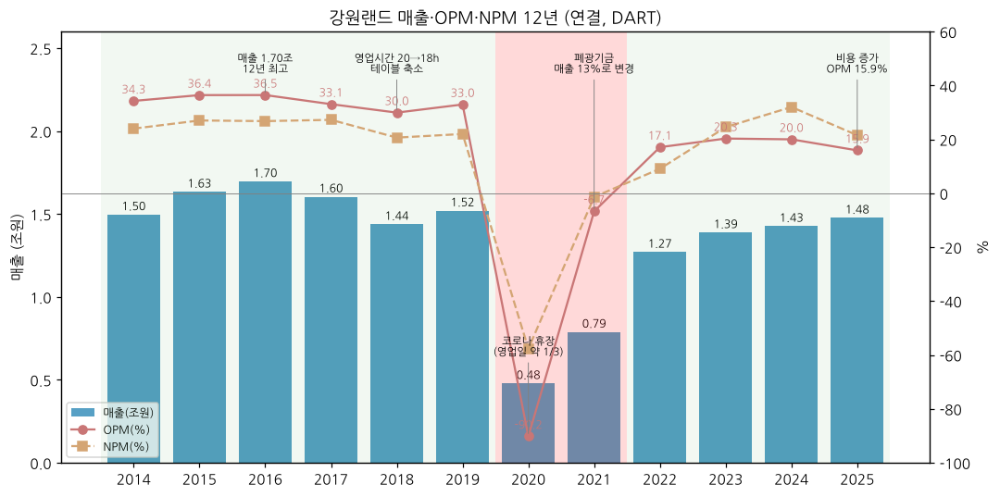

(2018 IFRS15 도입으로 카지노 콤프(하이원포인트) 사용분 회계가 바뀌어 카지노 순매출이 줄고 호텔 매출이 늘어남(2017 호텔 301억 → 2018 1,004억) — 사업부문 간 비교 시 주의. 폐광지역개발기금은 2014\~2018 손익계산서에 별도 행으로, 2019\~2020은 판관비에, 2021\~는 매출원가에 포함 [DART 각 연도 사업보고서 비용의 성격별 분류]. CapEx = 연결 현금흐름표 유형자산 + 무형자산 취득)

### ② 산업 분류

- 산업: **카지노(내국인 출입 가능) + 복합리조트(호텔·콘도·스키·골프·워터파크)** — 사행산업통합감독위원회(사감위) 감독, 문화체육관광부 3년 단위 카지노업 허가
- DART 업종: 갬블링 및 베팅업(카지노 운영) [OpenDART 기업개황 업종코드 기준] / 유가증권시장 상장 2003-09-04 (KOSDAQ 2001-10 상장 후 이전) [DART 분기보고서(2026.09) I-1, Yahoo 시세 시작일 2001-10-26]
- 공공기관: 「공공기관의 운영에 관한 법률」상 **시장형 공기업** (2018-02-06 지정) [DART 분기보고서(2026.09) II-7]
- 워치리스트 섹터: **여행·레저·유통** / 서브섹터: **면세·카지노·여행**
- 시장 지위: 국내 18개 카지노 영업장(외국인 전용 17 + 강원랜드 1) 중 유일한 내·외국인 카지노. 2024 영업매출(관광기금 부과대상) 1.36조 = 국내 카지노 전체 3.23조의 **42.3%**, 입장객 237만명 = 전체 532만명의 **44.6%** [DART 사업보고서(2025.12) II-7 국내 카지노 현황(문체부 2025-04 기준), 계산]

### ③ 분류 결정 논리

(1) **가장 매출 큰 사업부 기준** 적용 시: 카지노 1.31조 = 사업부문 합계(연결조정 전 1.51조)의 **86.8%** (2025) [DART 사업보고서(2025.12) II-4]. 매출총량제로 성장 상한이 묶인 독점 → 수요 사이클이 아닌 **규제 상한 내 저성장 → 지속성장(저성장)**
(2) **이익 비중 sub-rule**: DART 보고부문 공시 없음(단일 부문 취급, 회사별 주요 재무정보만 공시) — 2025 연결 당기순이익 3,182억 중 ㈜강원랜드 별도 3,072억(**99.8%**) [DART 사업보고서(2025.12) II-7 회사별 주요 재무정보]. 리조트(비카지노) 매출 원가 합계 3,302억 vs 리조트 매출 1,690억 [IR 4Q25 요약 연결손익계산서, 계산] → **리조트는 구조적 적자, 이익의 사실상 전부가 카지노**
(3) **Boundary case — "꿈/고성장" 가능성(K-HIT)**: 2035년까지 3조원 투자로 연간 방문객 1,300만명·매출 3.5조원 목표 [한국경제 2025-11-19] — 달성 시 매출 2.4배. 다만 2026 실제 투자예산은 1,454억 (3Q까지 1,101억 집행) [DART 분기보고서(2026.09) II-3]이고 1단계 제2카지노(1,796억)도 2027년 완공 목표 단계 → **아직 숫자로 확인된 성장 없음, Primary 유지**. 전환 조건은 ⑤ 트리거
(4) **국내·글로벌 피어 cross-ref**:
→ **파라다이스·GKL(그랜드코리아레저)**: 외국인 전용 카지노 — 수요 driver가 중국·일본 VIP/방한객(경기·외교 사이클)이라 강원랜드(내국인·규제 상한)와 분류가 다름. 같은 서브섹터 면세·여행 종목과의 비교는 ④-1 박스(통합 검수) 참조
→ 글로벌: Las Vegas Sands·Galaxy(마카오), Genting Singapore 등 IR 사업자는 "관광 수요 사이클 + 라이선스 갱신" 프레임. 강원랜드는 라이선스 갱신(3년) 리스크는 같지만 수요 측 사이클이 거의 없다는 점에서 **규제 유틸리티**에 가까움 (정성 비교, 수치 미수집)

### ④ 적정 밸류에이션 방법

- **배당수익률 + PER 우선, PBR(순현금 조정) 보조**
→ 이익의 99%가 단일 카지노에서 나오고 CapEx가 매출의 5\~8%로 낮아 **순이익 ≈ 배당 가능 현금**. 배당정책: 2024\~2026 사업연도 배당성향 50% 이상 + 총주주환원율 60% [IB토마토 2026-10-08, Focus Gaming News 2026-11-09]
→ 현재 **배당수익률 6.8%** [계산: 2025 DPS 950원 / 14,040원]. DPS 이력: 2016\~2017 990원(정점) → 2020\~2021 무배당 → 2024 1,170원(최고, 부가세 환급 750억 일회성 반영 이익) → 2025 950원 [DART 사업보고서 배당에 관한 사항]
- **PER (LTM 지배순이익 2,152억 [계산: 4Q25 677억 + 9M26 1,475억])**: **14.0배**. 단, 9M26 순이익은 금융자산 평가손익(3Q26 FVPL 평가·처분손실 377억 + 평가이익 환입)으로 크게 출렁임 → 영업이익 기반 보조 지표 필요. 순현금(2.99조)이 시총(3.00조)과 거의 같아 EV ≈ 0 → EV/EBITDA 등 EV 배수는 의미가 없음 — 아래 PBR·순현금 조정 참조
- **PBR**: 시총 3.00조 / 3Q26 지배자본 3.91조 = **0.77배** [계산]. 연말 기준 밴드: 고점 **2.74배 (2015)** → 2022까지 1.45배 이상 → 2023 **0.93배**로 처음 1배 하회 → 2024 0.88배 (12년 최저) → 2025 1.02배 → 현재 0.77배 (신저점)
- **순현금 조정 시**: 시총 3.00조 − 현금·금융자산 2.99조 ≈ **영업가치 0** [계산, 금융자산을 장부가 그대로 차감·법인세 미고려 — 단순화] → 시장이 카지노 본업 가치를 사실상 0으로 평가하거나, 금융자산이 K-HIT 투자로 소진될 것으로 할인하고 있다는 뜻
- **피어 차별화**: 외국인 카지노(파라다이스·GKL)는 방한객 회복 기대로 PER 프리미엄을 받는 구간이 있으나, 강원랜드는 성장률 대신 **배당 지속성 + 규제 완화 이벤트**가 재평가 driver (2024-11 "규제완화로 주가 30% 상승" 보도 [다음/이데일리 2024-11-24 제목 기준, 본문 미대조])

#### ④-1 면세·카지노·여행 공통 비교 박스 (통합 검수 예정)

### ⑤ 분기 재평가 트리거 (분류 변경 조건)

- **제2카지노 개장(2027 목표) 후 카지노 영업매출 YoY +10% 이상 2개 분기 연속** (회사 기대: 연 약 1,000억 매출 증대 [IB토마토 2026-10-08]) → Secondary를 "투자 성장 국면"으로 격상
- **매출총량제 한도 상향 또는 영업시간·출입일수 규제 완화 공식 확정** (2020-05 영업시간 18→20시간, 2024-09 게임기구 1,560→1,860대 사례 [DART 분기보고서(2026.09) I-2 연혁]) → 이익 레벨 재평가
- **반대로 FIU 특금법 개정(칩 구매·환전 시 신원·거래 기록 의무 → "전면 회원제" 논란) 시행** [뉴시스 2026-07-08·07-15] 또는 영업시간 재단축 → 규제 리스크 태그 추가 (2018 단축 시 카지노 영업매출 -8.1%)
- **K-HIT 대형 투자로 연간 CapEx가 OCF의 70% 초과 또는 금융자산 1조 이상 감소** → 배당 여력 하향·"투자 사이클 국면" 태그
- **OPM 15% 하회 2개 연도 연속** (2025 15.9%, LTM 13.9%) → "구조적 저마진" 재분류 검토

---

## 2. 회사 개요

### ① 기본 사항

- **회사명**: ㈜강원랜드 (Kangwon Land, Inc.) / KRX 035250 (유가증권시장)
- **본사**: 강원특별자치도 정선군 사북읍 하이원길 265 [DART 분기보고서(2026.09) I-1]
- **설립**: 1998-06-29, 「폐광지역 개발 지원에 관한 특별법」(현 「석탄산업전환지역 개발 지원에 관한 특별법」, 2026-03-31 명칭 변경) 근거 [DART 분기보고서(2026.09)·사업보고서(2025.12)]
- **사업 근거**: 국내 유일 내·외국인 출입 카지노 — 법 적용시한 2045-12-31 (2021-03 개정 전 2025-12-31). 카지노업 허가 3년 단위 갱신 [DART 사업보고서(2025.12) II-7]
- **사업 한 줄 정의**: 정선 '하이원리조트'에서 카지노(매출의 약 89%)와 호텔·콘도·스키·골프·워터월드(약 11%)를 운영하는 복합리조트 공기업. 카지노 영업매출에서 폐광기금 13%·관광기금 10%·개별소비세(교육세 포함) 5.2%를 부담 [IR 1Q26]
- **영업 규모**: 테이블게임 200대·머신게임 1,362대 (허가 1,860대 중 일부는 제2카지노 완공 후 배치), 영업시간 10:00\~익일 06:00 (20시간) [DART 분기보고서(2026.09) II-2]. 2025 카지노 입장객 247.9만명 [IR 4Q25·1Q26 분기 합산, 계산]
- **대표이사**: **김도균 사장** (1965-07생, 前 육군 수도방위사령관·국방부 대북정책관·청와대 국방개혁비서관, 임기 2026-09-02\~2029-09-01) — 2년 9개월 사장 공백 후 취임 [DART 분기보고서(2026.09) VIII, IB토마토 2026-10-08]
- **최대주주**: 한국광해광업공단 36.27% (정부 99.90% 출자 공공기관) [DART 분기보고서(2026.09) VII]
- **신용등급**: **미확보** (차입금 0 — 회사채 발행 이력 미확인)

### ② 최근 12년 손익·자본 추이 (조원, 연결, DART)

| 연도 | 매출 | YoY | 영업이익 | OPM | 순이익(지배) | 자본총계 | 자본 YoY |
|---|---|---|---|---|---|---|---|
| 2014 | 1.50 | - | 0.513 | 34.3% | 0.359 | 2.71 | - |
| 2015 | 1.63 | +9.2% | 0.595 | 36.4% | 0.442 | 3.00 | +10.8% |
| 2016 | 1.70 | +3.8% | 0.619 | 36.5% | 0.455 | 3.25 | +8.5% |
| 2017 | 1.60 | -5.4% | 0.531 | 33.1% | 0.438 | 3.50 | +7.6% |
| 2018 | 1.44 | -10.4% | 0.431 | 30.0% | 0.297 | 3.59 | +2.4% |
| 2019 | 1.52 | +5.7% | 0.501 | 33.0% | 0.335 | 3.72 | +3.7% |
| 2020 | 0.48 | -68.5% | -0.432 | -90.2% | -0.276 | 3.25 | -12.7% |
| 2021 | 0.79 | +64.7% | -0.053 | -6.7% | -0.011 | 3.25 | +0.2% |
| 2022 | 1.27 | +61.2% | 0.218 | 17.1% | 0.116 | 3.42 | +5.0% |
| 2023 | 1.39 | +9.3% | 0.282 | 20.3% | 0.341 | 3.68 | +7.7% |
| 2024 | 1.43 | +2.8% | 0.286 | 20.0% | 0.457 | 3.88 | +5.6% |
| 2025 | 1.48 | +3.5% | 0.235 | 15.9% | 0.318 | 3.96 | +2.1% |

(연결 기준, OpenDART fnlttSinglAcntAll. 9M26: 매출 1.094조 (-1.6%), 영업이익 0.172조 (-16.1%), 순이익 0.147조 (-41.1%) [DART 분기보고서(2026.09), 계산]. LTM(4Q25\~3Q26) 매출 1.46조·영업이익 2,022억 (OPM 13.9%) [계산]. 참고: 2011 1.27조/4,885억, 2012 1.30조/4,049억, 2013 1.36조/3,880억 (매출/영업이익) [DART 사업보고서 요약 연결 손익계산서])

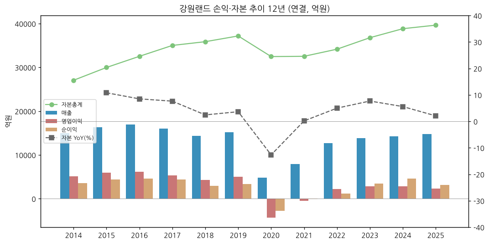

### ③ 회사 주가 역사 ★ narrative 영역

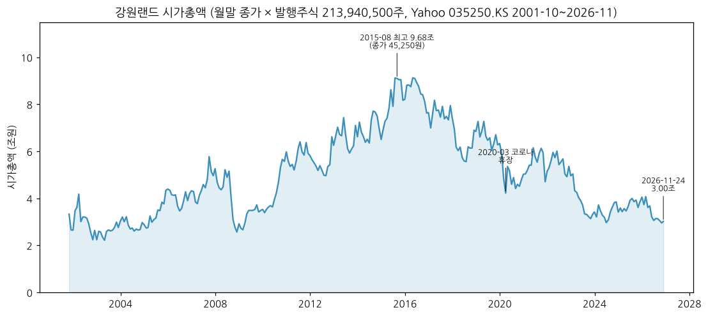

(차트: Yahoo 월말 종가(close) × 발행주식 213,940,500주 (상장 이후 증자·소각 없음 — 자기주식 포함). 시총은 [계산])

(1) 2001\~2008: 상장과 독점 프리미엄
→ 2001-10 KOSDAQ 상장(Yahoo 첫 시세 2001-10-26) → 2003-04 메인 호텔·카지노 개장, 2003-09-04 유가증권시장 이전 [DART 분기보고서(2026.09) I-1·I-2]
→ 2008 언론: "PER 약 13배, 2007 DPS 630원" [한경 머니 2008-09-03]

(2) 2009\~2015: 증설·리조트 확장 + 장기 상승
→ 2011-09 컨벤션호텔 개장, 2012-11 카지노 영업장 확장 허가(게임기구 1,092→1,560대), 2013-06 증축 카지노 개장 [DART 연혁]
→ 카지노 순매출 2012 1.21조 → 2015 1.56조 (+28%) [DART 사업부문별 매출]
→ **2015-08-20 종가 45,250원 — 사상 최고가 (시총 9.68조)** [Yahoo·DART 사업보고서(2015.12) 월별 주가]. 2015 연말 PBR 2.74배 (12년 최고) [계산]

(3) 2016\~2019: 매출 정점 → 규제 충격
→ 2016 매출 1.70조·OPM 36.5% 사상 최대 — 그러나 주가는 이미 고점 통과
→ 2017-12 카지노 재허가 조건 변경: 게임기구 1,560→1,540대, **영업시간 20→18시간** [DART 연혁] → 2018 카지노 영업매출 -8.1%·입장객 -8.4% [DART 국내 카지노 현황 표, 계산]
→ 2018-02 시장형 공기업 지정, 2018-07 워터월드 개장 [DART 연혁]

(4) 2020\~2021: 코로나 휴장
→ 2020 매출 4,786억(-68.5%)·영업손실 4,316억, 순손실 2,759억 — 입장객 59.9만명(-79.3%) [DART, 계산]. 2020-04 폐광기금 과소징수분(2014\~2019) 부과처분 2,250억이 같은 해 비용 반영 [DART 사업보고서(2023.12) 주석 우발부채]
→ 2020-05 영업시간 18→20시간 원상회복 [DART 연혁]
→ 2020·2021 2년 연속 무배당 [DART 배당에 관한 사항]
→ 2021-03 폐광지역법 개정: 시한 2045년 연장 + **폐광기금 산식 '세전이익 25%' → '카지노 매출 13%'** (2021-09 시행) [DART 사업보고서(2020.12) II-7]

(5) 2022\~2024: 정상화 + 저(低) PBR 고착
→ 2022 영업 정상화, 2023 OPM 20.3%·순이익 3,409억 — 그러나 2023말 주가 16,000원으로 PBR 0.93배 (첫 1배 하회) [계산]
→ 2024-09 카지노업 변경 허가(게임기구 1,560→1,860대, 외국인 전용존 베팅한도 변경) [DART 연혁], 2024 부가세 소송 승소 환급 750억 → 순이익 4,569억·DPS 1,170원 [IR 4Q25]
→ 2024 자사주 400억 매입 [DART 2024 연결 CF]

(6) 2025\~2026-11: K-HIT 비전 vs 이익 감소 → 신저 PBR
→ 2025-05 회원바카라 최고베팅액 200만 → 3,000만원 상향 [IR 4Q25] — 2Q25 회원영업장 매출 +49.7% QoQ
→ 2025 영업이익 2,353억(-17.7%) — 인건비(정부경영평가 성과급 등)·감가상각(지반침하 보강공사, 분기 약 27억)·기금 증가 [IR 4Q25]
→ 2025-11-19 'K-HIT 비전' 발표: 2035년까지 3조원 [한국경제 2025-11-19]
→ **2026-02-26 장중 19,590원 (52주 최고)** → 2026-03 객실 757실 리노베이션 착수로 비카지노 매출 감소 [Focus Gaming News 2026-11-09] → 2026-07 FIU 특금법 개정 논란 [뉴시스 2026-07-15]
→ 2026-09-02 김도균 사장 취임 (2년 9개월 공백 종료) [IB토마토 2026-10-08]
→ 3Q26 영업이익 597억(-17.9%), 순손실 20억 (금융자산 평가손실) [DART 분기보고서(2026.09)] → **2026-10-29 장중 13,500원 (52주 최저)**, **2026-11-24 14,040원 (시총 3.00조, 고점 대비 -69.0%)**

### ④ 회사의 주요 연혁

```
1995-12      폐광지역 개발 지원에 관한 특별법 제정 (내국인 카지노 근거)
1998-06-29   ㈜강원랜드 설립
2000-10      스몰카지노 호텔(현 하이원팰리스호텔) 개장 — 카지노 영업 개시
2001-10      KOSDAQ 상장 (Yahoo 시세 시작 2001-10-26)
2003-04      강원랜드호텔 & 강원랜드카지노(메인) 개장
2003-09-04   유가증권시장 상장
2005-07      하이원골프장 개장
2006-12      하이원스키장·하이원콘도 개장
2007-09      사행산업통합감독위원회 출범 → 매출총량제 등 규제 체계
2011-09      컨벤션호텔(현 그랜드호텔 컨벤션타워) 개장
2012-11      카지노 영업장 확장·게임기구 1,092→1,560대 허가
2013-06      증축 카지노 개장
2015-08      주가 사상 최고 45,250원 (종가)
2017-12      재허가 조건 변경: 게임기구 1,540대, 영업시간 20→18시간
2018-02      시장형 공기업 지정
2018-07      하이원 워터월드 개장
2020-02~     코로나19 휴장·제한영업 (2020~2021)
2020-05      영업시간 18→20시간, 게임기구 1,560대
2021-03      폐광지역법 개정 — 시한 2045년 연장, 폐광기금 카지노 매출 13% (2021-09 시행)
2024-09      카지노업 변경 허가 — 게임기구 1,560→1,860대, 외국인 전용존 변경
2025-05      회원바카라 최고베팅액 200만→3,000만원
2025-11-19   K-HIT 비전 발표 (2035년까지 3조원)
2026-03      객실 리노베이션 757실 착수 (~2028-1Q)
2026-03-31   법 명칭 변경: 석탄산업전환지역 개발 지원에 관한 특별법
2026-09-02   김도균 대표이사 취임
2026-10      M650 박물관 개관
2026-11      한국ESG기준원 ESG 7년 연속 통합 A등급
2027E        제2카지노(1,796억)·회원영업장 리모델링(299억) 완공 목표
```

(출처: DART 분기보고서(2026.09) I-2 연혁, 사업보고서(2020.12)·(2025.12) II-7 법규, IR 4Q25, 한국경제 2025-11-19, Focus Gaming News 2026-11-09, IB토마토 2026-10-08. 1995-12·2007-09는 DART 사업보고서 법규 설명 문단 기준. 코로나 휴장 개시 월은 미검증(DART 원문 미대조))

---

## 3. 비즈니스 모델

### ① 실적 추이 (연결 → DART 사업부문별 매출 → IR 카지노 영업장별 3단계 위계)

**연간 5년 통합 표 (DART 연결 + 사업부문별 매출 + 카지노 KPI):**

| 항목 | 2021 | 2022 | 2023 | 2024 | 2025 |
|---|---|---|---|---|---|
| **연결 매출액 (억원)** | **7,884** | **12,707** | **13,886** | **14,269** | **14,767** |
| └ 부문별 (DART 사업부문별 매출, 연결조정 전, 억원) | | | | | |
| &nbsp;&nbsp;&nbsp;&nbsp;└ 카지노 | 6,971 | 11,100 | 12,060 | 12,451 | 13,077 |
| &nbsp;&nbsp;&nbsp;&nbsp;└ 호텔 | 563 | 979 | 1,065 | 1,037 | 931 |
| &nbsp;&nbsp;&nbsp;&nbsp;└ 콘도 | 147 | 289 | 342 | 344 | 324 |
| &nbsp;&nbsp;&nbsp;&nbsp;└ 스키 | 73 | 142 | 184 | 199 | 211 |
| &nbsp;&nbsp;&nbsp;&nbsp;└ 골프 | 96 | 102 | 100 | 92 | 88 |
| &nbsp;&nbsp;&nbsp;&nbsp;└ 워터월드 | 20 | 83 | 120 | 125 | 120 |
| &nbsp;&nbsp;&nbsp;&nbsp;└ 머신제조 | 4 | 0 | 4 | 9 | 3 |
| &nbsp;&nbsp;&nbsp;&nbsp;└ (주)하이원추추파크 | 11 | 15 | 13 | 12 | 14 |
| &nbsp;&nbsp;&nbsp;&nbsp;└ (주)하이원파트너스 | 234 | 243 | 253 | 275 | 290 |
| &nbsp;&nbsp;&nbsp;&nbsp;└ 연결조정 | -234 | -245 | -255 | -276 | -290 |
| 카지노 비중 (부문 합계 대비) | 85.9% | 85.7% | 85.3% | 85.6% | 86.8% |
| 비카지노(리조트) 합계 | 899 | 1,594 | 1,811 | 1,797 | 1,673 |
| **연결 영업이익 (억원)** | **-527** | **2,176** | **2,823** | **2,858** | **2,353** |
| **매출 YoY (%)** | **+64.7** | **+61.2** | **+9.3** | **+2.8** | **+3.5** |
| **영업이익 YoY (%)** | **적지** | **흑전** | **+29.7** | **+1.2** | **-17.7** |
| **OPM 전사 (%)** | **-6.7** | **17.1** | **20.3** | **20.0** | **15.9** |
| 폐광지역개발기금 (억원, 비용) | 1,008 | 1,590 | 1,716 | 1,773 | 1,861 |
| 카지노 영업매출 (억원, 관광기금 부과대상) | 7,750 | 12,235 | 13,202 | 13,641 | 14,317 |
| 카지노 입장객 (만명) | 84.4 | 208.4 | 241.3 | 237.3 | 247.9 |
| 1인당 영업매출 (만원) [계산] | 91.8 | 58.7 | 54.7 | 57.5 | 57.8 |

(출처: 연결 매출·영업이익 = OpenDART. 부문별 매출 = 각 연도 사업보고서 II-4 "사업부문별 매출"(연결조정 전, 자회사 하이원파트너스의 강원랜드 대상 시설관리 매출이 연결조정으로 상계). 폐광기금 = 사업보고서 연결 주석 "비용의 성격별 분류". 카지노 영업매출·입장객 = 사업보고서 II-7 국내 카지노 현황(전년 수치) — 2025는 IR 분기 합산 [계산]. DART 보고부문(영업부문) 공시는 없음 — 사업부문별 영업이익 미공시. IR은 사업별 매출원가만 공시(4Q25 IR: 2025 카지노 원가 7,596억, 리조트 원가 합계 3,302억))

**15년 사업부문별 연간 매출 (DART, 연결조정 전, 억원):**

| 연도 | 카지노 | 호텔 | 콘도 | 스키 | 골프 | 워터월드 | 머신제조 | 자회사(게임·추추·파트너스) | 부문 합계 | 연결조정 | 연결 매출 | 카지노 비중 |
|---|---|---|---|---|---|---|---|---|---|---|---|---|
| 2011 | 11,918 | 223 | 222 | 223 | 50 | 0 | 0.0 | 20 | 12,657 | 0 | 12,657 | 94.2% |
| 2012 | 12,131 | 260 | 246 | 247 | 46 | 0 | 0.0 | 33 | 12,962 | 0 | 12,962 | 93.6% |
| 2013 | 12,773 | 255 | 261 | 238 | 42 | 0 | 0.0 | 44 | 13,613 | 0 | 13,613 | 93.8% |
| 2014 | 14,187 | 244 | 240 | 212 | 41 | 0 | 0.0 | 42 | 14,965 | 0 | 14,965 | 94.8% |
| 2015 | 15,561 | 264 | 239 | 203 | 43 | 0 | 0.0 | 27 | 16,337 | -0 | 16,337 | 95.2% |
| 2016 | 16,190 | 287 | 246 | 181 | 42 | 0 | 0.0 | 20 | 16,965 | -0 | 16,965 | 95.4% |
| 2017 | 15,226 | 301 | 258 | 202 | 43 | 0 | 0.0 | 16 | 16,045 | 0 | 16,045 | 94.9% |
| 2018 | 12,738 | 1,004 | 281 | 191 | 60 | 86 | 0.0 | 20 | 14,381 | 0 | 14,381 | 88.6% |
| 2019 | 13,423 | 1,069 | 297 | 186 | 63 | 132 | 4.9 | 25 | 15,201 | -0 | 15,201 | 88.3% |
| 2020 | 4,043 | 368 | 161 | 120 | 75 | 7 | 0.0 | 11 | 4,786 | -0 | 4,786 | 84.5% |
| 2021 | 6,971 | 563 | 147 | 73 | 96 | 20 | 3.7 | 244 | 8,118 | -234 | 7,884 | 85.9% |
| 2022 | 11,100 | 979 | 289 | 142 | 102 | 83 | 0.1 | 258 | 12,952 | -245 | 12,707 | 85.7% |
| 2023 | 12,060 | 1,065 | 342 | 184 | 100 | 120 | 4.2 | 266 | 14,141 | -255 | 13,886 | 85.3% |
| 2024 | 12,451 | 1,037 | 344 | 199 | 92 | 125 | 9.4 | 287 | 14,545 | -276 | 14,269 | 85.6% |
| 2025 | 13,077 | 931 | 324 | 211 | 88 | 120 | 3.2 | 304 | 15,058 | -290 | 14,767 | 86.8% |

(DART 사업보고서 II-4 각 연도 당기 컬럼. 2011\~2020은 "매출실적(영위업종별)" 양식, 2021\~ "사업부문별 매출(회사·업종별)" 양식. 2024 사업보고서 카지노 매출은 원문 자릿수 누락(1,245,089,901,84원) → 2025 사업보고서 전기 컬럼(1,245,089,901,843원)으로 대체)

**사업 구분 변경 이력 (구 부문 → 신 부문 매핑):**

| 시기 | DART 사업부문 (당시 명칭) | 본 문서 통일 기준 | 비고 |
|---|---|---|---|
| \~2017 | 카지노 / 호텔 / 콘도미니엄 / 골프장 / 스키장 / 게임 및 애니메이션 등(하이원엔터테인먼트) / 삭도궤도시설운영업 등(하이원추추파크, 2014\~) | 카지노 / 호텔 / 레저(콘도·스키·골프) / 기타·자회사 | 카지노 콤프는 비용 처리(IAS18) |
| 2018\~2020 | + 워터월드(2018-07 개장), 머신제조(2019\~) | 워터월드는 레저에 합산, 머신제조는 기타 | **IFRS15 도입(2018)** — 콤프(하이원포인트) 지급분을 카지노 매출에서 차감, 호텔 식음 사용분은 호텔 매출로 → 2018 카지노 -16.3%·호텔 +234% (회계 효과 포함) |
| 2021\~ | 회사별 표기: ㈜강원랜드(카지노·호텔·콘도·골프·스키·워터월드·머신제조) / ㈜하이원엔터테인먼트(2022 이후 0) / ㈜하이원추추파크 / ㈜하이원파트너스(시설관리, 2021 연결 편입 추정) | 동일 | 하이원파트너스 매출 대부분이 강원랜드 대상 → 연결조정 -230\~-290억 |
| 2025\~ | 카지노 식음업장 매출: 2024까지 호텔 매출 → 2025부터 카지노 매출로 인식 (분기 약 40억) [IR 4Q25] | 동일 | 2025 호텔 -10.2%·카지노 +5.0%에 재분류 효과 포함 |

**사업부문별 분기 시계열 (연결 억원 + DART 부문 억원, 1Q11\~3Q26 63개 분기):**

> 연결 매출·영업이익·순이익: 2016\~ OpenDART(1\~3Q = 분기 3개월, 4Q = 연간 − 3Q 누적), 2011\~2015 = 각 분기·반기·사업보고서 "요약 연결 손익계산서" 누적값 역산(DART 원문 XML). 연간 분기 합 = DART 연간 (2011\~2025 전 연도 일치, ±1억). 부문 매출 = 각 보고서 사업부문별 매출(누적) 역산 — 2020년까지 부문 합 = 연결 매출, 2021부터 부문 합이 연결보다 약 2% 큼(하이원파트너스 내부거래). 1Q20 하이원추추파크 합계 셀 원문 오기(236,006백만원 = 전체 합계값) → 내수 셀 176백만원 사용. 사업부문별 영업이익은 미공시

| 분기 | 연결 매출 | 연결 영업이익 | OPM | 매출 YoY | 순이익 | 카지노 | 호텔 | 레저(콘도·스키·골프·워터) | 기타·자회사 |
|---|---|---|---|---|---|---|---|---|---|
| 1Q11 | 3,336 | 1,454 | 43.6% | - | 1,026 | 3,076 | 46 | 212 | 2 |
| 2Q11 | 2,957 | 1,132 | 38.3% | - | 948 | 2,863 | 45 | 42 | 7 |
| 3Q11 | 3,271 | 1,340 | 41.0% | - | 1,043 | 3,121 | 65 | 81 | 4 |
| 4Q11 | 3,093 | 959 | 31.0% | - | 795 | 2,858 | 67 | 160 | 8 |
| 1Q12 | 3,470 | 1,239 | 35.7% | +4.0% | 933 | 3,152 | 61 | 250 | 7 |
| 2Q12 | 3,058 | 1,020 | 33.4% | +3.4% | 809 | 2,949 | 57 | 47 | 5 |
| 3Q12 | 3,326 | 1,058 | 31.8% | +1.7% | 818 | 3,157 | 79 | 82 | 8 |
| 4Q12 | 3,108 | 732 | 23.5% | +0.5% | 503 | 2,872 | 63 | 159 | 13 |
| 1Q13 | 3,420 | 1,183 | 34.6% | -1.4% | 889 | 3,112 | 62 | 238 | 8 |
| 2Q13 | 3,093 | 930 | 30.1% | +1.1% | 762 | 2,978 | 51 | 53 | 11 |
| 3Q13 | 3,744 | 1,352 | 36.1% | +12.6% | 1,316 | 3,551 | 78 | 97 | 17 |
| 4Q13 | 3,356 | 414 | 12.3% | +8.0% | 9 | 3,132 | 64 | 153 | 8 |
| 1Q14 | 3,733 | 1,376 | 36.9% | +9.1% | 1,060 | 3,448 | 56 | 224 | 4 |
| 2Q14 | 3,556 | 1,236 | 34.8% | +15.0% | 1,005 | 3,460 | 45 | 39 | 12 |
| 3Q14 | 3,940 | 1,328 | 33.7% | +5.2% | 1,055 | 3,760 | 76 | 89 | 15 |
| 4Q14 | 3,736 | 1,192 | 31.9% | +11.3% | 474 | 3,518 | 67 | 140 | 11 |
| 1Q15 | 4,254 | 1,694 | 39.8% | +14.0% | 1,323 | 3,957 | 62 | 230 | 5 |
| 2Q15 | 3,889 | 1,479 | 38.0% | +9.3% | 973 | 3,786 | 53 | 44 | 6 |
| 3Q15 | 4,135 | 1,579 | 38.2% | +5.0% | 1,190 | 3,950 | 81 | 94 | 11 |
| 4Q15 | 4,059 | 1,202 | 29.6% | +8.6% | 930 | 3,867 | 68 | 118 | 6 |
| 1Q16 | 4,366 | 1,779 | 40.7% | +2.6% | 1,428 | 4,085 | 68 | 210 | 3 |
| 2Q16 | 4,118 | 1,603 | 38.9% | +5.9% | 1,237 | 4,010 | 57 | 46 | 5 |
| 3Q16 | 4,381 | 1,617 | 36.9% | +6.0% | 1,243 | 4,194 | 86 | 94 | 7 |
| 4Q16 | 4,100 | 1,188 | 29.0% | +1.0% | 637 | 3,902 | 76 | 118 | 4 |
| 1Q17 | 4,230 | 1,624 | 38.4% | -3.1% | 1,298 | 3,938 | 71 | 218 | 2 |
| 2Q17 | 3,870 | 1,355 | 35.0% | -6.0% | 1,104 | 3,750 | 63 | 51 | 5 |
| 3Q17 | 3,951 | 1,376 | 34.8% | -9.8% | 1,190 | 3,767 | 85 | 94 | 5 |
| 4Q17 | 3,994 | 954 | 23.9% | -2.6% | 783 | 3,770 | 82 | 139 | 3 |
| 1Q18 | 3,784 | 1,260 | 33.3% | -10.5% | 904 | 3,329 | 252 | 201 | 1 |
| 2Q18 | 3,387 | 1,150 | 34.0% | -12.5% | 946 | 3,113 | 217 | 54 | 3 |
| 3Q18 | 3,691 | 1,239 | 33.6% | -6.6% | 933 | 3,175 | 298 | 209 | 8 |
| 4Q18 | 3,519 | 658 | 18.7% | -11.9% | 190 | 3,120 | 237 | 154 | 7 |
| 1Q19 | 3,774 | 1,251 | 33.1% | -0.3% | 1,024 | 3,290 | 258 | 219 | 7 |
| 2Q19 | 3,643 | 1,728 | 47.4% | +7.5% | 509 | 3,291 | 248 | 95 | 9 |
| 3Q19 | 4,055 | 1,392 | 34.3% | +9.9% | 1,286 | 3,525 | 309 | 214 | 6 |
| 4Q19 | 3,728 | 641 | 17.2% | +6.0% | 526 | 3,316 | 254 | 150 | 8 |
| 1Q20 | 2,360 | -1,868 | -79.1% | -37.5% | -1,561 | 2,000 | 179 | 180 | 2 |
| 2Q20 | 346 | -1,038 | -299.8% | -90.5% | -456 | 283 | 20 | 41 | 2 |
| 3Q20 | 766 | -649 | -84.7% | -81.1% | -409 | 589 | 80 | 93 | 4 |
| 4Q20 | 1,313 | -761 | -58.0% | -64.8% | -333 | 1,172 | 90 | 49 | 2 |
| 1Q21 | 974 | -596 | -61.2% | -58.7% | -409 | 854 | 57 | 61 | 57 |
| 2Q21 | 2,036 | 27 | 1.3% | +487.9% | 209 | 1,839 | 135 | 60 | 62 |
| 3Q21 | 2,452 | 243 | 9.9% | +220.1% | 204 | 2,130 | 194 | 122 | 67 |
| 4Q21 | 2,421 | -200 | -8.3% | +84.4% | -110 | 2,148 | 177 | 93 | 63 |
| 1Q22 | 2,269 | 105 | 4.6% | +132.8% | -58 | 1,922 | 176 | 168 | 61 |
| 2Q22 | 3,115 | 699 | 22.5% | +53.0% | 375 | 2,801 | 218 | 92 | 63 |
| 3Q22 | 3,976 | 1,187 | 29.9% | +62.1% | 747 | 3,435 | 323 | 212 | 69 |
| 4Q22 | 3,347 | 184 | 5.5% | +38.2% | 92 | 2,941 | 262 | 143 | 66 |
| 1Q23 | 3,581 | 697 | 19.5% | +57.9% | 1,015 | 3,060 | 274 | 245 | 63 |
| 2Q23 | 3,311 | 820 | 24.8% | +6.3% | 915 | 2,943 | 244 | 117 | 69 |
| 3Q23 | 3,740 | 918 | 24.5% | -5.9% | 741 | 3,201 | 300 | 234 | 70 |
| 4Q23 | 3,254 | 388 | 11.9% | -2.8% | 737 | 2,856 | 247 | 150 | 68 |
| 1Q24 | 3,684 | 758 | 20.6% | +2.9% | 928 | 3,162 | 258 | 261 | 67 |
| 2Q24 | 3,380 | 739 | 21.9% | +2.1% | 1,610 | 3,054 | 220 | 103 | 73 |
| 3Q24 | 3,759 | 933 | 24.8% | +0.5% | 909 | 3,204 | 299 | 244 | 83 |
| 4Q24 | 3,446 | 427 | 12.4% | +5.9% | 1,122 | 3,030 | 260 | 152 | 72 |
| 1Q25 | 3,663 | 743 | 20.3% | -0.6% | 746 | 3,169 | 227 | 262 | 74 |
| 2Q25 | 3,608 | 585 | 16.2% | +6.8% | 628 | 3,315 | 198 | 93 | 77 |
| 3Q25 | 3,841 | 727 | 18.9% | +2.2% | 1,131 | 3,337 | 267 | 233 | 79 |
| 4Q25 | 3,654 | 298 | 8.2% | +6.0% | 677 | 3,256 | 239 | 154 | 78 |
| 1Q26 | 3,789 | 689 | 18.2% | +3.4% | 397 | 3,304 | 237 | 247 | 74 |
| 2Q26 | 3,456 | 438 | 12.7% | -4.2% | 1,099 | 3,199 | 171 | 83 | 81 |
| 3Q26 | 3,695 | 597 | 16.1% | -3.8% | -20 | 3,278 | 209 | 204 | 91 |

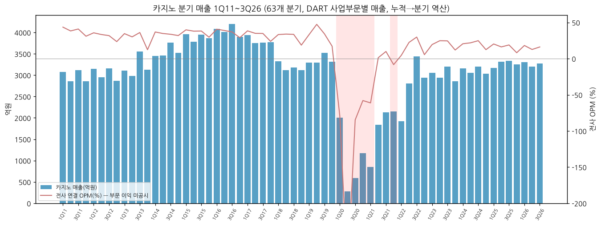
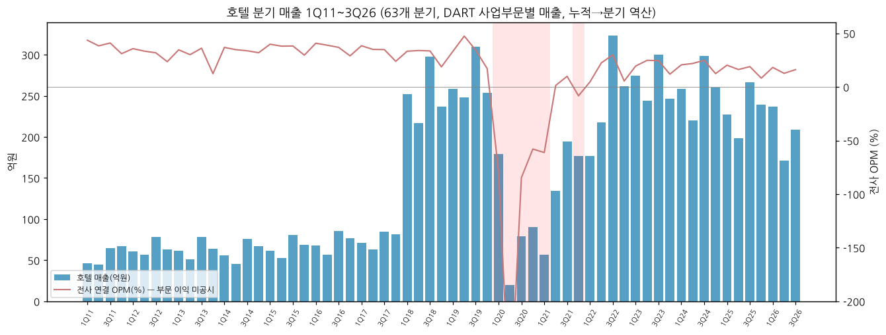
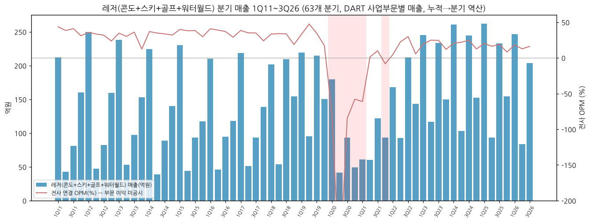
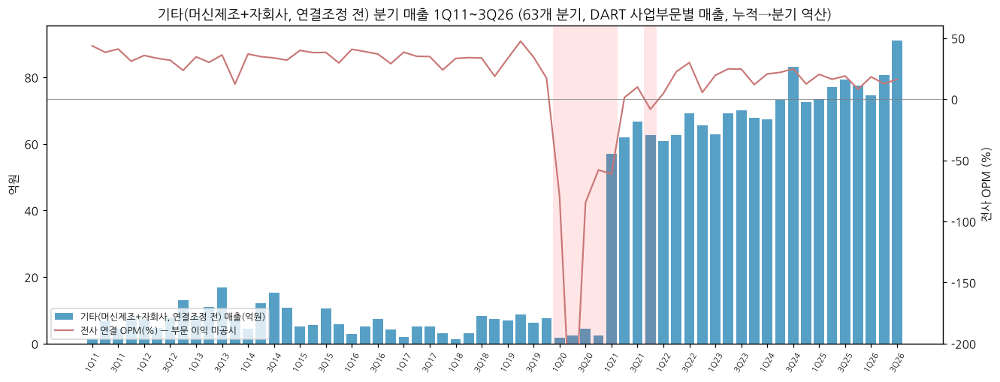

**부문 합계 vs 연결 cross-check (3Q26, 억원):** 카지노 3,278 + 호텔 209 + 레저(콘도 86·골프 39·스키 10·워터월드 68) 203 + 머신·자회사 91 = **3,781** vs 연결 매출 3,695 (차이 86 = 하이원파트너스 내부거래 연결조정) [DART 분기보고서(2026.09) II-4 누적 역산, 계산]

**3Q26 핵심 박스 (잠정실적 2026-11-06, 분기보고서 2026-11-16):**

| 항목 | 3Q26 | YoY | 9M26 | YoY |
|---|---|---|---|---|
| 연결 매출 | 3,695억 | -3.8% | 1.094조 | -1.6% |
| 카지노 매출 (K-IFRS) | 3,278억 | -1.8% | 9,780억 | -0.4% |
| 비카지노 매출 | 417억 | -17.4% | - | - |
| 연결 영업이익 | 597억 | -17.9% | 1,724억 | -16.1% |
| OPM | 16.2% | -2.7%p | 15.8% | -2.7%p |
| 세전이익 | 37억 | -97.4% | 1,985억 | -38.6% |
| 연결 순이익 | -20억 | 적전 | 1,475억 | -41.1% |
| 카지노 입장객 | 640,039명 | -3.2% | - | - |
| 카지노 GGR(영업매출) | 3,594억 | -2.5% | - | - |

(연결 손익 = DART 분기보고서(2026.09). 비카지노·입장객·GGR = 3Q26 잠정실적 보도 [Focus Gaming News 2026-11-09] — 3Q26 IR PDF는 irgo 미게시로 원문 미대조)

→ 영업이익 감소: 카지노 정체(-1.8%) + 객실 757실 리노베이션(2026-03 착수)으로 호텔 매출 -21.6%·콘도 -12%·워터월드 -14.5% [Focus Gaming News 2026-11-09]. 2Q26 영업이익 438억은 LTM 최저 (OPM 12.7%)
→ 매스(일반) GGR 2,949억 -4.8%·매스 드롭 -6.5% vs VIP GGR 645억 +9.6% — 2025-05 회원바카라 베팅한도 상향 효과가 VIP에서만 지속 [Focus Gaming News 2026-11-09]
→ **순손실 원인 = 금융자산 평가**: 3Q26 금융수익 -169억(FVPL 평가이익 -218억 환입) + 금융원가 384억(FVPL 평가손실 320억·처분손실 57억) [DART 분기보고서(2026.09) 연결 주석 26·27] — 금리 상승에 따른 채권형 금융자산 평가손 (금융자산 약 2.99조 보유 구조상 분기 순이익 변동성 큼)
→ 1Q26 기부금 183억(기타비용) [DART 분기보고서(2026.03) 주석 24] — 폐광지역 지원성 지출이 비경상적으로 발생
→ 2026 연간 투자예산 1,454억 중 3Q까지 1,101억 집행, 연말 전 자사주 200억 추가 매입 계획 [DART 분기보고서(2026.09) II-3, Focus Gaming News 2026-11-09]

**12분기 시계열 (연결, 매출 + OPM):**

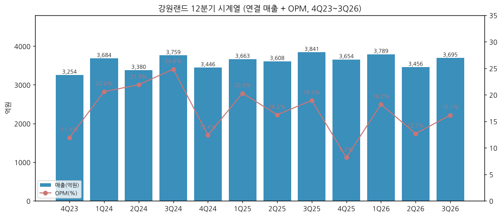

### ② 사업부별 개요 (매출 비중 큰 순서)

| 사업 | 주체 | 2025 매출 (억원) | 부문 합계 대비 | 사업 모델 |
|---|---|---|---|---|
| 카지노 | ㈜강원랜드 | 13,077 | 86.8% | 내·외국인 카지노. 일반영업장(테이블+머신) + 회원(VIP)영업장 + 외국인 전용 영업장. 영업매출(GGR) − 하이원포인트(콤프) + 카지노 식음 = K-IFRS 매출 |
| 호텔 | ㈜강원랜드 | 931 | 6.2% | 하이원그랜드호텔(메인·컨벤션타워)·팰리스호텔. 카지노 고객이 핵심 수요 |
| 콘도 | ㈜강원랜드 | 324 | 2.2% | 하이원 마운틴·밸리·힐콘도 |
| 스키 | ㈜강원랜드 | 211 | 1.4% | 슬로프 17면(21km), 곤돌라 3기 — 1Q·4Q 집중 |
| 워터월드 | ㈜강원랜드 | 120 | 0.8% | 2018-07 개장, 3Q 집중 |
| 골프 | ㈜강원랜드 | 88 | 0.6% | 18홀 퍼블릭 — 2Q·3Q 집중 |
| 머신제조 | ㈜강원랜드 | 3 | 0.0% | 자체 슬롯머신 HW/SW (GLI-11 인증 2017-12) |
| 자회사 | ㈜하이원추추파크(삼척), ㈜하이원파트너스 | 304 (연결조정 -290 전) | 2.0% | 철도테마파크 / 강원랜드 시설관리·차량서비스 (내부거래 위주) |

(DART 사업보고서(2025.12) II-1·II-2·II-4. 리조트 시설 규모는 DART 분기보고서(2026.09) II-2)

### ③ 사업부별 디테일

(1) 카지노 — 입장객은 늘지 않고, 1인당 베팅이 성장 driver

| 연도 | 카지노 영업매출 (억원) | YoY | 입장객 (명) | YoY | 1인당 영업매출 (원) [계산] | 카지노 순매출(K-IFRS, 억원) |
|---|---|---|---|---|---|---|
| 2015 | 15,611 | - | 3,133,391 | - | 498,229 | 15,561 |
| 2016 | 16,276 | +4.3% | 3,169,656 | +1.2% | 513,498 | 16,190 |
| 2017 | 15,231 | -6.4% | 3,114,948 | -1.7% | 488,965 | 15,226 |
| 2018 | 14,001 | -8.1% | 2,851,889 | -8.4% | 490,931 | 12,738 |
| 2019 | 14,816 | +5.8% | 2,895,191 | +1.5% | 511,730 | 13,423 |
| 2020 | 4,435 | -70.1% | 599,265 | -79.3% | 740,155 | 4,043 |
| 2021 | 7,750 | +74.7% | 844,140 | +40.9% | 918,101 | 6,971 |
| 2022 | 12,235 | +57.9% | 2,083,513 | +146.8% | 587,211 | 11,100 |
| 2023 | 13,202 | +7.9% | 2,413,082 | +15.8% | 547,109 | 12,060 |
| 2024 | 13,641 | +3.3% | 2,373,346 | -1.6% | 574,776 | 12,451 |
| 2025 | 14,317 | +5.0% | 2,478,658 | +4.4% | 577,611 | 13,077 |

(영업매출 = 관광기금 부과대상 카지노 매출(콤프 차감 전 GGR 성격), 입장객 = 문체부 집계 — 각 연도 DART 사업보고서 II-7 국내 카지노 현황 표(전년 수치). 2025는 IR 4Q25·1Q26 분기 합산 [계산]. 2011\~2014 입장객·영업매출 미확보)

→ 입장객은 2016 317만명 정점 → 2019 290만명 → 2025 248만명 (2016 대비 -21.8%) — 출입일수 제한(현행 허용 일수 미확인)·영업시간 단축 이후 회복하지 못함
→ 대신 1인당 영업매출 2019 51.2만원 → 2025 57.8만원 (+12.9%) [계산] — 베팅한도 상향(2025-05 회원바카라 3,000만원)·게임기구 증설(2024-09 허가 1,860대) 효과
→ **매출총량제**: 사감위가 사행산업별 매출 상한을 정하고 초과 시 제재 — 영업매출(A)이 관리 대상 [IR 2Q19 "영업매출(A) ☞ 매출총량제 관리 대상" 주석]. 2026 강원랜드 총량 한도 수치는 미확보

**카지노 영업장별 분기 (IR, 억원):**

| 분기 | 영업매출 계(A) | 일반테이블 | 회원영업장(VIP) | 슬롯머신 | 하이원포인트(B) | 카지노 매출 (K-IFRS) | 총 드롭액 | 입장객 (명) | 외국인 (명) | A/드롭 [계산] |
|---|---|---|---|---|---|---|---|---|---|---|
| 2Q18 | 3,417 | 1,516 | 544 | 1,358 | 304 | 3,113 | 14,750 | 663,382 | 8,229 | 23.2% |
| 3Q18 | 3,509 | 1,545 | 577 | 1,387 | 334 | 3,175 | 15,906 | 777,621 | 8,778 | 22.1% |
| 4Q18 | 3,434 | 1,553 | 564 | 1,317 | 314 | 3,120 | 15,180 | 680,737 | 8,960 | 22.6% |
| 1Q19 | 3,620 | 1,639 | 612 | 1,370 | 330 | 3,290 | 15,678 | 745,566 | 8,366 | 23.1% |
| 2Q19 | 3,631 | 1,621 | 616 | 1,394 | 340 | 3,291 | 15,898 | 668,687 | 7,481 | 22.8% |
| 4Q24 | 3,333 | 1,482 | 541 | 1,310 | 302 | 3,030 | 13,697 | 575,664 | 7,150 | 24.3% |
| 1Q25 | 3,444 | 1,604 | 487 | 1,353 | 320 | 3,169 | 14,549 | 621,035 | 6,725 | 23.7% |
| 2Q25 | 3,615 | 1,526 | 729 | 1,360 | 339 | 3,315 | 14,733 | 578,520 | 5,065 | 24.5% |
| 3Q25 | 3,685 | 1,670 | 588 | 1,427 | 388 | 3,337 | 16,026 | 661,196 | 7,103 | 23.0% |
| 4Q25 | 3,573 | 1,610 | 580 | 1,383 | 358 | 3,256 | 15,475 | 617,907 | 8,055 | 23.1% |
| 1Q26 | 3,600 | 1,594 | 621 | 1,385 | 340 | 3,304 | 15,008 | 625,916 | 7,003 | 24.0% |
| 3Q26 | 3,594 (GGR) | - | 645 (VIP GGR) | - | - | 3,278 | 미확보 | 640,039 | 미확보 | - |

(IR 2Q19(2019-09-02)·4Q25(2026-02-12)·1Q26(2026-05-21). 2025부터 카지노 식음업장 매출(분기 40\~44억)을 카지노 매출에 포함(C) — 2024 이전은 A−B, 2025\~는 A−B+C. 3Q26은 잠정실적 보도 [Focus Gaming News 2026-11-09]. 2019-3Q\~2024-3Q, 2Q26 분기 KPI는 IR PDF 미확보로 공란. "A/드롭"은 홀드율이 아니라 영업매출÷총드롭 [계산])

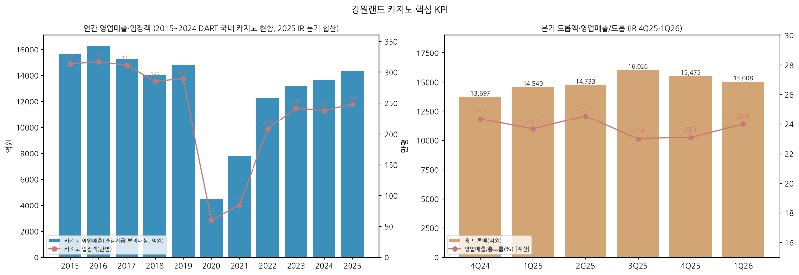

(2) 호텔 — 카지노 고객 의존 + 리노베이션 공백
→ 하이원그랜드호텔·팰리스호텔 객실: 강원권 4\~5성급 12개 호텔 2,741실 중 924실(약 34%) [DART 반기보고서(2020.06) II — 한국호텔업협회 2018-12 기준]
→ 호텔 매출 2023 1,065억 → 2025 931억 — 2025 감소는 카지노 식음 매출 재분류(연 약 166억 [IR 1Q25\~4Q25 C 합산, 계산]) 영향이 큼
→ 그랜드호텔 메인타워 477실 리노베이션 2026-1Q\~2028-1Q → 3Q26 호텔 매출 -21.6% [DART 분기보고서(2026.09) II-2, Focus Gaming News 2026-11-09]

(3) 레저(콘도·스키·골프·워터월드) — 계절형, 구조적 적자
→ 2025 레저 4개 사업 매출 743억 vs 매출원가 1,415억 (콘도 636·스키 453·골프 76·워터월드 250) [IR 4Q25 요약 연결손익, 계산] → 원가 기준 약 672억 적자 — 폐광지역 관광 활성화라는 공공 목적 사업
→ 계절성: 스키 1Q(1Q26 126억)·4Q, 워터월드 3Q(3Q25 80억), 골프 2\~3Q [IR]
→ 마운틴콘도 280실 리노베이션 2026-1Q\~2027-4Q [DART 분기보고서(2026.09)]

(4) 기타 — 머신제조·자회사
→ 슬롯머신 제조: 2019년 첫 매출 4.9억, 2024 9.4억, 2025 3.2억 [DART] — 규모 미미
→ 하이원추추파크(삼척 도계, 철도테마·객실 30실) 2025 매출 14억, 하이원파트너스(시설관리) 290억 (대부분 내부거래) [DART 사업보고서(2025.12)]

### ④ 주요 경쟁사 (사업별)

| 사업 | 국내 경쟁 | 비고 |
|---|---|---|
| 카지노(내국인) | **없음 (법정 독점)** | 대체재: 해외 카지노(마카오·필리핀·베트남·캄보디아), 불법 온라인 도박(회사 추정 규모 약 96조원 [DART 분기보고서(2026.09) II-7]) |
| 카지노(외국인 전용, 간접) | 파라다이스(워커힐·부산·제주·파라다이스시티 2024 영업매출 합계 8,307억), GKL 세븐럭 3곳 3,937억, 드림타워 3,203억, 인스파이어 1,733억 | 2024 관광기금 부과대상 매출 [DART 사업보고서(2025.12) II-7, 계산]. 외국인 전용 17곳 합계 1.86조 vs 강원랜드 1.36조 |
| 복합리조트(해외) | 마카오·싱가포르 IR, 일본 오사카 IR(2030 개장 예정) | 오사카 IR은 한국 VIP 고객 이탈 리스크로 언급 [뉴시스 2026-07-08] |
| 리조트(국내) | 대명비발디파크, 휘닉스파크, 용평리조트, 무주덕유산, 오크밸리, 웰리힐리 | [DART 사업보고서(2025.12) II-7 레저 시장 여건] |

### ⑤ 주요 매출처

> DART 사업보고서: "매출에 중대한 영향을 끼치는 주요 거래처는 없습니다" — 불특정 다수 개인(내국인) 고객. 판매경로: 카지노 = 일반·회원·외국인 전용 영업장 직접, 비카지노 = 직접판매(전화·홈페이지·앱)·국내외 대리점·세일즈 사무소(서울·부산·대전·대구) [DART 사업보고서(2025.12) II-4]

| 구분 (2025, 연결) | 금액 (억원) | 비중 |
|---|---|---|
| 용역의 제공으로 인한 수익 (카지노·숙박·레저) | 14,626 | 99.0% |
| 재화의 판매로 인한 수익 (식음·상품·슬롯머신) | 141 | 1.0% |
| **합계** | **14,767** | 100% |

(OpenDART fnlttSinglAcntAll 2025 FY 포괄손익계산서. 외국인 입장객 비중 1.3% (2025 분기 합산 26,948명 / 247.9만명 [IR, 계산]) — 매출은 사실상 전량 내국인)

### ⑥ 생산 CAPA + 임직원

- **카지노 영업장**: 회원 968.51㎡·일반 19,976.8㎡·외국인 전용 283.88㎡, 영업시간 20시간/일 [DART 분기보고서(2026.09) II-2]
- **게임기구**: 허가 1,860대 (2024-09), 현행 테이블 200대(전자테이블 7대 포함)·머신 1,362대 — 일반영업장 블랙잭 17대·바카라 등 일부는 **제2카지노 완공 후 배치 예정** [DART 분기보고서(2026.09) II-2]
- **리조트**: 그랜드호텔·팰리스호텔·콘도(객실), 스키 슬로프 17면·곤돌라 3기·리프트 6기, 골프 18홀(6,592m), 워터월드(어트랙션풀 9종·슬라이드 7종), 추추파크 객실 30실 [DART 분기보고서(2026.09) II-2]
- **투자 진행(2026-09)**: 제2카지노 신축 1,796억(2027 완공 목표), 회원영업장 리모델링 299억(2027-2Q), 객실 리노베이션 757실(2026-1Q\~2028-1Q) [DART 분기보고서(2026.09) II-3]
- **임직원 (별도, 2025말)**: **4,906명** (정규 3,724 / 계약 1,182) — 카지노 2,513명(51.2%), 호텔 659명, 팰리스·콘도 216명, 스키·골프 641명, 워터파크 90명, 지원 787명. 1인 평균 급여 약 7,082만원, 연간 급여총액 3,474억 [OpenDART empSttus 2025, 계산]. 연결 종업원급여 3,682억 (2024 3,192억, +15.3%) [DART 사업보고서(2025.12) 비용의 성격별 분류]

---

## 4. 재무 구조

> **재무제표 수치: OpenDART fnlttSinglAcntAll (연결 CFS), 2026-11-25 조회.** 2014 = 2015 사업보고서 전기 컬럼. 4Q = 연간 − 3Q 누적. 연간 분기 합 = 연간 (2011\~2025 일치 확인). 단위 억원(표기 없으면). 기능별 표시(매출원가·판관비). [계산] 표기는 DART 원수치로 직접 산출한 값

### ① 손익계산서 (12년 연결, 억원)

| 연도 | 매출 | 매출원가 | 매출총이익 | GPM | 판관비 | 폐광기금 (별도 표시분) | 영업이익 | OPM | 금융수익 | 기타손익(순) | 세전이익 | 법인세 | 순이익 | NPM | EPS(원) |
|---|---|---|---|---|---|---|---|---|---|---|---|---|---|---|---|
| 2014 | 14,965 | 7,223 | 7,742 | 51.7% | 1,177 | 1,434 | 5,132 | 34.3% | 452 | -422 | 4,959 | 1,366 | 3,593 | 24.0% | 1,772 |
| 2015 | 16,337 | 7,596 | 8,741 | 53.5% | 1,170 | 1,617 | 5,954 | 36.4% | 428 | -443 | 5,939 | 1,523 | 4,416 | 27.0% | 2,178 |
| 2016 | 16,965 | 7,852 | 9,114 | 53.7% | 1,262 | 1,665 | 6,186 | 36.5% | 413 | -623 | 5,969 | 1,423 | 4,545 | 26.8% | 2,242 |
| 2017 | 16,045 | 7,875 | 8,169 | 50.9% | 1,278 | 1,582 | 5,309 | 33.1% | 536 | -173 | 5,662 | 1,287 | 4,375 | 27.3% | 2,159 |
| 2018 | 14,381 | 7,296 | 7,085 | 49.3% | 1,529 | 1,248 | 4,307 | 30.0% | 500 | -593 | 4,107 | 1,135 | 2,972 | 20.7% | 1,467 |
| 2019 | 15,201 | 7,367 | 7,834 | 51.5% | 2,823 | 1,452 | 5,012 | 33.0% | 834 | -935 | 4,889 | 1,543 | 3,347 | 22.0% | 1,651 |
| 2020 | 4,786 | 5,445 | -659 | -13.8% | 3,657 | (원가/판관비 내) | -4,316 | -90.2% | 570 | -137 | -4,045 | -1,286 | -2,759 | -57.6% | -1,361 |
| 2021 | 7,884 | 7,268 | 616 | 7.8% | 1,143 | (원가/판관비 내) | -527 | -6.7% | 666 | -203 | -142 | -36 | -106 | -1.3% | -52 |
| 2022 | 12,707 | 9,218 | 3,489 | 27.5% | 1,313 | (원가/판관비 내) | 2,176 | 17.1% | 280 | -183 | 1,679 | 522 | 1,156 | 9.1% | 570 |
| 2023 | 13,886 | 9,794 | 4,092 | 29.5% | 1,269 | (원가/판관비 내) | 2,823 | 20.3% | 2,159 | -210 | 4,572 | 1,164 | 3,409 | 24.5% | 1,681 |
| 2024 | 14,269 | 10,080 | 4,189 | 29.4% | 1,331 | (원가/판관비 내) | 2,858 | 20.0% | 1,789 | 1,030 | 5,653 | 1,085 | 4,569 | 32.0% | 2,257 |
| 2025 | 14,767 | 10,940 | 3,827 | 25.9% | 1,474 | (원가/판관비 내) | 2,353 | 15.9% | 1,806 | -228 | 3,894 | 712 | 3,182 | 21.5% | 1,572 |

(폐광지역개발기금: 2014\~2018 손익계산서에 "폐광지역개발기금" 별도 행(영업비용), 2019\~2020 판관비 포함(2020 판관비 3,657억 중 기금 2,250억), 2021\~ 매출원가 포함. 2014\~2018 매출총이익 − 판관비 − 기금 = 영업이익. 기타손익(순) = 기타수익 − 기타비용(기부금 포함). 2024 기타수익 1,291억 = 부가가치세 부과처분 취소소송 승소 환급 750억(소송액 684억 + 가산금 66억) 등 [IR 1Q26 주석]. 금융수익 = 이자 + FVPL 평가·처분이익 — 2023\~ 채권형 FVPL 확대로 연 1,800\~2,200억)

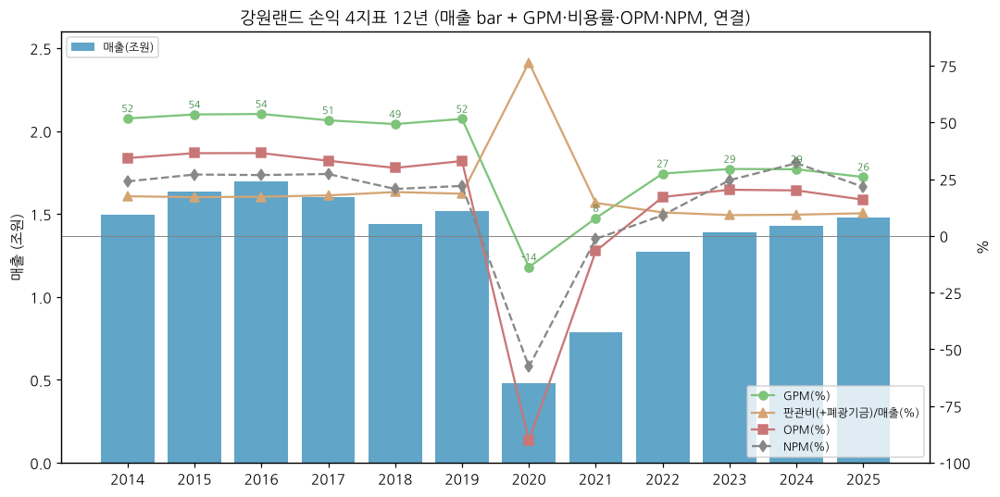

**비용 구조 — 매출 연동 준조세 3종 (카지노 영업매출 기준) [IR 4Q25·1Q26]:**
→ 폐광지역개발기금 13% + 관광진흥개발기금 10% + 개별소비세(교육세 포함) 5.2% = **영업매출의 약 28%** — 카지노 매출이 1% 늘면 비용도 자동으로 0.28% 증가하는 구조
→ 2025 연결 비용(성격별) 1.24조: 종업원급여 3,682억 · 폐광기금 1,861억 · 관광기금 1,426억 · 용역비 1,048억 · 세금과공과 875억 · 감가상각 837억 [DART 사업보고서(2025.12) 연결 주석 29]
→ 입장세(1인 9,000원: 개소세 6,300·교육세 1,890·부가세 810원)는 전액 국고 [DART 사업보고서(2025.12) II-7]

**폐광지역개발기금 12년 (비용, 억원):**

| 연도 | 폐광지역개발기금 (억원) | 산정 기준 | 기금/매출 | 기금/영업이익 전(=OP+기금) |
|---|---|---|---|---|
| 2014 | 1,434 | 세전이익 25% | 9.6% | 21.8% |
| 2015 | 1,617 | 세전이익 25% | 9.9% | 21.4% |
| 2016 | 1,665 | 세전이익 25% | 9.8% | 21.2% |
| 2017 | 1,582 | 세전이익 25% | 9.9% | 23.0% |
| 2018 | 1,248 | 세전이익 25% | 8.7% | 22.5% |
| 2019 | 1,452 | 세전이익 25% | 9.6% | 22.5% |
| 2020 | 2,250 | 세전이익 25% + 2014\~2019 과소징수분 추징 포함 | 47.0% | n/m |
| 2021 | 1,008 | 카지노 매출 13% | 12.8% | 209.5% |
| 2022 | 1,590 | 카지노 매출 13% | 12.5% | 42.2% |
| 2023 | 1,716 | 카지노 매출 13% | 12.4% | 37.8% |
| 2024 | 1,773 | 카지노 매출 13% | 12.4% | 38.3% |
| 2025 | 1,861 | 카지노 매출 13% | 12.6% | 44.2% |

(DART 사업보고서 연결 주석 비용의 성격별 분류(2019\~2025) / 2014\~2018 손익계산서 별도 행. 2020은 2014\~2019 과소징수분 부과처분(강원도, 2020-04·05, 소송가액 2,250억) 반영 — 회사는 부과처분 취소소송 진행, 2023-12 2심 일부 승소 후 쌍방 상고 [DART 사업보고서(2023.12)·(2025.12) 우발부채·소송]. 2021부터 "카지노 매출 13%"로 산식 변경 — 기금이 이익이 아니라 매출에 연동되면서 **영업 레버리지가 커짐**(적자 연도에도 기금 부담))

**일회성 항목 정리 (순이익·영업이익 왜곡 분기):**

| 분기 | 항목 | 금액 | 영향 | 출처 |
|---|---|---|---|---|
| 2020 | 폐광기금 과소징수분(2014\~2019) 부과 | 2,250억 (판관비) | 영업손실 확대 | DART 사업보고서(2021.12) 주석 |
| 4Q24 | 부가세 부과처분 취소소송 승소 환급 | 750억 (기타이익) | 순이익 ↑ (4Q24 1,122억) | IR 4Q25·1Q26 |
| 4Q25 | 법인세 비용 -3억 (전년 245억) | - | 4Q25 순이익 660억 지지 | IR 4Q25 |
| 1Q26 | 기부금 | 183억 (기타비용) | 세전이익 ↓ | DART 분기보고서(2026.03) 주석 24 |
| 3Q26 | FVPL 금융자산 평가·처분손실 + 평가이익 환입 | 금융수익 -169억 / 금융원가 384억 | 순손실 -20억 | DART 분기보고서(2026.09) 주석 26·27 |
| 3Q25\~2028-1Q | 지반침하 구역 안전보강공사 비용 감가상각 처리 | 분기 약 27억 | 영업이익 ↓ | IR 4Q25 |

### ② 재무상태표 (12년 연결, 조원)

| 연도 | 자산총계 | 유동자산 | 현금성자산 | 유동금융자산 | 비유동금융자산 | 유형자산 | 부채총계 | 유동부채 | 자본총계 | 자기주식 | 부채비율 | 유동비율 |
|---|---|---|---|---|---|---|---|---|---|---|---|---|
| 2014 | 3.38 | 1.37 | 0.10 | 1.25 | 0.38 | 1.39 | 0.67 | 0.62 | 2.71 | 0.000 | 24.8% | 219.7% |
| 2015 | 3.69 | 1.75 | 0.11 | 1.62 | 0.36 | 1.35 | 0.69 | 0.66 | 3.00 | 0.000 | 23.1% | 263.4% |
| 2016 | 3.98 | 1.81 | 0.09 | 1.70 | 0.62 | 1.32 | 0.73 | 0.72 | 3.25 | 0.000 | 22.3% | 251.7% |
| 2017 | 4.19 | 2.16 | 0.11 | 2.03 | 0.47 | 1.30 | 0.68 | 0.68 | 3.50 | 0.000 | 19.5% | 317.7% |
| 2018 | 4.23 | 1.76 | 0.05 | 1.68 | 0.93 | 1.31 | 0.64 | 0.64 | 3.59 | 0.000 | 18.0% | 276.6% |
| 2019 | 4.44 | 1.88 | 0.06 | 1.77 | 0.98 | 1.37 | 0.72 | 0.65 | 3.72 | 0.174 | 19.4% | 288.4% |
| 2020 | 3.64 | 1.50 | 0.07 | 1.40 | 0.46 | 1.35 | 0.39 | 0.33 | 3.25 | 0.174 | 12.2% | 454.0% |
| 2021 | 3.83 | 1.66 | 0.21 | 1.43 | 0.51 | 1.30 | 0.57 | 0.51 | 3.25 | 0.174 | 17.7% | 327.0% |
| 2022 | 4.17 | 1.21 | 0.10 | 1.08 | 1.30 | 1.26 | 0.75 | 0.69 | 3.42 | 0.174 | 22.0% | 175.4% |
| 2023 | 4.45 | 1.39 | 0.17 | 1.19 | 1.51 | 1.23 | 0.77 | 0.70 | 3.68 | 0.174 | 21.0% | 198.4% |
| 2024 | 4.70 | 1.21 | 0.24 | 0.93 | 1.97 | 1.25 | 0.82 | 0.75 | 3.88 | 0.214 | 21.0% | 161.9% |
| 2025 | 4.85 | 3.24 | 0.20 | 3.01 | 0.02 | 1.32 | 0.88 | 0.80 | 3.96 | 0.225 | 22.2% | 403.4% |

(차입금 없음 — 부채 대부분은 매입채무및기타채무(미지급 폐광기금·관광기금·개별소비세 등 익년 납부분, 2025말 6,562억)·충당부채 [OpenDART 2025 BS]. 금융자산 분류: 2025말 비유동금융자산 1.97조 → 유동(만기 1년 이내) 재분류로 유동금융자산 3.01조. **3Q26말**: 자산 4.68조 / 부채 0.77조 / 자본 3.91조, 현금 1,046억 + 유동금융자산 6,913억 + 비유동금융자산 2.20조 = **2.99조**, 자기주식 2,541억, 부채비율 19.8% [DART 분기보고서(2026.09), 계산])

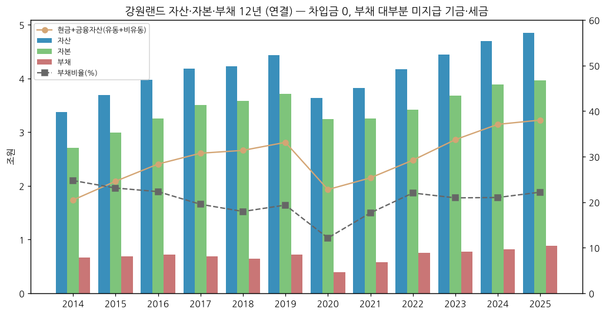

### ③ 현금흐름표 (12년 연결, 억원)

| 연도 | 영업CF | 투자CF | 재무CF | CapEx(유형) | CapEx(무형) | FCF | 배당지급 | 자사주 취득 | 감가상각비 | 법인세 납부 |
|---|---|---|---|---|---|---|---|---|---|---|
| 2014 | 5,104 | -4,274 | -1,480 | 802 | 3 | 4,299 | 1,480 | - | 756 | - |
| 2015 | 5,750 | -3,989 | -1,723 | 404 | 0 | 5,346 | 1,723 | - | 743 | - |
| 2016 | 5,965 | -4,115 | -1,977 | 746 | 0 | 5,219 | 1,987 | - | 750 | - |
| 2017 | 4,631 | -2,502 | -2,003 | 855 | 0 | 3,776 | 2,007 | - | 742 | - |
| 2018 | 3,639 | -2,020 | -2,024 | 1,033 | 1 | 2,606 | 2,007 | - | 661 | - |
| 2019 | 4,079 | -2,113 | -1,848 | 796 | 14 | 3,269 | 1,825 | - | 723 | - |
| 2020 | -6,557 | 8,446 | -1,836 | 590 | 8 | -7,154 | 1,825 | - | 773 | - |
| 2021 | 2,109 | -739 | 33 | 429 | 0 | 1,679 | 0 | - | 794 | - |
| 2022 | 4,202 | -5,242 | -13 | 294 | 6 | 3,901 | 0 | - | 782 | - |
| 2023 | 3,378 | -2,027 | -700 | 708 | 1 | 2,669 | 710 | - | 805 | - |
| 2024 | 4,870 | -1,781 | -2,307 | 1,075 | 115 | 3,681 | 1,885 | 400 | 785 | - |
| 2025 | 2,945 | -944 | -2,442 | 1,159 | 57 | 1,729 | 2,345 | 77 | 844 | - |

(FCF = 영업CF − 유·무형 취득. 투자CF는 단기·장기 금융상품 매매(연 수천억\~1조 규모)가 섞여 사업 투자 규모를 반영하지 않음. 배당지급 = 연결 CF 지급액(결산배당 익년 지급 → ⑥ 표와 1년 시차). 2020 영업CF -6,557억 = 휴장 + 폐광기금 추징 납부(2017\~2019분 1,071억 등))

→ **9M26**: 영업CF 524억 (9M25 1,357억), 유·무형 취득 923억, 배당지급 1,883억, 자사주 취득 323억 [DART 분기보고서(2026.09)] — 1H26 영업CF -289억(미지급 기금·세금 납부 1,531억 집중) [IB토마토 2026-10-08]
→ 2014\~2025 누적 FCF 3.10조 vs 누적 배당지급 1.78조 + 자사주 0.05조 [계산] — FCF의 약 59%를 주주환원, 나머지는 금융자산으로 축적(현금+금융자산 2014 1.74조 → 2025 3.22조)

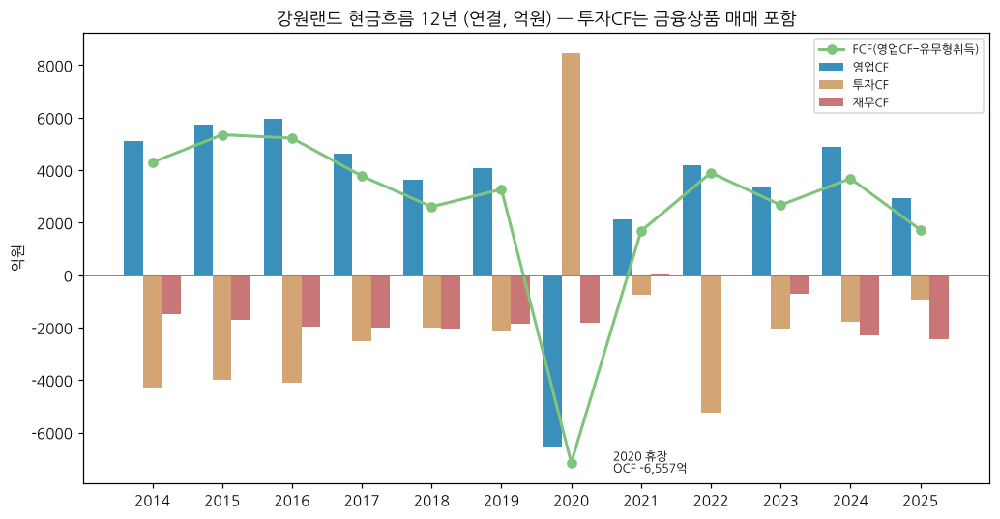

### ④ CapEx 추이 (12년, 억원)

| 연도 | 유형 | 무형 | 총 CapEx | CapEx/매출 | 감가상각비(유·무형) | CapEx/감가상각 |
|---|---|---|---|---|---|---|
| 2014 | 802 | 3 | 805 | 5.4% | 756 | 1.06x |
| 2015 | 404 | 0 | 404 | 2.5% | 743 | 0.54x |
| 2016 | 746 | 0 | 746 | 4.4% | 750 | 0.99x |
| 2017 | 855 | 0 | 855 | 5.3% | 742 | 1.15x |
| 2018 | 1,033 | 1 | 1,034 | 7.2% | 661 | 1.56x |
| 2019 | 796 | 14 | 809 | 5.3% | 723 | 1.12x |
| 2020 | 590 | 8 | 597 | 12.5% | 773 | 0.77x |
| 2021 | 429 | 0 | 430 | 5.4% | 794 | 0.54x |
| 2022 | 294 | 6 | 301 | 2.4% | 782 | 0.38x |
| 2023 | 708 | 1 | 710 | 5.1% | 805 | 0.88x |
| 2024 | 1,075 | 115 | 1,190 | 8.3% | 785 | 1.52x |
| 2025 | 1,159 | 57 | 1,216 | 8.2% | 844 | 1.44x |

- **세 번의 투자 구간**: ① 2014\~2019 유지보수 + 워터월드 신축(2016\~2018) 포함 CapEx 400\~1,030억 ② 2020\~2022 휴장기 축소(300\~598억) ③ 2023\~ 재확대 — 2024 1,190억·2025 1,216억, 9M26 923억 (제2카지노·리노베이션·슬롯머신 교체)
- 회사 집계 투자 집행액(VAT 포함): 2023 647억 → 2024 1,198억 → 2025 1,437억, 2026 예산 1,454억 [IB토마토 2026-10-08, IR 4Q25]
- **K-HIT 투자 규모 비교**: 2035년까지 3조원 = 연평균 약 3,000억 [계산, 단순 균등 가정] → 현재 CapEx의 2.5배. CapEx/감가상각 2025 1.44x → K-HIT 본격화 시 3x 이상 가능성 [⚠️ 추정 — 회사 연도별 집행 계획 미공시]

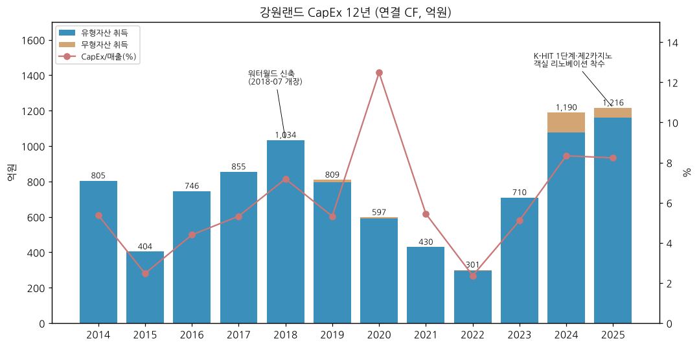

### ⑤ 부채구조 + 채무증권 발행 history

- **차입금 0** — 2014\~3Q26 사채·장기차입 발행 없음 (2017말 장기차입금 14억이 유일한 차입 잔액 이력(2018 상환), 2024 상환 5억) [OpenDART BS·CF]
- 이자비용 연 27\~28억 (2024\~2025) = 주로 리스·충당부채 할인 이자 [OpenDART 2025 CF 이자비용 27.4억]
- 부채 구성(2025말): 유동부채 8,027억 중 매입채무및기타채무 6,562억 — **익년 납부하는 폐광기금(1,861억)·관광기금(1,426억)·개별소비세** 등 준조세 미지급분이 핵심 [OpenDART, DART 사업보고서(2025.12) II-7]
- 신용등급: **미확보** (공모 채권 미발행)
- 순차입금 (3Q26): 차입금 0 − (현금 1,046억 + 유동금융자산 6,913억 + 비유동금융자산 21,970억) = **-29,929억 (순현금)** [계산 — 비유동금융자산에는 장기금융상품·FVPL 채권 등 포함, 처분 제약 여부는 미확인]

### ⑥ 배당·자사주 추이 (12년)

| 사업연도 | DPS(원) | 배당총액 (억원) | 연결 순이익 (억원) | 연결 배당성향 (DART) | 자사주 취득 (억원, CF) | 연말 종가(원) | 연말 배당수익률 [계산] |
|---|---|---|---|---|---|---|---|
| 2014 | 850 | 1,723 | 3,593 | 47.96% | - | 30,400 | 2.8% |
| 2015 | 980 | 1,987 | 4,416 | 44.99% | - | 38,400 | 2.6% |
| 2016 | 990 | 2,007 | 4,545 | 44.16% | - | 35,750 | 2.8% |
| 2017 | 990 | 2,007 | 4,375 | 45.87% | - | 34,800 | 2.8% |
| 2018 | 900 | 1,825 | 2,972 | 61.39% | - | 32,000 | 2.8% |
| 2019 | 900 | 1,825 | 3,347 | 54.52% | - | 29,600 | 3.0% |
| 2020 | 0 | - | -2,759 | -(무배당) | - | 23,500 | 0.0% |
| 2021 | 0 | - | -106 | -(무배당) | - | 24,050 | 0.0% |
| 2022 | 350 | 710 | 1,156 | 61.4% | - | 23,200 | 1.5% |
| 2023 | 930 | 1,885 | 3,409 | 55.3% | - | 16,000 | 5.8% |
| 2024 | 1,170 | 2,345 | 4,569 | 51.3% | 400 | 15,970 | 7.3% |
| 2025 | 950 | 1,883 | 3,182 | 59.2% | 77 | 18,950 | 5.0% |

(DPS·배당총액·배당성향 = DART 사업보고서 "배당에 관한 사항"(2014·2016·2017·2019·2022·2025 사업보고서). 연말 배당수익률 = DPS / Yahoo 연말 종가 [계산] — DART 공시 시가배당률(주주명부폐쇄 전 1주일 평균가 기준, 2025 4.9%·2024 7.3%)과 다름. 자사주 = 연결 CF "자기주식 취득")

- **배당정책**: 2024\~2026 사업연도 배당성향 50% 이상 + 총주주환원율 60% [IB토마토 2026-10-08, Focus Gaming News 2026-11-09]. 공기업으로 기획재정부 배당 가이드라인 적용 대상 (일반 공지 사실 — DART 원문 미대조)
- **자기주식 이력**: 장기 보유 11,201,502주(5.24%, 2013\~2023) → 2024 400억 매입 → 2025말 14,124,816주(장내 직접 5,019,086 + 신탁 현물 9,105,730) → 2026-06말 **15,746,696주 (7.36%)** — 소각 이력 없음 [DART 사업보고서(2013.12)·(2025.12), 반기보고서(2026.06) I-4]
- 자사주 매입: 2024 400억, 2025-12\~2026-02 400억, 2026 하반기 200억 계획 [IB토마토 2026-10-08]
- 현재가 기준 배당수익률 **6.8%** (2025 DPS 950원 / 14,040원) [계산]

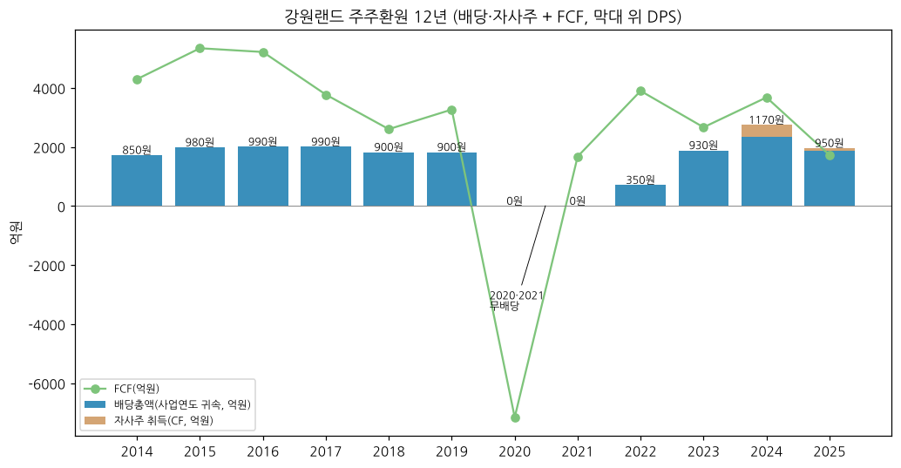

### ⑦ 재무 비율 + 밸류에이션 밴드 (12년)

| 연도 | ROE(지배) | ROA | 부채비율 | 유동비율 | 순현금성 금융자산 (조원) | 연말 종가(원) | 연말 시총(조원) | PBR | PER |
|---|---|---|---|---|---|---|---|---|---|
| 2014 | - | - | 24.8% | 219.7% | 1.74 | 30,400 | 6.50 | 2.40x | 18.1x |
| 2015 | 15.5% | 12.5% | 23.1% | 263.4% | 2.09 | 38,400 | 8.22 | 2.74x | 18.6x |
| 2016 | 14.5% | 11.9% | 22.3% | 251.7% | 2.41 | 35,750 | 7.65 | 2.35x | 16.8x |
| 2017 | 13.0% | 10.7% | 19.5% | 317.7% | 2.61 | 34,800 | 7.45 | 2.13x | 17.0x |
| 2018 | 8.4% | 7.1% | 18.0% | 276.6% | 2.66 | 32,000 | 6.85 | 1.91x | 23.0x |
| 2019 | 9.2% | 7.7% | 19.4% | 288.4% | 2.81 | 29,600 | 6.33 | 1.70x | 18.9x |
| 2020 | -7.9% | -6.8% | 12.2% | 454.0% | 1.93 | 23,500 | 5.03 | 1.55x | n/m(적자) |
| 2021 | -0.3% | -0.3% | 17.7% | 327.0% | 2.15 | 24,050 | 5.15 | 1.58x | n/m(적자) |
| 2022 | 3.5% | 2.9% | 22.0% | 175.4% | 2.48 | 23,200 | 4.96 | 1.45x | 42.9x |
| 2023 | 9.6% | 7.9% | 21.0% | 198.4% | 2.86 | 16,000 | 3.42 | 0.93x | 10.0x |
| 2024 | 12.1% | 10.0% | 21.0% | 161.9% | 3.15 | 15,970 | 3.42 | 0.88x | 7.5x |
| 2025 | 8.1% | 6.7% | 22.2% | 403.4% | 3.22 | 18,950 | 4.05 | 1.02x | 12.7x |

**주요 비율 의미:**
- **ROE**: 지배순이익 / 평균 지배자본 — 2015 15.5% 정점 → 2018 8.4%(규제) → 2020 -7.9%(휴장) → 2024 12.1%(부가세 환급 포함) → 2025 8.1%. 자본의 약 80%가 저수익 금융자산이라 구조적으로 ROE 상한이 낮음
- **부채비율**: 12\~25% (차입금 0, 준조세 미지급분)
- **유동비율**: 2025 403.4% — 금융자산 만기 재분류로 급등
- **PBR·PER 밴드**: 연말 종가 × 213,940,500주 / 지배자본·지배순이익 [계산]. PBR 2015 2.74배 → 2023 첫 1배 하회 → 현재 0.77배. PER은 2022(42.9배, 이익 정상화 초기) 제외 7.5\~23배
- 현재 (2026-11-24): PER 14.0배 (LTM 지배순이익 2,152억), PBR 0.77배 (3Q26 지배자본 3.91조) [계산]

---

## 5. 지배 구조

### ① 그룹·계열 관계

```
                 대한민국 정부 (99.90%)
                        │
              한국광해광업공단 (2021-09 광해관리공단+광물자원공사 통합)
                        │ 36.27%
   정선군 5.02% ── ㈜강원랜드 (035250) ── 국민연금 5.27% (2025말)
                        │
         ┌──────────────┴──────────────┐
  ㈜하이원추추파크 (삼척 도계)      ㈜하이원파트너스
  철도테마파크·숙박                 강원랜드 시설관리·차량서비스
```

(DART 분기보고서(2026.09) I-1·VII, 사업보고서(2025.12) VII. 연결대상 종속회사 3사(상장 1 = 강원랜드 / 비상장 2). 최대주주 기준 계열회사 총 24개사(강원랜드만 상장). 관계기업 투자지분 466억(2025말) [OpenDART BS])

- **공공 지배 구조**: 광해광업공단(정부 출자) + 정선군 등 지자체 — 시장형 공기업으로 사장 임명은 산업통상자원부(주무부처) 경로. 2023-12\~2026-09 사장 공백 2년 9개월 [IB토마토 2026-10-08]
- 최대주주 재무: 한국광해광업공단 자본총계 **-3.36조** (2026-06, 자본잠식), 1H26 순손실 2,563억 [DART 분기보고서(2026.09) VII] — 강원랜드 배당은 공단의 주요 현금원 (배당 정책 압력 요인, 정성)
- 교차 참조: 같은 서브섹터(면세·카지노·여행) 종목 비교는 ④-1 박스(통합 검수) 참조

### ② 주주 구분

| 주주 | 주식수 | 지분율 | 기준 |
|---|---|---|---|
| 한국광해광업공단 | 77,587,786 | 36.27% | 2026-09-30 |
| 정선군청 | 10,736,543 | 5.02% | 2026-09-30 |
| 국민연금공단 | 11,280,055 | 5.27% | 2025-12-31 (2026-09-30 5% 이상 주주 명단에는 미기재 → 5% 미만으로 감소 추정) |
| 우리사주조합 | 2,461 | 0.00% | 2026-09-30 |
| 자기주식 | 15,746,696 | 7.36% | 2026-06-30 |
| 소액주주 (1% 미만) | 77,826,870 | 36.38% | 2026-09-30, 96,195명 |
| 기타 (1% 이상 기관·지자체 등, 차감) | 약 32.0백만 | 약 15.0% | [계산] |
| **발행주식 총수** | **213,940,500** | 100% | 증자·소각 이력 없음 |

(DART 분기보고서(2026.09) VII 최대주주·5% 이상 주주·소액주주 현황, 반기보고서(2026.06) I-4 주식의 총수. 2015말에는 강원도개발공사 6.11%·국민연금 5.58%가 5% 이상 주주였음 [DART 사업보고서(2015.12)]. **외국인 지분율: 미확보** (DART 미공시, 이번 버전 시장 데이터 조회 실패))

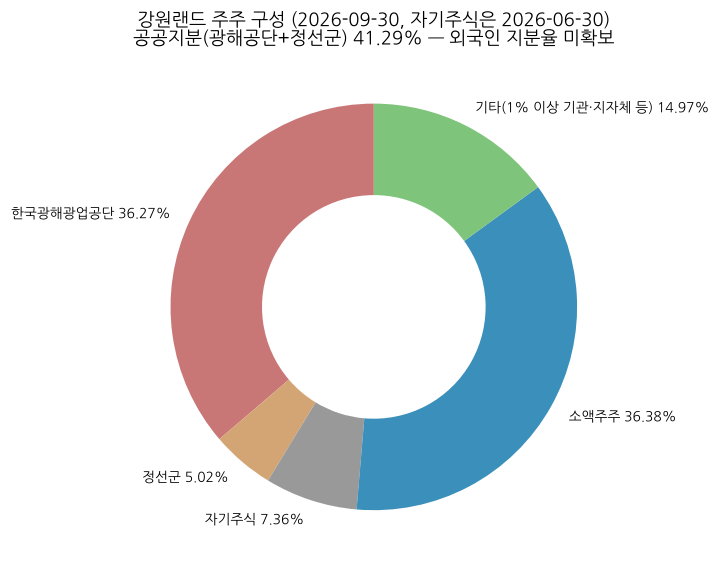

### ③ 임원·이사회

- **대표이사: 김도균 사장** (1965-07생) — 前 육군 수도방위사령관(중장), 국방부 국방정책실 대북정책관, 청와대 국가안보실 국방개혁비서관. 임기 2026-09-02\~2029-09-01 [DART 분기보고서(2026.09) VIII]. 취임 일성: K-HIT 속도, "글로벌 공공형 복합리조트", 폐광지역 상생 [MTN 2026-09-03]. 정치권 일각의 임명 적정성 문제 제기 보도 [Focus Gaming News 2026-11-09 관련 헤드라인 — 본문 미대조]
- **상임이사**: 장경열 상임감사위원(前 국정원 강원지부장, 2026-09-09\~), 유정배 부사장(前 대한석탄공사 사장, 2026-09-03\~) [DART 분기보고서(2026.09) VIII]
- **이사회 의장**: 노승만 선임비상임이사(독립이사, 前 강원연구원 본부장, 2026-04-15\~) — 감사위원장 박완성(공인회계사), 감사위원 최우식(변호사·노무사). 노동이사(기타비상무이사) 제도 운영 [DART 분기보고서(2026.09)·반기보고서(2026.06) VIII]
- 사외이사 다수가 폐광지역(정선·영월·삼척·태백) 지역 인사 — 임기 만료 후 후임 미선임 상태로 계속 기재된 이사 존재(권기홍·한우영, 임기 2025-01-15 만료 표기) [DART 분기보고서(2026.09) VIII]
- 2025말 등기임원 보수: 상임이사 4명 주총 승인 10.5억, 비상임 9명 2.7억 [DART 사업보고서(2025.12) VIII]

---

## 6. 기타 팩트

### ① R&D 인프라

| 항목 | 값 | 출처 |
|---|---|---|
| 연구개발비 (2014\~2025) | **공시 없음 (0)** — 사업보고서 II-6 "주요계약 및 연구개발활동"에 연구개발 금액 미기재 | DART 사업보고서 각 연도 |
| 기술 성격 사업 | 슬롯머신 HW/SW 자체 개발·제조 — GLI-11 국제인증(2017-12), 2019년 첫 매출 | DART 연혁·사업부문별 매출 |
| 머신제조 매출 | 2019 4.9억 / 2021 3.7억 / 2023 4.2억 / 2024 9.4억 / 2025 3.2억 | DART II-4 |
| 디지털 서비스 | 스마트(비대면) 체크인, 배송·서빙 로봇, 모바일 앱 예약 | DART 사업보고서(2025.12) II-7 |

→ 서비스·공기업 특성상 R&D 비중은 사실상 0. chart7은 R&D 대신 공시 연구개발비/매출 0%와 유일한 기술 사업(슬롯머신 제조) 매출을 함께 표시

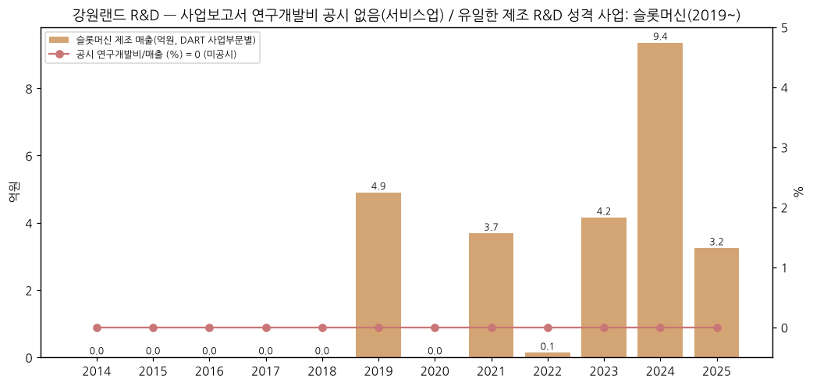

### ② 진행 중 corporate action — 10년치 주요 이벤트

| 시점 | 이벤트 | 출처 |
|---|---|---|
| 2017-12 | 카지노 재허가 조건 변경 (영업시간 20→18h, 게임기구 1,540대) | DART 연혁 |
| 2018-02 | 시장형 공기업 지정 | DART 연혁 |
| 2018-07 | 하이원 워터월드 개장 | DART 연혁 |
| 2020-04·05 | 폐광기금 과소징수분 부과처분(2,250억) → 취소소송 제기(2020-05-15) | DART 사업보고서(2025.12) 소송 |
| 2020-05 | 영업시간 18→20h, 게임기구 1,560대 | DART 연혁 |
| 2021-03 | 폐광지역법 개정 (시한 2045, 기금 매출 13%) | DART 사업보고서(2020.12) |
| 2021-12 | 카지노업 변경 허가 (일반영업장 면적 확장) | DART 연혁 |
| 2024-09 | 카지노업 변경 허가 (게임기구 1,860대, 외국인 전용존) | DART 연혁 |
| 2024 | 부가세 소송 승소 환급 750억 / 자사주 400억 매입 | IR 1Q26, OpenDART CF |
| 2025-05 | 회원바카라 최고베팅 3,000만원, 일반 블랙잭·홀덤 30만원 | IR 4Q25 |
| 2025-11-19 | K-HIT 비전 (2035년까지 3조원, 방문객 1,300만·매출 3.5조 목표) | 한국경제 2025-11-19 |
| 2025-12\~2026-02 | 자사주 400억 매입 | IB토마토 2026-10-08 |
| 2026-03 | 객실 리노베이션 757실 착수 | DART 분기보고서(2026.09) |
| 2026-09-02 | 김도균 대표이사 취임 | DART 분기보고서(2026.09) |
| 2026 2H | 자사주 200억 매입 계획 (연말 전) | Focus Gaming News 2026-11-09 |
| 2027E | 제2카지노(1,796억)·회원영업장 리모델링(299억) 완공 | DART 분기보고서(2026.09) |

### ③ 시설·사업 마일스톤 — 10년치 (R&D 마일스톤 대체)

- 2016-12 컨벤션호텔 5성급 획득 / 2017-12 자체개발 슬롯머신 GLI-11 국제인증 [DART 연혁]
- 2018-07 워터월드 개장 → 2018 워터월드 매출 86억, 2025 120억 [DART]
- 2024-09 게임기구 허가 1,860대(+300대) — 제2카지노 완공 시 배치 [DART]
- 2026-10 M650(탄광문화) 박물관 개관 [DART 연혁]
- 2027E 제2카지노 → 2035E K-HIT 그랜드코어존(신축 호텔 3개 동·새 그랜드카지노·미디어돔 아레나, 투자액의 71%) [한국경제 2025-11-19]

### ④ 주요 리스크

(1) 규제 (최대 변수)
→ 매출총량제·영업시간·출입일수·베팅한도·게임기구 수 모두 정부 인허가 — 2018 영업시간 단축 시 영업매출 -8.1% [DART, 계산]
→ FIU 특금법 개정 검토: 칩 구매·환전 시 신원·거래 기록 의무화 → "전면 회원제" 논란, 고객 이탈(해외·불법 도박) 우려 [뉴시스 2026-07-08·07-15]
→ 카지노업 허가 3년 단위 갱신, 법 시한 2045-12-31 [DART 사업보고서(2025.12)]
(2) 준조세·소송
→ 폐광기금 부과처분 취소소송(소송가액 2,250억) 대법원 계류 — 결과에 따라 환입 또는 추가 부담 [DART 사업보고서(2025.12) 소송]. 2023말 기준 총 10건 제소(3,481억)·7건 피소(125억) [DART 사업보고서(2023.12)]
(3) 경쟁·수요
→ 일본 오사카 IR(2030 개장 예정), 동남아 카지노 합법화(태국) — 고액 고객 이탈 [DART 사업보고서(2025.12) II-7, 뉴시스 2026-07-08]
→ 불법 온라인 도박 확대 (회사 추정 약 96조원) [DART 분기보고서(2026.09)]
→ 입장객 2016 정점 대비 -21.8% (2025) [계산]
(4) 투자 집행·거버넌스
→ K-HIT 3조 투자: 수익성 검증 전 대규모 투자, 공기업 의사결정(사장 공백 2년 9개월 전례) [IB토마토 2026-10-08, 뉴시스 2026-07-08]
→ 최대주주 공단 자본잠식(-3.36조) — 배당·투자 정책에 정책적 영향 가능 [DART 분기보고서(2026.09)]
(5) 금융자산·금리
→ 금융자산 2.99조 중 FVPL 비중 큼 — 금리 상승 시 평가손 (3Q26 순손실 사례) [DART 분기보고서(2026.09)]
(6) 지반·안전
→ 사업장 내 지반침하 구역 안전보강공사 (2025-07\~2028-01, 분기 약 27억 감가상각) [IR 4Q25]

### ⑤ ESG 등급

- **한국ESG기준원(KCGS) 통합 A — 7년 연속** (2026-11, 사회 부문 A+로 상향) [DART 분기보고서(2026.09) I-2 연혁, 위키트리 기사 제목 기준]. 2025-12 6년 연속 A [DART 연혁]
- 사행산업 건전화 평가 S등급 (2024년 평가, 2025-03 사감위) [DART 연혁]
- 과거: DJSI World 편입 2013\~2017 (5년 연속) [DART 연혁]
- MSCI ESG 등급: **미확보**
- 지속가능경영보고서: **원문 PDF 미수집** — 웹서치 1회에서 강원랜드 보고서 원문 링크 미확인 (source 체크리스트 4번 ❌)

### ⑥ 인증·라이선스

- 사업 근거: 석탄산업전환지역 개발 지원에 관한 특별법 제11조 (내국인 출입 카지노, \~2045-12-31), 관광진흥법상 카지노업 허가(문체부, 3년 갱신), 사행산업통합감독위원회법(중독예방치유부담금 납부) [DART 사업보고서(2025.12) II-7]
- 등급·인증: 그랜드호텔 5성(컨벤션타워 2016-12), 소비자중심경영(CCM) 인증(2024-12, 산업부 산하 공기업 최초), 가족친화 인증(2017-12), 에너지경영시스템 우수사업장(2017-12) [DART 연혁]
- 슬롯머신: GLI-11 국제인증(2017-12) [DART 연혁]

---

## Version Log

- **v1.0 (2026-11-25)**: 첫 작성 — Phase 1 source 전수 점검 (OpenDART 연결 재무 JSON 44개 FY2015\~3Q26, 정기공시 원문 XML 65건(2010\~3Q26, 15년치), 기업개황·주주·임원·직원·배당·자기주식·주식총수, IR 실적 PDF 9건(고유 6건), Yahoo 일간 시세 2001-10\~2026-11, 언론) + v4.8 6개 섹션 + 차트 16종 (12종 표준 + chart2 사업부문 4종(카지노·호텔·레저·기타자회사) + chart13 카지노 KPI(영업매출·입장객·드롭)). 사업부문 분기 시계열 **63개 분기(1Q11\~3Q26)** 확보. 3Q26 분기보고서(2026-11-16) 반영. 작업 중 BT PC의 device_bash가 'listen EIO'로 중단돼, 원자료를 컨테이너로 복사해 처리 후 결과만 BT 폴더에 기록
- **데이터 관례 (서브섹터 교차검증용)**: ① 사업 구분 = DART 사업부문별 매출(카지노·호텔·콘도·스키·골프·워터월드·머신·자회사), 부문 영업이익 미공시 ② 레저 = 콘도+스키+골프+워터월드 ③ 주가 = Yahoo `close`, 시총 = close × 발행주식 213,940,500주(자기주식 포함) — 자기주식 제외 시 ×0.926 ④ 배당 = 사업연도 귀속 DPS·배당총액(DART) ⑤ CapEx = 연결 CF 유형+무형 취득 ⑥ FCF = 영업CF − 유·무형 취득 ⑦ 순현금 = 현금 + 유동·비유동 금융자산 (차입금 0)
- 잔여 보완 후보: ① IR 3Q19\~3Q24·2Q26·3Q26 PDF (irgo 미게시) → 분기 드롭액·입장객 연속 시계열 ② 2011\~2014 연간 입장객·영업매출 ③ 매출총량제 연도별 한도·준수율 ④ 외국인 지분율 추이 ⑤ 지속가능경영보고서 PDF·MSCI 등급 ⑥ 폐광기금 소송 대법원 결과 ⑦ K-HIT 연도별 투자 집행 계획 ⑧ 출입일수 현행 규정

