# 고려아연 — 기업 개요 (v1.0)

> 마지막 update: 2026-11-25 (v1.0 — 첫 작성. 3Q26 분기보고서(2026-11-16 제출)·IR 3Q26(2026-11-05)까지 반영)
> 입력 source: OpenDART fnlttSinglAcntAll (연결 CFS + 별도 OFS, 2015 사업보고서\~3Q26 각 44개 JSON — 2014는 2015 사업보고서 전기 컬럼. **2022\~2025는 2026-08-13 기재정정(재작성)본 기준**) + DART 정기공시 원문 XML 44건 (사업보고서 2015\~2025·분기/반기 1Q16\~3Q26) + OpenDART 기업개황·최대주주·임원·직원·배당·자기주식·주식총수 (2025 사업보고서) + 고려아연 IR 실적발표 PDF 12건 (1Q24\~3Q26, irgo 경유) + Yahoo Finance (010130.KS 월간 2000-02\~2026-11, 일간 2024-11\~2026-11-25) + 언론 (비즈워치·아이뉴스24·뉴시스·머니투데이·전자신문·S&P Global·Mining.com, 2025-06\~2026-11)
> 갱신 주기: 매분기 (실적 리뷰 모드 호출 시)
> 워치리스트: **철강·비철 섹터 / 서브섹터: 비철 (고려아연·풍산)** (`earnings/watchlist.md` 88행, 2026-11-23 추가 섹터 — 4Q26부터 리뷰)
> **Fact verify cutoff**: 2026-11-25 (주가 2026-11-24 종가 **755,000원** [Yahoo Finance 010130.KS 일간 close. mydailybyte 헤더 736,000원은 장중 값으로 보이며, 같은 페이지 본문의 11-24 13:43 758,000원은 Yahoo와 정합 — Yahoo 채택. 11-25 장중 762,000원], 발행주식 20,872,969주 [DART 분기보고서(2026.09), 자기주식 479,737주 포함] → 시가총액 **약 15.76조원** [계산]. **사상 최고 종가: 2026-02-25 2,115,000원** [Yahoo 일간] → 당시 시총 **약 44.15조원** [계산, 20,872,969주] / 장중 최고 2,407,000원 (2024-12-06, 경영권 분쟁 중 단기 급등) [Yahoo 일간]. 고점(종가) 대비 **-64.3%**, YTD -42.6% (2025말 1,316,000원), 1년 -30.0% (2025-11-24 1,078,000원), 52주 최저 종가 727,000원 (2026-11-23) [Yahoo])

---

## 1. 기업 분류

- **Primary 분류: 사이클 — 비철 제련 마진형 (금속가격 × 제련수수료(TC) × 환율)** — 온산 단일 제련소에서 아연·연·동 정광을 처리해 **아연·연(기초금속) + 금·은(귀금속) + 인듐·안티모니 등 희소금속 + 황산**을 함께 뽑는 통합 제련 구조. 매출은 금속 가격을 거의 그대로 따라가고(pass-through), 이익은 TC·회수율·부산물 가격·환율에서 결정
- **Secondary 노트: ① 핵심광물 전략자산 (미국 공급망) ② 경영권 분쟁 이벤트 프리미엄** — 2025-12 미국 정부·JPMorgan이 참여한 Crucible JV가 신주 2,209,716주(10.59%)를 인수하고 테네시 74.3억달러 제련소(Project Crucible, 2029 완공 목표)를 추진 [DART 사업보고서(2025.12), S&P Global 2026-04-02]. 2024-09 이후 영풍·MBK와 최윤범 회장 측의 지분 경쟁이 주가를 펀더멘털과 분리시킴 (2024-12 장중 240.7만원, 2026-02 종가 211.5만원 → 2026-11 75.5만원)

### ① 정량 근거

**📊 Summary Box (12년, 2014\~2025 연결):**

| 지표 | 값 |
|------|-----|
| 매출 CAGR (2014→2025, 11년) | **+11.6%** (4.94조 → 16.59조) — 영업이익 CAGR은 **+5.5%**에 그쳐 매출 성장의 대부분이 금속가격·트레이딩 물량(저마진)에서 발생 |
| OPM 평균 | **10.7%** (range 6.0\~14.1%, 폭 8.1%p) |
| OPM 정점 평균 | **13.9%** (2015 14.1% · 2017 13.6%) — 아연 LME 상승 + 높은 벤치마크 TC 국면 |
| OPM 저점 평균 | **6.4%** (2023 6.8% · 2024 6.0%) — LME 아연 약세 + TC 급락 + 트레이딩·귀금속 매출 비중 확대 |
| 사이클 주기 | **약 6\~8년 (peak-to-peak)** — 이익 정점 2017(8,948억) → 2021(10,961억) → 2025\~1H26(1Q26 분기 7,461억) |
| 사이클 회수 (12년) | 영업이익 정점 3회 (2017·2021·2025) / 저점 2회 (2018·2023) |

```
[전사 OPM 시계열 (12년, 연결, DART)]
연도   매출(조)  영업이익  지배순이익   OPM    NPM   CapEx/매출
2014    4.94    0.683    0.501     13.8   10.2    7.9%   ← 단일 온산 제련 + SMC(호주) 체제, 무차입 경영
2015    4.77    0.672    0.509     14.1   10.8   10.1%   ← OPM 12년 최고, 원자재 하락기에도 TC·부산물로 방어
2016    5.85    0.765    0.592     13.1   10.2    3.2%   ← 아연 LME 반등 시작
2017    6.60    0.895    0.629     13.6    9.6    7.6%   ← 1차 이익 정점 (아연 10년래 고점)
2018    6.88    0.765    0.527     11.1    7.8    4.7%   ← 아연가 하락 전환 + TC 상승 전 단계, 감익
2019    6.69    0.805    0.633     12.0    9.5    5.5%   ← TC 급등(벤치마크 $245)으로 마진 회복
2020    7.58    0.897    0.573     11.8    7.6    8.8%   ← 코로나에도 금·은 강세로 증익
2021    9.98    1.096    0.807     11.0    8.1    4.8%   ← 2차 이익 정점, 영업이익 첫 1조 (원자재 슈퍼사이클)
2022    11.22   0.919    0.602      8.2    5.5    3.4%   ← 매출 최대·OPM 하락 — 트레이딩 확대, 호주 SMC 적자(-860억)
2023    9.70    0.660    0.432      6.8    4.5    4.5%   ← 저점 (LME 아연 -24%, 귀금속 정체)
2024    12.05   0.723    0.301      6.0    2.5    9.4%   ← OPM 12년 최저, 경영권 분쟁·자사주 2.1조, 4Q 순손실
2025    16.59   1.232    0.775      7.4    4.6    5.7%   ← 금(+44%)·은(+41%) 급등, 영업이익 사상 최대

OPM range: 6.0% ~ 14.1% = 8.1%p  (매출은 금속가격 따라 3.4배 증가, OPM은 구조적 하향 — 귀금속 pass-through·트레이딩 비중 확대 + TC 하락)
9M26: 매출 18.53조 (+57.0%), 영업이익 1.475조 (+79.5%), OPM 8.0% — 1Q26 12.3% → 3Q26 2.3% (IFRS 도입 후 최저) [DART 분기보고서(2026.09), 비즈워치 2026-11-04]
```

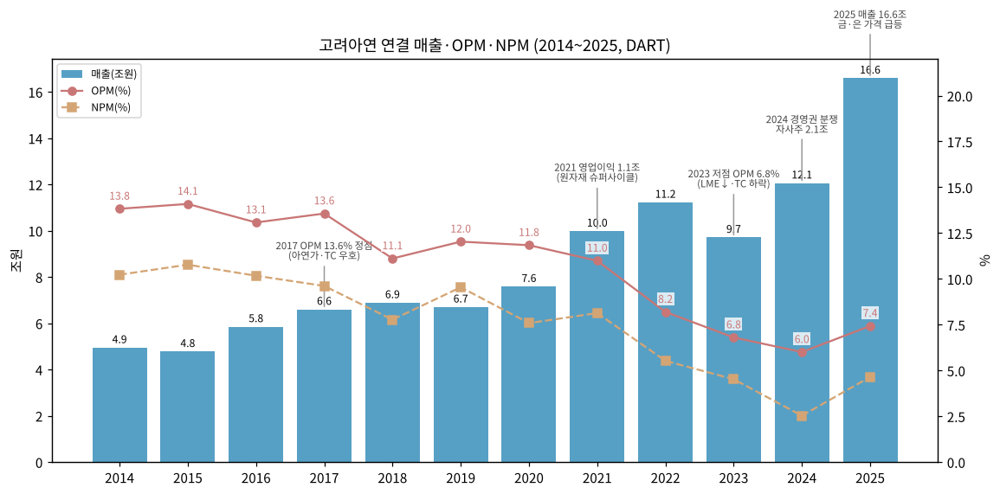

(연결 기준, OpenDART. 2022\~2025 수치는 2026-06-10 증권선물위원회 감리 조치(영업권 손상·FVPL 평가손익·법인세)에 따른 **2026-08 재작성본** — 영업이익은 불변, 순이익은 2024 1,948억 → 3,047억 등으로 변경 [DART 사업보고서(2025.12) 기재정정 주석 41]. CapEx = 연결 CF 유형 + 무형자산 취득)

### ② 산업 분류

- 산업: **비철금속 제련 (아연·연 1차 제련 + 귀금속·희소금속 회수) + 비철 트레이딩 + 자원순환·신재생·2차전지 소재(신사업)**
- DART 업종: 24213 연 및 아연 제련, 정련 및 합금 제조업 [OpenDART 기업개황]
- 워치리스트 섹터: **철강·비철** / 서브섹터: **비철 (고려아연·풍산)**
- 시장 지위: 온산제련소 생산능력 **아연 64만톤·연 43만톤·금 12톤·은 2,500톤·동 6.5만톤·황산 150만톤** (2025) [DART 사업보고서(2025.12) II-3]. 한신평은 온산을 아연·연 생산능력 글로벌 1위 단일 제련소로 평가 [전자신문 2025-06-30]. 호주 SMC(아연 약 50만톤급 — ⚠️ 정확 CAPA는 사업보고서 표 미대조)까지 합산 시 세계 최대 아연 제련 그룹 중 하나

### ③ 분류 결정 논리

(1) 가장 매출 큰 사업 기준 적용 시: 연결 매출의 71.3%가 비철금속 제조·판매, 25.1%가 비철 수출입(트레이딩), 3.6%가 폐기물처리 등 (2025) [DART 사업보고서(2025.12) II-7]. 별도 제품별로는 **은 33.0% > 아연 24.2% > 금 18.5% > 연 12.3%** (2025) — 2015년 아연 35.6%·은 27.3%에서 귀금속 비중이 51.5%로 확대 [DART 사업보고서 II-2, 계산] → "아연 회사"보다 **"귀금속 회수형 종합 제련사"**

(2) 영업이익 기준 sub-rule: 제조·판매 부문이 연결 영업이익의 96.8%(2025), 별도(온산) 영업이익 11,796억 ≈ 연결 12,319억 — **자회사 합산 기여는 사실상 0** (2022\~2024 SMC·광산·신재생 적자, 2025 소폭 흑자) [DART 부문정보, 계산]. 즉 이익 사이클 = 온산 제련 마진 사이클

(3) Boundary case 처리: 신사업(Ark Energy 신재생, 켐코·한국전구체 2차전지 소재, 케이잼 동박, Pedalpoint·Igneo 자원순환)은 아직 이익 기여 미미 → Primary 사이클 유지. 다만 **희소금속(인듐·안티모니·게르마늄·갈륨) + 미국 제련소**는 지정학 프리미엄 성격(중국 수출통제 대체재)이라 Secondary로 별도 표기. 3Q26 별도 희소금속 매출 830억·GPM 73.5% [IR 3Q26]

(4) 피어 대비: 순수 아연 제련사(Nyrstar·Boliden 제련 부문 등)는 TC 사이클에 OPM이 크게 출렁이지만, 고려아연은 귀금속·희소금속·황산 부산물로 2014\~2025 12년 연속 영업흑자 (107분기 연속 흑자, 3Q26 기준 [아이뉴스24 2026-11-04]) → **"방어력 있는 사이클주"**. 국내 피어 영풍(석포)은 단일 아연 제련 + 환경 제재로 비교 불가 수준의 수익성 격차

### ④ 적정 밸류에이션 방법

- **PBR (사이클 기준) 우선** — 이익이 금속가격·TC·환율의 곱이라 PER 변동이 큼. 2014\~2023 주가는 BPS(유통주식 기준) 26\~44만원 대비 PBR 약 1.1\~1.5배 밴드에서 움직임 [Yahoo 연말 종가 ÷ BPS, 계산 — 2014 1.54배, 2019 1.12배, 2023 1.14배]
- **EV/EBITDA 보조** — 2024 이후 차입금 급증(총차입금 2023말 0.86조 → 3Q26 7.96조)으로 자본구조가 바뀌어 EV 기준 비교가 필요. 3Q26 IR 기준 분기 EBITDA 2,800억, 1Q26 8,470억 [IR 3Q26]
- **이벤트 프리미엄 분리 필수** — 2024-09 이후 주가는 지분 경쟁(공개매수 가격, 우호지분 확보 경쟁)과 미국 전략자산 테마가 결정. 2025말 PBR 약 2.5배(종가 131.6만원 ÷ BPS 52.7만원), 2026-11 약 1.4배(75.5만원 ÷ 3Q26 BPS 약 52.1만원) [계산]. 펀더멘털 밸류(PBR 1.1\~1.5배)와 분쟁·전략 프리미엄을 나눠 볼 것
- PER은 참고만 — 2024 지배순이익 3,008억(재작성 후) 기준 PER이 수십 배로 왜곡

### ⑤ 분기 재평가 트리거 (분류 변경 조건)

- 별도(온산) 이외 자회사 영업이익 합계가 **연결 영업이익의 30% 이상**으로 2개 분기 연속 → "제련 단일 사이클" → "멀티 사업 홀딩스" 재분류 검토 (현재 3Q26 자회사·조정 -826억)
- **희소금속 매출이 별도 매출의 10% 이상** 또는 Crucible(미국) 상업 생산 개시(2029E) → Secondary(전략자산) → Primary 혼합 격상 검토
- 경영권 분쟁 종결(어느 한쪽 과반 확정 또는 지분 매각) → 이벤트 프리미엄 제거, 밸류에이션을 PBR 밴드로 회귀시켜 재평가
- OPM이 4개 분기 연속 5% 미만 → "방어형 사이클" 가정 폐기 (3Q26 2.3% 1회 발생)

---

## 2. 회사 개요

### ① 기본 사항

- **회사명**: 고려아연㈜ (KOREA ZINC INC) / KRX 010130 (유가증권시장)
- **본사**: 서울특별시 종로구 종로33 (청진동) / 제련소: 울산 울주군 온산읍 [OpenDART 기업개황, DART 사업보고서(2025.12)]
- **설립**: 1974-08-01 [OpenDART 기업개황]. 영풍그룹(장씨·최씨 공동 창업, 1949)에서 분리되지 않은 채 "장씨=지분, 최씨=경영" 구도로 50년간 운영 [머니투데이 2026-09-15]
- **사업 한 줄 정의**: 아연·연·동 정광을 들여와 온산 통합 제련 공정에서 아연·연과 금·은·동·황산·희소금속을 함께 회수·판매하는 세계 최대급 비철 제련사. 호주 SMC(아연 제련), KZ트레이딩(비철 무역), Ark Energy(호주 신재생), Pedalpoint(미국 자원순환), Crucible(미국 제련소 건설) 등 **연결 종속회사 84개** [DART 사업보고서(2025.12) II-1]
- **대표이사**: 최윤범 회장 (1975-03생, 前 호주 SMC 대표·고려아연 대표이사 부회장, 사내이사 임기 2028-03-24) / 박기덕 대표이사 사장 (1968-06생, 前 SMC CFO, TD사업부문 총괄, 임기 2027-03-28) [OpenDART exctvSttus 2025, 뉴시스 2026-03-26]
- **임직원**: 2,054명 (정규직 1,920 / 기간제 134, 평균근속 남 12년10개월, 1인 평균급여 남 1.25억) (2025말, 별도) [OpenDART empSttus]. 2015말 1,396명 대비 +47% [DART 사업보고서(2015.12)]
- **신용등급**: **AA+ (한국신용평가, 2025-06-30 유지)** — 근거: 온산 글로벌 1위 설비·다각화된 금속 포트폴리오·EBITDA 1조+ / 리스크: TC 하락(벤치마크 2024 $165 → 2025 약 $80)·분쟁 중 자사주 차입 [전자신문 2025-06-30]. 2026년 등급 변동은 미확인

### ② 최근 12년 손익·자본 추이 (조원, 연결, DART)

| 연도 | 매출 | YoY | 영업이익 | 순이익(지배) | 자본총계 | 자본 YoY |
|---|---|---|---|---|---|---|
| 2014 | 4.94 | - | 0.68 | 0.50 | 4.78 | - |
| 2015 | 4.77 | -3.4% | 0.67 | 0.51 | 5.22 | +9.1% |
| 2016 | 5.85 | +22.6% | 0.76 | 0.59 | 5.66 | +8.5% |
| 2017 | 6.60 | +12.8% | 0.89 | 0.63 | 6.11 | +7.8% |
| 2018 | 6.88 | +4.3% | 0.76 | 0.53 | 6.37 | +4.4% |
| 2019 | 6.69 | -2.7% | 0.81 | 0.63 | 6.84 | +7.3% |
| 2020 | 7.58 | +13.3% | 0.90 | 0.57 | 7.09 | +3.6% |
| 2021 | 9.98 | +31.6% | 1.10 | 0.81 | 7.73 | +9.1% |
| 2022 | 11.22 | +12.5% | 0.92 | 0.60 | 9.05 | +17.1% |
| 2023 | 9.70 | -13.5% | 0.66 | 0.43 | 9.37 | +3.5% |
| 2024 | 12.05 | +24.2% | 0.72 | 0.30 | 7.41 | -20.9% |
| 2025 | 16.59 | +37.6% | 1.23 | 0.78 | 11.00 | +48.5% |

(연결 기준, OpenDART fnlttSinglAcntAll. 순이익 = 지배기업 소유주 귀속. 2024 자본 -20.9%는 자사주 2.13조 취득(자본조정 차감) 영향, 2025 +48.5%는 Crucible JV 제3자배정 유상증자 2.83조 [DART 2025 연결CF·자본변동표]. 9M26: 매출 18.53조 (+57.0%), 영업이익 1.475조 (+79.5%), 지배순이익 0.889조 (+60.0%) [DART 분기보고서(2026.09), 계산])

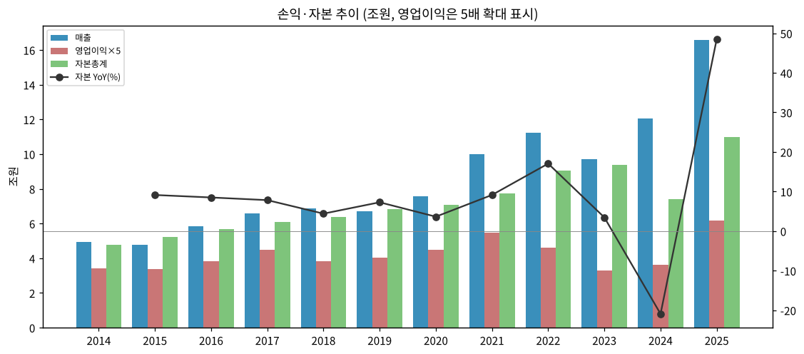

### ③ 회사 주가 역사 ★ narrative 영역

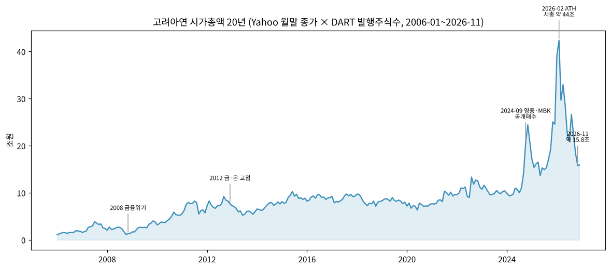

(차트: Yahoo 월말 종가(close) × DART 발행주식수 — 2022-07까지 18,870,000주 / 2022-08 19,863,158주 / 2023-09 20,908,588주 / 2024-05 20,703,283주 / 2025-05 18,663,253주 / 2025-12-27 이후 20,872,969주. 주식수 변경 월은 근사 적용 [DART 사업보고서 각 연도 주식의 총수])

(1) 2006\~2012: 원자재 슈퍼사이클 + 귀금속 랠리 → 10년 장기 상승
→ 2006말 98,700원 → 2008 금융위기 2008-11 월말 약 6.5만원대 (시총 약 1.2조) → **2012-12 405,000원 (시총 약 7.6조)** [Yahoo]
→ 아연·연 외에 금·은 회수 비중이 높아 2011\~2012 금·은 고점 국면의 수혜

(2) 2013\~2023: 안정적 고배당 사이클주 — 30\~60만원 박스권
→ 2013말 318,000원 → 2015말 469,000원 → 2019말 425,000원 → 2022말 564,000원 → 2023말 498,000원 [Yahoo]
→ 무차입·고ROE(10\~11%)·배당성향 25→39% 상향 [DART 배당], 시총 7\~11조 밴드
→ 2022\~2023 최윤범 회장 체제(2022-12 회장 취임 — ⚠️ 원문 미대조) "트로이카 드라이브(신재생·2차전지 소재·자원순환)" 추진, 한화·LG화학·Trafigura 자사주 교환 및 HMG Global 신주 1,045,430주 배정 [DART 사업보고서(2022.12)·(2024.12)]

(3) 2024-09\~2024-12: 영풍·MBK 공개매수 → 경영권 분쟁 폭발
→ 2024-09-12 영풍·장형진 회장과 MBK(한국기업투자홀딩스)가 경영협력계약 체결, 공개매수 개시 [DART 분기보고서(2026.09) VII 최대주주 변동 관련 사항]
→ 고려아연 자기주식 공개매수 2,040,030주 등 2024년 자사주 취득 **2.13조원** [DART 2024 연결CF] → 2024말 자기주식 2,539,726주(12.3%) [DART 사업보고서(2024.12)]
→ 영풍·MBK 지분 40.97%까지 확대 (2024-12-19) [CEO스코어데일리 2024-12-19]
→ **2024-12-06 장중 2,407,000원** (일간 고가) — 2024-08 월말 535,000원 대비 단기 4배 [Yahoo]

(4) 2025: 분쟁 장기화 + 금·은 급등 실적 + 미국 정부 파트너십
→ 2025-01 임시주총·2025-03 정기주총에서 영풍 의결권 제한(상호주 구조) 논란, 법적 공방 지속 [머니투데이 2026-09-15, 뉴시스 2026-04-02]
→ 2025-03-07 영풍 100% 자회사 (유)와이피씨 설립 → 영풍 보유 5,262,450주(25.21%) 이전, 2026-01-01 지주회사 전환 [DART 분기보고서(2026.09) VII]
→ 2025 영업이익 1.23조 (사상 최대) — 금 단가 +52%, 은 +62% (내수, 원화) [DART 사업보고서(2025.12) II-2]
→ **2025-12-15 Crucible JV(미국 정부·JPMorgan 등)와 신주인수계약 — 2,209,716주(10.59%), 2.83조원, 테네시 74.3억달러 제련소** [DART, Mining.com·Bloomberg 2025-12-15]
→ 2025말 1,316,000원 (시총 약 27.5조) [Yahoo, 계산]

(5) 2026: 사상 최고가 → 실적 급락·고점 대비 -64%
→ **2026-02-25 종가 2,115,000원 — 사상 최고 종가 (시총 약 44.15조)** [Yahoo]
→ 2026-03-24 정기주총: 최윤범 회장 재선임, 이사회 9대5(경영진 측 우위) [뉴시스 2026-03-26]
→ 2026-06-10 증선위 감리 조치 → 2022\~2025 재무제표 재작성 (2026-08-05 이사회 승인) [DART 사업보고서(2025.12) 기재정정]
→ 2026-09-09 임시주총: 이사회 12대7 (최윤범 측 12) [머니투데이 2026-09-15]
→ 3Q26 영업이익 1,417억 (-48.2% YoY, OPM 2.3%) — 귀금속 가격·환율 하락 + 고가 원료 투입 + TC 하락 [비즈워치 2026-11-04]
→ 2026-11-12 서울중앙지법, 영풍·MBK의 전년도 주총 결의 취소 청구 인용 / 2026-11-13 서울고법, HMG 신주발행무효 1심 뒤집고 고려아연 승소 (둘 다 미확정) [비즈워치 2026-11-13]
→ **2026-11-24 755,000원 (시총 약 15.76조, 52주 저점권)** [Yahoo]

### ④ 회사의 주요 연혁

```
1974-08      고려아연㈜ 설립 (영풍그룹 계열)
1978         온산제련소 가동 (⚠️ 연도 원문 미대조)
1990         유가증권시장 상장 (⚠️ 상장일 미검증)
1996~1999    호주 Sun Metals Corporation(SMC, 타운즈빌) 설립·가동 (⚠️ 원문 미대조)
2016-04      ㈜징크옥사이드코퍼레이션 90% 취득 (원재료 산화아연 확보)
2022-05      Epuron Holdings(현 Ark Energy, 호주 신재생) 100% 인수
2022         한화(H2)·LG화학·Trafigura와 자기주식 교환 등 1,195,760주 전량 처분 / 제3자배정
2023-09      HMG Global(현대차그룹) 신주 1,045,430주 배정 (5,272억)
2024-04      Kataman Metals(미국 비철 스크랩 트레이딩) 인수
2024-05      자사주 205,305주 소각 → 20,703,283주
2024-09-12   영풍·장형진–MBK 경영협력계약, 공개매수 → 경영권 분쟁
2024-10      고려아연 자기주식 공개매수 2,040,030주
2025-03-07   (유)와이피씨 설립 (영풍 100%), 영풍 보유 고려아연 25.21% 이전
2025-05      공개매수 자기주식 2,040,030주 소각 결정 → 18,663,253주
2025-06-27   HMG 신주 1,045,430주 신주발행무효 1심 판결 (회사 패소) → 2026-11-13 항소심 회사 승소
2025-07-01   MDSi·TechSource(미국 IT자산처분) 인수
2025-12-15   Crucible JV 신주인수계약·사업제휴합의 (2,209,716주, 2025-12-27 효력)
2026-01-01   (유)와이피씨 지주회사 전환
2026-03-24   정기주총 — 최윤범 재선임, Crucible 추천 Walter McLallen 기타비상무이사 선임
2026-04-01   Crucible Zinc 출범 — Nyrstar USA 클락스빌 제련소 인수 완료
2026-06-10   증선위 감리 조치 → 2026-08 2022~2025 재무제표 재작성
2026-09      테네시 제련소 연방 최종 환경평가(EA) 통과
2026-09-09   임시주총 — 이사회 12:7
2026-11-04   3Q26 실적 / 자사주 246,665주 2027-01 소각 결정, 액면분할 2027-03 주총 재상정 예정
2029E        테네시 Crucible 제련소 완공 목표
```

(출처: OpenDART 기업개황, DART 사업보고서(2016.12) 주석 40·(2022.12) 주석 41·(2024.12)·(2025.12) 주식의 총수·연결 주석 40, 분기보고서(2026.09) VII·II-6 / S&P Global 2026-04-02, 아이뉴스24 2026-11-04, 뉴시스 2026-03-26, 머니투데이 2026-09-15, 비즈워치 2026-11-13. ⚠️ 표기 항목은 원문 미대조 (미검증 — 비공식 출처))

---

## 3. 비즈니스 모델

### ① 실적 추이 (연결 → DART 사업부문 → 별도 제품별 3단계 위계)

**(1) 연결 사업부문 (DART 연결 주석 영업부문, 억원)**

| 부문 | 2023 매출 | 2024 매출 | 2025 매출 | 2025 비중 | 2023 영업이익 | 2024 영업이익 | 2025 영업이익 | 2025 OPM |
|---|---|---|---|---|---|---|---|---|
| 비철금속 제조·판매 (온산·SMC 등) | 82,690 | 94,245 | 125,046 | 71.3% | 6,718 | 7,397 | 12,097 | 9.7% |
| 비철금속 수출입 (KZ트레이딩) | 15,290 | 27,718 | 43,965 | 25.1% | 114 | 482 | 718 | 1.6% |
| 폐기물처리 등 (스틸싸이클·Pedalpoint 등) | 3,277 | 4,104 | 6,338 | 3.6% | -433 | -576 | -318 | -5.0% |

(내부거래 상계 전 부문 매출. 출처: DART 사업보고서(2025.12) II-7 사업부문별 요약재무현황. 비중은 부문 합계 대비)

**(2) 지역별 영업이익 (연결조정 전, 억원)**

| 연도 | 2015 | 2016 | 2017 | 2018 | 2019 | 2020 | 2021 | 2022 | 2023 | 2024 | 2025 |
|---|---|---|---|---|---|---|---|---|---|---|---|
| 국내(한국) | 6,404 | 7,084 | 8,062 | 6,908 | 7,648 | 8,471 | 10,180 | 10,323 | 6,816 | 8,250 | 12,096 |
| 호주 (SMC·Ark) | 431 | 618 | 954 | 767 | 306 | 535 | 800 | -860 | 70 | -604 | 383 |
| 남미·미국 등 | -142 | -51 | -23 | -53 | -41 | -115 | 0 | -386 | -487 | -342 | 18 |

(DART 사업보고서 각 연도 연결 주석 "영업부문 — 지역별 부문정보" 당기. 2025부터 "남미등"에 미국 자원순환(Pedalpoint) 포함, 매출 3.37조로 급증)

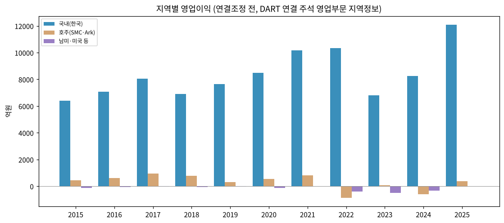

**(3) 별도(온산) 제품별 매출 (억원, DART 사업보고서 II-2)**

| 연도 | 아연 | 연 | 금 | 은 | 동 | 기타(황산·희소금속 등) | 합계 | 귀금속(금+은) 비중 |
|---|---|---|---|---|---|---|---|---|
| 2015 | 14,546 | 7,005 | 4,110 | 11,169 | (기타 포함) | 4,040 | 40,870 | 37.4% |
| 2016 | 16,437 | 9,939 | 5,798 | 14,665 | (기타 포함) | 3,609 | 50,448 | 40.6% |
| 2017 | 20,618 | 11,897 | 4,966 | 12,567 | (기타 포함) | 4,475 | 54,524 | 32.2% |
| 2018 | 23,311 | 11,293 | 4,040 | 11,214 | (기타 포함) | 5,421 | 55,277 | 27.6% |
| 2019 | 20,326 | 10,327 | 3,913 | 12,147 | (기타 포함) | 5,476 | 52,188 | 30.8% |
| 2020 | 18,354 | 9,874 | 6,197 | 17,129 | (기타 포함) | 4,967 | 56,521 | 41.3% |
| 2021 | 22,804 | 12,037 | 9,192 | 20,802 | (기타 포함) | 6,789 | 71,625 | 41.9% |
| 2022 | 30,330 | 13,443 | 8,897 | 18,361 | (기타 포함) | 9,782 | 80,814 | 33.7% |
| 2023 | 24,598 | 13,007 | 7,557 | 19,242 | 3,439 | 5,068 | 72,911 | 36.8% |
| 2024 | 25,605 | 14,206 | 7,482 | 23,836 | 3,894 | 5,868 | 80,890 | 38.7% |
| 2025 | 25,541 | 12,931 | 19,504 | 34,776 | 4,652 | 7,938 | 105,342 | **51.5%** |

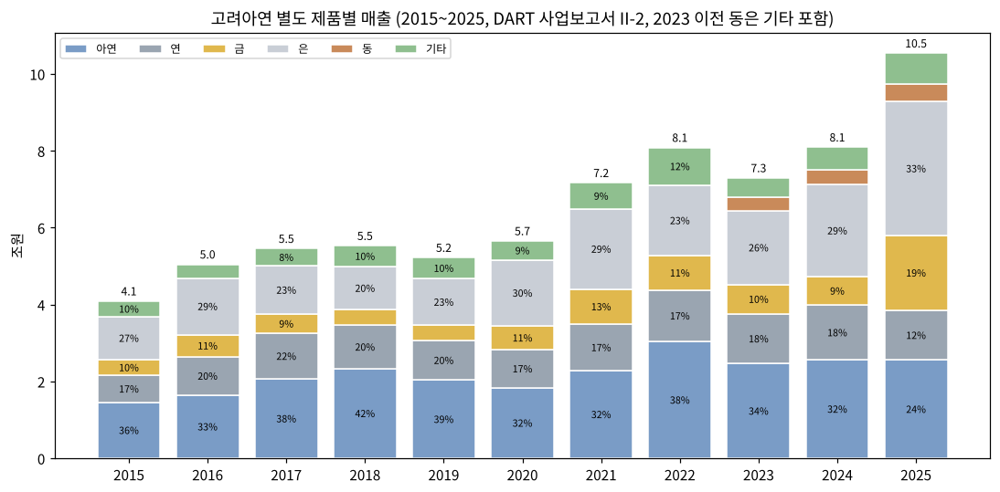

(2022 이전 동은 "기타"에 포함 공시. 2025 금·은 내수 단가 각 +52%·+62% (원화, kg당 1.60억원·198만원) [DART 사업보고서(2025.12) II-2 가격변동 추이]. 3Q26 별도 매출 비중: 은 48%·아연 20%·금 11%·연 9%·동 5% 내외 [IR 3Q26 — 그래프 판독, 근사])

**(4) 별도·자회사 분기 시계열 (1Q16\~3Q26, 43분기, 억원)**

| 분기 | 연결 매출 | 연결 영업이익 | 연결 OPM | 매출 YoY | 별도 매출 | 별도 영업이익 | 별도 OPM | 자회사·조정 매출 | 자회사·조정 영업이익 |
|---|---|---|---|---|---|---|---|---|---|
| 1Q16 | 13,519 | 1,873 | 13.9% |  | 11,656 | 1,761 | 15.1% | 1,863 | 112 |
| 2Q16 | 14,097 | 1,802 | 12.8% |  | 12,275 | 1,634 | 13.3% | 1,822 | 168 |
| 3Q16 | 14,590 | 1,621 | 11.1% |  | 12,643 | 1,381 | 10.9% | 1,947 | 240 |
| 4Q16 | 16,269 | 2,364 | 14.5% |  | 13,875 | 2,108 | 15.2% | 2,394 | 256 |
| 1Q17 | 15,738 | 2,363 | 15.0% | +16.4% | 13,385 | 2,080 | 15.5% | 2,353 | 283 |
| 2Q17 | 16,717 | 2,483 | 14.9% | +18.6% | 13,880 | 2,177 | 15.7% | 2,837 | 306 |
| 3Q17 | 16,169 | 1,873 | 11.6% | +10.8% | 13,419 | 1,644 | 12.3% | 2,750 | 229 |
| 4Q17 | 17,342 | 2,228 | 12.8% | +6.6% | 13,839 | 1,710 | 12.4% | 3,503 | 518 |
| 1Q18 | 16,834 | 2,001 | 11.9% | +7.0% | 13,183 | 1,599 | 12.1% | 3,651 | 402 |
| 2Q18 | 17,876 | 2,181 | 12.2% | +6.9% | 14,829 | 1,839 | 12.4% | 3,047 | 342 |
| 3Q18 | 17,735 | 1,951 | 11.0% | +9.7% | 14,287 | 1,642 | 11.5% | 3,448 | 309 |
| 4Q18 | 16,388 | 1,514 | 9.2% | -5.5% | 12,978 | 1,395 | 10.7% | 3,410 | 119 |
| 1Q19 | 14,967 | 1,775 | 11.9% | -11.1% | 11,940 | 1,537 | 12.9% | 3,027 | 238 |
| 2Q19 | 17,427 | 2,421 | 13.9% | -2.5% | 13,724 | 2,297 | 16.7% | 3,703 | 124 |
| 3Q19 | 17,311 | 2,088 | 12.1% | -2.4% | 13,059 | 1,826 | 14.0% | 4,252 | 262 |
| 4Q19 | 17,243 | 1,769 | 10.3% | +5.2% | 13,465 | 1,632 | 12.1% | 3,778 | 137 |
| 1Q20 | 17,326 | 2,043 | 11.8% | +15.8% | 13,376 | 1,969 | 14.7% | 3,950 | 74 |
| 2Q20 | 16,220 | 1,640 | 10.1% | -6.9% | 12,534 | 1,702 | 13.6% | 3,686 | -62 |
| 3Q20 | 19,762 | 2,674 | 13.5% | +14.2% | 14,140 | 2,118 | 15.0% | 5,622 | 556 |
| 4Q20 | 22,511 | 2,617 | 11.6% | +30.6% | 16,471 | 2,019 | 12.3% | 6,040 | 598 |
| 1Q21 | 22,005 | 2,700 | 12.3% | +27.0% | 16,843 | 2,326 | 13.8% | 5,162 | 374 |
| 2Q21 | 23,754 | 2,731 | 11.5% | +46.4% | 18,191 | 2,238 | 12.3% | 5,563 | 493 |
| 3Q21 | 24,147 | 2,658 | 11.0% | +22.2% | 17,058 | 2,189 | 12.8% | 7,089 | 469 |
| 4Q21 | 29,861 | 2,873 | 9.6% | +32.7% | 19,532 | 2,493 | 12.8% | 10,329 | 380 |
| 1Q22 | 26,614 | 2,847 | 10.7% | +20.9% | 18,167 | 2,207 | 12.1% | 8,447 | 640 |
| 2Q22 | 28,513 | 3,812 | 13.4% | +20.0% | 20,518 | 3,480 | 17.0% | 7,995 | 332 |
| 3Q22 | 27,445 | 1,507 | 5.5% | +13.7% | 20,485 | 2,064 | 10.1% | 6,960 | -557 |
| 4Q22 | 29,622 | 1,026 | 3.5% | -0.8% | 21,644 | 1,563 | 7.2% | 7,978 | -537 |
| 1Q23 | 25,273 | 1,458 | 5.8% | -5.0% | 18,149 | 1,549 | 8.5% | 7,124 | -91 |
| 2Q23 | 24,694 | 1,557 | 6.3% | -13.4% | 17,874 | 1,646 | 9.2% | 6,820 | -89 |
| 3Q23 | 22,932 | 1,604 | 7.0% | -16.4% | 17,829 | 1,666 | 9.3% | 5,103 | -62 |
| 4Q23 | 24,145 | 1,980 | 8.2% | -18.5% | 19,058 | 2,213 | 11.6% | 5,087 | -233 |
| 1Q24 | 23,754 | 1,845 | 7.8% | -6.0% | 18,136 | 1,907 | 10.5% | 5,618 | -62 |
| 2Q24 | 30,582 | 2,687 | 8.8% | +23.8% | 19,877 | 2,574 | 12.9% | 10,705 | 113 |
| 3Q24 | 32,067 | 1,500 | 4.7% | +39.8% | 20,293 | 1,792 | 8.8% | 11,774 | -292 |
| 4Q24 | 34,127 | 1,203 | 3.5% | +41.3% | 22,584 | 1,867 | 8.3% | 11,543 | -664 |
| 1Q25 | 38,328 | 2,711 | 7.1% | +61.4% | 23,886 | 2,727 | 11.4% | 14,442 | -16 |
| 2Q25 | 38,254 | 2,589 | 6.8% | +25.1% | 24,614 | 2,665 | 10.8% | 13,640 | -76 |
| 3Q25 | 41,598 | 2,734 | 6.6% | +29.7% | 26,092 | 2,352 | 9.0% | 15,506 | 382 |
| 4Q25 | 47,699 | 4,285 | 9.0% | +39.8% | 30,750 | 4,052 | 13.2% | 16,949 | 233 |
| 1Q26 | 60,720 | 7,461 | 12.3% | +58.4% | 42,945 | 6,933 | 16.1% | 17,775 | 528 |
| 2Q26 | 63,726 | 5,871 | 9.2% | +66.6% | 40,459 | 5,890 | 14.6% | 23,267 | -19 |
| 3Q26 | 60,861 | 1,417 | 2.3% | +46.3% | 36,573 | 2,243 | 6.1% | 24,288 | -826 |

(OpenDART 연결·별도 분기 3개월 금액, 4Q = 연간 − 3Q 누적 [dart_quarterly_summary]. "자회사·조정" = 연결 − 별도 (SMC·KZ트레이딩·스틸싸이클·Ark·Pedalpoint·Crucible 등 합산 + 내부거래·연결조정). ⚠️ 2015년 이전 분기는 OpenDART 미제공으로 미수록 — v1.1에서 공시원문 보강 후보)

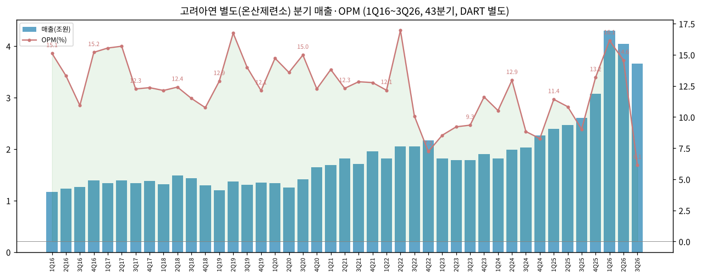

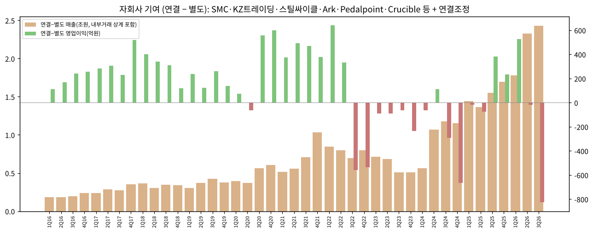

**(5) 3Q26 핵심 박스 (IR 3Q26, 2026-11-05)**

| 항목 | 3Q25 | 4Q25 | 1Q26 | 2Q26 | 3Q26 | YoY |
|---|---|---|---|---|---|---|
| 연결 매출 (십억원) | 4,160 | 4,770 | 6,072 | 6,373 | 6,086 | +46.3% |
| 연결 영업이익 | 273 | 429 | 746 | 587 | 142 | -48.2% |
| 연결 OPM | 6.6% | 9.0% | 12.3% | 9.2% | 2.3% | -4.2%p |
| 연결 EBITDA | 367 | 497 | 847 | 696 | 280 | -23.6% |
| 별도 매출 | 2,609 | 3,075 | 4,295 | 4,046 | 3,657 | +40.2% |
| 별도 영업이익 | 235 | 405 | 693 | 589 | 224 | -4.6% |
| SMC 영업이익 (천USD) | 6,341 | 17,057 | 33,241 | 7,921 | 10,048 | +58.5% |
| KZ트레이딩 영업이익 | 12.3 | 19.0 | 16.9 | 5.9 | 16.4 | +33.3% |
| 스틸싸이클 영업이익 | 1.3 | 4.9 | 2.7 | 11.7 | 8.9 | +585% |
| 희소금속 매출총이익 | 106.5 | 78.2 | 59.2 | 75.9 | 60.9 | -42.8% |

→ 3Q26 감익 원인 (회사 IR): 은 판매 확대·반도체용 황산 호조에도 **원/달러 환율 하락·귀금속 가격 약세**로 매출 감소, **금속가격·환율 변동과 TC 하락에 따른 원가 부담** [IR 3Q26]. 언론은 고가 매입 원료 투입 시차를 추가로 지적 [비즈워치 2026-11-04]
→ 연결−별도 영업이익 -826억 (3Q26) — Crucible 초기 비용·Ark·2차전지 소재 적자 추정 (⚠️ 개별 내역 미공시)
→ 4Q26 회사 전망: 환율·귀금속 가격 추가 급락이 없으면 추가 악화는 제한적, 건식 구리·인듐 등 고수익 희소금속 확대 [IR 3Q26]

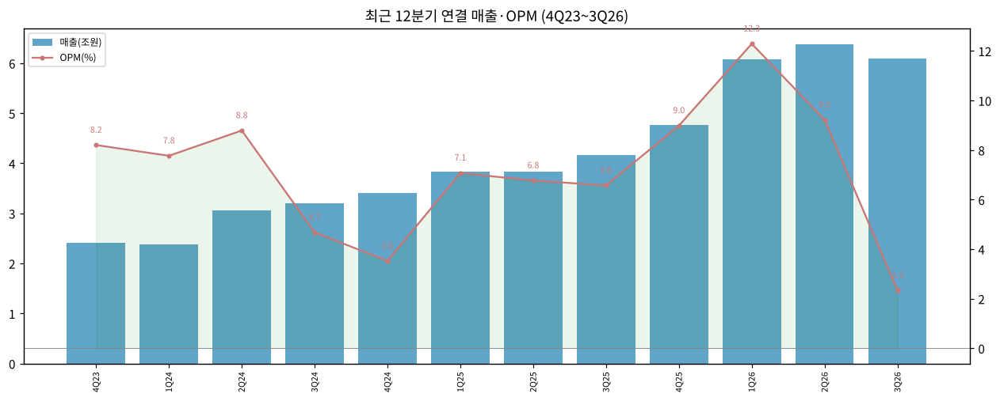

### ② 사업부별 개요 (매출 비중 큰 순서)

| 사업 | 주요 법인 | 2025 매출 비중 | 핵심 |
|---|---|---|---|
| 비철금속 제조·판매 | 고려아연(온산), Sun Metals Corporation(호주) | 71.3% | 아연·연·금·은·동·황산·희소금속 통합 제련 |
| 비철금속 수출입 | 케이지트레이딩(지분 50%) | 25.1% | 고려아연 제품 수출 + 알루미늄 등 내수 트레이딩 (OPM 1\~5%) |
| 자원순환 | 스틸싸이클(제강분진→조산화아연), ZOC Vietnam, Pedalpoint(미국 전자폐기물·스크랩: Igneo·evTerra·Kataman·MDSi) | 3.6% | 2차 원료 확보, 미국 자원순환 플랫폼 |
| 신재생·수소 | Ark Energy(호주, 지분 96%) — 923MW MacIntyre 풍력 30% 지분 등 | (부문 미분리) | 풍력·태양광·수소, 온산·SMC 전력 RE100 |
| 2차전지 소재 | 켐코(황산니켈, 73%), 한국전구체(51%, LG화학 JV), 케이잼(동박, 100%) | (부문 미분리) | 니켈 제련 → 전구체 → 동박 |
| 미국 제련소 | Crucible Metals Holdings → Crucible Zinc (테네시 클락스빌) | 건설 중 | 13개 비철금속(핵심광물 11종) + 반도체급 황산, 2029 완공 목표 |
| 광산개발 | KZ Minerals Holdings, ICM Pachapaqui(페루) | 미미 | 신규 선광장 준비로 기존 설비 조업 중단 |

(출처: DART 사업보고서(2025.12) II-1·II-2·II-4, IR 3Q26 지분구조도, S&P Global 2026-04-02)

### ③ 사업부별 디테일

**(1) 온산제련소 (별도) — 이익의 거의 전부**
→ 생산실적 (2025/2024/2023): 아연 60.0/63.0/64.0만톤, 연 41.4/44.5/41.3만톤, 금 12.5/7.1/9.2톤, 은 2,090/2,010/1,974톤, 동 3.30/3.21/3.11만톤, 황산 148/148/140만톤 [DART 사업보고서(2025.12) II-3]
→ 원재료: 아연정광 1.83조·연정광 4.63조 매입 (2025, Glencore 등) — 연정광 매입액이 더 큰 이유는 연정광에 은 함량이 높기 때문 (기준품위 Ag 2,200g/t) [DART II-3]
→ 가동률 100% 연속조업 [DART II-3]
→ 2025 아연 생산이 64만톤 CAPA 대비 60만톤으로 감소 — 정광 수급 및 귀금속 회수 우선 조업 (⚠️ 회사 설명 미대조)

**(2) 희소금속 — 고마진 성장 레버**
→ 인듐·안티모니·카드뮴·텔루륨·비스무스 등, 3Q26 매출 830억·GPM 73.5% (3Q25 매출 1,270억·GPM 84.0%) [IR 3Q26]
→ 안티모니·게르마늄·갈륨 회수공정 개발 (2025 연구과제) [DART 분기보고서(2026.09) II-6], Crude GeO₂ 조기 생산·장기계약 협상 [IR 3Q26]
→ 반도체용 황산 2026 하반기 32만톤으로 +14.3% 증설, 장기 50만톤 목표 [S&P Global 2026-04-02]

**(3) SMC (호주) — 변동성 높은 아연 단일 제련**
→ 분기 영업이익 634만\~3,324만 USD (3Q25\~3Q26) [IR 3Q26]. 2022 호주 영업손실 -860억, 2024 -604억 [DART 지역별 부문정보]
→ 제품의 약 88% 아시아·북미 수출, 12% 호주 내수 / 원재료 Cannington·San Cristobal·Red Dog·MIM 등 [DART 사업보고서(2025.12) II-2·II-3]

**(4) KZ트레이딩 — 매출 볼륨, 이익 미미**
→ 2025 매출 4.40조(부문 25.1%), 영업이익 718억 (OPM 1.6%) [DART II-7]. 매출 성장이 연결 OPM을 희석시키는 핵심 요인

**(5) Crucible (미국 테네시) — 초대형 프로젝트**
→ 총 74.3억달러 (약 9.9조원), 2026 부지 정비 → 2027 착공 → 2029 완공 목표, 아연·연·동부터 순차 생산, 부지 내 5개 폰드의 제련 부산물 약 62만톤 재처리로 게르마늄·갈륨·인듐 회수 [S&P Global 2026-04-02, 아이뉴스24 2026-11-04]
→ 미국 상무부 러트닉 장관 "2026년 고려아연 글로벌 생산에 대한 우선 접근권" 언급 [Mining.com 2025-12-15]. 2026-09 연방 최종 환경평가 통과 [아이뉴스24 2026-11-04]

### ④ 주요 경쟁사 (사업별)

| 사업 | 글로벌 | 국내 |
|---|---|---|
| 아연 제련 | Nyrstar(Trafigura), Glencore, Boliden, Teck(Trail), Hindustan Zinc, 중국 Zhuzhou Smelter·Yunnan Chihong 등 | 영풍(석포제련소) |
| 연·귀금속 회수 | Umicore, Aurubis, Boliden, 중국 대형 제련사 | LS MnM(동제련 부산물 금·은) |
| 희소금속 (게르마늄·갈륨·인듐·안티모니) | 중국 업체 다수 (2023\~ 중국 수출통제 대상 품목) | - |
| 2차전지 소재 | 에코프로·포스코퓨처엠(전구체), SK넥실리스·롯데에너지머티리얼즈(동박) | 동일 |

(경쟁사 목록은 업계 일반 정보 — ⚠️ DART 공시 대조 아님, 점유율 수치 미기재)

### ⑤ 주요 매출처

- DART 사업보고서에 매출처 명단 미공시. 아연은 도금강판(철강사)·다이캐스팅·신동, 연은 축전지(배터리)용이 대부분, 금·은은 산업재·장신구·투자 수요 [DART 사업보고서(2025.12) II-2]
- 수출 비중이 높아 원/달러 환율이 매출·이익에 직접 영향 (2025 아연 수출단가 433.7만원/MT ≈ 내수 432.8만원 — 수출·내수 가격이 LME 연동으로 동일) [DART II-2]

### ⑥ 생산 CAPA + 임직원

| 항목 | 값 |
|---|---|
| 온산 생산능력 (2025) | 아연 64만톤, 연 43만톤, 금 12톤, 은 2,500톤, 동 6.5만톤, 황산 150만톤 |
| 스틸싸이클 | 조산화아연(HZO) 6.2만톤, 동소성품 3만톤 |
| 임직원 (별도) | 2015말 1,396명 → 2025말 2,054명 |

(출처: DART 사업보고서(2025.12) II-3, (2015.12)·OpenDART empSttus 2025)

---

## 4. 재무 구조

> 12년 연결, OpenDART (2022\~2025 재작성본). 단위 억원 (재무상태표는 조원)

### ① 손익계산서 (12년 연결, 억원)

| 연도 | 매출 | 매출원가 | 매출총이익 | 판관비 | 영업이익 | 세전이익 | 순이익 | 지배순이익 | GPM | OPM | NPM |
|---|---|---|---|---|---|---|---|---|---|---|---|
| 2014 | 49,385 | 41,126 | 8,260 | 1,433 | 6,827 | 6,830 | 5,049 | 5,013 | 16.7% | 13.8% | 10.2% |
| 2015 | 47,714 | 39,295 | 8,420 | 1,697 | 6,722 | 6,845 | 5,140 | 5,094 | 17.6% | 14.1% | 10.8% |
| 2016 | 58,475 | 49,048 | 9,427 | 1,780 | 7,647 | 8,017 | 5,946 | 5,924 | 16.1% | 13.1% | 10.2% |
| 2017 | 65,967 | 55,279 | 10,687 | 1,740 | 8,948 | 9,257 | 6,340 | 6,290 | 16.2% | 13.6% | 9.6% |
| 2018 | 68,833 | 59,793 | 9,040 | 1,393 | 7,647 | 7,687 | 5,348 | 5,274 | 13.1% | 11.1% | 7.8% |
| 2019 | 66,948 | 57,436 | 9,512 | 1,459 | 8,053 | 8,724 | 6,386 | 6,329 | 14.2% | 12.0% | 9.5% |
| 2020 | 75,819 | 65,468 | 10,352 | 1,378 | 8,974 | 8,124 | 5,748 | 5,730 | 13.7% | 11.8% | 7.6% |
| 2021 | 99,768 | 87,205 | 12,563 | 1,602 | 10,961 | 11,391 | 8,111 | 8,068 | 12.6% | 11.0% | 8.1% |
| 2022 | 112,194 | 100,504 | 11,690 | 2,498 | 9,192 | 6,975 | 6,196 | 6,020 | 10.4% | 8.2% | 5.5% |
| 2023 | 97,045 | 87,426 | 9,619 | 3,020 | 6,599 | 6,103 | 4,385 | 4,324 | 9.9% | 6.8% | 4.5% |
| 2024 | 120,529 | 109,121 | 11,408 | 4,173 | 7,235 | 4,307 | 3,047 | 3,008 | 9.5% | 6.0% | 2.5% |
| 2025 | 165,879 | 147,863 | 18,015 | 5,696 | 12,319 | 10,290 | 7,702 | 7,750 | 10.9% | 7.4% | 4.6% |

→ GPM 16.7% (2014) → 10.9% (2025): 매출원가율 상승이 구조적 — 귀금속·트레이딩 매출은 원재료 가격이 그대로 원가로 넘어감
→ 판관비 1,433억 (2014) → 5,696억 (2025): 신사업 법인 편입·분쟁 관련 비용(자문·소송) 증가 (⚠️ 분쟁 비용 개별 미공시)

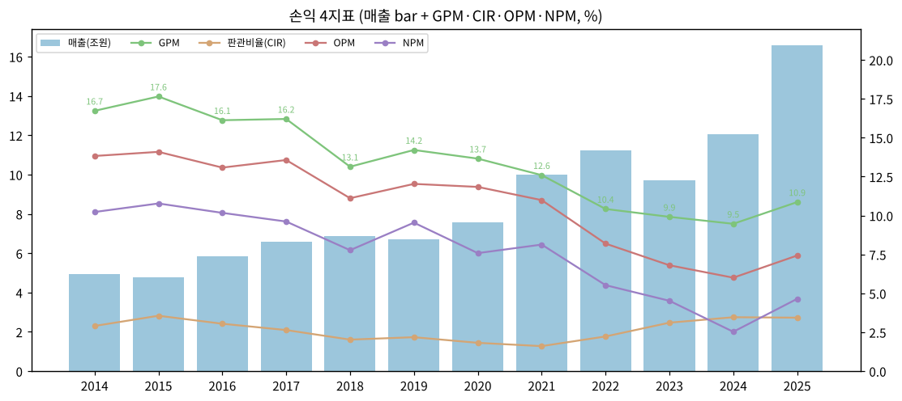

### ② 재무상태표 (12년 연결, 조원)

| 연도 | 자산총계 | 유동자산 | 현금 | 재고자산 | 유형자산 | 부채총계 | 총차입금 | 자본총계 | 지배자본 | 부채비율 | 순차입금 |
|---|---|---|---|---|---|---|---|---|---|---|---|
| 2014 | 5.64 | 2.67 | 0.18 | 1.28 | 2.11 | 0.86 | 0.17 | 4.78 | 4.63 | 18% | -0.00 |
| 2015 | 5.91 | 2.54 | 0.24 | 1.02 | 2.43 | 0.69 | 0.05 | 5.22 | 5.08 | 13% | -0.19 |
| 2016 | 6.48 | 2.89 | 0.31 | 1.20 | 2.48 | 0.82 | 0.05 | 5.66 | 5.52 | 14% | -0.26 |
| 2017 | 7.04 | 3.67 | 0.60 | 1.36 | 2.70 | 0.93 | 0.03 | 6.11 | 5.96 | 15% | -0.56 |
| 2018 | 7.23 | 3.97 | 0.66 | 1.29 | 2.79 | 0.85 | 0.03 | 6.37 | 6.25 | 13% | -0.63 |
| 2019 | 7.84 | 4.60 | 0.69 | 1.56 | 2.90 | 1.00 | 0.04 | 6.84 | 6.72 | 15% | -0.65 |
| 2020 | 8.50 | 4.91 | 0.43 | 2.25 | 3.19 | 1.41 | 0.12 | 7.09 | 6.97 | 20% | -0.30 |
| 2021 | 9.96 | 5.69 | 0.47 | 2.91 | 3.46 | 2.23 | 0.43 | 7.73 | 7.61 | 29% | -0.04 |
| 2022 | 11.92 | 6.07 | 0.78 | 2.83 | 3.69 | 2.87 | 1.01 | 9.05 | 8.86 | 32% | 0.23 |
| 2023 | 11.77 | 5.57 | 0.68 | 2.64 | 3.87 | 2.40 | 0.86 | 9.37 | 9.11 | 26% | 0.19 |
| 2024 | 14.60 | 7.57 | 0.89 | 3.78 | 4.82 | 7.20 | 4.82 | 7.41 | 7.14 | 97% | 3.93 |
| 2025 | 20.21 | 12.07 | 3.45 | 6.22 | 5.36 | 9.21 | 5.72 | 11.00 | 10.75 | 84% | 2.27 |
| 3Q26 | 21.90 | 10.21 | 1.04 | 6.62 | 6.01 | 11.04 | 7.96 | 10.86 | 10.62 | 102% | 6.93 |

(총차입금 = BS 단기·장기차입금 + 사채(유동성 포함) 합산 [계산]. 3Q26 IR은 총차입금 7.96조·순차입금 6.34조(단기투자자산 차감)·부채비율 102.8%로 제시 — 3Q26 IR 수치는 K-IFRS 1118호 표시 기준 [IR 3Q26])

→ 2014\~2021 사실상 무차입 (순현금) → 2024 자사주 2.13조 + 재고 증가로 부채비율 97% → 2025 Crucible 증자로 84% → 3Q26 102%
→ 재고자산 1.28조 (2014) → 6.62조 (3Q26): 금·은 가격 상승 + Pedalpoint·트레이딩 재고

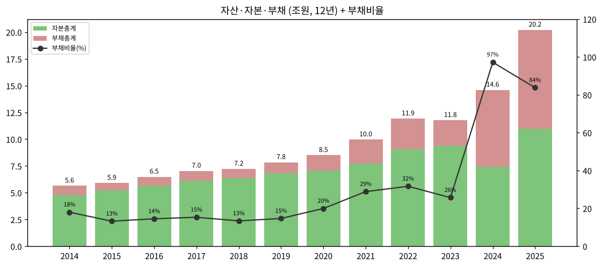

### ③ 현금흐름표 (12년 연결, 억원)

| 연도 | 영업CF | 투자CF | 재무CF | CapEx(유형+무형) | FCF | 배당지급 | 자사주취득 | 이자지급 |
|---|---|---|---|---|---|---|---|---|
| 2014 | 4,039 | -5,636 | -865 | 3,917 | 121 | 899 | 0 | 24 |
| 2015 | 9,449 | -6,508 | -2,363 | 4,802 | 4,647 | 1,164 | 0 | 20 |
| 2016 | 6,807 | -4,590 | -1,565 | 1,868 | 4,939 | 1,518 | 0 | 13 |
| 2017 | 7,968 | -3,237 | -1,725 | 5,000 | 2,968 | 1,518 | 0 | 8 |
| 2018 | 8,883 | -6,497 | -1,829 | 3,241 | 5,642 | 1,783 | 0 | 10 |
| 2019 | 6,927 | -4,739 | -1,909 | 3,654 | 3,272 | 1,960 | 0 | 7 |
| 2020 | 4,565 | -5,476 | -1,714 | 6,693 | -2,128 | 2,599 | 0 | 15 |
| 2021 | 6,069 | -5,777 | 17 | 4,787 | 1,282 | 2,775 | 0 | 46 |
| 2022 | 7,847 | -17,968 | 12,963 | 3,793 | 4,054 | 3,550 | 0 | 318 |
| 2023 | 8,209 | -6,225 | -3,156 | 4,388 | 3,821 | 5,990 | 519 | 520 |
| 2024 | 5,158 | -13,550 | 10,981 | 11,300 | -6,142 | 3,149 | 21,276 | 795 |
| 2025 | -6,282 | -4,411 | 36,747 | 9,430 | -15,712 | 1,393 | 0 | 2,179 |

(FCF = 영업CF − 유·무형자산 취득. 2025 영업CF -6,282억은 운전자본(재고 +2.4조) 급증 영향 [DART 2025 연결 BS·CF]. 9M26 영업CF -3,626억·투자CF -36,901억(Crucible·Nyrstar USA 인수 포함 추정)·재무CF +16,466억 [DART 분기보고서(2026.09)])

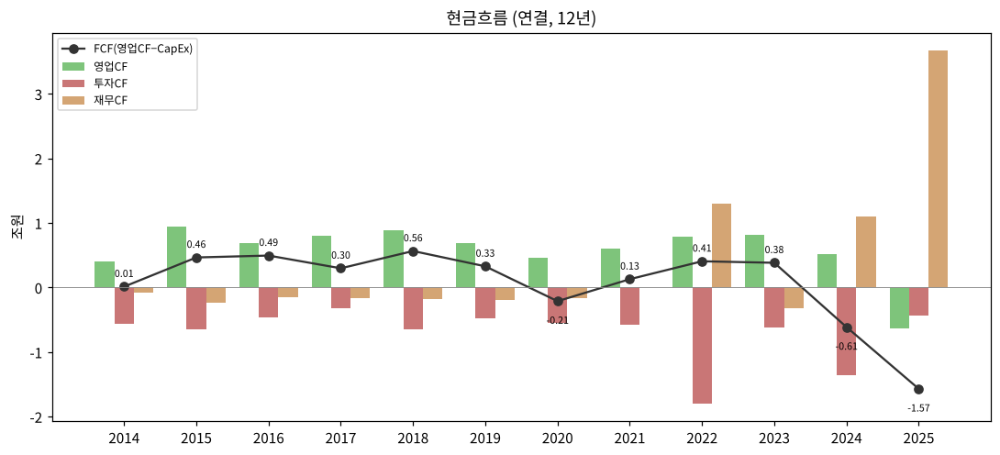

### ④ CapEx 추이 (12년, 억원)

| 연도 | 유형자산 취득 | 무형자산 취득 | 합계 | CapEx/매출 | 감가상각 대비(유형자산 증감) |
|---|---|---|---|---|---|
| 2014 | 3,916 | 2 | 3,917 | 7.9% | - |
| 2015 | 4,799 | 3 | 4,802 | 10.1% | 3,164 |
| 2016 | 1,845 | 23 | 1,868 | 3.2% | 562 |
| 2017 | 4,970 | 30 | 5,000 | 7.6% | 2,182 |
| 2018 | 3,162 | 79 | 3,241 | 4.7% | 826 |
| 2019 | 3,581 | 73 | 3,654 | 5.5% | 1,155 |
| 2020 | 6,621 | 72 | 6,693 | 8.8% | 2,934 |
| 2021 | 4,638 | 149 | 4,787 | 4.8% | 2,649 |
| 2022 | 3,730 | 64 | 3,793 | 3.4% | 2,354 |
| 2023 | 4,186 | 202 | 4,388 | 4.5% | 1,747 |
| 2024 | 11,133 | 167 | 11,300 | 9.4% | 9,497 |
| 2025 | 8,896 | 534 | 9,430 | 5.7% | 5,459 |

(유형자산 증감은 장부가 순증 — 취득 − 감가상각 − 처분 ± 연결범위 변동. 2024 CapEx 1.13조는 12년 최대 [DART 2024 연결CF]. Crucible 74.3억달러는 2026\~2029 집행 예정 — 2027 이후 CapEx 급증 구간)

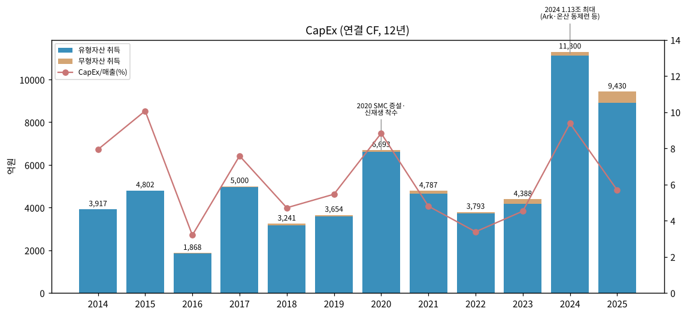

### ⑤ 부채구조 + 채무증권 발행 history

- 2025말 차입 구성: 단기차입금 3.05조, 장기차입금 1.07조, 사채(비유동) 1.60조 — 2025 장기 회사채 1.6조 발행, 전환사채 1.11조 조기상환 [DART 2025 연결 BS·CF]
- 2024말: 단기사채 1.00조 (분쟁 중 자사주 매입 재원), 단기차입금 3.32조 [DART 2024 연결 BS]
- 공급자금융약정 단기차입 2025 차입 3.82조·상환 3.76조 (원료 매입 금융) [DART 2025 연결CF]
- 이자지급: 2021 46억 → 2025 2,179억 (47배) [DART 연결CF]
- 신용등급 AA+ (한신평, 2025-06) [전자신문 2025-06-30]

### ⑥ 배당·자사주 추이 (12년)

| 사업연도 | DPS(원) | 배당총액(억원) | 연결 배당성향 | 자기주식 취득(억원, CF) | 비고 |
|---|---|---|---|---|---|
| 2014 | 6,500 | 1,149 | 22.9% | - | |
| 2015 | 8,500 | 1,502 | 29.5% | - | |
| 2016 | 8,500 | 1,502 | 25.4% | - | |
| 2017 | 10,000 | 1,767 | 28.1% | - | |
| 2018 | 11,000 | 1,944 | 36.9% | - | |
| 2019 | 14,000 | 2,474 | 39.1% | - | |
| 2020 | 15,000 | 2,651 | 46.3% | - | |
| 2021 | 15,000 | 2,651 | 32.9% | - | ⚠️ DPS 원문 미대조 (배당지급 CF로 역산) |
| 2022 | 20,000 | 3,973 | 66.0% | - | 중간배당 포함 (재작성 후 순이익 기준) |
| 2023 | 15,000 | 3,027 | 70.0% | 519 | 자사주 신탁 1,000억 (2024-05 205,305주 소각) |
| 2024 | 17,500 | 3,418 | 113.6% | 21,276 | 공개매수 2,040,030주 → 2025 소각 |
| 2025 | 20,000 | 4,079 | 52.6% | 0 | |
| 9M26 | 15,000 (분기 5,000×3) | 3,059 | - | - | 2026 분기배당 도입, 3Q 기준일 2026-11-29 |

(출처: DART 사업보고서 각 연도 배당에 관한 사항, OpenDART alotMatter 2025 (2025 배당성향 52.6%·2024 113.6%·2023 70.0%는 재작성 후 수치), 연결CF 자기주식의 취득, 아이뉴스24 2026-11-04. 2014\~2020 배당성향은 배당총액 ÷ 지배순이익 [계산])

→ 2026-11-04 이사회: 보유 자사주 479,737주 중 246,665주(51.4%) 2027-01 소각, 233,072주는 10년간 임직원 보상 활용 [아이뉴스24 2026-11-04]

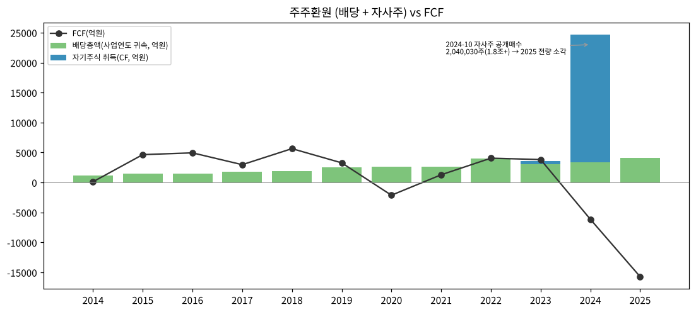

### ⑦ 재무 비율 (12년)

| 연도 | ROE(지배) | ROA | 부채비율 | 유동비율 | 순차입금/자본 | 이자보상배율(영업이익/이자지급) | BPS(원, 유통주식) |
|---|---|---|---|---|---|---|---|
| 2014 | 10.8% | 8.9% | 18% | 485% | -0% | 284배 | 262,184 |
| 2015 | 10.5% | 8.9% | 13% | 651% | -4% | 332배 | 287,269 |
| 2016 | 11.2% | 9.6% | 14% | 539% | -5% | 577배 | 312,118 |
| 2017 | 11.0% | 9.4% | 15% | 605% | -9% | 1,076배 | 337,232 |
| 2018 | 8.6% | 7.5% | 13% | 737% | -10% | 748배 | 353,622 |
| 2019 | 9.8% | 8.5% | 15% | 653% | -10% | 1,099배 | 379,956 |
| 2020 | 8.4% | 7.0% | 20% | 439% | -4% | 583배 | 394,347 |
| 2021 | 11.1% | 8.8% | 29% | 321% | -0% | 236배 | 430,439 |
| 2022 | 7.3% | 5.7% | 32% | 262% | 3% | 29배 | 446,257 |
| 2023 | 4.8% | 3.7% | 26% | 293% | 2% | 13배 | 438,067 |
| 2024 | 3.7% | 2.3% | 97% | 119% | 53% | 9배 | 393,306 |
| 2025 | 8.7% | 4.4% | 84% | 197% | 21% | 6배 | 527,256 |

(ROE = 지배순이익 ÷ 평균 지배자본, ROA = 순이익 ÷ 평균 자산, 이자보상배율 = 영업이익 ÷ 이자지급(CF), BPS = 지배자본 ÷ 연말 유통주식수 [계산]. 2014\~2021 이자보상배율 수백 배는 사실상 무차입 반영)

---

## 5. 지배 구조

### ① 그룹·계열 관계

- 공정거래법상 **영풍그룹 소속** — 최대주주 (유)와이피씨(영풍 100%)와 특수관계인 합계 32.88% (2026-09-30) [DART 분기보고서(2026.09) VII]
- (유)와이피씨: 2025-03-07 설립, 2026-01-01 지주회사 전환, 자산 1.01조·부채 0.71조, 2025 순손실 -3,724억 [DART 분기보고서(2026.09) VII]. ㈜영풍 최대주주는 장세준 18.11% [동]
- **영풍·장형진–MBK 경영협력계약 (2024-09-12)**: 이사 공동 의결권 행사, MBK 추천 이사 수가 영풍 추천보다 1인 많도록, MBK 지명 CEO·CFO 선임, 영풍 측 10년 처분 제한(이후에도 최윤범 측 매각 금지), MBK 콜옵션·영풍 풋옵션 ('50%+1주' 기준) [DART 분기보고서(2026.09) VII]
- 최윤범 회장 측 우호 지분: 한화·LG화학·현대차그룹(HMG Global)·Trafigura 등 2022\~2023 전략적 제휴 주주 [DART 사업보고서(2022.12)·(2024.12), 머니투데이 2026-09-15]

### ② 주주 구분

| 주주 | 주식수 | 지분율 | 기준 |
|---|---|---|---|
| (유)와이피씨 (최대주주, 영풍 100%) | 5,262,450 | 25.21% | 2026-09-30 |
| 장형진 (영풍 고문) | 721,798 | 3.46% | 〃 |
| 영풍 계열사·장씨 일가 기타 | 878,669 | 4.21% | 〃 |
| **영풍 측 특수관계인 합계** | **6,862,917** | **32.88%** | 〃 [DART 분기보고서(2026.09)] |
| Crucible JV LLC (미국 정부·JPMorgan 등) | 2,209,716 | 10.59% | 2025-12-27 신주 [DART, 계산], 1년 보호예수 |
| 자기주식 | 479,737 | 2.30% | 2025말 [DART] — 246,665주 2027-01 소각 예정 |
| MBK(한국기업투자홀딩스) | 미공시 | 약 9% (추정) | 영풍·MBK 합산 약 42% [머니투데이 2026-09-15] − 영풍 측 32.88% |
| 최윤범 측 우호지분 | - | 약 39% | [머니투데이 2026-09-15 — Crucible 포함 여부 불명] |
| 소액주주 | - | 약 15% | 2025말 추정 [뉴시스 2026-03-26] |

(발행주식 20,872,969주 기준. MBK 단독 지분과 최윤범 측 우호지분은 DART 5% 공시 원문 미대조 — 언론 추정치)

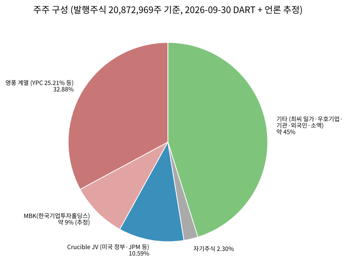

### ③ 임원·이사회

- **이사회 (2026-09-09 임시주총 이후 19인, 최윤범 측 12 : 영풍·MBK 측 7)** [머니투데이 2026-09-15]. 2026-03 정기주총 직후 9:5 → 임시주총에서 확대 [뉴시스 2026-03-26]
- 사내이사: **최윤범 회장** (1975-03생, Amherst·Columbia Law, 前 SMC 대표, 재직 18년, 임기 2028-03), **박기덕 대표이사 사장** (1968-06생, 前 SMC CFO, 임기 2027-03) [OpenDART exctvSttus 2025]
- 기타비상무이사: 강성두(前 영풍 사장), 김광일(MBK 부회장, 한국기업투자홀딩스 대표), 최연석(MBK 파트너), Walter Field McLallen(Crucible JV 추천) [OpenDART exctvSttus 2025, 뉴시스 2026-03-26]
- 사외이사(2025 사업보고서 기준): 권순범·James Andrew Murphy·정다미·이상훈·이형규·김경원·이재용·권광석·이선숙·황덕남·김보영·서대원 등 — 감사위원장 서대원 (前 국세청 차장) [OpenDART exctvSttus 2025]
- 2025-01 임시주총에서 집중투표제·이사 수 상한(19인) 도입 (⚠️ 원문 미대조), 2026-09 개정 상법 3% 룰 — 영풍·최윤범 측은 합산 대상, 영풍·MBK는 합산 미적용 해석 [MTN 2026-09-07]
- 2027-03 정기주총: 이사 8인·분리선출 감사위원 1인 임기 만료 → 다음 분수령 [머니투데이 2026-09-15]

---

## 6. 기타 팩트

### ① R&D 인프라

| 연도 | 2015 | 2016 | 2017 | 2018 | 2019 | 2020 | 2021 | 2022 | 2023 | 2024 | 2025 | 9M26 |
|---|---|---|---|---|---|---|---|---|---|---|---|---|
| 연구개발비 (억원) | 13 | 13 | 13 | 13 | 14 | 24 | 47 | 76 | 106 | 112 | 178 | 129 |
| R&D/매출 (%, 별도) | 0.03 | 0.03 | 0.02 | 0.02 | 0.03 | 0.04 | 0.07 | 0.09 | 0.15 | 0.14 | 0.17 | 0.11 |

(DART 사업보고서 각 연도·분기보고서(2026.09) II-6 연구개발비용 — 별도 기준)
- 기술연구소 (개발연구팀·분석관리팀) [DART 분기보고서(2026.09) II-6]
- R&D 집약도는 매우 낮음 (제련은 공정 노하우 산업) — 2021 이후 신사업(배터리 소재·자원순환·희소금속)으로 10배 이상 증가

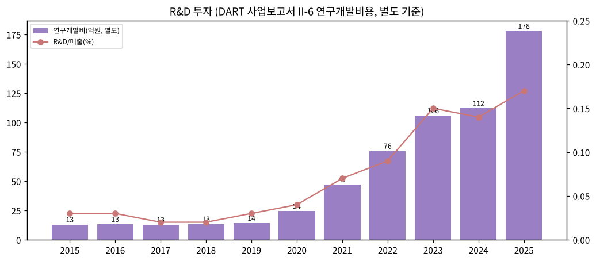

### ② 진행 중 corporate action — 10년치 주요 이벤트

| 시기 | 이벤트 | 규모 |
|---|---|---|
| 2016-04 | 징크옥사이드코퍼레이션 90% 취득 | 이전대가 688억 |
| 2022-05 | Epuron(현 Ark Energy) 100% 인수 | - |
| 2022 | 한화·LG화학·Trafigura 자사주 교환 / 한화H2 등 제3자배정 | 발행주식 18.87M → 19.86M |
| 2023-09 | HMG Global 제3자배정 | 1,045,430주, 5,272억 |
| 2023-11 | 자기주식 신탁 1,000억 → 2024-05 소각 | 205,305주 |
| 2024 | Kataman Metals(미국) 인수(2024-04), 로보원 33.3% (2024-10) | - |
| 2024-10 | 자기주식 공개매수 → 2025 소각 | 2,040,030주, 자사주 취득 2.13조(2024 합계) |
| 2025-07 | MDSi·TechSource(미국) 인수 | - |
| 2025-12 | Crucible JV 제3자배정 + 테네시 제련소 | 2,209,716주·2.83조 / 74.3억달러 |
| 2026-04 | Nyrstar USA 클락스빌 제련소 인수 → Crucible Zinc | 비공개 |
| 2027-01E | 자기주식 246,665주 소각 / 2027-03E 액면분할 재상정 | - |

(출처: DART 사업보고서 연결 주석 종속기업 취득 각 연도, (2025.12) 주식의 총수·자본금, 아이뉴스24 2026-11-04, S&P Global 2026-04-02)

### ③ R&D·기술 마일스톤 — 최근

- 2024: High-Fluorine Black Mass 처리, 고강도(500MPa) 전지용 동박, LFP 양극재, NCM 전구체, 폐초경합금(W·Co) 회수, 수산화리튬 제조 특허 등록
- 2025: 안티모니 회수율 증대, 희토자석 희토류 습식 재활용, 갈륨·게르마늄 회수공정, 망간단괴 유가금속 회수, 저압 암모니아 합성 반응기(특허 등록)
- 2026: 미국 Alta Resource Technologies와 영구자석 희토류 회수 JV 추진 [S&P Global 2026-04-02]

(출처: DART 분기보고서(2026.09) II-6 연구개발 실적)

### ④ 주요 리스크

- **금속가격·환율·TC**: 수익 = LME 아연·연, LBMA 금·은, 원/달러, 벤치마크 TC의 함수. 3Q26 귀금속·환율 동반 하락으로 OPM 2.3% [IR 3Q26, 비즈워치 2026-11-04]
- **경영권 분쟁·소송**: 2025 주총 결의 취소 1심 인용(2026-11-12), HMG 신주발행무효 항소심(2026-11-13 회사 승소) 모두 미확정, 액면분할·정관 변경 관련 가처분·본안 소송 [비즈워치 2026-11-13, 아이뉴스24 2026-11-04]
- **회계·감리**: 2026-06-10 증선위 감리 조치 — 영업권 과대계상(2025 1,853억·2024 1,898억), FVPL 평가손익·지분법·법인세 수정 [DART 사업보고서(2025.12) 기재정정 주석 41]
- **재무 레버리지**: 총차입금 7.96조·순차입금 6.34조 (3Q26 IR), 이자지급 2025 2,179억 — Crucible 9.9조 집행 시 추가 차입 가능성
- **미국 프로젝트 실행**: 인허가·건설비·원료 확보, 미국 정부 정책 변화 (2029 완공 목표)
- **자회사 적자**: 호주 SMC·Ark, 2차전지 소재(켐코·한국전구체·케이잼) 업황 부진 — 3Q26 연결−별도 영업이익 -826억

### ⑤ ESG 등급

- 미확인 (KCGS·MSCI 등급 원문 미대조 — v1.1 보강 후보). 이사회 내 ESG위원회 운영 (위원장 김보영 사외이사) [OpenDART exctvSttus 2025]
- 온산·SMC 전력의 신재생 전환(Ark Energy) 추진, clean slag 골재 판매 [DART 사업보고서(2025.12) II-2]

### ⑥ 인증·라이선스

- LME·LBMA 등 거래소 브랜드 등록 여부는 원문 미대조 (v1.1 보강 후보)

---

## Version Log

- **v1.0 (2026-11-25)**: 첫 작성 — Phase 1 source 점검 (OpenDART 연결·별도 재무 JSON 각 44개 FY2015\~3Q26, 정기공시 XML 44건, 기업개황·주주·임원·직원·배당·자기주식·주식총수, IR 실적발표 PDF 12건(1Q24\~3Q26), Yahoo 월간·일간 시세) + v4.8 6개 섹션 + 차트 15종 (12종 표준 + chart2 3종(별도제련·자회사기여·제품믹스) + chart13 지역별 영업이익). 3Q26 분기보고서(2026-11-16)·IR(2026-11-05) 반영
- **데이터 관례**: ① 2022\~2025 재무는 2026-08 재작성본 ② 사업부문 = DART 연결 부문(제조판매·수출입·폐기물처리 등) + 별도 제품별 + 연결−별도 분기 분해 ③ 주가 = Yahoo `close`, 시총 = close × DART 발행주식수(자기주식 포함) ④ 배당 = 사업연도 귀속 DPS·배당총액 ⑤ CapEx = 연결 CF 유형 + 무형자산 취득 ⑥ FCF = 영업CF − CapEx ⑦ 총차입금 = BS 차입금·사채 계정 합산
- **source audit**: ✅ OpenDART 재무·공시원문·기업정보 / IR 2024\~2026 / Yahoo ❌ IR 2023 이전 PDF(irgo 게시물 15건 중 12건, 2024 이후만), 지속가능경영보고서(미수집), KCGS·MSCI ESG, 5% 대량보유 원문(MBK 단독 지분) ⚠️ 추정: MBK 지분 약 9%, SMC CAPA, 일부 연혁 연도
- 잔여 보완 후보: ① 2011\~2015 분기 시계열 (공시원문 요약재무) → 60+분기 ② 회사 지속가능경영보고서 (ESG·인증·신용등급) ③ IR 2023 이전 PDF — SMC·KZ트레이딩 분기 시계열 연장 ④ 5% 대량보유 공시로 MBK·우호지분 확정 ⑤ 2021 DPS 원문 대조 ⑥ LME 아연·TC·금은 가격 시계열 차트 ⑦ 2025-01 임시주총·2025-03 정기주총 결의 원문 대조
