# 금호석유화학 — 기업 개요 (v1.0)

> 마지막 update: 2026-11-25 (v1.0 — 첫 작성. 3Q26 분기보고서(2026-11-16 제출)·3Q26 잠정실적(2026-11-06 공시, 언론 보도) 반영)
> 입력 source: OpenDART fnlttSinglAcntAll (연결 CFS, 2015 사업보고서\~3Q26, 44개 JSON — 2014는 2015 사업보고서 전기 컬럼, 1Q14\~4Q15 분기 손익은 2015 분기·반기보고서 원문 손익계산서) + DART 정기공시 원문 XML 48건 + 감사보고서 첨부 16건 (사업보고서 2014\~2025, 분기·반기 1Q15\~3Q26, 기재정정본 우선) + OpenDART 기업개황·최대주주·임원·직원·배당·자기주식·주식총수 (2025 사업보고서) + 금호석유화학 IR 실적발표 PDF 5건 (2Q25·3Q25·4Q25·1Q26·2Q26 — irgo 4건 + 회사 사이트 kkpc.com 1건; 2Q24\~2Q26 사업부 5부문 분기 표) + 지속가능경영보고서 2025 (언론 요약, 2026-06-23) + Yahoo Finance (011780.KS 월간 2000-02\~2026-11, 일간 2021 전체·2024-11\~2026-11-25 / 011785.KS 우선주 일간) + 언론·신용평가 보조 (머니투데이·비즈니스워치·시대·IB토마토·뉴데일리·한경·뉴시스·아이뉴스24·아시아경제, 2021-03\~2026-11)
> 갱신 주기: 매분기 (실적 리뷰 모드 호출 시)
> 워치리스트: **대분류 소재 / 섹터 정유·화학 / 서브섹터: 화학 (LG화학(석유화학 부문)·롯데케미칼·금호석유화학·한화솔루션(케미칼 부문)) + 정유·화학 통합** (`earnings/watchlist.md` 84\~86행, 137행) — 2026-11-23 추가 섹터, 4Q26부터 리뷰
> **Fact verify cutoff**: 2026-11-24 (보통주 2026-11-24 종가 **92,100원** [Yahoo Finance 011780.KS 일간], 보통주 발행주식 24,919,697주 [DART 분기보고서(2026.09) 주석14 — 2025말 26,031,742주에서 3Q26 자사주 1,112,045주 이익소각] → 보통주 시가총액 **2.30조원**, 우선주(011785, 36,350원 × 3,023,486주) 포함 **2.41조원** [계산]. 사상 최고 종가 **296,000원 (2021-05-06)** [Yahoo 일간, 장중 298,500원] → 당시 보통주 시총 **9.02조원** [계산, 당시 발행주식 30,467,691주]. 고점 대비 **-68.9%**. YTD **-23.7%** (2025-12-30 종가 120,700원), 1년 **-18.8%** (2025-11-24 113,400원). 2026 고점 종가 153,400원 (2026-02-26, 미-이란 전쟁발 공급망 쇼크) 대비 -40.0%)

---

## 1. 기업 분류

- **Primary 분류: 사이클 — 합성고무 스프레드형 (Spread Cycle, 원료 구매형 다운스트림)** — 나프타분해(NCC) 설비 없이 부타디엔(BD)·스티렌(SM)을 사서 합성고무·합성수지를 만드는 구조. 이익은 "제품가 − 원료가" 스프레드와 중국 증설 사이클, 그리고 2020\~2021 NB라텍스(의료용 장갑) 같은 수요 쇼크에 좌우
- **Secondary 노트: 재무 방어형 + 스페셜티 전환 옵션** — 순현금(3Q26 차입금 6,974억 < 현금 7,210억), 부채비율 32%(3Q26), 그리고 EPDM(금호폴리켐)·SSBR(전기차 타이어)·NB라텍스·MDI 지분법(금호미쓰이화학)·에너지(열병합) 등 범용 NCC 대비 변동성이 작은 이익원. 동시에 **오너 일가 경영권 분쟁(박철완 vs 박찬구 일가)** 과 대규모 자사주(10.5%)가 주주환원 정책을 움직이는 지배구조 변수

### ① 정량 근거

**📊 Summary Box (12년, 2014\~2025 연결):**

| 지표 | 값 |
|------|-----|
| 매출 CAGR (2014→2025, 11년) | **+3.4%** (4.77조 → 6.92조) — 2021-07 금호폴리켐(EPDM) 100% 자회사화·2021-04 금호리조트 인수로 연결 범위 확대분 포함 |
| OPM 평균 | **8.8%** (12년 단순평균) / 2021 outlier 제외 시 **7.1%** |
| OPM 정점 평균 | **19.2%** (2018 9.9% · 2021 28.4%) — 2021 제외 시 정점 9.9% |
| OPM 저점 평균 | **3.9%** (2016 4.0% · 2024 3.8%) — 2014·2015·2025도 3.9\~4.2% (바닥이 얕은 편: 12년간 연간 적자 없음) |
| 사이클 주기 | **정점 간 3년 (2018→2021), 저점 간 8년 (2016→2024)** — 소사이클(BD·SBR 스프레드) 약 3년 + 대사이클(중국 증설·코로나 수요) 약 8년 중첩 |
| 사이클 회수 (12년) | **2회** (① 2017\~2019 스프레드 사이클, ② 2020\~2023 NB라텍스 슈퍼사이클) + 2026 2Q 단기 스파이크(미-이란 전쟁, 분기 OPM 14.9%) 진행 중 |
| 분기 OPM 범위 (51분기, 1Q14\~3Q26) | **-1.1% (3Q26) \~ 34.3% (2Q21)** — 분기 적자는 4Q15(-4억)·3Q26(-208억) 2회뿐 |

```
[전사 손익 시계열 (12년, 연결, DART) — 사이클 변곡점 annotation]
연도   매출(조)  영업이익(억)  순이익(억)  OPM    NPM    지배순이익(억)  비고
2014     4.77       1,849         883    3.9    1.9         932     ← 합성고무 하락기(천연고무·BD 약세), 금호폴리켐·금호미쓰이 지분법
2015     3.93       1,640       1,219    4.2    3.1       1,189     ← 유가 급락 → 판가 하락, 4Q15 분기 영업적자(-4억)
2016     3.97       1,571         808    4.0    2.0         732     ← 저점①: 중국 SBR 반덤핑·공급과잉, OPM 4.0%
2017     5.06       2,626       2,176    5.2    4.3       2,136     ← BD 가격 급등기, 피앤비 페놀·BPA 회복
2018     5.58       5,546       5,031    9.9    9.0       4,912     ← 정점①: 합성고무+피앤비(페놀유도체 부문이익 2,492억) 동반 호황
2019     4.98       3,678       2,947    7.4    5.9       2,946     ← 미중 분쟁·자동차 수요 둔화, 하반기 급감
2020     4.81       7,422       5,830   15.4   12.1       5,829     ← 코로나: NB라텍스(의료용 장갑) 수요 폭발, 하반기 OPM 18~20%
2021     8.46      24,068      19,656   28.4   23.2      19,655     ← 정점② 슈퍼사이클: NB라텍스+BPA, 영업이익 2.41조(outlier)
2022     7.98      11,477      10,257   14.4   12.9      10,254     ← 장갑 재고조정·NB라텍스 가격 급락, 하반기 급감
2023     6.32       3,590       4,470    5.7    7.1       4,468     ← 중국 증설(BR·SBR·페놀·BPA) 본격화, 4Q23 OPM 2.4%
2024     7.16       2,728       3,486    3.8    4.9       3,486     ← 저점②: NB라텍스 판가 경쟁·페놀 적자, 4Q24 OPM 0.6%
2025     6.92       2,718       2,909    3.9    4.2       2,909     ← 관세 불확실성·중국 BD 증설, 4Q25 OPM 0.1%

9M26    5.97       3,776       3,747    6.3    6.3       3,746     ← 2Q26 미-이란 전쟁 스프레드 스파이크(3,390억) → 3Q26 역래깅 적자(-208억)
OPM range: 3.8 ~ 28.4% = 24.6%p (2021 제외 시 3.8 ~ 15.4% = 11.6%p) → 사이클 분류 기준 충족
```

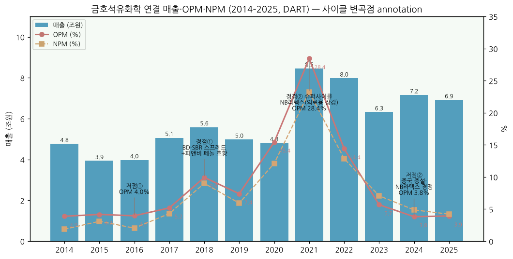

(2014 수치는 2015 사업보고서 전기 컬럼. 지배순이익은 지배기업 소유주지분 순이익. 금호폴리켐(EPDM)은 2021-07 잔여지분 50% 취득 전까지 공동기업(지분법), 이후 연결 [DART 사업보고서(2025.12) I-2]. 금호미쓰이화학(MDI, 50%)은 현재도 지분법 — 영업이익이 아닌 지분법손익(2025 1,311억)으로 들어온다 [DART 사업보고서(2025.12), IR 4Q25])

### ② 산업 분류

- 산업: **합성고무(SBR·BR·NBR·NB라텍스·SSBR) 1위 + 합성수지(ABS·PS·EPS·PPG) + 페놀유도체(금호피앤비화학) + 특수합성고무 EPDM(금호폴리켐) + 에너지(열병합)** — 석유화학 다운스트림(원료 구매형)
- DART 업종: 합성고무 제조업 / KRX 화학. 공정위 공시대상기업집단 "금호석유화학" (계열 16개사, 2025-05-01 연속 지정) [DART 사업보고서(2025.12) IX]
- 워치리스트 섹터: **정유·화학** / 서브섹터: **화학** (LG화학·롯데케미칼·금호석유화학·한화솔루션) 및 **정유·화학** 통합 — 2026-11-23 추가, 4Q26부터 리뷰
- 매출 구성 (별도 제품군, 9M26 누계): 합성고무 62.4% / 합성수지 24.6% / 정밀화학 3.7% / 기타(CNT·스팀·전기·임대) 9.3% [DART 분기보고서(2026.09) II-2]. 수출 비중: 합성고무 84%(동남아 45%·서남아 18%·중국 17%), 합성수지 65%(중국 26%·미주 20%) [IR 2Q26 Appendix]
- 시장 지위: 합성고무 생산능력 194.4만톤/년 (NB라텍스 94.6만톤 포함, 2Q26) [IR 2Q26 Appendix] — 회사 측 "세계 최대 합성고무 메이커" 표방 (글로벌 점유율 수치는 미검증)

### ③ 분류 결정 논리

(1) **가장 매출 큰 사업부 기준** 적용 시: 합성고무 = 별도 매출의 58.4% (2025, 2.67조) [DART 사업보고서(2025.12) I-1], IR 기준 합성고무 부문 연결 매출 비중 40.7% (3Q26, 7,824억/1.92조). 합성고무 판가는 BD 가격에 연동되고(BD가 SM과 함께 원재료 매입의 85%, 2025 [DART II-3]), 제품 단가가 2,083천원/톤(2024) → 1,990(2025) → 2,458(9M26)로 원료 따라 출렁임 [DART 분기보고서(2026.09) II-2] → **사이클(스프레드형)**
(2) **이익 비중 sub-rule**: 합성고무 부문 영업이익 비중 — 2Q24\~3Q26 IR 10개 분기 합산 기준 합성고무 3,842억 / 전사 8,436억 = **46%**. 다만 부문별 OPM이 2Q26 19.2% → 3Q26 0.3%처럼 한 분기 만에 무너지는 구조(원료 투입 시차 = "역래깅") → 이익이 가격 사이클에 직결 → **사이클 유지**. 반대로 EPDM/TPV(OPM 6.3\~20.9%)·에너지(열병합, SMP 연동)는 10개 분기 내내 흑자 → Secondary의 "방어형" 근거
(3) **Boundary case 처리 — 2021 NB라텍스 슈퍼사이클 + 지분법·스페셜티 비중**: ① 2021 영업이익 2.41조(OPM 28.4%)는 코로나 의료용 장갑 수요라는 일회성 수요 쇼크 → 12년 평균(8.8%)을 2%p 가까이 끌어올리는 **이익 outlier**로 분리 표기(제외 평균 7.1%). 이 구간을 "구조적 성장"으로 보면 안 되는 근거: 2022\~2024 NB라텍스 판가 경쟁으로 OPM이 3.8%까지 원복 ② 스페셜티(EPDM·SSBR·CNT) + 에너지 + MDI 지분법은 이익 안정판이지만 매출 합산 비중이 30% 미만 (IR 기준 EPDM/TPV 11.0% + 기타 9.6%, 3Q26) → Primary를 "지속성장"으로 바꿀 수준은 아님 ③ 3Q26 영업적자(-208억)는 2015-4Q 이후 42개 분기 만의 적자 — 미-이란 전쟁으로 비싸게 산 원료가 판가 하락기에 투입된 **재고·투입 시차 손실**로, 구조적 적자가 아님 (회사 "원재료 가격 변동성 완화, 고가 재고 영향 해소로 수익성 개선 기대" [머니투데이 2026-11-06]) → **사이클 + 재무 방어형 혼합, Primary 사이클 유지**
(4) **국내 정유·화학 피어 + 글로벌 cross-ref**:
→ **롯데케미칼 / LG화학(석유화학 부문) / 한화솔루션(케미칼 부문)**: 이들은 NCC(나프타분해)를 직접 돌리는 **업스트림 범용(에틸렌·PE·PP·PVC)** — 중국·중동 증설에 이익이 더 크게 노출되고 2023\~2025 적자 구간이 길었다 (각 사 기업개요와 교차 확인 필요 — 같은 날 병렬 작성). 금호석유화학은 NCC가 없는 **다운스트림 고무 스프레드형**이라 같은 "사이클" 분류 안에서도 저점 OPM이 3\~4%로 얕고, 순현금 재무구조가 차별점. LG화학은 NB라텍스 직접 경쟁사이기도 하다
→ **S-Oil / SK이노베이션(석유 부문)**: 정유 마진(크랙) 사이클 — 금호석유화학에는 **원료(BD·SM·벤젠) 가격 경로**로 연결되는 후방 산업. 유가 급등기(2Q26)엔 정유·화학 모두 재고이익이 나고, 급락기엔 동시에 역래깅이 난다는 점에서 분기 실적 방향이 같이 움직이는 경향 (6개 종목 공통 "사이클" 분류, 차이는 사이클의 원천: 정유 = 크랙, NCC = 에틸렌 스프레드, 금호 = BD·고무 스프레드 + 장갑 수요)
→ **글로벌 합성고무 피어**: 일본 Zeon(특수고무·NBR), Arlanxeo(아람코 자회사, EPDM·NBR), Kraton(2022 DL케미칼 인수, SBS·특수수지), Synthomer(영국, NB라텍스) — 금호석유화학의 경쟁 구도는 "범용 SBR·BR은 중국(Sinopec·PetroChina) 증설과 경쟁, NB라텍스는 LG화학·Synthomer·말레이시아 현지업체와 경쟁"이다. 이번 버전에서 글로벌 피어 수치는 검증하지 않음 (다음 버전 보강)

### ④ 적정 밸류에이션 방법

- **사업부 mix → PBR이 1순위**: 이익의 60% 이상이 스프레드형(합성고무·합성수지·페놀) → 분기 OPM이 -1%\~19% 사이를 오가므로 PER은 사이클 정점에서 싸 보이고(2021 PER 2.6배) 저점에서 비싸 보이는(2016 34.1배) 함정이 있음. 자본(지배지분 6.67조, 3Q26)은 2021 이익 축적 이후 꾸준히 증가 → 사이클 산업 표준인 **PBR 밴드**가 가장 안정적인 기준
→ 연말 PBR (보통주 시총/지배지분, [계산]): 2014 1.57 · 2015 1.02 · 2016 1.54 · 2017 1.65(정점) · 2018 1.13 · 2019 0.90 · 2020 1.40 · 2021 0.99 · 2022 0.65 · 2023 0.65 · 2024 **0.41(최저)** · 2025 0.50
→ 현재: **0.36배** (우선주 포함 시총 2.41조 / 지배지분 6.67조) · 보통주만 0.34배 — 12년 최저권. 자사주(보통주의 10.5%)를 차감한 유통주식 기준이면 더 낮아짐
- **EV/EBITDA는 2순위**: 순현금이라 EV ≈ 시총 2.38조 / LTM EBITDA 약 6,967억 (LTM 영업이익 3,792억 + 2025 연간 감가상각 3,175억 대용) = **약 3.4배** [계산]. 연말 기준 2014\~2017 9.6\~12.1배 → 2018\~2020 5.3\~5.8배 → 2021 2.1배 → 2023\~2025 5.3\~6.8배
- **PER은 보조(정상 이익 가정 필요)**: LTM 지배순이익 3,760억 (4Q25 14억 + 9M26 3,746억) 기준 **6.4배** [계산]. 단 LTM에 2Q26 스파이크(지배순이익 3,003억)가 포함 → 정상화 이익(12년 평균 OPM 7.1% 가정 시 영업이익 약 5,000억 내외 [추정])으로 봐야 함
- **지분가치 보조**: 금호미쓰이화학(MDI 61만톤, 50%) 등 공동·관계기업 투자 장부가 1.23조 (3Q26) = 시총의 51% — "본업 + 지분법 자산" 구조. 대우건설·아시아나항공 지분 등 공정가치 금융자산도 보유 [IR 2Q26 Appendix]
- **배당수익률은 참고**: 2025 DPS 1,700원 / 92,100원 = 1.8%. 배당성향(연결) 14\~20% + 자사주 소각을 합친 "주주환원율 40%"(2024\~2026 정책)가 핵심 [한경 2026-03-31]

#### ④-1 정유·화학 6사 공통 비교 박스 (통일 기준, 2026-11-28 통합 검수)

> 6개 문서(S-Oil·SK이노베이션·LG화학·롯데케미칼·금호석유화학·한화솔루션)에 **같은 표**를 넣었다. 본문 ④의 회사별 수치는 각 사 고유 정의(IR 순차입금, 우선주 포함 시총 등)라 이 표와 소수점 차이가 날 수 있음 — **6사 비교는 이 표 기준**.

| 지표 (2026-11-24 종가, 3Q26 말 기준) | S-Oil | SK이노베이션 | LG화학 | 롯데케미칼 | 금호석유화학 | 한화솔루션 |
|---|---|---|---|---|---|---|
| 서브섹터 | 정유 | 정유 (석유 부문) | 화학 (석유화학 부문) | 화학 | 화학 | 화학 (케미칼 부문) |
| Primary 분류 | 사이클 (정제마진) | 사이클 (정제마진) + 지주형 혼합 | 이중 사이클 (석화 + LGES) | 사이클 (NCC 스프레드, 구조조정) | 사이클 (합성고무 스프레드) | 이중 사이클 (석화 + 태양광) |
| 밸류 1순위 지표 | PBR | PBR + SOTP | SOTP (LGES 지분) | PBR | PBR | PBR (+SOTP 보조) |
| 보통주 시가총액 (조원) | 10.63 | 15.57 | 15.07 | 1.85 | 2.30 | 4.49 |
| LTM 매출 (조원, 4Q25\~3Q26) | 41.05 | 101.28 | 51.80 | 20.78 | 7.56 | 16.17 |
| LTM 영업이익 (조원) / OPM | 3.98 / 9.7% | 9.65 / 9.5% | 0.70 / 1.3% | -0.53 / -2.6% | 0.38 / 5.0% | 0.00 / 0.0% |
| 3Q26 OPM | 11.8% | 12.9% | 3.6% | -5.2% | -1.1% | 2.3% |
| LTM 지배순이익 (조원) | 2.90 | 1.53 | -2.28 | -1.34 | 0.38 | -0.10 |
| LTM EBITDA (조원) | 4.77 | 12.77 | 6.89 | 0.82 | 0.70 | 0.88 |
| 순차입금 (조원, 차입금·사채 − 현금및현금성자산, 리스 제외) | 7.16 | 19.88 | 26.86 | 7.17 | -0.02 (순현금) | 11.09 |
| 비지배지분 (조원) | 0.00 | 11.31 | 11.80 | 4.79 | 0.00 | 2.71 |
| EV (조원) = 시총 + 순차입금 + 비지배지분 | 17.79 | 46.76 | 53.73 | 13.81 | 2.28 | 18.29 |
| **EV/EBITDA (LTM)** | **3.7배** | **3.7배** | **7.8배** | **16.8배** | **3.3배** | **20.8배** |
| **PBR** (보통주 시총 / 3Q26 지배기업 소유주지분) | **0.93배** (11.42조) | **0.61배** (25.52조) | **0.47배** (31.81조) | **0.15배** (12.28조) | **0.34배** (6.67조) | **0.45배** (10.07조) |
| **PER** (보통주 시총 / LTM 지배순이익) | **3.7배** | **10.2배** | 적자 | 적자 | **6.1배** | 적자 |

(출처: 종가 = 각 문서 헤더 Fact verify cutoff (Yahoo Finance 일간, 롯데케미칼은 네이버 종가) × DART 보통주 발행주식총수 — 우선주는 6사 통일을 위해 제외. 매출·영업이익·지배순이익 = OpenDART fnlttSinglAcntAll 연결 (LTM = 2025 연간 + 9M26 누적 − 9M25 누적). 차입금·현금·지배지분·비지배지분 = DART 3Q26 연결 재무상태표 (SK이노베이션은 유동성장기부채 5.93조 포함). EBITDA = 각 문서 ④의 LTM EBITDA — S-Oil·금호석유화학은 영업이익 + DART 감가상각(금호는 2025 연간 대용), SK이노베이션·롯데케미칼·한화솔루션은 IR 분기 EBITDA 4개 합산, LG화학은 LTM 영업이익 + IR 감가상각이라 **EBITDA 정의는 회사별로 완전히 같지 않다**. 모두 [계산])

→ **읽는 법**: 2026년은 **정유가 정점, 화학이 저점**인 국면이 표에 그대로 찍혀 있다. ① **정유 2사(S-Oil·SK이노베이션)** = LTM OPM 9\~10%·EV/EBITDA 3.7배 — 이익 정점의 저배수 (사이클주는 이익 정점에서 배수가 가장 낮아 보인다는 점 주의). ② **LG화학** = 석화 적자를 LGES 이익이 메우는 구조라 EV/EBITDA 7.8배 — 석화 피어가 아니라 SOTP로 본다. ③ **롯데케미칼·한화솔루션** = EBITDA가 붕괴해 EV/EBITDA 16\~21배, PER 산출 불가 — 지금은 PBR(0.15·0.45배)과 정상화 이익으로만 비교 가능. ④ **금호석유화학** = 6사 중 유일한 순현금, EV/EBITDA 3.3배 — 3Q26 분기 적자에도 재무 리스크가 가장 작다.

### ⑤ 분기 재평가 트리거 (분류 변경 조건)

- **스페셜티·비(非)스프레드 이익(EPDM/TPV + 에너지 + MDI 지분법) 비중이 4개 분기 합산 전사 세전이익의 50%+** 로 2개 연도 유지 시 → 사이클 → "사이클 + 지속성장 혼합"으로 Primary 재검토 (현재: 2Q24\~3Q26 IR 10분기 EPDM/TPV 2,286억 + 기타 2,896억 = 영업이익(IR 5부문 합 8,436억)의 61%이지만, 2Q26처럼 스프레드 분기엔 30% 미만으로 떨어짐 → 미충족)
- **합성고무 부문 OPM 4개 분기 연속 2% 미만** (중국 BR·SBR·NB라텍스 증설 지속) 시 → 사이클 → 구조적 하락(Value Trap)형 하향 검토. 3Q26 0.3%가 1개 분기째
- **NB라텍스 2차 수요 쇼크** (미국의 중국산 장갑 관세 50→100% 상향에 따른 동남아 장갑 가동률 상승 [IB토마토 2026-11-11]) 로 합성고무 OPM 15%+ 2개 분기 지속 시 → 2021형 슈퍼사이클 재진입 여부 점검
- **지배구조 이벤트**: 박철완 측 이사회 진입(집중투표제 의무화 시) 또는 자사주 10.5% 전량 소각·처분 결정, 2027\~2029 주주환원 정책 공시(2027 초 예정 [IB토마토 2026-11-11]) → 밸류에이션 PBR 밴드 상단 재설정 검토

---

## 2. 회사 개요

### ① 기본 사항

- **회사명**: 금호석유화학(주) (KUMHO PETROCHEMICAL CO., LTD., 약호 KKPC) / KRX 011780 (보통주), 011785 (우선주) — 유가증권시장 1988-01-22 상장 [DART 사업보고서(2025.12) I-1]
- **본사**: 서울특별시 중구 청계천로 100 (수표동, 시그니쳐타워스 서울). 공장: 울산(고무·수지·라텍스), 여수(고무·정밀화학·에너지), 아산·율촌(CNT), 예산(건자재), 대전 중앙연구소
- **설립**: 1976-12-10 (한국합성고무공업 계열 출발, 금호그룹 화학 계열) → 2010-06 채권단 경영정상화 약정(워크아웃) → 2012-12-28 공동관리 졸업 → 현재 공정위 공시대상기업집단 "금호석유화학"(16개사)으로 금호아시아나와 별개 집단 [DART 사업보고서(2014.12) I-2, (2025.12) IX]
- **사업 한 줄 정의**: 세계 최대급 합성고무(SBR·BR·NBR·NB라텍스·SSBR) 생산자이자 ABS·PS 합성수지 메이커로, 자회사 금호피앤비화학(페놀·BPA·에폭시)·금호폴리켐(EPDM/TPV)·여수 열병합(스팀·전기)과 지분법 자회사 금호미쓰이화학(MDI)을 묶은 "다운스트림 석유화학 + 스페셜티" 포트폴리오
- **대표이사**: 백종훈 대표이사 사장 (1961년생, 부산대 화학공학, 前 금호피앤비화학 상무 → 2021-04 대표이사, 2024-03 재선임). 오너 일가: 박찬구 회장(미등기, 1948년생), 박준경 사장(사내이사, 1978년생, 박찬구 장남, 2022-07 사내이사), 박주형 부사장(1980년생, 장녀) [DART 사업보고서(2025.12) VIII, 뉴데일리 2026-03-26]
- **신용등급**: 회사채 **A+ (안정적)** — 2026 상반기 정기평정 유지 (한기평·한신평·NICE 중 최저 등급 기준 보도) [머니투데이 2026-07-23]. 2023-05 NICE A+ 등급전망 "안정적→긍정적" 상향 [IB토마토 2023-05-04]. 같은 시기 LG화학 AA+→AA 하향, 롯데케미칼 AA- 전망 부정적 — 국내 석화 14개사 중 상향 0곳 [머니투데이 2026-07-23]
- **임직원**: 별도 1,606명 (2025말, 평균근속 13.1년, 1인 평균급여 1.04억원) [DART 사업보고서(2025.12) VIII]

### ② 최근 12년 손익·자본 추이 (조원, 연결, DART)

| 연도 | 매출 | YoY | 영업이익 | OPM | 순이익 | 자본총계 | 자본 YoY |
|---|---|---|---|---|---|---|---|
| 2014 | 4.77 | - | 0.18 | 3.9% | 0.09 | 1.64 | - |
| 2015 | 3.93 | -17.4% | 0.16 | 4.2% | 0.12 | 1.66 | +1.4% |
| 2016 | 3.97 | +0.9% | 0.16 | 4.0% | 0.08 | 1.73 | +3.9% |
| 2017 | 5.06 | +27.6% | 0.26 | 5.2% | 0.22 | 1.96 | +13.2% |
| 2018 | 5.58 | +10.3% | 0.55 | 9.9% | 0.50 | 2.35 | +20.0% |
| 2019 | 4.98 | -10.9% | 0.37 | 7.4% | 0.29 | 2.63 | +12.0% |
| 2020 | 4.81 | -3.4% | 0.74 | 15.4% | 0.58 | 3.15 | +19.8% |
| 2021 | 8.46 | +75.9% | 2.41 | 28.4% | 1.97 | 5.08 | +61.4% |
| 2022 | 7.98 | -5.7% | 1.15 | 14.4% | 1.03 | 5.65 | +11.2% |
| 2023 | 6.32 | -20.7% | 0.36 | 5.7% | 0.45 | 5.83 | +3.2% |
| 2024 | 7.16 | +13.2% | 0.27 | 3.8% | 0.35 | 6.04 | +3.6% |
| 2025 | 6.92 | -3.4% | 0.27 | 3.9% | 0.29 | 6.25 | +3.4% |

(연결 기준, OpenDART fnlttSinglAcntAll. 9M26: 매출 5.97조 (+12.1% YoY), 영업이익 3,776억 (+39.7%), 지배순이익 3,746억, 3Q26말 자본총계 6.67조 [DART 분기보고서(2026.09)])

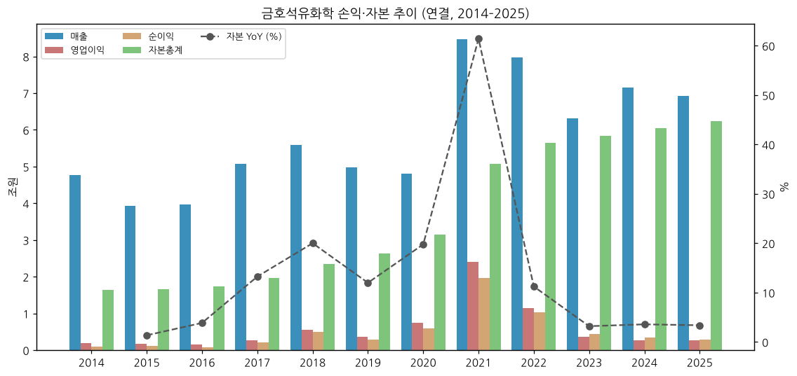

### ③ 회사 주가 역사 ★ narrative 영역

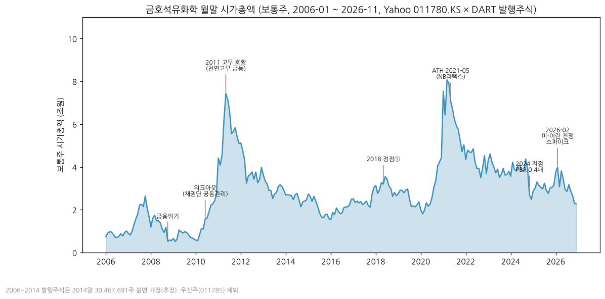

> 가격 처리: Yahoo 011780.KS 월간 종가 × DART 보통주 발행주식수(연도·소각일 반영). 금호석유화학은 액면분할·무상증자가 없어 Yahoo 가격 = 원주가. 2006\~2013 발행주식은 2014말 30,467,691주로 불변 가정 [추정]. 우선주(011785, 3,023,486주)는 시총에서 제외 (2026-11-24 기준 0.11조)

(1) 2006\~2010: 금호아시아나 그룹 리스크 → 워크아웃
→ 2007 고점 후 2008 금융위기, 2008-10\~2009 월말 시총 0.5\~0.7조 [계산] — 그룹의 대우건설(2006)·대한통운(2008) 인수 후유증으로 2010-06 채권단 경영정상화 약정 [DART 사업보고서(2014.12) I-2]

(2) 2010\~2011: 1차 슈퍼사이클 — 천연고무 급등과 합성고무 호황
→ 2011-05 월말 종가 244,000원, 월말 시총 약 7.4조 [계산] (2021 이전 최고권). 천연고무 가격 급등으로 합성고무 대체 수요 폭발. 2012-12 워크아웃 졸업

(3) 2012\~2019: 박스권 1.6\~3.5조 — 중국 증설과 스프레드 소사이클
→ 2014\~2016 OPM 4% 내외, 2016-01 월말 시총 1.6조(저점권) → 2018-05 3.2조 (정점①, BD·SBR 스프레드 + 피앤비 페놀 호황) → 2019 미중 분쟁으로 2.0조대

(4) 2020\~2021: NB라텍스 슈퍼사이클 → 사상 최고가
→ 코로나 의료용 장갑 수요로 NB라텍스 판가·물량 급증: 분기 OPM 10.9%(1Q20) → 20.1%(4Q20) → **34.3%(2Q21)**
→ **사상 최고 종가 296,000원 (2021-05-06), 보통주 시총 9.02조** [Yahoo, 계산]. 같은 해 3월 주총에서 조카 박철완 상무가 고배당(보통주 11,000원)·이사 선임 주주제안 → 회사안(DPS 4,200원) 64.4% 대 35.6%로 박찬구 회장 측 완승 [뉴시스 2021-03-26]

(5) 2022\~2025: 장갑 재고조정 + 중국 증설 → PBR 0.4배
→ 2022 장갑 재고조정으로 NB라텍스 급락, 2023\~2024 중국 BR·SBR·페놀·BPA 증설 → 2024-11 월말 시총 약 2.7조, 연말 PBR 0.41배 (12년 최저)
→ 2024-03 주총: 차파트너스(박철완 측 위임)의 자사주 전량 소각 정관 변경 주주제안 부결, 회사안(3년 내 자사주 50% 소각) 가결 — 자사주 소각안 찬성 약 75% [한경비즈니스 2024-03-22, CEO스코어데일리 2024-03-22]

(6) 2026: 미-이란 전쟁 스파이크 → 역래깅 적자
→ 1Q26 말 중동발 원료(BD) 급등·공급망 쇼크 → 2026-02-26 종가 153,400원(2026 고점), 2Q26 영업이익 3,390억(OPM 14.9%) [IR 2Q26]
→ 3Q26 영업손실 208억 (42개 분기 만의 적자, 2026-11-06 공시) → 2026-11-24 종가 92,100원, 보통주 시총 2.30조 [Yahoo, 계산]

### ④ 회사의 주요 연혁

| 일자 | 이벤트 | 출처 |
|---|---|---|
| 1976-12-10 | 금호석유화학 설립 | DART 사업보고서(2025.12) I-1 |
| 1988-01-22 | 유가증권시장 상장 | 같음 |
| 2000-07-10 | 금호피앤비화학 설립 (페놀·BPA) | DART 사업보고서(2014.12) I-2 |
| 2010-03 | 박찬구 대표이사 선임 (그룹 형제 분쟁 이후 복귀) | 같음 |
| 2010-06-08 | 채권은행협의회 경영정상화계획 이행 약정 (워크아웃) | 같음 |
| 2011-02 | 여수고무 제2공장 준공 | 같음 |
| 2012-12-28 | 채권단 공동관리 졸업 | 같음 |
| 2013-12 | CNT(탄소나노튜브) 공장 상업 운전 | 같음 |
| 2021-03-26 | 정기주총 박철완 주주제안 부결 (경영권 분쟁 1차) | 뉴시스 2021-03-26 |
| 2021-04 | 금호리조트 지분 66.7% 취득 (피앤비 33.3% 포함 100%) | DART 사업보고서(2025.12) I-2 |
| 2021-07 | 금호폴리켐(EPDM) 잔여지분 50% 취득 → 100% 자회사 | 같음 |
| 2022-03 / 07 | 정기주총·임시주총 사측 안건 가결, 박준경 사내이사 선임 | 이코노미스트 2022-07-21, DART |
| 2023-10-23 | 자사주 766,633주 이익소각 (1,000억) | DART 사업보고서(2025.12) I-4 |
| 2024-02 | 기업가치 제고 계획 (2024\~2026 주주환원율 40%, 2030 ROE 10%) | 한경 2026-03-31 |
| 2024-03-22 | 주총: 차파트너스 주주제안 부결, 자사주 50% 소각안 가결 | 한경비즈니스 2024-03-22 |
| 2025-04 | 금호폴리켐 EPDM 5라인 상업생산 (+7만톤, EPDM 31만톤) | DART 사업보고서(2025.12) I-2 |
| 2026-01 | SSBR 3.5만톤 증설분 상업 운전 (전기차 타이어용) | 한경 2026-03-31 |
| 2026-03-26 | 주총: 3차 상법개정 대응 정관 변경(자사주 보유·처분은 주주 승인), 박철완 측 주주제안 없음 | 뉴데일리 2026-03-26 |
| 2026-3Q | 자사주 1,112,045주 이익소각 (보유 874,417 + 신탁 취득 237,628) | DART 분기보고서(2026.09) 주석14 |
| 2026-11-06 | 3Q26 영업손실 208억 — 4Q15 이후 첫 분기 적자 | 머니투데이 2026-11-06 |

---

## 3. 비즈니스 모델

### ① 실적 추이 (연결 → 부문 → 제품군 3단계 위계)

**(가) 1단계 — 연결 + DART 3개 보고부문 (5년, 억원)**

| 구분 | 2021 | 2022 | 2023 | 2024 | 2025 | 9M26 |
|---|---|---|---|---|---|---|
| **연결 매출** | 84,618 | 79,756 | 63,225 | 71,550 | 69,151 | 59,696 |
| **연결 영업이익** | 24,068 | 11,477 | 3,590 | 2,728 | 2,718 | 3,776 |
| OPM | 28.4% | 14.4% | 5.7% | 3.8% | 3.9% | 6.3% |
| ├ 합성고무·합성수지 등 매출 | 53,041 | 48,331 | 39,884 | 46,382 | 43,720 | 38,560 |
| │ └ 법인세차감전 부문이익 (이익률) | 13,562 (25.6%) | 7,473 (15.5%) | 3,357 (8.4%) | 3,013 (6.5%) | 2,150 (4.9%) | 3,114 (8.1%) |
| ├ 기초유기화합물(페놀유도체) 매출 | 26,507 | 21,799 | 14,845 | 16,352 | 16,075 | 13,240 |
| │ └ 법인세차감전 부문이익 (이익률) | 10,159 (38.3%) | 3,163 (14.5%) | 258 (1.7%) | 44 (0.3%) | -502 (-3.1%) | -8 (-0.1%) |
| ├ 기타(에너지·리조트 등) 매출 | 5,070 | 9,627 | 8,497 | 8,816 | 9,356 | 7,895 |
| │ └ 법인세차감전 부문이익 (이익률) | 376 (7.4%) | 1,727 (17.9%) | 1,208 (14.2%) | 1,004 (11.4%) | 1,373 (14.7%) | 1,276 (16.2%) |

(DART 연결 주석 "영업부문" — 회사는 부문 성과를 **법인세차감전이익**으로 공시(지분법·금융손익 포함, 영업이익 아님). 부문 매출은 외부매출 기준(총매출 − 내부매출). 합성고무·합성수지 등 = 금호석유화학 본체 + 금호폴리켐 + 해외 판매법인, 기초유기화합물 = 금호피앤비화학, 기타 = 에너지·금호티앤엘·금호리조트 등)

**(나) 2단계 — IR 5개 사업부문 (영업이익 기준, 억원) — 2Q24\~3Q26 10개 분기**

| 부문 | 2Q24 | 3Q24 | 4Q24 | 1Q25 | 2Q25 | 3Q25 | 4Q25 | 1Q26 | 2Q26 | 3Q26 |
|---|---|---|---|---|---|---|---|---|---|---|
| 합성고무 매출 | 7,077 | 7,335 | 7,585 | 7,572 | 6,745 | 6,322 | 6,073 | 7,335 | 9,871 | 7,824 |
| └ 영업이익 (OPM) | 466 (6.6%) | 107 (1.5%) | 184 (2.4%) | 460 (6.1%) | 85 (1.3%) | 312 (4.9%) | 158 (2.6%) | 149 (2.0%) | 1,898 (19.2%) | 23 (0.3%) |
| 합성수지 매출 | 3,320 | 3,129 | 3,158 | 3,360 | 2,982 | 2,725 | 2,662 | 3,018 | 3,754 | 3,115 |
| └ 영업이익 (OPM) | 12 (0.4%) | -87 (-2.8%) | -95 (-3.0%) | 52 (1.5%) | 53 (1.8%) | 44 (1.6%) | -95 (-3.6%) | -22 (-0.7%) | 374 (10.0%) | -139 (-4.5%) |
| 페놀유도체 매출 | 4,444 | 4,065 | 3,855 | 4,317 | 4,326 | 3,787 | 3,645 | 3,992 | 4,928 | 4,321 |
| └ 영업이익 (OPM) | 57 (1.3%) | 11 (0.3%) | -222 (-5.8%) | 19 (0.4%) | -23 (-0.5%) | -144 (-3.8%) | -223 (-6.1%) | -86 (-2.2%) | 551 (11.2%) | -625 (-14.5%) |
| EPDM/TPV 매출 | 1,729 | 1,602 | 1,663 | 1,878 | 1,806 | 1,754 | 1,856 | 1,968 | 2,271 | 2,104 |
| └ 영업이익 (OPM) | 224 (13.0%) | 140 (8.7%) | 105 (6.3%) | 239 (12.7%) | 150 (8.3%) | 202 (11.5%) | 198 (10.7%) | 311 (15.8%) | 474 (20.9%) | 243 (11.5%) |
| 기타(에너지·정밀화학 등) 매출 | 1,955 | 2,148 | 1,810 | 1,955 | 1,875 | 1,850 | 1,661 | 1,487 | 1,857 | 1,851 |
| └ 영업이익 (OPM) | 433 (22.1%) | 479 (22.3%) | 128 (7.1%) | 436 (22.3%) | 387 (20.6%) | 431 (23.3%) | -23 (-1.4%) | 242 (16.3%) | 93 (5.0%) | 290 (15.7%) |
| **합계 매출** | 18,525 | 18,279 | 18,071 | 19,082 | 17,734 | 16,438 | 15,897 | 17,800 | 22,681 | 19,215 |
| **합계 영업이익** | 1,192 | 650 | 100 | 1,206 | 652 | 845 | 15 | 594 | 3,390 | -208 |

(출처: 금호석유화학 IR 실적발표 2Q25(2Q24\~2Q25)·3Q25·4Q25(kkpc.com)·1Q26·2Q26 PDF의 부문별 막대 수치를 분기별로 대조해 배치 — 5부문 합이 연결 매출·영업이익과 일치함을 확인. **3Q26은 IR PDF 미확보 → 머니투데이 2026-11-06 보도 수치** (부문 합 1조 9,215억 / -208억으로 연결과 일치). 페놀유도체 = 금호피앤비화학, EPDM/TPV = 금호폴리켐, 기타 = 에너지·정밀화학·CNT·리조트 등)

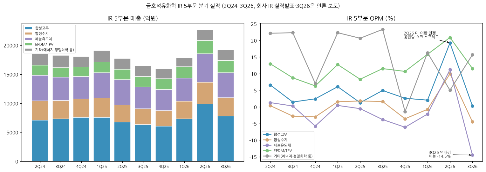

**(다) 3단계 — 별도(금호석유화학 본체) 제품군 + 주요 자회사 매출 (억원)**

| 구분 | 2014 | 2016 | 2018 | 2020 | 2021 | 2022 | 2023 | 2024 | 2025 | 9M26 |
|---|---|---|---|---|---|---|---|---|---|---|
| 합성고무 (SBR·BR·NBR·라텍스) | 18,529 | 15,591 | 20,154 | 18,367 | 30,521 | 25,789 | 21,622 | 27,953 | 26,714 | 25,032 |
| 합성수지 (ABS·PS·EPS·PPG) | 13,248 | 10,357 | 12,257 | 11,540 | 18,297 | 15,945 | 12,501 | 12,830 | 11,730 | 9,887 |
| 정밀화학 (노화방지제·가황촉진제) | 1,509 | 1,224 | 1,360 | 1,047 | 1,642 | 2,060 | 1,642 | 1,667 | 1,821 | 1,481 |
| 기타 (CNT·스팀·전기·임대) | 4,385 | 4,215 | 5,225 | 3,944 | 4,552 | 7,075 | 6,197 | 6,093 | 5,455 | 3,724 |
| **별도 합계** | 37,670 | 31,386 | 38,996 | 34,897 | 55,013 | 50,869 | 41,961 | 48,543 | 45,720 | 40,123 |
| 금호피앤비화학 (페놀·BPA·에폭시) | 11,084 | 8,978 | 18,002 | 14,120 | 26,887 | 22,025 | 15,135 | 16,653 | 16,414 | 13,576 |
| 금호폴리켐 (EPDM·TPV) | - | - | - | 3,280 | 6,315 | 7,816 | 6,468 | 6,684 | 7,298 | 6,346 |

(DART 사업보고서 II-4 "매출실적" — 각 연도 보고서의 3개년 표. 2020 이전 금호폴리켐은 공동기업(지분 50%)이라 연결 매출에 미포함, 2020 수치는 2022 사업보고서 참고 표기. 별도 합성고무 판매량 9M26 1,018,511톤(+소폭), 합성수지 403,338톤(-7%) [DART 분기보고서(2026.09) II-1])

**(라) 51분기 부문 시계열 (DART 3부문, 1Q14\~3Q26, 억원 — 매출 / 법인세차감전 부문이익)**

```
분기    연결매출  연결OP   OPM   | 합성고무·수지 매출/세전  | 기초유기(피앤비) 매출/세전 | 기타 매출/세전
1Q14    12,416     286    2.3  |   9,666 /    219 |   2,685 /   -105 |      66 /    -37
2Q14    12,182     415    3.4  |   9,526 /    432 |   2,593 /    -39 |      63 /    -73
3Q14    12,068     610    5.1  |   9,013 /    243 |   2,972 /    102 |      82 /   -211
4Q14    10,991     539    4.9  |   8,431 /    220 |   2,472 /    145 |      87 /     18
1Q15    10,202     552    5.4  |   7,914 /    398 |   2,206 /     63 |      82 /    -32
2Q15    10,791     641    5.9  |   8,415 /    397 |   2,269 /    158 |     107 /     61
3Q15     9,638     450    4.7  |   7,512 /    207 |   2,008 /     57 |     117 /    -49
4Q15     8,715      -4   -0.0  |   6,944 /     -9 |   1,653 /    -50 |     118 /    760
1Q16     8,715     463    5.3  |   6,944 /    440 |   1,645 /     14 |     127 /     10
2Q16    10,115     654    6.5  |   7,684 /    404 |   2,276 /    188 |     155 /     17
3Q16     9,944     235    2.4  |   7,363 /     93 |   2,450 /     86 |     131 /     -1
4Q16    10,930     219    2.0  |   8,407 /   -476 |   2,407 /    -16 |     115 /   -272
1Q17    14,082     657    4.7  |  10,763 /    658 |   3,161 /     50 |     159 /     43
2Q17    12,391     442    3.6  |   9,251 /    255 |   3,020 /     27 |     121 /    -47
3Q17    12,052     578    4.8  |   8,956 /    393 |   2,927 /     -6 |     169 /     20
4Q17    12,123     949    7.8  |   9,045 /    528 |   2,951 /     89 |     127 /     14
1Q18    13,399   1,658   12.4  |   9,026 /    949 |   4,215 /    636 |     158 /     30
2Q18    14,418   1,535   10.6  |   9,617 /    727 |   4,585 /    684 |     215 /     24
3Q18    14,506   1,510   10.4  |   9,749 /    542 |   4,582 /    768 |     175 /     68
4Q18    13,526     843    6.2  |   8,960 /    279 |   4,384 /    403 |     183 /     61
1Q19    12,751   1,442   11.3  |   8,888 /  1,505 |   3,703 /    346 |     160 /     33
2Q19    12,972   1,389   10.7  |   9,183 /    991 |   3,617 /    346 |     172 /     83
3Q19    12,200     687    5.6  |   8,915 /    583 |   3,106 /    -45 |     178 /     43
4Q19    11,857     159    1.3  |   8,425 /    273 |   3,231 /   -172 |     201 /     62
1Q20    12,255   1,331   10.9  |   8,579 /  1,214 |   3,508 /    136 |     167 /     39
2Q20    10,263   1,201   11.7  |   6,930 /    802 |   3,117 /    443 |     217 /     38
3Q20    11,883   2,138   18.0  |   7,992 /  1,899 |   3,701 /    665 |     190 /     39
4Q20    13,695   2,751   20.1  |   9,901 /  1,734 |   3,609 /    863 |     186 /     -5
1Q21    18,545   6,125   33.0  |  12,898 /  4,280 |   5,397 /  1,949 |     250 /     45
2Q21    21,991   7,537   34.3  |  14,035 /  4,114 |   7,503 /  3,512 |     453 /     20
3Q21    22,363   6,253   28.0  |  13,351 /  3,265 |   6,873 /  2,729 |   2,139 /    177
4Q21    21,720   4,153   19.1  |  12,757 /  1,904 |   6,735 /  1,970 |   2,228 /    134
1Q22    21,991   4,491   20.4  |  13,187 /  2,832 |   6,400 /  1,686 |   2,404 /    436
2Q22    22,439   3,540   15.8  |  13,659 /  2,035 |   6,044 /  1,109 |   2,736 /    620
3Q22    18,872   2,305   12.2  |  11,531 /  1,614 |   4,726 /    290 |   2,615 /    714
4Q22    16,455   1,143    6.9  |   9,954 /    992 |   4,629 /     78 |   1,872 /    -43
1Q23    17,213   1,302    7.6  |  11,017 /  1,733 |   4,183 /    193 |   2,013 /    317
2Q23    15,781   1,079    6.8  |   9,819 /    697 |   3,756 /    127 |   2,207 /    443
3Q23    15,070     842    5.6  |   9,473 /    569 |   3,427 /      6 |   2,170 /    397
4Q23    15,161     367    2.4  |   9,575 /    358 |   3,480 /    -67 |   2,106 /     51
1Q24    16,675     786    4.7  |  10,533 /  1,372 |   4,050 /     42 |   2,092 /    303
2Q24    18,525   1,191    6.4  |  11,738 /    979 |   4,512 /    129 |   2,275 /    394
3Q24    18,279     651    3.6  |  11,954 /    392 |   4,109 /     11 |   2,215 /    202
4Q24    18,071     100    0.6  |  12,157 /    269 |   3,680 /   -138 |   2,234 /    105
1Q25    19,082   1,206    6.3  |  12,470 /  1,331 |   4,317 /     45 |   2,295 /    244
2Q25    17,734     652    3.7  |  11,045 /    396 |   4,326 /    -33 |   2,363 /    148
3Q25    16,438     844    5.1  |  10,271 /    619 |   3,786 /    -76 |   2,381 /    384
4Q25    15,897      16    0.1  |   9,934 /   -195 |   3,645 /   -438 |   2,317 /    597
1Q26    17,800     594    3.3  |  11,472 /    999 |   3,992 /    -40 |   2,336 /    349
2Q26    22,682   3,390   14.9  |  14,909 /  2,482 |   4,928 /    661 |   2,845 /    612
3Q26    19,215    -208   -1.1  |  12,180 /   -367 |   4,321 /   -629 |   2,714 /    315
```
(1Q16\~3Q26 연결 매출·영업이익 = OpenDART dart_quarterly_summary (4Q = 연간 − 3Q 누적). 1Q14\~4Q15 = 2015 분기·반기보고서 원문 손익계산서(3개월·전년동기 컬럼), 4Q14·4Q15 = 연간 − 9M. 부문 = 연결 주석 영업부문의 누적치를 분기로 차감(2Q = 반기 − 1Q 등), 2014 분기는 2015 보고서 전기 컬럼. 부문 세전이익의 합 ≠ 연결 영업이익(지분법·금융손익·연결조정 차이))

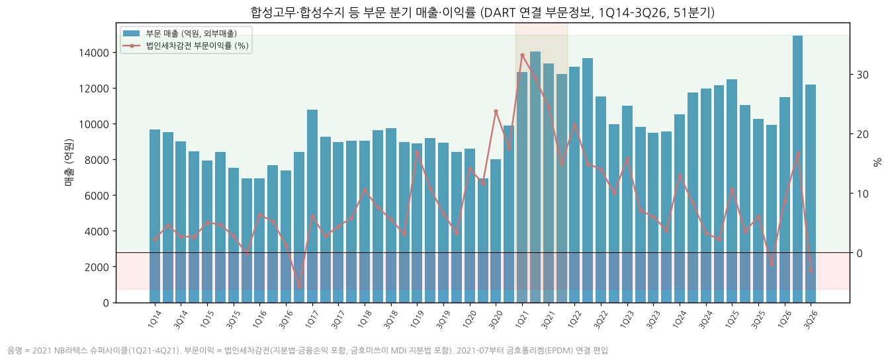

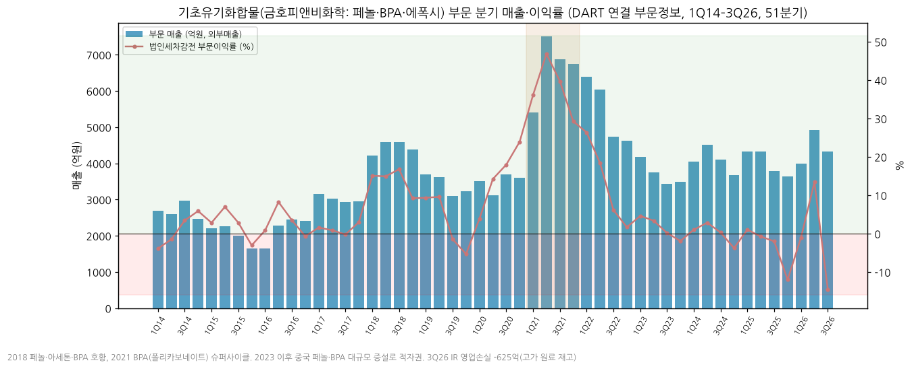

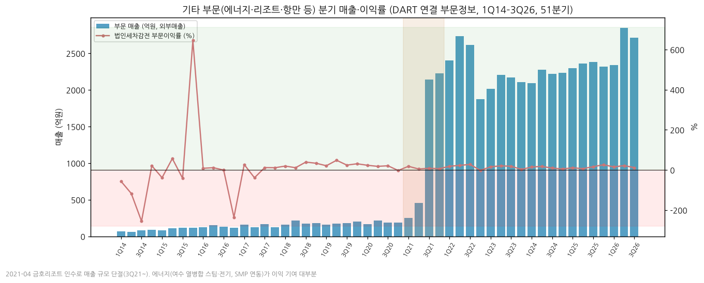

**(마) 최근 12분기 (연결, rolling)**

| 분기 | 4Q23 | 1Q24 | 2Q24 | 3Q24 | 4Q24 | 1Q25 | 2Q25 | 3Q25 | 4Q25 | 1Q26 | 2Q26 | 3Q26 |
|---|---|---|---|---|---|---|---|---|---|---|---|---|
| 매출 (억원) | 15,161 | 16,675 | 18,525 | 18,279 | 18,071 | 19,082 | 17,734 | 16,438 | 15,897 | 17,800 | 22,682 | 19,215 |
| 영업이익 (억원) | 367 | 786 | 1,191 | 651 | 100 | 1,206 | 652 | 844 | 16 | 594 | 3,390 | -208 |
| OPM | 2.4% | 4.7% | 6.4% | 3.6% | 0.6% | 6.3% | 3.7% | 5.1% | 0.1% | 3.3% | 14.9% | -1.1% |
| 매출 YoY | -7.9% | -3.1% | +17.4% | +21.3% | +19.2% | +14.4% | -4.3% | -10.1% | -12.0% | -6.7% | +27.9% | +16.9% |

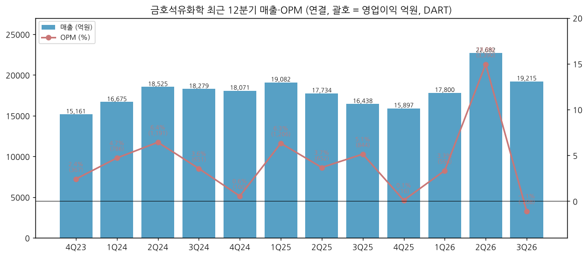

### ② 사업부별 개요 (매출 비중 큰 순서, 3Q26 IR 기준)

| 부문 | 3Q26 매출 (비중) | 3Q26 OPM | 주요 제품 | 원료 | 전방 |
|---|---|---|---|---|---|
| 합성고무 | 7,824억 (40.7%) | 0.3% | SBR·BR(NdBR·HBR·LBR)·SSBR·NBR·NB라텍스·SB라텍스·SBS | BD(부타디엔)·SM | 타이어(SBR·BR·SSBR), 의료용 장갑(NB라텍스), 신발·아스팔트(SBS) |
| 페놀유도체 | 4,321억 (22.5%) | -14.5% | 페놀·아세톤·BPA·큐멘·MIBK·에폭시 (금호피앤비화학) | 벤젠·프로필렌 | 폴리카보네이트·에폭시 수지·전자 |
| 합성수지 | 3,115억 (16.2%) | -4.5% | ABS·PS·EPS·SAN·PPG | SM·AN·BD | 가전·자동차 부품·건자재 |
| EPDM/TPV | 2,104억 (10.9%) | 11.5% | EPDM 31만톤·TPV/KEPA (금호폴리켐) | 에틸렌·프로필렌 | 자동차 부품(웨더스트립·호스) |
| 기타(에너지·정밀화학 등) | 1,851억 (9.6%) | 15.7% | 열병합 스팀·전기, 노화방지제·가황촉진제, CNT, 건자재, 리조트·항만 | 유연탄·바이오매스 등 | 공단 내 스팀, 전력거래소(SMP), 타이어·이차전지(CNT) |

### ③ 사업부별 디테일

(1) **합성고무 — 스프레드 사업의 본체 + 2021 NB라텍스 이익 outlier**
→ 생산능력 194.4만톤/년: SBR 26.3만·HBR 16.5만·NdBR 6만·LBR 5만·S-SBR 15.8만·NBR 9.4만·HSR 1만·**NB라텍스 94.6만**·SB라텍스 8.5만·SBS 11.3만톤 [IR 2Q26 Appendix]. BD 자체 생산 23.7만톤(울산 9만·여수 14.7만)은 소요량 일부 — 나머지는 여천NCC 등에서 구매 (BD 매입 1.30조 = 원재료 매입의 56.5%, 2025 [DART 사업보고서(2025.12) II-3])
→ 원료 BD 가격(USD/톤): 970(2023) → 1,406(2024) → 1,124(2025) [DART II-3]. 합성고무 제품 단가(천원/톤): 2,083(2024) → 1,990(2025) → 2,458(9M26) [DART 분기보고서(2026.09) II-2]
→ ★ **2021 NB라텍스 슈퍼사이클 (이익 outlier)**: 코로나로 의료용 니트릴 장갑 수요가 폭증 → 합성고무·합성수지 부문 세전이익 3,352억(2019) → 5,650억(2020) → **1.36조(2021)**, 분기 기준 1Q21 4,280억·2Q21 4,114억 (DART 부문정보). 전사 OPM 2Q21 34.3%는 12년 최고. 2022 이후 장갑 재고조정 + 말레이시아 장갑업체 가동률 하락 + 경쟁사 증설로 NB라텍스 스프레드가 정상화 → 2024 4Q 합성고무 OPM 2.4%. 회사는 오히려 2024 라텍스 설비를 79.5만 → 103.1만톤으로 늘려(DART II-3 생산능력) 물량 기반을 키움
→ 2026: 1Q26 "3월 초 BD 급등 및 전방산업 구매 관망세로 수익성 보합" → 2Q26 "미-이란 전쟁발 공급망 리스크 … 시장의 물량 확보 수요 확대로 주요 제품 스프레드 개선 … NB Latex 수요 증가 및 스프레드 확대로 흑자 전환" (OPM 19.2%) [IR 1Q26·2Q26 원문] → 3Q26 "고가 원재료 재고 부담 … NB라텍스 가격 경쟁 심화로 적자" (OPM 0.3%) [머니투데이 2026-11-06]
→ 시사점: 같은 BD 급등이 1Q26엔 원가 부담, 2Q26엔 판가 상승(스프레드 확대), 3Q26엔 역래깅으로 작동 — 분기 실적은 **BD 가격의 "방향 전환 시점"** 이 결정한다. 스페셜티 SSBR(3.5만톤 증설분 2026-01 상업 운전)·NdBR은 중국 범용 증설 노출이 상대적으로 작다 [한경 2026-03-31, IB토마토 2026-11-11]

(2) **합성수지 — ABS·PS 저마진 구조**
→ 생산능력 102.25만톤 (PS 26.45만·ABS 29만·SAN/Powder 23.7만·EPS 7.95만·PPG 15.15만) [IR 2Q26]. IR 10개 분기 OPM -3.6\~10.0%, 누적 영업이익 97억으로 사실상 손익분기. 2025 가동률 56% [DART 사업보고서(2025.12) II-3]
→ 2Q26 "원재료 수급 우려에 따른 제품 가격 상승으로 수익성 개선" (OPM 10.0%) → 3Q26 ABS 수요 부진으로 -139억 [IR 2Q26, 머니투데이 2026-11-06]

(3) **페놀유도체 (금호피앤비화학, 100%) — 중국 증설에 가장 크게 노출**
→ 페놀 68만·아세톤 42만·큐멘 90만·BPA 45만·에폭시 33.8만톤 (계 284.8만톤), 가동률 86% (2025) [IR 2Q26, DART 사업보고서(2025.12)]
→ 부문 세전이익: 2018 2,492억(정점) → 2021 **1.02조**(BPA·폴리카보네이트 슈퍼사이클) → 2023 259억 → 2025 **-502억** [DART 부문정보]. 중국의 페놀·BPA 자급화 이후 IR 기준 4Q24\~1Q26 6개 분기 중 5개 분기 적자, 3Q26 -625억(OPM -14.5%)은 "고가 재고로 스프레드 축소" [머니투데이 2026-11-06]
→ 회사는 "페놀유도체는 적자 사업으로 규모 축소 중"이라고 설명 [한경 2026-03-31] — 재평가 트리거의 하방 변수. 신용등급 A (안정적) 별도 보유 [머니투데이 2026-07-23]

(4) **EPDM/TPV (금호폴리켐, 100%) — 가장 안정적인 스페셜티**
→ EPDM 31만톤 (2025-04 5라인 +7만톤 상업생산), TPV/KEPA 1.2만톤 [DART 사업보고서(2025.12) I-2]. 원료는 에틸렌·프로필렌(여천NCC), 매출 6,684억(2024) → 7,298억(2025)
→ IR 10개 분기 OPM 6.3\~20.9%, 한 번도 적자 없음. 3Q26 영업이익 243억으로 전사 적자 분기에도 흑자 [IR, 머니투데이 2026-11-06]. 2021-07 잔여지분 50% 인수 전에는 지분법 대상이어서, 2021 이후 연결 매출·이익 증가분 일부는 연결 범위 변화 효과

(5) **기타 — 에너지(열병합)·정밀화학·CNT·리조트**
→ 여수 열병합: 스팀 1,710T/H·전기 300MW, 전력은 공단 직판 + 전력거래소 역송(SMP 연동) [IR 2Q26 Appendix]. 2Q24\~3Q25 기타 부문 OPM 20\~23% — "열병합 발전 영업이익률 38.3%"(2022) [IB토마토 2023-05-04]
→ 정밀화학(노화방지제 KUMANOX·가황촉진제 KUMAC, 7.08만톤): 9M26 판매량 39,623톤(+13%). CNT: 생산능력 120톤(2023) → 360톤(2025), 9M26 매출 +66% (이차전지 도전재) [DART 분기보고서(2026.09) II-1, 사업보고서(2025.12) II-3]
→ 금호리조트(2021-04 인수, 콘도 1,063실·아시아나CC 36홀): 9M26 매출 823억 [DART 분기보고서(2026.09) II-2] — 박철완 측이 "비핵심 인수"로 비판한 대목 [뉴시스 2021-03-26]

(6) **지분법 — 금호미쓰이화학(MDI, 50%) 등**
→ MDI 61만톤 (2026-4Q 10만톤 debottlenecking 완료 예정) [IR 2Q26 Appendix]. 연결 지분법손익: 119억(2014) → 1,886억(2021) → 934억(2024) → **1,311억(2025)** → 997억(9M26) [DART] — 영업이익이 3% OPM일 때 세전이익을 받쳐주는 "숨은 이익원". 관계·공동기업 장부가 1.23조 (3Q26)

### ④ 주요 경쟁사 (사업부별)

| 사업부 | 국내 | 글로벌 | 비고 |
|---|---|---|---|
| SBR·BR (타이어용 범용) | LG화학(BR), 한화솔루션(일부) | Sinopec·PetroChina(중국), Arlanxeo, Zeon, JSR(현 ENEOS Materials) | 중국 BD·BR 증설이 2023\~2025 판가 하락 주도 |
| SSBR·NdBR (고성능 타이어) | LG화학 | Arlanxeo, Trinseo·Synthos(유럽), JSR | 전기차 타이어용, 범용 대비 중국 노출 작음 |
| NB라텍스 (장갑) | LG화학 | Synthomer(영국), Nantex·Shin Foong(대만·말레이시아 계열) | 고객 = 말레이시아 Top Glove·Hartalega 등 장갑 업체 (개별 매출처 비공시) |
| ABS·PS | LG화학(ABS 1위), 롯데케미칼 | Chimei(대만), INEOS Styrolution, 중국 신규 업체 | 가전·자동차 수요 연동 |
| 페놀·BPA | LG화학, 롯데케미칼(BPA) | Sinopec·Lihuayi 등 중국 대규모 증설 | 금호피앤비 적자 원인 |
| EPDM | 국내 경쟁 구도 미검증 | Arlanxeo(Keltan), Dow(Nordel), Mitsui Chemicals | 금호폴리켐 31만톤 — 글로벌 상위권 (순위 미검증) |

(경쟁사 구도는 업계 일반 서술 기준, 점유율 수치는 미검증 — 다음 버전에서 산업 기초 분석과 교차 확인)

### ⑤ 주요 매출처

- DART 사업보고서에 개별 매출처 명칭·비중 공시 없음 (판매경로: 내수 = 생산지 → 타이어·신발 업체 직판, 수출 = Master/Local L/C 직수출) [DART 사업보고서(2025.12) II-4]
- 지역: 합성고무 수출 84% (동남아 45%·서남아 18%·중국 17%·유럽 10%·미주 9%), 합성수지 수출 65% (중국 26%·미주 20%·유럽 17%·동남아 15%·서남아 13%·아프리카 9%) [IR 2Q26 Appendix]
- 추정 주요 고객군 [추정]: 타이어(한국·금호·넥센·글로벌 메이저), 말레이시아·태국 의료용 장갑 업체(NB라텍스), 가전·자동차 부품(ABS) — 동남아 비중 45%는 장갑 산업 집중을 반영

### ⑥ 생산 CAPA + 임직원

| 품목 (별도, 천톤/년) | 2023 | 2024 | 2025 | 2025 생산 | 가동률(2025) |
|---|---|---|---|---|---|
| 합성고무 (울산/여수) | 907 | 907 | 907 | 763 | 70% |
| 합성수지 (울산) | 1,023 | 1,023 | 1,023 | 572 | 56% |
| LATEX (울산) | 795 | 1,031 | 1,031 | 587 | - |
| BD (울산/여수) | 237 | 237 | 237 | 34 | - |
| 정밀화학 (여수) | 71 | 71 | 71 | 48 | - |
| CNT (아산, 톤) | 120 | 240 | 360 | 119 | - |

(DART 사업보고서(2025.12) II-3. 합성고무 가동률 = 실제가동 5,601h / 가동가능 8,040h. 자회사: 피앤비 284.8만톤 가동률 86.0%, 폴리켐 EPDM 31만톤 가동률 62.8%)

| 연도 | 2014 | 2015 | 2016 | 2017 | 2018 | 2019 | 2020 | 2021 | 2022 | 2023 | 2024 | 2025 |
|---|---|---|---|---|---|---|---|---|---|---|---|---|
| 임직원 (별도, 명) | 1,277 | 1,281 | 1,306 | 1,278 | 1,280 | 1,339 | 1,345 | 1,401 | 1,453 | 1,513 | 1,579 | 1,606 |

(DART 사업보고서 VIII 직원 현황 합계. 2021\~2022 1인 평균급여 1.11억 → 1.40억(성과급) → 2023 0.96억)

---

## 4. 재무 구조 (12년 시계열)

> 모든 수치 연결(K-IFRS), OpenDART fnlttSinglAcntAll. 2014는 2015 사업보고서 전기 컬럼. [계산] 표시는 원 데이터로 직접 계산

### ① 손익계산서 (12년 연결, 억원)

| 연도 | 매출 | 매출총이익 | GPM | 판관비 | 판관비율 | 영업이익 | OPM | 지분법손익 | 세전이익 | 순이익 | 지배순이익 | NPM |
|---|---|---|---|---|---|---|---|---|---|---|---|---|
| 2014 | 47,657 | 3,470 | 7.3% | 1,621 | 3.4% | 1,849 | 3.9% | 119 | 1,172 | 883 | 932 | 1.9% |
| 2015 | 39,345 | 3,339 | 8.5% | 1,700 | 4.3% | 1,640 | 4.2% | 432 | 1,696 | 1,219 | 1,189 | 3.1% |
| 2016 | 39,704 | 3,329 | 8.4% | 1,758 | 4.4% | 1,571 | 4.0% | 276 | 1,129 | 808 | 732 | 2.0% |
| 2017 | 50,648 | 4,283 | 8.5% | 1,656 | 3.3% | 2,626 | 5.2% | 891 | 2,898 | 2,176 | 2,136 | 4.3% |
| 2018 | 55,849 | 7,307 | 13.1% | 1,761 | 3.2% | 5,546 | 9.9% | 1,181 | 6,169 | 5,031 | 4,912 | 9.0% |
| 2019 | 49,779 | 5,654 | 11.4% | 1,977 | 4.0% | 3,678 | 7.4% | 390 | 3,793 | 2,947 | 2,946 | 5.9% |
| 2020 | 48,095 | 9,508 | 19.8% | 2,086 | 4.3% | 7,422 | 15.4% | 564 | 7,669 | 5,830 | 5,829 | 12.1% |
| 2021 | 84,618 | 26,981 | 31.9% | 2,913 | 3.4% | 24,068 | 28.4% | 1,886 | 26,181 | 19,656 | 19,655 | 23.2% |
| 2022 | 79,756 | 14,268 | 17.9% | 2,791 | 3.5% | 11,477 | 14.4% | 1,178 | 12,516 | 10,257 | 10,254 | 12.9% |
| 2023 | 63,225 | 6,459 | 10.2% | 2,869 | 4.5% | 3,590 | 5.7% | 1,111 | 4,851 | 4,470 | 4,468 | 7.1% |
| 2024 | 71,550 | 5,856 | 8.2% | 3,128 | 4.4% | 2,728 | 3.8% | 934 | 4,076 | 3,486 | 3,486 | 4.9% |
| 2025 | 69,151 | 6,039 | 8.7% | 3,321 | 4.8% | 2,718 | 3.9% | 1,311 | 3,488 | 2,909 | 2,909 | 4.2% |
| 9M26 | 59,696 | 6,286 | 10.5% | 2,510 | 4.2% | 3,776 | 6.3% | 997 | 4,620 | 3,747 | 3,746 | 6.3% |

→ 판관비율은 12년간 3.2\~4.8%로 거의 고정 — **이익 변동의 거의 전부가 GPM(스프레드)** 에서 나온다 (GPM 7.3%(2014) \~ 31.9%(2021))

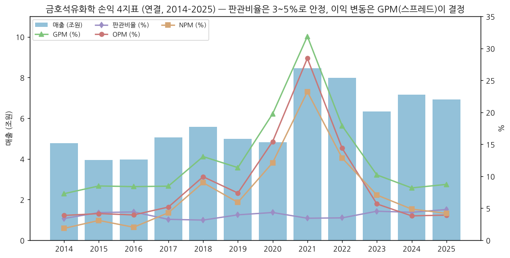

### ② 재무상태표 (12년 연결, 억원)

| 연도 | 자산 | 부채 | 자본 | 지배지분 | 차입금(사채 포함) | 현금 | 순차입금 | 재고자산 | 관계·공동기업 | 부채비율 |
|---|---|---|---|---|---|---|---|---|---|---|
| 2014 | 44,373 | 27,957 | 16,416 | 15,594 | 21,482 | 2,136 | 19,346 | 5,293 | 3,543 | 170% |
| 2015 | 42,106 | 25,468 | 16,637 | 15,565 | 19,146 | 473 | 18,673 | 3,947 | 3,958 | 153% |
| 2016 | 45,461 | 28,182 | 17,279 | 16,197 | 20,807 | 1,970 | 18,837 | 4,455 | 4,178 | 163% |
| 2017 | 45,798 | 26,230 | 19,568 | 18,427 | 18,091 | 2,344 | 15,747 | 4,268 | 4,879 | 134% |
| 2018 | 46,167 | 22,686 | 23,481 | 23,473 | 14,570 | 1,018 | 13,552 | 4,716 | 5,884 | 97% |
| 2019 | 45,380 | 19,085 | 26,296 | 26,286 | 11,041 | 1,278 | 9,763 | 4,695 | 5,963 | 73% |
| 2020 | 50,273 | 18,780 | 31,492 | 31,482 | 8,602 | 4,182 | 4,419 | 5,319 | 6,543 | 60% |
| 2021 | 81,157 | 30,328 | 50,829 | 50,818 | 9,577 | 6,229 | 3,348 | 7,803 | 6,451 | 60% |
| 2022 | 77,193 | 20,659 | 56,534 | 56,520 | 7,288 | 5,673 | 1,615 | 8,265 | 7,574 | 37% |
| 2023 | 79,797 | 21,457 | 58,340 | 58,295 | 8,219 | 4,524 | 3,694 | 7,456 | 8,877 | 37% |
| 2024 | 83,402 | 22,980 | 60,422 | 60,378 | 8,826 | 4,293 | 4,533 | 9,584 | 9,935 | 38% |
| 2025 | 84,745 | 22,279 | 62,465 | 62,453 | 8,798 | 6,504 | 2,293 | 8,588 | 11,751 | 36% |
| 3Q26 | 88,143 | 21,438 | 66,705 | 66,691 | 6,974 | 7,210 | -236 | 10,885 | 12,333 | 32% |

(현금 = 현금및현금성자산만, 단기금융상품 제외 → 실제 순현금은 더 큼. 차입금 = BS 계정 중 차입금·사채·유동성장기부채 합(리스부채 제외) [계산]. 2014 부채비율 170% → 2021 60% → 3Q26 32%: 워크아웃 졸업(2012) 이후 10년간 차입금 2.15조 → 0.70조로 감축)

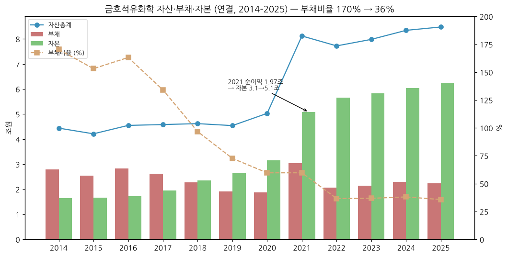

### ③ 현금흐름표 (12년 연결, 억원)

| 연도 | 영업CF | 투자CF | 재무CF | CapEx(유·무형) | FCF | 감가상각(유형+사용권+무형) | EBITDA |
|---|---|---|---|---|---|---|---|
| 2014 | 3,200 | -2,313 | 415 | 2,554 | 646 | 1,776 | 3,625 |
| 2015 | 4,832 | -3,913 | -2,584 | 3,915 | 917 | 1,759 | 3,399 |
| 2016 | 2,968 | -2,507 | 1,036 | 2,744 | 224 | 2,060 | 3,630 |
| 2017 | 4,210 | -1,060 | -2,767 | 1,068 | 3,142 | 2,179 | 4,805 |
| 2018 | 4,846 | -1,907 | -4,264 | 1,355 | 3,492 | 2,094 | 7,641 |
| 2019 | 5,577 | -1,360 | -3,957 | 1,735 | 3,841 | 2,028 | 5,705 |
| 2020 | 7,715 | -2,000 | -2,785 | 1,783 | 5,933 | 1,810 | 9,232 |
| 2021 | 21,270 | -17,585 | -1,666 | 3,550 | 17,720 | 2,081 | 26,150 |
| 2022 | 5,135 | 941 | -6,610 | 4,281 | 855 | 2,438 | 13,916 |
| 2023 | 6,307 | -5,920 | -1,533 | 5,902 | 405 | 2,512 | 6,102 |
| 2024 | 3,223 | -2,590 | -906 | 4,366 | -1,142 | 2,752 | 5,480 |
| 2025 | 7,153 | -3,725 | -1,213 | 1,956 | 5,197 | 3,175 | 5,893 |
| 9M26 | 2,565 | 757 | -2,605 | 854 | 1,711 | - | - |

(감가상각 = 연결 현금흐름표 주석 조정항목의 감가상각비 + 사용권자산상각비 + 무형자산상각비 [DART 사업보고서 각 연도]. FCF = 영업CF − 유·무형자산 취득 [계산]. 2024 FCF 적자(-1,142억)는 운전자본 증가 + NB라텍스·EPDM 증설 CapEx 피크)

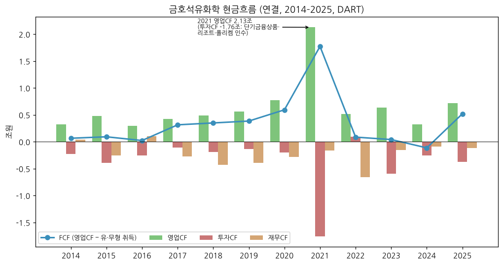

### ④ CapEx 추이 (12년, 억원)

| 연도 | 2014 | 2015 | 2016 | 2017 | 2018 | 2019 | 2020 | 2021 | 2022 | 2023 | 2024 | 2025 |
|---|---|---|---|---|---|---|---|---|---|---|---|---|
| 유형자산 취득 | 2,543 | 3,898 | 2,727 | 1,060 | 1,341 | 1,727 | 1,754 | 3,538 | 4,277 | 5,898 | 4,362 | 1,944 |
| 무형자산 취득 | 11 | 18 | 16 | 8 | 14 | 9 | 28 | 12 | 4 | 4 | 4 | 12 |
| CapEx / 감가상각 | 1.4x | 2.2x | 1.3x | 0.5x | 0.6x | 0.9x | 1.0x | 1.7x | 1.8x | 2.3x | 1.6x | 0.6x |

→ 사이클 annotation: ① 2014\~2016 여수 열병합·고무 증설 투자(CapEx/감가 1.3\~2.2배) → ② 2017\~2020 투자 축소·차입 상환(0.5\~1.0배) → ③ 2021\~2024 슈퍼사이클 현금으로 NB라텍스(+23.6만톤)·EPDM 5라인(+7만톤)·SSBR(+3.5만톤)·CNT 증설 (2023 5,898억 = 12년 최대) → ④ 2025 1,944억으로 급감, 회사 "경상적 투자 외 계획된 투자 없음" [DART 사업보고서(2025.12) II-3] — 증설 사이클 종료, FCF 회복 국면

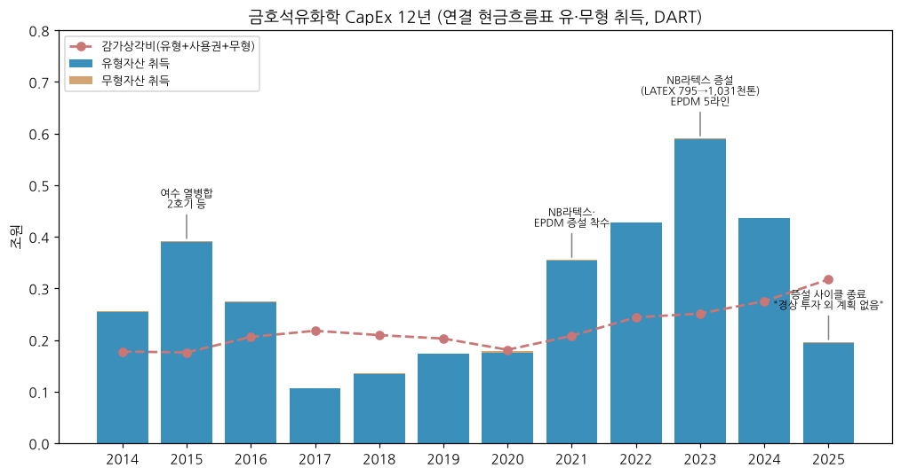

### ⑤ 부채구조 + 채무증권 발행 history

- 3Q26 차입금 6,974억 = 단기차입금 2,097억 + 유동성장기차입금 2,064억 + 유동성사채 550억 + 사채 997억 + 장기차입금 1,266억 → **유동성 차입 비중 68%** [DART 분기보고서(2026.09) 주석16]
- 공모사채 미상환 1,550억: 제155-2회 550억(2027-04-05 만기, 4.003%), 제156-1회 600억(2028-06-09, 3.039%), 제156-2회 400억(2030-06-07, 3.311%). 2026-04 제155-1회 450억 상환. 2026 신규 발행 없음, CP·단기사채 잔액 0 [DART 분기보고서(2026.09) III-7]
- 장기차입 주요 기관: 한국산업은행 2,326억·신한 512억·국민 153억 (금리 1.75\~4.27%) — 일부 토지·건물 담보 제공
- 순차입금 추이: 1.93조(2014) → 0.98조(2019) → 0.33조(2021) → 0.23조(2025) → **-0.02조 (3Q26, 순현금)** [계산, 현금및현금성자산 기준]. 이자보상배율(영업이익/금융비용): 1.5배(2014\~2016) → 41.3배(2021) → 3.9배(2024·2025) [계산]

### ⑥ 배당·자사주 추이 (12년)

| 연도 | 보통주 DPS (원) | 현금배당 총액 (억원) | 배당성향 (연결, %) | 시가배당률 (보통주, %) | 자사주 취득 (억원, CF) | 자사주 소각 |
|---|---|---|---|---|---|---|
| 2014 | 1,500 | 420 | 45.1 | 1.8 | 0 | - |
| 2015 | 800 | 225 | 18.9 | 1.5 | 0 | - |
| 2016 | 800 | 221 | 30.2 | 1.0 | 0 | - |
| 2017 | 1,000 | 273 | 12.8 | 1.0 | 0 | - |
| 2018 | 1,350 | 367 | 7.5 | 1.6 | 299 | - |
| 2019 | 1,500 | 409 | 13.9 | 1.9 | 0 | - |
| 2020 | 4,200 | 1,158 | 19.9 | 3.0 | 0 | - |
| 2021 | 10,000 | 2,809 | 14.3 | 5.4 | 0 | 171,847주 (12월) |
| 2022 | 5,400 | 1,464 | 14.4 | 3.8 | 1,501 | 981,532주 |
| 2023 | 2,900 | 765 | 17.1 | 2.1 | 1,000 | 766,633주 (1,000억) |
| 2024 | 2,200 | 573 | 16.4 | 2.4 | 500 | 1,213,092주 (1,791억) |
| 2025 | 1,700 | 436 | 15.0 | 1.4 | 500 | 1,302,845주 (1,521억) |
| 9M26 | (2026 결산 예정) | - | - | - | 300 | 1,112,045주 (363억) |

(DART 사업보고서 "배당에 관한 사항"(각 연도 귀속) + 연결 현금흐름표 자기주식 취득 + 자기주식 소각현황. 우선주 DPS = 보통주 + 50원. 2022 소각 주식수는 발행주식 감소분 역산 [계산])
- **주주환원 정책 (2024\~2026)**: 주주환원율 40% (현금배당 + 자사주 소각), 2024 실적 41% (배당 22% + 소각 19%), 2025 42% (배당 25% + 소각 17%) 계획. 2024-03 주총 결의로 보유 자사주의 50%(약 262만주)를 2026년까지 3년간 분할 소각 [한경 2026-03-31, 한경비즈니스 2024-03-22]
- 자기주식: 5,592,528주(2014\~2020, 보통주의 18.4% — 박철완 측 "과도한 장기 보유" 비판 대상) → 3,498,834주(2025말, 13.44%) → **2,624,417주 (3Q26, 10.53%)** [DART]. 2025-10 자사주 기반 교환사채(EB) 발행 검토에 박철완 측 비판 [뉴데일리 2026-03-26]. 2027\~2029 주주환원 정책은 2027 초 공시 예정 [IB토마토 2026-11-11]

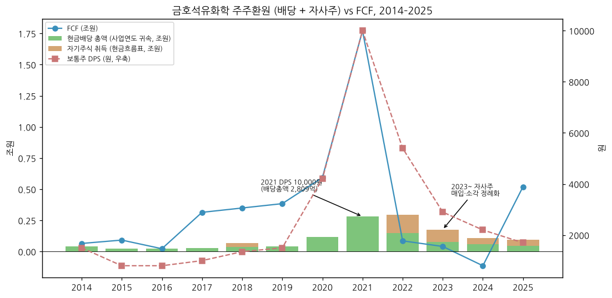

### ⑦ 재무 비율 (12년)

| 연도 | ROE (지배) | ROA | 부채비율 | 유동비율 | 이자보상배율 | 연말 PBR | 연말 PER | EV/EBITDA |
|---|---|---|---|---|---|---|---|---|
| 2014 | 6.0% | 2.1% | 170% | 81% | 1.5x | 1.57 | 26.4 | 12.1 |
| 2015 | 7.6% | 2.8% | 153% | 63% | 1.5x | 1.02 | 13.4 | 10.2 |
| 2016 | 4.6% | 1.6% | 163% | 59% | 1.5x | 1.54 | 34.1 | 12.1 |
| 2017 | 12.3% | 4.7% | 134% | 70% | 2.5x | 1.65 | 14.2 | 9.6 |
| 2018 | 23.4% | 10.6% | 97% | 77% | 6.2x | 1.13 | 5.4 | 5.3 |
| 2019 | 11.8% | 6.5% | 73% | 99% | 4.8x | 0.90 | 8.0 | 5.8 |
| 2020 | 20.2% | 11.6% | 60% | 141% | 8.9x | 1.40 | 7.6 | 5.3 |
| 2021 | 47.8% | 24.2% | 60% | 146% | 41.3x | 0.99 | 2.6 | 2.1 |
| 2022 | 19.1% | 13.3% | 37% | 188% | 11.0x | 0.65 | 3.6 | 2.8 |
| 2023 | 7.8% | 5.6% | 37% | 168% | 5.9x | 0.65 | 8.5 | 6.8 |
| 2024 | 5.9% | 4.2% | 38% | 177% | 3.9x | 0.41 | 7.1 | 5.3 |
| 2025 | 4.7% | 3.4% | 36% | 201% | 3.9x | 0.50 | 10.8 | 5.7 |
| 현재 (2026-11-24) | LTM 5.8% | - | 32% | 206% | - | **0.36** | **6.4** | **3.4** |

(ROE = 지배순이익 / 평균 지배지분 (2014는 기말). PBR·PER·EV/EBITDA = 연말 보통주 시총 기준 [계산, Yahoo 12월 월말 종가 × DART 발행주식]. 현재값은 우선주 포함 시총 2.41조, LTM 지배순이익 3,760억, LTM EBITDA 약 6,967억(감가상각은 2025 연간 대용) [계산]. 이자보상배율 분모 = 연결 금융비용 전체(외환손실 포함) — 보수적)

---

## 5. 지배 구조

### ① 그룹·계열 관계

- 기업집단 "금호석유화학" — 계열 16개사 (상장 1 · 비상장 15), 2025-05-01 공시대상기업집단 연속 지정 [DART 사업보고서(2025.12) IX]. 연결 종속회사 20개 (2025말)
```
금호석유화학(주) [상장, 자사주 10.53%(3Q26)]
├─ 금호피앤비화학 100%  (페놀·BPA·에폭시, 연결) ── OCIKUMHO(말레이시아) 50%·디앤케이켐텍 50%·강소금호양농 50% (지분법)
├─ 금호폴리켐 100%      (EPDM·TPV, 2021-07 50%→100%, 연결)
├─ 금호미쓰이화학 50%    (MDI, 미쓰이화학과 JV, 지분법)
├─ 금호티앤엘 100%      (여수 항만 하역·TDF, 연결)
├─ 코리아에너지발전소 96.13% (연결) ── 철도솔라·강원학교태양광
├─ 금호리조트 66.7% (+피앤비 33.3%) (콘도·아시아나CC, 2021-04 인수) ── Kumho Holdings(H.K.) → ASIANA WEIHAI CC (중국)
├─ 영광백수풍력발전 51% · 케이앤에이치특수가스 100%(2025-04) · 여수페트로 22.2%
├─ 금호개발상사 (피앤비 100%) ── 금호그린바이오부산·창원 100%
└─ 해외: 금호페트로홀딩스(홍콩)·상해금호일려소료 50%·KKPC America·말레이시아·인도네시아·태국(Kumho-Sunny 50%)·독일(2025-10 신설)
```
(DART 사업보고서(2025.12) IX 계열회사 출자 현황. 공정가치 금융자산: 아시아나항공 4.0%, 대우건설 1.6% [IR 2Q26 Appendix] — 금호아시아나 그룹 시절 잔존 지분)

### ② 주주 구분

| 주주 (3Q26말, 보통주) | 주식수 | 지분율 | 관계 / 비고 |
|---|---|---|---|
| **박철완** (DART상 "최대주주 본인") | 2,599,132 | **10.43%** | 故 박정구 회장 장남, 박찬구 조카. 前 상무(2015-04\~2021-03). 2021·2022·2024 주총 표대결 패배, 2026 주주제안 없음 |
| 박준경 | 2,183,120 | 8.76% | 박찬구 장남, 사장(사내이사) |
| 박찬구 | 2,039,629 | 8.18% | 회장(미등기) |
| 박주형 | 331,580 | 1.33% | 박찬구 장녀, 부사장 |
| 박은혜·박은형·박은경·허경수 등 친인척 | 258,981 | 1.03% | 2026 중 일부 장내매도·상속 |
| 계열사 임원 등 (백종훈 대표 7,000주 포함) | 17,238 | 0.07% |  |
| **최대주주 및 특수관계인 합계** | 7,428,680 | **29.81%** | 단, 박철완(10.43%)과 박찬구 일가(18.27%)는 사실상 대립 관계 — "박찬구 우호지분 약 17%" [뉴데일리 2026-03-26] |
| 국민연금공단 (2025말) | 2,535,331 | 9.74% (2025말 기준) | 5% 이상 주주. 2024 주총에서 회사안 찬성·차파트너스안 반대 |
| 자기주식 | 2,624,417 | 10.53% | 의결권 없음. 2025말 13.44% → 3Q26 소각 |
| 소액주주 (2025말) | 12,811,524 | 49.22% (2025말) | 75,188명 |

(DART 분기보고서(2026.09) VII, 사업보고서(2025.12) VII. 지분율은 보통주 발행주식 기준. 외국인 지분율은 KRX 데이터 미수집 — 다음 버전 보강)

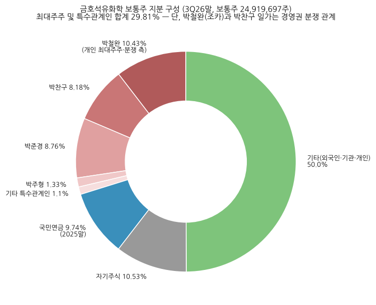

**경영권 분쟁 ("조카의 난") 타임라인:**
- 2021-01: 박철완 상무, 박찬구 회장과 특수관계 해소 선언 후 주주제안 (고배당·이사 선임) → 2021-03-26 주총 회사안 승리 (배당안 64.4% vs 35.6%, 백종훈 사내이사 선임) → 박철완 상무직 해임 (DART상 상무 재임 2021-03까지) [뉴시스 2021-03-26, DART 분기보고서(2026.09) VII]
- 2022-03·07: 정기·임시 주총 사측 안건 모두 가결, 박준경 사내이사 선임 [이코노미스트 2022-07-21]
- 2024-03-22: 행동주의 차파트너스가 박철완 위임으로 자사주 전량 소각·사외이사 선임 주주제안 → 전부 부결. 회사안(3년 내 자사주 50% 소각) 가결, ISS·글래스루이스·국민연금 모두 회사안 지지 [한경비즈니스 2024-03-22]
- 2025-10: 자사주 기반 EB 발행 검토 — 박철완 측 비판 / 2026-03-26 주총: 3차 상법개정(자사주 소각 의무화) 대응 정관 변경 가결, 박철완 측 주주제안·의결권 행사 없음. 집중투표제 의무화 시 약 11% 지분으로 이사 선임 가능성은 남음 [뉴데일리 2026-03-26]

### ③ 임원·이사회

- **대표이사 백종훈** (1961년생, 사장, 부산대 화학공학, 前 금호피앤비화학 상무 → 영업본부장 → 2021-04 대표이사, 2024-03 재선임, 경영위원회 위원장·ESG위원회 위원) [DART 사업보고서(2025.12) VIII]
- 사내이사: 박준경 사장 (1978년생, 고려대 환경공학, 임기 2028-03), 고영도 전무 (관리본부장, 임기 2027-03)
- 사외이사: 최도성 이사회 의장 (前 서울대 경영대 교수), 민세진 (동국대 경제학 교수, 2025-03), 양정원 (前 삼성액티브자산운용 대표, 감사위원 2026-03), 김재희·박순애 (2026-03 선임) 등 [DART, 뉴데일리 2026-03-26]
- 오너 경영: 박찬구 회장(1948년생, 미등기), 박주형 부사장(기획·관리 총괄) — 이사 보수한도 65억 → 60억 축소 (2026-03) [뉴데일리 2026-03-26]

---

## 6. 기타 팩트

### ① R&D 인프라

- 대전 중앙연구소(대덕) — 합성고무·합성수지·라텍스·연구기획 4개 담당, 연구소장 고영훈 부사장 [DART 사업보고서(2025.12) II-6, VIII]
| 연도 | 2014 | 2015 | 2016 | 2017 | 2018 | 2019 | 2020 | 2021 | 2022 | 2023 | 2024 | 2025 |
|---|---|---|---|---|---|---|---|---|---|---|---|---|
| 연구개발비 (억원) | 339 | 400 | 398 | 416 | 450 | 506 | 491 | 575 | 591 | 631 | 654 | 663 |
| 연결 매출 대비 | 0.71% | 1.02% | 1.00% | 0.82% | 0.81% | 1.02% | 1.02% | 0.68% | 0.74% | 1.00% | 0.91% | 0.96% |

(DART 사업보고서 II "연구개발비용(연결기준)" 표 — 회사 공시 비율은 별도 매출 대비 0.68\~1.60%. 2015\~2016은 이후 보고서의 수정치 사용. 피앤비 별도 R&D 72억(2025))

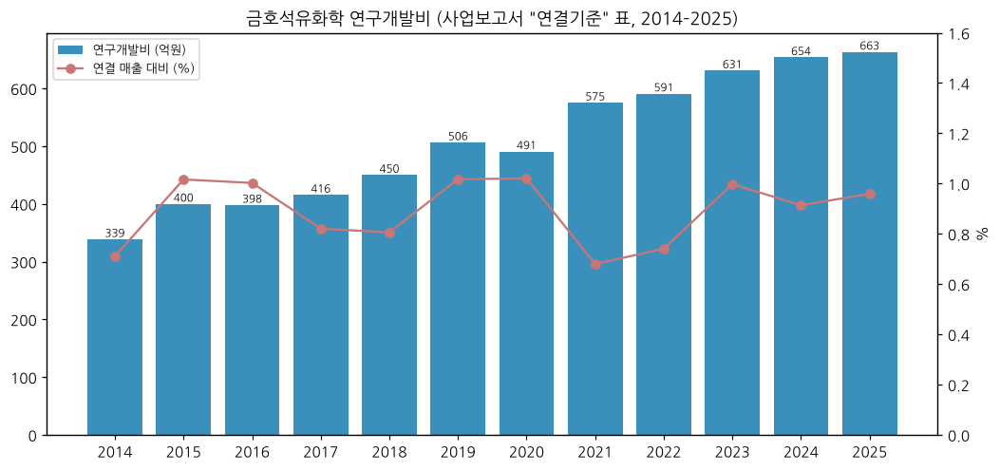

### ② 진행 중 corporate action — 10년치 주요 이벤트

| 일자 | 이벤트 | 출처 |
|---|---|---|
| 2021-04 | 금호리조트 인수 (금호석유화학 66.7% + 피앤비 33.3%) — "금호 명맥을 지키기 위해" (박찬구 회장) | DART, 아시아경제 2021-01-26 |
| 2021-07 | 금호폴리켐 잔여지분 50% 취득 → 100% 자회사 | DART 사업보고서(2025.12) I-2 |
| 2022-04\~09 | 피앤비, 말레이시아 OCIKumho 50% 출자 500억 (이후 2024·2025 증자 522억) | 같음 |
| 2023-09 | 케이앤에이치특수가스 설립 → 2025-04 잔여 50% 취득 | 같음 |
| 2021-12 \~ 2026-3Q | 자사주 소각 누적 약 555만주 (보통주 발행주식 30,467,691 → 24,919,697주, -18.2%) | DART [계산] |
| 2024-02 | 기업가치 제고 계획: 2025\~2030 매출 CAGR 6%, ROE 7%→10%, 주주환원율 40% | 한경 2026-03-31 |
| 2024-10 / 2025-02 | 금호그린바이오부산·창원 편입 (금호개발상사 산하) | DART |
| 2025-04 | EPDM 5라인 (+7만톤) 상업생산 | DART |
| 2025-10\~11 | 독일 판매법인 2곳 설립 (Kumho Petrochemical Germany, Kumho P&B Chemicals Europe) | DART 사업보고서(2025.12) I-1 |
| 2026-01 | SSBR 3.5만톤 증설분 상업 운전 | 한경 2026-03-31 |
| 2026-03\~09 | 300억 자사주 신탁 → 1,112,045주 소각 | DART 분기보고서(2026.09) |
| 2026-4Q(예정) | 금호미쓰이 MDI 10만톤 debottlenecking 완료 | IR 2Q26 |
| 2027 초(예정) | 2027\~2029 주주환원 정책 공시 | IB토마토 2026-11-11 |

### ③ R&D·제품 마일스톤 — 10년치

- 2013-12 CNT 상업 운전 → 생산능력 120톤(2023) → 360톤(2025), 이차전지 도전재 판매 본격화 (9M26 매출 +66%) [DART]
- 2021 초고분자량 SSBR 파일럿·Ultra Light Glove용 NB라텍스 플랜트 테스트 → 2022 전기차용 연속식 SSBR(SOL 6220E)·초경량 장갑용 NB라텍스(KNL 838) 출시 → 2023 레이싱 타이어용 UHM 200 [DART 사업보고서 II-6 각 연도]
- 2024 차세대 NdBR(NdBR 45) 상업화·일본 타이어사 정규 공급(USOL) → 2025 배터리 바인더용 SB라텍스(KSL152)·아스팔트용 SBS(KTR 203)·PCR 35% HIPS 컴파운드·폐플라스틱 가스화 파일럿 [DART 사업보고서(2025.12) II-6]
- 2026: SSBR/SBS 병행생산 설비 구축 완료 [IR 2Q26 Appendix]

### ④ 주요 리스크

(1) **중국 증설·공급과잉 (구조적)**: BR·SBR·BD·페놀·BPA·ABS 신증설 → 2023\~2025 저점 OPM 3.8\~5.7%. 2025 사업보고서 기준 합성수지 가동률 56%, 합성고무 70% [DART]. 국내 석화 14개사 중 2026 상반기 신용등급 상향 0곳 — 중국·미국·중동 대비 원가 열위 [머니투데이 2026-07-23]
(2) **원료 가격 변동·역래깅**: 3Q26처럼 원료 급등 후 하락 국면에서 고가 재고 투입 → 분기 적자. 미-이란 분쟁 등 지정학 리스크가 BD·벤젠 가격 경로를 흔듦 [DART 분기보고서(2026.09) II-1]
(3) **NB라텍스 수요·경쟁**: 장갑 업체 가동률과 말레이시아 경쟁사 증설에 좌우. 미국의 중국산 장갑 관세 상향은 기회 요인 [IB토마토 2026-11-11]
(4) **지배구조·경영권 분쟁**: 박철완(10.43%) vs 박찬구 일가(18.27%) 구도 지속, 3차 상법개정(자사주 소각 의무화·집중투표제)으로 자사주 활용 제약 [뉴데일리 2026-03-26]
(5) **환율**: 합성고무 수출 84% — 원화 강세 시 판가 하락. 3Q26 원·달러 하락이 업계 공통 부담으로 언급 [비즈니스워치 2026-11-10]
(6) **안전·환경 제재**: 2023\~2025 계열사 산업안전보건법·악취방지법·폐기물관리법 위반 과태료·벌금 다수 (금호티앤엘 협력사 중대재해 2025-03 벌금), 2023 기업집단 지정자료 누락으로 임원 1명 벌금 1.5억 약식명령 [DART 사업보고서(2025.12) XI-3]
(7) **우발채무**: 피앤비의 OCIKUMHO(말레이시아) 시설자금 지급보증 USD 6,500만 등 계열사 채무보증 [DART 분기보고서(2026.09) XI-2]

### ⑤ ESG 등급

- **MSCI ESG: BB (2024) → BBB (2025-03) → A (2026, 1단계 상향)** [아이뉴스24 2025-03-18, 아시아경제 2026-06-23]
- 지속가능경영보고서 2025 (8번째, 2026-06-23 발간): 중대 이슈 5개(온실가스·공급망·순환경제·지속가능 포트폴리오·에너지 효율), CCUS 설비 구축, TNFD 자연 분석 전 국내 사업장 확대, DJSI Korea 4년 연속 편입(기사 번역 표기 기준 — 확인 필요) [아시아경제 2026-06-23]. 원문 PDF 미수집 (회사 사이트 2024판 존재 확인)
- 금호폴리켐 EcoVadis 플래티넘 (2024·2025, 상위 1%) [DART 사업보고서(2025.12) II-7]
- 온실가스 배출 3,319,747 → 3,308,643 → 3,293,466 tCO2e (2023\~2025), 에너지 사용 40,783 → 42,467TJ [DART 사업보고서(2025.12) XI-4]
- KCGS(한국ESG기준원) 등급: 미확인 (다음 버전 보강)

### ⑥ 인증·라이선스

- 전 사업장 ISO 9001·14001·45001, 본사·연구소·울산·여수 공장 IATF 16949 (자동차 품질) [DART 사업보고서(2025.12) II-7]
- 지식재산권: 등록 1,642건 (국내특허 371·해외특허 284·상표 982) + 출원 217건 (2025말) [같음]
- 울산수지공장 녹색기업 지정 (2024-12-16\~2027-12-15, 낙동강유역환경청), 온실가스·에너지 목표관리업체 [같음]

---

## Version Log

- **2026-11-28 v1.0 통합 검수**: 정유·화학 6사(S-Oil·SK이노베이션·LG화학·롯데케미칼·금호석유화학·한화솔루션) 병렬 작성 후 교차 검수 — 1장 ④-1 '정유·화학 6사 공통 비교 박스'(보통주 시총·PBR·PER·EV/EBITDA 통일 정의) 6문서 동일 삽입

- **v1.0 (2026-11-25)**: 첫 작성 — Phase 1 source 전수 점검 (OpenDART 재무 JSON 44개(2015 FY\~3Q26, 2015 1\~3Q는 API 미제공 → 원문 XML로 대체), 정기공시 원문 XML 48건 + 감사보고서 첨부 16건(본문·첨부 각각 열어 확인), 기업개황·주주·임원·직원·배당·자기주식·주식총수 7종, IR 실적발표 PDF 5건(irgo 4 + kkpc.com 1), Yahoo 월간·일간·우선주, 언론·신용평가 보조) + v4.8 6개 섹션 + 차트 15종 (12종 표준 + chart2 DART 부문 3종(합성고무·수지 / 페놀유도체 / 기타) + chart2b IR 5부문)
- **데이터 처리 결정**: ① 분기 손익 1Q16\~3Q26 = dart_quarterly_summary, 1Q14\~4Q15 = 2015 분기·반기보고서 원문 손익계산서 (4Q = 연간 − 9M) → 연결 51분기 ② 부문은 DART 3부문(합성고무·합성수지 등 / 기초유기화합물 / 기타)의 매출·법인세차감전이익 누적치를 분기 차감 → 51분기, IR 5부문(영업이익)은 2Q24\~3Q26 10분기 ③ IR PDF의 막대 수치는 PDF 간 중복 분기를 대조해 분기 배치(5부문 합 = 연결 일치 검증), 2Q26 PDF의 페놀유도체 25.2Q 표기(3,992)는 오기로 판단해 다른 PDF·DART 값(4,326) 채택 ④ 3Q26 부문 수치 = 머니투데이 2026-11-06 (IR PDF 미확보) ⑤ 시총 = 보통주 발행주식 기준(우선주 별도 표기), 2006\~2013 발행주식 불변 가정 [추정] ⑥ 감가상각 = 연결 CF 주석 조정항목(유형+사용권+무형) ⑦ R&D = 사업보고서 "연결기준" 표 ⑧ 범위 표기 물결표는 모두 이스케이프
- 잔여 보완 후보: ① 1Q11\~4Q13 분기 시계열(2011\~2013 보고서 XML 미수집) → 60+분기 표준 충족 ② IR 5부문 2023 이전 + 3Q26 IR PDF (kkpc.com 다운로드 seq 탐색 필요) ③ 외국인 지분율 시계열 (KRX) ④ 글로벌 피어(Zeon·Arlanxeo·Synthomer) 수치 검증, 합성고무 글로벌 점유율 ⑤ BD·SBR·NB라텍스 시장 스프레드 시계열 (회사 공시는 연평균 단가만) ⑥ 지속가능경영보고서 2025 원문 PDF·KCGS 등급 ⑦ 4Q26 결산 후 연간 반영 및 2027\~2029 주주환원 정책 ⑧ 정유·화학 6사 공통 비교 박스(PBR·EV/EBITDA 통일 정의) 통합 검수
