# 기아 — 기업 개요 (v1.0)

> 마지막 update: 2026-11-25 (3Q26 분기보고서 2026-11-16 제출분까지 반영)
> 입력 source: OpenDART fnlttSinglAcntAll (연결, 2015 FY\~3Q26 44개 JSON + 2014 비교컬럼) + DART 정기공시 원문 XML 45건 (사업보고서 2014\~2025, 분기·반기 1Q16\~3Q26) + OpenDART 주요정보 (최대주주·임원·직원·배당·자기주식·주식총수, 2016·2019·2022·2025) + 기아 IR 실적발표 PDF 25건 (3Q22\~3Q26, irgo) + Yahoo Finance (000270.KS, 2000-01\~2026-11-25 월간) + 보도 (지디넷 2026-10-30, 헤럴드경제 2026-02-25, SBS Biz, mydailybyte 주간 리포트 2026-11-02)
> 갱신 주기: 매분기 (실적 리뷰 모드 호출 시)
> 워치리스트: 자동차 섹터 (2026-11-23 신설, 4Q26부터 리뷰) / 서브섹터: **완성차**
> **Fact verify cutoff**: 2026-11-25 (주가 95,600원·시총·52주 고저 = Yahoo Finance 2026-11-25 조회값. 외국인 지분율 40.41%는 2026-02-24 보도치 — 현재치 미확인)

---

## 1. 기업 분류

- **Primary 분류: 사이클** (Cyclical — 완성차 수요·환율·인센티브·관세 사이클)
- **Secondary 노트: 2021년 이후 수익성 레벨 업 (OPM 3%대 → 8\~12%) + 로봇·피지컬AI 옵션 (보스턴다이내믹스 간접 지분)** — 2026-02 주가 고점은 실적이 아니라 그룹 피지컬AI 재평가로 형성

### ① 정량 근거

**📊 Summary Box (12년, 2014\~2025 연결):**

| 지표 | 값 |
|------|-----|
| 매출 CAGR (2014→2025, 11년) | **+8.4%** (47.1조 → 114.1조) |
| 매출 CAGR (3년, 2022→2025) | **+9.7%** |
| OPM 평균 | **6.0%** (2014\~2020 3.6% / 2021\~2025 9.4%) |
| OPM 정점 평균 | **8.7%** (2014 5.5% · 2024 11.8%) |
| OPM 저점 평균 | **2.4%** (2017 1.2% · 2020 3.5%) |
| 사이클 주기 | 약 10년 (peak-to-peak 2014→2024), 분기 기준으로는 3\~4년 단위 품질비용·환율 미니 사이클 |
| 사이클 회수 (12년) | 정점 2회 / 저점 2회 |

```
[전사 OPM 시계열 (12년, 연결, OpenDART)]
연도   매출(조) 영업이익  순이익   OPM    NPM
2014     47.1    2.57    3.82     5.5    8.1   ← 원화 강세·러시아 루블 급락 전 고점권
2015     49.5    2.35    3.10     4.8    6.3   ← 멕시코 공장 건설 (CapEx 3.9조)
2016     52.7    2.46    3.44     4.7    6.5   ← 멕시코 공장 양산(2016.05)
2017     53.5    0.66    1.14     1.2    2.1   ← 통상임금 1심 패소 충당금, 3Q17 영업손실 -4,270억 (12년 저점)
2018     54.2    1.16    1.47     2.1    2.7   ← 美 판매 부진·인센티브, 저마진 지속
2019     58.1    2.01    2.53     3.5    4.4   ← 인도 아난타푸르 공장 가동·셀토스
2020     59.2    2.07    1.84     3.5    3.1   ← 코로나 + 세타2 엔진 품질비용(3Q20)
2021     69.9    5.07    6.39     7.3    9.2   ← 사명 변경·신규 로고, RV 믹스·인센티브 축소
2022     86.6    7.23    7.50     8.4    8.7   ← 3Q22 품질비용 1.5조에도 OPM 8%대
2023     99.8   11.61    8.78    11.6    8.8   ← OP 11.6조, RV·고가 믹스 구조적 레벨업
2024    107.4   12.67    9.78    11.8    9.1   ← 12년 정점 OP 12.7조 / OPM 11.8%
2025    114.1    9.08    7.55     8.0    6.6   ← 美 관세 25%(2025.04~) → OP -28%

OPM range: 1.2% ~ 11.8% = 10.6%pt  (현대차 2.3~9.3% = 7.0%pt 대비 진폭 큼 → 사이클 cutoff ±10%pt 충족)
```

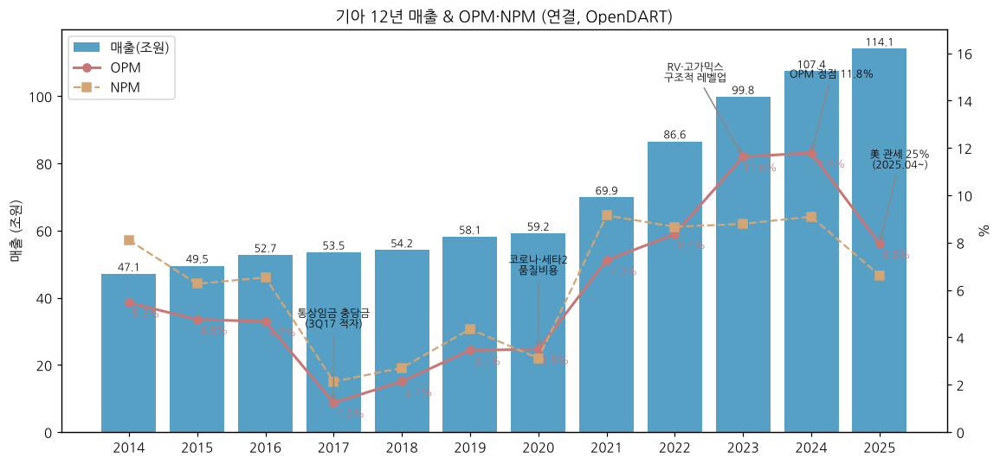

(2014 수치는 2015 사업보고서 전기 비교컬럼. 기아는 단일 보고부문 — DART상 "완성차 및 부분품 제조·판매" 1개 부문, 렌트·정비는 중요하지 않아 미분리)

### ② 산업 분류

- 산업: **자동차 (완성차 OEM)** — 사이클 산업 list 포함 (글로벌 SAAR·인센티브·환율·원자재 사이클)
- DART 업종: 자동차용 엔진 및 자동차 제조업 (30121) / KRX 운수장비 / WICS 자동차
- 워치리스트 섹터: **자동차** (2026-11-23 추가) / 서브섹터: **완성차** (현대차·기아)
- 그룹: 현대자동차그룹 — 현대차 35.17% 최대주주, 순환출자 고리 (현대모비스 → 현대차 → 기아 → 현대모비스 18.10%)

### ③ 분류 결정 논리

(1) **가장 매출 큰 사업부 기준** 적용 시: 단일 부문(완성차) 100% → 완성차 사이클에 직결 → 사이클

(2) **이익 진폭 sub-rule**: 매출은 12년간 역성장이 거의 없지만(2014\~2025 매년 증가), 영업이익은 -73%(2017)·+145%(2021)·+61%(2023)·-28%(2025)로 진폭이 크다. 매출은 지속성장형, 이익은 사이클형 → **이익 기준 사이클 Primary**

(3) **Boundary case 처리**: 2021년 이후 OPM 레벨이 구조적으로 올라감 (RV 비중 확대, 인센티브 축소, 원/달러 1,300\~1,450원대, xEV 믹스). 2021\~2025 평균 9.4%는 2014\~2020 평균 3.6%의 2.6배 → "사이클 내 레벨 업"으로 보고 **Primary 사이클 유지, Secondary에 구조적 레벨 업 표기**. 관세 15% 체제에서 OPM 8%+가 유지되면 지속성장 transition 후보 (⑤ 트리거)

(4) **현대차 대비**: 현대차는 OPM range 7.0%pt·금융부문 보유(현대캐피탈 연결)로 "완만한 사이클" → 기아는 금융부문 없는 순수 완성차 + 해외 생산 비중이 낮아 **환율·관세 민감도가 더 높다** (2025 별도 매출 중 수출 68.7%). 동일 Primary(사이클)지만 기아의 이익 베타가 더 큼. 현대모비스는 A/S 캐시카우로 지속성장 분류 — 같은 그룹 내 3사 분류가 갈림

### ④ 적정 밸류에이션 방법

→ **1차 — P/E (trailing·12MF) + 배당수익률**: 단일 완성차 부문이라 이익 = 밸류. 2026-11-25 종가 95,600원 × 발행주식 390,412,998주 = **시총 약 37.3조원**. 직전 4개 분기(4Q25\~3Q26) 연결 순이익 합 69,143억원 기준 **trailing PER 약 5.4배** (`추정`, 자사주 미차감). DPS 6,800원(FY25) 기준 **배당수익률 약 7.1%**
→ **2차 — P/B 밴드**: 3Q26말 지배주주 자본 62.27조 → **PBR 약 0.6배** (`추정`). 12년 연말 PBR 0.4\~0.9배 밴드 (4-⑦ 표). 사이클 저점(2017\~2018) PBR 0.5배, 정점권(2023) 0.86배
→ **3차 — 순현금 + 지분가치 보정**: 2025말 순현금 19.3조(현금성+단기금융 − 차입금, 시총의 약 52%) + 현대모비스 18.10%(시가 6.1조, 2025말) 등 상장 계열사 지분 → 실질 EV/EBIT 2\~3배 수준. 로봇 옵션(BD)은 HMG Global 30.5% 경유 간접 지분이라 별도 SOTP는 증권사별 편차 큼
→ **현대차 차별화**: 현대차는 금융부문 자산 때문에 P/B 중심, 기아는 금융 미연결·순현금 구조라 **P/E + 배당수익률(주주환원 TSR) 1순위**
→ **DCF 미사용 근거**: 관세·인센티브·환율 3변수에 따른 OPM 진폭(분기 5.1\~13.2%)이 커서 장기 FCF 가정 신뢰도 낮음

### ⑤ 분기 재평가 트리거 (분류 변경 조건)

- **관세 15% 체제에서 OPM 8%+ 4개 분기 연속** (2026 사업계획 OPM 8.3%) → 사이클 → **지속성장 transition 후보** (2021\~2024형 레벨 재확인)
- **OPM 5% 하회 2분기 연속** (3Q25 5.1%, 3Q26 5.8% 근접) → 사이클 하강 국면 확정, 2017\~2020형 저마진 회귀 검토
- **xEV(HEV+PHEV+EV) 믹스 50%+ & EV 흑자 확인** (3Q26 xEV 36.2%, 경영진 "EV 수익성 2\~3년 내 개선") → Secondary에 전동화 성장 격상
- **로봇·자율주행 지분(BD·Motional·포티투닷) 가치가 공시 숫자로 확인** (HMG Global 지분가치 재평가·BD IPO 등) → Secondary 꿈 격상

---

## 2. 회사 개요

### ① 기본 사항

| 항목 | 내용 |
|---|---|
| 회사명 | 기아 주식회사 (KIA CORPORATION) — 2021-03-22 기아자동차(주)에서 상호 변경 |
| 설립 / 상장 | 1944-12-10 (경성정공) / 1973-07-21 유가증권시장 |
| 본사 | 서울특별시 서초구 헌릉로 12 |
| 대표이사 | 송호성 사장·송민수 (각자 대표, OpenDART 기업개황 2026-11 조회) — 2025 사업보고서 기준 대표는 송호성·최준영 |
| 사업 한 줄 정의 | 현대차그룹 내 **RV·전동화 중심 대중 브랜드** 완성차 OEM — 국내 4개·해외 4개(美·슬로바키아·멕시코·인도) 공장 + 중국 JV |
| 생산능력 (2025) | 3,114,000대 / 생산실적 2,851,092대 (가동률 91.6%) |
| 판매 (2025, 도매) | 3,136천대 (CKD·특수 포함) — 2026 계획 3,350천대 (+6.8%) |
| 임직원 (2025말, 별도) | 36,566명 (평균 근속 21.1년(남), 남 평균 연봉 1.35억) |
| 비전/브랜드 | "Movement that inspires" (2021-01 신규 로고·슬로건), Plan S (전동화·PBV) |

### ② 최근 12년 손익·자본 추이 (조원, 연결, OpenDART)

| 연도 | 매출 | 영업이익 | 순이익 | 자본총계 | 자본 YoY | OPM |
|---|---|---|---|---|---|---|
| 2014 | 47.1 | 2.57 | 3.82 | 22.5 | - | 5.5% |
| 2015 | 49.5 | 2.35 | 3.10 | 24.2 | +7.7% | 4.8% |
| 2016 | 52.7 | 2.46 | 3.44 | 26.6 | +9.8% | 4.7% |
| 2017 | 53.5 | 0.66 | 1.14 | 26.9 | +1.1% | 1.2% |
| 2018 | 54.2 | 1.16 | 1.47 | 27.2 | +1.4% | 2.1% |
| 2019 | 58.1 | 2.01 | 2.53 | 29.0 | +6.4% | 3.5% |
| 2020 | 59.2 | 2.07 | 1.84 | 29.9 | +3.2% | 3.5% |
| 2021 | 69.9 | 5.07 | 6.39 | 34.9 | +16.8% | 7.3% |
| 2022 | 86.6 | 7.23 | 7.50 | 39.3 | +12.7% | 8.4% |
| 2023 | 99.8 | 11.61 | 8.78 | 46.6 | +18.4% | 11.6% |
| 2024 | 107.4 | 12.67 | 9.78 | 55.8 | +19.9% | 11.8% |
| 2025 | 114.1 | 9.08 | 7.55 | 61.2 | +9.6% | 8.0% |

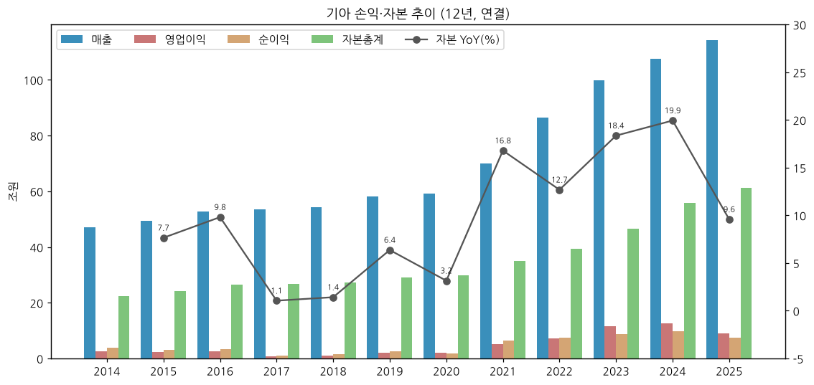

→ 자본은 12년간 22.5조 → 61.2조 (2.7배). 2021 이후 연 +10\~20% 증가 — 순이익 증가 + 순현금 누적

### ③ 회사 주가 역사 ★ narrative 영역

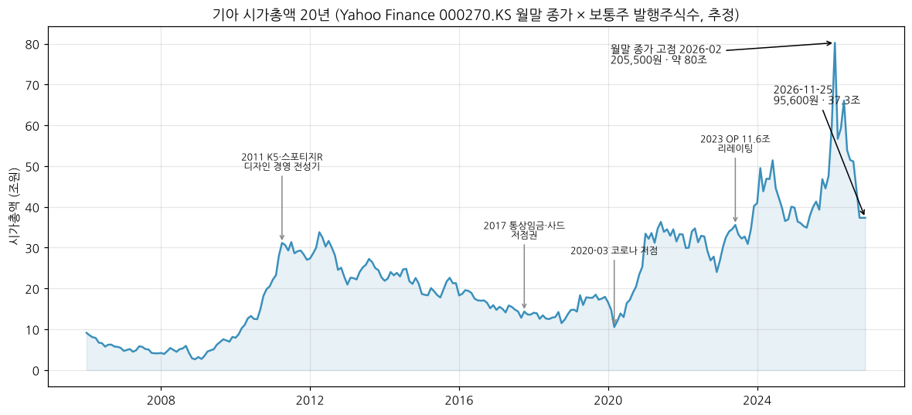

```
[주가·시총 milestone — Yahoo Finance 000270.KS 월말 종가, 시총 = 종가 × 당시 보통주 발행주식수 (추정)]
2008-12 :  6,550원 · 약 2.7조   ← 금융위기 저점
2011-04 : 약 31조                ← K5·스포티지R 디자인 경영(2006 슈라이어 영입) 성과, 1차 전성기
2016~2018: 33,500~39,250원 · 14~16조 ← 사드·통상임금·美 부진, 장기 저평가 (PBR 0.5배)
2020-03 : 코로나 저점 (시총 약 10조대)
2023-12 : 100,000원 · 약 40조   ← OP 11.6조, 첫 10만원 안착 (밸류업·주주환원 기대)
2025-12 : 121,800원 · 약 47.6조
2026-02 : 205,500원 (월말 종가 고점) · 약 80조 ← ATH. 장중 52주 고가 212,500원 (Yahoo)
          — CES 2026 현대차 '뉴 아틀라스' 공개, 그룹 피지컬AI·로봇 재평가 + 외국인 순매수, 코스피 6000 돌파
          — 2026-02-26 장중 20만원 첫 돌파, 외국인 지분율 40.41% (헤럴드경제 2026-02-25)
2026-10-30: 3Q26 실적 발표일 -11.2% (OP 1.82조, 컨센서스 2.44조 대비 -25.5%), 주간 -9.1%
2026-11-25: 95,600원 · 약 37.3조 ← 고점 대비 -53%. 52주 저가 83,800원
```

- **ATH**: 2026-02 (월말 종가 205,500원, 시총 약 80.2조 / 장중 212,500원) [Yahoo Finance v8, 2026-11-25 조회]
- 2026년 주가 사이클: 1\~2월 피지컬AI 테마 급등 → 3월 이후 실적(관세 15% 정착 후에도 원자재·중동·인센티브)으로 되돌림 → 10월 3Q 쇼크로 2025년 말 수준 하회. **주가가 이익보다 테마에 먼저 반응한 해** (2026 1\~3Q OP -8.1% YoY)
- 2026-11-24 +10.6% 반등(86,400 → 95,600원) — 원인 보도 미확인 (잔여 보완)

### ④ 회사의 주요 연혁

| 시기 | 내용 |
|---|---|
| 1944-12 | 경성정공 설립 (국내 최초 자전거 생산), 1952 기아산업으로 상호 변경 |
| 1973-07 | 유가증권시장 상장, 소하리(현 오토랜드 광명) 종합 자동차 공장 |
| 1997\~1998 | 외환위기 부도·법정관리 → 1998-12 현대자동차 인수, 현대차그룹 편입 |
| 2006 | 피터 슈라이어 디자인 총괄 영입 ("디자인 기아"), 2006-12 슬로바키아 질리나 공장 양산 |
| 2009-11 | 美 조지아 웨스트포인트 공장(현 Kia Georgia) 양산 |
| 2016-05 | 멕시코 몬테레이 공장 양산 |
| 2017-08 | 통상임금 소송 1심 패소 → 3Q17 충당금, 영업손실 |
| 2019-07 | 인도 아난타푸르 공장 셀토스 양산 |
| 2021-01/03 | 신규 로고·슬로건 공개, 상호 '기아'로 변경. 2021-08 첫 전용 EV 'EV6' 출시 |
| 2022-03 | EV6 '유럽 올해의 차' |
| 2023-06 | EV9 출시 → 2024-03 '세계 올해의 자동차' |
| 2024-09\~11 | 국내 신용평가 3사 AAA 달성 |
| 2025-04 | EV3 '세계 올해의 자동차' 선정 (2년 연속 기아) |
| 2025 | 첫 전용 PBV 'PV5' 출시, EV4·EV5 출시, 타스만(픽업) 출시. 2025-11 화성 EVO Plant East 준공 |
| 2025-12 | 창립 80주년, 美 조지아 텔루라이드 후속(LQ2a) 양산, 인도 셀토스 후속 양산 |
| 2026 | 1Q EV2(유럽 현지생산 B-SUV EV) 출시, 텔루라이드 HEV·셀토스 HEV 출시 |

---

## 3. 비즈니스 모델

### ① 실적 추이 (연결 → 지역별 → 제품별 3단계 위계)

**5년 연간 통합 표 (조원, DART 사업보고서 "매출실적")**

| 구분 | 2021 | 2022 | 2023 | 2024 | 2025 | 2025 비중 |
|---|---|---|---|---|---|---|
| **연결 매출** | **69.9** | **86.6** | **99.8** | **107.4** | **114.1** | 100% |
| 연결 영업이익 | 5.07 | 7.23 | 11.61 | 12.67 | 9.08 | OPM 8.0% |
| └ 지역 (연결 순매출) | | | | | | |
| 　국내 | 21.1 | 24.5 | 26.4 | 28.8 | 30.0 | 26.3% |
| 　북중미 (KUS 포함) | 23.8 | 33.3 | 41.3 | 47.3 | 50.7 | 44.4% |
| 　　└ KUS (Kia America) | 19.8 | 28.5 | 35.3 | 39.4 | 41.9 | 36.7% |
| 　유럽 | 19.8 | 20.7 | 23.7 | 23.3 | 24.4 | 21.4% |
| 　기타 (인도·아태 등) | 5.1 | 8.0 | 8.3 | 8.0 | 9.0 | 7.9% |
| └ 제품 (별도 매출, 내수+수출) | | | | | | |
| 　RV | 23.8 | 29.5 | 39.8 | 39.6 | 42.8 | 65.7% (별도) |
| 　승용 | 8.3 | 7.8 | 7.0 | 7.8 | 8.3 | 12.7% |
| 　상용 | 2.1 | 2.6 | 2.8 | 2.3 | 2.3 | 3.6% |
| 　제품 외 기타 (CKD·부품 등) | 6.7 | 6.5 | 8.9 | 13.5 | 11.7 | 18.0% |
| **별도 매출 합계** | 41.0 | 46.4 | 58.5 | 63.3 | 65.1 | 내수 31.3% / 수출 68.7% |

- 연결 지역 매출은 DART "지역별 매출 현황" 순매출(내부매출 제거 후). 2022부터 북중미를 KUS / KUS 이외로 분리 공시 → 2021 KUS는 2022 보고서 재분류치
- **북미가 2021 34% → 2025 44%로 최대 시장** (텔루라이드·스포티지·카니발 HEV). 국내 비중은 30% → 26%로 하락
- 별도 RV 매출 비중 66% — "RV 중심 믹스"가 2021 이후 OPM 레벨업의 핵심

**전사 분기 시계열 (43분기, 1Q16\~3Q26, 연결, OpenDART)** — 단일 보고부문이라 사업부별 대신 전사 시계열

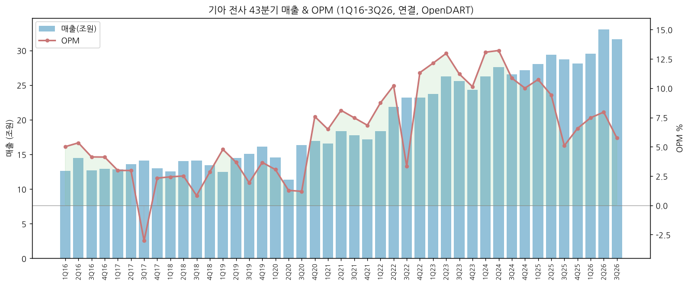

| 분기 | 매출(억원) | 영업이익(억원) | OPM | 매출 YoY | 영업이익 YoY | 순이익(억원) | 이벤트 |
|---|---|---|---|---|---|---|---|
| 1Q16 | 126,494 | 6,336 | 5.0% | - | - | 9,446 |  |
| 2Q16 | 144,500 | 7,709 | 5.3% | - | - | 8,257 |  |
| 3Q16 | 126,989 | 5,247 | 4.1% | - | - | 6,644 |  |
| 4Q16 | 129,147 | 5,322 | 4.1% | - | - | 3,200 |  |
| 1Q17 | 128,439 | 3,828 | 3.0% | +1.5% | -39.6% | 7,654 |  |
| 2Q17 | 135,784 | 4,040 | 3.0% | -6.0% | -47.6% | 3,896 |  |
| 3Q17 | 141,077 | -4,270 | -3.0% | +11.1% | 적전 | -2,918 | 통상임금 충당금 → 적자 |
| 4Q17 | 130,056 | 3,024 | 2.3% | +0.7% | -43.2% | 1,048 |  |
| 1Q18 | 125,622 | 3,056 | 2.4% | -2.2% | -20.2% | 4,320 |  |
| 2Q18 | 140,601 | 3,525 | 2.5% | +3.5% | -12.7% | 3,319 |  |
| 3Q18 | 140,743 | 1,173 | 0.8% | -0.2% | 흑전 | 2,977 | 품질비용(엔진) |
| 4Q18 | 134,732 | 3,820 | 2.8% | +3.6% | +26.3% | 943 |  |
| 1Q19 | 124,444 | 5,941 | 4.8% | -0.9% | +94.4% | 6,491 |  |
| 2Q19 | 145,067 | 5,336 | 3.7% | +3.2% | +51.4% | 5,054 |  |
| 3Q19 | 150,895 | 2,915 | 1.9% | +7.2% | +148.5% | 3,258 |  |
| 4Q19 | 161,054 | 5,905 | 3.7% | +19.5% | +54.6% | 3,464 |  |
| 1Q20 | 145,669 | 4,445 | 3.1% | +17.1% | -25.2% | 2,660 |  |
| 2Q20 | 113,688 | 1,452 | 1.3% | -21.6% | -72.8% | 1,263 | 코로나 셧다운 |
| 3Q20 | 163,218 | 1,952 | 1.2% | +8.2% | -33.0% | 1,337 | 세타2 품질비용 |
| 4Q20 | 169,106 | 12,816 | 7.6% | +5.0% | +117.0% | 9,616 | 품질비용 기저 + 믹스 |
| 1Q21 | 165,817 | 10,764 | 6.5% | +13.8% | +142.2% | 10,350 |  |
| 2Q21 | 183,395 | 14,872 | 8.1% | +61.3% | +924.2% | 13,429 |  |
| 3Q21 | 177,528 | 13,270 | 7.5% | +8.8% | +579.8% | 11,347 |  |
| 4Q21 | 171,884 | 11,751 | 6.8% | +1.6% | -8.3% | 12,477 |  |
| 1Q22 | 183,572 | 16,065 | 8.8% | +10.7% | +49.2% | 10,326 |  |
| 2Q22 | 218,760 | 22,341 | 10.2% | +19.3% | +50.2% | 18,810 |  |
| 3Q22 | 231,616 | 7,682 | 3.3% | +30.5% | -42.1% | 4,589 | 품질비용 1.54조 |
| 4Q22 | 231,642 | 26,243 | 11.3% | +34.8% | +123.3% | 20,365 |  |
| 1Q23 | 236,907 | 28,740 | 12.1% | +29.1% | +78.9% | 21,198 |  |
| 2Q23 | 262,442 | 34,030 | 13.0% | +20.0% | +52.3% | 28,169 | 분기 OP 정점 3.4조 |
| 3Q23 | 255,454 | 28,651 | 11.2% | +10.3% | +273.0% | 22,210 |  |
| 4Q23 | 243,282 | 24,658 | 10.1% | +5.0% | -6.0% | 16,201 |  |
| 1Q24 | 262,129 | 34,257 | 13.1% | +10.6% | +19.2% | 28,091 |  |
| 2Q24 | 275,679 | 36,437 | 13.2% | +5.0% | +7.1% | 29,566 | 분기 OPM 13.2% |
| 3Q24 | 265,199 | 28,813 | 10.9% | +3.8% | +0.6% | 22,679 |  |
| 4Q24 | 271,481 | 27,164 | 10.0% | +11.6% | +10.2% | 17,414 |  |
| 1Q25 | 280,175 | 30,086 | 10.7% | +6.9% | -12.2% | 23,926 |  |
| 2Q25 | 293,496 | 27,648 | 9.4% | +6.5% | -24.1% | 22,682 | 美 관세 25% 시작 |
| 3Q25 | 286,860 | 14,623 | 5.1% | +8.2% | -49.2% | 14,225 | 관세 풀반영 (OPM 5.1%) |
| 4Q25 | 280,877 | 18,425 | 6.6% | +3.5% | -32.2% | 14,709 |  |
| 1Q26 | 295,019 | 22,051 | 7.5% | +5.3% | -26.7% | 18,302 |  |
| 2Q26 | 330,371 | 26,286 | 8.0% | +12.6% | -4.9% | 23,277 | 분기 매출 최대 33.0조 |
| 3Q26 | 315,974 | 18,183 | 5.8% | +10.1% | +24.3% | 12,855 | 원자재·중동·인센티브 → OPM 5.8% |

(1\~3Q = 분기보고서 3개월 금액, 4Q = 사업보고서 연간 − 3Q 누적. 2015 분기는 OpenDART 미제공)

**📌 3Q26 핵심 박스 (2026-10-30 IR + 2026-11-16 분기보고서)**

| 지표 | 3Q26 | YoY | QoQ |
|---|---|---|---|
| 매출 | 31.60조 | +10.1% | -4.4% |
| 영업이익 | 1조 8,183억 (OPM 5.8%) | +24.3% | -30.8% |
| 순이익 | 1조 2,855억 | -9.6% | |
| 컨센서스 대비 (FnGuide) | OP 2.44조 대비 **-25.5%** | | |
| 글로벌 도매 / 현지판매 | 847천대 (+7.9%) / 829천대 (+6.9%) | | |
| xEV 믹스 (소매) | 36.2% (+9.8%p) — HEV 20.7%, EV 14.8% | | |
| 시장점유율 | 글로벌 4.0%(중국 제외 5.0%), 美 5.8%·국내 36.8% 분기 최고 | | |
| ASP (연결) | 3,950만원 (+2.3%) | | |
| 평균환율 | 1,423원/달러 (+2.8%) | | |

- OP YoY 분해 (IR): 관세 기저(25%→15%) +5,290억, 볼륨 +4,130억, 환율 +4,420억 vs **인센티브/가격 -7,270억, 믹스 -4,650억, 재료비(알루미늄·구리) -3,680억**, 중동 분쟁 영향 -2,090억
- QoQ -6,550억 중 환율(원화 강세 -5.2%) -5,330억이 최대 — 원/달러 민감도 확인
- 1\~3Q26 누적: 매출 94.1조(+9.4%) / OP 6.65조(-8.1%) / OPM 7.1% → 2026 계획(OP 10.2조, 8.3%) 달성에는 4Q 3.5조 필요

**12분기 시계열 (rolling, 4Q23\~3Q26)**

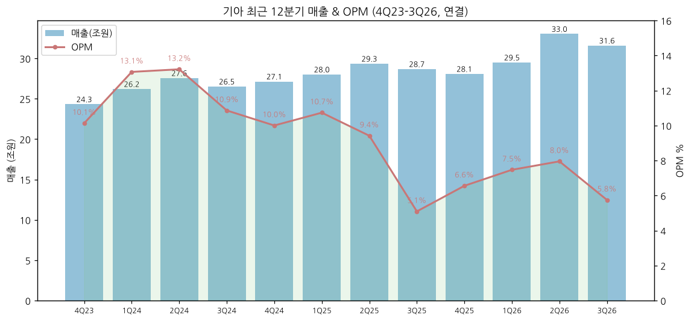

| 분기 | 매출(조) | 영업이익(억원) | OPM | 순이익(억원) |
|---|---|---|---|---|
| 4Q23 | 24.3 | 24,658 | 10.1% | 16,201 |
| 1Q24 | 26.2 | 34,257 | 13.1% | 28,091 |
| 2Q24 | 27.6 | 36,437 | 13.2% | 29,566 |
| 3Q24 | 26.5 | 28,813 | 10.9% | 22,679 |
| 4Q24 | 27.1 | 27,164 | 10.0% | 17,414 |
| 1Q25 | 28.0 | 30,086 | 10.7% | 23,926 |
| 2Q25 | 29.3 | 27,648 | 9.4% | 22,682 |
| 3Q25 | 28.7 | 14,623 | 5.1% | 14,225 |
| 4Q25 | 28.1 | 18,425 | 6.6% | 14,709 |
| 1Q26 | 29.5 | 22,051 | 7.5% | 18,302 |
| 2Q26 | 33.0 | 26,286 | 8.0% | 23,277 |
| 3Q26 | 31.6 | 18,183 | 5.8% | 12,855 |

### ② 사업부별 개요 (매출 비중 큰 순서 — 차급·지역 기준)

| 구분 | 비중 (2025) | 주요 차종 | 성격 |
|---|---|---|---|
| RV (SUV·MPV·픽업) | 별도 매출 66% | 스포티지·쏘렌토·카니발·셀토스·텔루라이드·EV3/5/6/9·PV5·타스만 | 이익 엔진. 美 RV 판매 비중 75% (소매) |
| 승용 | 13% | K4·K5·K8·모닝·레이·EV4 | 볼륨, 마진 낮음 |
| 상용 | 4% | 봉고·버스·PV5 카고 | 국내 위주, PBV로 재정의 중 |
| 기타 (CKD·부품·A/S) | 18% | KD 부품 수출 등 | 해외 공장 공급 |

- **지역**: 북미 44% > 국내 26% > 유럽 21% > 인도·기타 8% (연결 순매출)
- **파워트레인 (3Q26 소매)**: ICE 63.8% / HEV 20.7% / EV 14.8% / PHEV 0.7%

### ③ 사업부별 디테일

- **Top-seller**: 스포티지(글로벌 최다 판매), 쏘렌토·카니발 HEV (국내 백오더), 셀토스(인도·국내), 텔루라이드(美 조지아 생산, 2025-12 후속 양산 + 2.5T HEV)
- **Growth**: (1) 美 HEV — 3Q26 판매 +118%, HEV M/S 10.6% (2) 서유럽 EV — 3Q26 +163%, EV3·EV4(슬로바키아 생산)·EV2 (3) 인도 — 3Q26 +38.5%, 시로스·카렌스, M/S 6.5% (4) PBV — PV5 '2026 세계 올해의 밴', 화성 EVO Plant
- **이익 outlier**: 2Q23\~2Q24 분기 OPM 12\~13% (美 인센티브 업계 최저 + RV 믹스 + 원/달러 1,300원대) / 3Q25 5.1% (관세 25% 풀반영)
- **2026 사업계획 (2026-02-10 IR)**: 도매 3,350천대(+6.8%), 매출 122.3조(+7.2%), OP 10.2조(OPM 8.3%), 환율 가정 1,370원/달러 / 신차: 텔루라이드·셀토스(ICE/HEV), EV2·인도 전략형 EV

### ④ 주요 경쟁사 (지역별)

| 시장 | 주요 경쟁사 | 기아 포지션 |
|---|---|---|
| 국내 | 현대차·제네시스(그룹 내), 수입 BYD·테슬라, KGM·르노코리아 | M/S 36.8% (3Q26, 분기 최고). 수입 EV +48.5%가 위협 |
| 미국 | 토요타·혼다(HEV), GM·포드·스텔란티스, 현대차 | M/S 5.8% (3Q26), HEV M/S 10.6% |
| 서유럽 | VW그룹·스텔란티스·르노, 토요타, BYD 등 중국 EV | M/S 4.0%, EV M/S 확대 |
| 인도 | 마루티 스즈키·타타·마힌드라·현대차 인도 | M/S 6.5% |
| 글로벌 피어 | 현대차 (같은 그룹·플랫폼 공유), 토요타 (HEV 벤치마크) | 현대차 대비 OPM 상회 (2023 11.6% vs 9.3%, 2025 8.0% vs 6.2%) |

### ⑤ 주요 매출처 / 매입처

- **매출처**: 최종 고객은 개인·법인 소비자. 해외는 현지 판매법인(Kia America·Kia Europe 등) → 딜러 경로. DART상 특정 고객 매출 의존 공시 없음 (단일 고객 10% 이상 없음 — 추정)
- **할부금융 파트너**: 현대캐피탈(지분 40.13%)·Hyundai Capital America(20%)·Hyundai Capital Canada(30%) — 지분법
- **매입처 (2025 사업보고서)**: 국내공장 원재료 53.3조 중 부품 91.4%(현대모비스·현대위아 등), 원자재 8.5%(현대제철·포스코) / 해외공장 부품 97\~98% (현대모비스·HMMA·현대글로비스)
- 원자재 가격 (2025 평균): 알루미늄 $2,632/t(+8.8%), 구리 $9,945/t(+8.7%), 철광석 $102/t(-7.3%) → 2026 비철금속 상승이 3Q26 재료비 -3,680억으로 이어짐

### ⑥ 생산 CAPA + 임직원

| 공장 | 생산능력 2025 (대) | 생산실적 2025 | 가동률 |
|---|---|---|---|
| 국내 (광명·화성·광주·서산 위탁) | 1,596,000 | 1,597,342 | 100.1% |
| 미국 (조지아) | 347,000 | 355,000 | 102.3% |
| 슬로바키아 (질리나) | 340,000 | 296,550 | 87.2% |
| 멕시코 (몬테레이) | 400,000 | 288,100 | 72.0% |
| 인도 (아난타푸르) | 431,000 | 314,100 | 72.9% |
| **합계** | **3,114,000** | **2,851,092** | **91.6%** |
| (중국 KCN, 연결 제외) | — | — | 운영 Capa 기준 97\~104% (IR) |

- 美 HMGMA(조지아 메타플랜트) 지분 40% 보유 (지분법) — 현대차와 생산 거점 공유
- 1\~3Q26: 생산능력 2,351,000대 / 생산실적 2,235,294대 (가동률 95.1%)

| 연도 | 연구개발비 계(억원) | R&D/매출 | 생산실적(대, 연결) | 임직원(별도) |
|---|---|---|---|---|
| 2014 | 12,700 | 2.7% | 2,405,584 | - |
| 2015 | 15,235 | 3.1% | 2,425,550 | - |
| 2016 | 16,464 | 3.1% | 2,373,945 | 34,102 |
| 2017 | 16,419 | 3.1% | 2,373,420 | - |
| 2018 | 16,649 | 3.1% | 2,336,715 | - |
| 2019 | 17,682 | 3.0% | 2,416,409 | 35,675 |
| 2020 | 16,730 | 2.8% | 2,184,077 | - |
| 2021 | 18,719 | 2.7% | 2,406,556 | - |
| 2022 | 21,630 | 2.5% | 2,731,560 | 35,847 |
| 2023 | 26,092 | 2.6% | 2,890,355 | - |
| 2024 | 32,473 | 3.0% | 2,792,385 | - |
| 2025 | 37,124 | 3.3% | 2,851,092 | 36,566 |

(생산실적은 CKD 제외 연결 공장 합계. 임직원은 OpenDART 직원현황 조회 연도만 기재 — 나머지 연도 잔여 보완)

---

## 4. 재무 구조 (12년 시계열, 연결, OpenDART)

### ① 손익계산서 (12년 연결, 억원)

| 연도 | 매출 | 매출원가 | 매출총이익 | 판관비 | 영업이익 | 세전이익 | 순이익 | GPM | CIR | OPM | NPM | EPS(원) |
|---|---|---|---|---|---|---|---|---|---|---|---|---|
| 2014 | 470,970 | 377,541 | 93,429 | 67,704 | 25,725 | 38,163 | 38,163 | 19.8% | 14.4% | 5.5% | 8.1% | 7,393 |
| 2015 | 495,214 | 396,538 | 98,677 | 75,134 | 23,543 | 31,003 | 31,003 | 19.9% | 15.2% | 4.8% | 6.3% | 6,559 |
| 2016 | 527,129 | 422,816 | 104,313 | 79,698 | 24,615 | 34,420 | 34,420 | 19.8% | 15.1% | 4.7% | 6.5% | 6,873 |
| 2017 | 535,357 | 446,187 | 89,170 | 82,548 | 6,622 | 11,401 | 11,401 | 16.7% | 15.4% | 1.2% | 2.1% | 2,414 |
| 2018 | 541,698 | 461,773 | 79,925 | 68,351 | 11,575 | 14,686 | 14,686 | 14.8% | 12.6% | 2.1% | 2.7% | 2,883 |
| 2019 | 581,460 | 487,666 | 93,794 | 73,697 | 20,097 | 25,311 | 25,311 | 16.1% | 12.7% | 3.5% | 4.4% | 4,556 |
| 2020 | 591,681 | 492,226 | 99,455 | 78,791 | 20,665 | 18,414 | 18,414 | 16.8% | 13.3% | 3.5% | 3.1% | 3,710 |
| 2021 | 698,624 | 569,372 | 129,252 | 78,595 | 50,657 | 63,938 | 63,938 | 18.5% | 11.2% | 7.3% | 9.2% | 11,874 |
| 2022 | 865,590 | 685,360 | 180,230 | 107,899 | 72,331 | 75,020 | 75,020 | 20.8% | 12.5% | 8.4% | 8.7% | 13,495 |
| 2023 | 998,084 | 771,796 | 226,288 | 110,210 | 116,079 | 126,773 | 87,778 | 22.7% | 11.0% | 11.6% | 8.8% | 22,168 |
| 2024 | 1,074,488 | 826,780 | 247,708 | 121,036 | 126,671 | 135,002 | 97,750 | 23.1% | 11.3% | 11.8% | 9.1% | 24,893 |
| 2025 | 1,141,409 | 916,328 | 225,081 | 134,299 | 90,781 | 102,414 | 75,542 | 19.7% | 11.8% | 8.0% | 6.6% | 19,382 |

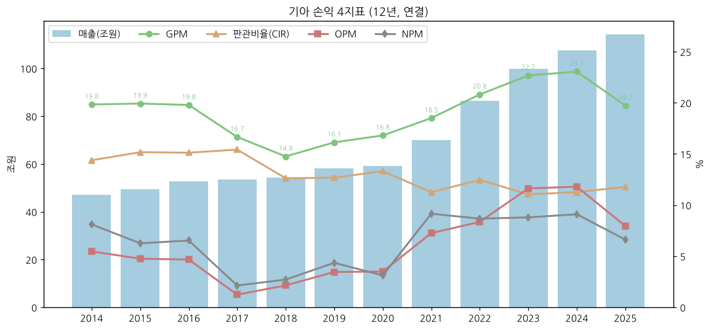

- GPM은 2018 14.8% → 2024 23.1%로 +8.3%p. 판관비율(CIR)은 15% → 11% — **원가·판관비 양쪽에서 구조 개선**. 2025는 관세로 GPM 19.7%로 3.4%p 하락

### ② 재무상태표 (12년 연결, 조원)

| 연도 | 자산총계 | 유동자산 | 현금성 | 단기금융상품 | 재고자산 | 유형자산 | 무형자산 | 부채총계 | 유동부채 | 충당부채(유+비유동) | 자본총계 |
|---|---|---|---|---|---|---|---|---|---|---|---|
| 2014 | 41.0 | 16.7 | 2.5 | - | 6.1 | 10.1 | - | 18.6 | 12.0 | 0.0 | 22.5 |
| 2015 | 46.0 | 18.4 | 1.1 | - | 7.7 | 13.0 | - | 21.8 | 14.6 | 0.0 | 24.2 |
| 2016 | 50.9 | 20.9 | 3.1 | - | 8.9 | 13.5 | - | 24.3 | 16.2 | 0.0 | 26.6 |
| 2017 | 52.3 | 21.6 | 1.6 | - | 8.5 | 13.7 | - | 25.4 | 15.3 | 0.0 | 26.9 |
| 2018 | 51.8 | 19.7 | 2.3 | - | 7.2 | 14.8 | - | 24.5 | 14.8 | 0.0 | 27.2 |
| 2019 | 55.3 | 21.6 | 4.3 | - | 8.1 | 15.7 | - | 26.4 | 17.3 | 0.0 | 29.0 |
| 2020 | 60.5 | 26.1 | 10.2 | - | 7.1 | 15.6 | - | 30.6 | 21.1 | 0.0 | 29.9 |
| 2021 | 66.8 | 29.2 | 11.5 | - | 7.1 | 15.6 | - | 31.9 | 21.6 | 0.0 | 34.9 |
| 2022 | 73.7 | 34.1 | 11.6 | - | 9.1 | 15.4 | - | 34.4 | 25.4 | 0.0 | 39.3 |
| 2023 | 80.6 | 37.5 | 14.4 | 2.3 | 11.3 | 16.1 | - | 34.1 | 25.7 | 0.0 | 46.6 |
| 2024 | 92.8 | 41.8 | 13.6 | 5.3 | 12.4 | 18.3 | 4.1 | 36.9 | 27.0 | 0.0 | 55.8 |
| 2025 | 99.0 | 44.4 | 14.0 | 7.7 | 14.7 | 19.9 | 4.8 | 37.8 | 28.4 | 9.1 | 61.2 |

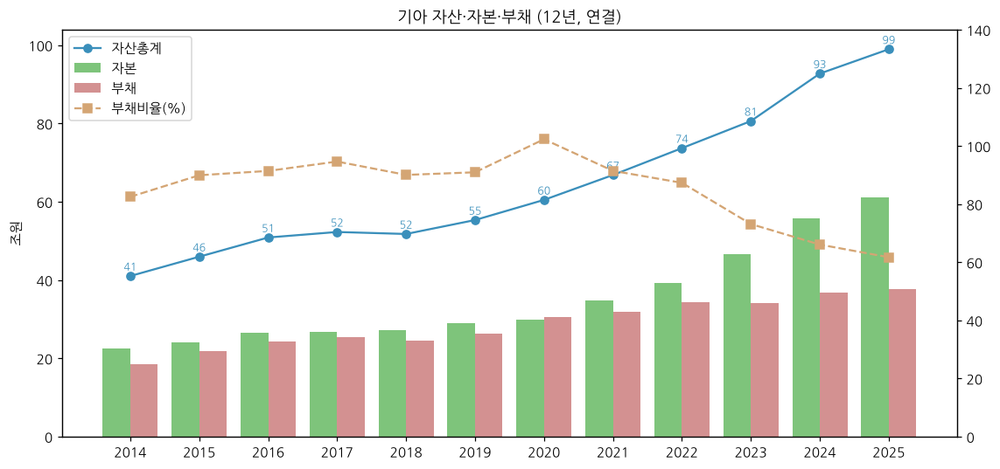

- 충당부채(대부분 판매보증충당부채)는 2014 2.1조 → 2025 9.1조. 3Q26말 판매보증 8.55조 — 환율 변동 시 환평가로 분기 OP에 ±수천억 영향 (3Q26 +6,700억)
- 공동기업·관계기업투자 25.2조 (2025말): 현대모비스 8.5조·HMG Global 2.0조·현대제철 3.2조·현대캐피탈 2.9조·HCA 2.1조 등

### ③ 현금흐름표 (12년 연결, 억원)

| 연도 | 영업CF | 투자CF | 재무CF | 유형 CapEx | 무형 CapEx | FCF | 배당 지급 | 자사주 취득 |
|---|---|---|---|---|---|---|---|---|
| 2014 | 23,638 | -29,834 | 9,865 | 14,296 | 5,899 | 3,444 | 2,835 | 645 |
| 2015 | 33,752 | -56,138 | 9,064 | 39,146 | 6,614 | -12,008 | 4,041 | 1,462 |
| 2016 | 32,759 | -23,123 | 9,454 | 15,595 | 8,136 | 9,028 | 4,410 | 1,318 |
| 2017 | 25,942 | -47,946 | 7,319 | 16,895 | 7,022 | 2,025 | 4,410 | 0 |
| 2018 | 44,708 | -11,554 | -25,430 | 23,763 | 7,054 | 13,891 | 3,207 | 0 |
| 2019 | 36,107 | -11,042 | -7,263 | 17,365 | 6,734 | 12,008 | 3,608 | 0 |
| 2020 | 54,239 | -28,649 | 35,173 | 16,619 | 6,579 | 31,041 | 4,611 | 0 |
| 2021 | 73,597 | -44,239 | -16,205 | 13,195 | 5,831 | 54,570 | 4,009 | 381 |
| 2022 | 93,332 | -56,713 | -34,544 | 14,946 | 6,018 | 72,368 | 12,028 | 1,104 |
| 2023 | 112,965 | -31,068 | -55,963 | 23,352 | 7,950 | 81,664 | 14,033 | 5,000 |
| 2024 | 125,644 | -101,528 | -35,700 | 34,851 | 11,975 | 78,818 | 21,943 | 5,000 |
| 2025 | 90,541 | -49,599 | -41,755 | 37,645 | 12,286 | 40,611 | 25,590 | 7,000 |

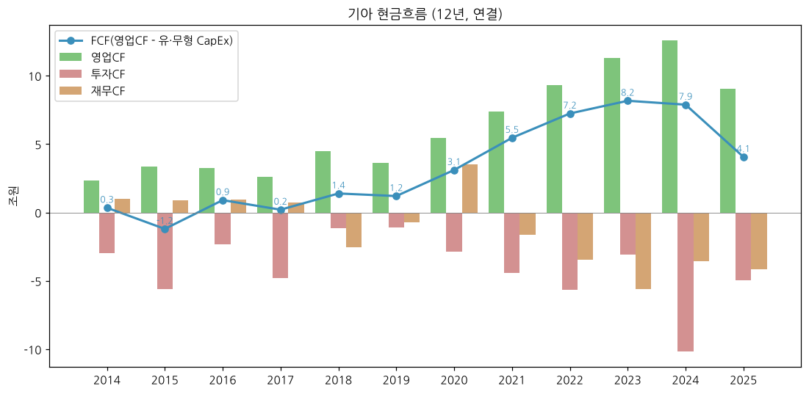

### ④ CapEx 추이 (12년, 억원)

| 연도 | 유형 | 무형(개발비 등) | 합계 | CapEx/매출 | 감가상각 대비 메모 |
|---|---|---|---|---|---|
| 2014 | 14,296 | 5,899 | 20,195 | 4.3% |  |
| 2015 | 39,146 | 6,614 | 45,760 | 9.2% | 멕시코 몬테레이 공장 건설 |
| 2016 | 15,595 | 8,136 | 23,731 | 4.5% | 멕시코 양산 개시(2016.05) |
| 2017 | 16,895 | 7,022 | 23,917 | 4.5% | 인도 공장 착공(2017.10) |
| 2018 | 23,763 | 7,054 | 30,817 | 5.7% | 인도 공장 건설 |
| 2019 | 17,365 | 6,734 | 24,099 | 4.1% | 인도 아난타푸르 양산(2019.07) |
| 2020 | 16,619 | 6,579 | 23,198 | 3.9% | 코로나 투자 이연 |
| 2021 | 13,195 | 5,831 | 19,026 | 2.7% | 반도체 대란 속 최저 CapEx |
| 2022 | 14,946 | 6,018 | 20,964 | 2.4% | EV 전환 준비 |
| 2023 | 23,352 | 7,950 | 31,302 | 3.1% | EV 전용라인·오토랜드 광명 EV |
| 2024 | 34,851 | 11,975 | 46,826 | 4.4% | 화성 PBV(EVO Plant)·美 EV |
| 2025 | 37,645 | 12,286 | 49,931 | 4.4% | 화성 EVO Plant East 준공(2025.11) |

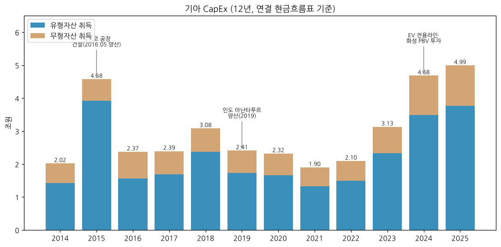

- 3Q26 누적 유형자산 취득 2.64조 (전년 연간 3.76조 대비 진도 70%)

### ⑤ 부채구조 + 운전자본 (12년, 억원)

| 연도 | 단기차입금 | 유동성장기부채 | 사채(비유동) | 장기차입금 | 총차입금 | 현금+단기금융 | 순현금 | 이자지급 |
|---|---|---|---|---|---|---|---|---|
| 2014 | 13,898 | 4,191 | 8,124 | 20,699 | 46,912 | 24,785 | -22,127 | 907 |
| 2015 | 15,124 | 12,687 | 9,271 | 26,049 | 63,130 | 11,049 | -52,081 | 1,192 |
| 2016 | 28,763 | 12,552 | 16,654 | 22,716 | 80,685 | 30,642 | -50,043 | 1,519 |
| 2017 | 29,937 | 8,614 | 30,200 | 18,747 | 87,498 | 15,617 | -71,881 | 1,963 |
| 2018 | 13,666 | 9,050 | 30,990 | 13,112 | 66,818 | 22,927 | -43,891 | 1,535 |
| 2019 | 14,148 | 10,755 | 26,671 | 13,078 | 64,652 | 42,687 | -21,964 | 1,538 |
| 2020 | 44,795 | 7,885 | 27,230 | 21,757 | 101,667 | 101,607 | -60 | 2,242 |
| 2021 | 31,078 | 13,078 | 32,970 | 16,313 | 93,439 | 115,337 | 21,898 | 1,686 |
| 2022 | 16,595 | 17,686 | 30,992 | 9,452 | 74,725 | 115,540 | 40,814 | 2,267 |
| 2023 | 1,288 | 9,688 | 25,023 | 2,000 | 37,998 | 166,489 | 128,491 | 1,973 |
| 2024 | 2,209 | 8,378 | 21,756 | 0 | 32,342 | 188,516 | 156,174 | 1,679 |
| 2025 | 2,113 | 11,537 | 9,790 | 0 | 23,439 | 216,600 | 193,160 | 1,381 |

- 2025말 총차입금 2.34조 / 순현금 약 19.3조 (IR 기준 현금 21.98조 − 차입금 2.34조 = 19.64조, 당기손익인식 금융자산 포함)
- 신용등급: 국내 **AAA** (한기평·한신평·NICE, 2024-09\~ / 2025-06 정기), S&P **A-** (2024-08), Moody's **A3** (2025-12)

### ⑥ 배당·자사주 추이 (12년)

| 연도 | DPS(원) | 배당총액(억원) | 연결 배당성향 | 연말 주가(원) | 배당수익률(연말가) | 자사주 취득(CF, 억원) |
|---|---|---|---|---|---|---|
| 2014 | 1,000 | 4,041 | 13.5% | 52,300 | 1.9% | 645 |
| 2015 | 1,100 | 4,410 | 16.8% | 52,600 | 2.1% | 1,462 |
| 2016 | 1,100 | 4,410 | 16.0% | 39,250 | 2.8% | 1,318 |
| 2017 | 800 | 3,207 | 33.1% | 33,500 | 2.4% | 0 |
| 2018 | 900 | 3,608 | 31.2% | 33,700 | 2.7% | 0 |
| 2019 | 1,150 | 4,611 | 25.2% | 44,300 | 2.6% | 0 |
| 2020 | 1,000 | 4,009 | 27.0% | 62,400 | 1.6% | 0 |
| 2021 | 3,000 | 12,028 | 25.3% | 82,200 | 3.6% | 381 |
| 2022 | 3,500 | 14,033 | 25.9% | 59,300 | 5.9% | 1,104 |
| 2023 | 5,600 | 22,188 | 25.3% | 100,000 | 5.6% | 5,000 |
| 2024 | 6,500 | 25,590 | 26.2% | 100,700 | 6.5% | 5,000 |
| 2025 | 6,800 | 26,425 | 34.9% | 121,800 | 5.6% | 7,000 |

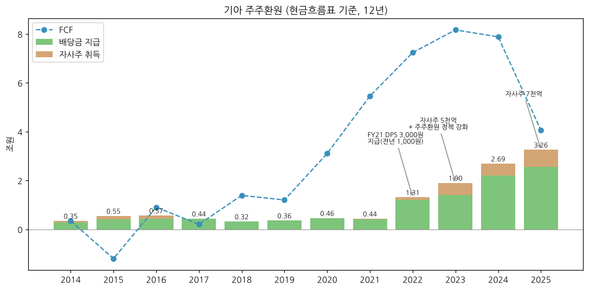

- DPS 12년 6.8배 (1,000원 → 6,800원). 2021 실적 레벨업과 동시에 DPS 3배(1,000 → 3,000원)
- 자사주: 2023\~2025 연 5천억\~7천억 매입. 발행주식 405,363,347주(2022) → 402,044,203(2023) → 397,672,632(2024) → 390,412,998주(2025) — 소각 진행. 2026 1\~3Q 자사주 취득 6,813억
- 2025 연결 배당성향 34.9% (관세로 이익 감소에도 DPS 상향)

### ⑦ 재무 비율 (12년)

| 연도 | ROE | ROA | 부채비율 | 유동비율 | 이자보상배율(OP/이자지급) | 순현금(조) | PER(연말) | PBR(연말) |
|---|---|---|---|---|---|---|---|---|
| 2014 | 17.0% | 9.3% | 82.5% | 139.1% | 28.4배 | -2.2 | 7.1배 | 0.94배 |
| 2015 | 13.3% | 7.1% | 90.0% | 126.1% | 19.8배 | -5.2 | 8.1배 | 0.88배 |
| 2016 | 13.6% | 7.1% | 91.5% | 128.7% | 16.2배 | -5.0 | 5.8배 | 0.60배 |
| 2017 | 4.3% | 2.2% | 94.7% | 141.2% | 3.4배 | -7.2 | 14.0배 | 0.51배 |
| 2018 | 5.4% | 2.8% | 90.1% | 132.9% | 7.5배 | -4.4 | 11.8배 | 0.50배 |
| 2019 | 9.0% | 4.7% | 91.0% | 124.8% | 13.1배 | -2.2 | 9.8배 | 0.62배 |
| 2020 | 6.3% | 3.2% | 102.4% | 123.7% | 9.2배 | -0.0 | 17.0배 | 0.85배 |
| 2021 | 19.7% | 10.0% | 91.5% | 135.4% | 30.0배 | 2.2 | 7.0배 | 0.95배 |
| 2022 | 20.2% | 10.7% | 87.4% | 134.6% | 31.9배 | 4.1 | 4.4배 | 0.61배 |
| 2023 | 20.4% | 11.4% | 73.2% | 145.9% | 58.8배 | 12.8 | 4.6배 | 0.86배 |
| 2024 | 19.1% | 11.3% | 66.1% | 154.9% | 75.5배 | 15.6 | 4.1배 | 0.72배 |
| 2025 | 12.9% | 7.9% | 61.8% | 156.5% | 65.7배 | 19.3 | 6.3배 | 0.78배 |

(PER·PBR = 연말 주가 × 당시 발행주식수 / 지배주주 순이익·지배주주 자본, `추정`. 이자보상배율은 현금흐름표 이자지급액 기준)

---

## 5. 지배 구조

### ① 그룹·계열 관계

- 현대자동차그룹 소속. **순환출자**: 현대모비스 → 현대차(최대주주) → 기아(현대차 35.17%) → 현대모비스(기아 18.10%, 2025말 — 2024말 17.66%에서 모비스 자사주 소각 영향으로 상승)
- 기아가 보유한 주요 계열 지분 (2025말, 지분법): 현대모비스 18.10% · 현대제철 17.27% · 현대트랜시스 40.43% · 현대캐피탈 40.13% · 현대오토에버 16.24% · 현대엔지니어링 9.35% · 현대카드 6.48% · 현대건설 5.24% · 포티투닷 39.11%
- 미래사업 지분: HMG Global LLC 30.5% (美 신사업 지주 — 보스턴다이내믹스 등 보유), Motional 24.25%, Supernal 22.22%, Robotics and AI Institute 28.50%, HMGMA 40%, IONITY(유럽 충전) 지분
- 중국: 강소열달기아(KCN) 50% 공동기업 — 누적 지분법 미반영 손실 3,828억, 기아 지급보증 USD 1억·CNY 7.2억+

### ② 주주 구분

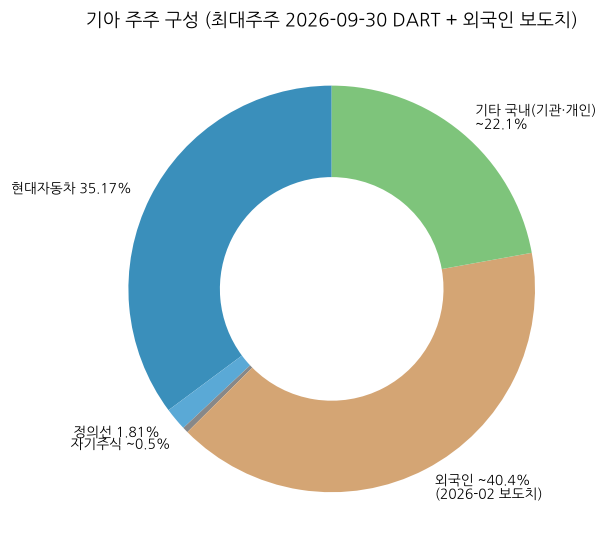

| 주주 | 주식수 | 지분율 | 기준 |
|---|---|---|---|
| 현대자동차 | 137,318,251 | 35.17% | DART 3Q26 (2026-09-30) |
| 정의선 (회장, 사내이사) | 7,061,331 | 1.81% | 〃 |
| 특수관계인 계 | 144,4xx,xxx | 36.99% | 〃 |
| 자기주식 | 1,810,273 | 0.46% | 2025말 |
| 외국인 | — | 40.41% | 헤럴드경제 2026-02-25 보도 (현재치 미확인) |
| 국민연금 | — | 미확인 | 5% 이상 공시 여부 잔여 보완 |

- 발행주식 390,412,998주 (보통주 단일, 우선주 없음). 최근 5년 최대주주 변동 없음

### ③ 임원·이사회 (2025 사업보고서, 등기임원 9명 — 사내 4 / 사외 5)

| 성명 | 직위 | 담당 | 약력 |
|---|---|---|---|
| 송호성 | 대표이사 사장 | 대표이사 | 연세대 불문, 기아 사업관리본부장 (1962년생) |
| 최준영 | 대표이사 사장 | CSO·국내생산 | 고려대 경영, 기아 경영지원본부장 |
| 정의선 | 회장 (사내이사) | 현대차그룹 회장 | 현대차·현대모비스 대표이사 겸직 |
| 김승준 | 전무 (사내이사) | 재경본부장 (CFO) | 현대캐피탈·현대카드 이사 겸직 |
| 조화순 | 사외이사 | 감사위·사추위 위원장 | 연세대 정외과 교수 |
| 이인경 | 사외이사 | 감사위·보수위 | MBK파트너스 CFO |
| 전찬혁 | 사외이사 | 지속가능경영위원장 | 세스코 회장 |
| 신재용 | 사외이사 | 감사위원장 | 서울대 경영학과 교수 |
| 신현정 | 사외이사 | 보수위원장 | KAIST 기계공학과 교수 |

- 이사회 내 위원회 4개: 감사위(사외 4)·사외이사후보추천위·지속가능경영위(대표 포함 6명)·보수위
- OpenDART 기업개황(2026-11 조회) 대표: 송호성·송민수 각자대표 → 최준영 → 송민수 대표 변경 (2026 중, 세부 일자 잔여 보완)
- 외부감사인: 한영회계법인 (2025\~2027), 이전 삼정(2022\~2024 지정)

---

## 6. 기타 팩트

### ① R&D 인프라

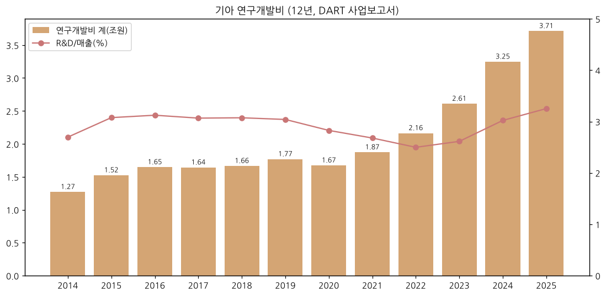

- 연구개발비 2014 1.27조 → 2025 3.71조 (2.9배), 매출 대비 2.6\~3.3%. 2025: 판관비 처리 2.14조 + 제조경비 0.37조 + 개발비 자산화 1.20조
- 그룹 공동 R&D (남양연구소, 현대차와 플랫폼 공유 — E-GMP, eM/eS 플랫폼). 기아 별도 조직: AVP본부·R&D본부
- 1\~3Q26 연구개발비 2.41조 (매출 대비 2.6%)

### ② 진행 중 corporate action — 10년치 주요 이벤트

| 시기 | 내용 |
|---|---|
| 2014-09\~2015-09 | 한전부지(GBC) 컨소시엄 — 기아 몫 2.11조 취득, GBC 신축 도급 기아분 5,121억 (2025-02 설계 변경안 제출, 인허가 협상 중) |
| 2016-05 | 멕시코 공장 양산 (연 40만대) |
| 2017-10\~2019 | 인도 공장 건설·양산 (현 43.1만대) |
| 2021-08 | 현대카드 지분 19.99% 투자자 매각 관련 주주간 계약 (풋·콜옵션) |
| 2022-07 | HMG Global LLC 설립 출자 (기아 30.5%) — BD·美 신사업 지주 |
| 2023 | 주주환원 정책 강화 (자사주 5천억/년, 소각) |
| 2023-12 | 러시아 공장(HMMR) 지분 매각 SPA — 바이백 옵션 2026-01-31 미행사 종료 |
| 2024\~2025 | 포티투닷 추가 출자 (39.11%), Motional 추가 출자 (24.25%) |
| 2025-11 | 화성 EVO Plant East 준공·West 기공 (PBV 전용) |
| 2026-02 | 현대제철 보통주 TRS 계약 (순환출자 해소 목적, 600억) |

### ③ 제품·기술 마일스톤 — 10년치

| 시기 | 내용 |
|---|---|
| 2016 | 니로 HEV (첫 전용 하이브리드 SUV) |
| 2019 | 텔루라이드 美 양산 → 2020 '세계 올해의 자동차' |
| 2021-08 | EV6 (E-GMP 첫 기아 전용 EV) → 2022 유럽 올해의 차 |
| 2023-06 | EV9 → 2024 세계 올해의 자동차, 북미 올해의 차 |
| 2024 | EV3 (대중화 EV) → 2025 세계 올해의 자동차 |
| 2025 | PV5 (첫 전용 PBV, '2026 세계 올해의 밴'), EV4 (유럽 생산 첫 EV), EV5, 타스만 |
| 2025-12 | 텔루라이드 후속 + 2.5T HEV (329hp) |
| 2026 | EV2 (B-SUV EV, 유럽 생산) |

### ④ 주요 리스크

- **美 관세**: 2025-04 수입차 25% → 한미 합의로 15% (2025-11 적용, 3Q26 YoY 기저효과 +5,290억). 관세율 재변경 시 분기 OP 수천억 단위 변동
- **환율**: 수출 비중 69%(별도). 3Q26 QoQ 원화 강세 5.2%로 OP -5,330억. 2026 계획 환율 1,370원
- **인센티브·경쟁**: 美·유럽 인센티브 증가 (3Q26 -6,060억 YoY), 국내 수입 EV(BYD·테슬라) +48.5%
- **원자재·지정학**: 알루미늄·구리 상승 (3Q26 -3,680억), 중동 분쟁으로 아중동 판매 -28%
- **품질비용**: 과거 세타2 엔진(2020·2022 각 1조+) 이력. 판매보증충당부채 8.55조
- **소송**: 통상임금 소송 충당부채 720억 + 기타 소송 4,420억 (3Q26)
- **중국 KCN**: 공동기업 자본잠식(지분법 중지), 기아 지급보증 제공
- **EV 수요**: 美 IRA 보조금 조기 종료 → 美 EV 비중 감소, 유연 생산으로 ICE/HEV 전환

### ⑤ ESG 등급

- 2021-03 투명경영위원회 → 지속가능경영위원회 확대, 2021-11 '2045 탄소중립' 전략 공개, 오션클린업 파트너십(2022-04)
- KCGS·MSCI 등 외부 ESG 등급: 잔여 보완 (미확인)

### ⑥ 인증·라이선스

- 주요 수상: 세계 올해의 자동차 2020(텔루라이드)·2024(EV9)·2025(EV3), 유럽 올해의 차 2022(EV6), J.D.파워 내구품질조사 일반브랜드 1위(2021\~2023)
- 안전: Euro NCAP 최고 등급 (EV6·EV9·PV5), IIHS TSP+ (텔루라이드·스포티지)
- 사업목적 추가: 2023 금융상품판매대리·중개업, 2025 부동산 개발업

---

## Version Log

**v1.0 (2026-11-25) — 신규 작성**
- ① 데이터 수집: OpenDART fnlttSinglAcntAll 연결 44개 JSON (2015 FY\~3Q26, 2014 비교컬럼) → 12년 손익·재무상태·현금흐름·CapEx·배당 DART 원값, 43분기 전사 시계열
- ② DART 정기공시 원문 XML 45건 → 생산능력·실적 12년, 연구개발비 12년, 지역별·제품별 매출 5년, 매입처, 관계기업 지분, 신용등급, 연혁
- ③ OpenDART 주요정보 (2016·2019·2022·2025): 배당 12년, 최대주주, 임원, 직원
- ④ 회사 IR PDF 25건 (3Q22\~3Q26) 중 3Q26·4Q25·2026 사업계획 반영 (판매·xEV·M/S·OP 분해)
- ⑤ 차트 12종: chart1·1b·2(전사 43분기)·4·5·6·7·8·9·10·11·12
- ⑥ 3Q26은 분기보고서(2026-11-16) 확정치 — 잠정치 아님

**잔여 보완 후보:**
- IR PDF 기반 분기 도매판매·ASP·xEV 믹스·지역별 매출 12분기 시계열 표 (현재는 3Q26 단일 분기만)
- 임직원 12년 시계열 (2016·2019·2022·2025만 반영), 2015 분기 (OpenDART 미제공 → 공시원문 보강)
- 외국인 지분율 현재치, 국민연금 지분, ESG 등급, 2026 대표이사 변경 일자
- 2026-11-24 주가 +10.6% 원인
