# 대덕전자 — 기업 개요 (v1.0)

> 종목: 대덕전자 (353200.KS / 대덕전자 주식회사 / DAEDUCK ELECTRONICS Co., Ltd.) — 우선주 대덕전자1우 (35320K)
> 섹터: IT 하드웨어 — 전자부품·기판 (반도체 패키지 기판 + MLB)
> 작성 시각: 2026-11-25 KST (**v1.0** — 첫 작성, v4.8 표준 6개 섹션 + 12종 차트)
> 마지막 반영 분기: **3Q26** (2026-11-13 분기보고서 확정치 + 2026-11-04 IR 3Q26 경영실적)
> 입력 source: OpenDART (신설 대덕전자 353200 재무 JSON 2020\~3Q26 + 정기보고서 원문 26건 / 구 대덕전자=현 ㈜대덕 008060 재무 JSON 2018\~2019 + 사업보고서 원문 52건) · 회사 IR 실적 PDF 22건 (2021-03 \~ 2026-11, irgo) · Yahoo Finance (353200.KS 2020-05\~, 008060.KS 2000\~) · 뉴스 (Bizwatch·잡포스트·재경일보)
> 법인 불연속 주의: 현 대덕전자(353200)는 **2020-05-01 ㈜대덕(구 대덕전자, 008060)에서 PCB 사업부문을 인적분할해 신설**된 법인이다. 2014\~2019는 구 대덕전자(분할 전 동일 PCB 사업) 숫자를 이어 붙였다 — **2014\~2017 별도 기준(연결 대상 없음), 2018\~2019 연결, 2018-12 대덕GDS 흡수합병, 2020 = 신설법인 5\~12월 8개월분만**.
> **Fact verify cutoff**: 2026-11-25 (시총·주가: alphasquare 2026-11-24 종가 / Yahoo Finance 주봉, ATH: 2026-05-29 종가 — Bizwatch 2026-06-01 기사로 교차 확인)

---

## 1. 기업 분류

- **Primary 분류: 사이클** (Cyclical — 메모리 반도체 패키지 기판 사이클)
- **Secondary 노트: AI 인프라 지속성장 일부 섞임** (FCBGA 대면적·AI 가속기 MLB·GDDR7/LPDDR5/SoCAMM 기판 — 2025 하반기부터 비중 확대 중)

### ① 정량 근거

**📊 Summary Box (12년, 2014\~2025):**

| 지표 | 값 |
|------|-----|
| 매출 CAGR (12년, 2014→2025) | **+4.0%** (2018 GDS 합병·2020 분할·HDI 철수 등 구조 변화 포함) |
| 매출 CAGR (신설법인 2021→2025) | **+1.6%** |
| OPM 평균 (12년) | **5.4%** (2020 8개월분 포함) |
| OPM 정점 평균 | **11.9%** (2017 6.0% · 2022 17.7%) |
| OPM 저점 평균 | **1.7%** (2014 3.5% · 2020 0.4% · 2024 1.3%) |
| 사이클 주기 | 약 5년 (peak-to-peak 2017→2022, 차기 정점 2026\~27 진행 중) |
| 사이클 회수 (12년) | 정점 2회 / 저점 3회 |

```
[전사 OPM 시계열 (12년, 억원)]
연도    매출    영업이익  순이익   OPM    NPM
2014   6,909     242     302    3.5%   4.4%   ← 구 대덕전자 (별도) — 스마트폰 HDI 비중 큰 시기
2015   5,126     268     306    5.2%   6.0%   ← 매출 -26% (모바일 HDI 축소)
2016   4,909     288     234    5.9%   4.8%
2017   5,121     306     356    6.0%   7.0%   ← 구 대덕전자 정점 (메모리 1차 슈퍼사이클)
2018   5,921     348   2,647    5.9%  44.7%   ← 2018-12 대덕GDS 흡수합병 (염가매수차익으로 NPM 왜곡)
2019  10,722     464     646    4.3%   6.0%   ← 합병 후 첫 full year (매출 2배), 메모리 다운사이클
2020   6,206      27     -87    0.4%  -1.4%   ← 2020-05 인적분할 (8개월분) · HDI 공장 가동중단 — 저점
2021  10,009     725     630    7.2%   6.3%   ← 신설법인 첫 full year, 메모리 PKG 회복
2022  13,162   2,325   1,839   17.7%  14.0%   ← ★ 1차 정점 (DDR5·GDDR 패키지 기판 호황)
2023   9,097     237     254    2.6%   2.8%   ← 메모리 다운사이클
2024   8,921     113     238    1.3%   2.7%   ← ★ 저점 (FCBGA 초기 적자 + 메모리 재고조정)
2025  10,653     491     476    4.6%   4.5%   ← 하반기 AI·데이터센터 회복 (3Q25 OPM 8.5%)
---
3Q26 누적 11,654  2,095   1,576  18.0%  13.5%   ← 2차 사이클 진입 (3Q26 분기 OPM 21.0% = 사상 최고)
TTM(4Q25~3Q26) 14,833 2,384 1,832 16.1%

OPM range: 0.4% ~ 17.7% = 17.3%pt (분기 기준 -3.5% ~ 21.0% = 24.5%pt)
사이클 cutoff (±10%pt) 명확히 충족
```

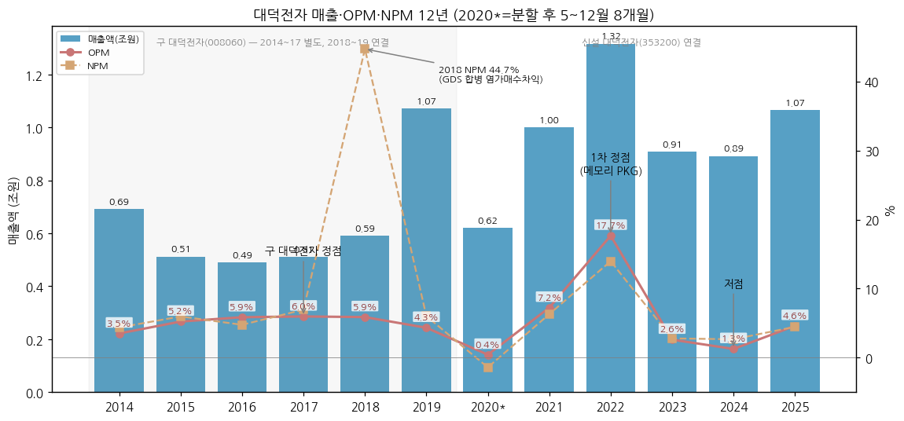

### ② 산업 분류

- 산업: **반도체 패키지 기판 + 고다층 PCB(MLB)** — 사이클 산업 (메모리 반도체 전방)
- DART 업종 코드: 2622 (인쇄회로기판 제조업)
- 워치리스트 섹터: IT 하드웨어 — 전자부품·기판 (삼성전기·LG이노텍·이수페타시스·대덕전자·심텍)
- 보고 부문: DART상 **PCB 단일 영업부문**. IR에서만 PKG Substrate / MLB 2개 매출 구분 (부문 영업이익 미공시)

### ③ 분류 결정 논리

(1) **가장 매출 큰 사업 기준** 적용 시: PKG Substrate 3Q26 매출 3,463억 = 전사의 **83%** → PKG 기판 회사. PKG 매출의 다수가 메모리(DDR5·LPDDR5·GDDR7·NAND CSP) → 메모리 사이클에 직결.
(2) **사이클 사업부 영업이익 비중 우선 sub-rule**: 부문 영업이익은 비공시이나, 전사 OPM이 메모리 업황과 동행 (2022 17.7% → 2024 1.3% → 3Q26 21.0%). 분기 OPM range 24.5%pt → **사이클 분류 유지**.
(3) **Boundary case 처리**: (a) FCBGA(비메모리·전장·데이터센터) 비중 3Q25 20% → 3Q26 27%, 4Q25 흑자전환 (IR), (b) MLB 3Q26 매출 718억(+69% YoY) — Aerospace·Defense·Network·AI 가속기 → **Secondary로 'AI 인프라 지속성장' 표기**. FCBGA+MLB 합산 비중이 매출의 50%를 넘으면 지속성장 비중 격상 검토 (⑤ 트리거).
(4) **피어 대비**: 심텍(메모리 모듈 PCB + 메모리 PKG 기판, 순수 메모리 사이클)보다 비메모리(FCBGA)·MLB 노출이 커서 사이클 진폭이 약간 덜하고, 이수페타시스(AI 가속기·네트워크 MLB, 지속성장)보다는 메모리 사이클 비중이 훨씬 크다 → **심텍과 이수페타시스 사이, 사이클 쪽에 가까운 위치**.

### ④ 적정 밸류에이션 방법

- **PBR (사이클 기준) 우선** — 매출 83%가 메모리 중심 PKG 기판, 이익이 사이클 저점(2024 OPM 1.3%)에서 거의 0이 되는 구조라 PER이 저점에서 무의미.
- **PER 보조 (사이클 정점 이익 기준)** — 정점 구간(2022·2026)에는 Forward PER로 상단 체크. FCBGA·MLB 성장분이 커질수록 PER 가중 확대.
- 참고 수준 (2026-11-24 기준): 시총 약 3.67조원 (보통주, alphasquare) / 3Q26말 자본 1조 279억 → **PBR 약 3.6배**, TTM 순이익 1,832억 → **TTM PER 약 20배**. ATH(2026-05-29, 시총 약 9.43조) 당시 PBR 약 9.7배(2Q26말 자본 9,768억 기준) — 신설법인 상장 이후 최고 밴드.
- **심텍 = PBR 단독, 이수페타시스 = PER 중심, 대덕전자 = PBR 우선 + 정점 구간 PER 혼합** — 이유: 메모리 PKG가 본체지만 FCBGA·MLB가 '지속성장' 성분을 더한다.

### ⑤ 분기 재평가 트리거 (분류 자체가 바뀌는 조건)

- **FCBGA + MLB 합산 매출 비중이 2개 분기 연속 50% 이상** (3Q26 추정 약 40% = FCBGA 약 22%[PKG의 27%] + MLB 17%) → Secondary 'AI 인프라 지속성장' → Primary 공동 분류 검토
- **메모리 다운사이클 국면에서도 분기 OPM이 8% 이상 유지** (2023·2024 저점은 0.6\~4.7%) → 사이클 → 지속성장 transition 후보
- **2026 신규 투자 3건(1.33조) 가동 후 고객 장기계약·선수금 구조 고착** (3Q26 비유동 선수금 914억) — 수주형 구조로 전환되면 사이클 진폭 축소로 재분류 검토

---

## 2. 회사 개요

### ① 기본 사항

- **회사명**: 대덕전자 주식회사 (DAEDUCK ELECTRONICS Co., Ltd.)
- **설립**: 2020-05-01 (㈜대덕에서 인적분할 신설) / 최초 설립 1972-08 (한국우라하마전자공업㈜ → 1974-04 대덕전자㈜ 상호변경)
- **상장**: 2020-05-21 유가증권시장 재상장 (구 대덕전자 최초 상장 1989-01-26)
- **대표이사**: 신영환 (2015-03 \~ , 경영총괄)
- **본사**: 경기도 안산시 단원구 강촌로 230 / 해외거점: 대덕 베트남, 대덕전자(상해), DD USA, DD ELECTRONICS CANADA
- **규모 (2026-09)**: 자산 1조 5,695억 / 임직원 2,868명 (IR)
- **사업 한 줄 정의**: 메모리·비메모리 반도체 **패키지 기판(FCCSP·CSP·FCBGA)**과 네트워크·항공우주·방산·AI 가속기용 **고다층 MLB**를 만드는 국내 3대 PKG 기판 업체 중 하나

### ② 최근 12년 손익·자본 추이 (억원, 좌→우 시간순)

| 연도 | 매출 | YoY | 영업이익 | 순이익 | 자본총계 | 자본 YoY | OPM |
|------|------|-----|----------|--------|----------|----------|-----|
| 2014 | 6,909 | - | 242 | 302 | 4,380 | - | 3.5% |
| 2015 | 5,126 | -25.8% | 268 | 306 | 4,562 | +4.2% | 5.2% |
| 2016 | 4,909 | -4.2% | 288 | 234 | 4,669 | +2.3% | 5.9% |
| 2017 | 5,121 | +4.3% | 306 | 356 | 5,201 | +11.4% | 6.0% |
| 2018 | 5,921 | +15.6% | 348 | 2,647 | 9,839 | +89.2% | 5.9% |
| 2019 | 10,722 | +81.1% | 464 | 646 | 10,397 | +5.7% | 4.3% |
| 2020* | 6,206 | n/m | 27 | -87 | 6,378 | 분할 | 0.4% |
| 2021 | 10,009 | n/m | 725 | 630 | 6,819 | +6.9% | 7.2% |
| 2022 | 13,162 | +31.5% | 2,325 | 1,839 | 8,550 | +25.4% | 17.7% |
| 2023 | 9,097 | -30.9% | 237 | 254 | 8,683 | +1.6% | 2.6% |
| 2024 | 8,921 | -1.9% | 113 | 238 | 8,755 | +0.8% | 1.3% |
| 2025 | 10,653 | +19.4% | 491 | 476 | 8,973 | +2.5% | 4.6% |

(2014\~2017 구 대덕전자 별도, 2018\~2019 구 대덕전자 연결, 2020\~ 신설 대덕전자 연결. *2020 = 2020-05-01 분할 후 8개월분. 2018 자본 +89%는 대덕GDS 흡수합병, 2020 자본 감소는 인적분할(분할비율 신설 0.6335))

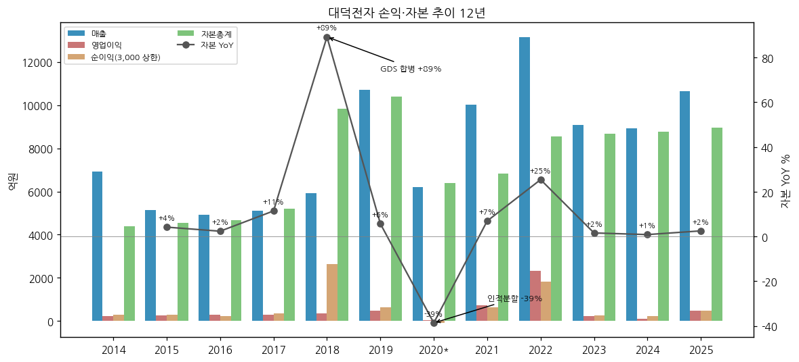

### ③ 회사 주가 역사 ★ 유일한 narrative 영역

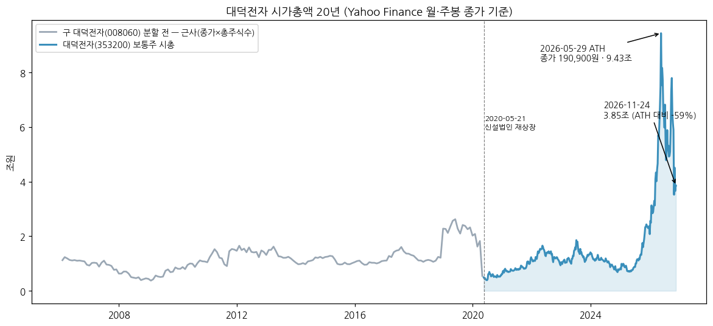

**(1) 구 대덕전자 시대 (2006\~2020-04) — 1조 안팎 박스권**
→ 2008 금융위기 저점 시총 약 0.4조 (근사, 종가 × 총주식수)
→ 2011\~2013 스마트폰 HDI 호황기 1.4\~1.6조
→ 2018-12 대덕GDS 흡수합병으로 주식수 4,880만 → 8,131만주 확대, 2019 상반기 시총 약 2.6조 (근사) — 분할 전 고점
→ 시총은 Yahoo 008060.KS 월간 종가 × 자본금/액면가 기준 총주식수(우선주 포함) 근사치라 ±10% 오차 가능

**(2) 신설법인 상장 후 (2020-05 \~ 2025 상반기) — 메모리 사이클 한 바퀴**
→ 2020-05-21 재상장, 첫 달 종가 9,900원 (시총 약 0.5조)
→ 2021\~2022 메모리 PKG 호황 → 2021-12 24,900원, 2023-12 28,500원 부근 (시총 1.2\~1.4조)
→ 2024-12 15,900원 (시총 약 0.8조) — 2024 OPM 1.3% 저점 반영
→ 2025-04 저점 12,900원 (주간 저가)

**(3) AI 기판 랠리 (2025 하반기 \~ 2026-05) — 주가 약 15배**
→ 2025-07 이후 GDDR7·DDR5·LPDDR5(SoCAMM)·FCBGA 대면적 기대로 상승, 2025-12 47,950원
→ 2026-03\~05 급등: 2026-05-29 **ATH 종가 190,900원 · 시총 약 9.43조 (보통주 49,416,925주 기준)** [Yahoo Finance 주봉 / Bizwatch 2026-06-01 기사 "5월 29일 종가 190,900원"] — 장중 최고 198,000원 (2026-06 첫 주)
→ 2025-04 주간 저가 12,900원 대비 약 15배

**(4) 급락 국면 (2026-06 \~ 현재)**
→ 2026-07 말 주간 저가 71,800원까지 하락 후 10월 157,700원(주간 종가)까지 재반등
→ 2026-10-30 장중 -14.6% (2,130억 건물 증축 등 **패키지기판 투자 부담** 부각, 잡포스트)
→ 2026-11 첫 주 주간 종가 119,400 → 71,200원 (-40%), 2026-11-20 장중 -13.4% (3Q26 실적 호조에도 **고평가·차익 매물**, 잡포스트)
→ **2026-11-24 종가 74,900원 · 시총 약 3.67조 (alphasquare)** — ATH 대비 약 -61% (Yahoo 주봉 기준 78,000원 · 3.85조)
→ 52주 범위 41,550 \~ 198,000원 (alphasquare)

### ④ 회사의 주요 연혁

| 시점 | 내용 |
|------|------|
| 1972-08 | 한국우라하마전자공업㈜ 설립 (PCB) |
| 1974-04 | 대덕전자㈜로 상호 변경 |
| 1989-01 | 유가증권시장 상장 (구 대덕전자) |
| 2009-03 | 창업주 김정식 회장 이사회 퇴진, 김영재 체제 (Bizwatch) |
| 2014-04 | 아페리오㈜ 흡수합병 |
| 2017-07 | 그룹, RF 부품사 와이솔 인수 (674억, 현재 ㈜대덕 자회사) |
| 2018-12 | **대덕GDS㈜ 흡수합병** (MLB·FPC·HDI 사업 통합) |
| 2020 상반기 | 스마트폰 HDI 공장 가동 중단 (이후 재고 매출만, IR 2021-03) |
| 2020-05-01 | **인적분할** — ㈜대덕(존속, 지주) / 대덕전자(신설, PCB 사업) · 05-21 재상장 |
| 2020-08 | ㈜대덕 공개매수 → 지분 15.12% → 31.46% |
| 2022-04 | FCBGA 등 생산설비 투자 개시 (총 2,700억, 기간 '22.4 \~ '27.12로 연장) |
| 2021\~2023 | FPC·Module SiP 축소 → IR 매출 구분이 PKG·MLB 2개로 정리 |
| 4Q25 | FCBGA 분기 흑자전환 (IR 2026-02) |
| 2026-03 | 오너 3세 김정미(전략기획) 사내이사 선임 (Bizwatch) |
| 2026-05 \~ 10 | 신규 투자 3건 결정: 건물 증축 2,130억('26.5\~'27.12), 기계장치 4,970억('26.7\~'27.12), 기계장치 6,150억('26.10\~'30.12, 2026-10-22 공시) |
| 3Q26 | 분기 매출 4,181억·OPM 21.0% — 사상 최고 (분할 후) |

---

## 3. 비즈니스 모델

### ① 실적 추이 (제품별·지역별)

**(1) 5년 연간 통합 (억원)**

| 구분 | 2021 | 2022 | 2023 | 2024 | 2025 |
|------|------|------|------|------|------|
| **전사 매출 (연결)** | **10,009** | **13,162** | **9,097** | **8,921** | **10,653** |
| └ PKG Substrate (IR) | 6,804 | 11,288 | 7,968 | 7,687 | 9,023 |
| └ MLB (IR) | 1,347 | 1,390 | 1,100 | 1,227 | 1,631 |
| └ FPC·Module SiP·기타 (연결 역산) | 1,858 | 484 | 29 | 7 | -1 |
| **영업이익** | 725 | 2,325 | 237 | 113 | 491 |
| **OPM** | 7.2% | 17.7% | 2.6% | 1.3% | 4.6% |
| 지역: 대한민국 | - | - | 5,343 | 5,119 | 5,559 |
| 지역: 중국 | - | - | 1,891 | 2,024 | 2,317 |
| 지역: 미국 | - | - | 675 | 951 | 1,350 |
| 지역: 대만 | - | - | 478 | 273 | 222 |
| 지역: 베트남 | - | - | 28 | 19 | 387 |
| 지역: 기타 | - | - | 682 | 535 | 818 |

(PKG·MLB는 IR 분기 합산, 2021년 IR 일부는 별도 기준 → 연결 합계와 차이는 FPC·기타로 역산 처리. 지역별은 DART 2025 사업보고서 3개년만 공시. 국내 매출 52%지만 판매 구성은 Domestic 4% · Local 수출 49% · Direct 수출 47% — 국내 OSAT·메모리사 경유 수출이 대부분)

**(2) 전사 분기 시계열 (1Q19 \~ 3Q26)**

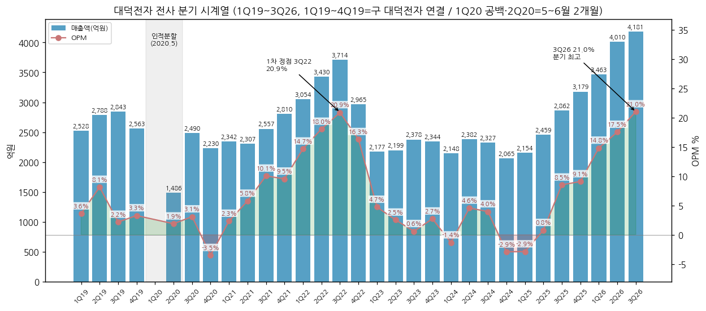

(1Q19\~4Q19 = 구 대덕전자(008060) 연결, 1Q20 = 분할 직전 분기로 ㈜대덕 보고서에서 중단영업 처리되어 공백, 2Q20 = 5\~6월 2개월분. 2015\~2018 분기 시계열은 구 사업보고서 본문에 분기 손익표가 분리되어 있지 않아 이번 버전에서 미확보 — Version Log 잔여 항목)

**(3) 사업부(제품군)별 분기 시계열 (IR, 1Q21 \~ 3Q26)**

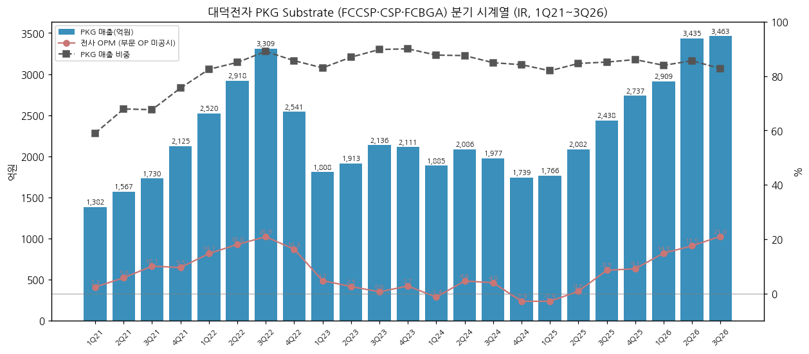
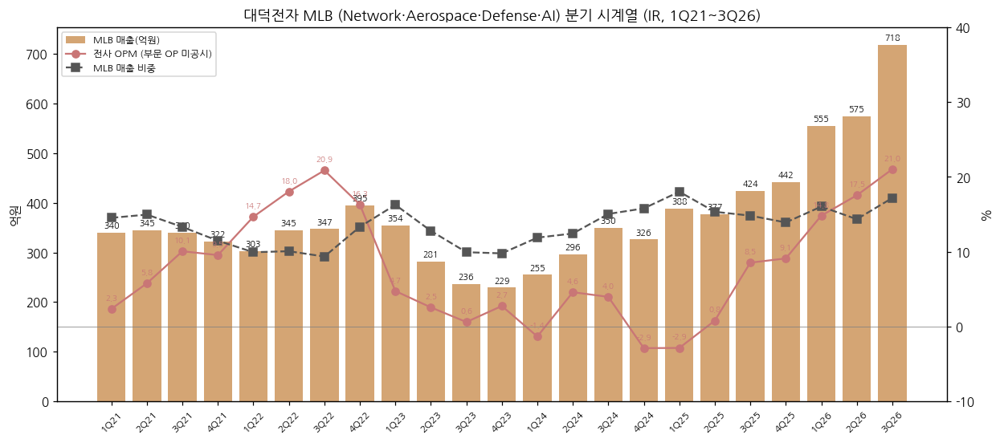

| 분기 | 전사 매출 | PKG | MLB | FPC·기타 | 영업이익 | OPM |
|------|----------|-----|-----|---------|---------|-----|
| 1Q21 | 2,342 | 1,382 | 340 | 620 | 55 | 2.3% |
| 2Q21 | 2,307 | 1,567 | 345 | 395 | 133 | 5.8% |
| 3Q21 | 2,557 | 1,730 | 340 | 487 | 257 | 10.0% |
| 4Q21 | 2,810 | 2,125 | 322 | 363 | 268 | 9.5% |
| 1Q22 | 3,054 | 2,520 | 303 | 231 | 448 | 14.7% |
| 2Q22 | 3,430 | 2,918 | 345 | 167 | 619 | 18.0% |
| 3Q22 | 3,714 | 3,309 | 347 | 58 | 775 | 20.9% |
| 4Q22 | 2,965 | 2,541 | 395 | 29 | 483 | 16.3% |
| 1Q23 | 2,177 | 1,808 | 354 | 15 | 103 | 4.7% |
| 2Q23 | 2,199 | 1,913 | 281 | 5 | 56 | 2.6% |
| 3Q23 | 2,378 | 2,136 | 236 | 6 | 14 | 0.6% |
| 4Q23 | 2,344 | 2,111 | 229 | 4 | 64 | 2.7% |
| 1Q24 | 2,148 | 1,885 | 255 | 8 | -29 | -1.3% |
| 2Q24 | 2,382 | 2,086 | 296 | 0 | 109 | 4.6% |
| 3Q24 | 2,327 | 1,977 | 350 | 0 | 92 | 4.0% |
| 4Q24 | 2,065 | 1,739 | 326 | 0 | -60 | -2.9% |
| 1Q25 | 2,154 | 1,766 | 388 | 0 | -62 | -2.9% |
| 2Q25 | 2,459 | 2,082 | 377 | 0 | 19 | 0.8% |
| 3Q25 | 2,862 | 2,438 | 424 | 0 | 244 | 8.5% |
| 4Q25 | 3,179 | 2,737 | 442 | 0 | 289 | 9.1% |
| 1Q26 | 3,463 | 2,909 | 555 | 0 | 513 | 14.8% |
| 2Q26 | 4,010 | 3,435 | 575 | 0 | 703 | 17.5% |
| 3Q26 | 4,181 | 3,463 | 718 | 0 | 879 | 21.0% |

(전사 매출·영업이익 = OpenDART 연결, PKG·MLB = 각 분기 IR '요약 재무제표' 매출 구분. 1Q21 IR(별도) 기준 FPC·Module SiP 598억. 부문별 영업이익은 IR·DART 모두 미공시 → chart2는 전사 OPM을 겹쳐 표시)

**(4) 12분기 시계열 (4Q23 \~ 3Q26)**

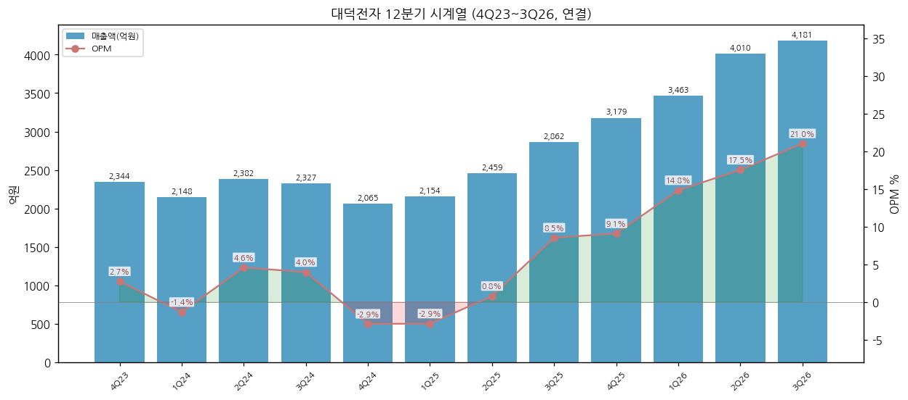

| 분기 | 매출 | YoY | 영업이익 | OPM | 순이익 |
|------|------|-----|---------|-----|--------|
| 4Q23 | 2,344 | -20.9% | 64 | 2.7% | 61 |
| 1Q24 | 2,148 | -1.3% | -29 | -1.3% | 20 |
| 2Q24 | 2,382 | +8.4% | 109 | 4.6% | 122 |
| 3Q24 | 2,327 | -2.2% | 92 | 4.0% | 52 |
| 4Q24 | 2,065 | -11.9% | -60 | -2.9% | 44 |
| 1Q25 | 2,154 | +0.3% | -62 | -2.9% | -57 |
| 2Q25 | 2,459 | +3.2% | 19 | 0.8% | 44 |
| 3Q25 | 2,862 | +23.0% | 244 | 8.5% | 233 |
| 4Q25 | 3,179 | +54.0% | 289 | 9.1% | 256 |
| 1Q26 | 3,463 | +60.8% | 513 | 14.8% | 455 |
| 2Q26 | 4,010 | +63.1% | 703 | 17.5% | 577 |
| 3Q26 | 4,181 | +46.1% | 879 | 21.0% | 544 |

**📌 3Q26 핵심 박스 (2026-11-04 IR / 2026-11-13 분기보고서)**

- 매출 **4,181억 (+46% YoY, +4% QoQ)**, 영업이익 **879억 (+260% YoY, +25% QoQ)**, OPM **21.0%** — 분할 후 분기 사상 최고 (직전 정점 3Q22 20.9%)
- PKG 3,463억 (+42% YoY, +1% QoQ) — 제품 mix: FCCSP 48% · FCBGA 27% · CSP 22% · 기타 3%. "환율 하락 영향에도 AI·데이터센터 중심 수요 확대", **신규 AI向 Large Body FCBGA 양산 개시**
- MLB 718억 (+69% YoY, +25% QoQ) — 응용 mix: Aerospace 34% · Network 28% · Defense 22% · 기타 14% · AI 2%. "생산능력 확대 효과", 4Q26 **AI 가속기向 차세대 제품 양산** 기대
- EBITDA 1,108억 (26.5%), 부채비율 52.7% (3Q25 29.8%) — **비유동 선수금 914억**(전기말 68억) + 기타비유동금융부채 881억 등 고객 자금 유입성 부채 급증
- 4Q26 회사 전망: PKG "견조한 수요 기반 성장세 지속", MLB "성장 모멘텀 지속"

### ② 사업부별 개요 (매출 비중 큰 순서)

**(1) PKG Substrate — 3Q26 매출 비중 83%**
→ 반도체 칩과 메인보드를 이어주는 패키지 기판. 세 가지 제품군:
   - **FCCSP** (48%): 모바일 AP, 차량 레이더·ADAS, SSD 컨트롤러, GDDR7, DDR5
   - **CSP** (22%): NAND, LPDDR5 (SoCAMM·CXL·모바일), MCP — 와이어본딩 메모리 기판
   - **FCBGA** (27%): 자율주행 칩, 광통신(Optics), 네트워크, CXL 컨트롤러, AI 서버 컨트롤러 — 2022-04 투자 시작, 4Q25 흑자전환, 3Q26 대면적(Large Body) AI 제품 양산
→ 전방: 메모리 (삼성전자·SK하이닉스 경유) + 비메모리 (글로벌 팹리스·OSAT)

**(2) MLB (Multi-Layer Board) — 3Q26 매출 비중 17%**
→ 고다층 인쇄회로기판. 스위치·라우터(Network), 위성·항공우주(Aerospace), 군용 통신장비(Defense), 반도체 검사장비(Tester), EDA, AI 가속기 서버 보드
→ 구 대덕GDS에서 넘어온 사업. 2023 저점 분기 229억 → 3Q26 718억 (3배)

**(3) 철수 사업 — 스마트폰 HDI·FPC·Module SiP**
→ 2014년 매출 6,909억의 상당 부분이 스마트폰 메인보드(HDI). 2020 상반기 HDI 공장 가동 중단, FPC·Module SiP는 2021 1,858억 → 2023 이후 사실상 0

### ③ 사업부별 디테일

- **Top seller**: FCCSP (PKG의 48%) — GDDR7 신규 고객 확보(4Q25 IR), DDR5·LPDDR5 강세
- **Growth**: FCBGA 비중 3Q25 20% → 2Q26 26% → 3Q26 27%, 매출 약 488억 → 약 935억 (PKG 매출 × 비중, 추정). MLB +69% YoY
- **이익 outlier**: 2022 OPM 17.7% (메모리 PKG 단독 호황), 2024 OPM 1.3% (FCBGA 초기 감가상각·적자 + 메모리 재고조정이 겹침)
- **응용처 관점 (4Q25 IR, PKG)**: PC/Server 43% · Mobile 25% · Network & Data Center 18% · Automotive 12%
- **평균판매단가 (DART, 원/㎡)**: 내수 1,638,027(2023) → 2,241,697(2024) → 2,444,562(2025) / 수출 1,311,934 → 1,256,933 → 1,444,025 — 제품 mix 고도화로 상승

### ④ 주요 경쟁사

| 분야 | 국내 | 해외 |
|------|------|------|
| 메모리 PKG (FCCSP·CSP·BOC) | 심텍, LG이노텍, 해성디에스, 코리아써키트 | Kinsus, Unimicron, Simmtech 해외법인 |
| FCBGA | 삼성전기, LG이노텍, 코리아써키트 | Ibiden, Shinko, Unimicron, Nan Ya PCB, AT&S |
| MLB (Network·AI) | 이수페타시스 | TTM, Victory Giant, WUS, Gold Circuit |

**국내 PCB 업체 별도 매출 비교 (DART 2025 사업보고서 '시장점유율' 표, 억원)**

| 업체 | 2022 | 2023 | 2024 | 2025 |
|------|------|------|------|------|
| 심텍 | 14,609 | 8,136 | 9,495 | 10,971 |
| 대덕전자 | 13,090 | 9,097 | 8,921 | 10,647 |
| 이수페타시스 | 4,972 | 5,790 | 7,187 | 9,297 |
| 코리아써키트 | 8,046 | 6,344 | 7,207 | 8,630 |
| 인터플렉스 | 2,733 | 2,617 | 2,694 | 2,698 |

### ⑤ 주요 매출처

- DART 공시 주요 거래처: **삼성전자㈜, 에스케이하이닉스㈜, 앰코테크놀로지코리아㈜, (유)스태츠칩팩코리아** 등 (금액 미공시)
- 추정 순서: 삼성전자(메모리 PKG) ≥ SK하이닉스(메모리 PKG) > 글로벌 OSAT(앰코·스태츠칩팩 경유 비메모리·FCBGA) > 해외 통신·네트워크 장비사(MLB)
- 판매 방식: 주문생산 직거래, 단납기 (2025 수주총액 1조 2,811억 / 연말 수주잔고 2,168억)

### ⑥ 생산 CAPA + 임직원 추이

| 항목 | 2023 | 2024 | 2025 | 3Q26 |
|------|------|------|------|------|
| 생산능력 (천㎡, 한국·베트남) | 906 | 1,002 | 1,002 | - |
| 생산실적 (천㎡) | 742 | 724 | 759 | - |
| 가동률 | 82% | 72% | 76% | - |
| 임직원 (명) | - | - | 2,633 (남 2,271 / 여 362) | 2,868 (IR) |
| 1인 평균 급여 (백만원) | - | - | 남 84 / 여 66 | - |

- 진행 중 투자 (3Q26 분기보고서): 기계장치 2,700억('22.4\~'27.12) / 건물 증축·부대시설 2,130억('26.5\~'27.12) / 기계장치 4,970억('26.7\~'27.12)
- 향후 투자: 기계장치 6,150억('26.10\~'30.12, 2026-10-22 결정) → **2026 신규 결정분 합계 1조 3,250억 = 2025말 자본(8,973억)의 1.5배**

---

## 4. 재무 구조

### ① 손익계산서 (12년, 억원, 좌→우 시간순)

| 연도 | 매출 | 매출총이익 | GPM | 판관비 | CIR | 영업이익 | OPM | 순이익 | NPM |
|------|------|-----------|-----|--------|-----|---------|-----|--------|-----|
| 2014 | 6,909 | 529 | 7.7% | 287 | 4.2% | 242 | 3.5% | 302 | 4.4% |
| 2015 | 5,126 | 499 | 9.7% | 231 | 4.5% | 268 | 5.2% | 306 | 6.0% |
| 2016 | 4,909 | 494 | 10.1% | 207 | 4.2% | 288 | 5.9% | 234 | 4.8% |
| 2017 | 5,121 | 542 | 10.6% | 236 | 4.6% | 306 | 6.0% | 356 | 7.0% |
| 2018 | 5,921 | 557 | 9.4% | 209 | 3.5% | 348 | 5.9% | 2,647 | 44.7% |
| 2019 | 10,722 | 940 | 8.8% | 475 | 4.4% | 464 | 4.3% | 646 | 6.0% |
| 2020* | 6,206 | 333 | 5.4% | 306 | 4.9% | 27 | 0.4% | -87 | -1.4% |
| 2021 | 10,009 | 1,176 | 11.8% | 452 | 4.5% | 725 | 7.2% | 630 | 6.3% |
| 2022 | 13,162 | 2,969 | 22.6% | 643 | 4.9% | 2,325 | 17.7% | 1,839 | 14.0% |
| 2023 | 9,097 | 751 | 8.3% | 514 | 5.7% | 237 | 2.6% | 254 | 2.8% |
| 2024 | 8,921 | 615 | 6.9% | 503 | 5.6% | 113 | 1.3% | 238 | 2.7% |
| 2025 | 10,653 | 1,083 | 10.2% | 592 | 5.6% | 491 | 4.6% | 476 | 4.5% |
| 3Q26 누적 | 11,654 | 2,862 | 24.6% | 767 | 6.6% | 2,095 | 18.0% | 1,576 | 13.5% |

(2014·2015 매출총이익 = 영업이익 + 판관비 역산. 판관비율이 4\~6%로 낮고 안정적 → **OPM 변동은 거의 전부 GPM(가동률·제품 mix·ASP) 변동**에서 나온다)

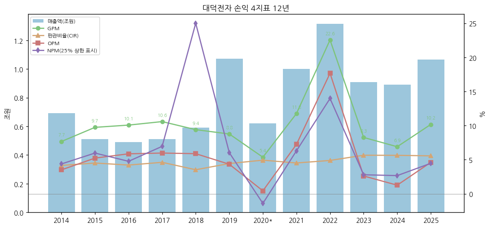

### ② 재무상태표 (12년, 억원)

| 연도 | 자산총계 | 유동자산 | 현금성자산 | 부채총계 | 자본총계 | 부채비율 | 유동비율 | 차입금 |
|------|---------|---------|-----------|---------|---------|---------|---------|-------|
| 2014 | 5,473 | 2,231 | 247 | 1,093 | 4,380 | 25% | 219% | - |
| 2015 | 5,254 | 2,886 | 397 | 692 | 4,562 | 15% | 431% | - |
| 2016 | 5,577 | 2,673 | 246 | 909 | 4,669 | 19% | 308% | - |
| 2017 | 6,071 | 3,103 | 281 | 870 | 5,201 | 17% | 369% | 63 |
| 2018 | 11,369 | 5,310 | 349 | 1,530 | 9,839 | 16% | 378% | 119 |
| 2019 | 12,019 | 5,225 | 492 | 1,621 | 10,397 | 16% | 356% | 174 |
| 2020* | 8,092 | 2,639 | 226 | 1,714 | 6,378 | 27% | 167% | 91 |
| 2021 | 9,410 | 3,728 | 767 | 2,591 | 6,819 | 38% | 204% | 10 |
| 2022 | 11,918 | 4,981 | 1,224 | 3,368 | 8,550 | 39% | 188% | 269 |
| 2023 | 11,275 | 4,331 | 766 | 2,592 | 8,683 | 30% | 245% | 198 |
| 2024 | 10,887 | 4,659 | 382 | 2,132 | 8,755 | 24% | 292% | 157 |
| 2025 | 11,780 | 5,884 | 339 | 2,807 | 8,973 | 31% | 237% | 410 |
| 3Q26 | 15,695 | 7,137 | 1,093 | 5,415 | 10,279 | 53% | 214% | 38 |

(현금성자산 = 현금및현금성자산만. 2025말 기타금융자산(단기 예금 등) 1,975억 별도 보유 → 순현금 구조 유지. 3Q26 부채 급증은 차입이 아니라 **선수금·기타비유동금융부채 등 고객 자금**)

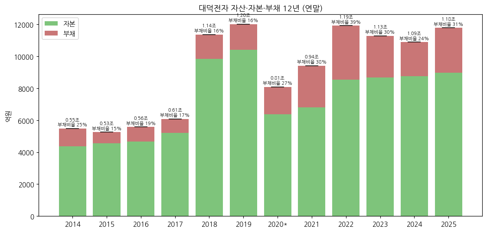

### ③ 현금흐름표 (12년, 억원)

| 연도 | 영업CF | 투자CF | 재무CF | 유형자산 취득 | 무형자산 취득 | CapEx 합계 | CapEx/매출 | FCF | 배당 지급 |
|------|-------|-------|-------|-------------|-------------|-----------|-----------|-----|---------|
| 2014 | 833 | -640 | -123 | 555 | 9.6 | 565 | 8.2% | 268 | 123 |
| 2015 | 968 | -705 | -125 | 545 | 0.9 | 546 | 10.7% | 422 | 125 |
| 2016 | 461 | -493 | -125 | 247 | 16.0 | 263 | 5.4% | 198 | 125 |
| 2017 | 689 | -576 | -62 | 559 | 2.6 | 562 | 11.0% | 128 | 125 |
| 2018 | 378 | -159 | -153 | 403 | 21.3 | 425 | 7.2% | -46 | 125 |
| 2019 | 1,793 | -1,490 | -161 | 908 | 53.6 | 962 | 9.0% | 831 | 209 |
| 2020* | 829 | -838 | -62 | 971 | 31.0 | 1,002 | 16.1% | -173 | - |
| 2021 | 2,038 | -1,335 | -164 | 1,295 | 24.3 | 1,320 | 13.2% | 719 | 155 |
| 2022 | 2,936 | -2,588 | 122 | 2,048 | 25.7 | 2,074 | 15.8% | 862 | 155 |
| 2023 | 1,807 | -1,975 | -289 | 1,170 | 41.7 | 1,212 | 13.3% | 595 | 206 |
| 2024 | 978 | -1,161 | -206 | 596 | 27.1 | 623 | 7.0% | 355 | 155 |
| 2025 | 716 | -795 | 42 | 649 | 22.6 | 671 | 6.3% | 44 | 206 |
| 3Q26 누적 | 3,218 | -1,832 | -632 | 2,996 | 27.6 | 3,024 | 25.9% | 194 | 258 |

(FCF = 영업CF − (유형+무형 취득). 2014·2015 재무CF는 배당 지급액으로 간주. 3Q26 영업CF 3,218억에는 고객 선수금 유입이 포함)

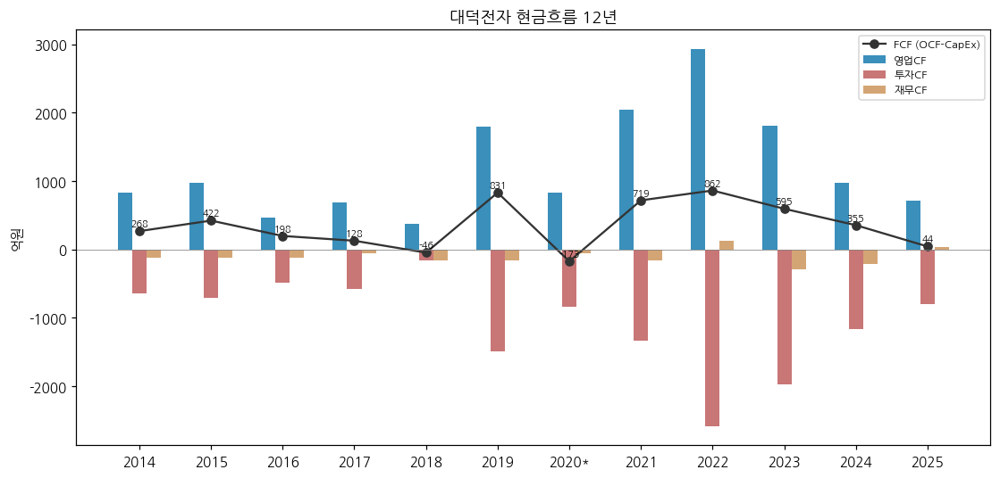

### ④ CapEx 추이 (12년)

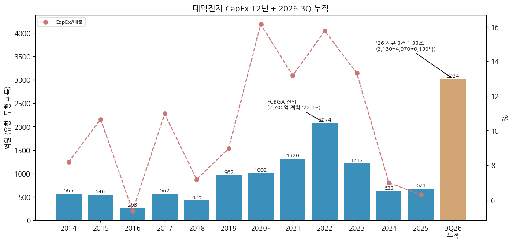

- **1기 (2014\~2019, 구 대덕전자)**: 연 260\~960억, 매출 대비 5\~11% — HDI·메모리 PKG 유지보수형
- **2기 (2020\~2023, 신설법인)**: 연 1,000\~2,070억, 매출 대비 13\~16% — **FCBGA 진입 투자 (2022-04 2,700억 계획)**
- **조정기 (2024\~2025)**: 620\~670억 — 업황 저점, 투자 속도 조절 (2,700억 계획 기간 '24.12 → '27.12 연장)
- **3기 (2026\~)**: 3Q26 누적 3,024억 (이미 2022 연간 초과) + 신규 결정 1조 3,250억 ('26.5\~'30.12) — **2022 투자 사이클의 약 5배 규모**

### ⑤ 부채구조 (억원)

| 연도 | 단기차입금 | 유동성장기차입금 | 장기차입금 | 차입금 합계 | 부채총계 | 차입금/자본 |
|------|-----------|----------------|-----------|-----------|---------|-----------|
| 2021 | 10 | - | - | 10 | 2,591 | 0.1% |
| 2022 | 10 | 68 | 190 | 269 | 3,368 | 3.1% |
| 2023 | - | 68 | 129 | 198 | 2,592 | 2.3% |
| 2024 | 23 | 68 | 66 | 157 | 2,132 | 1.8% |
| 2025 | 342 | 68 | - | 410 | 2,807 | 4.6% |
| 3Q26 | 21 | 17 | - | 38 | 5,415 | 0.4% |

- 회사채·CB·EB 발행 이력 없음 (분할 후). 2025 단기차입 342억 중 우리은행은 '중견기업 상생지원 프로그램' 저금리 대출, 하나은행 20억은 삼성전자 ESG펀드 시설대(무이자) (DART)
- 신용등급 (이크레더블): 2023 A → **2024-04 A-** → 2025-09 A- 유지
- 3Q26 비유동부채 2,081억 = 비유동 선수금(계약부채) 914억 + 기타비유동금융부채 881억 + 장기미지급비용 284억 등 → **차입이 아닌 고객 선수금 기반 증설 자금 조달** 구조로 변화

### ⑥ 배당·자사주 추이

| 연도 | 현금배당 지급 (CF, 억원) | 보통주 DPS (원) | 배당성향 (연결) | 비고 |
|------|------------------------|---------------|--------------|------|
| 2014\~2017 | 123\~125 | - | - | 구 대덕전자 |
| 2019 | 209 | - | - | GDS 합병 후 주식수 증가 |
| 2021 (FY20분) | 155 | - | - | 분할 후 첫 배당 |
| 2022 (FY21분) | 155 | - | - | |
| 2023 (FY22분) | 206 | - | - | |
| 2024 (FY23분) | 155 | 300 (FY23) | 60.9% | |
| 2025 (FY24분) | 206 | 400 (FY24) | 86.8% | |
| 2026 (FY25분) | 258 | 500 (FY25) | 54.1% | 우선주 DPS 505원 |

- 자사주: 분할 후 매입·소각 이력 없음 (2025말 자기주식 0주). 국내 언론은 "그룹 내 대덕전자만 주식 소각이 없다"고 지적 (MTN, 2025-04)
- 배당수익률 (FY25): 보통주 0.80%, 우선주 2.90% (DART)

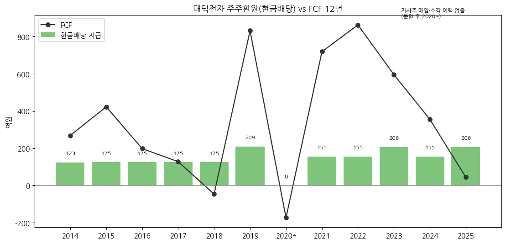

### ⑦ 재무 비율 (12년)

| 연도 | ROE | ROA | 부채비율 | 유동비율 | OPM | 영업이익/금융비용 |
|------|-----|-----|---------|---------|-----|-----------------|
| 2014 | 6.9% | 5.5% | 25% | 219% | 3.5% | - |
| 2015 | 6.8% | 5.7% | 15% | 431% | 5.2% | - |
| 2016 | 5.1% | 4.3% | 19% | 308% | 5.9% | - |
| 2017 | 7.2% | 6.1% | 17% | 369% | 6.0% | n/m |
| 2018 | 35.2% | 30.4% | 16% | 378% | 5.9% | n/m |
| 2019 | 6.4% | 5.5% | 16% | 356% | 4.3% | 71.1x |
| 2020* | n/m | n/m | 27% | 167% | 0.4% | 0.2x |
| 2021 | 9.6% | 7.2% | 38% | 204% | 7.2% | 11.1x |
| 2022 | 23.9% | 17.2% | 39% | 188% | 17.7% | 8.3x |
| 2023 | 2.9% | 2.2% | 30% | 245% | 2.6% | 1.5x |
| 2024 | 2.7% | 2.1% | 24% | 292% | 1.3% | 0.8x |
| 2025 | 5.4% | 4.2% | 31% | 237% | 4.6% | 2.1x |

(ROE·ROA = 평균 자본·자산 기준. 2018 ROE는 GDS 합병 염가매수차익 효과. 금융비용에 외환차손 등이 포함되어 이자보상배율과 다름 — 실제 이자비용은 차입금이 작아 미미)

---

## 5. 지배 구조

### ① 그룹·계열 관계

```
김영재 일가 (김영재 ㈜대덕 지분 33.54%를 2022-06부터 두 딸에게 증여 진행 — Bizwatch)
   └ ㈜대덕 (008060, 지주회사 · 구 대덕전자 존속법인)
        ├ 대덕전자 (353200) — 지분 29.51% (2026-09-30, 5% 이상 주주 표)
        └ 와이솔 (RF·SAW 부품, 2017 인수) 등
대덕전자 종속기업: 대덕 베트남, 대덕전자(상해), DD USA, DD ELECTRONICS CANADA
```

- ㈜대덕 2025 연결 매출 구성: PCB 72% · RF 21% (Bizwatch) — 지주 가치의 대부분이 대덕전자 지분
- 분할비율: 존속 ㈜대덕 0.3665 : 신설 대덕전자 0.6335. 분할 직후 ㈜대덕 지분 15.12% → 2020-08 공개매수로 31.46%

### ② 주주 구분

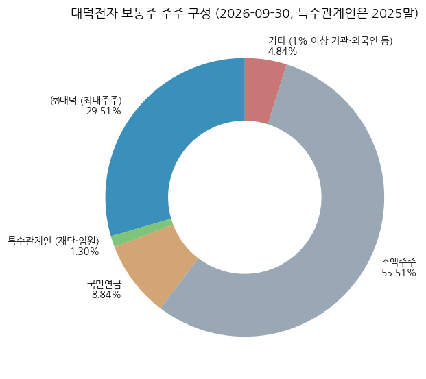

| 주주 | 주식수 | 지분율 | 기준일 |
|------|-------|-------|-------|
| ㈜대덕 (최대주주) | 14,584,913 | 29.51% | 2026-09-30 |
| 국민연금 | 4,370,141 | 8.84% | 2026-09-30 |
| 사회복지법인 대덕복지재단 | 526,622 | 1.07% | 2025-12-31 |
| (재)해동과학문화재단 | 89,000 | 0.18% | 2025-12-31 |
| 임원 (신영환·배영근·김지호) | 28,012 | 0.06% | 2025-12-31 |
| 소액주주 (1% 미만) | 27,431,409 | 55.51% | 2026-09-30 (주주 148,016명) |

- 보통주 49,416,925주 + 우선주 2,095,519주 (액면 500원, 분할 후 자본금 변동 없음)
- ⚠️ ㈜대덕 지분이 2025말 15,546,152주(31.46%) → 2026-09 14,584,913주(29.51%)로 약 96만주 감소. 3Q26 보고서는 '최대주주 변동 없음'으로만 기재 — 처분 경위 미확인
- 소액주주 수 2025말 74,185명 → 2026-09 148,025명 (2배) — 2026 랠리 기간 개인 유입
- 외국인 지분율: 이번 버전 미확보

### ③ 임원·이사회 (2025말 기준, DART)

| 이름 | 직위 | 구분 | 담당 | 비고 |
|------|------|------|------|------|
| 신영환 | 대표이사 | 사내이사 | 경영총괄 | 1960년생, 2015-03 \~ |
| 김영재 | 사장 | 사내이사 | - | ㈜대덕 사장, 최대주주 특수관계인 (2024-03 선임) |
| 배영근 | 실장 | 사내이사 | 경영기획 | 2025-03 재선임 |
| 정승부 | 사외이사 | 사외이사 | - | 성균관대 신소재공학부 교수 |
| 박찬호 | 감사 | 상근감사 | - | 서울대 법학 |
| 김정미 | 팀장 | 미등기(2025말) | 전략기획 | 1989년생, 최대주주 특수관계인 — 2026-03 사내이사 선임 (Bizwatch) |

- 사업 조직: FCB사업(고영주), MFS사업(조순진), MLB사업(이태식), 제조(박상갑) — 미등기 임원 36명

---

## 6. 기타 팩트

### ① R&D 인프라

| 연도 | R&D 비용 (억원, 보조금 차감 전) | R&D/매출 |
|------|-------------------------------|---------|
| 2020* | 61.7 | 0.99% |
| 2021 | 94.0 | 0.94% |
| 2022 | 109.1 | 0.83% |
| 2023 | 152.2 | 1.67% |
| 2024 | 143.4 | 1.61% |
| 2025 | 168.0 | 1.58% |

- 회계처리: 대부분 제조경비(2025 142억), 판관비 26억 — 개발비 자산화 없음
- R&D 비율 1%대로 낮음 — 고객 주문 사양 대응형(공정 기술) 연구 중심

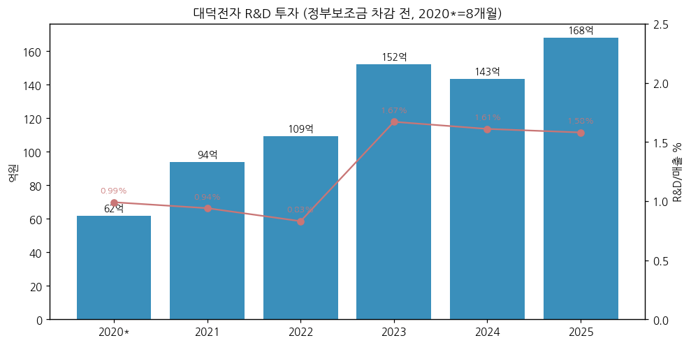

### ② 진행 중 corporate action — 10년치

| 시점 | 내용 |
|------|------|
| 2017-07 | 그룹 차원 와이솔 인수 (674억) |
| 2018-12 | 대덕GDS 흡수합병 (잔여 지분 84.6% 취득 — MarketScreener) |
| 2020-05 | 인적분할 (㈜대덕 지주 / 대덕전자 신설) |
| 2020-08 | ㈜대덕의 대덕전자 공개매수 (지분 31.46%) |
| 2022-04 | FCBGA 등 생산설비 2,700억 투자 개시 |
| 2022-06 \~ | 김영재 → 두 딸 ㈜대덕 지분 증여 (승계) |
| 2026-05 \~ 10 | 신규 투자 3건 1조 3,250억 결정 |

### ③ R&D 마일스톤 (DART 공시대상기간 개발 완료 항목)

- **FCBGA**: High density C4 bump(20k bump/unit) 양산 기술, **대면적(120×150mm)·26층·2.7mm 후판 FCBGA** 개발 완료, Low Df 신규 Build-up 소재
- **미세화**: mSAP L/S 9/12㎛, Cu Pillar 55pitch bump, Fine bond finger 45pitch
- **초박판**: 3L Coreless 70㎛, 4L 105㎛ Substrate
- **기타**: DTC embedding(Cavity 구조), 고다층 후판 안테나 기판, mSAP용 동박 국산화, S-parameter 분석·패키지 조립 모사 인프라

### ④ 주요 리스크

- **대규모 CapEx 회수 리스크**: 2026 신규 결정 1.33조 vs 2025말 자본 8,973억 — 감가상각 증가·현금 유출 부담이 주가 급락 요인으로 지목됨 (잡포스트 2026-10-30)
- **메모리 사이클**: PKG 매출 다수가 메모리. 2023 매출 -31%, OPM 2.6%로 급락한 전례
- **고객 집중**: 주요 거래처가 삼성전자·SK하이닉스·대형 OSAT로 소수
- **환율**: 실질 수출 96% (Local+Direct). USD·JPY·EUR 노출, 3Q26 "환율 하락 영향" 언급
- **원재료**: CCL(LG화학·두산), PREPREG, ABF(Ajinomoto 단독 성격) — 2025 CCL 단가 +2.5%, ABF +10.7%
- **주가 변동성**: 2026-05 ATH 대비 2026-11 약 -61%, 하루 -13\~-21% 급락 다수 (잡포스트)
- **지배구조**: 3세 승계 진행, ㈜대덕 지분 감소 경위 미확인, 자사주 소각 없음

### ⑤ ESG 등급

- KCGS(한국ESG기준원) 2020 종합 **A** (IR 2021-03). 2021 이후 등급은 이번 버전 미확보
- 녹색경영: 온실가스 배출량·에너지 사용량 정부 신고 (DART)

### ⑥ 인증·라이선스

- 이번 버전 미확보 (ISO·IATF 16949·AS9100 등 — 차량·항공우주 MLB 납품 특성상 보유 추정, 회사 사이트 확인 필요)

---

## Version Log

**v1.0 (2026-11-25)** — 첫 작성
- 데이터: OpenDART dart_financials (353200 2020\~3Q26, 008060 2018\~2019) / dart_quarterly_summary 2종 / dart_company_info (2025 사업보고서) / 정기보고서 원문 XML 353200 26건 + 008060 52건 / IR PDF 22건 (2021-03\~2026-11) / Yahoo Finance 353200.KS·008060.KS
- 2014\~2016 손익·재무상태 = 구 대덕전자 2016 사업보고서 요약재무정보(별도), 2014·2015 현금흐름 = 2014·2015 감사보고서 첨부
- 12종 차트 + chart2 3종 (전사 / PKG / MLB)

**잔여 보완 후보 (v1.1)**
- 2015\~2018 분기 시계열 (구 대덕전자 분기보고서 첨부 XML에서 3개월 손익 추출) → 60분기 표준 근접
- 1Q20 (분할 직전 분기) 실적 — ㈜대덕 1Q20 중단영업 주석에서 추출
- 외국인 지분율, KCGS 2021\~2025 등급, 인증 목록 (회사 사이트·Sustainability Report)
- PKG 제품 mix(FCCSP/CSP/FCBGA)·메모리/비메모리 비중의 분기 시계열화 (IR 차트 수치 정리)
- 2021 IR(별도 기준) PKG·FPC 숫자를 연결 기준으로 재대사

**핵심 source**
- [OpenDART 대덕전자 3Q26 분기보고서 (2026-11-13)](https://opendart.fss.or.kr) · [irgo 대덕전자 IR 자료실](https://m.irgo.co.kr/IR-COMP/353200)
- [alphasquare 대덕전자 시세 (2026-11-24)](https://alphasquare.co.kr/home/stock-summary?code=353200)
- [Bizwatch 대덕 지배구조 (2026-06-01)](https://news.bizwatch.co.kr/article/governance/2026/05/30/0001)
- [잡포스트 2026-10-30 투자 부담 급락](https://www.job-post.co.kr/news/articleView.html?idxno=235606) · [잡포스트 2026-11-20 3Q 호조에도 급락](https://www.job-post.co.kr/news/articleView.html?idxno=239900)
