# 대우건설 — 기업 개요 (v1.0)

> 마지막 update: 2026-11-04 (3Q26 잠정실적 2026-10-27 공시 반영 — 언론 보도 인용, 분기보고서 제출 전)
> 입력 source: OpenDART fnlttSinglAcntAll (연결·별도, 2015 FY~2Q26 각 43개 JSON + 2014 비교컬럼) + DART 정기공시 원문 XML 55건 (사업보고서 2012~2025, 분기·반기 1Q13~2Q26, 기재정정본 우선) + OpenDART 기업개황·주주·임원·직원·배당·자기주식 (2015·2019·2020·2025·2Q26) + Yahoo Finance (047040.KS, 2001-03~2026-11-03) + 네이버 증권 (시총·외국인·컨센서스, 2026-11-03) + 언론·증권사 (3Q26 잠정, 체코 원전 시공계약 결렬, CEO 교체)
> 갱신 주기: 매분기 (실적 리뷰 모드 호출 시)
> 워치리스트: 원전 섹터 (T2) / 서브섹터: 원전 시공 (확장 종목)
> **Fact verify cutoff**: 2026-11-04 (주가·시총·외국인 소진율·컨센서스 = 2026-11-02~03 조회값. 3Q26은 잠정치. 체코 두코바니 시공계약 결렬 = 2026-10-29 한수원 발표)

---

## 1. 기업 분류

- **Primary 분류: 사이클** (Cyclical — 국내 주택 분양 사이클 + 해외 토목·플랜트 원가 사이클, 빅배스 반복형)
- **Secondary 노트: 꿈(원전 시공) — 2026-10-29 체코 시공계약 결렬로 약화** — 2026-02~04 주가는 실적이 아니라 체코·해외 원전 시공 기대로 12배 상승했고, 결렬 후 고점 대비 -71%

### ① 정량 근거

**📊 Summary Box (12년, 2014~2025 연결):**

| 지표 | 값 |
|------|-----|
| 매출 CAGR (2014→2025, 11년) | **-1.9%** (10.00조 → 8.05조) / 2014→2024 +0.5% — 외형 성장 없음 |
| OPM 평균 | **3.3%** (빅배스 2개년 2016·2025 제외 시 5.4%) |
| OPM 정점 평균 | **7.2%** (2018 5.9% · 2021 8.5%) |
| OPM 저점 평균 | **-7.2%** (2016 -4.2% · 2025 -10.1%) |
| 사이클 주기 | 약 3~4년 (peak-to-peak 2018→2021) / 빅배스 간격 9년 (2016→2025) |
| 사이클 회수 (12년) | 정점 2회 / 저점 2회 (+ 소저점 2019·2024) |

```
연도   매출(조)  영업이익  순이익   OPM    NPM
2014    10.00     0.43     0.13    4.3    1.3   ← 국내 주택 분양 붐 진입
2015     9.94     0.34     0.14    3.5    1.4   ← 주택 OP 4,574억 vs 해외·플랜트 손실
2016    11.11    -0.47    -0.75   -4.2   -6.8   ← 빅배스 -4,672억 (4Q16 -7,314억, 3Q16 안진 검토의견 거절)
2017    11.77     0.43     0.26    3.6    2.2   ← 4Q17 모로코 사피 손실 → 호반 인수 무산(2018-02)
2018    10.61     0.63     0.30    5.9    2.8   ← OPM 정점 5.9% (주택 마진)
2019     8.65     0.36     0.20    4.2    2.3   ← 주택 매출 감소
2020     8.14     0.56     0.28    6.9    3.5   
2021     8.69     0.74     0.48    8.5    5.6   ← 주택 OPM 정점권 8.5%
2022    10.42     0.76     0.51    7.3    4.9   ← 중흥그룹 인수(2022-02), 영업이익 최고 7,600억
2023    11.65     0.66     0.52    5.7    4.5   ← 매출 최고 11.6조
2024    10.50     0.40     0.24    3.8    2.3   ← 원가율 상승, 해외 토목 손실
2025     8.05    -0.82    -0.92  -10.1  -11.4   ← 빅배스 -8,154억 (4Q25 -1.11조: 지방 미분양·해외 토목)

OPM range: -10.1% ~ 8.5% = 18.6%pt  (현대건설 10.1%pt 대비 2배 가까운 이익 변동 — 주택 마진 레버리지 + 해외 손실 일괄 인식)
```

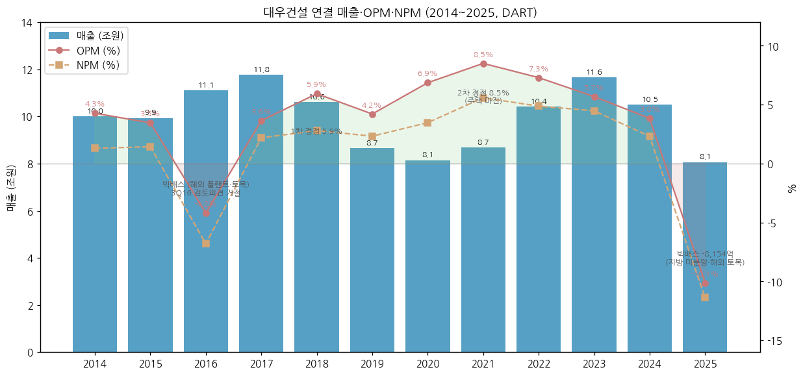

(2014 수치는 2015 사업보고서의 전기 컬럼. 2013 연결 매출 8.78조·영업손실 -2,447억은 2013 사업보고서 II '부문별 주요재무현황' 기준 — OpenDART 재무 API 미제공 구간)

### ② 산업 분류

- 산업: **건설 (종합건설)** — 사이클 산업 list 포함 (국내 주택 분양 사이클 + 해외 EPC 수주·원가 사이클)
- DART 업종코드 41112 (아파트 건설업) / KRX 건설 / 시공능력평가 3위 (2024, 11.7조원, DART 연혁)
- 워치리스트 섹터: **T2 — 원전** / 서브섹터: **원전 시공** (확장 종목 — 현대건설과 함께 국내 대형원전 시공 2강)

### ③ 분류 결정 논리

(1) **가장 매출 큰 사업부 기준** 적용 시: 주택건축(2025 건축) 부문이 연결 매출의 **68%** (2025, DART 영업부문) → 국내 주택 분양 사이클에 직결 → 사이클

(2) **사이클 사업부 이익 비중 우선 sub-rule**: 2014~2024 주택건축 부문 영업이익 누계 +6.20조 vs 토목 -1.00조 · 플랜트 -1.19조 (DART 영업부문, 아래 3-① 표) → **이익은 주택이 벌고 해외 토목·플랜트가 깎는 구조**. 2025는 주택건축마저 -1,843억 (4Q25 지방 미분양 대손) → 주택 사이클 하강이 이익 전체를 끌어내림 → **사이클 유지**

(3) **Boundary case 처리**: 원전은 수주잔고·매출 미반영 (2Q26 수주상황 상세표에 원전 본공사 없음). 체코 두코바니 5·6호기 시공 주간사 기대가 2026-04 시총 15.3조의 대부분을 설명했으나 (2025말 자본 3.47조, P/B 약 4.2배), 2026-10-29 한수원이 대우건설-두산에너빌리티 컨소시엄과의 시공계약 협상 종료를 선언 → **Primary 사이클 + Secondary 꿈(원전, 약화)** 병기. 꿈 Secondary는 2027-07 한수원 신규 시공사 선정 결과까지 유지 후 재판정

(4) **피어 대비**: 현대건설 = 주택 + 해외 플랜트 + 원전 EPC 옵션 (현대차그룹, AA- 등급) / **대우건설 = 주택 비중이 더 높고(68% vs 현대건설 별도 56%) 신용등급 A로 재무 완충력이 약함** — 같은 사이클이라도 하강기 이익·자본 훼손 폭이 큼 (2025 자본 -19.8%). 두산에너빌리티는 원전 주기기 제조(고마진) — 원전 테마 내 이익 레버리지는 주기기 > EPC > 시공 하도급 순

### ④ 적정 밸류에이션 방법

- **PBR (사이클 기준) 우선** — 본업 ROE는 -31%~+17%로 변동이 커 PER이 의미 없는 구간이 잦음 (2016·2025 적자). 주택 사이클 저점 P/B 0.3배 (2025-04-09 종가 2,970원 / 2024말 BPS 약 10,300원, 자체 계산) ~ 원전 프리미엄 고점 P/B 약 4.2배 (2026-04-28 종가 37,150원 / 1Q26말 BPS 약 8,700원)
- **PER 보조 (정상화 이익)** — 2026E 컨센서스 영업이익 8,425억·순이익 5,502억, 추정 EPS 1,326원 → **추정 PER 8.05배** (네이버 증권 컨센서스, 2026-11-02 생성). 2026 OPM 10%대는 주택 원가율 정상화 + 정산이익 효과로, 지속성 검증 필요
- **원전 SOTP는 본계약 전까지 0 가정** — 체코 시공은 결렬, 신규 원전(베트남·미국·사우디)은 수주 전 단계
- 현재: 2026-11-03 종가 10,680원 / BPS 9,216원 → **P/B 1.16배** (네이버 증권) — 원전 프리미엄은 대부분 소멸했으나 본업 저점 밴드(0.3~0.5배) 대비로는 여전히 높음
- 현대건설은 PBR + 원전 SOTP, **대우건설은 PBR 단독 + 정상화 PER** — 원전 본계약 부재 + 신용등급 A로 리레이팅 근거 약함

### ⑤ 분기 재평가 트리거 (분류 변경 조건)

- 원전 시공 **본계약 수주잔고 3조원+** 확보 시 (2027-07 한수원 체코 신규 시공사 선정 재참여, 베트남 닌투언·국내 신규원전 등) → Secondary 꿈 → 원전 시공 백로그 격상 검토
- 2027년 말까지 원전 본공사 수주 0건 시 → Secondary 꿈 삭제, 순수 주택 사이클 복귀
- **주택건축 부문 매출 비중 55% 이하** + 해외 비중 25%+ 회복 시 → 주택 단일 사이클 → 복합 EPC 사이클로 재분류
- 2개 연도 연속 **OPM 7%+ 및 부문 손실 0개** 시 → 사이클 → 지속성장 transition 후보 (2014~2025 12년간 해당 연도 없음)

---

## 2. 회사 개요

### ① 기본 사항

- **회사명**: 주식회사 대우건설 (DAEWOO ENGINEERING & CONSTRUCTION CO., LTD., DAEWOO E&C) / KRX 047040 (보통주만 상장)
- **본사**: 서울특별시 중구 을지로 170 (을지트윈타워)
- **설립**: 1973 대우건설㈜ 설립 → 1982 ㈜대우 건설부문 → **2000-12-27 ㈜대우 건설부문 인적분할로 신설** (DART 연혁)
- **그룹**: **중흥그룹** — 최대주주 중흥토건㈜ 41.07% + 중흥건설㈜ 10.27% = 51.34% (DART 반기보고서(2026.06), 2022-02-28 최대주주 변경)
- **대표이사**: **이강석** (2026-10-02 임시주총·이사회 선임 — SBS Biz 2026-10-05). 전임 김보현 사장 2026-08 용퇴
- **사업 한 줄 정의**: 국내 주택공급 2년 연속 1위(2025 18,834세대, DART) '푸르지오·써밋' 브랜드 주택이 매출 2/3를 차지하고, 이라크·나이지리아·모잠비크·싱가포르 등 거점 해외 토목·플랜트와 월성 3·4호기·신월성 1·2호기 주간사 경력의 원자력 시공을 병행하는 종합건설사. 연결 종속 30개사 (주요종속 15, DART 반기보고서(2026.06))

### ② 최근 12년 손익·자본 추이 (조원, 연결, DART)

| 연도 | 매출 | YoY | 영업이익 | 순이익 | 자본총계 | 자본 YoY |
|---|---|---|---|---|---|---|
| 2014 | 10.00 | - | 0.43 | 0.13 | 2.73 | - |
| 2015 | 9.94 | -0.6% | 0.34 | 0.14 | 2.83 | +3.9% |
| 2016 | 11.11 | +11.8% | -0.47 | -0.75 | 2.07 | -26.9% |
| 2017 | 11.77 | +6.0% | 0.43 | 0.26 | 2.28 | +10.1% |
| 2018 | 10.61 | -9.9% | 0.63 | 0.30 | 2.32 | +1.7% |
| 2019 | 8.65 | -18.4% | 0.36 | 0.20 | 2.49 | +7.4% |
| 2020 | 8.14 | -6.0% | 0.56 | 0.28 | 2.68 | +7.6% |
| 2021 | 8.69 | +6.7% | 0.74 | 0.48 | 3.22 | +20.1% |
| 2022 | 10.42 | +20.0% | 0.76 | 0.51 | 3.72 | +15.8% |
| 2023 | 11.65 | +11.8% | 0.66 | 0.52 | 4.06 | +9.1% |
| 2024 | 10.50 | -9.8% | 0.40 | 0.24 | 4.33 | +6.7% |
| 2025 | 8.05 | -23.3% | -0.82 | -0.92 | 3.47 | -19.8% |

(연결 기준, OpenDART. 2016 자본 -26.9% = 4Q16 빅배스, 2025 자본 -19.8% = 4Q25 빅배스)

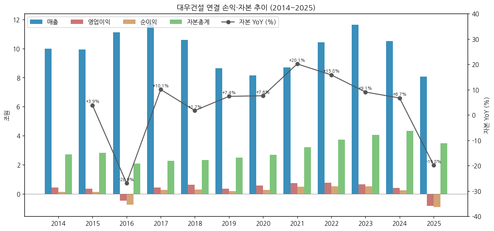

### ③ 회사 주가 역사 ★ narrative 영역

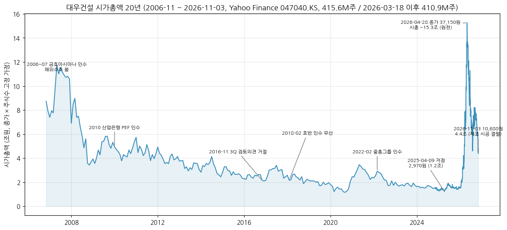

**시가총액 데이터:** 2006-11 ~ 2026-11-03 (Yahoo Finance 047040.KS 월간 종가 + 2024-11 이후 일간 종가 × 보통주 415,622,638주 / 2026-03-18 소각 후 410,907,638주 고정 가정 — 2010년 이전 주식수 변동은 미반영, 근사)
- 2026-11-03 종가 **10,680원 → 시총 4조 3,883억원** (네이버 증권, 2026-11-03)
- **사상 최고 (종가 기준): 2026-04-28 37,150원 → 시총 약 15.3조원** / 장중 최고 40,350원 (2026-04-28, Yahoo)
- 직전 최고 (월말 종가): 2007-05 28,250원 (금호아시아나 편입 후 해외수주 붐)
- 최근 저점: 2025-04-09 종가 2,970원 (시총 약 1.2조)
- 2025-04 저점 → 2026-04 고점 **+1,151%** → 2026-11-03 고점 대비 **-71%**
- 1Y 수익률 +200% (2025-11-03 3,560원 대비) / 2026 YTD +180% (2025-12-30 3,820원 대비) / 2026-10-29 하루 -18.6% (14,270 → 11,620원, 체코 시공계약 결렬 발표일)

**사이클 history:**

```
[2006-12 ~ 2009] 금호아시아나그룹 편입 + 해외수주 붐
  · 2007-05 월말 28,250원 — 2026년 이전 최고가
  · 2008 금융위기 + 금호 유동성 위기 → 2008-10 8,600원

[2010-12] 산업은행 PEF(KDB밸류제6호) 인수 — 이후 2019 KDB인베스트먼트 이관 (미검증 — 비공식 출처)
  · 2010-12 12,850원 → 이후 해외 저가수주 후유증으로 장기 하락

[2016-11] 3Q16 분기 검토의견 거절 (안진회계법인, DART 분기보고서(2016.09))
  · 4Q16 영업손실 -7,314억 (해외 토목·플랜트 일괄 반영, DART)
  · 2016-11 월말 5,170원

[2018-02] 호반건설 인수 무산 (4Q17 모로코 사피 발전 손실 — 4Q17 플랜트 부문 영업손실 -2,764억, DART / 인수 무산 = 미검증 — 비공식 출처)

[2020-03] 코로나 저점 2,940원 (월말)

[2021-12 ~ 2022-02] 중흥그룹 인수
  · 2021 SPA 체결 → 2022-02-28 최대주주 중흥토건 변경 (DART 연혁)
  · 2021-06 월말 7,950원 (인수 기대) → 2022-02 6,130원

[2023 ~ 2025-04] 주택 원가율 상승·PF 리스크
  · 2025-04-09 2,970원 (P/B 약 0.3배)

[2026-02 ~ 04] 원전 리레이팅 (+1,151%)
  · 2026-02-10 '6만가구 공급' 정책 + 원전 기대 → 하루 +27% (다음 2026-02-10 보도)
  · 체코 두코바니 시공 주간사 + 베트남 원전 2기 기대 (현대차증권 2026-05, TP 7,400 → 32,000원)
  · 2026-04-28 종가 37,150원 (시총 15.3조)

[2026-05 ~ 11] 원전 프리미엄 소멸
  · 2026-08 김보현 사장 용퇴 → 2026-10-02 이강석 대표 취임
  · 2026-10-27 3Q26 OP 1,832억 (+224% YoY) 호실적에도
  · 2026-10-29 한수원, 체코 두코바니 시공계약 협상 결렬 선언 → 11,620원 (-18.6%)
  · 2026-11-03 10,680원 (고점 대비 -71%)
```

### ④ 회사의 주요 연혁

```
1973      대우건설㈜ 설립 (대우그룹)
1982      ㈜대우 출범 (건설/무역부문 통합)
1991~     월성 3·4호기 주설비공사 주간사 → 신월성 1·2호기 주간사 (데일리안 2026-04-22)
2000-12   ㈜대우 건설부문 인적분할 → ㈜대우건설 신설 (대우그룹 해체)
2006~2008 3년 연속 시공능력평가 1위 (DART 연혁)
2006-12   금호아시아나그룹 편입 (미검증 — 비공식 출처)
2010-12   산업은행 PEF 인수 (미검증 — 비공식 출처)
2010년대  요르단 연구용원자로(JRTR) EPC 완공 — 한국 최초 원자력 시스템 일괄 수출 (데일리안 2026-04-22)
2014      하이엔드 브랜드 '푸르지오 써밋' 론칭
2016      7년 연속 주택 공급실적 1위 / 4Q16 빅배스 (연결 영업손실 -4,672억)
2018-02   호반건설 매각 무산 (미검증 — 비공식 출처)
2019      본사 을지로 이전, 모잠비크 LNG Area 1 수주 (계약 2020-12, DART 수주상황)
2022-02   최대주주 변경 — 중흥토건㈜ (DART)
2023      정원주 중흥그룹 부회장, 대우건설 회장 취임
2024      시공능력평가 3위 (11.7조원)
2024-07   체코 두코바니 5·6호기 팀코리아 우선협상대상자 (대우건설 시공 주간사, MTN 2024-07-18)
2025-06   체코 원전 한수원–EDUJ 본계약 체결 (DART 사업보고서(2025.12) 플랜트 부문)
2025      국내 주택공급 1위 2년 연속 (18,834세대) / 4Q25 빅배스 (연결 영업손실 -1.11조)
2026-03   자기주식 4,715,000주 소각 (발행주식 410,907,638주)
2026-04   주가 사상 최고 37,150원 (시총 15.3조)
2026-10   이강석 대표 취임 (10-02) / 체코 시공계약 결렬 (10-29)
```

---

## 3. 비즈니스 모델

### ① 실적 추이 (연결 → 부문 → 지역 3단계 위계)

**연간 5년 통합 표 (조원):**

| 항목 | 2021 | 2022 | 2023 | 2024 | 2025 |
|------|------|------|------|------|------|
| **연결 매출액** | **8.69** | **10.42** | **11.65** | **10.50** | **8.05** |
| └ 부문별 | | | | | |
| &nbsp;&nbsp;&nbsp;&nbsp;└ 주택건축(건축) | 5.90 | 6.36 | 7.21 | 6.84 | 5.51 |
| &nbsp;&nbsp;&nbsp;&nbsp;└ 토목 | 1.42 | 1.90 | 2.42 | 2.17 | 1.40 |
| &nbsp;&nbsp;&nbsp;&nbsp;└ 플랜트 (원자력 포함) | 0.87 | 1.45 | 1.62 | 1.14 | 0.84 |
| &nbsp;&nbsp;&nbsp;&nbsp;└ 기타·신사업·조정 | 0.49 | 0.72 | 0.41 | 0.35 | 0.30 |
| └ 지역별 (부문 합, 조정 전) | | | | | |
| &nbsp;&nbsp;&nbsp;&nbsp;└ 국내 | - | - | 9.08 | 8.37 | 6.69 |
| &nbsp;&nbsp;&nbsp;&nbsp;└ 해외 | - | - | 2.93 | 2.42 | 1.73 |
| **연결 영업이익** | **0.74** | **0.76** | **0.66** | **0.40** | **-0.82** |
| &nbsp;&nbsp;&nbsp;&nbsp;└ 주택건축 | 0.72 | 0.37 | 0.25 | 0.28 | -0.18 |
| &nbsp;&nbsp;&nbsp;&nbsp;└ 토목 | -0.06 | 0.12 | 0.16 | -0.08 | -0.59 |
| &nbsp;&nbsp;&nbsp;&nbsp;└ 플랜트 | -0.02 | 0.08 | 0.17 | 0.12 | -0.13 |
| &nbsp;&nbsp;&nbsp;&nbsp;└ 기타·조정 | 0.09 | 0.19 | 0.08 | 0.07 | 0.09 |
| **매출 YoY (%)** | **+6.7** | **+20.0** | **+11.8** | **-9.8** | **-23.3** |
| **영업이익 YoY (%)** | **+32.2** | **+2.9** | **-12.8** | **-39.2** | **적전** |
| **OPM 전사 (%)** | **8.5** | **7.3** | **5.7** | **3.8** | **-10.1** |
| &nbsp;&nbsp;&nbsp;&nbsp;└ 주택건축 OPM | 12.2 | 5.9 | 3.5 | 4.1 | -3.3 |
| &nbsp;&nbsp;&nbsp;&nbsp;└ 토목 OPM | -4.1 | 6.6 | 6.7 | -3.5 | -42.2 |
| &nbsp;&nbsp;&nbsp;&nbsp;└ 플랜트 OPM | -1.8 | 5.3 | 10.2 | 10.8 | -15.1 |

(출처: 전부 DART. 부문 = 연결 영업부문 주석 (매출·영업이익), 지역 = 사업보고서 II-4 '매출현황' 국내/해외 (부문 합, 조정 및 제거 전), 2021~2022 국내/해외는 동일 표 미추출. 2021 기타에는 '신사업' 부문 0.68조 포함 → 2022부터 기타로 통합)

**연결 부문별 매출·영업이익 13년 (조원, DART 사업보고서 II '부문별 주요재무현황'(2013~2015) / 연결 영업부문 주석(2016~2025)):**

| 연도 | 토목 | 주택건축 | 플랜트 | 기타·조정 | 합계 | 토목 OPM | 주택건축 OPM | 플랜트 OPM | 주택건축 비중 | 부문 OP 합계(억) |
|---|---|---|---|---|---|---|---|---|---|---|
| 2013 | 1.39 | 4.34 | 2.96 | 0.09 | 8.78 | -2.0% | -1.7% | -4.3% | 49% | -2,447 |
| 2014 | 1.53 | 5.59 | 2.77 | 0.10 | 10.00 | 4.0% | 9.0% | -4.6% | 56% | 4,270 |
| 2015 | 2.34 | 5.07 | 2.42 | 0.10 | 9.94 | -4.0% | 10.3% | -2.9% | 51% | 3,434 |
| 2016 | 2.40 | 5.79 | 2.79 | 0.13 | 11.11 | -23.3% | 14.2% | -25.4% | 52% | -4,672 |
| 2017 | 1.88 | 6.86 | 2.62 | 0.40 | 11.77 | -14.0% | 13.4% | -11.4% | 58% | 4,290 |
| 2018 | 1.74 | 6.58 | 1.94 | 0.34 | 10.61 | -3.7% | 11.5% | -5.5% | 62% | 6,287 |
| 2019 | 1.39 | 5.15 | 1.58 | 0.53 | 8.65 | -13.1% | 10.0% | -9.4% | 60% | 3,641 |
| 2020 | 1.48 | 5.08 | 1.09 | 0.48 | 8.14 | -3.3% | 10.6% | -7.2% | 62% | 5,583 |
| 2021 | 1.42 | 5.90 | 0.87 | 0.49 | 8.69 | -4.1% | 12.2% | -1.8% | 68% | 7,383 |
| 2022 | 1.90 | 6.36 | 1.45 | 0.72 | 10.42 | 6.6% | 5.9% | 5.3% | 61% | 7,600 |
| 2023 | 2.42 | 7.21 | 1.62 | 0.41 | 11.65 | 6.7% | 3.5% | 10.2% | 62% | 6,625 |
| 2024 | 2.17 | 6.84 | 1.14 | 0.35 | 10.50 | -3.5% | 4.1% | 10.8% | 65% | 4,031 |
| 2025 | 1.40 | 5.51 | 0.84 | 0.30 | 8.05 | -42.2% | -3.3% | -15.1% | 68% | -8,154 |

**연결 부문별 영업이익 13년 (억원, 동일 출처):**

| 연도 | 토목 OP | 주택건축 OP | 플랜트 OP | 기타·조정 OP | 합계 |
|---|---|---|---|---|---|
| 2013 | -272 | -752 | -1,264 | -159 | -2,447 |
| 2014 | 613 | 5,025 | -1,279 | -88 | 4,270 |
| 2015 | -934 | 5,203 | -698 | -137 | 3,434 |
| 2016 | -5,591 | 8,190 | -7,098 | -174 | -4,672 |
| 2017 | -2,631 | 9,222 | -2,990 | 689 | 4,290 |
| 2018 | -639 | 7,555 | -1,060 | 431 | 6,287 |
| 2019 | -1,811 | 5,133 | -1,494 | 1,813 | 3,641 |
| 2020 | -490 | 5,390 | -785 | 1,468 | 5,583 |
| 2021 | -587 | 7,218 | -158 | 911 | 7,383 |
| 2022 | 1,248 | 3,724 | 764 | 1,865 | 7,600 |
| 2023 | 1,613 | 2,523 | 1,655 | 834 | 6,625 |
| 2024 | -769 | 2,834 | 1,225 | 741 | 4,031 |
| 2025 | -5,919 | -1,843 | -1,267 | 875 | -8,154 |

(부문 매핑: 2013~2016 토목·건축·주택·해외INFRA(해외토건)·플랜트·발전·기타 7부문 → 2017-3Q부터 토목·주택건축·플랜트·기타 4부문 → 2020~2021 신사업 별도 → 2022 기타 통합 → 2025 '주택건축'을 '건축'으로 개칭. 본 표는 토목 = 토목 + 해외INFRA/해외토건, 주택건축 = 건축 + 주택, 플랜트 = 플랜트 + 발전, 기타 = 기타 + 신사업 + 조정. 2015 토목 2.34조 = 해외INFRA 1.13조 포함 (2014 이전 해외토건은 토목·건축에 분산))

→ 2014~2024 **주택건축 부문 영업이익 누계 +6.20조 vs 토목 -1.00조 · 플랜트 -1.19조** — 주택이 해외 손실을 메우는 구조가 11년간 반복
→ 주택건축 OPM 2016~2021 10~14% 정점 → 2023 3.5% 저점 (원가율 상승) → 2025 -3.3% (지방 미분양 대손) → **1H26 17%대 급반등** (아래 분기표)
→ 해외 토목: 2016 -23.3% (해외INFRA) · 2025 **-42.2%** (4Q25 단독 -5,196억) — 2번의 빅배스 모두 해외 토목이 최대 손실원

**연결 공종 × 국내/해외 매출 (억원, DART 사업보고서(2025.12) II-4 매출현황, 조정 전):**

| 부문 | 2023 국내 | 2023 해외 | 2024 국내 | 2024 해외 | 2025 국내 | 2025 해외 |
|---|---|---|---|---|---|---|
| 토목 | 9,455 | 14,696 | 9,282 | 12,422 | 6,472 | 7,569 |
| 건축 | 70,823 | 1,229 | 67,376 | 1,043 | 53,289 | 1,796 |
| 플랜트 | 4,721 | 11,481 | 2,355 | 9,031 | 2,404 | 6,007 |
| 기타/종속 | 5,805 | 1,883 | 4,704 | 1,735 | 4,718 | 1,930 |

→ 해외 매출 2.93조 (2023) → 1.73조 (2025): 토목(이라크·싱가포르) + 플랜트(나이지리아·모잠비크)가 해외의 약 80% (2025 78%). 건축은 98% 국내
→ 2025 지역별 (DART 영업부문 주석 6.4): 한국 6.69조 / 중동 0.47조 / 아시아 0.59조 / 아프리카 0.67조 / 조정 -0.36조. 매출 10% 이상 단일 고객 없음
→ 2025 매출 형태: 도급공사 6.91조 / **분양매출(자체사업) 0.98조** / 기타 0.17조

**부문별 분기 시계열 (50분기 = 1Q14~2Q26, DART 부문 누적값 차분 / 별도 42분기 = 1Q16~2Q26):**

각 차트 = 매출 (bar, 좌축) + 부문 영업이익률 (line, 우축, -60% 하한 클립 — 4Q25 토목 -340%·플랜트 -131% 등 극단치는 숫자 라벨로 표기). 4Q15·3Q17은 부문 재편 분기라 부문 간 이동 왜곡 있음.

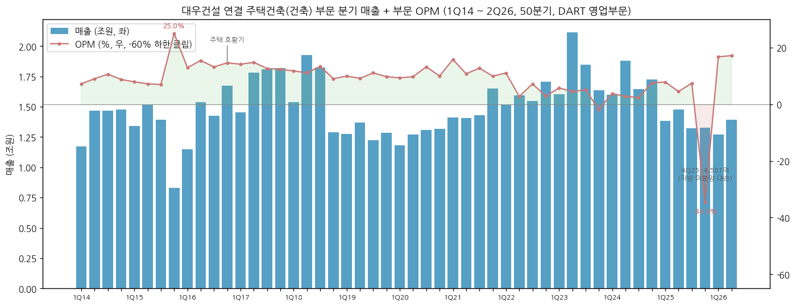
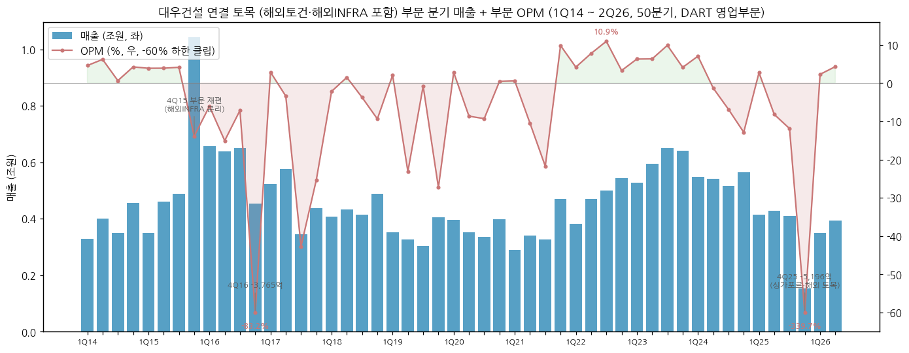
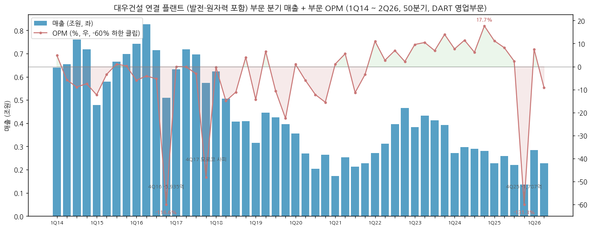
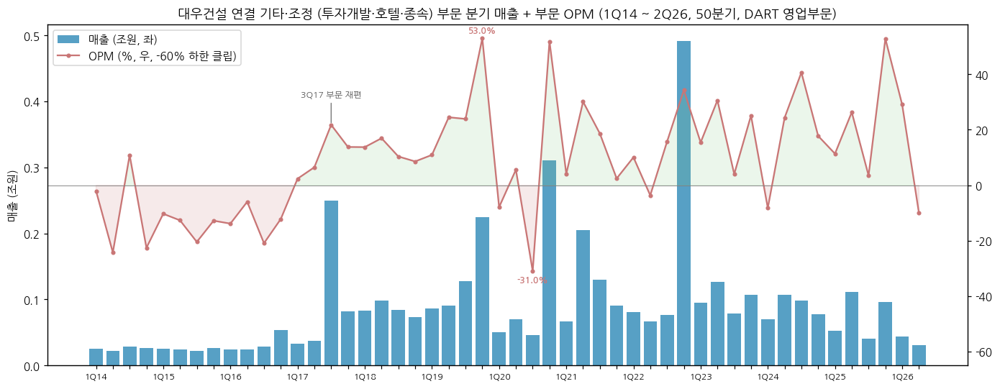
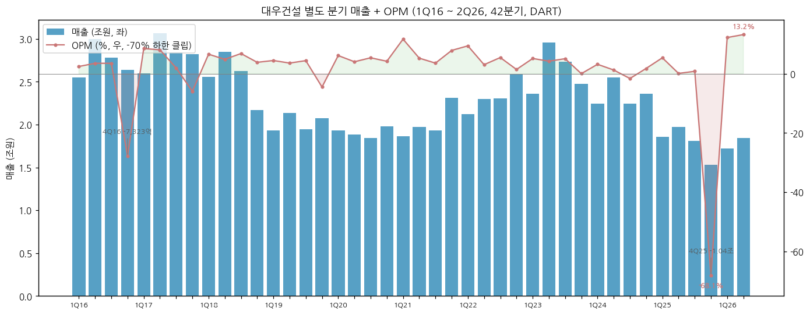

**연결 부문별 최근 12분기 (억원, DART 영업부문 / 2026-3Q = 잠정 보도, 부문 이익 미공개):**

| 분기 | 토목 | 주택건축 | 플랜트 | 기타·조정 | 합계 | 토목 OPM | 주택건축 OPM | 플랜트 OPM | 전사 OPM |
|---|---|---|---|---|---|---|---|---|---|
| 2023-3Q | 6,511 | 18,473 | 4,125 | 791 | 29,901 | 9.9% | 5.1% | 6.9% | 6.4% |
| 2023-4Q | 6,414 | 16,384 | 3,915 | 1,069 | 27,782 | 4.1% | -1.8% | 14.0% | 2.8% |
| 2024-1Q | 5,478 | 15,977 | 2,720 | 699 | 24,873 | 7.0% | 3.8% | 7.7% | 4.6% |
| 2024-2Q | 5,406 | 18,777 | 2,963 | 1,068 | 28,215 | -1.3% | 2.8% | 11.5% | 3.7% |
| 2024-3Q | 5,164 | 16,434 | 2,895 | 985 | 25,478 | -6.9% | 2.4% | 6.2% | 2.4% |
| 2024-4Q | 5,656 | 17,230 | 2,808 | 776 | 26,470 | -12.9% | 7.6% | 17.7% | 4.6% |
| 2025-1Q | 4,150 | 13,816 | 2,270 | 530 | 20,767 | 2.7% | 7.9% | 11.2% | 7.3% |
| 2025-2Q | 4,273 | 14,757 | 2,586 | 1,117 | 22,733 | -8.2% | 4.5% | 8.2% | 3.6% |
| 2025-3Q | 4,088 | 13,220 | 2,195 | 403 | 19,906 | -11.9% | 7.5% | 2.4% | 2.8% |
| 2025-4Q | 1,529 | 13,291 | 1,360 | 959 | 17,140 | -339.7% | -34.5% | -131.3% | -64.5% |
| 2026-1Q | 3,506 | 12,732 | 2,840 | 436 | 19,514 | 2.3% | 16.8% | 7.5% | 13.1% |
| 2026-2Q | 3,927 | 13,924 | 2,275 | 309 | 20,435 | 4.3% | 17.2% | -9.2% | 11.4% |
| 2026-3Q (잠정) | 3,161 | 13,001 | 1,871 | 391 | 18,424 | - | - | - | 9.9% |

(3Q26 부문 매출: 건축 1조 3,001억 / 토목 3,161억 / 플랜트 1,871억 / 기타 연결종속 391억 — 이코노미스트 2026-10-27. 3Q26 매출총이익률: 건축 22.0% (전년 11.4%), 토목 10.4% (전년 0.1%) — 비즈워치 2026-10-27)

**연결 분기 매출·영업이익 매트릭스 (억원, DART / 2026-3Q = 잠정):**

| 연도 | 1Q 매출 | 2Q | 3Q | 4Q | 1Q OP | 2Q OP | 3Q OP | 4Q OP | 분기합 매출 | 연간(DART) |
|---|---|---|---|---|---|---|---|---|---|---|
| 2016 | 25,699 | 30,284 | 28,177 | 26,899 | 605 | 1,060 | 976 | -7,314 | 111,059 | 111,059 |
| 2017 | 26,401 | 31,141 | 30,980 | 29,146 | 2,211 | 2,458 | 1,136 | -1,515 | 117,668 | 117,668 |
| 2018 | 26,528 | 29,639 | 27,285 | 22,603 | 1,820 | 1,617 | 1,915 | 936 | 106,055 | 106,055 |
| 2019 | 20,309 | 22,308 | 20,809 | 23,093 | 985 | 1,017 | 1,190 | 448 | 86,519 | 86,519 |
| 2020 | 19,858 | 19,632 | 18,963 | 22,914 | 1,209 | 811 | 1,029 | 2,533 | 81,367 | 81,367 |
| 2021 | 19,390 | 22,074 | 21,001 | 24,387 | 2,294 | 1,923 | 1,123 | 2,044 | 86,852 | 86,852 |
| 2022 | 22,495 | 24,409 | 25,205 | 32,083 | 2,213 | 865 | 2,055 | 2,468 | 104,192 | 104,192 |
| 2023 | 26,081 | 32,714 | 29,901 | 27,782 | 1,767 | 2,177 | 1,902 | 779 | 116,478 | 116,478 |
| 2024 | 24,873 | 28,215 | 25,478 | 26,470 | 1,148 | 1,048 | 623 | 1,212 | 105,036 | 105,036 |
| 2025 | 20,767 | 22,733 | 19,906 | 17,140 | 1,513 | 822 | 566 | -11,055 | 80,546 | 80,546 |
| 2026 | 19,514 | 20,435 | 18,424 | - | 2,556 | 2,322 | 1,832 | - | 58,373 (9M) | - |

(4Q = 연간 − 3Q 누적. 분기합 = 연간 DART 일치 (2016~2025 전 연도 차이 0). 2026 9M 매출 58,373억·영업이익 6,711억 = 잠정 보도 누계 (5조 8,373억·6,711억)와 일치)

**별도 분기 매출·영업이익 (억원, DART):**

| 연도 | 1Q 매출 | 2Q | 3Q | 4Q | 1Q OP | 2Q OP | 3Q OP | 4Q OP | 연간 매출 | 연간 OPM |
|---|---|---|---|---|---|---|---|---|---|---|
| 2016 | 25,503 | 29,960 | 27,812 | 26,371 | 626 | 1,057 | 979 | -7,323 | 109,646 | -4.3% |
| 2017 | 26,000 | 30,689 | 28,433 | 28,198 | 2,212 | 2,476 | 555 | -1,673 | 113,321 | 3.1% |
| 2018 | 25,545 | 28,515 | 26,264 | 21,723 | 1,682 | 1,386 | 1,789 | 837 | 102,047 | 5.6% |
| 2019 | 19,333 | 21,363 | 19,457 | 20,767 | 863 | 769 | 860 | -931 | 80,919 | 1.9% |
| 2020 | 19,315 | 18,836 | 18,430 | 19,792 | 1,185 | 762 | 991 | 833 | 76,373 | 4.9% |
| 2021 | 18,662 | 19,752 | 19,325 | 23,119 | 2,179 | 1,039 | 692 | 1,819 | 80,857 | 7.1% |
| 2022 | 21,213 | 23,008 | 23,050 | 25,918 | 1,997 | 703 | 1,260 | 374 | 93,189 | 4.7% |
| 2023 | 23,580 | 29,574 | 27,350 | 24,736 | 1,213 | 1,255 | 1,388 | 8 | 105,240 | 3.7% |
| 2024 | 22,444 | 25,471 | 22,445 | 23,614 | 714 | 321 | -363 | 424 | 93,973 | 1.2% |
| 2025 | 18,568 | 19,710 | 18,097 | 15,312 | 999 | 22 | 148 | -10,426 | 71,686 | -12.9% |
| 2026 | 17,204 | 18,414 | - | - | 2,102 | 2,432 | - | - | (1H) | - |

**3Q26 핵심 (분기 데이터만 반영, 연간 합산은 FY26 결산 후 v2.0에서 갱신):**
- 연결 매출 **1조 8,424억** (-7.4% YoY) / 영업이익 **1,832억** (+223.7% YoY, OPM 9.9%) / 순이익 831억 (흑자전환) — 이코노미스트·비즈워치 2026-10-27 (잠정 공시 인용)
- 컨센서스 대비 영업이익 +12.8% (삼성증권 2026-10-29, TP 21,000 → 18,000원) — 매출은 주택·해외 플랜트 현장 준공으로 기대 하회
- 건축 원가율 조정·준공정산이익 약 960억 (+) vs 지방 준공 후 미분양 대손충당금 733억 (판관비, −) (삼성증권)
- 9M26 누계: 매출 5.84조 (-7.9%) / 영업이익 6,711억 (+131.3%, OPM 11.5%) / 매출총이익률 18.6% (전년 10.6%)
- 9M26 신규수주 12.48조 (+11.9%) — 연간 목표 27조의 46.2% (비즈워치, 연초 공시 목표 18조에서 상향된 수치로 보도 — 회사 확인 미검증). 3Q 주요: 청라 국제업무단지 M5 8,181억, 신이문역 재개발 5,292억, 천호 A1-1 3,720억, 청파1구역 3,556억
- 수주잔고 **54조 8,550억** (2025말 50.60조 대비 +8.4%, 약 6.8년치) / 부채비율 274.8% (2025말 284.5%)

**12분기 시계열 (4Q23 ~ 3Q26, 억원):**

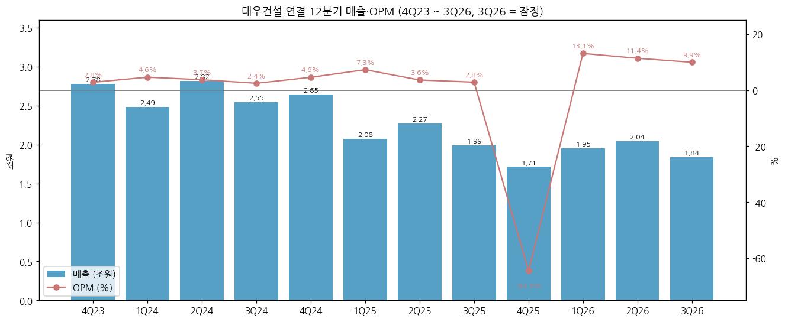

| 분기 | 매출 | 영업이익 | OPM | 순이익 | 별도 매출 | 별도 OP | 종속(연결−별도) OP |
|---|---|---|---|---|---|---|---|
| 2023-4Q | 27,782 | 779 | 2.8% | 1,093 | 24,736 | 8 | 771 |
| 2024-1Q | 24,873 | 1,148 | 4.6% | 915 | 22,444 | 714 | 434 |
| 2024-2Q | 28,215 | 1,048 | 3.7% | 965 | 25,471 | 321 | 727 |
| 2024-3Q | 25,478 | 623 | 2.4% | 403 | 22,445 | -363 | 986 |
| 2024-4Q | 26,470 | 1,212 | 4.6% | 145 | 23,614 | 424 | 788 |
| 2025-1Q | 20,767 | 1,513 | 7.3% | 580 | 18,568 | 999 | 515 |
| 2025-2Q | 22,733 | 822 | 3.6% | -429 | 19,710 | 22 | 800 |
| 2025-3Q | 19,906 | 566 | 2.8% | -530 | 18,097 | 148 | 418 |
| 2025-4Q | 17,140 | -11,055 | -64.5% | -8,782 | 15,312 | -10,426 | -629 |
| 2026-1Q | 19,514 | 2,556 | 13.1% | 1,958 | 17,204 | 2,102 | 455 |
| 2026-2Q | 20,435 | 2,322 | 11.4% | 1,671 | 18,414 | 2,432 | -110 |
| 2026-3Q | 18,424 | 1,832 | 9.9% | 831 | - | - | - |

→ 4Q25 -1.11조: 별도 -1.04조 (지방 미분양 현장 대손 — 시화 MTV 푸르지오 디오션 분양대금 3,252억 중 회수 138억, 대구 달서 푸르지오 시그니처 3,165억 중 53억 / 싱가포르 도시철도 설계변경 원가 상승 — 비즈워치 2026-02-11). 2025 판관비 1.05조 (전년 0.52조) 중 대손상각비 6,051억 (DART 연결 주석 30)
→ 1Q26~3Q26 OPM 13.1% · 11.4% · 9.9%: 빅배스 이후 원가율 정상화 + 준공정산이익 — 12년 최고 수준이나 매출은 3개 분기 연속 2조 미만

**수주잔고 (DART 계약잔액):**

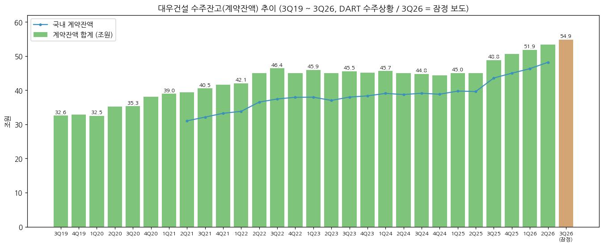

**DART 수주상황 계약잔액 (조원, 사업·분기보고서 II-4 '수주상황(요약)'):**

| 시점 | 국내 | 해외 | 합계 | 해외 비중 |
|---|---|---|---|---|
| 2021-4Q | 33.25 | 8.35 | 41.60 | 20% |
| 2022-4Q | 37.95 | 7.11 | 45.05 | 16% |
| 2023-4Q | 38.36 | 6.78 | 45.13 | 15% |
| 2024-4Q | 38.84 | 5.60 | 44.44 | 13% |
| 2025-4Q | 45.00 | 5.59 | 50.60 | 11% |
| 2026-1Q | 46.34 | 5.55 | 51.89 | 11% |
| 2026-2Q | 48.20 | 5.20 | 53.40 | 10% |

(계약잔액 = 기본도급액 − 완성공사액. 2019-3Q~2021-1Q는 본문 '계약잔액은 N조 N억원' 서술값 (국내/해외 분리 미추출). 2018년 이전 보고서는 상위 현장만 공시 → 총액 미추출. 3Q26 54.86조 = 잠정 보도)

→ 계약잔액 32.6조 (3Q19) → 53.4조 (2Q26): **증가분의 대부분이 국내 (주택·정비사업)**, 해외 잔고 8.4조 (2021) → 5.2조 (2Q26)로 감소 — 해외 비중 20% → 10%
→ 2Q26 잔고에 **체코 원전 시공분 미포함** (상세표 상위 현장에 원전 본공사 없음)

**계약잔액 상위 현장 (2026-06-30, 억원, DART 반기보고서 상세표-4):**

| 현장 | 계약일 | 완공예정 | 기본도급액 | 계약잔액 |
|---|---|---|---|---|
| 블랑써밋74 | 2023-12 | 2028-11 | 16,868 | 16,452 |
| 서면써밋더뉴 | 2025-07 | 2031-03 | 15,162 | 13,469 |
| GTX-B 민간투자사업 | 2025-08 | 2031-08 | 11,800 | 11,191 |
| 투르크메니스탄 미네랄 비료 | 2025-09 | 2028-10 | 10,482 | 9,911 |
| 모잠비크 LNG Area 1 | 2020-12 | 2028-10 | 9,819 | 9,224 |
| 장위10구역 재개발 | 2026-05 | 2030-06 | 7,872 | 7,549 |
| 써밋더힐 | 2026-03 | 2030-04 | 7,023 | 6,755 |
| 써밋리미티드남천 | 2025-07 | 2029-06 | 6,546 | 6,026 |
| 동래푸르지오에듀포레 | 2026-02 | 2030-02 | 5,386 | 5,160 |
| 탑석푸르지오파크7 | 2025-11 | 2029-03 | 6,421 | 5,107 |
| 홍천양수발전소 1·2호기 | 2025-09 | 2032-12 | 3,357 | 3,335 |
| 싱가포르 도시철도 CR108 | 2021-04 | 2029-12 | 7,112 | 3,312 |

**신규수주 (회사 발표, 연결):** 2025 14.24조 (+43.6% YoY, 건축 11.1조 사상 최대 · 토목 1.57조 · 기타 0.23조 — DART 사업보고서(2025.12) 본문·비즈워치) / 2026 목표 18조 (2026-02 발표) / 9M26 12.48조

### ② 사업부별 개요 (매출 비중 큰 순서)

**건축 (舊 주택건축) — 2025 연결 매출의 68%**

"푸르지오·써밋 브랜드의 국내 주택·정비사업이 이익의 원천이자 사이클의 원천."

- 아파트·주상복합·오피스텔 + 비주거 (오피스·데이터센터) — 2025 수주 11.1조 (본부 사상 최대), 매출 5.5조, 18,834세대 공급 (2년 연속 국내 1위) / 2026 계획 수주 8.4조·매출 5.2조 (DART 사업보고서(2025.12))
- 도급 + 자체사업(분양매출 0.98조, 2025) — 자체사업은 이익률이 높지만 미분양·PF 리스크를 직접 부담
- 2026 분양 목표 1만 6,000가구 중 9M 1만 948가구 (68.1%, 비즈워치 2026-10-27)

**토목 — 17%**

"국내 SOC·민자(GTX) + 이라크·싱가포르 등 해외 항만·철도."

- 2025 수주 1.57조·매출 1.40조 — "손실의 대부분은 해외 일부 프로젝트" (DART 사업보고서(2025.12)) / 이라크 해군·공군기지 등 해외 대형공사 2026-1Q 수주 기대 서술
- 거점: 이라크 (Al Faw 항만 — 2014 계약 GCPI, 10대 매출처), 싱가포르 (도시철도 CR108), 국내 (GTX-A·B, 진해신항, 홍천양수)

**플랜트 — 10% (원자력 포함)**

"석유화학(LNG·비료)·에너지개발·원자력 3개 영업조직."

- 석유화학: 나이지리아 (NLNG Train 7, Indorama 비료), 모잠비크 LNG Area 1, 투르크메니스탄 비료 (2025-2Q, 약 1조) / 파푸아뉴기니·모잠비크 추가 LNG 계약 4Q26 예정 (비즈워치)
- 에너지개발: 국내 천연가스 복합화력·열병합 주기기 설계·공급, 안산 연료전지, 해상풍력
- **원자력**: "원자력 생애 전 주기 수행 실적을 보유한 국내 유일 기업" (DART 사업보고서(2025.12)) — 대형원전·연구용 원자로·방폐장·핵연료 시설 / 조직: 원자력사업팀 + SMR팀 (원자력사업단장 김무성 상무)

**기타 — 투자개발·호텔·종속**

- 베트남 하노이 스타레이크시티 (THT Development, 총사업비 약 23억불) / 대우에스티 (철구조물·강교) / 대우송도호텔 (쉐라톤 그랜드 인천) / 2025 수주 2,341억·매출 3,010억 (DART)

### ③ 사업부별 디테일

**현재 가장 잘나가는 사업 (top-seller):**
- **국내 건축** — 1H26 부문 OPM 16.8%·17.2%, 3Q26 매출총이익률 22.0% (2023 부문 OPM 3.5% 대비 급반등) — 단, 빅배스로 손실 현장 선반영 + 준공정산이익 효과 포함

**향후 큰 매출 기대 사업 (growth — 원전 파이프라인, 2026-11-04 기준):**

| 프로젝트 | 노형·규모 | 대우건설 역할 | 현재 상태 (2026-11) | 출처 |
|---|---|---|---|---|
| 체코 두코바니 5·6호기 | APR1000급 2기, 총사업비 약 25조 | 팀코리아 시공 주간사 (두산에너빌리티와 시공 컨소시엄) | **2026-10-29 한수원 시공계약 협상 결렬 선언** — 컨소시엄이 일괄확정가(lump-sum) 대신 단가 정산 방식·1조원+ 증액 요구 (한수원 주장). 한수원은 2027-03말~04-01 입찰 → 2027-07까지 신규 국내 시공사 선정, 법적 분쟁 가능성 언급 / 대우건설 "손실 감내 수준까지 가격 낮춘 수정안 제출, 매우 유감" | CEO스코어데일리·한인센터 2026-10-29 |
| 베트남 닌투언 | 대형원전 2기 | 팀코리아 참여 기대 | 확정 전 (현대차증권 2026-05 "곧 확정 기대") | 아시아경제 2026-05-30 (미검증 — 비공식 출처) |
| i-SMR (한수원) | 혁신형 SMR | 'SMART 팀코리아' 시공 협력·공동투자 협의 | MOU 단계 (2024 한수원 MOU) | 데일리안 2026-04-22 |
| 국내 신규원전 | 대형 2기 + SMR 1기 (11차 전기본) | 시공 입찰 후보 | 정책 검토 단계 | DART 반기보고서(2026.06) |
| 미국·사우디 | - | 한수원·글로벌 사업자 협력 강화 | 구체 프로젝트 미공개 | 데일리안 2026-04-22 |

- 원자력 실적: 1991년 이후 약 30건 — 월성 3·4호기 주간사 (1991~), 신월성 1·2호기 주간사, 요르단 연구용원자로 EPC, 기장 신형연구로 주간사, 월성 1호기 해체설계 참여 (데일리안 2026-04-22), 월성 방폐물처분시설 1단계 시공 (DART 사업보고서(2013.12) 수주현황)
- 한수원 측 주장: "대우건설의 원전 시공 경험·인력은 약 15년 전 월성 이후 약화" (한인센터 2026-10-29) — 경험인력 요건 제외 요구가 결렬 사유 중 하나
- **2026-11-04 현재 원전 본공사 수주잔고 반영분 없음** (2Q26 DART 상세표 기준)

**이익 outlier (DART 부문 영업이익, 억원):**
- 4Q25 토목 -5,196 (OPM -340%) / 건축 -4,581 / 플랜트 -1,787 — 주택건축·토목·플랜트 3개 부문 동시 손실은 1Q14 이후 50분기 중 4Q25가 유일
- 4Q16 토목 -3,765 / 플랜트 -5,935 vs 주택건축 +2,451 — 해외 손실을 주택이 메우던 구조
- 1H26 건축 +4,529 (2개 분기 합) — 빅배스 이후 반등

### ④ 주요 경쟁사 (사업부별)

| 사업부 | 주요 경쟁사 |
|--------|-------------|
| 국내 주택·정비사업 | 현대건설(힐스테이트·디에이치), 삼성물산(래미안), GS건설(자이), DL이앤씨(아크로), 포스코이앤씨 |
| 해외 토목 (이라크·싱가포르·아프리카) | 현대건설, 삼성물산, 중국 국영 건설사 (CSCEC·CCCC 등) |
| 해외 플랜트 (LNG·비료) | 삼성E&A, GS건설, Saipem, Technip Energies, McDermott |
| 대형원전 시공 (국내·팀코리아) | 현대건설, 삼성물산, DL이앤씨 (한수원 체코 신규 시공사 선정 후보군) |
| SMR | 현대건설(Holtec), 삼성물산·두산에너빌리티(NuScale·X-energy) |

### ⑤ 주요 매출처

> DART는 고객별 매출액을 공시하지 않음. 아래는 DART 사업보고서(2025.12) II-4 '주요 매출처 현황'의 10대 매출처(합계 비중만 공시)와 계약잔액 상위 현장.

**2025 10대 매출처 (매출 비중 합계 27.2%, 순서 = DART 기재 순):**

| 매출처 | 비고 |
|---|---|
| GCPI (General Company for Ports of Iraq) | 이라크 Al Faw 항만 발주처 |
| ㈜엠디엠플러스 | 국내 개발사업 시행사 |
| NLNG (Nigeria LNG) | 나이지리아 LNG Train 7 |
| 주식회사 남동타운피에프브이 | 국내 개발 PFV |
| 가야피에프브이 주식회사 | 국내 개발 PFV |
| INDORAMA FERTILIZER FZE | 나이지리아 비료 플랜트 |
| JR22 VINA SINGCO PTE. LTD. | 베트남 관련 투자법인 |
| 원영디앤씨 주식회사 | 국내 시행사 |
| LTA (Land Transport Authority, 싱가포르) | 싱가포르 도시철도 |
| 장위6구역주택재개발정비사업조합 | 국내 정비사업 |

- 매출액 10% 이상 단일 외부고객 없음 (DART 영업부문 주석 6.5)

### ⑥ 생산 CAPA + 임직원

- 수주산업으로 생산 CAPA 개념 대신 **수주잔고 54.86조 (3Q26 잠정, 약 6.8년치 매출)** 가 CAPA 지표
- 현대차증권 (2026-05): "체코·베트남 원전을 동시에 수주하면 추정 수행 역량을 거의 소진" — 원전 시공 인력이 병목 (미검증 — 비공식 출처)

**임직원 추이 (대우건설 별도, DART 사업보고서 VIII / OpenDART empSttus):**

| 연도 | 직원 수 | 정규직 | 기간제 | 평균 근속(년) | 급여총액(억원) | 1인 평균(백만원) |
|---|---|---|---|---|---|---|
| 2013 | 6,382 | 4,499 | 1,883 | 7.6 | 4,506 | 71 |
| 2014 | 5,543 | 4,578 | 965 | 9.0 | 3,937 | 71 |
| 2015 | 5,597 | 4,121 | 1,476 | - | 4,530 | 81 |
| 2016 | 6,072 | 4,043 | 2,029 | 12.7 | 4,501 | 74 |
| 2017 | 5,804 | 3,943 | 1,861 | 13.4 | 4,228 | 73 |
| 2018 | 5,357 | 3,811 | 1,546 | 14.2 | 4,189 | 78 |
| 2019 | 5,385 | 3,782 | 1,603 | - | 4,420 | 82 |
| 2020 | 5,452 | 3,783 | 1,669 | - | 4,492 | 82 |
| 2021 | 5,433 | 3,694 | 1,739 | 15.5 | 4,556 | 84 |
| 2022 | 5,842 | 3,675 | 2,167 | 15.3 | 5,481 | 94 |
| 2023 | 5,923 | 3,633 | 2,290 | 15.8 | 5,987 | 101 |
| 2024 | 5,503 | 3,575 | 1,928 | 16.1 | 5,922 | 108 |
| 2025 | 5,146 | 3,425 | 1,721 | 16.7 | 5,246 | 102 |

- 2Q26 직원 5,110명 (정규 3,387 · 기간제 1,723, 기간제 비중 34%) — 2023 5,923명 대비 -14%
- 2025말 본부별 (OpenDART empSttus): 토목 1,026 / 건축 2,274 / 플랜트 933 / 기타 913

---

## 4. 재무 구조

> **재무제표 수치: OpenDART fnlttSinglAcntAll, 2026-11-04 조회.** (연결 CFS·별도 OFS) 2014 = 2015 사업보고서 전기 컬럼. 2024 = 2025-08-13 정정 사업보고서 기준. 3Q26 = 잠정 공시 (언론 인용, 분기보고서 제출 전). 2015~2022 차입금은 DART 계정 '단기·장기 금융상품부채'(차입금+사채) 합계, 2023~는 차입금·사채 계정 합계.

### ① 손익계산서 (12년 연결, 조원)

| 연도 | 매출 | 매출원가 | 매출총이익 | GPM | 판관비 | CIR | 영업이익 | OPM | 세전이익 | 순이익 | NPM | 지배순이익 |
|---|---|---|---|---|---|---|---|---|---|---|---|---|
| 2014 | 10.00 | 9.23 | 0.76 | 7.6% | 0.34 | 3.4% | 0.43 | 4.3% | 0.18 | 0.13 | 1.3% | 0.13 |
| 2015 | 9.94 | 9.21 | 0.73 | 7.3% | 0.38 | 3.9% | 0.34 | 3.5% | 0.17 | 0.14 | 1.4% | 0.14 |
| 2016 | 11.11 | 11.01 | 0.10 | 0.9% | 0.56 | 5.1% | -0.47 | -4.2% | -1.01 | -0.75 | -6.8% | -0.74 |
| 2017 | 11.77 | 10.94 | 0.83 | 7.1% | 0.40 | 3.4% | 0.43 | 3.6% | 0.31 | 0.26 | 2.2% | 0.26 |
| 2018 | 10.61 | 9.58 | 1.03 | 9.7% | 0.40 | 3.8% | 0.63 | 5.9% | 0.43 | 0.30 | 2.8% | 0.30 |
| 2019 | 8.65 | 7.80 | 0.86 | 9.9% | 0.49 | 5.7% | 0.36 | 4.2% | 0.31 | 0.20 | 2.3% | 0.21 |
| 2020 | 8.14 | 7.14 | 1.00 | 12.3% | 0.44 | 5.4% | 0.56 | 6.9% | 0.38 | 0.28 | 3.5% | 0.28 |
| 2021 | 8.69 | 7.45 | 1.24 | 14.3% | 0.50 | 5.8% | 0.74 | 8.5% | 0.60 | 0.48 | 5.6% | 0.48 |
| 2022 | 10.42 | 9.17 | 1.25 | 12.0% | 0.49 | 4.7% | 0.76 | 7.3% | 0.71 | 0.51 | 4.9% | 0.50 |
| 2023 | 11.65 | 10.44 | 1.21 | 10.4% | 0.55 | 4.7% | 0.66 | 5.7% | 0.74 | 0.52 | 4.5% | 0.51 |
| 2024 | 10.50 | 9.58 | 0.93 | 8.8% | 0.52 | 5.0% | 0.40 | 3.8% | 0.36 | 0.24 | 2.3% | 0.23 |
| 2025 | 8.05 | 7.82 | 0.24 | 3.0% | 1.05 | 13.1% | -0.82 | -10.1% | -1.21 | -0.92 | -11.4% | -0.91 |

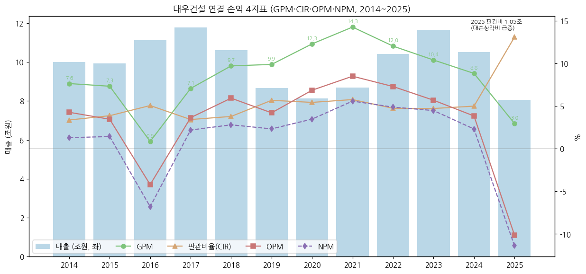

→ GPM 2014 7.6% → 2021 14.3% 정점 (주택 마진) → 2025 3.0% / 판관비율 2025 13.1% (판관비 1.05조, 전년 0.52조 — **대손상각비 6,051억 (전년 963억)**, DART 사업보고서(2025.12) 연결 주석 30)
→ 2025 연결 EPS -2,220원 / 2Q26 반기 EPS 877원 (OpenDART 배당 API)

**별도 vs 연결 (억원, DART) — 종속회사 기여:**

| 연도 | 별도 매출 | 별도 OP | 별도 OPM | 연결 매출 | 연결 OP | 종속 기여 매출 | 종속 기여 OP |
|---|---|---|---|---|---|---|---|
| 2014 | 98,531 | 4,155 | 4.2% | 99,950 | 4,270 | 1,419 | 115 |
| 2015 | 98,775 | 3,346 | 3.4% | 99,357 | 3,434 | 583 | 89 |
| 2016 | 109,646 | -4,661 | -4.3% | 111,059 | -4,672 | 1,413 | -12 |
| 2017 | 113,321 | 3,569 | 3.1% | 117,668 | 4,290 | 4,348 | 721 |
| 2018 | 102,047 | 5,695 | 5.6% | 106,055 | 6,287 | 4,008 | 592 |
| 2019 | 80,919 | 1,562 | 1.9% | 86,519 | 3,641 | 5,599 | 2,079 |
| 2020 | 76,373 | 3,771 | 4.9% | 81,367 | 5,583 | 4,994 | 1,812 |
| 2021 | 80,857 | 5,729 | 7.1% | 86,852 | 7,383 | 5,995 | 1,654 |
| 2022 | 93,189 | 4,334 | 4.7% | 104,192 | 7,600 | 11,003 | 3,266 |
| 2023 | 105,240 | 3,864 | 3.7% | 116,478 | 6,625 | 11,238 | 2,761 |
| 2024 | 93,973 | 1,097 | 1.2% | 105,036 | 4,031 | 11,063 | 2,935 |
| 2025 | 71,686 | -9,257 | -12.9% | 80,546 | -8,154 | 8,860 | 1,103 |

→ 별도가 연결 매출의 89~99% — 현대건설(현대엔지니어링 의존)과 달리 **종속 기여가 작은 본체 중심 구조**. 2019~2024 종속 OP 1,650~3,270억 (베트남 THT 개발·대우에스티 등)

### ② 재무상태표 (12년 연결, 조원)

| 연도 | 자산총계 | 부채총계 | 자본총계 | 지배지분 | 자본 YoY | 부채비율 | 유동비율 |
|---|---|---|---|---|---|---|---|
| 2014 | 10.26 | 7.53 | 2.73 | 2.63 | - | 276.4% | 165.1% |
| 2015 | 10.15 | 7.32 | 2.83 | 2.77 | +3.9% | 258.6% | 143.4% |
| 2016 | 9.97 | 7.90 | 2.07 | 2.03 | -26.9% | 381.7% | 96.2% |
| 2017 | 8.78 | 6.50 | 2.28 | 2.24 | +10.1% | 285.3% | 100.1% |
| 2018 | 8.73 | 6.42 | 2.32 | 2.28 | +1.7% | 276.8% | 107.3% |
| 2019 | 9.70 | 7.21 | 2.49 | 2.46 | +7.4% | 289.7% | 119.0% |
| 2020 | 9.31 | 6.63 | 2.68 | 2.67 | +7.6% | 247.6% | 121.0% |
| 2021 | 10.46 | 7.24 | 3.22 | 3.21 | +20.1% | 225.1% | 141.6% |
| 2022 | 11.14 | 7.42 | 3.72 | 3.71 | +15.8% | 199.1% | 148.5% |
| 2023 | 11.24 | 7.18 | 4.06 | 4.05 | +9.1% | 176.8% | 159.4% |
| 2024 | 12.66 | 8.32 | 4.33 | 4.29 | +6.7% | 192.1% | 211.0% |
| 2025 | 13.36 | 9.88 | 3.47 | 3.35 | -19.8% | 284.5% | 194.1% |
| 2026-1Q | 14.08 | 10.35 | 3.73 | 3.59 | - | 277.7% | 195.5% |
| 2026-2Q | 14.39 | 10.46 | 3.92 | 3.79 | - | 266.5% | 183.9% |

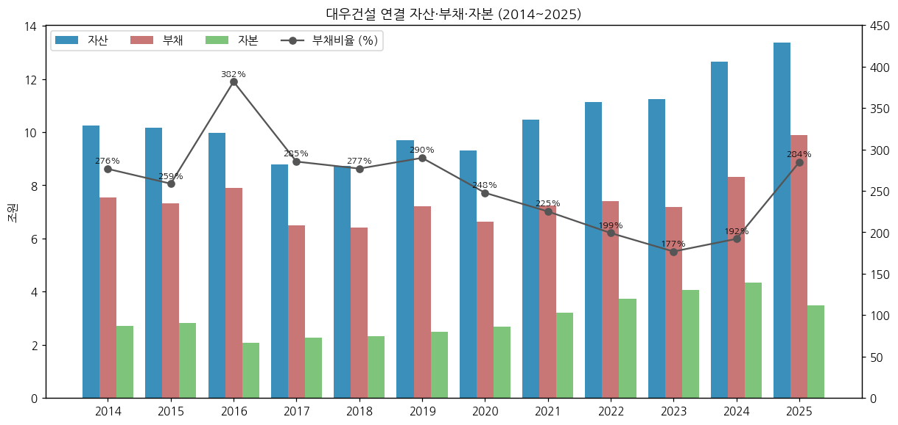

→ 부채비율 2016 381.7% (빅배스) → 2023 176.8% (12년 최저) → 2025 284.5% → 3Q26 274.8% (잠정 보도). 2025 부채 증가는 "유동성 안정화를 위한 선제 자금 조달" (회사 설명, 비즈워치)

### ③ 현금흐름표 (12년 연결, 억원)

| 연도 | 영업CF | 투자CF | 재무CF | CapEx(유형) | CapEx(무형) | 배당지급 | FCF |
|---|---|---|---|---|---|---|---|
| 2014 | 2,644 | -607 | -2,891 | 1,560 | 43 | 7 | 1,041 |
| 2015 | 6,850 | -5,411 | 690 | 4,406 | 53 | 0 | 2,392 |
| 2016 | 3,588 | -2,618 | 1,745 | 2,736 | 41 | 0 | 812 |
| 2017 | 3,374 | 849 | -7,211 | 680 | 44 | 0 | 2,650 |
| 2018 | 1,762 | -1,528 | 1,675 | 270 | 34 | 0 | 1,459 |
| 2019 | -3,097 | 2,542 | 1,076 | 235 | 44 | 0 | -3,377 |
| 2020 | 4,084 | 471 | -4,190 | 117 | 108 | 0 | 3,859 |
| 2021 | 17,468 | -9,165 | -5,815 | 496 | 116 | 0 | 16,857 |
| 2022 | -4,231 | 3,327 | 4,304 | 691 | 111 | 1 | -5,034 |
| 2023 | -8,328 | 260 | 1,677 | 703 | 42 | 1 | -9,074 |
| 2024 | -12,835 | 1,044 | 11,697 | 376 | 58 | 1 | -13,269 |
| 2025 | 4,629 | 1,720 | 570 | 1,003 | 107 | 29 | 3,519 |

(FCF = 영업CF − 유·무형자산 취득. 배당지급 = 연결 CF상 지급액 (비지배주주 배당, 지배주주 현금배당 없음))

→ **2022~2024 3년 연속 영업CF 적자 (누적 -2.54조)** — 매출채권 7,371억 (2021) → 2.78조 (2024), 자체사업·정비사업 운전자본 증가. 2024 재무CF +1.17조 (차입금+사채 2.34조 (2023) → 3.67조 (2024))
→ 2021 영업CF 1.75조 (12년 최대) — 주택 분양 호황기 선수금·회수

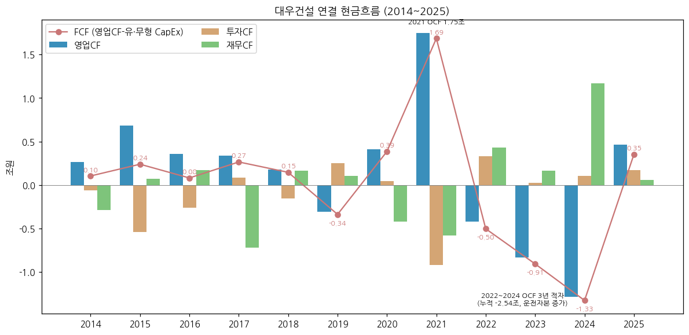

### ④ CapEx 추이 (12년, 억원)

| 연도 | 유형 | 무형 | 총 CapEx | CapEx/매출 |
|---|---|---|---|---|
| 2014 | 1,560 | 43 | 1,603 | 1.60% |
| 2015 | 4,406 | 53 | 4,459 | 4.49% |
| 2016 | 2,736 | 41 | 2,776 | 2.50% |
| 2017 | 680 | 44 | 724 | 0.62% |
| 2018 | 270 | 34 | 303 | 0.29% |
| 2019 | 235 | 44 | 280 | 0.32% |
| 2020 | 117 | 108 | 225 | 0.28% |
| 2021 | 496 | 116 | 612 | 0.70% |
| 2022 | 691 | 111 | 802 | 0.77% |
| 2023 | 703 | 42 | 746 | 0.64% |
| 2024 | 376 | 58 | 434 | 0.41% |
| 2025 | 1,003 | 107 | 1,110 | 1.38% |

- 수주산업 특성상 2017년 이후 CapEx는 매출의 0.3~1.4% — 사이클 판단 지표로는 CapEx보다 **수주잔고·미분양·PF 보증·매출채권** 이 중요

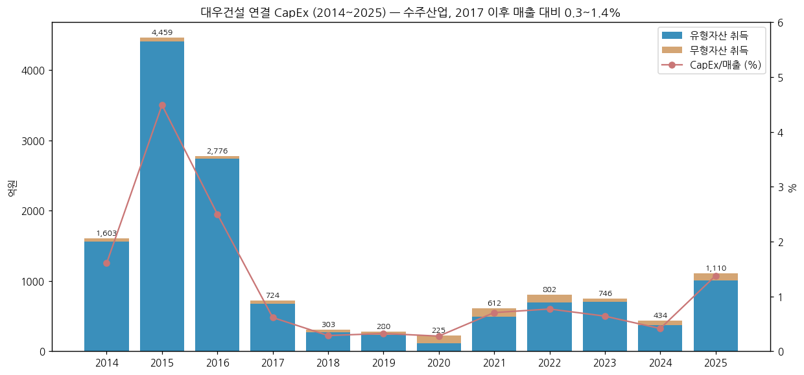

### ⑤ 부채구조 + 운전자본 (12년, 억원)

| 연도 | 유동부채 | 비유동부채 | 총차입금 | 현금+단기금융상품 | 순현금(+)/순차입(−) | 미청구공사 | 초과청구공사 | 매출채권 |
|---|---|---|---|---|---|---|---|---|
| 2014 | 42,337 | 33,009 | n/a | 3,257 | n/a | n/a | n/a | 32,631 |
| 2015 | 46,715 | 26,498 | 26,652 | 5,390 | -21,262 | n/a | n/a | 28,226 |
| 2016 | 66,085 | 12,919 | 28,108 | 8,168 | -19,940 | 13,403 | 13,768 | 11,911 |
| 2017 | 52,697 | 12,285 | 20,253 | 5,171 | -15,082 | 13,530 | 12,239 | 10,779 |
| 2018 | 48,446 | 15,715 | 21,766 | 7,059 | -14,707 | 9,387 | 9,860 | 10,633 |
| 2019 | 50,847 | 21,247 | 23,933 | 7,568 | -16,365 | 9,084 | 8,220 | 13,535 |
| 2020 | 49,364 | 16,925 | 20,440 | 8,065 | -12,375 | 8,598 | 8,683 | 10,009 |
| 2021 | 50,490 | 21,926 | 15,535 | 10,610 | -4,925 | 9,540 | 12,624 | 7,371 |
| 2022 | 54,062 | 20,095 | 22,115 | 14,231 | -7,884 | 12,053 | 14,177 | 11,540 |
| 2023 | 50,335 | 21,478 | 23,402 | 16,660 | -6,742 | 12,955 | 8,193 | 18,560 |
| 2024 | 45,440 | 37,804 | 36,716 | 19,316 | -17,400 | 12,608 | 7,049 | 27,772 |
| 2025 | 51,109 | 47,730 | 37,303 | 22,635 | -14,668 | 7,889 | 10,664 | 26,824 |

(총차입금: 2015~2022 '금융상품부채', 2023~ 단기차입금·유동성장기차입금·사채·장기차입금 계정 합. 2014는 계정 미분리로 n/a. 2014~2015 미청구·초과청구공사 계정 미추출. 현금 = 현금및현금성자산 + 단기금융상품)

→ **2015~2025 11년 연속 순차입** (현대건설은 순현금) — 2024 순차입 1.74조로 확대 후 2025 1.47조. 2Q26 차입금 및 사채 계정 합 4.24조 / 현금 1.22조 + 단기금융상품 0.25조 → 순차입 약 2.8조 (자체 계산)

**신용등급 (DART 반기보고서(2026.06) I-1):** 회사채 **A** (한국기업평가 2026-06-25 정기평가, 2026-02-11 수시평가) / 기업신용 **A** (NICE신용평가 2026-06-19) / CP·전자단기사채 **A2** (한기평·NICE) — 2024~2026 등급 유지

**부동산 PF 우발부채 (연결, 백만원 → 조원, DART 반기보고서(2026.06) XI-2 채무보증 및 채무인수약정):**

| 구분 | 2024말 | 2025말 | 2Q26말 |
|---|---|---|---|
| ① PF 신용보강 합계 (책임준공·중도금·SOC 제외) | 1.69조 | 1.76조 | **2.18조** |
| └ 단독사업 보증금액 | 1.50조 | 1.65조 | 2.16조 |
| &nbsp;&nbsp;&nbsp;&nbsp;└ 정비사업 (본PF) | - | 0.50조 (대출잔액) | 1.03조 (대출잔액 0.95조) |
| &nbsp;&nbsp;&nbsp;&nbsp;└ 기타사업 (브릿지론 0.67조 + 본PF 0.46조) | - | 1.28조 (대출잔액) | 1.13조 (대출잔액 1.24조) |
| └ 컨소시엄 참여사업 | 0.19조 | 0.11조 | 0.02조 |
| ② 책임준공 조건부 채무인수 약정 (연결회사분) | - | 15.70조 (대출잔액 10.62조) | **16.94조 (대출잔액 10.36조)** |
| └ 그 중 HUG 등 보증기관 보증 | - | 4.47조 | 5.29조 |
| ③ SOC 자금보충 한도 (전체) | - | 0.46조 | 0.43조 |
| ④ 중도금대출 보증 (정비 + 기타) | - | 2.18조 | 1.34조 |
| 특수관계자 신용보강 (①에 포함) | 0.35조 | 0.38조 | 0.35조 |

- 2Q26 단독사업 기타사업 브릿지론 6,695억 — **만기 3개월 이내 1,545억 + 6개월 초과~12개월 이내 5,150억** (1년 내 전액 만기) → 본PF 전환·착공 지연 시 노출 구간
- 3Q26 (잠정 보도, 비즈워치 2026-10-27, 회사 발표 기준): PF 대출 보증잔액 1조 2,189억 (2025말) → 1조 1,811억 (-3.1%) / **미착공 PF 4,845억 → 8,400억 (+73.4%, 노들역 푸르지오 관련)** — DART 주석 ①과 집계 범위 상이
- 책임준공 약정 대출잔액 10.36조 = 2Q26 연결 자본 3.92조의 2.6배 — 시공사 책임준공 미이행 시 채무인수 구조 (현대건설 PF 보증 14.18조 / 자본 11.22조 = 1.3배 대비 레버리지 높음)

### ⑥ 배당·자사주 추이 (12년)

| 연도 | DPS 보통주(원) | 현금배당총액 | 비고 |
|---|---|---|---|
| 2012~2025 | **0 (무배당)** | - | 사업보고서 2014 (제13~15기) + OpenDART alotMatter 2015·2019·2020·2025 '현금배당금총액 -' / 연결 CF 배당지급 0~29억은 비지배주주분 |
| 2026 (반기) | - | - | 2Q26 반기보고서 배당 없음 |

- **자기주식**: 신탁계약 취득분 4,715,000주 + 기타취득 21,918주 = 4,736,918주 보유 (2025말) → **2026-03-18 이사회 결의로 4,715,000주 소각** (발행주식 415,622,638 → 410,907,638주, 자본금 불변 — 이익소각). 신규 자사주 매입 공시 없음 (DART 반기보고서(2026.06) I-3)
- 과거 유상감자 누적 13,571,618주 (OpenDART 주식총수 '감소 주식수 — 유상감자', 시점 미기재)
- 주주환원 정책 미공시 — 중흥그룹 인수 후 무배당 유지

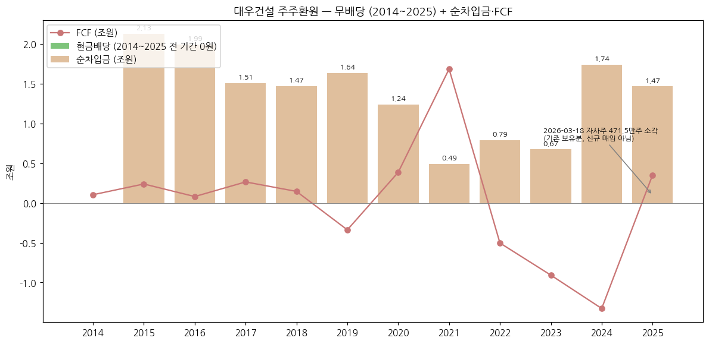

### ⑦ 재무 비율 (12년)

| 연도 | ROE(지배) | ROA | 부채비율 | 유동비율 | OP/금융원가 |
|---|---|---|---|---|---|
| 2014 | 5.0% | 1.3% | 276.4% | 165.1% | 3.5x |
| 2015 | 5.3% | 1.4% | 258.6% | 143.4% | 3.5x |
| 2016 | -30.6% | -7.5% | 381.7% | 96.2% | -5.0x |
| 2017 | 12.1% | 2.8% | 285.3% | 100.1% | 4.7x |
| 2018 | 13.2% | 3.4% | 276.8% | 107.3% | 5.7x |
| 2019 | 8.8% | 2.2% | 289.7% | 119.0% | 2.8x |
| 2020 | 11.1% | 3.0% | 247.6% | 121.0% | 5.3x |
| 2021 | 16.5% | 4.9% | 225.1% | 141.6% | 12.0x |
| 2022 | 14.6% | 4.7% | 199.1% | 148.5% | 9.4x |
| 2023 | 13.2% | 4.7% | 176.8% | 159.4% | 4.4x |
| 2024 | 5.6% | 2.0% | 192.1% | 211.0% | 2.5x |
| 2025 | -23.9% | -7.0% | 284.5% | 194.1% | -4.5x |

**주요 비율 의미:**
- **ROE**: 지배순이익 / 평균 지배지분 — 12년 최고 16.5% (2021), 2025 -23.9%. 2026E 15.0% (네이버 컨센서스)
- **ROA**: 순이익 / 평균 자산
- **부채비율**: 2023 176.8% 최저 → 2025 284.5% — 빅배스로 자본 -0.86조 + 사채 확대
- **OP/금융원가**: 이자비용 별도 계정 미추출로 금융원가(외환손실 포함) 대용. 2025 이자지급 2,075억 (연결 CF) → 2025 영업이익 기준 이자보상 불가 구간

---

## 5. 지배 구조

### ① 그룹·계열 관계

- **중흥그룹** (2022-02-28 편입): 정창선 회장 일가 → 중흥토건㈜ (41.07%) · 중흥건설㈜ (10.27%) → 대우건설 (DART 반기보고서(2026.06)). 그룹 지배구조 상단(정원주 → 중흥토건)은 대우건설 공시 범위 밖 (미검증 — 비공식 출처)
- **정원주 회장** (1968년생, 미등기 상근 회장): 중흥그룹 부회장 · ㈜헤럴드 회장 · 대한주택협회 회장 (DART 임원현황) — 2023 대우건설 회장 취임
- **인수 경위**: 2021 SPA 체결 (KDB인베스트먼트 → 중흥) → 2022-02-28 종전 최대주주 케이디비인베스트먼트제일호 유한회사 (50.75%) → 중흥토건으로 변경 (DART 연혁). 인수가 약 2.1조원 (미검증 — 비공식 출처)
- **연결 종속기업 30개사** (비상장 30, 주요종속 15, 2Q26): 대우에스티, 대우송도호텔, THT Development (베트남), 한국인프라관리, 푸르지오서비스(2020 대우에스티 합병) 등. 2026 신규 연결: 제이알일반사모부동산투자신탁 제31호, JVH31 SINGCO·VINA, ㈜이노밸류
- 중흥 계열 출신 임원: 조달본부장 안병관 상무 (전 중흥건설 공사관리부), 전략기획본부장 손원균 전무 (전 ㈜헤럴드 감사) — 그룹 관리 라인 (DART 2025 임원현황)

### ② 주주 구분

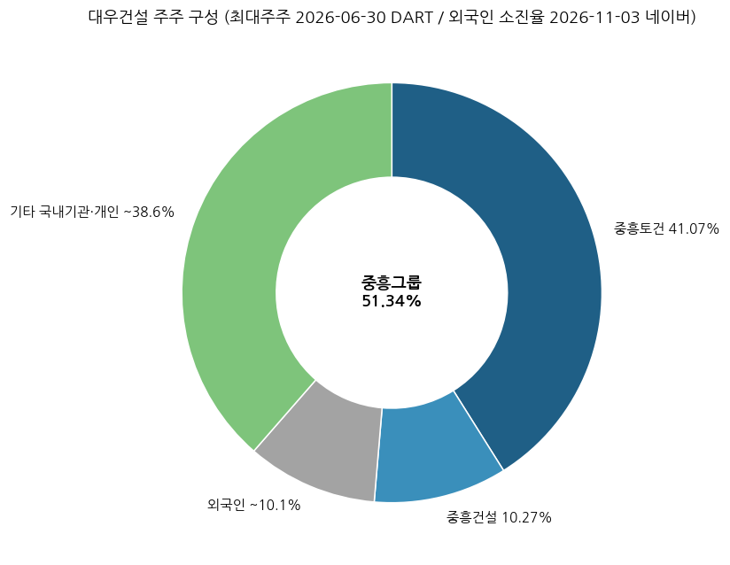

**5% 이상 주주 (보통주):**

| 주주명 | 주식수 | 지분율 | 기준일 / 출처 |
|--------|--------|--------|------|
| 중흥토건㈜ (최대주주) | 168,744,967 | 41.07% | 2026-06-30 DART |
| 중흥건설㈜ (계열) | 42,186,242 | 10.27% | 2026-06-30 DART |
| 김보현 (전 대표이사) | 15,000 | 0.00% | 2026-06-30 DART |
| **최대주주 등 합계** | **210,946,209** | **51.34%** | 2026-06-30 DART (2025말 50.75% — 자사주 소각으로 지분율 상승) |

**전체 주주 구분 (2026-11):**

| 구분 | 지분율 | 비고 |
|---|---|---|
| 중흥그룹 (최대주주등) | 51.34% | DART 2Q26 |
| 외국인 | 10.07% | 네이버 증권 외인소진율 2026-11-03 |
| 기타 국내기관·개인 | ~38.6% | 잔여 (국민연금 등 5% 이상 공시 확인 안 됨) |

- 발행주식: 보통주 410,907,638주 (자기주식 21,918주, 유통 410,885,720주) / 액면 5,000원, 자본금 2조 781억 (2026-06-30)

### ③ 임원·이사회

**대표이사:**
- **이강석 대표이사** (1971년 04월생, DART 2025 임원현황)
    - 약력: 1996 대우건설 입사 — 영업·대외협력 약 30년 '정통 대우맨', 인천대, 총무팀장 → 관리지원실장 → 대외협력단장 (상무A, 2025말) → 부사장 → 2026-08 차기 대표 내정 → **2026-10-02 임시주총·이사회 선임** (CEO스코어데일리 2026-08-24, SBS Biz 2026-10-05)
    - **중흥그룹 인수 당시 M&A TF를 이끈 인물** (CEO스코어데일리)
    - 취임 경영방향: SUMMIT·TOGETHER·CHALLENGE, AI 인프라 신사업·해외 거점 확장 (SBS Biz)
    - 전임: 김보현 사장 (1966년생, 공군사관학교, 전 ㈜헤럴드 부사장, 2024-12-12 대표 취임 → 2026-08 용퇴, 사유 미공개) / 그 이전 백정완 (2022-02~2024-12)
- 2026-10 정기 외 임원인사: 건축·토목·플랜트 본부장 교체 (MTN 2026-10-08)

**등기임원 (DART 반기보고서(2026.06), 2026-06-30 — 이강석 선임 전):**

| 구분 | 성명 | 직위·담당 | 주요 경력 | 임기만료 |
|---|---|---|---|---|
| 사내이사 | 김보현 (1966.02) | 사장, 대표이사 | 공군사관학교, 전 총괄부사장·경영지원본부장, 전 ㈜헤럴드 부사장 | 2029-03 (2026-08 사임) |
| 사외이사 | 김재웅 (1958.09) | 감사위원 | 법무법인 광장 고문, 전 서울지방국세청장 | 2028-03 |
| 사외이사 | 김재중 (1961.10) | - | 김&장 고문, 전 공정위 서울사무소장 | 2028-04 |
| 사외이사 | 이인석 (1969.09) | 감사위원 | L&O파트너스 대표변호사, 전 서울고법 부장판사 | 2028-03 |
| 사외이사 | 이영희 (1971.11) | - | 법무법인 바른 대표변호사 | 2028-12 |
| 사외이사 | 안성희 (1976.11) | 감사위원 | 가톨릭대 회계학과 교수 | 2029-03 |

- 이사회: 사내 1 + 사외 5 (2Q26) — 사외이사 비중 높으나 사내이사는 대표 1인 / 회장(정원주)은 미등기
- 주요 미등기 임원 (2025말): CFO 황원상 상무 (전 삼일회계법인), 원자력사업단장 김무성 상무 (전 요르단 연구용원자로 PJ), 플랜트사업본부장 박세윤 상무B (전 모잠비크 LNG PJ팀장)

**외부감사인 (DART 각 연도 사업보고서 V):**

| 기간 | 감사인 | 비고 |
|---|---|---|
| ~2015 (제16기) | 삼일회계법인 | 적정 |
| 2016 (제17기) | 안진회계법인 | **3Q16 분기 검토 의견거절** → FY16 적정 |
| 2017 (제18기) | 삼정회계법인 | 적정 |
| 2018~2024 (제19~25기) | 삼일회계법인 | 적정. 핵심감사사항: 투입법 수익인식 정확성 · 개발사업 건설계약 매출채권 회수가능성 |
| 2025~ (제26기~) | 삼정회계법인 | 적정. 핵심감사사항: **총계약원가 추정 불확실성 · 공사진행률 산정 · 개발사업 매출채권 회수가능성** |

---

## 6. 기타 팩트

### ① R&D 인프라

| 연도 | 2013 | 2014 | 2015 | 2016 | 2017 | 2018 | 2019 | 2020 | 2021 | 2022 | 2023 | 2024 | 2025 |
|---|---|---|---|---|---|---|---|---|---|---|---|---|---|
| 연구개발비용 (억원) | 728 | 464 | 566 | 440 | 562 | 653 | 634 | 668 | 596 | 680 | 737 | 830 | 875 |
| **R&D / 매출** | **0.86%** | **0.47%** | **0.57%** | **0.40%** | **0.48%** | **0.62%** | **0.73%** | **0.82%** | **0.69%** | **0.65%** | **0.63%** | **0.79%** | **1.08%** |

(DART 사업보고서 II '연구개발비용 계' — 판관비 경상개발비 + 연구개발부서 비용 + 제안 프로젝트 기본설계 위탁용역비 포함. 2022·2023은 2024 사업보고서 재작성값. 2019 비율 0.73%는 2020 보고서 기재값)

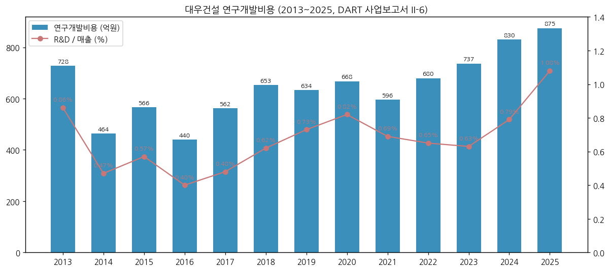

- **기술연구원** (수원): 기술전략팀, AX데이터팀 (전사 AX 전략·AI PoC), 스마트TI팀 (드론·디지털·스마트건설) + 본부별 기술팀 (DART 반기보고서(2026.06) II-6)
- 원자력: 고온가스로(HTGR) 국가과제 참여 (~2027말, 방사선 방호·방폐물 계통 설계, 사용후핵연료 중간저장 설계) / ISO 19443 (원자력 품질) 국내 건설사 최초 인증 (데일리안 2026-04-22)

### ② 진행 중 corporate action — 10년치 주요 이벤트

```
2026  · 이강석 대표 취임 (10-02) / 김보현 용퇴 (08) / 건축·토목·플랜트 본부장 교체 (10)
      · 체코 두코바니 시공계약 결렬 (10-29, 한수원 발표) — 법적 분쟁 가능성
      · 자기주식 4,715,000주 소각 (03-18)
      · 해외·원자력 조직 통합 → 글로벌인프라 부문 (데일리안 2026-04-22)
      · 청라 M5 8,181억 등 9M 수주 12.48조
2025  · 4Q25 빅배스 (연결 OP -1.11조) / 투르크메니스탄 비료 약 1조 (2Q) / GTX-B 민자 (08)
      · 체코 원전 본계약 (한수원–EDUJ, 06) / 신규수주 14.24조
2024  · 김보현 대표 선임 (12-12) / 시공능력평가 3위
2022  · 중흥그룹 편입 (02-28) / 백정완 대표 선임 (02-28)
2021  · 중흥그룹 SPA 체결
2020  · 모잠비크 LNG Area 1 계약 (12) / 나이지리아 NLNG Train 7 원청 / 대우에스티–푸르지오서비스 합병
2019  · 본사 을지로 이전
2018  · 호반건설 매각 무산 (02, 언론 보도)
2016  · 3Q16 검토 의견거절 → 4Q16 빅배스
```

### ③ 원전·기술 마일스톤 — 10년치

```
2026  · 체코 시공계약 결렬 (10-29) — 한수원, 2027-07까지 신규 국내 시공사 선정
      · i-SMR 시공 협력·공동투자 협의 (한수원 'SMART 팀코리아')
2025  · 체코 두코바니 5·6호기 본계약 (한수원–EDUJ, 2025-06) — 대우건설 시공 주간사 지위로 참여 예정이었음
      · 한전 계열사와 SMR 협력체계 구축 (2025-03, 데일리안 2026-04-22)
2024  · 체코 팀코리아 우선협상대상자 (2024-07) / 한수원 혁신형 SMR MOU
2023  · 한국원자력연구원 차세대 SMR 기술 MOU
2018~ · 체코 원전 팀코리아 시공 주간사 활동 (현지 600여 기업 네트워크)
2010s · 요르단 연구용원자로 EPC 완공 / 기장 신형연구로 주간사 / 월성 1호기 해체설계 참여
```

### ④ 주요 리스크

- **원전 옵션 소멸 리스크**: 체코 시공계약 결렬 (2026-10-29) — 한수원은 "국내 기업"만 대상으로 2027-07까지 신규 시공사 선정 예정, 대우건설 재참여 여부 불확실. 한수원 측은 법적 분쟁 가능성 언급 (한인센터 2026-10-29) / 증권사 리포트 제목 "해외 원전 기대감의 균열, 투자의견 하향 불가피" (2026-10-30, 네이버 증권 리서치 목록 — 증권사명 미표기)
- **PF·책임준공 우발채무**: 책임준공 조건부 채무인수 약정 16.94조 (연결회사분, 대출잔액 10.36조) / PF 신용보강 2.18조 (2Q26, DART) — 연결 자본 3.92조 대비 크게 상회. 기타사업 브릿지론 6,695억 전액 1년 내 만기. 미착공 PF 8,400억 (3Q26, +73%)
- **지방 미분양**: 4Q25 빅배스 주원인 + 3Q26에도 준공 후 미분양 대손 733억 (삼성증권) — 시화 MTV·대구 달서 등 분양대금 회수율 2~4% 현장 (비즈워치 2026-02-11)
- **해외 토목 원가**: 2016·2025 두 차례 빅배스 모두 해외 토목이 최대 손실원 / 싱가포르 CR108 설계변경, 이라크 매출 감소 (삼성증권 2026-10-29)
- **소송**: 2Q26 연결 피고 소송 314건 (소송가액 5,730억) / 원고 90건 (5,237억) / 중재 신청 8건 (5,537억)·피신청 7건 (2,472억) — 하자보수 소송 다수, 대한민국 원고 사해행위취소 306억 (DART 반기보고서(2026.06) XI-2)
- **신용등급 A**: 대형 건설사 중 낮은 편 (현대건설 AA-) — 2025 부채비율 284.5%, 12년 연속 순차입
- **핵심감사사항 (삼정회계법인, 2025)**: 총계약원가 추정 불확실성 · 진행률 산정 · 개발사업 매출채권 회수가능성 — 원가 추정 변경이 일시 손실로 이어지는 구조 (4Q16·4Q25 사례)
- **지배구조**: 중흥그룹 51.34% — CEO 교체가 정기인사 외 사유 미공개로 이뤄짐 (2026-08, 노조 반발 — CEO스코어데일리)
- **환율**: 해외 매출 비중 21% (2025 1.73조 / 8.05조 조정 전 기준) — 이라크·나이지리아·모잠비크 등 신흥국 통화·지정학 노출

### ⑤ ESG 등급

| 평가기관 | 등급 | 비고 |
|---------|------|------|
| KCGS (한국ESG기준원) | 미확인 | 이번 버전에서 원문 확인 못 함 — v1.1 보강 대상 |
| CDP / DJSI | 미확인 | 지속가능경영보고서 미수집 |

- DART 기재: 온실가스 배출권과 배출부채 주석 (연결 주석 37) 존재

### ⑥ 인증·라이선스

- **원전**: 국내 대형원전 주설비 주간사 (월성 3·4호기, 신월성 1·2호기), 연구용 원자로 EPC (요르단), ISO 19443 (원자력 공급망 품질) — 데일리안 2026-04-22
- 대우에스티: 원자력발전소 철강구조물 제조공장 인증 (한국전력산업기술기준), 공장인증 건축분야 1급 (국토교통부) — DART 반기보고서(2026.06)
- 신용등급: 회사채 A / ICR A / CP A2 (2026-06, 한기평·NICE)
- 시공능력평가 3위 (2024, 11.7조원)

---

## Version Log

**v1.0 (2026-11-04) — 신규 작성**
- ① 데이터 수집: OpenDART fnlttSinglAcntAll (연결·별도 각 43개 JSON, 2015 FY~2Q26 + 2014 비교컬럼) → 12년 손익·재무상태·현금흐름·CapEx 전부 DART 원값. dart_quarterly_summary 분기표와 대조 (분기합 = 연간 차이 0)
- ② DART 정기공시 원문 XML 55건 파싱 (최신 기재정정본 우선): 부문별 매출·영업이익 2013~2025 (연간) + 1Q14~2Q26 (50분기, 누적값 차분), 계약잔액 3Q19~2Q26, 국내/해외 매출, 10대 매출처, 임직원 2013~2025, 연구개발비 2013~2025, 감사인 변천, 소송, PF·책임준공 우발부채 (2Q26), 계약잔액 상위 현장, 자사주 소각, 신용등급
- ③ OpenDART 주요정보 (최대주주·임원·직원·배당·자기주식·주식총수): 2015·2019·2020·2025·2Q26
- ④ 시장 데이터: Yahoo Finance 월간 (2001-03~) + 일간 2년, 네이버 증권 (시총·외인소진율·컨센서스 2026-11-02~03)
- ⑤ 언론·증권사: 3Q26 잠정 (이코노미스트·비즈워치·삼성증권 2026-10-27~29), 4Q25 빅배스 (비즈워치 2026-02-11), 체코 시공 결렬 (CEO스코어데일리·한인센터 2026-10-29), CEO 교체 (CEO스코어데일리 2026-08-24, SBS Biz 2026-10-05), 원전 실적 (데일리안 2026-04-22), 현대차증권 (아시아경제 2026-05-30)
- ⑥ 차트 17종: chart1·1b·2(×5: 주택건축·토목·플랜트·기타 + 별도)·4·5·6·7·8·9·10·11·12·13 (수주잔고, 건설업 추가)
- ⑦ 3Q26 잠정실적 반영 (분기 시계열만, 연간 표는 FY25 기준 유지)

**누락·한계:**
- 회사 IR 자료: irgo 게시물 5건 중 PDF 0건 다운로드 — IR 실적 PDF(부문 원가율·신규수주 분기 시계열) 미확보
- 2018년 이전 수주잔고 총액 (보고서에 상위 현장만 공시) / 신규수주 연도별 시계열 (2025만 확보)
- ESG 등급·지속가능경영보고서 미수집
- 2014년 차입금 (계정 미분리)

**다음 갱신 (3Q26 분기보고서 제출 후, 11월 중순):**
- 3Q26 부문 영업이익·PF 보증·9월말 재무상태표를 DART 확정치로 교체 (현재 3Q26 = 잠정 보도)
- 체코 시공 결렬 후속 (법적 분쟁·재입찰 참여 여부), 원전 Secondary 재판정
- 연간 표는 FY26 결산 후 v2.0
