# 대한항공 — 기업 개요 (v1.0)

> 마지막 update: 2026-11-25 (v1.0 — 첫 작성. 3Q26 분기보고서(2026-11-13 제출)·3Q26 IR(별도 잠정)까지 반영)
> 입력 source: OpenDART fnlttSinglAcntAll (연결 CFS 44개 + 별도 OFS 44개 JSON, 2015 사업보고서\~3Q26 — 2014는 2015 사업보고서 전기 컬럼) + DART 정기공시 원문 XML 25건 (사업보고서 2020\~2025(2020은 기재정정본), 분기·반기 3Q20\~3Q26) + OpenDART 기업개황·최대주주·임원·직원·배당·자기주식·주식총수 (2017·2020·2022·2025 사업보고서, 3Q26 분기보고서) + 아시아나항공(020560) OpenDART 분기 손익 (1Q23\~3Q26) + 대한항공 IR 실적발표 PDF 44건 (irgo 경유, 3Q19\~3Q26 — 텍스트 추출 가능분 23건, 1Q21·4Q21·1Q22 3건은 이미지 PDF, 2Q21·3Q21 4건 다운로드 실패) + Yahoo Finance (003490.KS 월간 2000-01\~2026-11 수정주가, 일간 2007·2020-06\~2021-02·2021-01\~2026-11-25) + 언론 (머니투데이·데일리안·비즈워치·뉴스토마토·CEO스코어데일리·이투데이·한국ESG기준원 보도 등, 2020-06\~2026-11)
> 갱신 주기: 매분기 (실적 리뷰 모드 호출 시)
> 워치리스트: **운송 섹터 / 서브섹터: 항공 (대한항공·제주항공)** (`earnings/watchlist.md` 95행) — 2순위 섹터, 4Q26부터 리뷰
> **Fact verify cutoff**: 2026-11-25 (주가 2026-11-24 종가 **31,150원** [Yahoo Finance 003490.KS 일간], 보통주 발행주식총수 368,220,661주 [DART 사업보고서(2025.12) 주식의 총수 — 3Q26까지 변동 없음] → 보통주 시가총액 **11.47조원** [계산] (우선주 1,110,794주 제외). 무상·유상증자 조정 이후 구간(2021-01-25 권리락 이후, Yahoo 비수정 구간) 최고 종가 **34,500원 (2021-06-11)**, 장중 최고 35,100원 (2021-06-10) → 현재가는 고점 대비 **-9.7%**. 수정주가 기준 월말 최고는 2010-12 (Yahoo 수정종가 55,000원대 — 수정주가라 실제 주가와 다름 ⚠️), 일간 수정종가 최고 59,199원 (2007-11-06, 수정주가). **YTD +38.1%** (2025말 22,550원), **1년 +48.3%** (2025-11-24 21,000원). 2026년 최저 종가 21,650원 (2026-01-08), 2026년 최고 종가 32,450원 (2026-11-10))

---

## 1. 기업 분류

- **Primary 분류: 사이클 — 글로벌 항공 운송 사이클 (여객 수요·화물 운임·유가·환율 4변수)** (OPM이 12년간 1.4%\~20.1% 범위에서 변동, 2020\~2022 코로나 화물 특수로 사상 최대 이익)
- **Secondary 노트: 구조 변화(아시아나 통합 → 국내 FSC 단일화) + 항공우주(방산·MRO·무인기) 옵션** — 2024-12-11 아시아나항공 지분 63.88% 취득 [이투데이·CEO스코어데일리 2024-12], 2026-12-17 합병(통합 대한항공 출범 예정) [머니투데이 2026-05-13], 통합 LCC(진에어+에어부산+에어서울) 2027-03-17 출범 예정 [국토부 인가 2026-11-12 보도]. 항공우주 부문 매출 0.78조 (2025, 연결 부문 합계의 3.0%) [DART 사업보고서(2025.12)]

### ① 정량 근거

**📊 Summary Box (12년, 2014\~2025 연결):**

| 지표 | 값 |
|------|-----|
| 매출 CAGR (2014→2025, 11년) | **+7.1%** (11.91조 → 25.23조) — 2025는 아시아나 손익 연결 첫해. 아시아나 편입 전 기준 2014→2024 CAGR **+4.1%** |
| OPM 평균 (12년) | **8.3%** (코로나 화물 특수 2021\~2022 제외 시 6.4%) |
| OPM 정점 평균 | **14.9%** (2016 9.6% · 2022 20.1%) |
| OPM 저점 평균 | **2.4%** (2014 3.3% · 2020 1.4%) |
| 사이클 주기 | **약 6년** (정점→정점 2016→2022, 저점→저점 2014→2020) |
| 사이클 회수 (12년) | **2회** (2014 저점→2016 정점→2020 저점→2022 정점→2025 하강 중) |

```
[전사 OPM 시계열 (12년, 연결, DART)]
연도   매출(조)  영업이익(조)  순이익(조)   OPM    NPM   EBITDA마진
2014    11.91      0.40       -0.61     3.3   -5.1    16.7   ← 고유가 구간 + 부채비율 966%, 순손실 -6,129억
2015    11.54      0.88       -0.56     7.6   -4.9    21.9   ← 유가 급락 수혜 OPM 7.6%, 원화 약세 외화환산손실로 순손실 [DART]
2016    11.73      1.12       -0.56     9.6   -4.7    24.5   ← 사이클 정점① OPM 9.6%, 그러나 순손실 -5,568억 (환산손실) — 부채비율 1,178% 12년 최고
2017    12.09      0.94        0.80     7.8    6.6    21.8   ← 원화 강세 환산이익 → 순이익 8,019억, 2017-12 유상증자
2018    13.01      0.62       -0.20     4.8   -1.5    18.2   ← 유가 반등 → OPM 4.8%
2019    12.68      0.26       -0.62     2.0   -4.9    18.5   ← 미중 무역분쟁·한일 갈등·화물 부진 → OPM 2.0%, 순손실
2020     7.61      0.11       -0.23     1.4   -3.0    27.3   ← 사이클 저점 OPM 1.4% — 코로나 여객 -74% vs 화물 특수(화물 노선 +66%), 유증 1.13조
2021     9.02      1.42        0.58    15.7    6.4    34.5   ← 화물 특수 OPM 15.7%, 유증 3.32조
2022    14.10      2.83        1.73    20.1   12.3    31.8   ← 사이클 정점② OPM 20.1% 사상 최대 (화물 운임 + 여객 리오프닝)
2023    16.11      1.79        1.13    11.1    7.0    21.8   ← 화물 운임 정상화, 여객 회복 → OPM 11.1%
2024    17.87      2.11        1.38    11.8    7.7    21.9   ← 여객 역대 최대권, 2024말 아시아나 BS 편입 (손익은 미포함)
2025    25.23      1.11        0.65     4.4    2.6    15.7   ← 아시아나 손익 첫 연결 (매출 +41%) + 아시아나 적자·통상임금 → OPM 4.4%

OPM range: 1.4% ~ 20.1% (18.7%p) — 매출보다 이익 변동이 훨씬 큼 = 고정비(항공기·인건비) 레버리지 + 유가·환율·화물운임 민감
```

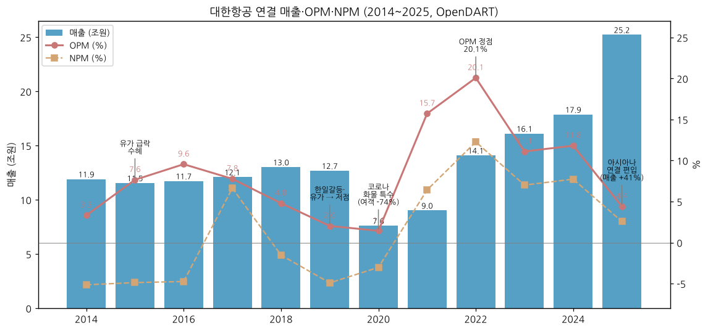

(2014 수치는 2015 사업보고서 전기 컬럼. EBITDA = 영업이익 + 현금흐름표 감가상각비 + 무형자산상각비 [계산] — 감가상각비에는 2018 이전 금융리스 항공기·2019 이후 사용권자산 상각 포함. 2018·2019 연결 매출은 원 공시치(13.01조·12.68조) — 2020 기내식·기내면세 사업 매각 후 사업보고서에서는 중단영업 재분류로 12.70조·12.38조로 재작성됨 [DART 사업보고서(2020.12) 부문정보])

### ② 산업 분류

- 산업: **항공운송 (FSC, 국제선 여객·화물) + 항공우주 (군용기 MRO·민항기 구조물·무인기)**
- DART 업종: 511 정기 항공 운송업 [OpenDART company.json] / KRX 운수창고업
- 워치리스트 섹터: **운송** / 서브섹터: **항공** (대한항공·제주항공)
- 시장 지위: 국내 유일 대형 FSC(아시아나 인수 후). 2025말 대한항공 별도 165대(여객 142 + 화물 23) [IR 4Q25], 국내 10개·해외 33개국 96개 도시 여객 취항, 화물기 26개국 45개 도시 [DART 사업보고서(2025.12) II-1]. 2025 별도 여객 RPK 78,010백만인km, 화물 CTK 8,530백만톤km [DART 사업보고서(2025.12) II-3]
- 연결 구조: 대한항공(별도) + 아시아나항공(63.88%, 2024-12-31 인수의제일 BS 편입 → 2025-01-01부터 손익 연결) + 진에어(LCC) + 아시아나 산하 에어부산·에어서울 + 한국공항(지상조업) 등 29개 종속기업 [DART 사업보고서(2025.12) I-1, 부문정보 주석 "인수의제일인 2024년 12월 31일"]

### ③ 분류 결정 논리

(1) **여객 vs 화물 vs 항공우주 (매출 비중)**: 대한항공 별도 2025 매출 16.50조 중 여객 노선 9.84조 (59.7%) / 화물 노선 4.41조 (26.7%) / 기타 1.47조 (8.9%) / 항공우주 0.78조 (4.7%) [DART 사업보고서(2025.12) II-2]. 그러나 **비중은 사이클에 따라 뒤집힌다** — 2021 화물 76.5% · 여객 12.4% (코로나), 2019 여객 64.6% · 화물 21.3% [DART 사업보고서(2020.12)·(2021.12)]. 여객·화물 모두 경기·유가·환율에 연동되는 **글로벌 운송 사이클** → Primary 사이클
(2) **영업이익 비중 sub-rule**: 연결 부문 영업이익의 97\~107%가 항공운송 부문 (2018\~2025 중 2020 제외 — 2020은 부문 합계가 1,071억에 불과해 186%)  [DART 부문정보 계산]. 항공우주 OP는 -370억\~+385억/년으로 미미 (2026 9M 587억으로 개선 중) → 분류는 항공운송 사이클이 결정
(3) **Boundary case — 아시아나 통합 후 구조 변화**:
→ **연결 매출 급증 = M&A 효과**: 2025 연결 매출 25.23조 (+41.2% YoY) 중 아시아나 계열(아시아나·에어부산·에어서울 등) 손익 첫 연결. 대한항공 별도 매출은 +2.4% (16.12→16.50조) [DART]. **2025 연결 YoY는 유기적 성장이 아님**
→ **연결 이익률 희석**: 아시아나 연결 OP 2025 -3,452억 (1Q +554 / 2Q -69 / 3Q -1,977 / 4Q -1,960) [OpenDART 020560 분기, 계산], 9M26 -5,911억 → 연결 OPM이 별도 OPM보다 2\~8%p 낮아짐 (1Q25\~3Q26) (2Q26 연결 -2.9% vs 별도 +5.2%)
→ **아시아나 화물 매각**: EU 기업결합 조건으로 아시아나 화물사업부를 에어인천에 매각, 2025-08-01 거래 종결 [데일리안 2026-08-15] → 아시아나 화물노선 매출 2024 1.72조 → 2025 0.96조 [DART 사업보고서(2025.12)]
→ **향후**: 2026-12-17 대한항공-아시아나 합병 (합병비율 1:0.2736432, 대한항공 존속, 자본금 약 1,017억원 증가 예정) [머니투데이 2026-05-13] → 이후 '연결 = 사실상 별도 + LCC' 구조로 단순화. 통합 시너지(중복노선 재배치·공동구매)와 통합 비용(마일리지 통합·IT·기단 재도장)이 2027\~2028 이익을 결정
→ 결론: **Primary 사이클 유지 + Secondary(국내 FSC 독점화에 따른 구조적 yield 개선 여부 = 재평가 트리거)**
(4) **글로벌 피어 대비**:
→ **Delta·United (미국 FSC)**: 국내선 비중이 크고 프리미엄·로열티(카드 제휴) 수익이 이익의 큰 축 — 대한항공은 국제선 비중 95.2% (여객 노선수익 기준, 2025) [DART]로 환율·국제 수요 민감도가 더 큼. Delta는 한진칼 지분 14.90% 보유 전략적 파트너(조인트벤처) [CEO스코어데일리 2026-11-03]
→ **Singapore Airlines·Cathay Pacific (허브 캐리어)**: 환승 수요 의존 구조가 유사 — 대한항공도 3Q26 "미국-중국, 구주-동남아, 중국-일본 환승 수요 증가" [IR 3Q26]. Cathay는 화물 비중이 높아 대한항공과 함께 2020\~2022 화물 특수 수혜 프로파일 공유
→ **ANA·JAL (일본 FSC)**: 2강 체제 — 대한항공-아시아나 통합 후 한국은 1 FSC + LCC 구도로 일본보다 집중도 높음
→ 이번 버전은 글로벌 피어 **수치 비교 미수행** (정성 비교만) — 다음 버전 보강 대상

### ④ 적정 밸류에이션 방법

- **1순위: PBR (사이클 저점·고점 밴드) + ROE** — 이익이 사이클·환율 환산손익으로 크게 흔들려 PER은 왜곡이 큼 (2019·2020 적자, 3Q26 분기 순이익 1.26조 중 상당 부분이 외화환산이익 (별도 +1.07조) [IR 3Q26])
→ 연말 PBR (지배지분, 연말 시총 [계산]): 저점 **0.76배 (2025)** · 0.79배 (2024) / 고점 **1.55배 (2020, 유증 직후 코로나 회복 기대)** · 1.51배 (2021)
→ 현재 **1.00배** (2026-11-24 보통주 시총 11.47조 / 3Q26 지배지분 11.47조 [DART]) — 2022\~2025 0.76\~0.94배 밴드 상단 돌파
→ ROE (지배): 2022 22.0% (화물 특수 정점) → 2025 7.3% [계산]
- **2순위: EV/EBITDA (리스부채 포함, IFRS16 기준)** — 현재 **9.0배** (EV 34.53조 = 시총 11.47 + 차입금·사채 12.58 − 현금 2.30 + 리스부채 12.37 + 비지배 0.41, LTM EBITDA 3.85조 [계산])
→ **리스부채를 반드시 포함하는 이유**: 항공기의 상당수를 리스로 도입 — 3Q26 리스부채 12.37조로 차입금·사채(12.58조)와 동급 [DART]. IFRS16 EBITDA는 리스료(사용권자산 상각+이자)를 비용에서 제외하므로, 분자(EV)에서 리스부채를 빼면 **분자는 리스 없음·분모는 리스 비용 제외**가 되어 배수가 과소평가됨. 리스 제외 EV/EBITDA는 5.8배 [계산]로 3.2배p 차이
→ 연말 EV/EBITDA (리스 포함): 4.2배 (2022) \~ 9.3배 (2020) 범위
- **3순위: PER (보조)** — LTM 지배순이익 0.96조 기준 **11.9배** (연결 순이익 0.72조 기준 16.0배) [계산]. 외화환산손익 노이즈 큼 (순외화부채 약 55억불, 환율 10원 변동 시 약 550억원 평가손익 [DART 사업보고서(2025.12) III 위험관리])
- **배당수익률**: 2025 사업연도 DPS 750원 / 31,150원 = **2.4%** [계산] (DART 시가배당률 3.22% — 배당기준일 전 평균가 기준)

#### ④-1 밸류에이션 지표 정의 (운송 섹터 피어 통일용, 2026-11-25)

| 지표 | 정의 | 대한항공 값 |
|---|---|---|
| 주가·시점 | 2026-11-24 종가 (Yahoo 003490.KS 일간) | 31,150원 |
| 시가총액 | 종가 × 보통주 발행주식총수 (자기주식 51주 포함, 우선주 제외) | 11.47조원 |
| PBR | 시총 / 3Q26 말 지배기업 소유주지분 (DART 연결 BS) | 1.00배 |
| PER (지배) | 시총 / LTM 지배순이익 (4Q25\~3Q26 = FY25 − 9M25 + 9M26, OpenDART) | 11.9배 (0.96조) |
| PER (연결) | 시총 / LTM 연결 당기순이익 (비지배 포함) | 16.0배 (0.72조) |
| EBITDA | LTM 영업이익 + LTM 감가상각비(사용권자산 포함) + 무형자산상각비 (CF 표 누적치로 LTM 환산) | 3.85조 (OP 0.81 + D&A 3.03) |
| 순차입금 | 차입금·사채 (단기차입금+유동성장기부채+사채+장기차입금+자산유동화차입금) − 현금및현금성자산 (단기금융상품 4.37조 제외 — 보수적) | 10.27조 |
| EV (리스 포함, 기준) | 시총 + 순차입금 + 리스부채(유동+비유동) + 비지배지분 | 34.53조 → **EV/EBITDA 9.0배** |
| EV (리스 제외, 참고) | 시총 + 순차입금 + 비지배지분 | 22.16조 → 5.8배 |
| 배당수익률 | 직전 사업연도(2025) 보통주 DPS / 종가 | 2.4% (750원) |
| 일회성 (LTM) | 2Q26 연결 영업손실(-2,071억: 유가 급등 + 아시아나 -3,563억), 3Q26 외화환산이익 | — |

(단기금융상품 포함 순차입금 기준 시 EV/EBITDA 7.8배 [계산]. 모든 수치 [계산], 원천은 OpenDART fnlttSinglAcntAll 2025 FY·2025 3Q·2026 3Q 연결)

#### ④-2 운송 5사 공통 비교 박스 (통일 기준, 2026-11-28 통합 검수)

> 다섯 문서(HMM·팬오션·대한항공·제주항공·CJ대한통운)에 **같은 표**를 넣었다. 본문 ④의 회사별 수치는 각 사 고유 정의(리스 제외·단기금융상품 차감 등)라 이 표와 차이가 날 수 있음 — **운송 5사 비교는 이 표 기준**.

| 지표 (2026-11-24 종가, 3Q26 말 기준) | HMM | 팬오션 | 대한항공 | 제주항공 | CJ대한통운 |
|---|---|---|---|---|---|
| 서브섹터 | 해운(컨테이너) | 해운(벌크) | 항공(FSC) | 항공(LCC) | 물류 |
| 시가총액 (조원, 발행주식총수 기준) | 21.08 | 2.57 | 11.47 | 0.65 | 1.58 |
| LTM 매출 (조원, 4Q25\~3Q26) | 12.96 | 7.00 | 27.70 | 1.95 | 13.13 |
| LTM 영업이익 (조원) / OPM | 2.34 / 18.0% | 0.66 / 9.5% | 0.81 / 2.9% | 0.10 / 5.0% | 0.46 / 3.5% |
| LTM EBITDA (조원) / 매출 대비 | 3.65 / 28.2% | 1.08 / 15.5% | 3.85 / 13.9% | 0.25 / 13.0% | 1.16 / 8.8% |
| 순차입금 (조원, 차입금·사채 + 리스부채 − 현금및현금성자산) | 4.23 | 4.45 | 22.65 | 0.89 | 3.88 |
| 　└ 이 중 리스부채 | 4.92 | 0.53 | 12.37 | 0.82 | 1.78 |
| 비지배지분 (조원) | 0.00 | 0.00 | 0.41 | 0.00 | 0.21 |
| EV (조원) = 시총 + 순차입금 + 비지배지분 | 25.31 | 7.02 | 34.53 | 1.54 | 5.67 |
| **EV/EBITDA (LTM, 리스 포함)** | **6.9배** | **6.5배** | **9.0배** | **6.1배** | **4.9배** |
| EV/EBITDA 참고 (리스부채 제외 EV) | 5.6배 | 6.0배 | 5.8배 | 2.8배 | 3.3배 |
| **PBR** (시총 / 3Q26 지배기업 소유주지분) | **0.79배** | **0.44배** | **1.00배** | **1.21배** | **0.38배** |
| PER (시총 / LTM 연결 당기순이익, 비지배 포함) | 7.9배 | 5.5배 | 16.0배 | 4.3배 | 7.3배 |
| **배당수익률** (2025 사업연도 DPS / 종가) | 3.1% (700원) | 3.1% (150원) | 2.4% (750원) | 0% (FY2019\~ 무배당) | 1.2% (800원) |
| 일회성·주의 (LTM 구간) | 3Q26 고운임(순이익의 58%) + 단기금융상품 11.56조 미차감 | 기능통화 USD (원화 자본 환율 영향) | 2Q26 유가 급등·아시아나 적자, 3Q26 외화환산이익 | 3Q26 외환이익 + 항공기 처분이익 522억 | 신종자본증권 3,989억 자본 처리 |

(출처: 시총·종가 = Yahoo Finance 일간 × DART 발행주식총수. 매출·영업이익·순이익 = OpenDART fnlttSinglAcntAll 분기 합산(4Q25 = 연간 − 3Q 누적). EBITDA = 영업이익 + 감가상각비(사용권자산 포함) + 무형자산상각비 — HMM은 부문정보 감가상각비(무형상각 제외), 팬오션은 IR 분기 EBITDA 합산. 차입금·리스부채·현금·지배지분·비지배지분 = DART 3Q26 연결 재무상태표. 단기금융상품은 회사마다 계정 구성이 달라 순차입금에서 일괄 미차감, 신종자본증권은 자본으로 둠 — 통신 3사 박스와 같은 보수적 원칙에 리스부채만 추가. 모두 [계산])

→ **읽는 법**: 항공·해운은 리스로 배·비행기를 들여오는 구조라 **리스 포함 EV/EBITDA가 기준**(리스를 빼면 제주항공 2.8배처럼 착시). ① **해운 2사** = PBR 1배 미만의 사이클 저평가 구간 — HMM은 단기금융상품까지 넣으면 순현금 7.33조로 EV/EBITDA 3.8배까지 내려가 "현금이 주가를 받치는" 구조, 팬오션은 순차입 + 장기계약 이익 하방. ② **항공 2사** = 대한항공 EV/EBITDA 9.0배로 5사 중 최고(아시아나 통합 프리미엄 + 리스부채 12.37조), 제주항공은 PBR 1.21배지만 신종자본증권을 빼면 1.95배로 자본이 얇음. ③ **CJ대한통운** = EV/EBITDA 4.9배·PBR 0.38배로 5사 중 가장 쌈 — 다만 OPM 3.5%의 저마진 방어형이라 사이클 업사이드가 없음.

### ⑤ 분기 재평가 트리거 (분류 변경 조건)

- **합병 후 2개 연도 연속 연결 OPM 10%+ (유가 배럴당 80달러 이상 구간 포함)** 시 → "국내 FSC 독점화로 사이클 진폭 축소" = 사이클 → 사이클+구조 개선 하이브리드 재분류 검토
- **통합 비용으로 연결 OPM이 2개 분기 연속 0% 미만** 시 → 통합 리스크 경보 (2Q26 -2.9% 1회 발생)
- **항공우주 부문 매출이 연결 부문 합계의 10%+ 또는 OP 기여 20%+** 시 → Secondary(방산·MRO) 격상 (현재 매출 3.2%·OP 9.2% (9M26) [DART 3Q26 부문정보])
- **화물 노선수익이 별도 매출의 35%+ 를 4개 분기 연속** 시 → 화물 사이클 주도 국면(2020\~2022형) 재진입 판정 (3Q26 28.4%)
- **한진칼 최대주주 변경 (호반그룹 측)** 시 → 지배구조 리스크 프레임 추가 [한진칼 12-01까지 최대주주 관련 재공시 예정 — CEO스코어데일리 2026-11-03]

---

## 2. 회사 개요

### ① 기본 사항

- **회사명**: 주식회사 대한항공 (KOREAN AIR LINES CO.,LTD.) / KRX 003490 (보통주), 003495 (우선주) [OpenDART company.json]
- **본사**: 서울특별시 강서구 하늘길 260 [OpenDART company.json]
- **설립**: 1962-06-19 (대한항공공사) → 1969-03 한진그룹 인수·민영화 [OpenDART company.json, DART 사업보고서 I — 1969 민영화는 일반 공개정보 ⚠️]. 2013-08 인적분할로 지주사 한진칼 신설 (대한항공은 사업회사) — 주식의 총수 표 "회사분할" 감소 14,445,198주 [OpenDART stockTotqySttus 2025]
- **지배구조**: 한진칼 26.13% (최대주주) + 특수관계인 합계 27.01% (보통주, 2025-12-31) [DART 사업보고서(2025.12)], 국민연금 7.24%. 한진칼 지분은 조원태 회장 측 20.57% vs 호반그룹 20.15% 경쟁 [CEO스코어데일리 2026-11-03]
- **사업 한 줄 정의**: 인천 허브 기반 국제선 여객(노선수익의 95%)·항공화물(세계 상위권 화물 FSC)·항공우주(군용기 MRO·민항기 구조물·무인기)를 영위하는 국내 1위 FSC, 아시아나 인수(2024-12)·합병(2026-12 예정)으로 국내 대형항공사 단일화
- **규모 (3Q26)**: 별도 매출 5.04조 (+25.9%) / 별도 영업이익 4,212억 / 연결 매출 7.32조 / 연결 영업이익 3,492억 [IR 3Q26, DART 분기보고서(2026.09)]
- **대표이사**: **조원태** (대표이사 회장, 1976-01생, 인하대 경영·USC MBA, 한진칼 대표이사 겸임) / **우기홍** (대표이사 부회장, 1962-12생) [OpenDART exctvSttus 3Q26]
- **신용등급**: 회사채 **A (안정적 여부 미확인)** — 한국신용평가·한국기업평가·NICE신용평가, 2026-09-16 공모채 발행 시 [DART 분기보고서(2026.09) 채무증권 발행실적]. 2021-09 BBB+ → A 상향 이력 [DART 사업보고서(2021.12) I]

### ② 최근 12년 손익·자본 추이 (조원, 연결, DART)

| 연도 | 매출 | YoY | 영업이익 | 순이익 | 자본총계 | 자본 YoY |
|---|---|---|---|---|---|---|
| 2014 | 11.91 | - | 0.40 | -0.61 | 2.20 | - |
| 2015 | 11.54 | -3.1% | 0.88 | -0.56 | 2.50 | +13.5% |
| 2016 | 11.73 | +1.6% | 1.12 | -0.56 | 1.87 | -25.0% |
| 2017 | 12.09 | +3.1% | 0.94 | 0.80 | 3.75 | +100.1% |
| 2018 | 13.01 | +7.6% | 0.62 | -0.20 | 2.89 | -22.8% |
| 2019 | 12.68 | -2.5% | 0.26 | -0.62 | 2.78 | -3.9% |
| 2020 | 7.61 | -40.0% | 0.11 | -0.23 | 3.31 | +19.1% |
| 2021 | 9.02 | +18.5% | 1.42 | 0.58 | 6.87 | +107.3% |
| 2022 | 14.10 | +56.3% | 2.83 | 1.73 | 9.29 | +35.3% |
| 2023 | 16.11 | +14.3% | 1.79 | 1.13 | 9.82 | +5.6% |
| 2024 | 17.87 | +10.9% | 2.11 | 1.38 | 10.96 | +11.7% |
| 2025 | 25.23 | +41.2% | 1.11 | 0.65 | 11.46 | +4.5% |

(연결 기준, OpenDART fnlttSinglAcntAll. 9M26: 매출 21.21조 (+13.2% YoY), 영업이익 0.66조 (-31.2%), 순이익 0.70조 (+11.0%), 지배순이익 0.83조 [DART 분기보고서(2026.09), 계산]. 9M26 매출 증가는 별도 여객·화물 yield 상승, 이익 감소는 2Q26 유가 급등(별도 연료비 +110.9% YoY)과 아시아나 적자)

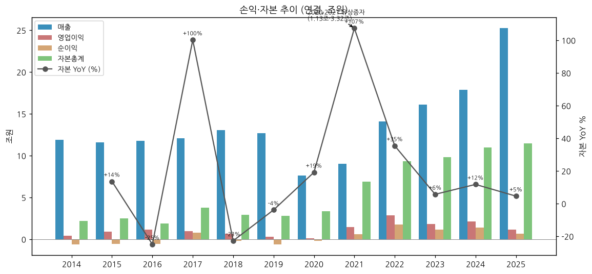

### ③ 회사 주가 역사 ★ narrative 영역

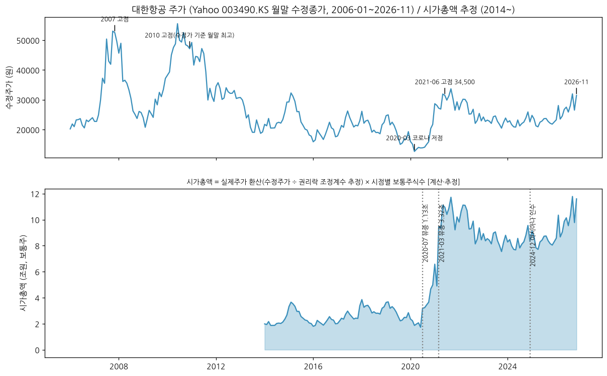

(Yahoo 003490.KS는 **권리락 조정 수정주가** (2021-01-25 이전 가격이 소수점 — 유상증자 조정). 시총 = 실제주가 환산 × 시점별 보통주식수 [계산·추정]. 환산계수 (수정주가 ÷ 실제주가): 2021-01-25 이후 1.0 / 2020-06\~2021-01 **0.760** (2021 유증 권리락 기준가 역산: 1차 발행가 19,100원·배정비율 기준 [비즈워치 2021-01-26, 계산]) / 2020-05 이전 **0.643** (DART 2017 사업연도 시가배당률 0.70%·DPS 250원 → 실제 평균가 35,700원 역산 vs Yahoo 2017-12 수정가 22,970원 [계산]) — 2017-12 이전은 2017·2015 증자 조정계수 미분리로 **과소 추정 가능** ⚠️. 보통주식수: 2014 58.7M → 2015\~2016 72.8M → 2017-12 94.8M → 2020-07 174.2M → 2021-03 347.8M → 2022\~ 368.2M [DART 자본금/액면 5,000원 − 우선주 1.11M, 계산])

(1) 2006\~2013: 고유가·금융위기·인적분할
→ 수정주가 기준 2007-11 일간 최고 (59,199원, 수정가), 2008 금융위기 급락 → 2010 회복 고점 [Yahoo]
→ 2013-08 인적분할 — 한진칼(지주사) 신설, 대한항공은 사업회사 [OpenDART stockTotqySttus "회사분할"]

(2) 2014\~2019: 고부채(부채비율 500\~1,200%)·저유가 수혜·오너 리스크
→ 2014 OPM 3.3%, 순손실 -6,129억, 부채비율 966% [DART, 계산]
→ 2015\~2017 유가 급락 → OPM 7.6\~9.6% (2016 정점), 그러나 외화환산손실로 2015·2016 순손실 [DART]
→ 2017-12 유상증자 (CF 4,533억, 22.0M주) [DART CF·자본금]
→ 2019 미중 무역분쟁·한일 갈등(일본 노선 수요 감소)·유가 → OPM 2.0%, 순손실 -6,228억 [DART, IR 4Q19]
→ 2019-04 조양호 회장 별세 → 조원태 체제 (일반 공개정보 ⚠️), 2019\~2020 한진칼 경영권 분쟁 (KCGI·조현아·반도건설 3자 연합) — 이번 버전 세부 미검증 ⚠️

(3) 2020\~2021: 코로나 — 여객 붕괴, 화물 특수, 두 차례 유상증자
→ 2020 별도 국제선 여객 -76% (7.28→1.76조), 화물 +66% (2.56→4.25조) [DART 사업보고서(2021.12) 매출현황]
→ **2020-03 월말 수정종가 12,690원 → 실제 환산 약 19,700원, 시총 약 1.9조 — 12년 최저권** [Yahoo, 계산·추정]
→ **2020-07 유상증자 79,365,079주, 약 1.13조** (발행가 약 14,200원 — 자본금 증가 3,968억·CF 11,193억으로 역산; 예정가 12,600원 [뉴스토마토 2020]) — 채무 상환
→ 2020-11 아시아나 인수 발표 → 2020-12 산업은행, 한진칼에 8,000억 투자 [비즈워치 2021-01-26]
→ 2020-12 기내식·기내면세 사업 매각 (중단영업 — 2018\~2019 재작성) [DART 사업보고서(2020.12)] — 매각가 9,906억은 일반 공개정보 ⚠️
→ **2021-03 유상증자 173,611,112주 × 19,100원 = 약 3.32조** (아시아나 인수 1.5조 + 채무상환 1.8조, 납입 2021-03-12) [비즈워치 2021-01-26]. 단, 2021 연결 CF '유상증자' 2.55조로 표기 — 차이 원인 미검증 ⚠️
→ **2021-06-11 종가 34,500원 — 비수정 구간 최고가, 시총 약 12.0조** [Yahoo 일간, 계산]

(4) 2022\~2024: 화물 특수 정점 → 여객 리오프닝 → 인수 장기화
→ 2022 연결 OP 2.83조·OPM 20.1% (사상 최대), 화물 노선 7.72조 [DART]
→ 2022 사업연도 배당 재개 DPS 750원 [OpenDART alotMatter 2022]
→ 2023\~2024 여객 회복 (별도 여객 9.0→9.8조), 화물 운임 정상화 → OPM 11%대 [DART]
→ 2022\~2025 주가 21,000\~26,000원 박스, PBR 0.8\~0.9배 [Yahoo, 계산]
→ **2024-12-11 아시아나 신주 인수 (1.5조, 지분 63.88%) → 12-12 자회사 편입** [이투데이·CEO스코어데일리 2024-12]

(5) 2025\~2026-11: 연결 편입 후 희석 → 유가 쇼크 → 통합 기대로 52주 신고가
→ 2025 연결 OP 1.11조 (-47.2%) — 아시아나 적자·통상임금 인건비 [DART, IR 4Q25 "통상임금 효과에 따른 인건비 증가"]
→ 2026-05-13 합병계약 이사회 승인 → 2026-06-25 국토부 합병 인가 → 통합 대한항공 2026-12-17 출범 예정 [머니투데이 2026-05-13, MTN 2026-06-25]
→ 2Q26 중동 리스크·유가 급등 → 별도 연료비 1.999조 (+110.9%), 연결 영업손실 -2,071억 [IR 2Q26, DART]
→ 3Q26 별도 여객 yield +16%, 화물 yield +27.5% (AI·반도체 화물) → 별도 OP 4,212억 (+11.9%) [IR 3Q26]
→ 2026-11 한진칼 지분 경쟁 재점화 (호반 20.15% vs 조원태 측 20.57%) [CEO스코어데일리 2026-11-03]
→ **2026-11-24 31,150원 (시총 11.47조), YTD +38.1%** [Yahoo]

### ④ 회사의 주요 연혁

```
1962-06-19   대한항공공사 설립
1969-03      한진그룹 인수 (민영화)                              ← 일반 공개정보, 미검증
2000         스카이팀(SkyTeam) 창립 멤버                          ← 일반 공개정보, 미검증
2013-08      인적분할 — 지주사 한진칼 신설
2015·2017    유상증자 (자본금 2,989억 → 3,698억 → 4,798억)
2018-05      델타항공 태평양노선 조인트벤처 개시                   ← 일반 공개정보, 미검증
2020-07      유상증자 약 1.13조 (79,365,079주)
2020-11      아시아나항공 인수 결정 (신주 1.5조)
2020-12      기내식·기내면세 사업 매각 (중단영업)
2021-03      유상증자 약 3.32조 (173,611,112주)
2022         자본금 1,744.7억 → 1,846.7억 (+20.4M주, 원인 미검증)
2024-12-11   아시아나항공 지분 63.88% 취득 (12-12 자회사 편입)
2024-12-31   아시아나 인수의제일 — 연결 BS 편입
2025-08-01   아시아나 화물사업 에어인천 매각 완료
2026-05-13   대한항공-아시아나 합병계약 (1 : 0.2736432)
2026-06-25   국토부 합병 인가
2026-11-12   진에어·에어부산·에어서울 합병 인가 (통합 진에어 2027-03-17 목표)
2026-12-17   통합 대한항공 출범 예정
```

(출처: OpenDART company.json·자본금 시계열, DART 사업보고서(2020.12·2025.12)·분기보고서(2026.09), 언론 — 날짜별 본문 표기. "미검증" 표기는 원문 대조 미수행)

---

## 3. 비즈니스 모델

### ① 실적 추이 (연결 → DART 부문 → 대한항공 별도 노선별 3단계 위계)

**연결 구조 변화 (아시아나 편입 전후 구분 — 반드시 확인):**

| 기간 | 연결 범위 | 비고 |
|---|---|---|
| \~2024 | 대한항공 + 진에어 + 한국공항·한진정보통신·호텔(Hanjin Int'l) 등 | 아시아나 미포함 |
| 2024-12-31 | **BS만** 아시아나 계열 편입 (인수의제일) | 2024 연결 자산 30.39 → 47.01조 (+16.6조), 리스부채 4.43 → 10.93조 |
| 2025-01-01\~ | 손익까지 아시아나·에어부산·에어서울·아시아나에어포트·아시아나IDT 연결 | 2025 연결 매출 +41.2% 대부분이 편입 효과 |
| 2026-12-17 (예정) | 대한항공이 아시아나 흡수합병 → 아시아나 별도 손익이 대한항공 별도로 이동 | 이후 별도≈연결−LCC |

**연간 8년 통합 표 (DART 연결 부문정보 + 대한항공 별도 노선 매출):**

| 항목 | 2018 | 2019 | 2020 | 2021 | 2022 | 2023 | 2024 | 2025 |
|---|---|---|---|---|---|---|---|---|
| **연결 매출 (조원, 원공시)** | **13.01** | **12.68** | **7.61** | **9.02** | **14.10** | **16.11** | **17.87** | **25.23** |
| └ 부문별 매출 (부문간 포함, 조원) |  |  |  |  |  |  |  |  |
| &nbsp;&nbsp;&nbsp;&nbsp;└ 항공운송 | 12.22 | 11.79 | 7.14 | 8.73 | 13.72 | 15.86 | 17.63 | 24.96 |
| &nbsp;&nbsp;&nbsp;&nbsp;└ 항공우주 | 0.65 | 0.74 | 0.56 | 0.37 | 0.49 | 0.54 | 0.59 | 0.78 |
| &nbsp;&nbsp;&nbsp;&nbsp;└ 호텔 | 0.17 | 0.19 | 0.07 | 0.09 | 0.16 | 0.17 | 0.18 | 0.20 |
| &nbsp;&nbsp;&nbsp;&nbsp;└ 기타 | 0.19 | 0.20 | 0.15 | 0.15 | 0.18 | 0.21 | 0.23 | 0.42 |
| **연결 영업이익 (억원, 원공시)** | **6,239** | **2,575** | **1,089** | **14,180** | **28,306** | **17,901** | **21,102** | **11,136** |
| &nbsp;&nbsp;&nbsp;&nbsp;└ 항공운송 OP | 6,062 | 1,888 | 2,006 | 15,010 | 28,811 | 18,133 | 21,297 | 11,743 |
| &nbsp;&nbsp;&nbsp;&nbsp;└ 항공우주 OP | 144 | 385 | -129 | -370 | -7 | -114 | -157 | 242 |
| &nbsp;&nbsp;&nbsp;&nbsp;└ 호텔 OP | -566 | -562 | -804 | -584 | -495 | -348 | -259 | -218 |
| &nbsp;&nbsp;&nbsp;&nbsp;└ 기타 OP | 57 | 72 | -2 | 1 | 53 | -4 | 20 | 332 |
| &nbsp;&nbsp;&nbsp;&nbsp;└ 항공운송 OPM | 5.0% | 1.6% | 2.8% | 17.2% | 21.0% | 11.4% | 12.1% | 4.7% |
| &nbsp;&nbsp;&nbsp;&nbsp;└ 항공우주 OPM | 2.2% | 5.2% | -2.3% | -10.1% | -0.1% | -2.1% | -2.6% | 3.1% |
| **대한항공 별도 매출 (억원)** | **123,636** | **120,177** | **74,050** | **87,534** | **134,127** | **145,751** | **161,166** | **165,019** |
| &nbsp;&nbsp;&nbsp;&nbsp;└ 여객 노선 (국내+국제) | 77,375 | 77,675 | 20,052 | 10,839 | 43,531 | 90,139 | 97,786 | 98,447 |
| &nbsp;&nbsp;&nbsp;&nbsp;&nbsp;&nbsp;&nbsp;&nbsp;여객 비중 | 62.6% | 64.6% | 27.1% | 12.4% | 32.5% | 61.8% | 60.7% | 59.7% |
| &nbsp;&nbsp;&nbsp;&nbsp;└ 화물 노선 | 30,122 | 25,574 | 42,507 | 66,948 | 77,244 | 40,297 | 44,116 | 44,093 |
| &nbsp;&nbsp;&nbsp;&nbsp;&nbsp;&nbsp;&nbsp;&nbsp;화물 비중 | 24.4% | 21.3% | 57.4% | 76.5% | 57.6% | 27.6% | 27.4% | 26.7% |
| &nbsp;&nbsp;&nbsp;&nbsp;└ 기타 | 9,634 | 9,524 | 5,844 | 6,080 | 8,442 | 9,908 | 13,334 | 14,683 |
| &nbsp;&nbsp;&nbsp;&nbsp;└ 항공우주 | 6,505 | 7,404 | 5,647 | 3,667 | 4,910 | 5,407 | 5,930 | 7,796 |
| **별도 영업이익 (억원)** | **6,510** | **2,864** | **2,383** | **14,644** | **28,836** | **15,869** | **19,034** | **15,393** |
| **별도 OPM** | **5.1%** | **2.3%** | **3.2%** | **16.7%** | **21.5%** | **10.9%** | **11.8%** | **9.3%** |
| 연결 − 별도 영업이익 (억원, 자회사·조정) | -271 | -289 | -1,294 | -465 | -531 | 2,032 | 2,068 | -4,257 |

(부문정보: DART 사업보고서 각 연도 "사업부문별 재무 정보" — 부문간 거래 포함 총매출, 2018·2019는 2020 사업보고서의 중단영업(기내식) 반영 재작성치, 2020은 2021 보고서 재작성치. 별도 노선 매출: DART 사업보고서 II-2 매출현황 (2020·2021·2022·2025 보고서), 2018·2019 여객·화물은 동 보고서 재작성치 (여객=국내+국제). 2018 별도 합계 12.36조·2019 12.02조는 중단영업 반영 후)

**대한항공 별도 노선·지역 구조 (2025):**
- 여객 노선수익 9.84조 = 국제 9.37조 (95.2%) + 국내 0.47조 (4.8%) [DART 사업보고서(2025.12) II-1]
- 평균 운임: 국제선 500,809원/명 (2023 612,846원 → 하락), 국내선 72,576원/명 / 화물 국제선 4,250원/kg [DART 사업보고서(2025.12) II-2 가격변동]
- 노선별(미주·구주·동남아·일본·중국·대양주) 여객 매출 비중·화물 지역별 비중은 IR 자료에 **원그래프 이미지로만** 제공 → 이번 버전 수치 미추출 ⚠️ (다음 버전: IR PDF 7·10페이지 이미지 판독)
- 지역별 매출(연결, 판매지역 기준): 국내 25.08조 / 미주 0.14조 / 아시아 등 0.001조 (2025) — 판매 법인 기준이라 노선 구조를 반영하지 않음 [DART 사업보고서(2025.12) II-4]

**사업부별 분기 시계열 (억원, 연결 1Q16\~3Q26 43개 분기 + 별도 43개 분기 + IR 노선수익 2Q21\~3Q26 22개 분기 + 아시아나 1Q23\~3Q26):**

> 1·2·3Q = 분기보고서 "3개월" 금액, 4Q = 사업보고서 연간 − 3분기 누적 [dart_quarterly_summary]. 여객·화물 노선수익은 IR 요약 손익계산서(별도) — 2Q21\~1Q22는 다음 해 IR의 전년동기 컬럼. 항공우주 = DART 부문정보 분기 환산(3Q22\~, 누적 차감) 또는 IR 비고("항공우주 매출 ○억원"). 아시아나 = OpenDART 020560 연결. **60+분기 표준 미충족** — OpenDART 재무 API가 2015 분기 이전을 제공하지 않음 (43분기)

| 분기 | 연결 매출 | 연결 OP | 연결 OPM | 매출 YoY | 연결 순이익 | 별도 매출 | 별도 OP | 별도 OPM | 여객 노선(별도) | 화물 노선(별도) | 항공우주 | 아시아나 매출 | 아시아나 OP |
|---|---|---|---|---|---|---|---|---|---|---|---|---|---|
| 1Q16 | 28,670 | 3,233 | 11.3% | - | -1,749 | 28,112 | 3,078 | 10.9% | - | - | - | - | - |
| 2Q16 | 28,177 | 1,592 | 5.6% | - | -2,508 | 27,669 | 1,484 | 5.4% | - | - | - | - | - |
| 3Q16 | 31,179 | 4,600 | 14.8% | - | 5,108 | 30,568 | 4,476 | 14.6% | - | - | - | - | - |
| 4Q16 | 29,292 | 1,783 | 6.1% | - | -6,419 | 28,681 | 1,752 | 6.1% | - | - | - | - | - |
| 1Q17 | 28,660 | 1,915 | 6.7% | -0.0% | 5,592 | 28,107 | 1,848 | 6.6% | - | - | - | - | - |
| 2Q17 | 29,052 | 1,728 | 5.9% | +3.1% | -2,003 | 28,513 | 1,617 | 5.7% | - | - | - | - | - |
| 3Q17 | 32,139 | 3,555 | 11.1% | +3.1% | 616 | 31,261 | 3,788 | 12.1% | - | - | - | - | - |
| 4Q17 | 31,071 | 2,200 | 7.1% | +6.1% | 3,814 | 30,148 | 2,308 | 7.7% | - | - | - | - | - |
| 1Q18 | 31,020 | 1,663 | 5.4% | +8.2% | -100 | 30,173 | 1,768 | 5.9% | - | - | - | - | - |
| 2Q18 | 31,057 | 667 | 2.1% | +6.9% | -3,047 | 30,138 | 824 | 2.7% | - | - | - | - | - |
| 3Q18 | 35,179 | 4,018 | 11.4% | +9.5% | 2,573 | 34,097 | 3,928 | 11.5% | - | - | - | - | - |
| 4Q18 | 32,860 | -109 | -0.3% | +5.8% | -1,412 | 32,061 | -10 | -0.0% | - | - | - | - | - |
| 1Q19 | 31,389 | 1,406 | 4.5% | +1.2% | -618 | 30,498 | 1,482 | 4.9% | - | - | - | - | - |
| 2Q19 | 31,210 | -986 | -3.2% | +0.5% | -3,963 | 30,201 | -1,015 | -3.4% | - | - | - | - | - |
| 3Q19 | 33,829 | 964 | 2.8% | -3.8% | -2,513 | 32,830 | 1,179 | 3.6% | - | - | - | - | - |
| 4Q19 | 30,406 | 1,191 | 3.9% | -7.5% | 867 | 29,387 | 1,218 | 4.1% | - | - | - | - | - |
| 1Q20 | 24,273 | -828 | -3.4% | -22.7% | -7,369 | 23,523 | -566 | -2.4% | - | - | - | - | - |
| 2Q20 | 17,284 | 1,102 | 6.4% | -44.6% | 1,174 | 16,909 | 1,485 | 8.8% | - | - | - | - | - |
| 3Q20 | 15,953 | -314 | -2.0% | -52.8% | -324 | 15,508 | 76 | 0.5% | - | - | - | - | - |
| 4Q20 | 19,037 | 1,207 | 6.3% | -37.4% | 4,218 | 18,594 | 1,466 | 7.9% | - | - | - | - | - |
| 1Q21 | 17,925 | 1,016 | 5.7% | -26.2% | -561 | 17,498 | 1,245 | 7.1% | - | - | - | - | - |
| 2Q21 | 20,126 | 1,936 | 9.6% | +16.4% | 1,168 | 19,508 | 1,969 | 10.1% | 2,146 | 15,108 | - | - | - |
| 3Q21 | 23,035 | 4,202 | 18.2% | +44.4% | 1,063 | 22,270 | 4,386 | 19.7% | 3,319 | 16,503 | - | - | - |
| 4Q21 | 29,075 | 7,037 | 24.2% | +52.7% | 4,118 | 28,259 | 7,044 | 24.9% | 3,795 | 21,807 | - | - | - |
| 1Q22 | 28,843 | 7,731 | 26.8% | +60.9% | 5,311 | 28,052 | 7,884 | 28.1% | 3,598 | 21,486 | - | - | - |
| 2Q22 | 34,214 | 7,403 | 21.6% | +70.0% | 4,493 | 33,324 | 7,359 | 22.1% | 8,742 | 21,712 | 1,129 | - | - |
| 3Q22 | 39,108 | 8,007 | 20.5% | +69.8% | 3,743 | 36,684 | 8,392 | 22.9% | 14,543 | 18,564 | 1,219 | - | - |
| 4Q22 | 38,797 | 5,165 | 13.3% | +33.4% | 3,749 | 36,068 | 5,201 | 14.4% | 16,648 | 15,483 | 1,592 | - | - |
| 1Q23 | 35,920 | 4,855 | 13.5% | +24.5% | 2,510 | 31,959 | 4,150 | 13.0% | 17,777 | 10,485 | 1,175 | 17,474 | 1,668 |
| 2Q23 | 38,773 | 4,772 | 12.3% | +13.3% | 3,600 | 35,354 | 4,680 | 13.2% | 22,210 | 9,638 | 1,217 | 18,256 | 1,513 |
| 3Q23 | 42,490 | 5,430 | 12.8% | +8.6% | 4,198 | 38,638 | 5,203 | 13.5% | 25,584 | 9,153 | 1,388 | 20,019 | 1,995 |
| 4Q23 | 43,934 | 2,843 | 6.5% | +13.2% | 982 | 39,801 | 1,836 | 4.6% | 24,568 | 11,021 | 1,628 | 20,485 | 1,023 |
| 1Q24 | 42,914 | 5,375 | 12.5% | +19.5% | 4,065 | 38,225 | 4,361 | 11.4% | 23,421 | 9,966 | 1,296 | 20,089 | 623 |
| 2Q24 | 44,022 | 4,429 | 10.1% | +13.5% | 3,591 | 40,237 | 4,134 | 10.3% | 24,446 | 10,972 | 1,630 | 20,153 | 180 |
| 3Q24 | 46,753 | 6,657 | 14.2% | +10.0% | 3,169 | 42,408 | 6,186 | 14.6% | 26,173 | 11,198 | 1,560 | 21,773 | 1,768 |
| 4Q24 | 45,018 | 4,641 | 10.3% | +2.5% | 2,993 | 40,296 | 4,353 | 10.8% | 23,746 | 11,980 | 1,444 | 21,171 | 186 |
| 1Q25 | 64,919 | 4,310 | 6.6% | +51.3% | 3,499 | 39,559 | 3,509 | 8.9% | 24,355 | 10,540 | 1,350 | 20,744 | 554 |
| 2Q25 | 62,107 | 3,701 | 6.0% | +41.1% | 5,573 | 39,859 | 3,989 | 10.0% | 23,965 | 10,554 | 1,624 | 18,870 | -69 |
| 3Q25 | 60,269 | 1,575 | 2.6% | +28.9% | -2,781 | 40,085 | 3,763 | 9.4% | 24,211 | 10,667 | 1,740 | 16,812 | -1,977 |
| 4Q25 | 64,961 | 1,549 | 2.4% | +44.3% | 183 | 45,515 | 4,131 | 9.1% | 25,917 | 12,331 | 3,082 | 16,242 | -1,960 |
| 1Q26 | 66,581 | 5,174 | 7.8% | +2.6% | 337 | 45,151 | 5,169 | 11.4% | 26,131 | 10,906 | 2,522 | 16,804 | -524 |
| 2Q26 | 72,301 | -2,071 | -2.9% | +16.4% | -6,001 | 50,200 | 2,619 | 5.2% | 28,479 | 15,419 | 2,101 | 18,441 | -3,563 |
| 3Q26 | 73,196 | 3,492 | 4.8% | +21.4% | 12,644 | 50,447 | 4,212 | 8.3% | 29,174 | 14,323 | 2,508 | 18,189 | -1,824 |

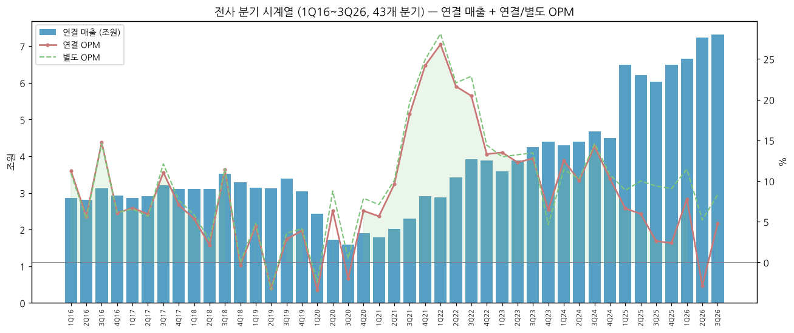
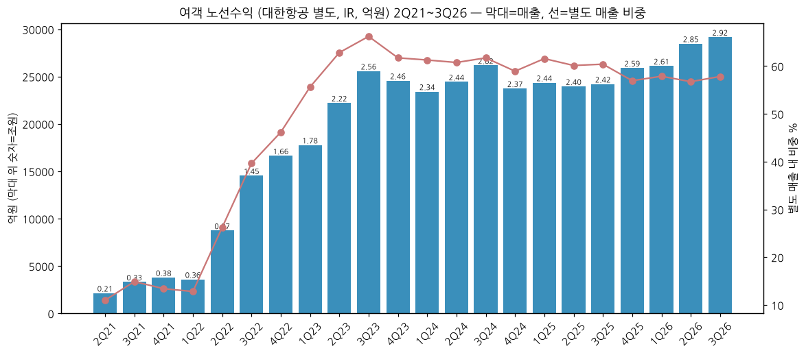
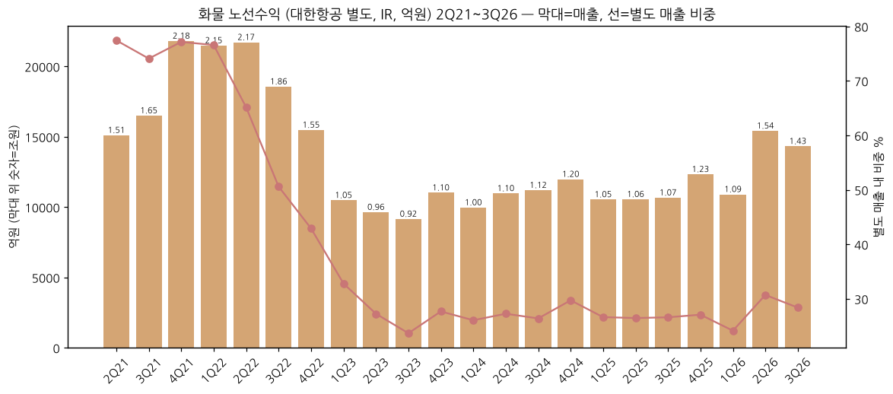
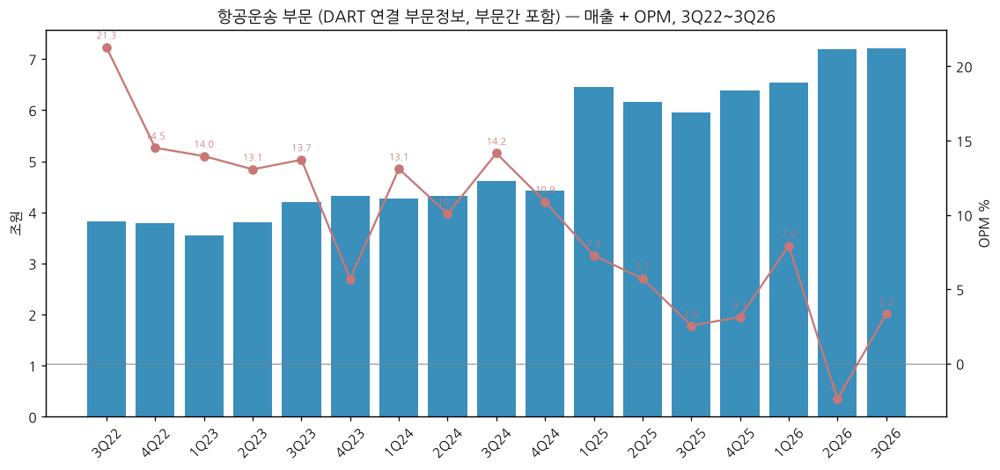
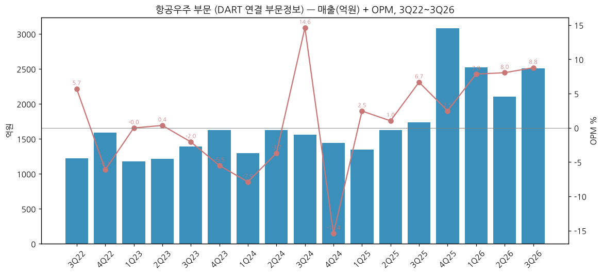
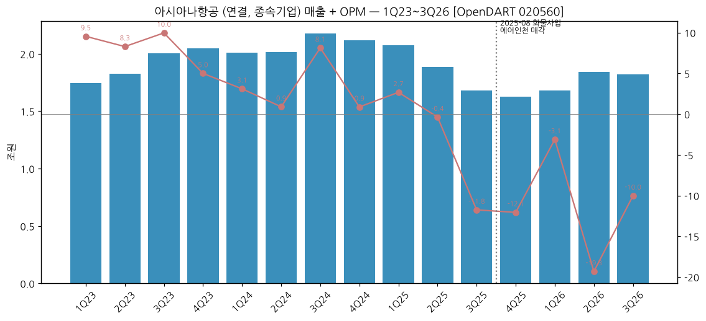

**3Q26 핵심 박스 (IR 잠정 2026-10-16 게시 [irgo], 분기보고서 2026-11-13 [DART]):**

| 항목 | 3Q26 | YoY | 9M26 | YoY |
|---|---|---|---|---|
| 연결 매출 | 7.32조 | +21.4% | 21.21조 | +13.2% |
| 연결 영업이익 | 3,492억 | +121.6% | 6,594억 | -31.2% |
| 연결 OPM | 4.8% | +2.2%p | 3.1% | -2.0%p |
| 연결 순이익 | 1.26조 | 흑전 | 6,980억 | +11.0% |
| 별도 매출 / 영업이익 | 5.04조 / 4,212억 | +25.9% / +11.9% | 14.58조 / 1.20조 | — |
| 별도 여객 노선수익 | 2.92조 (국제 2.80조) | +20.5% | — | — |
| 별도 화물 노선수익 | 1.43조 | +34.3% | 4.06조 | +28.0% |
| 별도 연료비 | 1.70조 | +67.0% | — | — |
| 아시아나 (연결) 영업이익 | -1,824억 | 적지 | -5,911억 | — |

(IR 3Q26 p4·p6·p9·p13, DART 분기보고서(2026.09), OpenDART 020560 [계산]. 3Q26 별도 순이익 9,297억 = 외화환산이익 1조 702억 (평가환율 1,434.9 → 1,358.4원) [IR 3Q26])

→ 증익 요인 (회사 설명): 중동 전쟁 장기화·원화 약세 환경에서 해외발·환승 수요 유치로 여객 Yield +16.1%, AI 인프라(서버랙·반도체) 화물 수요로 화물 Yield +27.5% [IR 3Q26]
→ 감익 요인: 연료비 +67% (고유가), 인건비 +18% [IR 3Q26]
→ 운송 KPI (별도 3Q26): 여객 ASK 23,961백만km (+2.6%), RPK 20,372 (+3.7%), L/F 85.0%, Yield 143원/km / 화물 ACTK 3,156백만톤km (+4.0%), CTK 2,277 (+5.3%), L/F 72.1%, Yield 629원/km [IR 3Q26]
→ 전망 (회사): 고유가 하 수익성 중심 공급, 2026-12 멜버른·히로시마 신규 취항, 화물은 AI·반도체 성장 vs 중동·관세 리스크 [IR 3Q26]

**12분기 시계열 (연결, 매출 + OPM):**

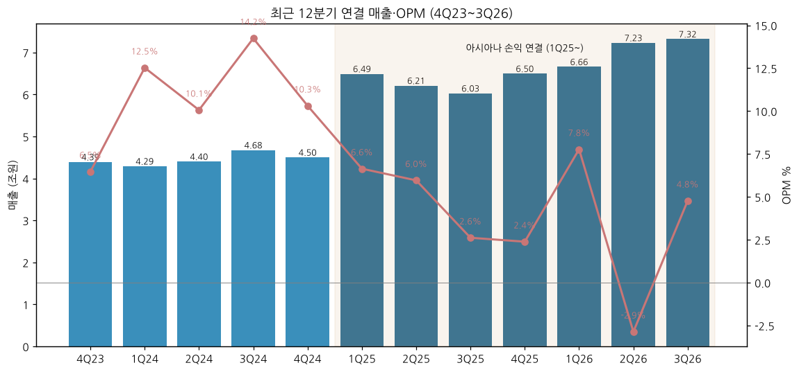

**연료비 vs 수익성 (별도):**

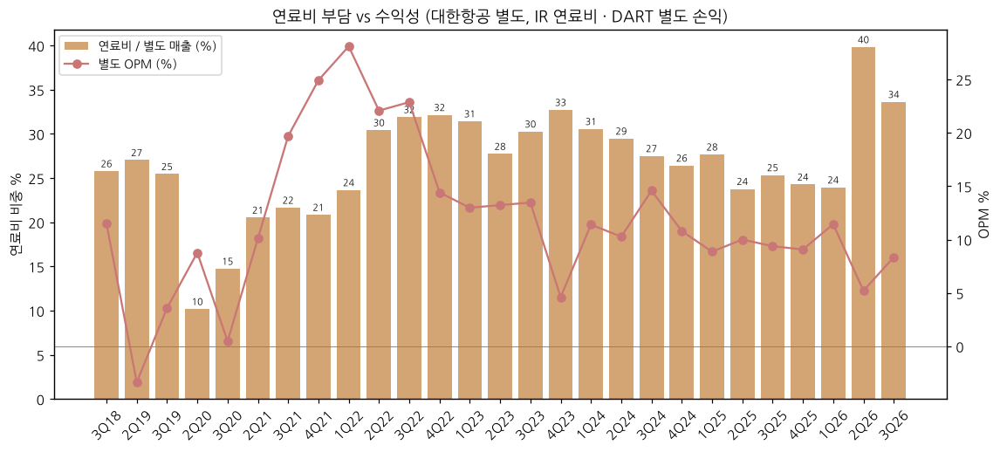

(연료비 = IR 요약 손익계산서(별도) "연료비", 별도 매출·영업이익 = OpenDART 별도. 2Q26 연료비/매출 39.8%·OPM 5.2% vs 2Q25 23.8%·10.0% → 유가 1달러/배럴 변동 시 연간 약 3,050만불 손익 변동 (연간 소모량 약 3,050만 배럴) [DART 사업보고서(2025.12) III 위험관리])

### ② 사업부별 개요 (매출 비중 큰 순서)

| 부문 | 주체 | 2025 부문매출 | 부문 합계 비중 | 2025 OP | 사업 모델 |
|---|---|---|---|---|---|
| 항공운송 | 대한항공 별도 운송 + 진에어 + 아시아나·에어부산·에어서울 + 한국공항 | 24.96조 | 94.7% | 1.17조 | 국제·국내 여객(운임+유류할증료), 화물(화물기 23대+여객기 belly), 마일리지 |
| 항공우주 | 대한항공 항공우주사업본부 | 0.78조 | 3.0% | 242억 | 군용기 창정비·성능개량(MRO/U), 보잉·에어버스 기체 구조물, 무인기 |
| 기타 | 한진정보통신·아시아나IDT(IT), 아이에이티(엔진 시운전), 전자상거래 등 | 0.42조 | 1.6% | 332억 | IT 서비스, 엔진 정비 |
| 호텔 | Hanjin Int'l Corp. (LA 윌셔그랜드 등) | 0.20조 | 0.8% | -218억 | 호텔 운영·빌딩 임대 (USD 1.35억, 2025) |

(DART 사업보고서(2025.12) II-4 사업부문별 재무정보. 비중 = 연결조정 전 부문 합계 26.36조 대비)

### ③ 사업부별 디테일

(1) 여객 — 국제선 95%, 인천 허브 환승
→ 별도 여객 노선수익 2019 7.77조 → 2021 1.08조 (코로나) → 2025 9.84조 (역대 최대) [DART]
→ 공급 ASK 2025 92,390백만석km, RPK 78,010 (L/F 84.4%), 보너스 승객 BPK 8,006 별도 [DART 사업보고서(2025.12) II-3, 계산]
→ 국제선 1인당 운임 612,846원(2023) → 500,809원(2025): 리오프닝 고운임 정상화 [DART]
→ 2025-09 국내 FSC 최초 프리미엄 이코노미 도입 (싱가포르 노선부터) [DART 사업보고서(2025.12) II-7]
→ 기업결합 시정조치: 동남아·제주 등 노선 공급 유지 의무 이행 [DART 사업보고서(2025.12) II-7]

(2) 화물 — 화물기 23대, AI·반도체·전자상거래
→ 별도 화물 노선수익: 2019 2.56조 → 2021 6.69조 → 2022 7.72조 (정점) → 2023 4.03조 → 2025 4.41조 [DART]
→ 2025 화물 CTK 8,530백만톤km, 국제선 운임 4,250원/kg [DART]
→ 3Q26 화물 +34.3% YoY: AI 데이터센터 서버랙·반도체 등 고부가 화물 [IR 3Q26]
→ 화물기: B747F 4·B747-8F 7·B777F 12 = 23대 (2019 이후 23대 유지) [IR]

(3) 항공우주 — 방산 MRO·무인기·민항기 구조물
→ 연결 부문 매출 2018 0.65조 → 2021 0.37조 (저점) → 2025 0.78조, 9M26 0.71조 (+51.3% YoY) [DART 부문정보, 계산]
→ OPM 9M26 8.2% (58.7/713.1억) — 2018\~2024 -2\~+2%에서 개선 [DART 3Q26 부문정보, 계산]
→ 사업: 국군·주한미군 항공기 창정비 40여년, 보잉 787·에어버스 A350 구조물, 사단정찰용·대형 전략급 무인정찰기 양산, 저피탐 무인편대기 비행시제 1호기 출고 (2025-02), 미 안두릴(Anduril)과 자율형 무인기 MOU (2025-04)·독점 파트너십 (2025-08) [DART 사업보고서(2025.12) II-6]
→ 엔진 MRO: 인천 운북 신 엔진정비공장 2026 4Q 완공·2027 하반기 정상 가동, 정비 가능 엔진 6종→12종, 연 130대→500대 이상 (2030 목표) [IR 3Q26]

(4) 아시아나항공 (종속, 63.88%) — 연결 이익의 '희석 요인'
→ 매출 2024 8.32조(연결 OpenDART 분기 합) → 2025 7.27조 (화물 매각) [OpenDART 020560, 계산]
→ OP 2025 -3,452억, 9M26 -5,911억 — 2Q26 -3,563억은 유가 + 화물 매각 후 belly 공백 + 통합 준비 비용 [데일리안 2026-08-15, OpenDART]
→ 아시아나 별도 2Q26 매출 1.547조, 영업손실 -2,951억 vs 대한항공 별도 +2,618억 [데일리안 2026-08-15]
→ 국제선 1인당 운임 356,822원 (2025, 마일리지 승객 포함 기준 변경) — 대한항공(500,809원)보다 낮음 [DART 사업보고서(2025.12)]

(5) LCC — 진에어(대한항공 자회사) + 에어부산·에어서울(아시아나 자회사)
→ 매출 2025: 진에어 1.38조 / 에어부산 0.83조 / 에어서울 0.29조 = 2.50조 [DART 사업보고서(2025.12) II-2]
→ 2026-11-12 국토부·공정위 3사 합병 승인 → 2027-03-17 '통합 진에어' 출범 목표 [한국중앙(koreancenter)·이코노미스트 2026-11-12]
→ 경쟁사 제주항공과 국내 LCC 1위 경쟁 구도 재편 — `제주항공_기업개요.md` 참조

### ④ 주요 경쟁사 (사업부별)

| 부문 | 국내 | 글로벌 | 비고 |
|---|---|---|---|
| 국제선 여객 (FSC) | (아시아나 — 종속·합병 예정) | Delta·United (태평양), 싱가포르항공·캐세이퍼시픽 (아시아 허브), ANA·JAL (일본), 중국 3대 항공사 | 환승 수요 경쟁 — 3Q26 미-중·구주-동남아·중-일 환승 유치 [IR 3Q26] |
| 단거리 여객 (일본·동남아·중국) | 제주항공, 티웨이항공, 진에어(자회사) 등 LCC | — | LCC 공격적 시장 진입 [DART 사업보고서(2025.12)] |
| 항공화물 | (아시아나 화물 → 에어인천 이관) | 캐세이퍼시픽, 에미레이츠, 카타르, FedEx·UPS 등 | 이번 버전 글로벌 화물 순위 미검증 ⚠️ |
| 항공우주 | 한국항공우주(KAI), 한화에어로스페이스 | 보잉·에어버스 협력사 | `한국항공우주_기업개요.md`·`한화에어로스페이스_기업개요.md` 교차 참조 가능 |

### ⑤ 주요 매출처

> 여객·화물 매출처는 **불특정 다수 개인·기업·포워더** — 고객 집중도 없음. 항공우주는 국방부·주한미군·보잉·에어버스 (개별 비중 미공시) [DART 사업보고서(2025.12) II]

| 매출 원천 (대한항공 별도, 2025) | 금액 (억원) | 별도 매출 비중 |
|---|---|---|
| 여객 노선 (국제) | 93,744 | 56.8% |
| 여객 노선 (국내) | 4,703 | 2.9% |
| 화물 노선 | 44,093 | 26.7% |
| 기타 (타사 정비용역·항공기 임대 등) | 14,683 | 8.9% |
| 항공우주 (제조판매·정비) | 7,796 | 4.7% |
| 합계 | 165,019 | 100% |

(DART 사업보고서(2025.12) II-2 매출현황)

### ⑥ 기단·생산 CAPA + 임직원

**대한항공 별도 기단 (대, 연말, IR):**

| 구분 | 2018 | 2019 | 2020 | 2021 | 2022 | 2023 | 2024 | 2025 | 3Q26 |
|---|---|---|---|---|---|---|---|---|---|
| 여객기 | 143 | 146 | 136 | 131 | 132 | 136 | 139 | 142 | 143 |
| 화물기 | 23 | 23 | 23 | 23 | 23 | 23 | 23 | 23 | 23 |
| 합계 | 166 | 169 | 159 | 154 | 155 | 159 | 162 | 165 | 166 |

(IR 4Q19·4Q20·4Q22·4Q23·4Q24·4Q25·3Q26 "항공기 보유 현황", 2021은 DART 사업보고서(2021.12) "154대 항공기". 2018은 IR 4Q19 전년 컬럼)

- **3Q26 기종 구성 (166대)**: B747-8i 4 · B777 29 · B787-9 14 · B787-10 18 · A380 5 · A350 3 · A330 17 (중대형 90) / B737-800·900 17 · B737-8 6 · A321neo 20 · A220 10 (소형 53) / 화물기 B747F 4 · B747-8F 7 · B777F 12 [IR 3Q26]. 2025\~3Q26 B787-10 +5, B777 -4, A380 -1 → 차세대 기재 전환
- **신규 항공기 구매 계획**: 총소요 76.05조 (List Price, 2015-11\~2033-03), 기지출 10.93조, 향후 65.12조 (환율 1,434.9원) [DART 사업보고서(2025.12) II-3 주요 설비 투자]
- **평균 가동시간 (2025)**: 여객기 356시간/월, 화물기 442시간/월 [DART]
- **임직원 (대한항공 별도)**: 2017 18,330명 → 2020 18,518명 → 2025 18,318명 (항공운송 14,984 / 항공우주 1,714 / 기타 1,620), 평균 근속 항공운송 남 17.8년·여 17.9년, 1인 평균 급여 항공운송 남 1.49억·여 0.96억 (2025) [OpenDART empSttus 2017·2020·2025, 계산]

---

## 4. 재무 구조

> **재무제표 수치: OpenDART fnlttSinglAcntAll (연결 CFS), 2026-11-25 조회.** 2014 = 2015 사업보고서 전기 컬럼. 4Q = 연간 − 3Q 누적. 상각비 = CF 감가상각비 + 무형자산상각비 (2018 이전 금융리스 항공기, 2019 이후 사용권자산 상각 포함). **차입금·사채 = 단기차입금 + 단기사채 + 유동성장기부채 + 사채 + 장기차입금 + 자산유동화차입금 (리스부채 제외)**. 리스부채 = 유동+비유동 (2018 이전 금융리스부채, 2019\~ IFRS16 리스부채). **2024말 BS는 아시아나 계열 포함, 2024 손익은 미포함** — 2024 비율(ROA·부채비율 등) 해석 주의

### ① 손익계산서 (12년 연결, 조원)

| 연도 | 매출 | 매출원가 | 매출총이익 | GPM | 판관비 | 판관비율 | 영업이익 | OPM | 세전이익 | 순이익 | NPM | 지배순이익 | EPS(원) | 상각비 | EBITDA | EBITDA 마진 |
|---|---|---|---|---|---|---|---|---|---|---|---|---|---|---|---|---|
| 2014 | 11.91 | 10.39 | 1.52 | 12.8% | 1.12 | 9.4% | 0.40 | 3.3% | -0.44 | -0.61 | -5.1% | -0.64 | - | 1.59 | 1.99 | 16.7% |
| 2015 | 11.54 | 9.52 | 2.03 | 17.6% | 1.14 | 9.9% | 0.88 | 7.6% | -0.49 | -0.56 | -4.9% | -0.56 | - | 1.65 | 2.53 | 21.9% |
| 2016 | 11.73 | 9.44 | 2.30 | 19.6% | 1.18 | 10.0% | 1.12 | 9.6% | -0.72 | -0.56 | -4.7% | -0.56 | -7639 | 1.75 | 2.87 | 24.5% |
| 2017 | 12.09 | 9.99 | 2.10 | 17.4% | 1.16 | 9.6% | 0.94 | 7.8% | 1.12 | 0.80 | 6.6% | 0.79 | - | 1.69 | 2.63 | 21.8% |
| 2018 | 13.01 | 11.01 | 2.00 | 15.4% | 1.38 | 10.6% | 0.62 | 4.8% | -0.23 | -0.20 | -1.5% | -0.21 | -2148 | 1.74 | 2.37 | 18.2% |
| 2019 | 12.68 | 11.14 | 1.54 | 12.2% | 1.29 | 10.1% | 0.26 | 2.0% | -0.73 | -0.62 | -4.9% | -0.63 | -6557 | 2.08 | 2.34 | 18.5% |
| 2020 | 7.61 | 6.84 | 0.76 | 10.0% | 0.65 | 8.6% | 0.11 | 1.4% | -0.93 | -0.23 | -3.0% | -0.21 | -6335 | 1.97 | 2.08 | 27.3% |
| 2021 | 9.02 | 6.91 | 2.10 | 23.3% | 0.69 | 7.6% | 1.42 | 15.7% | 0.84 | 0.58 | 6.4% | 0.58 | 1743 | 1.70 | 3.11 | 34.5% |
| 2022 | 14.10 | 10.25 | 3.85 | 27.3% | 1.02 | 7.2% | 2.83 | 20.1% | 2.56 | 1.73 | 12.3% | 1.73 | 4787 | 1.65 | 4.48 | 31.8% |
| 2023 | 16.11 | 12.85 | 3.26 | 20.2% | 1.47 | 9.1% | 1.79 | 11.1% | 1.58 | 1.13 | 7.0% | 1.06 | 2866 | 1.72 | 3.51 | 21.8% |
| 2024 | 17.87 | 14.11 | 3.76 | 21.0% | 1.65 | 9.2% | 2.11 | 11.8% | 1.84 | 1.38 | 7.7% | 1.32 | 3566 | 1.80 | 3.91 | 21.9% |
| 2025 | 25.23 | 21.55 | 3.68 | 14.6% | 2.56 | 10.2% | 1.11 | 4.4% | 0.82 | 0.65 | 2.6% | 0.78 | 2133 | 2.86 | 3.97 | 15.7% |

(EPS = DART 공시 보통주 기본주당이익, 2014·2015·2017 미표기 연도는 '-'. 2015\~2016 영업흑자에도 순손실 = 원화 약세에 따른 외화환산손실 (외화부채 구조), 2017 순이익 8,019억 = 원화 강세 환산이익 [DART])

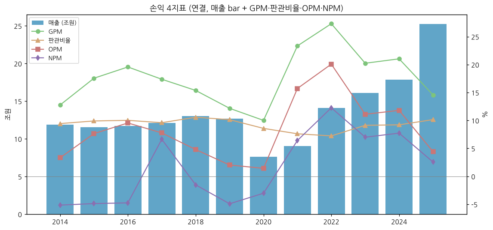

**영업비용 구성 (대한항공 별도, IR 3Q26, 분기):** 연료비 37% · 인건비 20% · 공항/화객비 16% · 감가상각비 12% · 정비비 3% · 기타(제조원가 등) 12% [IR 3Q26 p5]

### ② 재무상태표 (12년 연결, 조원)

| 연도 | 자산총계 | 유동자산 | 유형자산 | 부채총계 | 유동부채 | 자본총계 | 지배지분 | 비지배 | 부채비율 | 유동비율 | 현금성자산 | 단기금융상품 | 차입금·사채 | 리스부채 |
|---|---|---|---|---|---|---|---|---|---|---|---|---|---|---|
| 2014 | 23.47 | 4.95 | 15.78 | 21.26 | 7.44 | 2.20 | 2.09 | 0.11 | 966% | 66% | 0.80 | 0.06 | 9.80 | 6.50 |
| 2015 | 24.18 | 3.29 | 17.85 | 21.68 | 8.45 | 2.50 | 2.39 | 0.11 | 868% | 39% | 0.97 | 0.11 | 7.77 | 8.39 |
| 2016 | 23.96 | 3.33 | 17.87 | 22.08 | 9.13 | 1.87 | 1.76 | 0.11 | 1178% | 36% | 1.09 | 0.18 | 7.80 | 8.49 |
| 2017 | 24.65 | 3.58 | 18.91 | 20.90 | 6.64 | 3.75 | 3.63 | 0.12 | 557% | 54% | 0.76 | 0.51 | 7.27 | 7.58 |
| 2018 | 25.57 | 3.86 | 19.65 | 22.68 | 7.56 | 2.89 | 2.77 | 0.12 | 783% | 51% | 1.50 | 0.24 | 8.25 | 7.49 |
| 2019 | 27.01 | 3.57 | 21.31 | 24.23 | 8.78 | 2.78 | 2.66 | 0.12 | 871% | 41% | 0.82 | 0.72 | 8.71 | 8.31 |
| 2020 | 25.19 | 4.00 | 18.48 | 21.88 | 7.99 | 3.31 | 3.21 | 0.11 | 661% | 50% | 1.31 | 0.49 | 8.96 | 6.58 |
| 2021 | 26.67 | 6.64 | 16.91 | 19.81 | 8.44 | 6.87 | 6.75 | 0.11 | 288% | 79% | 1.19 | 2.92 | 6.91 | 5.60 |
| 2022 | 29.00 | 8.09 | 17.08 | 19.71 | 8.48 | 9.29 | 8.99 | 0.30 | 212% | 95% | 1.06 | 4.94 | 6.29 | 4.85 |
| 2023 | 30.39 | 8.60 | 18.17 | 20.58 | 9.41 | 9.82 | 9.53 | 0.29 | 210% | 91% | 0.62 | 5.55 | 6.51 | 4.43 |
| 2024 | 47.01 | 11.62 | 28.37 | 36.05 | 16.97 | 10.96 | 10.47 | 0.49 | 329% | 68% | 2.22 | 4.48 | 8.50 | 10.93 |
| 2025 | 50.41 | 9.71 | 32.94 | 38.95 | 15.08 | 11.46 | 10.95 | 0.51 | 340% | 64% | 1.87 | 3.47 | 9.45 | 13.04 |

(3Q26: 자산 54.51조 / 부채 42.63조 / 자본 11.88조 / 지배지분 11.47조 / 차입금·사채 12.58조 / 리스부채 12.37조 / 현금 2.30조 / 단기금융상품 4.37조 / 부채비율 359% [DART 분기보고서(2026.09), 계산]. 별도 3Q26 부채비율 257%, 순금융부채 13.50조 (IR 정의: 금융부채 − 현금성자산) [IR 3Q26])

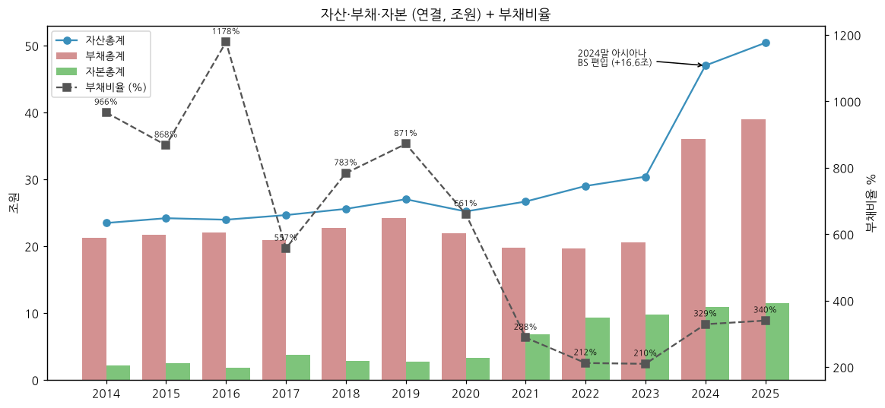

### ③ 현금흐름표 (12년 연결, 억원)

| 연도 | 영업CF | 투자CF | 재무CF | CapEx(유형) | CapEx(무형) | 리스부채 상환 | 배당지급 | 이자지급 | FCF | FCF−리스상환 | 상각비 |
|---|---|---|---|---|---|---|---|---|---|---|---|
| 2014 | 18,636 | -10,649 | -11,379 | 11,206 | 0 | 9,849 | 6 | 4,659 | 7,429 | -2,420 | 15,930 |
| 2015 | 27,280 | 4,187 | -29,966 | 17,427 | 0 | 10,934 | 6 | 3,857 | 9,853 | -1,081 | 16,509 |
| 2016 | 28,063 | -8,735 | -18,293 | 11,451 | 11 | 12,996 | 10 | 4,003 | 16,600 | 3,604 | 17,515 |
| 2017 | 28,068 | -20,412 | -10,362 | 18,765 | 8 | 17,120 | 6 | 4,579 | 9,295 | -7,825 | 16,930 |
| 2018 | 27,926 | -6,579 | -14,075 | 12,762 | 3 | 12,644 | 247 | 5,440 | 15,162 | 2,518 | 17,417 |
| 2019 | 23,337 | -15,950 | -14,472 | 11,828 | 17 | 15,663 | 252 | 6,255 | 11,492 | -4,172 | 20,826 |
| 2020 | 13,767 | -27 | -8,581 | 6,110 | 62 | 15,430 | 12 | 5,408 | 7,594 | -7,836 | 19,691 |
| 2021 | 35,142 | -24,448 | -12,112 | 3,430 | 52 | 14,200 | 0 | 4,110 | 31,660 | 17,460 | 16,954 |
| 2022 | 55,724 | -29,759 | -26,980 | 7,618 | 23 | 14,617 | 0 | 3,978 | 48,084 | 33,466 | 16,497 |
| 2023 | 40,925 | -24,099 | -20,852 | 19,085 | 87 | 13,754 | 2,771 | 5,424 | 21,752 | 7,998 | 17,229 |
| 2024 | 45,589 | -8,707 | -21,625 | 28,941 | 122 | 14,479 | 2,782 | 5,453 | 16,526 | 2,047 | 17,960 |
| 2025 | 40,752 | -23,402 | -21,368 | 42,891 | 70 | 21,797 | 2,892 | 8,281 | -2,209 | -24,006 | 28,552 |

(FCF = 영업CF − 유형자산 취득 − 무형자산 취득 [계산]. 대한항공은 신규 항공기 상당수를 리스(사용권자산)로 도입 → **실질 항공기 투자 = CapEx + 리스부채 상환**. 리스부채 상환은 재무CF(유동성리스부채의 상환). 2016\~2023 유형자산 취득 계정명 "유형자산 및 투자부동산의 취득")

→ 12년 누적 FCF 약 19.3조, **리스 상환 차감 후 약 2.0조** [계산] — 항공기 투자 부담을 고려하면 잉여현금은 거의 없음. 주주환원(배당)은 2022 사업연도부터 연 2,771억
→ 2021\~2022 OCF 3.5\~5.6조 = 화물 특수 + 선수금(항공권) 증가

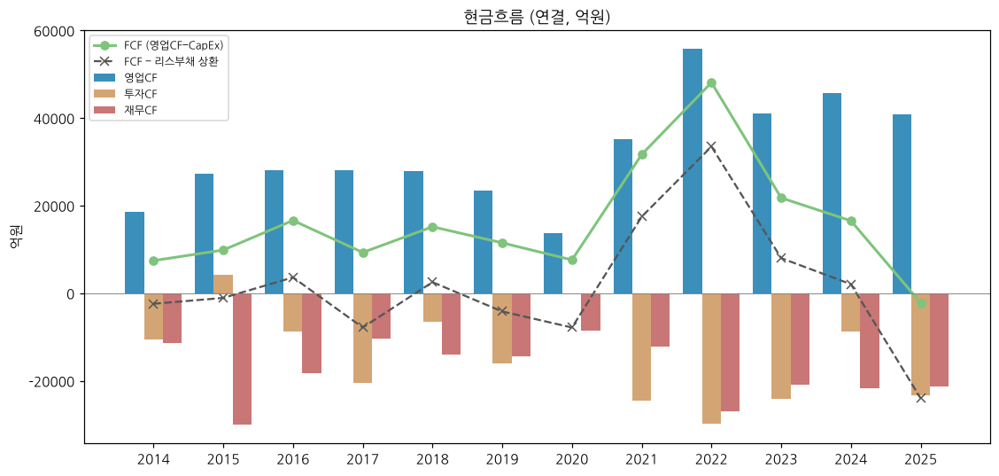

### ④ CapEx 추이 (12년, 억원)

| 연도 | 유형(항공기 포함) | 무형 | 총 CapEx | CapEx/매출 | 리스부채 상환 | CapEx+리스상환 | 상각비 | (CapEx+리스)/상각비 |
|---|---|---|---|---|---|---|---|---|
| 2014 | 11,206 | 0 | 11,206 | 9.4% | 9,849 | 21,055 | 15,930 | 1.32x |
| 2015 | 17,427 | 0 | 17,428 | 15.1% | 10,934 | 28,361 | 16,509 | 1.72x |
| 2016 | 11,451 | 11 | 11,462 | 9.8% | 12,996 | 24,459 | 17,515 | 1.40x |
| 2017 | 18,765 | 8 | 18,773 | 15.5% | 17,120 | 35,893 | 16,930 | 2.12x |
| 2018 | 12,762 | 3 | 12,765 | 9.8% | 12,644 | 25,408 | 17,417 | 1.46x |
| 2019 | 11,828 | 17 | 11,845 | 9.3% | 15,663 | 27,508 | 20,826 | 1.32x |
| 2020 | 6,110 | 62 | 6,173 | 8.1% | 15,430 | 21,603 | 19,691 | 1.10x |
| 2021 | 3,430 | 52 | 3,482 | 3.9% | 14,200 | 17,682 | 16,954 | 1.04x |
| 2022 | 7,618 | 23 | 7,641 | 5.4% | 14,617 | 22,258 | 16,497 | 1.35x |
| 2023 | 19,085 | 87 | 19,172 | 11.9% | 13,754 | 32,926 | 17,229 | 1.91x |
| 2024 | 28,941 | 122 | 29,063 | 16.3% | 14,479 | 43,542 | 17,960 | 2.42x |
| 2025 | 42,891 | 70 | 42,961 | 17.0% | 21,797 | 64,758 | 28,552 | 2.27x |

- **(CapEx + 리스상환) / 상각비 ≈ 1.0\~2.4x** — 코로나(2020\~2021) 1.0\~1.1x 저점, 2023\~2025 1.9\~2.4x = 차세대 기단 투자 사이클. 2020\~2022 코로나로 유형 CapEx 3,430\~7,618억으로 축소 → 2023\~2025 1.9조 → 4.3조로 재확대
- 향후: 신규 항공기 향후 투자 65.1조 (List Price, \~2033) [DART 사업보고서(2025.12)], 엔진정비공장 잔여 3,116억 (\~2027-12), 부천 대장 산업단지 2,011억 (\~2030) [동]

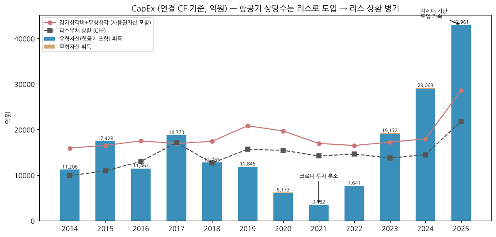

### ⑤ 부채구조 + 채무증권 + 유상증자·영구채

| 연도 | 차입금·사채 (조원) | 리스부채 (조원) | 현금성자산 (조원) | 순차입금 (리스 제외) | 순차입금+리스 | (순차입+리스)/EBITDA | 이자지급 (억원) | EBITDA/이자지급 |
|---|---|---|---|---|---|---|---|---|
| 2014 | 9.80 | 6.50 | 0.80 | 9.01 | 15.51 | 7.8x | 4,659 | 4.3x |
| 2015 | 7.77 | 8.39 | 0.97 | 6.80 | 15.19 | 6.0x | 3,857 | 6.6x |
| 2016 | 7.80 | 8.49 | 1.09 | 6.71 | 15.19 | 5.3x | 4,003 | 7.2x |
| 2017 | 7.27 | 7.58 | 0.76 | 6.51 | 14.08 | 5.3x | 4,579 | 5.8x |
| 2018 | 8.25 | 7.49 | 1.50 | 6.75 | 14.24 | 6.0x | 5,440 | 4.3x |
| 2019 | 8.71 | 8.31 | 0.82 | 7.89 | 16.21 | 6.9x | 6,255 | 3.7x |
| 2020 | 8.96 | 6.58 | 1.31 | 7.65 | 14.22 | 6.8x | 5,408 | 3.8x |
| 2021 | 6.91 | 5.60 | 1.19 | 5.72 | 11.32 | 3.6x | 4,110 | 7.6x |
| 2022 | 6.29 | 4.85 | 1.06 | 5.23 | 10.08 | 2.2x | 3,978 | 11.3x |
| 2023 | 6.51 | 4.43 | 0.62 | 5.89 | 10.32 | 2.9x | 5,424 | 6.5x |
| 2024 | 8.50 | 10.93 | 2.22 | 6.28 | 17.21 | 4.4x | 5,453 | 7.2x |
| 2025 | 9.45 | 13.04 | 1.87 | 7.58 | 20.62 | 5.2x | 8,281 | 4.8x |

(이자지급 = 연결 CF "이자의 지급" (리스 이자 포함 여부는 회사 분류 기준). (순차입+리스)/EBITDA는 IFRS16 기준 일관 비교 지표 [계산])

- **부채비율 장기 추이**: 2016 1,178% (12년 최고) → 2020 661% → 2021 288% (유증 3.3조) → 2023 210% (최저) → 2024 329% (아시아나 BS 편입) → 3Q26 359% [DART, 계산]
- **유상증자 이력 (자본금 증가 기준)**: 2015 +709억 (CF 4,942억) / 2017-12 +1,100억 (CF 4,533억) / 2020-07 +3,968억 (79.4M주, CF 1.12조) / 2021-03 +8,681억 (173.6M주, 약 3.32조) / 2022 +1,020억 (원인 미검증 ⚠️) [OpenDART 자본금·CF, 계산]
- **신종자본증권(영구채)**: 대한항공(별도) 3Q26 미상환 잔액 없음. 아시아나 신종자본증권 미상환 1,750억(2024-06)·3,000억(2025-11)·2,000억(2025-12) — 이 중 4,750억은 연결실체(대한항공)가 취득 [DART 분기보고서(2026.09) 채무증권 발행실적]. 2018 신종자본증권 발행 3,677억·상환 5,498억 (연결 CF) [DART 2018]
- **최근 채무증권**: 2026-09-16 공모 회사채 1,800억 (4.985%, 2029-09, A/A/A) [DART 분기보고서(2026.09)]. 3Q26 연결 채무증권 미상환 합계 5.51조 [동]
- **위험 노출 (2025말)**: 순외화부채 약 55억불 (10원 변동 → 약 550억 평가손익), 연간 달러 부족 약 16억불 (10원 → 약 160억 현금 변동), 변동금리 차입 약 5.7조 (금리 1%p → 약 570억 이자비용) [DART 사업보고서(2025.12) III]

### ⑥ 배당·자사주 추이 (12년)

| 사업연도 | DPS 보통주(원) | DPS 우선주(원) | 현금배당총액 (억원) | 연결 배당성향 (DART) | 시가배당률 보통주 (DART) | 비고 |
|---|---|---|---|---|---|---|
| 2014 | 0 | 0 | 0 | - | - | 순손실 |
| 2015 | 0 | 0 | 0 | - | - | 순손실 |
| 2016 | 0 | 0 | 0 | - | - | 순손실 |
| 2017 | 250 | 300 | 240 | 3.0% | 0.7% | |
| 2018 | 250 | 300 | 240 | -14.9% | 0.7% | 순손실에도 배당 |
| 2019 | 0 | 0 | 0 | - | - | |
| 2020 | 0 | 0 | 0 | - | - | 코로나·유증 |
| 2021 | 0 | 0 | 0 | - | - | |
| 2022 | 750 | 800 | 2,771 | 16.0% | 3.1% | 배당 재개 |
| 2023 | 750 | 800 | 2,771 | 26.1% | 3.15% | |
| 2024 | 750 | 800 | 2,771 | 21.0% | 3.16% | |
| 2025 | 750 | 800 | 2,771 | 35.5% | 3.22% | |

(OpenDART alotMatter 2017·2020·2022·2025 사업보고서 3개년 표. 2014\~2016·2019·2021 무배당은 alotMatter 공란 및 연결 CF 배당지급(2015\~2017 6\~10억 = 종속기업 비지배 배당 추정, 2021\~2022 0)으로 판단 [계산]. 2018 배당성향 -14.9% = 순손실 연도 배당)

- **자기주식**: 보통주 51주·우선주 3주 (2025말) — **자사주 매입·소각 정책 없음** [OpenDART tesstkAcqsDspsSttus 2025]
- 현재가 기준 배당수익률 2.4% (750원 / 31,150원) [계산]

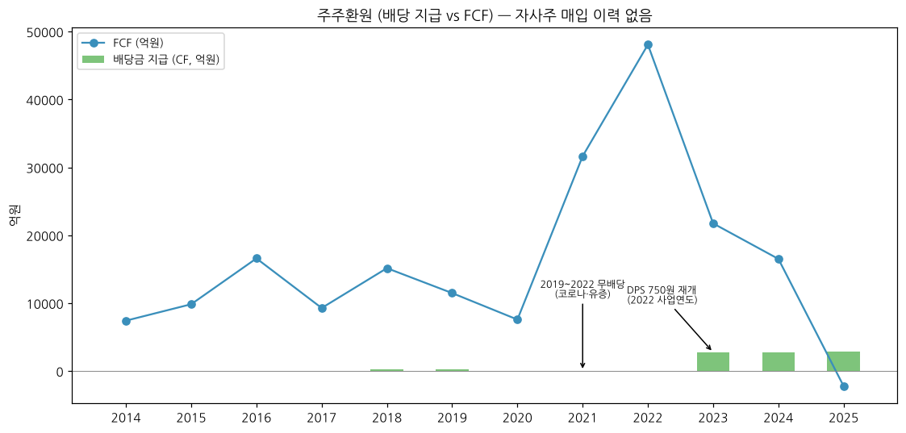

### ⑦ 재무 비율 (12년)

| 연도 | ROE(지배) | ROA | 부채비율 | 유동비율 | (순차입+리스)/EBITDA | 연말 종가(원, 환산) | 연말 시총(조원) | 연말 PBR | 연말 PER | 연말 EV/EBITDA (리스 포함) |
|---|---|---|---|---|---|---|---|---|---|---|
| 2014 | - | - | 966% | 66% | 7.8x | 45,487 ⚠️ | 2.67 | 1.28 | 적자 | 9.2 |
| 2015 | -25.2% | -2.4% | 868% | 39% | 6.0x | 27,729 ⚠️ | 2.02 | 0.85 | 적자 | 6.8 |
| 2016 | -27.2% | -2.3% | 1178% | 36% | 5.3x | 27,378 ⚠️ | 1.99 | 1.13 | 적자 | 6.0 |
| 2017 | 29.4% | 3.3% | 557% | 54% | 5.3x | 35,723 ⚠️ | 3.39 | 0.93 | 4.3 | 6.7 |
| 2018 | -6.4% | -0.8% | 783% | 51% | 6.0x | 34,879 ⚠️ | 3.31 | 1.19 | 적자 | 7.5 |
| 2019 | -23.2% | -2.4% | 871% | 41% | 6.9x | 30,077 ⚠️ | 2.85 | 1.07 | 적자 | 8.2 |
| 2020 | -7.2% | -0.9% | 661% | 50% | 6.8x | 28,615 ⚠️ | 4.99 | 1.55 | 적자 | 9.3 |
| 2021 | 11.6% | 2.2% | 288% | 79% | 3.6x | 29,350 | 10.21 | 1.51 | 17.7 | 7.0 |
| 2022 | 22.0% | 6.2% | 212% | 95% | 2.2x | 22,950 | 8.45 | 0.94 | 4.9 | 4.2 |
| 2023 | 11.5% | 3.8% | 210% | 91% | 2.9x | 23,900 | 8.80 | 0.92 | 8.3 | 5.5 |
| 2024 | 13.2% | 3.6% | 329% | 68% | 4.4x | 22,600 | 8.32 | 0.79 | 6.3 | 6.7 |
| 2025 | 7.3% | 1.3% | 340% | 64% | 5.2x | 22,550 | 8.30 | 0.76 | 10.6 | 7.4 |

**주요 비율 의미:**
- **ROE**: 지배순이익 / 평균 지배지분 [계산] (2014\~2016 지배지분 미공시 연도는 자본총계−비지배). 2022 22.0% 정점, 2025 7.3%
- **연말 종가(환산)**: Yahoo 수정종가 ÷ 환산계수 (⚠️ 2020 이전 추정치 — 2.③ 주석 참조). 2021 이후는 비수정 실제 종가
- **PBR**: 연말 시총 / 지배지분. 2022\~2025 0.76\~0.94배 → 3Q26 1.00배
- **EV/EBITDA (리스 포함)**: (시총 + 차입금·사채 − 현금 + 리스부채 + 비지배) / EBITDA (IFRS16 일관). 2018 이전 리스부채 = 금융리스부채 (운용리스 미포함 → 과소)
- 부채비율·(순차입+리스)/EBITDA는 2016 정점 → 2022 저점 → 아시아나 편입으로 재상승

---

## 5. 지배 구조

### ① 그룹·계열 관계

```
조원태 회장 측 20.57%  vs  호반그룹 20.15%  ·  델타항공 14.90%  ·  산업은행 10.58%  ·  국민연금 5.11%
                                  │  (2026-06말, 호반은 07-10 기준)
                         ㈜한진칼 (지주사, 180640)
                                  │ 26.13% (+특수관계인 합계 27.01%)
                          ㈜대한항공 (003490)
   ┌──────────────┬─────────────────┬──────────────┬──────────────────┐
 아시아나항공 63.88%   진에어 (LCC, 상장)    한국공항 (지상조업)   한진정보통신·아이에이티·Hanjin Int'l(호텔) 등
   ├ 에어부산 (상장)                                         
   ├ 에어서울                       → 2027-03-17 진에어·에어부산·에어서울 '통합 진에어' 목표
   └ 아시아나에어포트·아시아나IDT(상장) 등
   → 2026-12-17 대한항공에 흡수합병 예정
```

(DART 사업보고서(2025.12) I-1 연결대상 종속회사 (29개, 상장 5개), CEO스코어데일리 2026-11-03. 진에어 지분율·에어부산 지분율 세부는 이번 버전 미기재 ⚠️)

- **한진칼 지분 경쟁 이력**: 2019\~2020 KCGI·조현아·반도건설 '3자 연합' vs 조원태 (세부 미검증 ⚠️) → 2020-12 산업은행 한진칼 8,000억 투자(조원태 측 우호 지분화) [비즈워치 2021-01-26] → **2022 호반그룹이 KCGI 보유 한진칼 지분 인수** [CEO스코어데일리 2026-11-03] → 2026-07 호반 누적 순매수 8,782억, 20.15% → 2026-10 호반 공정위 기업결합 신고, 한진칼 12-01까지 최대주주 관련 재공시 예정 [동]
- **산업은행 10.58%**가 캐스팅보트 — 조원태 측 + 델타 + 산은 = 46.05% [CEO스코어데일리 2026-11-03]
- **교차 참조**: 항공 서브섹터 피어 `제주항공_기업개요.md`

### ② 주주 구분

| 주주 | 주식수 (보통주) | 지분율 | 기준 |
|---|---|---|---|
| ㈜한진칼 | 96,207,460 | 26.13% | 2026-09-30 (변동 없음) |
| 정석인하학원 | 2,342,281 | 0.64% | 2026-09-30 (2025말 2,593,934주 0.70%) |
| 정석물류학술재단·일우재단 | 591,475 | 0.16% | 2026-09-30 |
| 조원태·이명희·조현민·임원 | 81,104 | 0.02% | 2026-09-30 |
| **특수관계인 합계** | **99,222,320** | **26.95%** | 2026-09-30 |
| 국민연금공단 | 26,675,253 | 7.24% | 2025-12-31 |
| 우리사주조합 | 7,343,691 | 1.99% | 2025-12-31 |
| 소액주주 (보통+우선) | 219,197,733 | 59.35% (총발행 대비) | 2025-12-31, 628,574명 |
| 발행주식총수 | 보통 368,220,661 + 우선 1,110,794 | 100% | 자기주식 54주 |

(OpenDART hyslrSttus 2025·3Q26, DART 사업보고서(2025.12) VII 5% 이상 주주·소액주주. 외국인 지분율은 DART 미공시 — 이번 버전 미확보 ⚠️)

**최대주주 측 지분 추이 (보통주, 연말, OpenDART hyslrSttus):** 2017말 한진칼 29.96%·특수관계인 합계 33.34% → 2020말 29.27%·31.13% → 2022말 26.13%·27.02% → 2025말 26.13%·27.01% → 3Q26 26.95% (2017 28,417,147주 29.96% / 2020 50,988,508주 29.27% / 2022 96,207,460주 26.13% — 유증 참여로 주식수 증가, 2021 유증 이후 지분율 희석) [OpenDART hyslrSttus 2017·2020·2022·2025]

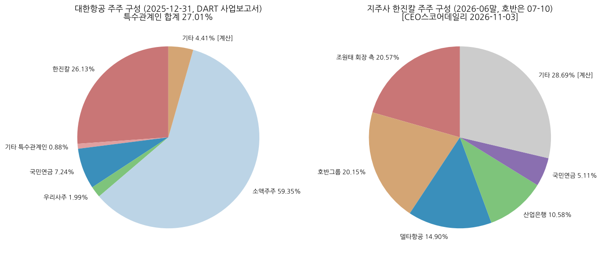

### ③ 임원·이사회

- **대표이사 회장: 조원태** (1976-01생, 인하대 경영·USC MBA, 대표이사 사장 → 회장, ㈜한진칼 대표이사 겸) — 사내이사 최근 선임 2024-03-21 [OpenDART exctvSttus 3Q26, DART 사업보고서(2025.12) VI]
- **대표이사 부회장: 우기홍** (1962-12생, 서울대 경영·KAIST 석사·USC MBA, 경영전략본부장 → 대표이사 사장) [동]
- **이사회 (2025말)**: 사내이사 3인(조원태·우기홍·유종석) + 사외이사 6인 = 9인, 의장 정갑영 사외이사(유니세프 한국위원회 회장, 2023-03-22 재선임) [DART 사업보고서(2025.12) VI]
- **통합 조직 (3Q26 미등기 임원)**: 최정호 영업 총괄 부사장(前 아시아나 인수통합 총괄), 박희돈 경영전략본부장 겸 OZ 통합추진총괄, 하은용 CFO, 엄재동 화물사업본부장 [OpenDART exctvSttus 3Q26]

---

## 6. 기타 팩트

### ① R&D 인프라

| 연도 | 연구개발비 (억원, 별도, 비용계상) | 매출 대비 | 정부보조금 (억원) |
|---|---|---|---|
| 2018 | 436 | 0.34% | 0.6 |
| 2019 | 404 | 0.32% | 4.9 |
| 2020 | 347 | 0.47% | 5.7 |
| 2021 | 374 | 0.43% | 5.3 |
| 2022 | 452 | 0.34% | 5.8 |
| 2023 | 523 | 0.36% | 20.7 |
| 2024 | 802 | 0.50% | 21.5 |
| 2025 | 915 | 0.55% | 32.0 |

(DART 사업보고서 2020·2022·2025 "연구개발활동" 3개년 표. 2014\~2017 미확보 (해당 연도 사업보고서 XML 미수집). 매출 대비는 회사 공시 비율(중단영업 반영 후 전사 매출 대비))

- 조직: R&D센터 (항공우주사업본부), 2022 '차세대 스텔스 무인기 개발센터' 설립 [DART 사업보고서(2025.12) II-6]
- 신성장: UAM 운항통제·교통관리 시스템 ACROSS (2024 상표 등록, K-UAM GrandChallenge 1단계 실증 완료), AI 기반 항공 MRO(드론 6대·로버 2대 군집 손상진단), 우주(소형발사체 추진제탱크·공중발사체·한국형 위성항법 위성 구조계) [동]

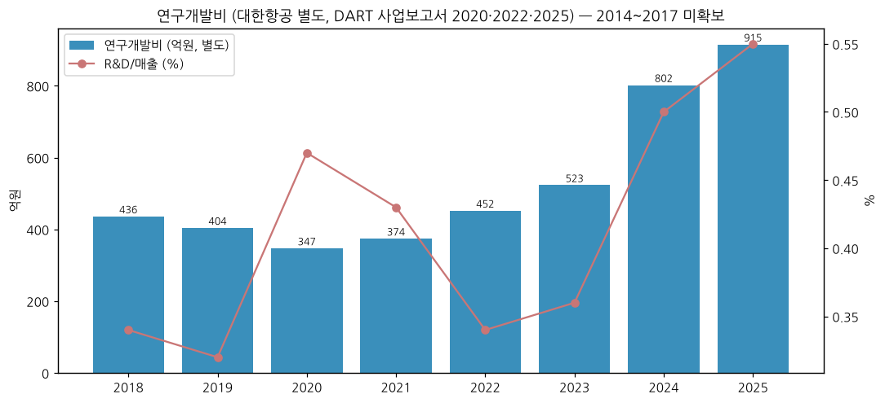

### ② 진행 중 corporate action — 10년치 주요 이벤트

| 시점 | 이벤트 | 출처 |
|---|---|---|
| 2017-12 | 유상증자 (CF 4,533억) | OpenDART CF·자본금 |
| 2020-07 | 유상증자 약 1.13조 (79,365,079주) | 뉴스토마토 2020, OpenDART |
| 2020-11 | 아시아나항공 인수 결정 (신주 1.5조) | 비즈워치 2021-01-26 |
| 2020-12 | 기내식·기내면세 사업 매각 (중단영업) | DART 사업보고서(2020.12) |
| 2020-12 | 산업은행 → 한진칼 8,000억 투자 | 비즈워치 2021-01-26 |
| 2021-03-12 | 유상증자 약 3.32조 납입 (173,611,112주, 19,100원) | 비즈워치 2021-01-26 |
| 2022 | 호반그룹, KCGI 보유 한진칼 지분 인수 | CEO스코어데일리 2026-11-03 |
| 2024-12-11 | 아시아나 신주 인수 1.5조 → 지분 63.88% | 이투데이·CEO스코어데일리 2024-12 |
| 2025-04·08 | 안두릴과 무인기 MOU·독점 파트너십 | DART 사업보고서(2025.12) |
| 2025-08-01 | 아시아나 화물사업 에어인천 매각 종결 | 데일리안 2026-08-15 |
| 2026-05-13 | 대한항공-아시아나 합병계약 (1:0.2736432) | 머니투데이 2026-05-13 |
| 2026-06-15 | 에어부산 신종자본증권 1,000억 → 아시아나 전환권 행사로 주식 전환 | DART 분기보고서(2026.09) |
| 2026-06-25 | 국토부 합병 인가 | MTN 2026-06-25 |
| 2026-08-21 | 진에어·에어부산·에어서울 합병계약 이사회 승인 | MTN 2026-08-21 |
| 2026-11-12 | LCC 3사 합병 국토부·공정위 승인 (2027-03-17 목표) | 한국중앙·이코노미스트 2026-11-12 |
| 2026-12-17 | 통합 대한항공 출범 예정 | 머니투데이 2026-05-13 |

### ③ 기술·사업 마일스톤 — 10년치

- 2016 스텔스 무인기 기술시범기 개발 / 2020 사단정찰용 무인기 양산 납품 완료, 2024 PBL 계약 / 2023 대형 전략급 무인정찰기 양산 착수 [DART 사업보고서(2025.12) II-6]
- 에어버스 'Wing of Tomorrow' 차세대 날개 구조물 개발 완료 / P-3C 해상초계기 성능개량 완료 [동]
- 2025-02 저피탐 무인편대기 비행시제 1호기 출고, 2025-12 광대역저피탐 UAV 기체구조 기술개발 완료 [동]
- 2025 A350-900 첫 도입, B787-9/10·A321neo 확충, 국내 FSC 최초 프리미엄 이코노미 [동]
- 2026 4Q 인천 운북 엔진정비공장 완공 예정 (2027 하반기 정상 가동) [IR 3Q26]

### ④ 주요 리스크

(1) 유가 — 연간 소모량 약 3,050만 배럴, 배럴당 1달러 변동 시 약 3,050만불 손익 변동 [DART 사업보고서(2025.12) III]
→ 헤지: 연간 예상 소모량의 최대 50% 이내, 주로 Zero Cost Collar (2025말 유가옵션 15,300,000배럴, \~2027-10) [동]
→ 2Q26 실현: 별도 연료비 +1.05조 YoY (단가 +9,115억) → 별도 OP -34.4% [IR 2Q26]
(2) 환율 — 순외화부채 약 55억불: 10원 변동 시 약 550억 외화평가손익 / 연간 달러 부족 약 16억불: 10원 변동 시 약 160억 현금 변동 [DART 사업보고서(2025.12) III]
→ 순이익 변동성의 주원인 (2Q26 외화환산손실 -1,450억 → 3Q26 +1조 702억, 별도) [IR 2Q26·3Q26]
(3) 금리 — 변동금리 차입 약 5.7조, 1%p 변동 시 약 570억 이자비용 증감 [동]
(4) 통합 리스크 — 마일리지 통합(공정위 협의 중) [머니투데이 2026-05-13], 아시아나 적자 흡수 (9M26 -5,911억), 시정조치(노선 공급 유지 의무), 해외 당국 인허가 [국토부 인가 조건]
(5) 지배구조 리스크 — 한진칼 지분 경쟁 (조원태 측 20.57% vs 호반 20.15%, 산은 10.58% 캐스팅보트) [CEO스코어데일리 2026-11-03]
(6) 수요·지정학 — 중동 전쟁 장기화, 미국 관세 정책, 미주 비자 발급 기준 강화 [IR 3Q26, DART 사업보고서(2025.12)]
(7) 레버리지 — 3Q26 부채비율 359%(연결), 리스부채 12.37조, 신규 항공기 향후 투자 65.1조 (List Price) [DART]

### ⑤ ESG 등급

- **KCGS(한국ESG기준원)**: 2020 통합등급 A [아시아경제 2020-10-15] — **2024·2025 등급 미확보** ⚠️
- MSCI 등급: **미확보**
- ESG 보고서: 「2026 Korean Air ESG Report」 (2026-06 발간, koreanair 뉴스룸 PDF) 존재 확인 — **본문 미다운로드·수치 미추출** ⚠️
- 이사회 내 ESG위원회 (2020 신설) [IR 4Q20 ESG 페이지]

### ⑥ 인증·라이선스

- 사업 근거: 항공사업법 (국제항공운송사업 면허), 항공안전법 (운항증명 AOC — 합병 후 대한항공 AOC 유지, 아시아나 기재·안전체계 편입) [머니투데이 2026-05-13]
- 항공동맹: 스카이팀 (아시아나는 스타얼라이언스 — 통합 후 이탈 예정, 미검증 ⚠️)
- 신용등급: 회사채 A (한신평·한기평·NICE, 2026-09) [DART 분기보고서(2026.09)]
- 항공우주: 국방부 군용기 창정비 업체, 보잉·에어버스 1차 협력사 (인증 세부 미기재)

---

## Source Audit (Phase 1, 6종 전수 점검)

| # | Source | 상태 | 확보 내용 | 누락 / 영향 |
|---|---|---|---|---|
| 1 | DART XML 본문 | 확보 (25건) | 사업보고서 2020\~2025, 분기·반기 3Q20\~3Q26 | 2015\~2019 사업보고서 XML 미수집 (다운로드 중단) → 2014\~2017 R&D·부문정보·기단 일부 공란. 2020.09\~2022.03 파일은 EUC-KR 인코딩 — 2020·2021 사업보고서만 재디코딩 사용 |
| 2 | DART 첨부 (감사보고서 등 _00760/_00761) | 확보 (5개 연도 × 2) | 2021\~2025 사업보고서 첨부 | 이번 버전 본문만 사용 |
| 3 | IR PDF | 확보 44건 / 텍스트 추출 23개 분기 | 3Q19\~3Q26 별도 요약 손익·운송 KPI·기단 | 1Q21·4Q21·1Q22 이미지 PDF, 2Q21·3Q21 다운로드 실패(HTTP 200 오류) → 해당 분기는 다음 해 전년 컬럼으로 보강. 노선별 매출 비중은 이미지(원그래프) — 미추출 |
| 4 | Sustainability report | URL 확인 (2025·2026 ESG 보고서) | — | 본문 미다운로드 → ESG 수치 공란 |
| 5 | Yahoo Finance | 확보 | 월간 2000\~2026, 일간 2007·2020-06\~2026-11 | 수정주가 → 시총 환산계수 추정 (2020 이전 ⚠️) |
| 6 | KIND/FnGuide/뉴스 | 부분 | 언론 10여 건 (합병·LCC·한진칼·유증·2Q26) | FnGuide 컨센서스·외국인 지분율 미확보 |
| + | OpenDART API (재무·info) | 확보 | 연결·별도 JSON 88개, info 4개 연도 + 3Q26, 아시아나 15개 | 2015 1\~3Q 분기 미제공 |

---

## Version Log

- **2026-11-28 v1.0 통합 검수**: 운송 5사(HMM·팬오션·대한항공·제주항공·CJ대한통운) 동시 작성 후 교차 검수 — 1장 ④ 끝에 '운송 5사 공통 비교 박스'(EV/EBITDA 리스 포함·PBR·PER·배당수익률 통일 정의) 5문서 동일 삽입

- **v1.0 (2026-11-25)**: 첫 작성 — Phase 1 source 6종 점검 (OpenDART 재무 JSON 연결·별도 88개 + 아시아나 15개, 정기공시 XML 25건, 기업개황·최대주주·임원·직원·배당·주식총수 (2017·2020·2022·2025·3Q26), IR 실적발표 PDF 44건, Yahoo 월간·일간, 언론) + v4.8 6개 섹션 + 차트 18종 (12종 표준 + chart2 6종(전사·여객·화물·항공운송·항공우주·아시아나) + chart13 연료비 vs OPM). 3Q26은 분기보고서(2026-11-13) 반영. 밸류에이션 정의(④-1)는 운송 섹터 피어 통일용
- 잔여 보완 후보: ① 노선별 여객 매출 비중(미주·구주·동남아·일본·중국·대양주)·화물 지역별 비중 — IR 원그래프 이미지 판독 ② 60+분기 (2011\~2015 분기, 2016\~2021 부문 분기 — 구 XML 확보 필요) ③ 2014\~2017 R&D·부문정보·기단 (2015\~2019 사업보고서 XML) ④ 시총 환산계수 정밀화 (2015·2017·2020 권리락 기준가 원자료) ⑤ 글로벌 피어 수치 비교 (Delta·United·SIA·Cathay·ANA·JAL — PBR·EV/EBITDA) ⑥ ESG 등급(KCGS 2025·MSCI), ESG 보고서 수치 ⑦ 외국인 지분율·진에어/에어부산 지분율 ⑧ 2021 유증 CF 2.55조 vs 자본금 기준 3.32조 차이, 2022 자본금 증가 원인 ⑨ 합병(2026-12-17) 후 연결/별도 재정의 — v1.1에서 4Q26 반영
