> 종목: 두산로보틱스 (454910.KS / 두산로보틱스 주식회사 / Doosan Robotics Inc.)
> 섹터: 로봇 — 서브섹터 산업·물류 자동화 (워치리스트 모빌리티·에너지전환 대분류)
> 작성 시각: 2026-11-14 KST (v1.0 — 최초 작성)
> 적용 구조: v4.8 (6개 섹션 + 12종 표준 차트 + chart2b 전 분기 시계열). 상장 3년차 적자 성장 기업이라 12년 연간·60분기 표준은 **확보 가능 범위(연간 2021~2025, 분기 3Q23~3Q26)로 축소** 적용
> 데이터: 연결 연간 5년(2021~2025 — 2023~2025 OpenDART CFS, 2021·2022는 2023 사업보고서 비교표시) + 연결 분기 13개(3Q23~2Q26 OpenDART, 3Q26 회사 IR 잠정) + 제품별 매출(2024~1H26 DART) + Yahoo Finance 454910.KS 주간 시계열(2023.10~2026.11)
> 출처: DART 정기보고서 12건 (corp_code 01105153) — 최신 정성자료 2026.06 반기보고서(rcept_no 20260814003345), 2025 사업보고서(20260318001562) / OpenDART 연결재무제표 JSON 12건(2023 3Q~2026 2Q) / 회사 IR 실적발표 PDF(irgo, 2024.02~2026.10) — 최신 2026-10-29 「2026년 3분기 경영실적」 / 언론: CEO스코어데일리 2026-11-10(신임 CEO·누적 실적), 아이뉴스24 2026-07-24 / 시장데이터: Yahoo Finance(2026-11-13 종가)

# 두산로보틱스 기업 개요 (v1.0 — 로봇 산업·물류 자동화, 꿈(적자 성장) + 솔루션 전환형)
> **Fact verify cutoff**: 2026-11-14 (주가·시가총액·52주 고저는 2026-11-13 Yahoo Finance meta 단일 소스 — 2차 소스 교차 확인 미완. 재무는 2026-10-29 회사 3Q26 IR까지, 3Q26 분기보고서는 미공시)

---

## ① 기업 분류

(1) Primary / Secondary 분류

**Primary 분류: 꿈 (적자 성장주 — 협동로봇·피지컬AI 옵션가치)**

→ 상장(2023.10) 이후 한 번도 영업흑자를 낸 적이 없다. 연간 영업손실 2021 -71억 → 2023 -192억 → 2024 -412억 → 2025 -595억으로 **4년 연속 확대**, 2025 OPM -180%

→ 주가를 움직이는 변수는 이익이 아니라 **휴머노이드·피지컬AI 내러티브와 두산그룹 지배구조 이벤트**다 (2024.07 밥캣 합병 발표·12월 철회, 2026.05~06 로봇 테마 고점). 시가총액 3.36조 vs 연 매출 330억(2025) — PSR 수십 배 구간

**Secondary 노트: 솔루션 전환형 (협동로봇 Arm 단품 → 북미 EOL 자동화 솔루션)**

→ 2025.09 미국 ONExia(EOL·CMI 자동화 SI, 1984년 설립) 지분 89.6% 인수(약 356억, CEO스코어데일리 2026-11-10) → 2025.12 미국법인과 합병해 Doosan Robotics Americas(DRA) 출범

→ 제품 믹스: 로봇 Arm 비중 2024 83% → 2025 60% → 1H26 43%, 자동화 솔루션(EOL/CMI) 0% → 18% → **45%** (DART). 3Q26 누적 기준 솔루션 50%, 북미 매출 55% (회사 IR)

→ 2026년 매출은 회복(3Q 누적 491억, +146% YoY)했지만, 인수 효과를 빼면 Arm 단품 매출은 2024 389억 → 2025 199억으로 반토막 — **본업(Arm) 경쟁력 회복 여부가 미해결**

**Entity 구조 (2026.06 반기 기준)**

→ **(1) 두산로보틱스(주)** — 수원 본사·공장(CAPA 연 2,200대), 협동로봇 Arm(M·H·A·E·P 시리즈)·부품·F&B 솔루션, 국내·APAC 영업

→ **(2) Doosan Robotics Americas, Inc.** — 구 ONExia + 구 미국 판매법인(2022.05 설립) 합병, EOL(팔레타이징·케이스 이렉터·케이스 패커)·CMI(맞춤형 자동화) 솔루션. 2026년 사업장 4배 규모로 확장 이전

→ **(3) Doosan Robotics Europe** — 2024.04 뒤셀도르프 설립, 2026.05 프랑크푸르트 확장 이전

→ 영업부문은 단일(협동로봇)로 공시 — **사업부별 영업이익은 미공개**. 제품별 매출(Arm / 부품 등 / 자동화 솔루션)과 수출·내수만 공시

(2) Summary Box (연결 5년 2021~2025 + 2026 3Q 누적)

| 지표 | 5년 평균 (2021~2025) | 최고 | 최저 | 2025년 | 2026 3Q 누적 |
|---|---|---|---|---|---|
| 매출 (억원) | 430 | **530 (2023)** | 330 (2025) | 330 | **491 (+146% YoY)** |
| 영업이익 (억원) | -281 | -71 (2021) | **-595 (2025)** | -595 | -399 (적자 7.3% 축소) |
| 순이익 (억원) | -256 | -74 (2021) | -555 (2025) | -555 | -403 [IR 분기 합산] |
| OPM | -70.6% | -19.1% (2021) | -180.3% (2025) | -180.3% | -81.2% |
| GPM | 24.8% | 31.7% (2022) | 13.4% (2025) | 13.4% | 미공개 (IR) |

→ 매출 CAGR(2021→2025) **-2.8%**, 판관비 CAGR **+36%** (185억 → 639억) — 외형 정체 속 비용(인력·북미 확장·AI R&D)만 늘어난 구조
→ 사이클 판정: 이익 사이클이 성립하지 않는 적자 단계 → 사이클 주기·회수 산정 불가
→ 2026 3Q 누적 순이익 = 1Q -92 + 2Q -128 + 3Q -183 (IR) = -403억

(3) 정량 근거 — 연간 매출·OPM

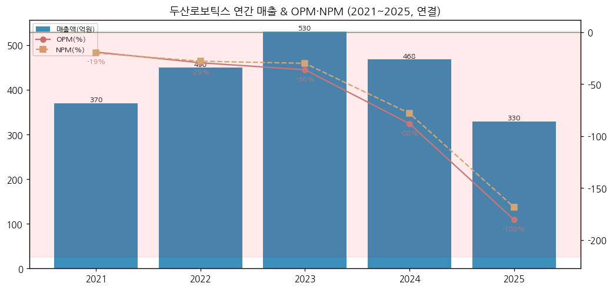

→ 2023년이 매출 정점(530억). 2024~2025 Arm 수요 둔화(유럽·국내 딜러 재고 조정 + 중국산 저가 협동로봇 경쟁 — `[판단]`)로 매출이 38% 줄며 OPM이 -36% → -180%로 급락

→ 2026년은 ONExia 연결로 매출이 회복 중이지만 분기 OPM은 -79~-83%에 머물러 **적자 축소 속도는 매출 회복보다 느리다**

(4) 산업 분류

| 구분 | 분류 |
|---|---|
| DART 업종 | 2928 — 특수 목적용 기계 제조업 (산업용 로봇) |
| KRX | 유가증권시장 (2023.10.05 상장) |
| 워치리스트 | 로봇 섹터 — 서브섹터 **산업·물류 자동화** (핵심) / 피어: 현대오토에버, Symbotic(SYM) / 트래킹: Teradyne(Universal Robots 부문) |
| 그룹 | 두산그룹 — (주)두산 68.11% |

(5) 분류 결정 논리

→ 이익이 없어 PER·사이클 분류가 불가능하고, 시가총액 대부분이 미래 옵션(휴머노이드·피지컬AI·북미 솔루션 스케일업)에 걸려 있다 → **꿈**

→ 다만 "꿈" 종목 중에서도 매출 기반(연 600억대 run-rate)과 순현금(1,584억, 2026.09)이 있어 **현금 소진 속도**가 하방을 결정한다 `[판단]`

(6) 적정 밸류에이션 방법

| 우선순위 | 방법 | 현재 값 (2026-11-13) | 비고 |
|---|---|---|---|
| 1 | PSR (최근 4분기 매출) | 시총 3.36조 / 622억 = **약 54배** | 흑자 전 단계 표준. 피어(Teradyne·레인보우로보틱스) 대비 비교 |
| 2 | PBR | 3.36조 / 자본 3,048억 = **약 11.0배** | 순현금 1,584억 → 하방 참고치 |
| 3 | EV/Sales (2027E) | 컨센 미확보 | 셀사이드 확보 시 보강 |

→ 최근 4분기 매출 = 4Q25 130 + 1Q26 153 + 2Q26 177 + 3Q26 162 = 622억 (DART·IR)

(7) 분기 재평가 트리거

→ (1) 분기 OPM -50% 이내 진입 (현재 -80%대) — 적자 축소 가속 신호
→ (2) DRA 수주잔고 반등 — 2025말 $14.9M → 2Q26 $12.4M → 3Q26 $9.1M로 2개 분기 연속 감소 (회사 IR)
→ (3) 2027 Agentic Robot OS 솔루션 공개·차세대 Arm 출시 — Arm 단품 매출 반등 여부
→ (4) 순현금 1,000억 하회 시 자금조달(유상증자·추가 차입) 리스크 재평가
→ (5) 두산그룹 지배구조 재편 재추진 여부 (2024.12 철회 이력)

---

## ② 회사 개요

(1) 기본 사항

| 항목 | 내용 |
|---|---|
| 회사명 (한글) | 두산로보틱스 주식회사 |
| 회사명 (영문) | Doosan Robotics Inc. |
| 종목코드 | 454910 (KRX 유가증권시장, 2023.10.05 상장, 공모가 26,000원) |
| 설립 | 2015.07.31 |
| 본사 | 경기도 수원시 권선구 산업로156번길 79 |
| 홈페이지 | www.doosanrobotics.com |
| 대표이사 | **권영민** 사장 (2026.09.18 신임 CEO, 1967년생, (주)두산 지주부문 상무·두산밥캣 CSO·두산모트롤 대표 — CEO스코어데일리 2026-11-10). DART 2025 사업보고서상 대표이사는 박인원·조길성(김민표 2026.09.30 퇴임) |
| 발행주식수 | 64,819,980주 (보통주, 자기주식 없음, 2025말) |
| 최대주주 | **(주)두산 68.11%** (44,149,038주) + 특수관계인 합 68.11% (DART 2025 사업보고서) |
| 연결종속회사 | Doosan Robotics Americas, Inc.(지분 89.6%) 등 |
| 임직원 | 255명 (2025말, 남 200·여 55, 평균 근속 3.9년, 1인 평균 급여 약 7,200만원 — DART) / R&D 인력 70명 (2026.06) |
| 시가총액 | **약 3.36조원** (51,900원 × 64.82M주, 2026-11-13 Yahoo Finance) |
| 52주 고가 / 저가 | 170,000원 (2026-06-01 주간 장중) / 46,850원 (2026-11-02 주간 장중) — Yahoo Finance, 2026-11-13 |

(2) 연간 손익·자본 추이 (연결)

| 연도 | 매출 (억) | OP (억) | OPM | NI (억) | 자본총계 (억) | 자산총계 (억) |
|---|---|---|---|---|---|---|
| 2021 | 370 | -71 | -19.1% | -74 | 155 | 294 |
| 2022 | 450 | -132 | -29.4% | -126 | 428 | 626 |
| 2023 | 530 | -192 | -36.1% | -159 | 4,388 | 4,564 |
| 2024 | 468 | -412 | -88.0% | -366 | 4,025 | 4,217 |
| **2025** | **330** | **-595** | **-180.3%** | **-555** | **3,486** | **3,994** |
| 2026.09 (IR) | 491 (3Q 누적) | -399 (3Q 누적) | -81.2% | -403 | 3,048 | 4,080 |

→ 출처: 2021·2022는 2023 사업보고서 연결 비교표시(전전기·전기), 2023~2025 OpenDART CFS, 2026.09는 회사 3Q26 IR 요약재무상태표
→ **시계열 단절 지점**: ① 2023.10 IPO로 자본 428억 → 4,388억(재무활동CF +4,108억), ② 2025.09 ONExia 연결 편입(4Q25부터 온기 반영), ③ 2026.06(2Q26) 장기차입금 500억 신규 (회사 2Q26 IR)
→ 자본은 2023말 4,388억 → 2026.09 3,048억으로 **3년간 1,340억 감소(-31%)** — 누적 적자가 공모 자금을 잠식 중

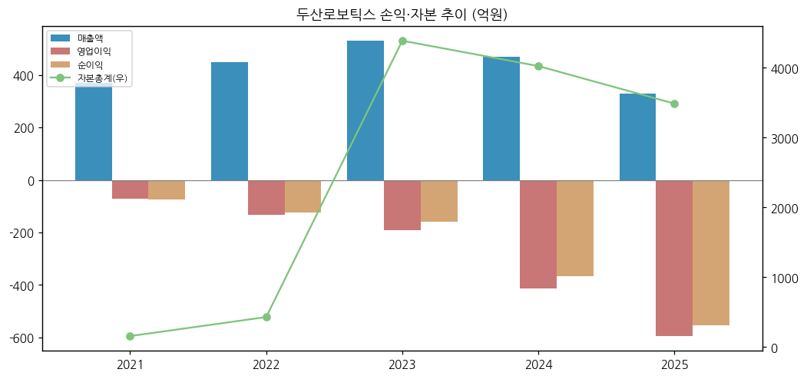

(3) 주가·시가총액 역사

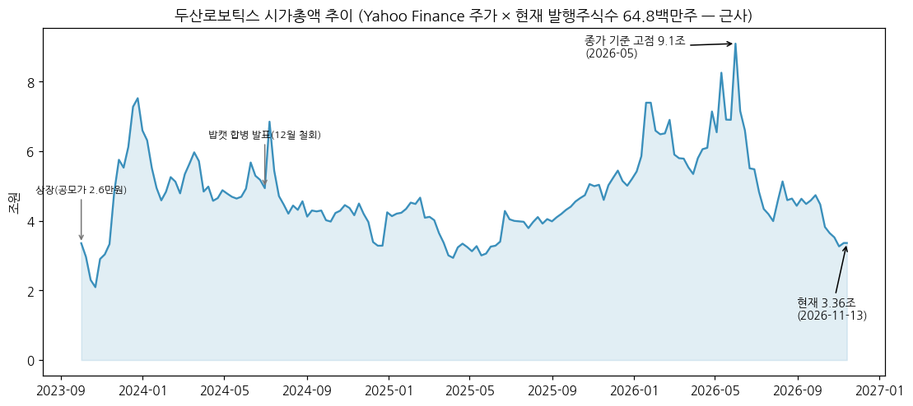

→ (출처: Yahoo Finance 454910.KS 주간 종가 × 현재 발행주식수 64.82M주 — 상장 이후 주식수 변동 없음)

→ **2023.10 상장** 공모가 26,000원 → 상장 직후 2023.12 주간 종가 116,100원(시총 약 7.5조)까지 급등 — 국내 협동로봇 1위 + 두산 브랜드 프리미엄

→ **2024.07** 두산그룹이 두산밥캣을 두산로보틱스 자회사로 편입하는 분할합병안 발표 → 주가 급등 후 합병비율 논란 → **2024.12 철회** (아시아경제 2024-12-10 「12일 임시 주총 소집 철회」)

→ **2025.03~05 저점** 주간 종가 45,300원(시총 약 2.9조) — 매출 급감(1Q25 53억, 2Q25 45억)과 동행

→ **2026.01~06 로봇 테마 랠리** — 2026.06 초 주간 고가 170,000원(시총 장중 약 11.0조), 주간 종가 기준 고점 140,300원(약 9.1조)

→ **2026.07~11 하락** — 2026-11-13 종가 51,900원(약 3.36조), 고점 대비 -69%(장중 고가 기준). 3Q26 실적 발표(10-29) 전후로도 하락 지속

(4) 주요 연혁

| 시점 | 내용 |
|---|---|
| 2015.07 | 두산로보틱스 설립 (두산그룹 협동로봇 법인), 4개 모델 개발 완료 |
| 2018 | M시리즈 협동로봇 판매 개시 |
| 2022.05 | 미국 판매법인 Doosan Robotics Americas, LLC 설립 |
| 2022.12 | 박인원 대표이사 선임 |
| 2023.10.05 | 유가증권시장 상장 (공모가 26,000원) |
| 2024.04 | 유럽 지사(독일 뒤셀도르프) 설립 |
| 2024.07~12 | 두산밥캣 분할합병 추진 → 철회 |
| 2025.03 | 김민표 대표이사 선임 (전 토스페이먼츠 대표) |
| 2025.09 | 미국 ONExia, Inc. 지분 89.6% 취득 (EOL·CMI 자동화 솔루션) |
| 2025.12 | ONExia가 미국법인 흡수합병 → Doosan Robotics Americas, Inc. |
| 2026.05 | 유럽 지사 프랑크푸르트 확장 이전 |
| 2026.06 | NVIDIA와 피지컬AI 협력 발표, AI 팔레타이징 'PalletizHD+' 공개 |
| 2026.06 | 장기차입금 500억 (회사 2Q26 IR 재무상태표) |
| 2026.09 | 권영민 사장 신임 CEO (김민표 9/30 퇴임) |
| 2026.10 | 한국형 피지컬AI 국책과제 2건 수주 (지원규모 857억 + 158억, 회사 IR) |

---

## ③ 비즈니스 모델

(1) 실적 추이 통합 표 — 제품별·지역별 (억원)

| 구분 | 2024 | 2025 | 1H26 | 비중 2024 → 1H26 |
|---|---|---|---|---|
| **매출 합계** | **468** | **330** | **330** | |
| 로봇 Arm | 389 | 199 | 143 | 83.0% → 43.4% |
| ├ 수출 | 253 | 116 | 87 | |
| └ 내수 | 136 | 83 | 56 | |
| 부품 등 기타 | 79 | 71 | 38 | 17.0% → 11.4% |
| 자동화 솔루션 (EOL/CMI) | — | 60 | 149 | 0% → **45.2%** |
| 수출 합계 | 279 | 184 | 240 | 59.7% → 72.9% |
| 내수 합계 | 189 | 146 | 89 | 40.3% → 27.1% |

→ 출처: DART 2026 반기보고서 II-2·4 (백만원 → 억원 반올림). 자동화 솔루션은 전액 수출(북미)
→ 3Q26 누적(회사 IR): 로봇 Arm 35% / 부품 등 15% / 자동화 솔루션 50%, 지역 북미 55% / 국내 28% / 유럽 14% / APAC 및 기타 3%

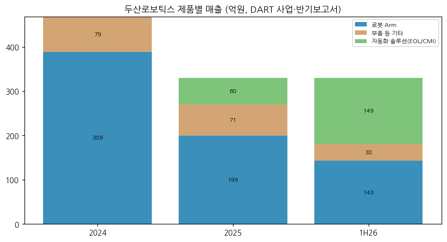

(2) 분기 시계열 (연결, 억원)

| 분기 | 매출액(억원) | 영업이익(억원) | OPM | 매출 YoY | 영업이익 YoY/적자폭 변화 |
|---|---|---|---|---|---|
| 3Q23 | 125 | -61 | -49.1% | — | — |
| 4Q23 | 169 | -31 | -18.4% | — | — |
| 1Q24 | 109 | -69 | -63.3% | — | — |
| 2Q24 | 144 | -79 | -54.6% | — | — |
| 3Q24 | 100 | -96 | -95.6% | -19.8% | 적지 (적자 -35억) |
| 4Q24 | 115 | -169 | -146.7% | -31.9% | 적지 (적자 -138억) |
| 1Q25 | 53 | -121 | -229.3% | -51.5% | 적지 (적자 -52억) |
| 2Q25 | 45 | -157 | -345.3% | -68.6% | 적지 (적자 -78억) |
| 3Q25 | 102 | -153 | -150.2% | +1.3% | 적지 (적자 -57억) |
| 4Q25 | 130 | -165 | -126.5% | +13.2% | 적지 (적자 +4억) |
| 1Q26 | 153 | -121 | -78.9% | +189.7% | 적지 (적자 폭 유사) |
| 2Q26 | 177 | -144 | -81.6% | +290.0% | 적지 (적자 +13억) |
| 3Q26* | 162 | -134 | -82.9% | +59.1% | 적지 (적자 +19억) |

→ 출처: 3Q23~2Q26 OpenDART 분기·사업보고서(4Q = 연간 − 3Q 누적), **3Q26\* = 회사 IR 2026-10-29 (K-IFRS 연결, 감사 전, 분기보고서 미공시)**. 적자 기업이라 영업이익 YoY 대신 적자폭 변화(+ = 축소, − = 확대)로 표기
→ 3Q26 IR 원값(백만원): 매출 16,175 / 영업이익 -13,404 / EBITDA -10,250 / 당기순이익 -18,301

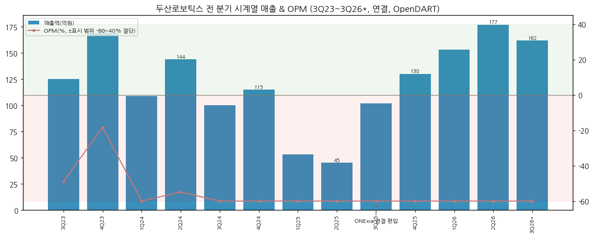

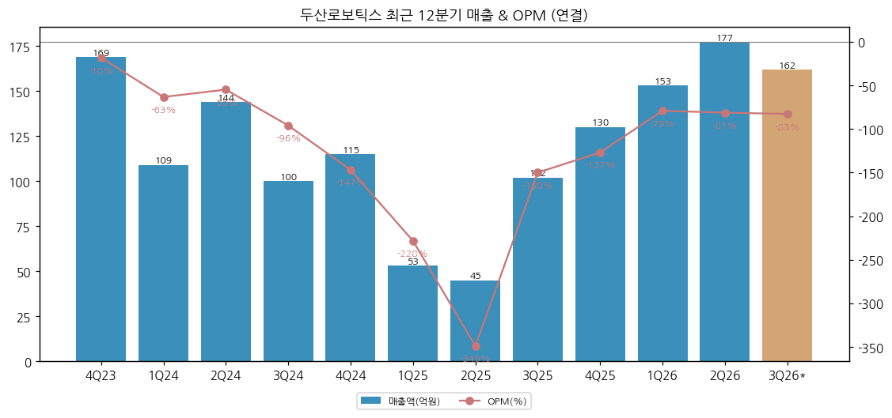

→ 매출 바닥은 2Q25(45억). 3Q25부터 ONExia 연결로 반등해 2Q26 177억 고점, 3Q26 162억(-8.5% QoQ)으로 한 분기 쉬어감
→ 영업적자는 1Q26 -121억 이후 -120~-145억 박스 — 매출이 3배가 됐는데 적자폭은 거의 그대로 (판관비가 같이 늘어서: 북미 사업장 확장 이전·AI R&D 인력 채용 — 회사 IR 2Q26·3Q26)

(3) 3Q26 핵심 박스

| 항목 | 3Q25 | 2Q26 | **3Q26** | QoQ | YoY |
|---|---|---|---|---|---|
| 매출액 (억원) | 102 | 177 | **162** | -8.5% | +59.1% |
| 영업이익 (억원) | -153 | -144 | **-134** | +10억 | +19억 |
| EBITDA (억원) | -134 | -113 | **-103** | +10억 | +31억 |
| 당기순이익 (억원) | -129 | -128 | **-183** | -55억 | -54억 |
| 순차입금 (억원) | -2,110 | -2,024 | **-1,584** | +440억 | +526억 |
| 부채비율 | 9.7% | 34.2% | **33.9%** | -0.4%p | +24.1%p |
| DRA 매출 ($M) | 5.4 | 6.8 | **6.8** | 0% | +27% |
| └ EOL ($M) | 3.2 | 4.8 | **5.0** | +4% | +55% |
| DRA 수주잔고 ($M) | — | 12.4 | **9.1** | -27% | (2025말 14.9) |

→ 출처: 회사 3Q26 IR p.4~5 (2026-10-29). DRA 3Q25는 ONExia 인수 이전 매출을 포함한 비교 기준, 2026년 DRA 매출은 사업부간 매출 조정 전 기준
→ 순차입금 마이너스 = 순현금. 3Q 한 분기에 순현금 440억 감소 (영업적자 + 운전자본·설비 — 세부는 분기보고서 확인 필요)
→ 회사 가이던스: **DRA 2026년 매출 전년 대비 50% 이상 성장** (2Q26·3Q26 IR 동일 문구)

(4) 사업부별 개요 (매출 비중 큰 순, 1H26)

→ **(1) 자동화 솔루션 (EOL/CMI) — 45%**: 북미 식음료·소비재 공장 라인 끝 공정(포장·팔레트 적재) 솔루션. Palletizer·Case Erector·Case Packer + CMI(맞춤형 자동화 시스템, MES 연동). 규격 단가 없음(프로젝트형). 전액 DRA 매출

→ **(2) 로봇 Arm — 43%**: 협동로봇 6개 시리즈 — M(토크센서 6축, 6~15kg), H(20~25kg), A(5~9kg, 저가), E(F&B 전용 5kg), P(30kg 5축 팔레타이징 전용). 1H26 평균판매가 내수 2,627만원 / 해외 5,039만원 (DART)

→ **(3) 부품 등 기타 — 11%**: 그리퍼·주변기기·서비스·F&B 모듈(튀김·커피 — 커피모듈은 관계사 플레토로보틱스 완제품 매입 판매)

(5) 사업부별 디테일

→ 성장 엔진: **EOL** — DRA 내 EOL 매출 2Q26 +130% YoY, 3Q26 +55% YoY (회사 IR). 다만 DRA 수주잔고가 $14.9M(2025말) → $9.1M(3Q26)으로 줄어 4Q 이후 성장률 둔화 가능성 `[판단]`

→ 약점: **Arm 단품** — 2024 389억 → 2025 199억(-49%). 1H26 143억(연환산 약 290억)으로 일부 회복. 수원공장 CAPA 2,200대 대비 2025 외주생산 488대 포함 총 2,688대 능력, 1H26 외주 없음 (DART)

→ 판매경로(1H26): 수출 직판 46.3% / 수출 딜러 26.6% / 내수 직판 17.7% / 내수 딜러 9.4% — 북미 직판(EOL) 확대로 딜러 의존도 하락 (DART)

(6) 주요 경쟁사

| 구분 | 경쟁사 | 비고 |
|---|---|---|
| 협동로봇 글로벌 | Universal Robots(Teradyne, 덴마크) | "과반 점유율 1강 체제" (DART 사업보고서) |
| | Techman Robot(대만), FANUC CRX·Yaskawa(일본), ABB GoFa(스위스), KUKA(독일) | DART 기재 |
| | 중국 JAKA·AUBO·Elite·Dobot 등 | 저가 공세 `[판단]` (DART 미기재) |
| 협동로봇 국내 | 레인보우로보틱스(삼성전자 최대주주), 뉴로메카 | DART 기재. 레인보우로보틱스 2Q26 매출 120억대·영업손실 약 20억 (CEO스코어데일리) |
| EOL 자동화(북미) | 다수 SI·팔레타이저 업체 | 공시 없음 |

→ 협동로봇 시장점유율은 "공신력 있는 통계 부재"로 회사가 기재하지 않음 (2026 반기보고서)

(7) 주요 매출처·매입처

→ 매출처: 10% 이상 단일 고객 공시 없음. 해외는 딜러·SI 경유, 북미 EOL은 직접 판매 (DART)
→ 매입처: 가공품·JTS(토크센서)·H/Drive(감속기)·제어기·Encoder·PCB·Motor — 업체명 비공개(A~N사). 1H26 원재료 매입 78억 (구동 13·전자 41·기계 23억)

(8) 생산 CAPA + 임직원

| 항목 | 2024 | 2025 | 1H26 |
|---|---|---|---|
| 생산능력 (대) | 3,200 (수원 2,200 + 외주 1,000) | 2,688 (수원 2,200 + 외주 488) | 2,200 (수원, 반기 기준 연환산 아님) |
| 임직원 (명) | — | 255 | R&D 70명 |

→ 출처: DART 2026 반기보고서 II-3, 2025 사업보고서 직원 현황

---

## ④ 재무 구조 (연간 2021~2025)

① 손익계산서

| 항목 (억원) | 2021 | 2022 | 2023 | 2024 | 2025 |
|---|---|---|---|---|---|
| 매출액 | 370 | 450 | 530 | 468 | 330 |
| 매출총이익 | 114 | 142 | 147 | 95 | 44 |
| 판관비 | 185 | 275 | 338 | 507 | 639 |
| 영업이익 | -71 | -132 | -192 | -412 | -595 |
| 당기순이익 | -74 | -126 | -159 | -366 | -555 |
| 매출 YoY | — | 21.6% | 18.0% | -11.7% | -29.6% |
| GPM | 30.8% | 31.7% | 27.6% | 20.4% | 13.4% |
| 판관비율 | 49.9% | 61.1% | 63.8% | 108.3% | 193.7% |
| OPM | -19.1% | -29.4% | -36.1% | -88.0% | -180.3% |
| NPM | -20.1% | -27.9% | -29.9% | -78.1% | -168.3% |

→ 2021·2022 OpenDART 미제공 → 2023 사업보고서 비교표시. GPM은 2022 31.7% → 2025 13.4%로 하락 — Arm 단가 경쟁 + 저가동률 고정비 `[판단]`
→ 판관비가 매출을 넘어선 것이 2024년(108%)부터. 2025년 판관비 639억 = 매출의 1.9배

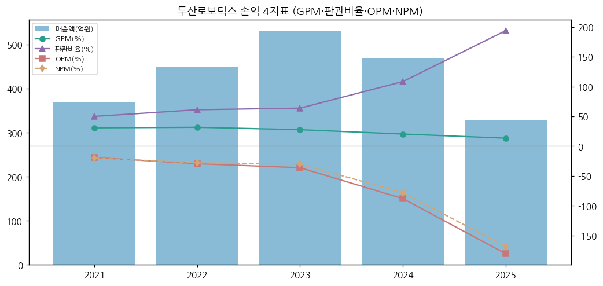

② 재무상태표

| 재무상태 (억원) | 2021 | 2022 | 2023 | 2024 | 2025 |
|---|---|---|---|---|---|
| 자산총계 | 294 | 626 | 4,564 | 4,217 | 3,994 |
| 유동자산 | — | 388 | 4,261 | 3,420 | 2,670 |
| 현금및현금성자산 | — | 81 | 3,054 | 2,655 | 1,567 |
| 부채총계 | 139 | 198 | 176 | 192 | 508 |
| 유동부채 | — | 147 | 134 | 154 | 278 |
| 자본총계 | 155 | 428 | 4,388 | 4,025 | 3,486 |
| 부채비율 | 89.9% | 46.4% | 4.0% | 4.8% | 14.6% |
| 유동비율 | — | 263.5% | 3191.2% | 2214.3% | 959.5% |

→ 2026.09(회사 IR): 자산 4,080억 / 부채 1,032억(장기차입금 500억 포함) / 자본 3,048억 / 현금성자산(현금+단기금융상품) 2,084억 / 부채비율 33.9%
→ 2025 부채 증가(192 → 508억)는 ONExia 인수에 따른 연결 부채·리스부채 `[판단]`

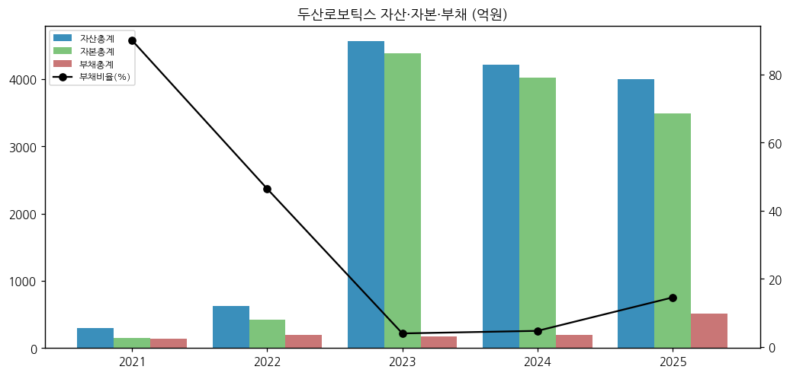

③ 현금흐름표

| 현금흐름 (억원) | 2021 | 2022 | 2023 | 2024 | 2025 |
|---|---|---|---|---|---|
| 영업활동CF | -76 | -226 | -272 | -438 | -173 |
| 투자활동CF | — | — | -856 | 48 | -902 |
| 재무활동CF | — | — | 4,108 | -11 | -17 |
| 유형자산 취득 | — | — | 31.2 | 33.0 | 131.4 |
| 무형자산 취득 | — | — | 59.9 | 48.6 | 22.3 |
| 감가상각비 | — | — | — | — | — |
| 자기주식 취득 | — | — | — | — | — |
| 배당금 지급 | — | — | — | — | — |
| FCF (영업CF−CapEx) | — | — | -363 | -519 | -327 |

→ 영업CF는 상장 후 매년 마이너스(-272 → -438 → -173억). 2025 투자CF -902억은 ONExia 인수(약 356억)·금융상품 운용 포함
→ 순현금 추이(회사 IR): 2023말 3,820억 → 2024말 2,752억 → 2025말 1,971억 → 2026.03 2,113억 → 2026.06 2,024억 → 2026.09 1,584억. **2년 9개월간 2,236억 소진**, 최근 4분기 평균 약 130억/분기 `[판단: 3Q26은 440억 감소로 가속]`

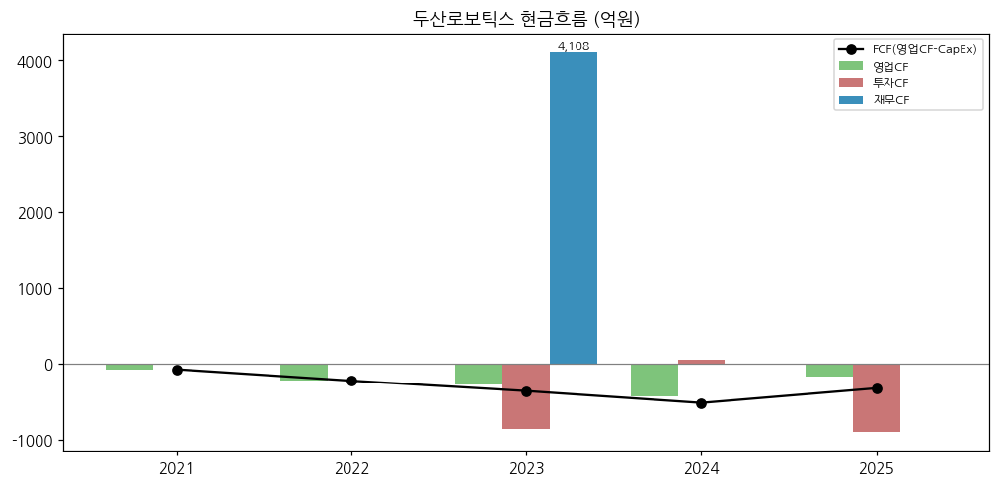

④ CapEx

→ 유형+무형 취득: 2023 91억 → 2024 82억 → 2025 154억(미국 사업장 확장). 시설 투자 규모는 작고, 현금 사용의 대부분은 영업적자와 M&A

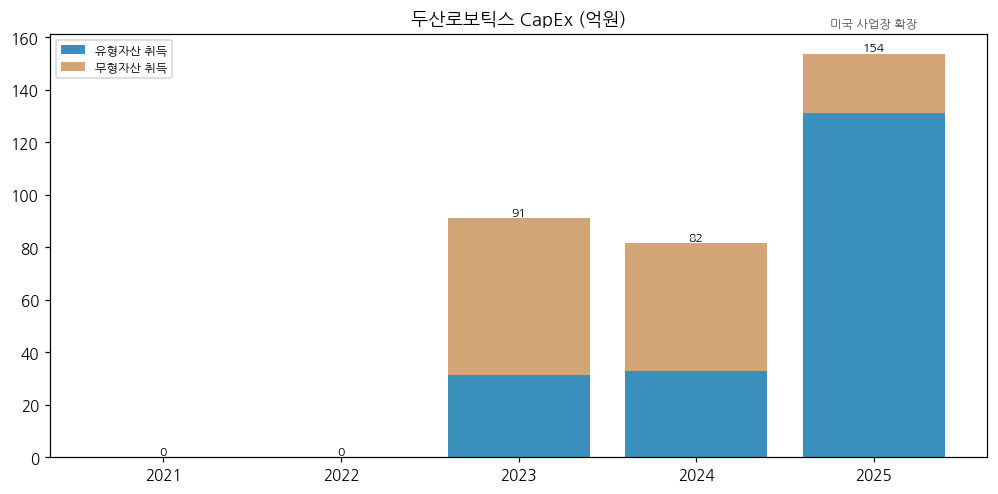

⑤ 부채구조

→ 상장 후 무차입 → **2026.06 장기차입금 500억 신규** (회사 2Q26·3Q26 IR 재무상태표). 차입 조건·용도는 반기보고서 주석·3Q26 분기보고서에서 확인 필요
→ 사채 발행 이력 없음 (DART 2025 사업보고서)

⑥ 배당·자사주

→ 무배당 (2023~2025 현금배당 없음), 자기주식 없음 (DART 배당에 관한 사항·주식총수 현황)

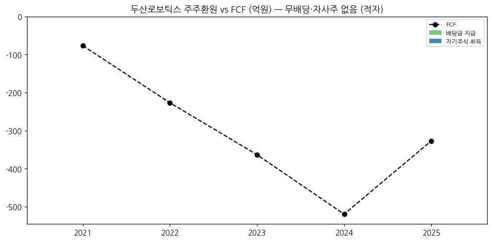

⑦ 재무비율

| 재무비율 | 2021 | 2022 | 2023 | 2024 | 2025 |
|---|---|---|---|---|---|
| ROE (평균자본) | — | -43.1% | -6.6% | -8.7% | -14.8% |
| ROA (평균자산) | — | -27.3% | -6.1% | -8.3% | -13.5% |
| 부채비율 | 89.9% | 46.4% | 4.0% | 4.8% | 14.6% |

→ 이자보상배율: 영업적자로 산정 의미 없음. 2026.09 부채비율 33.9% (회사 IR)

---

## ⑤ 지배 구조

① 그룹·계열 관계

→ 두산그룹 계열. 최대주주 **(주)두산 68.11%** — 두산에너빌리티·두산밥캣과 같은 지주 아래 형제 회사
→ 2024.07 두산에너빌리티 인적분할 → 밥캣 지분을 두산로보틱스로 이전하고, 밥캣을 로보틱스와 포괄적 주식교환해 상장폐지하는 재편안 발표 → 소액주주 반발·금감원 정정 요구 끝에 **2024.12 임시주총 소집 철회** (아시아경제 2024-12-10)

② 주주 구분

| 주주 | 주식수 | 지분율 | 기준 |
|---|---|---|---|
| (주)두산 | 44,149,038 | 68.11% | 2025말 DART |
| 박성민(특수관계인) | 27 | 0.00% | 2025말 DART |
| 기타 (외국인·기관·개인) | 20,670,915 | 31.89% | 역산 |

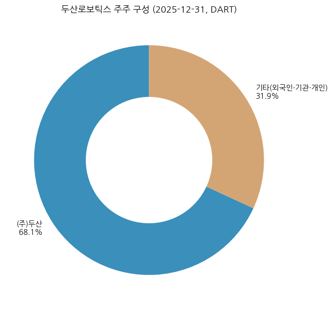

→ 외국인 지분율·국민연금 5% 이상 여부는 DART 2025 사업보고서에 별도 5% 주주 미기재 → 2026 분기보고서 확인 필요

③ 임원·이사회 (DART 2025 사업보고서, 2026.03 정기주총 반영)

| 성명 | 직위 | 주요 경력 |
|---|---|---|
| 박인원 | 사장, 사내이사·대표이사 | 두산에너빌리티 Plant EPC BG·Water BG 부사장 (2022.12 대표 선임, 2026.03 재선임) |
| 조길성 | 전무, 사내이사·대표이사 | (주)두산 지주부문 상무, 두산인프라코어 FA팀장 |
| 김민표 | 부사장, 사내이사·대표이사 | 토스페이먼츠 대표, 비바리퍼블리카, 맥킨지 — **2026.09.30 퇴임** (CEO스코어데일리) |
| 권영민 | 사장, 신임 CEO | 2026.09.18 선임 — 두산모트롤 대표(2021~), 두산밥캣 CSO(2018~2020), 두산인프라코어 중국 영업 총괄 |
| 강남훈·김은태·유혜련 | 사외이사 | 감사위원회·내부거래위원회 등 (강남훈 KAMA 회장, 김은태 연세대 전기전자 교수, 유혜련 회계사) |
| 오창훈 | 전무(미등기) | AI&SW 담당, 토스증권 |
| 이우섭 | 상무(미등기) | Robot R&D, 로봇연구소장, 삼성전자·KIST |

---

## ⑥ 기타 팩트

① R&D 인프라

| 연도 | 연구개발비 (억원) | 매출 대비 |
|---|---|---|
| 2023 | 98.7 | 19% |
| 2024 | 71.3 | 15% |
| 2025 | 84.1 | 26% |
| 1H26 | 60.0 | 18% |

→ 출처: DART 2025 사업보고서·2026 반기보고서 (전액 비용 처리). R&D 인력 70명(대표이사 3인 포함). 2026 R&D 지출 항목에 "생성형 AI 도구 도입: 개발 생산성 향상을 위한 Claude 구독" 명시

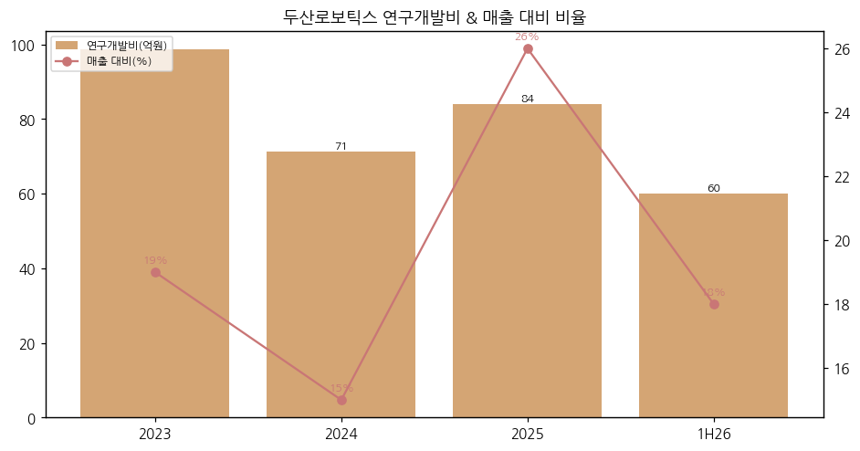

② Corporate action

| 시점 | 내용 |
|---|---|
| 2023.10 | IPO (재무활동CF +4,108억) |
| 2024.07~12 | 두산밥캣 편입 분할합병 추진 → 철회 |
| 2025.07~09 | ONExia, Inc. 지분 89.59% 인수 결의·완료 (약 356억, 2030 매출 목표 $84.2M — CEO스코어데일리) |
| 2025.12 | ONExia + DRA LLC 합병 → Doosan Robotics Americas, Inc. |
| 2026.06 | 장기차입금 500억 |
| 진행 중 | "M&A·전략적 파트너십을 통한 기술 추가 확보 지속 검토" (회사 3Q26 IR) |

③ R&D·제품 마일스톤

| 시점 | 내용 |
|---|---|
| 2015 | 협동로봇 4개 모델 개발 완료 |
| 2018 | M시리즈 판매 개시 |
| 2020~2023 | H·A·E 시리즈, P시리즈(팔레타이징 전용 5축 30kg), F&B 솔루션(튀김·커피) |
| 2026.06 | NVIDIA 피지컬AI 협력, AI 팔레타이징 PalletizHD+ |
| 2026 하반기 | 차세대 Arm 모델 개발, 자체 AI 모델 플랫폼·데이터 인프라 구축 (회사 IR) |
| 2027 (계획) | Agentic Robot OS 기반 솔루션 공개 |
| 2031 (계획) | 국책과제로 5·10·20kg 협동로봇 3종 + 산업용 휴머노이드 상용화 (CEO스코어데일리) |

→ 국책과제 2건 (회사 3Q26 IR p.9): ① 온디바이스AI 반도체 기반 차세대 협동로봇(지원 857억, 54개월, 물류·제조) ② 협동로봇·AI 지능형 용접(지원 158억, 45개월, 원전 기자재·조선·방산 — 두산에너빌리티 실증)

④ 주요 리스크

→ (1) **현금 소진**: 순현금 2023말 3,820억 → 2026.09 1,584억. 현재 속도(연 500~600억)면 2028~2029년 추가 조달 필요 `[판단]`
→ (2) **Arm 본업 약화**: 2025 Arm 매출 -49%. 중국산 저가 협동로봇과 가격 경쟁 `[판단]`
→ (3) **북미 솔루션 수주잔고 감소**: DRA 잔고 $14.9M → $9.1M (2025말 → 3Q26)
→ (4) **IPO 추정치와의 괴리**: 상장 당시 2026년 당기순이익 942억 추정 vs 실제 3Q 누적 -403억 (CEO스코어데일리 2026-11-10)
→ (5) **환율**: 매출 73% 수출(1H26), 북미 비중 55% — 원/달러 하락 시 원화 매출 감소
→ (6) **지배구조 이벤트**: 두산그룹 재편 재추진 시 소액주주 가치 훼손 논란 재발 가능

⑤ ESG

→ 별도 ESG 등급 공시 미확인 (작성 시점 미검증)

⑥ 인증·라이선스

→ 협동로봇 안전 인증, E·A시리즈 일부 NSF(식품위생)·IP66 인증 (DART 2026 반기보고서 제품 설명)

---

## Version Log

| 버전 | 일자 | 내역 |
|---|---|---|
| v1.0 | 2026-11-14 | 최초 작성. OpenDART 연결 재무(2023~2026.2Q) + 2023 사업보고서 비교표시(2021·2022) + 회사 IR(3Q26 잠정) + DART 반기보고서 정성자료. 차트 13종 |

**잔여 보완 후보**
→ 3Q26 분기보고서 공시 후 3Q26 확정치·영업외손익(순손실 183억 원인)·장기차입금 조건 반영
→ 2015~2020 연간 손익 (증권신고서 2023.09 재무 요약)으로 시계열 확장
→ 외국인 지분율·52주 고저 2차 소스(stockanalysis/네이버) 교차 확인
→ 셀사이드 컨센서스(2026E·2027E 매출·영업이익) 확보 시 밸류에이션 표 보강
→ 지역별 매출 연도 시계열(IR 차트 수치) 정확 전사
