# 두산밥캣 — 기업 개요 (v1.0)

> 마지막 update: 2026-11-25 (3Q26 분기보고서 2026-11-12 공시 + 3Q26 IR 2026-10-29 반영)
> 입력 source: OpenDART fnlttSinglAcntAll (연결, 2016 FY\~3Q26 40개 JSON + 2014·2015 비교컬럼) + DART 정기공시 원문 XML 40건 (사업보고서 2016\~2025, 분기·반기 1Q17\~3Q26) + DART 기업정보 (최대주주·배당·자기주식·임원·직원) + 두산밥캣 IR 실적발표 PDF 32건 (irgo 경유, 2018-05\~2026-10) + Yahoo Finance (241560.KS, 2016-12\~2026-11-25) + 뉴스 (CEO스코어데일리·아시아경제 등)
> 갱신 주기: 매분기 (실적 리뷰 모드 호출 시)
> 워치리스트: 건설·건설기계 섹터 (2026-11-23 추가, 4Q26부터 리뷰, 표준 깊이) / 서브섹터: 건설기계
> **Fact verify cutoff**: 2026-11-25 (주가·시총 = Yahoo Finance 2026-11-25 조회값, 지분율 = DART 3Q26 분기보고서. 3Q26 = 분기보고서 확정치)

**⚠ 통화 주의 (이 리포트 전체 규칙):** 두산밥캣은 **2023 사업보고서(2024-03 공시)부터 연결재무제표 표시통화를 USD로 변경**했다 (지배기업 기능통화는 원화, DART 연결 재무 JSON도 2023 FY부터 USD). 그래서 이 리포트는 **원화 표(2014\~2022 DART, 2023\~ IR·공시 원화환산치)** 와 **USD 표(2021\~ DART)** 를 따로 쓴다. 한 표 안에서 두 통화를 섞지 않는다. IR 자료는 원래부터 USD 기준이고, 원화 손익은 IR 부록에 '참고용 원화 환산'으로만 나온다.

---

## 1. 기업 분류

- **Primary 분류: 사이클** (Cyclical — 북미 소형 건설장비·지게차 수요 + 딜러 재고 사이클)
- **Secondary 노트: '고마진 사이클'** — 상장 이후 분기 적자 0회, 연간 OPM 하단 7.8% (2025). 같은 사이클주라도 진폭은 매출 쪽이 크고 이익률 하단이 높다

### ① 정량 근거

**📊 Summary Box (12년, 2014\~2025 연결, 원화):**

| 지표 | 값 |
|------|-----|
| 매출 CAGR (2016→2025, 9년) | **+11.5%** (3.29조 → 8.79조, 원화) / USD 기준 **+9.1%** ($2.83B → $6.18B) — 2021-07 산업차량(MH) 인수 포함 |
| OPM 평균 (12년) | **10.8%** |
| OPM 정점 평균 | **13.2%** (2016 12.1% · 2023 14.3%) |
| OPM 저점 평균 | **8.5%** (2020 9.2% · 2025 7.8%) |
| 사이클 주기 | 약 5년 (OPM 정점 2016\~2018 고원 → 2023, 저점 2020 → 2025) |
| 사이클 회수 (12년) | 정점 2회 / 저점 2회 |

```
[전사 매출·OPM 시계열 (12년, 연결, 원화)]
연도  매출(조)  영업이익(조)  순이익(조)  OPM    NPM
2014   2.93     0.28        0.06      9.6    1.9   ← 2014-04 설립, 9개월분 / Heavy 건설기계 포함
2015   4.04     0.39        0.15      9.5    3.7   ← Heavy 포함 원공시
2016   3.29     0.40        0.18     12.1    5.5   ← 2016-11 KOSPI 상장. Heavy 제외 재작성
2017   3.39     0.39        0.27     11.6    8.1   ← Heavy 사업 중단영업 처리 (DART)
2018   3.97     0.46        0.26     11.6    6.7   ← 북미 주택·건설 호조, 1차 정점 고원
2019   4.51     0.48        0.27     10.6    6.0   ← 콤팩트 트랙터 출시·모어 진출
2020   4.28     0.39        0.25      9.2    5.8   ← 1차 저점 (코로나, 2020 무배당)
2021   5.82     0.60        0.39     10.2    6.6   ← 2021-07 두산산업차량 인수 (3Q21부터 연결)
2022   8.62     1.07        0.64     12.4    7.5   ← 북미 호황 + 판가 인상, 영업이익 1조 첫 돌파
2023   9.76     1.39        0.92     14.3    9.4   ← 2차 정점 (원화 잠정공시 기준)
2024   8.55     0.87        0.56     10.2    6.6   ← 딜러 재고조정 (3Q24 매출 -25% YoY)
2025   8.79     0.69        0.40      7.8    4.6   ← 2차 저점: 美 관세 + MH 부진
OPM range: 7.8% ~ 14.3% = 6.5%pt  (적자 연도 0)
```

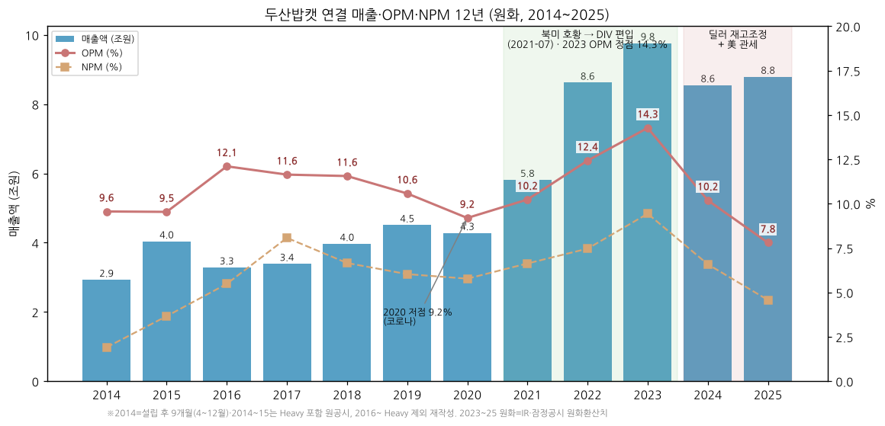

(2014\~2022 = OpenDART 원화. 2014·2015는 2016 사업보고서의 비교컬럼, 2016은 2017 사업보고서의 재작성값(Heavy 제외, 원공시 3.95조). 2023 = 2024-01 잠정공시 원화(CEO스코어데일리 2024-01-29), 순이익은 DART 배당사항의 연결 당기순이익(원화). 2024·2025 = IR 원화 손익 부록(FY25 IR 2026-02-13, 손익 환율 FY24 1,363.98원·FY25 1,422.22원))

**최근 2개 분기 YoY:** 2Q26 원화 매출 +11.2% / 영업이익 +42.9% (USD +4.1% / +34.0%, 일회성 $81M 포함) · 3Q26 원화 매출 +16.5% / 영업이익 +25.3% (USD +13.0% / +22.0%) — 원화 YoY가 USD보다 큰 차이는 원화 약세(3Q 손익 환율 1,385.28 → 1,423.38원) 효과

### ② 산업 분류

- 산업: **건설기계 (소형 건설장비 중심)** — 사이클 산업 list 포함 (북미 주택·비주택 건설, 렌탈 업체 교체 수요, 딜러 재고)
- DART 업종: 29241 (건설 및 채광용 기계장비 제조업) / KRX 기계 / 지주회사 형태 (외국기업지배지주회사 — 사업은 해외 종속회사가 수행)
- 워치리스트 섹터: **건설·건설기계** (2026-11-23 추가, T1 아님) / 서브섹터: **건설기계**

### ③ 분류 결정 논리

(1) **가장 매출 큰 사업부 기준**: Compact Equipment(CE)가 2025 매출의 77% (USD 4,771M / 6,182M, DART) → 북미 주택·조경·렌탈 수요에 직결 → 사이클
(2) **사이클 사업부 이익 비중 우선 sub-rule**: 사업부별 이익은 미공시 (DART 영업부문 = 'Construction Equipment' 단일 + 유압기기). 다만 매출 변동은 CE가 주도 — 3Q24 CE -29.8% YoY vs MH -21.5%, 회복기 3Q25 CE +20.2% vs MH -8.7%. 북미 비중 73% (2025) → 북미 사이클 단일 노출. **사이클 유지**
(3) **Boundary case 처리**: 2016\~2025 매출 CAGR 11.5%는 지속성장처럼 보이지만, 산업차량 인수(2021)와 원화 약세를 빼면 유기적 성장은 낮다 (USD 기준 2017 $3.0B → 2025 $6.2B 중 MH $0.93B·유압기기 $0.15B는 인수분). OPM이 2023 14.3% → 2025 7.8%로 절반 가까이 꺾여 '이익률 사이클'이 분명 → 지속성장 X
(4) **피어 대비**: Caterpillar (대형 장비·광산·에너지 엔진 혼합, 사이클 + 서비스 매출) / Deere (농기계 사이클이 주력, 건설·임업은 일부) / Kubota (소형 트랙터·미니 굴착기 — 두산밥캣의 가장 직접적인 소형장비 경쟁사, 일본·북미 노출) / Komatsu (중대형 건설·광산 장비, 중국·신흥국 노출) / HD현대건설기계 (중대형 굴착기, 신흥국·북미 혼합). **두산밥캣 = 북미 소형장비(SSL·CTL) 집중형** — 같은 건설기계라도 광산·중국 사이클이 아니라 **美 주택·비주택 건설 + 렌탈 교체 사이클**을 탄다 (OPM 진폭은 피어 대비 작지만 매출 진폭은 2024 USD -16%로 큼)

### ④ 적정 밸류에이션 방법

- **PER (사이클 평균 이익 기준) 우선** — 적자 연도가 없어 이익이 0 근처로 가지 않으므로 PER이 의미 있음. 다만 정점 이익(2023)이 아니라 사이클 평균 OPM 10\~11% 기준 이익에 배수를 줘야 함
- **PBR 보조** — 자본의 약 80%가 무형자산(영업권·브랜드, 2025 $4.0B / 자본 $5.0B)이라 PBR 하단 의미가 약함
- **현재 다이얼 (자체 계산, 2026-11-25):** 시총 4.61조 (48,050원 × 95,856,065주) / TTM 순이익 5,105억 (원화 IR: 4Q25 854 + 1Q26 1,314 + 2Q26 1,995 + 3Q26 942) → **TTM PER 약 9.0배** / 자본 $5,170M × 1,358.4원(2026-09말, IR) ≈ 7.02조 → **PBR 약 0.66배**
- 주주환원 하한: 최소 DPS 1,600원 (2025\~) → 현재가 기준 배당수익률 3.3% (자체 계산)
- 사이클 밴드 (시총): 저점 1.8조 (2020-03) \~ 고점 7.35조 (2026-05-07 종가 76,700원) — 상장 후 10년 중 대부분 3\~6조 박스

### ⑤ 분기 재평가 트리거 (분류 변경 조건)

- 2개 연도 연속 **OPM 12%+ 및 매출 YoY 플러스** (관세 영향 제외) → 사이클 → '사이클 + 지속성장 일부' 검토
- 분기 **OPM 5% 하회 2분기 연속** (2025 3Q·4Q 6%대 → 추가 하락) → 저점 판단 수정, 재고조정 2라운드 여부 점검
- 지배구조 개편 재추진 (두산에너빌리티 보유 지분 이전·합병 등) 발표 시 → 밸류에이션 방법(지주 할인·소수주주 이슈) 별도 재검토
- 신사업(전동화·자율화·로보틱스 연계) 매출이 **연결 매출 5%+** 공시 시 → Secondary 노트 추가 검토

---

## 2. 회사 개요

### ① 기본 사항

- **회사명**: 두산밥캣 주식회사 (Doosan Bobcat Inc.) / KRX 241560 (KOSPI)
- **본사**: 경기도 성남시 분당구 정자일로 155 (분당두산타워) — 2021-03 서울 중구에서 이전
- **설립**: 2014-04-25 (두산인프라코어의 해외 소형장비 사업 지주회사) / **상장 2016-11-18** (공모가 30,000원)
- **그룹**: 두산그룹 — 최대주주 두산에너빌리티 48.17% (DART 3Q26)
- **대표이사**: 스캇성철박 · 조덕제 (2인 대표)
- **사업 한 줄 정의**: 'Bobcat' 브랜드로 북미 스키드스티어로더(SSL)·콤팩트트랙로더(CTL) 시장을 이끄는 소형 건설장비 회사. 매출의 73%가 북미, 77%가 소형장비. 2021 지게차(두산산업차량), 2024 유압부품(두산모트롤) 인수로 제품군 확장. 판매는 대부분 독점 딜러망 경유 (북미 딜러 평균 계약기간 29년+, DART 2025 사업보고서)

### ② 최근 12년 손익·자본 추이

**원화 (조원, 2014\~2022 DART / 2023\~2025 IR·잠정공시 원화환산):**

| 연도 | 매출 | YoY | 영업이익 | OPM | 순이익 | NPM | 자본총계 | 자본 YoY |
|---|---|---|---|---|---|---|---|---|
| 2014 | 2.93 | - | 0.28 | 9.6% | 0.06 | 1.9% | 3.05 | - |
| 2015 | 4.04 | +37.9% | 0.39 | 9.5% | 0.15 | 3.7% | 3.13 | +2.4% |
| 2016 | 3.29 | -18.6% | 0.40 | 12.1% | 0.18 | 5.5% | 3.35 | +7.2% |
| 2017 | 3.39 | +3.1% | 0.39 | 11.6% | 0.27 | 8.1% | 3.43 | +2.3% |
| 2018 | 3.97 | +17.2% | 0.46 | 11.6% | 0.26 | 6.7% | 3.74 | +9.1% |
| 2019 | 4.51 | +13.6% | 0.48 | 10.6% | 0.27 | 6.0% | 3.98 | +6.4% |
| 2020 | 4.28 | -5.0% | 0.39 | 9.2% | 0.25 | 5.8% | 4.07 | +2.4% |
| 2021 | 5.82 | +35.8% | 0.60 | 10.2% | 0.39 | 6.6% | 4.32 | +6.1% |
| 2022 | 8.62 | +48.2% | 1.07 | 12.4% | 0.64 | 7.5% | 5.02 | +16.3% |
| 2023 | 9.76 | +13.2% | 1.39 | 14.3% | 0.92 | 9.4% | (USD 표) | - |
| 2024 | 8.55 | -12.4% | 0.87 | 10.2% | 0.56 | 6.6% | (USD 표) | - |
| 2025 | 8.79 | +2.8% | 0.69 | 7.8% | 0.40 | 4.6% | (USD 표) | - |

(2023\~2025 자본은 원화 DART 값이 없어 아래 USD 표 참조 — 원화 환산하지 않음)

**USD (USD M, DART 연결 — 2021·2022는 2023 사업보고서 재작성 비교컬럼):**

| 연도 | 매출 | YoY | 매출총이익 | GPM | 판관비 | 영업이익 | OPM | 순이익 | 자산 | 부채 | 자본 | 현금 |
|---|---|---|---|---|---|---|---|---|---|---|---|---|
| 2021 | 5,082 | - | 1,078 | 21.2% | 558 | 520 | 10.2% | 337 | 7,238 | 3,593 | 3,645 | 803 |
| 2022 | 6,674 | +31.3% | 1,508 | 22.6% | 679 | 829 | 12.4% | 499 | 7,298 | 3,333 | 3,965 | 552 |
| 2023 | 7,476 | +12.0% | 1,821 | 24.4% | 756 | 1,065 | 14.2% | 706 | 8,044 | 3,426 | 4,618 | 1,086 |
| 2024 | 6,269 | -16.1% | 1,460 | 23.3% | 821 | 639 | 10.2% | 413 | 8,170 | 3,480 | 4,690 | 1,263 |
| 2025 | 6,182 | -1.4% | 1,386 | 22.4% | 904 | 482 | 7.8% | 283 | 8,558 | 3,547 | 5,012 | 1,390 |

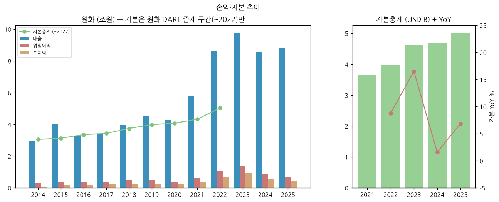

**환율 효과 (원화 vs USD 성장률 차이):** 2025 매출 원화 +2.8% vs USD -1.4% (손익 환율 1,363.98 → 1,422.22원, +4.3%) / 2024 원화 -12.4% vs USD -16.1%. 원화 실적은 '원화 약세 = 실적 부풀림' 효과가 항상 섞여 있으므로 **사이클 판단은 USD 숫자로** 한다

### ③ 회사 주가 역사 ★ narrative 영역

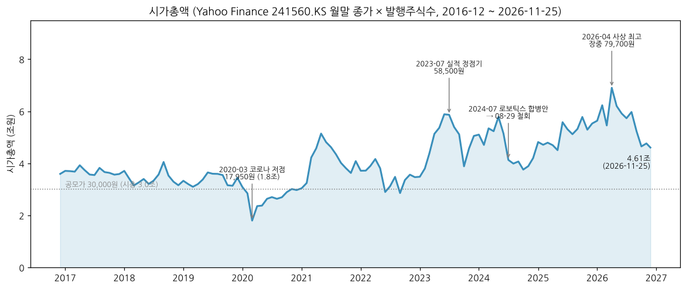

**시가총액 데이터:** 2016-12 \~ 2026-11-25 (Yahoo Finance 241560.KS 월간 종가 + 2024-11 이후 일간 종가. 발행주식수 100,249,166주 → 2025-02-27 자사주 소각 후 95,856,065주)
- 2026-11-25 종가 **48,050원 → 시총 약 4.61조원** (Yahoo, 장 마감 직전 조회값)
- **사상 최고 (종가): 2026-05-07 76,700원 → 시총 약 7.35조** / 장중 최고 **79,700원 (2026-04-28)** (Yahoo 일간)
- 상장 후 최저 (월말 종가): 2020-03 17,950원 (시총 약 1.8조)
- 공모가 30,000원 (2016-11, 공모가 희망밴드 하단 미만으로 확정되며 기관 수요 부진 — 이투데이·시대일보 2016-10\~11)
- 2026-04 고점 대비 2026-11-25 **-37%** (종가 기준 76,700 → 48,050원)

**사이클 history:**

```
[2016-11] KOSPI 상장 — 공모가 30,000원, 상장 후 3년간 3~4만원대 박스 (시총 3~4조)
  · 2017 Heavy(중대형) 사업 이관 → Compact 집중 회사로 정리

[2020-03] 코로나 급락 17,950원 — 상장 후 최저. 2020 무배당

[2021-03 ~ 2021-06] 북미 주택 호황 + 산업차량 인수 발표 → 장중 59,400원 (2021-06)

[2023-03 ~ 2023-07] 실적 정점기 (2Q23 OPM 17.5%, 분기 최대) → 장중 67,000원 (2023-07)

[2024-07-11 ~ 2024-12] 지배구조 개편 쇼크
  · 2024-07-11 두산로보틱스와 포괄적 주식교환(상장폐지 후 자회사화) + 두산에너빌리티 분할합병 발표 → 주가 급락 (월말 41,200원)
  · 2024-08-29 주식교환 계약 해제 (이사회), 분할합병만 유지 → 2024-12 분할합병도 철회
  · 2024-12-16 주주환원 정책: 최소 DPS 1,600원·분기배당·자사주 2,000억 매입 소각·총주주환원율 40%

[2024-07 ~ 2025-05] 딜러 재고조정 + 美 관세 불확실성 — 3~5만원 박스

[2025-06 ~ 2026-04] 美 인프라·데이터센터 건설 수요, 관세 환급 기대 → 2026-04-28 장중 79,700원 (사상 최고)

[2026-05 ~ 11] 고점 대비 조정 — 3Q26 OPM 6.9% (관세 원가 온기 반영) 실망 → 48,050원 (2026-11-25)
```

### ④ 회사의 주요 연혁

```
1958~60   美 노스다코타 Melroe Manufacturing의 소형 로더 → 스키드스티어로더(Bobcat 브랜드 기원)
2007-11   두산인프라코어, Ingersoll Rand로부터 Bobcat 등 3개 사업 인수 (약 49억 달러)
2014-04   두산밥캣(주) 설립 — 두산인프라코어의 해외 소형장비 지주회사
2016-11   KOSPI 상장 (공모가 30,000원)
2017      Heavy 건설기계(중대형) 사업 두산인프라코어로 이관 → 중단영업 처리 (DART 2017 사업보고서)
2019      콤팩트 트랙터 출시 + 북미 모어(잔디깎이) 사업 진출 → 농업·조경 확장
2021-07-01 두산인프라코어 분할합병 → 최대주주 두산에너빌리티(51.05%)로 변경
2021-07-06 두산산업차량(지게차) 인수 → Material Handling 부문 (3Q21 연결 편입)
2023-06-21 두산에너빌리티 보유주식 500만주 시간외 대량매매 → 46.06%
2023     연결재무제표 표시통화 USD로 변경 (2023 사업보고서부터)
2024-07-11 두산로보틱스와 포괄적 주식교환 계약 → 2024-08-29 해제
2024-10-04 (주)모트롤(現 두산모트롤) 지분 100% 인수 → '유압기기' 영업부문 추가
2024-12-16 주주환원 정책 발표 (최소 DPS 1,600원, 자사주 2,000억 매입·소각)
2025-02-27 자기주식 4,393,101주 소각 → 발행주식 95,856,065주, 에너빌리티 지분 48.17%
2025      분기배당 시작 (분기 400원)
2026-01   CES 2026 참가 — AI 잡사이트 컴패니언, 모듈형 콘셉트 장비 RogueX3, 표준형 모듈 배터리팩 BSUP 공개
```

(1958·1960·2007 연혁은 회사 공개 연혁·언론 일반 사실, 나머지는 DART 사업보고서·IR 기준)

---

## 3. 비즈니스 모델

### ① 실적 추이 (전사 → 제품군 → 지역 3단계 위계)

**연간 5년 통합 표 (USD M, DART 사업보고서 'II. 사업의 내용 - 매출실적' / 영업이익 = DART 연결):**

| 항목 | 2021 | 2022 | 2023 | 2024 | 2025 |
|------|------|------|------|------|------|
| **연결 매출액** | **5,082** | **6,674** | **7,476** | **6,269** | **6,182** |
| └ 제품군별 | | | | | |
| &nbsp;&nbsp;&nbsp;&nbsp;└ Compact Equipment (CE) | 4,362 | 5,250 | 5,763 | 4,879 | 4,771 |
| &nbsp;&nbsp;&nbsp;&nbsp;└ Material Handling (MH, 산업차량) | 468 ※ | 1,111 | 1,321 | 1,026 | 929 |
| &nbsp;&nbsp;&nbsp;&nbsp;└ Portable Power (PP) | 253 | 313 | 393 | 332 | 334 |
| &nbsp;&nbsp;&nbsp;&nbsp;└ 유압기기 (두산모트롤) | - | - | - | 32 ※ | 147 |
| └ 지역별 | | | | | |
| &nbsp;&nbsp;&nbsp;&nbsp;└ North America | 3,554 | 4,823 | 5,561 | 4,644 | 4,516 |
| &nbsp;&nbsp;&nbsp;&nbsp;└ EMEA | 1,003 | 1,131 | 1,210 | 958 | 970 |
| &nbsp;&nbsp;&nbsp;&nbsp;└ ALAO (아시아·중남미·오세아니아) | 526 | 719 | 705 | 667 | 696 |
| **연결 영업이익** | **520** | **829** | **1,065** | **639** | **482** |
| **매출 YoY** | +40.1% | +31.3% | +12.0% | -16.1% | -1.4% |
| &nbsp;&nbsp;&nbsp;&nbsp;└ CE YoY | +28.0% | +20.4% | +9.8% | -15.3% | -2.2% |
| &nbsp;&nbsp;&nbsp;&nbsp;└ MH YoY | - | +137% (편입 효과) | +18.9% | -22.3% | -9.4% |
| **영업이익 YoY** | - | +59.4% | +28.4% | -40.0% | -24.5% |
| **OPM 전사** | **10.2%** | **12.4%** | **14.2%** | **10.2%** | **7.8%** |

※ MH: 2021-07-06 인수 → 2021은 3Q·4Q 2개 분기만 반영 (단절). 유압기기: 2024-10 인수 → 2024는 4Q만 반영. 제품군별 영업이익은 미공시 (DART 영업부문은 'Construction Equipment' 단일 + 유압기기 2개). 2021 매출 YoY는 2020 $3,629M 대비

**제품군·지역 12년 (USD M, DART 사업보고서 매출실적 — 각 연도 사업보고서 당기값):**

| 연도 | 합계 | CE | MH | PP | 유압기기 | Heavy | NA | EMEA | ALAO | CE 비중 | NA 비중 |
|---|---|---|---|---|---|---|---|---|---|---|---|
| 2014 | 3,550 | 2,528 | 0 | 340 | 0 | 681 | 2,292 | 1,073 | 185 | 71% | 65% |
| 2015 | 3,571 | 2,683 | 0 | 299 | 0 | 589 | 2,480 | 913 | 178 | 75% | 69% |
| 2016 | 3,404 | 2,567 | 0 | 240 | 0 | 597 | 2,247 | 971 | 186 | 75% | 66% |
| 2017 | 2,997 | 2,747 | 0 | 250 | 0 | 0 | 2,176 | 614 | 207 | 92% | 73% |
| 2018 | 3,609 | 3,300 | 0 | 309 | 0 | 0 | 2,659 | 734 | 216 | 91% | 74% |
| 2019 | 3,869 | 3,542 | 0 | 327 | 0 | 0 | 2,880 | 756 | 233 | 92% | 74% |
| 2020 | 3,629 | 3,406 | 0 | 222 | 0 | 0 | 2,664 | 703 | 261 | 94% | 73% |
| 2021 | 5,082 | 4,362 | 468 | 253 | 0 | 0 | 3,554 | 1,003 | 526 | 86% | 70% |
| 2022 | 6,674 | 5,250 | 1,111 | 313 | 0 | 0 | 4,823 | 1,131 | 719 | 79% | 72% |
| 2023 | 7,476 | 5,763 | 1,321 | 393 | 0 | 0 | 5,561 | 1,210 | 705 | 77% | 74% |
| 2024 | 6,269 | 4,879 | 1,026 | 332 | 32 | 0 | 4,644 | 958 | 667 | 78% | 74% |
| 2025 | 6,182 | 4,771 | 929 | 334 | 147 | 0 | 4,516 | 970 | 696 | 77% | 73% |
| 9M26 | 4,892 | 3,791 | 722 | 244 | 135 | 0 | 3,553 | 786 | 553 | 77% | 73% |

(2014 = 설립 전 1Q 결합재무 포함 연간 Combined. 2014\~2016 'Heavy 건설기계'는 2017년 이관된 중대형 장비 — 2017부터 제외, 단절. 2017\~2020 지역 NA는 당시 'North America & Oceania' 기준, 2021 보고서부터 Oceania를 ALAO로 재분류)

**제품군·지역별 분기 시계열 (USD M, DART 분기·반기·사업보고서 매출실적 누적값 차분, 1Q17\~3Q26 = 39분기):**

각 차트 = 매출 (bar, 좌축) + YoY (line, 우축). 제품군별 영업이익이 공시되지 않아 OPM 대신 YoY를 그렸다 (전사 OPM은 chart2_전사).

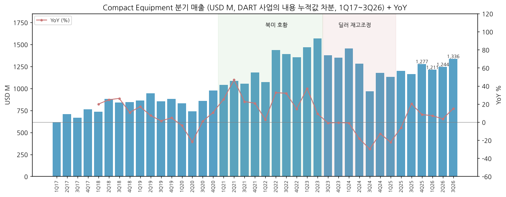
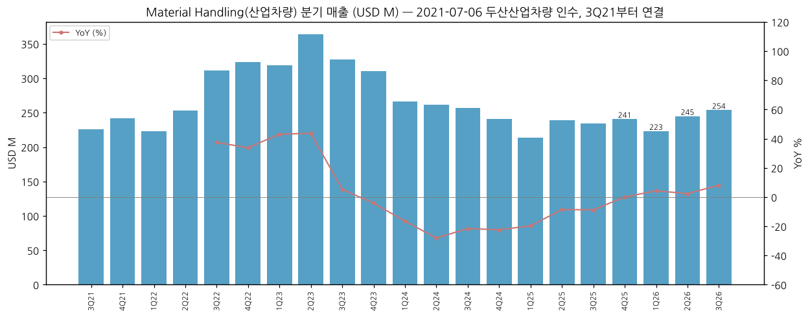
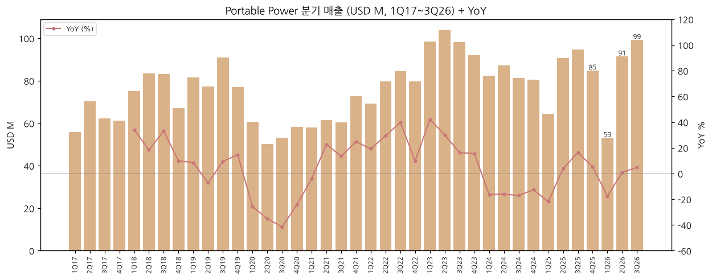
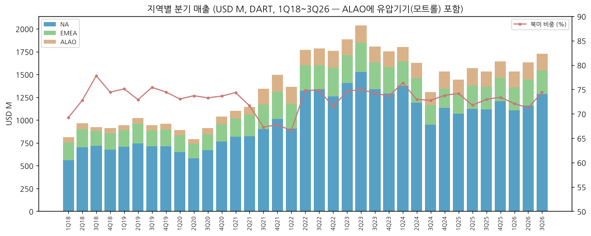
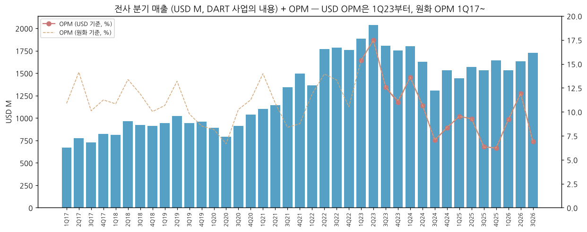

**제품군·지역별 최근 16분기 (USD M, DART):**

| 분기 | CE | MH | PP | 유압기기 | 합계 | NA | EMEA | ALAO | CE YoY | MH YoY | NA 비중 |
|---|---|---|---|---|---|---|---|---|---|---|---|
| 4Q22 | 1,354 | 324 | 80 | 0 | 1,757 | 1,256 | 317 | 184 | +14.5% | +33.8% | 71% |
| 1Q23 | 1,468 | 319 | 98 | 0 | 1,886 | 1,406 | 307 | 173 | +37.3% | +43.1% | 75% |
| 2Q23 | 1,568 | 364 | 104 | 0 | 2,035 | 1,527 | 319 | 190 | +9.2% | +43.7% | 75% |
| 3Q23 | 1,378 | 328 | 98 | 0 | 1,803 | 1,338 | 296 | 170 | -0.9% | +5.3% | 74% |
| 4Q23 | 1,349 | 310 | 92 | 0 | 1,752 | 1,290 | 289 | 173 | -0.4% | -4.2% | 74% |
| 1Q24 | 1,454 | 267 | 82 | 0 | 1,803 | 1,376 | 265 | 162 | -1.0% | -16.5% | 76% |
| 2Q24 | 1,281 | 262 | 87 | 0 | 1,629 | 1,188 | 269 | 172 | -18.3% | -28.1% | 73% |
| 3Q24 | 967 | 257 | 81 | 0 | 1,306 | 950 | 212 | 143 | -29.8% | -21.5% | 73% |
| 4Q24 | 1,178 | 241 | 81 | 32 | 1,532 | 1,130 | 211 | 190 | -12.7% | -22.4% | 74% |
| 1Q25 | 1,131 | 214 | 64 | 35 | 1,444 | 1,071 | 211 | 162 | -22.2% | -19.7% | 74% |
| 2Q25 | 1,201 | 239 | 91 | 36 | 1,567 | 1,124 | 254 | 189 | -6.2% | -8.5% | 72% |
| 3Q25 | 1,162 | 235 | 95 | 38 | 1,529 | 1,116 | 247 | 167 | +20.2% | -8.7% | 73% |
| 4Q25 | 1,277 | 241 | 85 | 39 | 1,641 | 1,205 | 259 | 178 | +8.4% | +0.1% | 73% |
| 1Q26 | 1,211 | 223 | 53 | 46 | 1,534 | 1,106 | 250 | 177 | +7.1% | +4.3% | 72% |
| 2Q26 | 1,244 | 245 | 91 | 50 | 1,630 | 1,161 | 281 | 189 | +3.6% | +2.4% | 71% |
| 3Q26 | 1,336 | 254 | 99 | 39 | 1,728 | 1,286 | 255 | 187 | +14.9% | +8.2% | 74% |

(2017 분기 지역별은 Heavy 포함 수치만 공시되어 표·차트에서 제외. ALAO에는 유압기기(두산모트롤) 매출이 포함 — IR의 지역별 매출은 모트롤 제외 기준이라 IR 수치와 다름. 예: 3Q26 IR ALAO $149M vs DART $187M)

**전사 분기 매출·영업이익 매트릭스 (억원, 원화):**

| 연도 | 1Q 매출 | 2Q | 3Q | 4Q | 1Q OP | 2Q OP | 3Q OP | 4Q OP | 연간 매출 | 연간 OPM |
|---|---|---|---|---|---|---|---|---|---|---|
| 2017 | 7,786 | 8,868 | 8,359 | 8,879 | 848 | 1,254 | 845 | 998 | 33,892 | 11.6% |
| 2018 | 8,703 | 10,385 | 10,353 | 10,267 | 943 | 1,389 | 1,229 | 1,030 | 39,708 | 11.6% |
| 2019 | 10,624 | 11,906 | 11,280 | 11,285 | 1,133 | 1,571 | 1,104 | 962 | 45,096 | 10.6% |
| 2020 | 10,642 | 9,638 | 10,849 | 11,691 | 868 | 643 | 1,112 | 1,315 | 42,821 | 9.2% |
| 2021 | 12,248 | 12,836 | 15,463 | 17,615 | 1,713 | 1,401 | 1,296 | 1,543 | 58,162 | 10.2% |
| 2022 | 16,408 | 22,184 | 23,789 | 23,839 | 1,944 | 3,095 | 3,169 | 2,508 | 86,219 | 12.4% |
| 2023 | 24,051 | 26,721 | 23,660 | 23,191 | 3,697 | 4,665 | 2,976 | 2,595 | 97,624 | 14.3% |
| 2024 | 23,946 | 22,366 | 17,777 | 21,423 | 3,260 | 2,395 | 1,257 | 1,802 | 85,512 | 10.2% |
| 2025 | 20,982 | 22,014 | 21,152 | 23,772 | 2,000 | 2,042 | 1,336 | 1,483 | 87,920 | 7.8% |
| 2026 | 22,473 | 24,479 | 24,635 | - | 2,070 | 2,917 | 1,674 | - | 71,587 (9M) | 9.3% |

(1Q17\~3Q23 = OpenDART 원화 (2017은 2018 분기보고서의 Heavy 제외 재작성값, 4Q = 연간 − 3Q 누적). 4Q23 = 2023 원화 잠정공시 연간 − 1\~3Q23 DART ⚠ / 1Q24 = 언론 보도 원화(CEO스코어데일리 2024-04-29) / 2Q24 = FY24 원화 − 1Q·3Q·4Q 역산 ⚠ / 3Q24\~3Q26 = IR 원화 손익 부록. 2025 분기합 87,920 vs 연간 87,919 = 반올림)

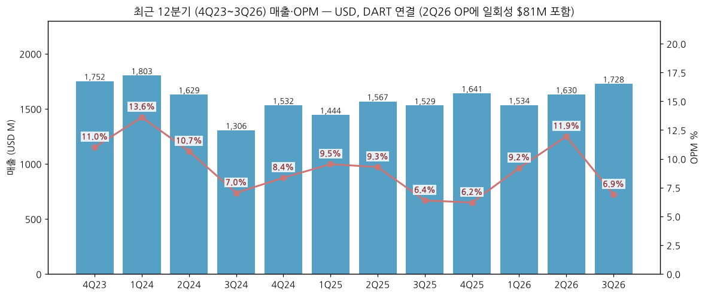

**최근 12분기 (rolling, 4Q23\~3Q26) — USD(DART)와 원화(IR) 병기, 같은 행에서 통화별 YoY 분리:**

| 분기 | 매출 (USD M) | 영업이익 (USD M) | OPM | 매출 YoY (USD) | OP YoY (USD) | 매출 (억원) | 영업이익 (억원) | 매출 YoY (원화) | OP YoY (원화) |
|---|---|---|---|---|---|---|---|---|---|
| 4Q23 | 1,752 | 193 | 11.0% | -0.3% | - | 23,191 | 2,595 | -2.7% | +3.4% |
| 1Q24 | 1,803 | 245 | 13.6% | -4.4% | -15.3% | 23,946 | 3,260 | -0.4% | -11.8% |
| 2Q24 | 1,629 | 174 | 10.7% | -19.9% | -51.2% | 22,366 | 2,395 | -16.3% | -48.7% |
| 3Q24 | 1,306 | 92 | 7.0% | -27.6% | -59.4% | 17,777 | 1,257 | -24.9% | -57.8% |
| 4Q24 | 1,532 | 128 | 8.4% | -12.5% | -33.6% | 21,423 | 1,802 | -7.6% | -30.6% |
| 1Q25 | 1,444 | 138 | 9.5% | -19.9% | -43.9% | 20,982 | 2,000 | -12.4% | -38.7% |
| 2Q25 | 1,567 | 145 | 9.3% | -3.8% | -16.3% | 22,014 | 2,042 | -1.6% | -14.7% |
| 3Q25 | 1,529 | 98 | 6.4% | +17.2% | +6.2% | 21,152 | 1,336 | +19.0% | +6.3% |
| 4Q25 | 1,641 | 102 | 6.2% | +7.1% | -20.5% | 23,772 | 1,483 | +11.0% | -17.7% |
| 1Q26 | 1,534 | 141 | 9.2% | +6.2% | +2.6% | 22,473 | 2,070 | +7.1% | +3.5% |
| 2Q26 | 1,630 | 195 | 11.9% | +4.1% | +34.0% | 24,479 | 2,917 | +11.2% | +42.9% |
| 3Q26 | 1,728 | 119 | 6.9% | +13.0% | +22.0% | 24,635 | 1,674 | +16.5% | +25.3% |

(USD 4Q23·4Q24·4Q25 영업이익 = 연간 − 1\~3Q 누적. 2Q26 영업이익 $195M에 일회성 수익 $81M 포함 (IR 각주, 관세 환급 관련으로 보도) → 일회성 제외 시 $114M·OPM 7.0%. 2026 가이던스: 매출 $6.45B (+4.3%)·영업이익 $482M (전년 수준), 9M26 누적 영업이익 $455M = 가이던스의 94%)

### ② 사업부별 개요 (매출 비중 큰 순서, 2025 USD)

| 제품군 | 2025 매출 | 비중 | 주요 제품 | 생산 |
|---|---|---|---|---|
| **Compact Equipment** | $4,771M | 77.2% | SSL·CTL·미니굴착기·텔레핸들러·백호로더 + 콤팩트 트랙터·모어 | 美 노스다코타(그윈너·비스마크) 등 해외 공장, CAPA 125,000대 (2025) |
| **Material Handling** | $929M | 15.0% | 엔진·전동 지게차 (핸드파렛트\~30톤급 풀라인업) | 국내(인천) CAPA 27,600대 + 해외 3,484대 |
| **Portable Power** | $334M | 5.4% | 이동식 공기압축기·발전기·조명탑 | 해외 CAPA 19,900대 |
| **유압기기** | $147M | 2.4% | 주행모터·선회모터·메인펌프·MCV (두산모트롤) | 국내 221,130 + 해외 163,834 (생산능력 단위, DART) |

(생산능력 = DART 2025 사업보고서. CE 공장 위치는 회사 공개 정보 기준 일반 사실)

### ③ 사업부별 디테일

**Compact Equipment (CE):**
- 북미 SSL·CTL에서 Bobcat은 세계 최초 SSL 개발 브랜드로, 독점 딜러망과 렌탈사 판매가 핵심 채널
- 사이클 진폭: 2023 $5,763M (정점) → 2024 $4,879M (-15.3%) → 2025 $4,771M. 분기로는 2Q23 $1,568M → 3Q24 $967M (-38%)
- 2025: 관세 불확실성에 따른 딜러 재고 축소로 -2% (IR FY25) / 3Q26: 북미 이연물량 출하·렌탈사 물량 증가로 +15% YoY
- 2019 콤팩트 트랙터·모어로 농업·조경 진입 → 기존 로더·굴착기 2개 라인업 한계 보완 (DART)

**Material Handling (MH, 산업차량):**
- 2021-07-06 두산산업차량 인수 (㈜두산에서) → 3Q21 $226M부터 연결. 2023 $1,321M 정점 → 2025 $929M (-30%)
- 2025: 경기 둔화로 대형 고객(Key Account) 구매 이연 -9% / 2026 전략: 美 관세 부담을 유럽·한국 판매 확대로 상쇄 (IR FY25) / 3Q26 +8%
- 국내 생산 → 미국 수출 구조라 **美 관세 직접 노출**이 가장 큰 제품군

**Portable Power (PP):**
- 2025 $334M (+1%): 북미 발전기 판매 증가 / 3Q26 +5%: 렌탈사 판매 정상화, 데이터센터 등 북미 건설 활동 (IR)

**유압기기 (두산모트롤):**
- 2024-10-04 ㈜모트롤 지분 100% 인수 (매도인: 소시어스웰투시 인베스트먼트 제2호, DART 사업결합 주석) → 2025 $147M (적자 소폭, DART 영업부문 9M26 영업손실 $0.7M)
- IR 제품별·지역별 매출은 모트롤 제외 기준으로 공시

### ④ 주요 경쟁사 (사업부별)

| 사업부 | 주요 경쟁사 |
|---|---|
| Compact Equipment | Caterpillar, Deere, Kubota, Case(CNH), Takeuchi, JCB, Komatsu (소형) |
| Material Handling | Toyota Industries, KION, Jungheinrich, Hyster-Yale, Crown, Mitsubishi Logisnext |
| Portable Power | Atlas Copco, Sullair (Kaishan), Generac 등 |
| 유압기기 | Kawasaki, Nabtesco, Bosch Rexroth 등 |

(DART는 시장점유율 미기재 — "타사 판매 현황 확인 불가". 경쟁사 목록은 업계 일반 사실 기준, 점유율 수치는 미확보)

### ⑤ 주요 매출처

- DART 사업보고서는 개별 고객명 미공시. 판매 구조는 **독점 딜러망 + 렌탈 업체 + 직판** (북미·유럽 딜러가 구역별 브랜드 독점권 보유)
- 북미 딜러 평균 계약기간 29년+, 유럽 딜러 초기 계약 5년 (DART 2025 사업보고서)
- 산업차량: 국내는 판매대리점, 수출은 NA·EMEA 판매법인이 현지 딜러에 재판매

### ⑥ 생산 CAPA + 임직원 추이

**생산능력 (대, DART 2025 사업보고서):** CE 해외 125,000 (2025) / 115,300 (2024) / 120,200 (2023) · CE 생산실적 76,500 (2025) / 78,600 (2024) / 99,800 (2023) → 2025 가동률 약 61% (자체 계산)

**연결 임직원 (명, DART 사업보고서 각 연도 '연결회사 기준 직원' + 별도 직원):**

| 연도 | 2016 | 2017 | 2018 | 2019 | 2020 | 2021 | 2022 | 2023 | 2024 | 2025 |
|---|---|---|---|---|---|---|---|---|---|---|
| 연결 종속회사 임직원 | 5,070 | 5,995 | 6,516 | 6,486 | 6,788 | 8,900 | 9,412 | 9,739 | 9,463 | 9,846 |

(별도(지주) 직원 153명 별도, 2025. 2025 지역별: North America 5,246 / EMEA 2,413 / ALAO 2,187. 2021 급증 = 산업차량 인수)

---

## 4. 재무 구조

**통화 규칙:** 2014\~2022 = 원화 (DART), 2021\~2025 = USD (DART, 2021·2022는 재작성 비교컬럼). 2021·2022는 두 표에 모두 있어 연결고리 역할.

### ① 손익계산서

**원화 (억원, DART 2014\~2022):**

| 연도 | 매출 | 매출총이익 | GPM | 판관비 | CIR | 영업이익 | OPM | 순이익 | NPM |
|---|---|---|---|---|---|---|---|---|---|
| 2014 | 29,303 | 5,898 | 20.1% | 3,095 | 10.6% | 2,802 | 9.6% | 560 | 1.9% |
| 2015 | 40,408 | 8,582 | 21.2% | 4,726 | 11.7% | 3,856 | 9.5% | 1,481 | 3.7% |
| 2016 | 32,873 | 8,079 | 24.6% | 4,099 | 12.5% | 3,980 | 12.1% | 1,803 | 5.5% |
| 2017 | 33,892 | 8,082 | 23.8% | 4,137 | 12.2% | 3,945 | 11.6% | 2,738 | 8.1% |
| 2018 | 39,708 | 8,813 | 22.2% | 4,223 | 10.6% | 4,590 | 11.6% | 2,645 | 6.7% |
| 2019 | 45,096 | 9,801 | 21.7% | 5,031 | 11.2% | 4,770 | 10.6% | 2,721 | 6.0% |
| 2020 | 42,821 | 8,898 | 20.8% | 4,960 | 11.6% | 3,939 | 9.2% | 2,475 | 5.8% |
| 2021 | 58,162 | 12,336 | 21.2% | 6,383 | 11.0% | 5,953 | 10.2% | 3,859 | 6.6% |
| 2022 | 86,219 | 19,485 | 22.6% | 8,769 | 10.2% | 10,716 | 12.4% | 6,441 | 7.5% |

(2023\~2025 원화 손익은 1번 섹션 12년 표 참조 — 매출총이익·판관비 원화값은 미공시)

**USD (USD M, DART 2021\~2025):** 위 2번 섹션 USD 표 참조 — GPM 21.2% (2021) → 24.4% (2023 정점) → 22.4% (2025) / 판관비 $558M → $904M (2021→2025, +62%) → 매출 정체 속 판관비 증가가 2025 OPM 하락의 한 축

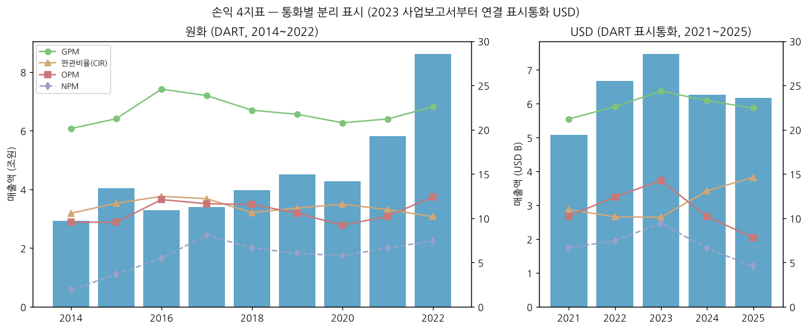

### ② 재무상태표

**원화 (억원, DART 2014\~2022):**

| 연도 | 자산총계 | 유동자산 | 현금 | 재고자산 | 부채총계 | 자본총계 | 부채비율 |
|---|---|---|---|---|---|---|---|
| 2014 | 62,563 | 13,873 | 1,695 | 8,009 | 32,045 | 30,519 | 105.0% |
| 2015 | 63,649 | 16,421 | 4,204 | 7,850 | 32,395 | 31,255 | 103.6% |
| 2016 | 63,261 | 15,289 | 3,636 | 7,008 | 29,742 | 33,518 | 88.7% |
| 2017 | 61,838 | 16,512 | 4,168 | 5,240 | 27,563 | 34,275 | 80.4% |
| 2018 | 64,463 | 16,837 | 5,473 | 6,185 | 27,067 | 37,396 | 72.4% |
| 2019 | 67,042 | 15,196 | 2,124 | 8,090 | 27,252 | 39,791 | 68.5% |
| 2020 | 69,606 | 18,620 | 7,822 | 6,598 | 28,868 | 40,738 | 70.9% |
| 2021 | 85,809 | 26,459 | 9,518 | 11,533 | 42,596 | 43,213 | 98.6% |
| 2022 | 92,484 | 30,825 | 6,990 | 16,510 | 42,240 | 50,244 | 84.1% |

**USD (USD M, DART + IR 3Q26):**

| 시점 | 자산총계 | 유동자산 | 현금 | 부채총계 | 총차입금 | 자본총계 | 순차입금 | 부채비율 |
|---|---|---|---|---|---|---|---|---|
| 2021 | 7,238 | 2,232 | 823 | 3,593 | 1,503 | 3,645 | 681 | 98.6% |
| 2022 | 7,298 | 2,432 | 560 | 3,333 | 1,032 | 3,965 | 473 | 84.1% |
| 2023 | 8,044 | 3,013 | 1,092 | 3,426 | 933 | 4,618 | -159 | 74.2% |
| 2024 | 8,170 | 3,052 | 1,269 | 3,480 | 1,236 | 4,690 | -33 | 74.2% |
| 2025 | 8,558 | 3,125 | 1,396 | 3,547 | 1,043 | 5,012 | -353 | 70.8% |
| 2026-09 | 8,956 | 3,589 | 1,504 | 3,786 | 1,051 | 5,170 | -453 | 73.2% |

(IR 재무상태표 기준 — 현금은 단기금융상품 포함 IR 정의라 DART '현금및현금성자산'(2025 $1,390M)과 소폭 차이. 2023부터 순현금 전환)

- 무형자산 $3,997M (2025, 자산의 47%) — 2007 Bobcat 인수 시 영업권·브랜드가 대부분
- 재고자산: 2022 $1,303M → 2023 $1,407M (정점) → 2025 $1,173M (DART) — 재고조정 진행

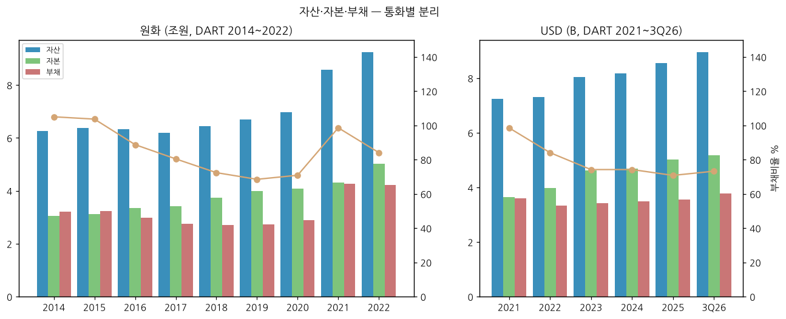

### ③ 현금흐름표

**원화 (억원, DART 2014\~2022):**

| 연도 | OCF | ICF | CFF | 유형 CapEx | 무형 CapEx | FCF | 배당지급 | 자사주 |
|---|---|---|---|---|---|---|---|---|
| 2014 | 2,497 | -709 | -1,992 | 528 | 161 | 1,808 | - | - |
| 2015 | 3,420 | -632 | -120 | 587 | 340 | 2,493 | 171 | - |
| 2016 | 3,269 | -901 | -3,028 | 524 | 392 | 2,353 | - | - |
| 2017 | 3,766 | -1,147 | -1,790 | 469 | 396 | 2,901 | 674 | - |
| 2018 | 6,166 | -679 | -4,219 | 753 | 514 | 4,899 | 1,238 | - |
| 2019 | 4,857 | -3,459 | -4,931 | 1,320 | 589 | 2,948 | 1,104 | - |
| 2020 | 5,653 | -2,389 | 2,424 | 1,175 | 505 | 3,973 | 513 | - |
| 2021 | 4,600 | -8,621 | 5,242 | 2,137 | 549 | 1,915 | - | - |
| 2022 | 7,040 | -1,226 | -8,750 | 1,725 | 652 | 4,664 | 1,845 | 14 |

**USD (USD M, DART 2021\~2025):**

| 연도 | OCF | ICF | CFF | 유형 CapEx | 무형 CapEx | FCF | 배당지급 | 자사주 매입 |
|---|---|---|---|---|---|---|---|---|
| 2021 | 388 | -727 | 442 | 180 | 46 | 162 | - | - |
| 2022 | 556 | -97 | -690 | 136 | 51 | 368 | 146 | 1 |
| 2023 | 993 | -193 | -269 | 132 | 69 | 791 | 120 | 2 |
| 2024 | 533 | -424 | 112 | 201 | 69 | 263 | 118 | 44 |
| 2025 | 822 | -239 | -489 | 168 | 73 | 581 | 135 | 97 |

(FCF = OCF − 유형·무형 CapEx (자체 계산). 2021 ICF -8,621억 = 두산산업차량 인수 대금 포함. 2024 ICF = 모트롤 인수 포함)

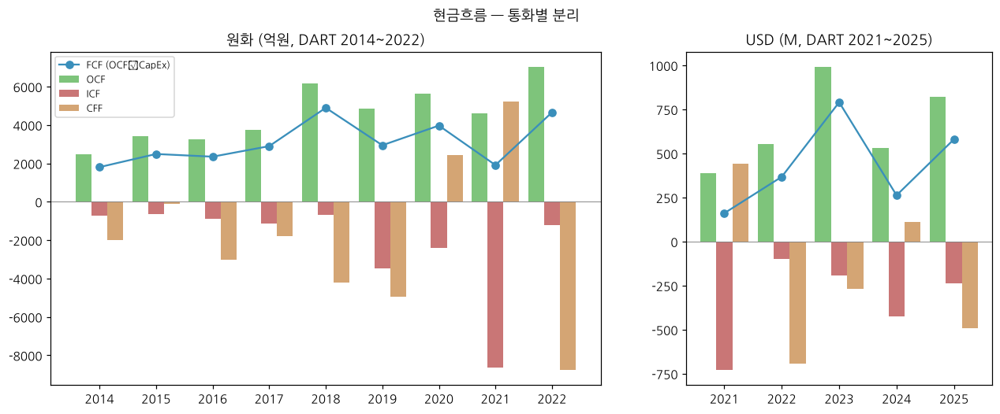

### ④ CapEx 추이

- 원화 유형+무형 CapEx: 2014 689억 → 2019 1,909억 → 2021 2,686억 (정점) → 2022 2,377억
- USD: 2021 $226M → 2023 $201M → 2024 $270M (정점) → 2025 $241M
- 매출 대비 CapEx 3\~4% 수준 — 경자산형(조립 중심) 구조

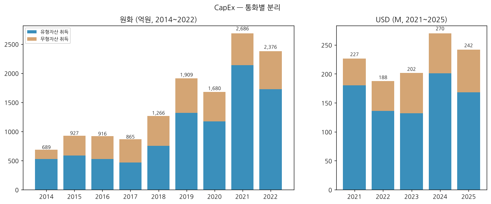

### ⑤ 부채구조 + 채무증권 발행 history

- 총차입금 $1,503M (2021, 산업차량 인수 후) → $933M (2023) → $1,051M (2026-09) / 순현금 $453M (2026-09, IR)
- 美 법인 Clark Equipment Co.(現 Doosan Bobcat North America) 사채 3억불 발행 (2020-05) / 차입금 14.45억불 리파이낸싱 (2022-04) (DART 2024 사업보고서)
- 이자보상배율 (영업이익/금융비용) 2.6배 (2025) — 금융비용에 외환손실 포함이라 실제 이자 부담보다 낮게 나옴 (2025 순금융비용 $31M, IR)

### ⑥ 배당·자사주 추이

| 연도 | DPS (원) | 현금배당총액 (억원) | 연결 배당성향 | 자사주 |
|---|---|---|---|---|
| 2016 | 700 | 702 | 41.5% | - |
| 2017 | 800 | 802 | 29.3% | - |
| 2018 | 900 | 902 | 34.1% | - |
| 2019 | 1,200 | 1,203 | 44.2% | - |
| 2020 | 0 | 0 | - | - (코로나 무배당) |
| 2021 | 1,200 | 1,203 | 31.2% | - |
| 2022 | 1,350 | 1,353 | 21.0% | - |
| 2023 | 1,600 | 1,602 | 17.3% | - |
| 2024 | 1,600 | 1,591 | 28.2% | 2,000억 매입·소각 결의 (2024-12-16) |
| 2025 | 1,700 | 1,627 | 40.4% | 4,393,101주 소각 (2025-02-27), 2025 매입 3,066,043주 ($97M) |

(DART 배당에 관한 사항 각 연도. 2025부터 분기배당 (1\~3Q 각 400원 + 결산). 2025 USD 기준 주주환원 $237M = 배당 $135M + 자사주 $102M (IR FY25))

**주주환원 정책 (2024-12-16 발표, 아시아경제):** 최소 배당 1,600원/주 (총 1,600억) · 분기배당 전환 · 자사주 2,000억 매입 후 소각 · **총주주환원율 40%** (배당+자사주) · 2030 매출 $12B 목표

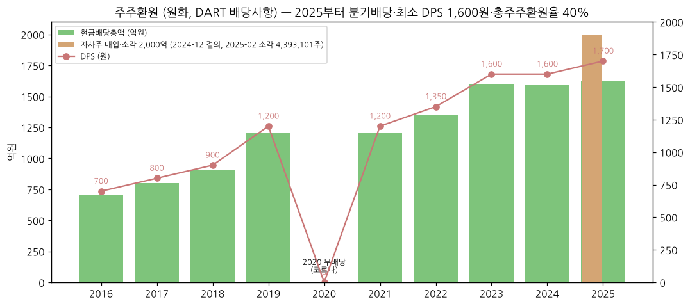

### ⑦ 재무 비율

| 연도 | 통화 | ROE | ROA | 부채비율 | 유동비율 | 이자보상배율(OP/금융비용) |
|---|---|---|---|---|---|---|
| 2015 | KRW | 4.8% | 2.3% | 103.6% | 196% | 2.3x |
| 2016 | KRW | 5.6% | 2.8% | 88.7% | 207% | 2.7x |
| 2017 | KRW | 8.1% | 4.4% | 80.4% | 193% | 2.0x |
| 2018 | KRW | 7.4% | 4.2% | 72.4% | 175% | 5.5x |
| 2019 | KRW | 7.1% | 4.1% | 68.5% | 133% | 5.0x |
| 2020 | KRW | 6.1% | 3.6% | 70.9% | 184% | 3.7x |
| 2021 | KRW | 9.2% | 5.0% | 98.6% | 177% | 3.9x |
| 2022 | KRW | 13.8% | 7.2% | 84.1% | 150% | 3.8x |
| 2022 | USD | 13.1% | 6.9% | 84.1% | 150% | 3.8x |
| 2023 | USD | 16.4% | 9.2% | 74.2% | 161% | 6.7x |
| 2024 | USD | 8.9% | 5.1% | 74.2% | 182% | 3.5x |
| 2025 | USD | 5.8% | 3.4% | 70.8% | 165% | 2.6x |

(평균 자본·자산 기준, 자체 계산. 2022는 원화·USD 양쪽 표시 — 통화 따라 ROE 차이 0.7%p = 환율 효과)

---

## 5. 지배 구조

### ① 그룹·계열 관계

```
㈜두산 (지주회사)
  └ 두산에너빌리티 (중간지주 역할)
       └ 두산밥캣 48.17% (46,176,250주, DART 3Q26)
            ├ Doosan Bobcat North America (美, 구 Clark Equipment)
            ├ Doosan Bobcat EMEA (체코 등)
            ├ 두산밥캣코리아 (ALAO 총괄)
            ├ 두산산업차량 (Material Handling, 2021-07 인수)
            └ 두산모트롤 (유압기기, 2024-10 인수)
```

**지배구조 변동 이력:**
- 2014\~2021-06: 최대주주 두산인프라코어
- 2021-07-01: 두산인프라코어–두산에너빌리티(구 두산중공업) 분할합병 → 두산에너빌리티 51.05% (51,176,250주) (DART)
- 2023-06-21: 두산에너빌리티 500만주 시간외 대량매매 → 46.06% (DART)
- 2024-07-11: 두산로보틱스와 포괄적 주식교환 계약 + 두산에너빌리티 분할합병(밥캣 지분 보유 신설법인 → 로보틱스 합병) 발표 → 소수주주 반발·금감원 정정 요구
- 2024-08-29: 포괄적 주식교환 계약 해제 (두산밥캣 이사회, DART)
- 2024-12: 에너빌리티 분할합병까지 철회 (뉴스핌 2024-12-10 보도 — 원문 미열람, 제목 기준 ⚠)
- 2025-02-27: 자사주 4,393,101주 소각 → 에너빌리티 지분율 48.17%로 상승 (주식수 변동 없음)
- 2025-03: 두산에너빌리티, 보유 밥캣 지분의 약 88%를 담보로 자금 조달 (다음/언론 2025-03-28 제목 기준 ⚠)

### ② 주주 구분

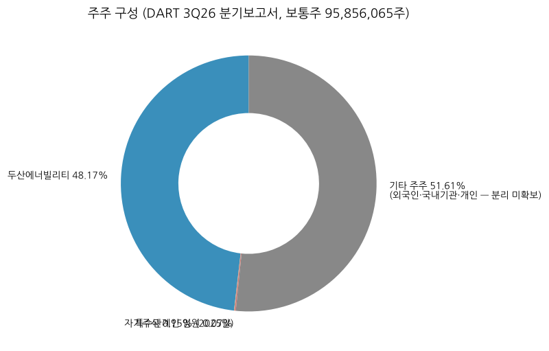

| 주주 | 주식수 | 지분율 | 비고 |
|---|---|---|---|
| 두산에너빌리티㈜ | 46,176,250 | 48.17% | 최대주주 |
| 박진원·박형원 (특수관계인) | 19,314 | 0.02% | |
| 스캇성철박·조덕제 (계열 임원) | 44,806 | 0.05% | |
| 최대주주 등 합계 | 46,240,370 | 48.24% | DART 3Q26 |
| 자기주식 | 142,263 | 0.15% | 2025-12말 (DART) |
| 기타 (외국인·국내기관·개인) | 약 49.47M | 약 51.6% | 외국인·국민연금 등 5% 주주 분리 수치 미확보 ⚠ |

(발행주식 95,856,065주 = 100,249,166 − 2025-02 소각 4,393,101)

### ③ 임원·이사회

- 이사회: 대표이사 2인 (스캇성철박, 조덕제) + 사외이사 4인 (최지광, 남유선, 이두희, 김무겸 — 2025-03 김무겸 신규) / 감사위원회 전원 사외이사 (DART 2025 사업보고서)
- **스캇성철박** 대표이사: 2023-03 재선임 (DART). 밥캣 북미·글로벌 사업 총괄
- **조덕제** 대표이사: 2021-03 선임, 2024-03 재선임 (DART)

---

## 6. 기타 팩트

### ① R&D 인프라

| 연도 | 2015 | 2016 | 2017 | 2018 | 2019 | 2020 | 2021 | 2022 | 2023 | 2024 | 2025 |
|---|---|---|---|---|---|---|---|---|---|---|---|
| 연구개발비 (USD M) | 80.2 | 72.0 | 75.2 | 93.5 | 106.9 | 111.5 | 126.7 | 153.4 | 179.0 | 174.4 | 178.0 |
| 매출 대비 | 2.2% | 2.1% | 2.5% | 2.6% | 2.8% | 3.1% | 2.5% | 2.3% | 2.4% | 2.8% | 2.9% |

(DART 사업보고서 '연구개발비용' — 비용 + 개발비 자산화. 2015·2016은 Heavy 포함 당시 기준)

- 연구 인력 (2025-12): North America 469명 (미국) / EMEA 246명 (체코·프랑스·독일) / ALAO 297명 (한국·인도·중국) = 1,012명
- 주요 과제: CE 신모델, 전동화 제품, 전동·자율 장비 통합 제어 (DART 2025)

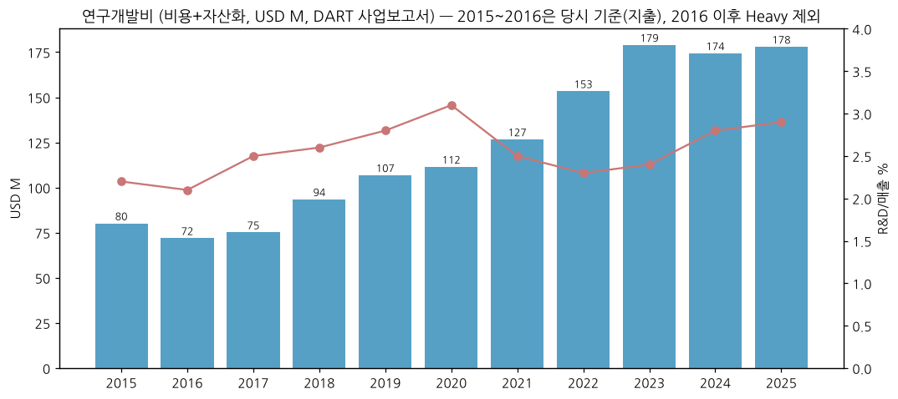

### ② 진행 중 corporate action — 10년치 주요 이벤트

| 시점 | 이벤트 |
|---|---|
| 2016-11 | KOSPI 상장 |
| 2017 | Heavy 건설기계 사업 이관 (중단영업) |
| 2021-07 | 두산산업차량 인수 (MH 진출) |
| 2023-06 | 최대주주 지분 500만주 블록딜 |
| 2024-07\~12 | 두산로보틱스 합병·지배구조 개편 발표 → 철회 |
| 2024-10 | 두산모트롤 인수 (유압기기) |
| 2024-12 | 주주환원 정책 (총환원율 40%, 자사주 2,000억) |
| 2025-02 | 자사주 4.39M주 소각 |

### ③ 기술·제품 마일스톤 — 10년치

- 2019: 콤팩트 트랙터 출시, 모어 사업 진출 (DART)
- 2022\~: 전동화 라인업 확대 (전기 CTL 'T7X' 등 — 회사 발표, 세부 출시일 미검증)
- 2026-01 CES 2026: AI 잡사이트 컴패니언(음성 상호작용 작업보조, 50+ 기능), 서비스 AI(정비 진단), RogueX3(조종석·동력원 가변 모듈형 콘셉트), BSUP 표준형 모듈 배터리팩 (IR FY25 부록)

### ④ 주요 리스크

- **美 관세**: 2025 영업이익률 -2.4%p의 주원인이 관세 (IR FY25). MH(국내 생산→미국 수출)가 가장 직접 노출. 2Q26 일회성 $81M (관세 환급 관련 보도) — 환급은 일회성, 관세 원가는 지속
- **딜러 재고·금리**: 2024\~2025 딜러 재고 축소가 CE 매출 -15%의 원인. 美 30년 모기지 금리·NAHB 주택지수가 수요 선행지표 (IR 매 분기 제시) — 3Q26 IR: 주택시장 '높은 모기지 금리에 위축 지속', 비주택은 데이터센터·인프라가 견인
- **환율**: 원화 실적은 원/달러에 직접 연동 (USD 표시통화). 외화관련손익 FY25 -$20M (IR)
- **지배구조**: 최대주주 지분 담보 제공·재개편 가능성 → 소수주주 이슈 재부각 위험
- **북미 단일 노출**: 매출 73% 북미 (2025)

### ⑤ ESG 등급

- 지속가능경영보고서 발간 (2022-23 보고서 2024-06 이사회 보고, DART). 외부 ESG 등급(KCGS 등)은 이번 버전에서 미확보 ⚠

### ⑥ 인증·라이선스

- 배기규제 대응: 북미 EPA Tier 4 Final, 유럽 Stage V, 한국 Stage V(2022), 중국 Stage IV(2022-12) (DART 2025 사업보고서)
- 준법지원인 선임 (2024-11 이사회, DART)

---

## Version Log

**v1.0 (2026-11-25) — 신규 작성**
- ① 데이터 수집: OpenDART fnlttSinglAcntAll 연결 40개 JSON (2016 FY\~3Q26), 정기공시 원문 XML 40건, 기업정보 (최대주주·배당·자기주식·임원·직원), IR 실적 PDF 32건 (irgo), Yahoo Finance 월간·일간
- ② **통화 처리**: 2023 사업보고서부터 연결 표시통화 USD → 원화 표(2014\~2022 DART / 2023\~ IR·잠정공시 원화환산)와 USD 표(2021\~ DART) 분리. 제품군·지역 매출은 DART 사업의 내용이 2014년부터 USD로 공시 → 39분기 USD 시계열의 1차 소스
- ③ **단절 표기**: 2014\~2016 Heavy 건설기계 포함 → 2017 이관 (2016 재작성값 사용) / MH 3Q21 편입 / 유압기기 4Q24 편입 / 지역 Oceania 재분류 (2021 보고서)
- ④ 차트 16종: chart1·1b·2(×5: CE·MH·PP·지역·전사)·4·5·6·7·8·9·10·11·12
- ⑤ 3Q26 = DART 분기보고서 확정치 (USD) + IR 원화 부록

**잔여 보완 후보 (다음 버전):**
- 2014\~2015 원화 손익: 상장 투자설명서(2016-10) 원문으로 Heavy 제외 재작성값 확보 (현재는 2016 사업보고서 비교컬럼 = Heavy 포함)
- IR PDF 누락 분기 (2017 전체, 4Q18·2Q19·4Q19·2020·2Q\~3Q21·FY24) 및 이미지형 PDF(2018\~2019, 1Q24\~2Q25) — 회사 사이트(doosanbobcat.com) 영문 Earnings deck으로 보강, USD 분기 영업이익 2017\~2022 확보
- 외국인 지분율·5% 이상 주주(국민연금 등), ESG 등급
- 2024-12 분할합병 철회·2025-03 지분 담보 기사 원문 확인 (현재 제목 기준)
