# 두산에너빌리티 — 기업 개요 (v1.1)

> 마지막 update: 2026-11-03 (v1.1 — DART 정기공시 원문 XML 47건 반영 / 3Q26 잠정실적·IR 자료 반영, 발표 2026-10-29)
> 입력 source: **DART 정기공시 원문 (OpenDART document.xml) 47건 — 사업보고서 2014~2025 (12건, 2014·2015·2017~2020은 기재정정본) + 분기·반기보고서 1Q15~2Q26 (35건) + 첨부 감사보고서 17건** + OpenDART 연결재무제표 (fnlttSinglAcntAll, 2015~2026 43건) + 두산에너빌리티 IR (분기 기업설명회 6개 분기: 1Q25·3Q25·FY25·1Q26·2Q26·3Q26 + '26 사업계획·NDR 자료) + 통합(지속가능경영)보고서 7권 + 증권사 리포트 10건 + Yahoo Finance v8 (20년 월간 주가) + FnGuide/WISEreport (2026-11-02 시세·주주) + companiesmarketcap (연말 시총)
> **v1.1 원칙**: DART에 있는 수치는 DART 원문 우선 (출처 표기 "DART 사업보고서(YYYY.12)" / "분기보고서(YYYY.MM)" / "반기보고서(YYYY.06)"). 회사 IR 수치는 DART에 없는 항목(제품별 수주 구성·순차입금·2030 가이던스)과 3Q26(분기보고서 제출 전)에만 사용하고 "IR" 표기
> ⚠ **2024년 기재정정 (DART 2024-03-27·2024-05-16 접수)**: 2024-02-07 금융위원회 회계감리조치에 따라 2017~2020 연결재무제표 재작성. 사유 = ① 인도 자회사(Doosan Power Systems India) Obra-C·Jawaharpur 석탄화력 공사손실충당부채 과소계상 ② 도하 담수화(Doha RO) 총공사예정원가 과소추정 ③ 서남해 해상풍력 제작결함 비용·지체상금 미반영 (DART 사업보고서(2020.12) 정정본 주석 42 "재무제표의 재작성"). 연결 영업이익 정정 전→후: **2017 9,257억→8,302억 / 2018 1조 17억→1조 6억 / 2019 1조 769억→9,184억 / 2020 1,541억→4,092억**, 지배순이익 2017 -2,920억→-3,803억 / 2019 -3,953억→-5,146억 / 2020 -1조 697억→-8,538억 (각 정정본 정정신고 (주2)·주석 42). 2023.12 정정(2024-03-27)은 임원보수 산정기준·채무증권 발행실적 단순오기 정정 — 재무수치 변동 없음
> 갱신 주기: 매분기 (실적 리뷰 모드 호출 시)
> **Fact verify cutoff**: 2026-11-03 (주가 52,200원·시총 33.4조원 = Yahoo 2026-11-03 / 주주·외국인 지분 = FnGuide 2026-11-02 / ATH = 2026-05-07 139,200원 [NewsSpace 2026-06-22] / 등기임원·감사인·소송 = DART 반기보고서(2026.06))

> **연결 범위 주의 (매핑 노트)**
> - 연결 = 에너빌리티 부문 + 두산밥캣(지분 48.23%, 1H26 검토보고서) + 두산퓨얼셀(30.33%) + 기타 (두산큐벡스 등)
> - 에너빌리티 부문 = 회사 IR의 "내부관리연결" = 두산에너빌리티 별도 + 해외 자회사 (두산스코다파워 67% 등). 2018년 이전 명칭은 "중공업 부문 관리연결"
> - **2021년 구조 단절**: 두산인프라코어(현 HD현대인프라코어) 매각으로 중단영업 재분류 → 2021년 연결 매출 10.99조로 급감. 2014~2020 연결은 인프라코어 포함(두산밥캣은 인프라코어 산하로 포함), 2021~는 밥캣을 에너빌리티가 직접 보유
> - 두산밥캣 분할·두산로보틱스 합병안 (2024-07 발표) → 2024-12 철회. **2026-11 현재 두산밥캣은 연결 종속기업 유지** (키움 2Q26 Review·3Q26 IR 연결 실적에 밥캣 포함 확인)

---

## 1. 기업 분류

- **Primary 분류: 사이클** (Cyclical — 발전설비 투자·수주 사이클)
- **Secondary 노트: 꿈 (원전·SMR·대형 가스터빈 성장 옵션) 섞임** — 2025년 이후 주가는 이익보다 수주 파이프라인(대형원전·SMR·북미 데이터센터 GT)에 연동

### ① 정량 근거

**📊 Summary Box (12년 평균, 연결 2014~2025):**

| 지표 | 값 |
|------|-----|
| 매출 CAGR (12년, 2014→2025) | **+0.6%** (구조 단절 왜곡 — 2021→2025 4년 CAGR **+11.6%**) |
| OPM 평균 | **5.4%** |
| OPM 정점 평균 | **7.6%** (2018 6.8% · 2023 8.3%) |
| OPM 저점 평균 | **1.3%** (2015 -0.2% · 2020 2.7%) |
| 사이클 주기 | 약 5년 (peak-to-peak 2018 → 2023) |
| 사이클 회수 (12년) | 정점 2회 / 저점 2회 |

```
[연결 OPM 시계열 (12년, 조원)]
연도   매출    영업이익  순이익   OPM    NPM
2014   16.04    0.62   -0.09    3.9   -0.5
2015   14.47   -0.03   -1.75   -0.2  -12.1   ← 저점: 해외 EPC 손실·인프라코어 구조조정
2016   13.95    0.80   -0.22    5.7   -1.5
2017   13.84    0.82   -0.20    5.9   -1.4   ← 탈원전 정책 (신고리 5·6 공론화, 신한울 3·4 백지화)
2018   14.74    1.00   -0.43    6.8   -2.9   ← 정점 (구 구조, 인프라코어·밥캣 이익 견인)
2019   15.57    0.92   -0.22    5.9   -1.4   ← 계속기업 불확실성 강조사항
2020   15.24    0.41   -0.62    2.7   -4.1   ← 저점: 별도 대규모 손실·채권단 3조+ 지원
2021   10.99    0.87    0.65    7.9    5.9   ← 구조 단절 (인프라코어 중단영업 재분류)
2022   15.42    1.11   -0.45    7.2   -2.9   ← 사명 변경·채권단 졸업, 밥캣 호황
2023   17.59    1.47    0.52    8.3    2.9   ← 정점 (밥캣 OPM 14%)
2024   16.23    1.02    0.39    6.3    2.4   ← 밥캣 다운사이클
2025   17.06    0.76    0.21    4.5    1.2   ← 밥캣 관세·퓨얼셀 적자 / 에너빌리티 수주 14.7조 (사상 최대)

OPM range: -0.2% ~ 8.3% = 8.5%pt (연결)
에너빌리티 부문 OPM range (DART 영업부문, 2014~2025): -5.4% (2020) ~ 4.7% (2016·2021) = 10.1%pt / 분기 기준 -18.4% (2Q20) ~ 7.2% (4Q25)
→ 연결 OPM 변동폭은 작지만 부문 단위 사이클 진폭은 큼 (아래 ③ 논리)
```

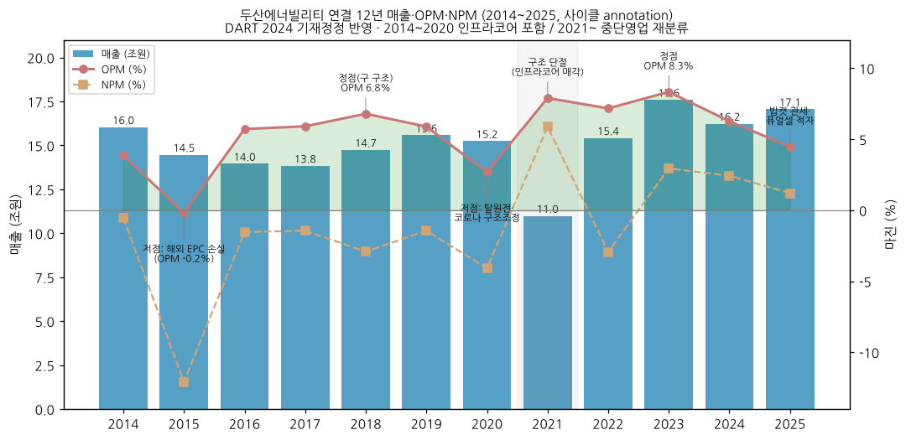

(2014 = 2016 통합보고서 연결재무제표(중단영업 재작성) / 2015~2019 = OpenDART 차기 보고서 전기 컬럼(재작성·정정 반영) / 2020 = OpenDART FY2020 정정본 (인프라코어 포함; 2021 보고서 재작성 시 인프라코어 제외 9.17조·OP -0.13조) / 2021 = 2022 보고서 재작성치 / 2022~2025 = OpenDART 당기. 단위 조원)

### ② 산업 분류

- 산업: **발전설비 (원자력 주기기·가스/증기터빈·보일러·해상풍력) + 발전 EPC + 소형 건설기계(밥캣)**
- KRX/WICS 분류: 코스피 기계·장비 / WICS 기계
- 워치리스트 섹터: **T2 — 원전**, 서브섹터 **원전 기자재** (`earnings/watchlist.md` 38행)
- 국내 피어: 한전기술(원전 설계) · 현대건설(원전 시공) · 한전KPS(원전 정비) — 동일 섹터 기업개요 참조

### ③ 분류 결정 논리

(1) **가장 매출 큰 사업부 기준** 적용 시
→ 2025 매출 비중: 두산밥캣 51.5% (8.79조) > 에너빌리티 45.7% (7.79조) > 퓨얼셀 2.5% (DART 사업보고서(2025.12) 매출실적)
→ 밥캣(북미 소형 건설·농업 장비) = 금리·주택경기 연동 **사이클**

(2) **단, 영업이익·밸류에이션 기여 우선 sub-rule** 적용
→ 2025 영업이익 (DART 영업부문): 밥캣 6,861억 vs 에너빌리티 3,023억 → 이익은 밥캣 우위
→ 그러나 시가총액(2026-11-03 33.4조) 대비 밥캣 지분가치(48.2%)는 일부에 불과 → 주가는 에너빌리티 부문(원전·GT 수주)이 결정
→ 에너빌리티 부문 자체도 **수주→매출 시차 2~4년의 수주 사이클** (DART 수주잔고 증감 2015 8.4조 → 2018 3.8조 급감 → 2020 부문 OPM -5.4% → 2025 14.1조, 잔고 23.4조)
→ 두 사업부 모두 사이클 → **Primary 사이클 유지**

(3) **Boundary case 처리**: 사이클 + 꿈 섞임 → Primary + Secondary 표기
→ 수주잔고 내 성장사업(원자력·가스) 비중 75% (2025말) → 81% (2030P 회사 가이던스)
→ 2030 가이던스: 에너빌리티 매출 11.7조·OPM 9.9%·잔고 47.7조 (FY25 IR, 2026-02) — 실현 시 "고성장"으로 재분류 후보
→ 현재는 이익 실현 전(9M26 에너빌리티 OPM 4.6%) → Secondary "꿈" 단계

(4) **글로벌 피어 대비**
→ GE Vernova (GEV): 가스터빈 + 그리드 + 풍력, 순현금·OPM 두 자릿수 → 지속성장 진입
→ 두산에너빌리티: 동일 GT 사이클 수혜이나 이익률 한 자릿수·순차입 4.5조 → 아직 사이클 + 꿈
→ 일본 MHI·Siemens Energy와 함께 "대형 GT 3강 + 두산" 구도 (3Q26 IR: 미국 H급 18기 중 두산 7기 수주, McCoy 1Q26)

### ④ 적정 밸류에이션 방법

- **SOTP 우선** — 에너빌리티 부문 EV/EBITDA (또는 PER) + 두산밥캣·두산퓨얼셀 상장 지분가치(할인 적용) − 에너빌리티 순차입금
→ 이유: 연결 이익의 절반 이상이 상장 자회사(밥캣)에서 발생 → 연결 PER/PBR은 왜곡 (2025 연결 PER 420.9배, FnGuide)
→ 증권사 관행: 메리츠 = 에너빌리티 '27 EBITDA × 18.6배 + 자회사 지분가치 (2025-02-18) / 키움 = 부문별 SOTP
- **PBR 보조** (사이클 밴드) — 2026-11-02 PBR 4.36배 (BPS 12,767원, FnGuide TTM) vs 2024말 1.50배 / 2025말 6.20배 (키움 2Q26 Review)
→ 사이클 저점(2019~2020) PBR 0.4배 ↔ 2025~2026 꿈 단계 PBR 6~8배 밴드
- **수주잔고 커버리지 보조 지표** — 시가총액/수주잔고 (33.4조 / 26.6조 = 1.26배, 2026-11-03)
- 피어 차별화: GEV는 PER 단독 (순현금·지속이익), 두산에너빌리티는 SOTP + PBR 혼합 — 자회사 구조 + 이익 실현 전 단계 때문

### ⑤ 분기 재평가 트리거 (분류 변경 조건)

- 에너빌리티 부문 OPM **2개 분기 연속 8%+** 및 수주잔고 30조+ 도달 시 → Secondary "꿈" → "고성장" 격상 검토
- 에너빌리티 부문 영업이익이 **연간 기준 밥캣 영업이익 초과** 시 → 대표 사업부 변경 (사이클 원천 = 밥캣 → 원전·GT 수주 사이클로 재정의)
- 두산밥캣 지분 매각·분할 등으로 **연결 제외** 시 → 연결 시계열 재작성 + 분류 전면 재평가
- 대형원전 수주가 **2년 연속 계획 대비 50% 미만** (2026 9M: 0.4조 / 계획 4.9조) 시 → Secondary "꿈" 할인, 순수 사이클로 하향

---

## 2. 회사 개요

### ① 기본 사항

- **회사명**: 두산에너빌리티 주식회사 (Doosan Enerbility Co., Ltd.) — 2022-03 두산중공업에서 사명 변경
- **회사명 의미 / 비전**: Energy + Sustainability + Ability — "친환경 에너지 사업 중심으로 지구의 가치를 높이는 세계적인 기업" (2022 통합보고서 CEO 메시지)
- **사업 한 줄 정의**: 주단조 소재부터 원자로·증기발생기·가스/증기터빈·해상풍력 터빈을 직접 설계·제작하고 발전소 EPC까지 수행하는 한국 유일의 발전설비 종합 OEM (+ 북미 소형 건설장비 두산밥캣 보유)
- **설립**: 1962-09-20 (현대양행) → 1980 한국중공업 → 2001 민영화·두산 인수 (두산중공업)
- **본사**: 경상남도 창원시 성산구 두산볼보로 22 (창원 본사·공장)
- **발행주식**: 보통주 640,561,146주 (액면 5,000원, 자기주식 1,428,328주 — 1H26 검토보고서)
- **시가총액**: **33.4조원** (2026-11-03 Yahoo 종가 52,200원 × 640.56백만주) / 35.68조원 (2026-11-02 종가 55,700원, FnGuide)

### ② 최근 12년 손익·자본 추이 (조원, 연결, 좌→우 시간순)

| 연도 | 매출 | YoY | 영업이익 | 순이익(연결) | 지배순이익 | 자본총계 | 자본 YoY |
|------|------|-----|----------|--------|--------|----------|----------|
| 2014 | 16.04 | - | 0.62 | -0.09 | -0.09 | 7.68 | - |
| 2015 | 14.47 | -9.8% | -0.03 | -1.75 | -1.04 | 7.03 | -8.5% |
| 2016 | 13.95 | -3.6% | 0.80 | -0.22 | -0.17 | 6.82 | -2.9% |
| 2017 | 13.84 | -0.8% | 0.82 | -0.20 | -0.38 | 6.48 | -5.1% |
| 2018 | 14.74 | +6.6% | 1.00 | -0.43 | -0.53 | 6.12 | -5.5% |
| 2019 | 15.57 | +5.6% | 0.92 | -0.22 | -0.51 | 5.99 | -2.2% |
| 2020 | 15.24 | -2.1% | 0.41 | -0.62 | -0.85 | 7.11 | +18.7% |
| 2021 | 10.99 | (구조 단절) | 0.87 | 0.65 | 0.50 | 8.81 | +23.9% |
| 2022 | 15.42 | +40.3% | 1.11 | -0.45 | -0.77 | 10.08 | +14.4% |
| 2023 | 17.59 | +14.1% | 1.47 | 0.52 | 0.06 | 10.84 | +7.6% |
| 2024 | 16.23 | -7.7% | 1.02 | 0.39 | 0.11 | 11.66 | +7.6% |
| 2025 | 17.06 | +5.1% | 0.76 | 0.21 | 0.08 | 12.01 | +3.0% |

(연결 기준, OpenDART. 2017~2020은 2024년 기재정정 후 값. 2021년은 인프라코어·한백메카텍 중단영업 소급 재작성 값으로 2021년 최초 공시 11.81조/0.89조와 차이)

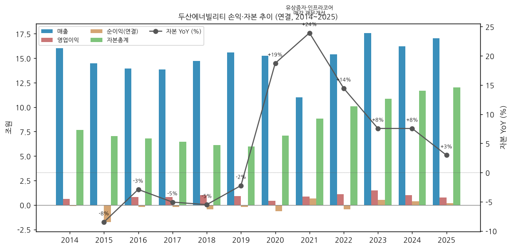

### ③ 회사 주가 역사 ★ 유일한 narrative 영역

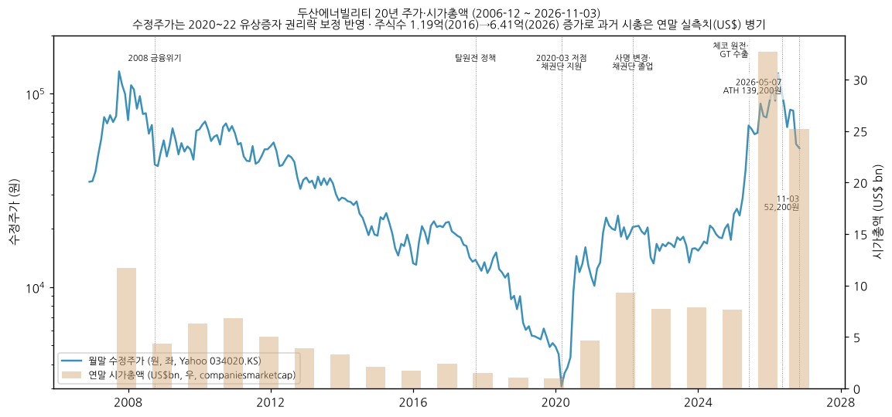

**주가·시가총액 데이터:** Yahoo Finance v8 월간 수정주가 2006-12 ~ 2026-11-03 (241개월) + companiesmarketcap 연말 시가총액 (US$)
- 현재: **52,200원 / 시총 33.4조원** (2026-11-03, 당일 -6.3%) — 52주 고/저 139,200 / 51,700원
- **ATH: 139,200원 (2026-05-07 장중)** [NewsSpace 2026-06-22] → 시총 약 89.2조원 (640.56백만주 기준 환산)
- 저점: 2020-03 (월말 수정주가 4,349원 / 2020-06) — 채권단 긴급 지원 국면. 연말 시총 최저 US$0.99B (2019말)
- 연말 시총 (companiesmarketcap, US$): 2007 11.7B → 2019 0.99B → 2020 4.65B → 2021 9.30B → 2024 7.67B → **2025 32.66B (+326%)** → 2026-11 25.17B
- 수익률 (FnGuide 2026-11-02): 1M -31.3% / 3M -17.0% / 6M -56.2% / 1Y -37.2%
- 주식수: 2016 1.19억주 (자본금 5,968억) → 2019 2.15억 → 2020 3.88억 → 2021 5.35억 → 2026 6.41억 (2020~2022 유상증자·두산 지분 정리) — 수정주가는 권리락 보정, 과거 시총은 연말 실측치 병기

**발전설비·원전 사이클 history (2000년대~):**

```
[2007-2008] 1차 원전 르네상스 + 해외 담수·화력 EPC 붐
  · 2007-10 수정주가 고점 (Yahoo 수정 기준 151,595원, 연말 시총 US$11.7B)
  · 2009 UAE 바라카 APR1400 4기 주기기 수주 (한국형 원전 첫 수출)

[2011-2016] 후쿠시마 이후 원전 정체 + 해외 석탄 EPC 의존
  · 2015 영업적자 (-273억) · 순손실 1.75조 (해외 EPC 손실·자회사 구조조정)

[2017-2020] 탈원전 정책 + 석탄 발주 급감 → 재무 위기
  · 2017 신규원전 백지화(신한울 3·4 등) → 관리연결 수주 9.1조(2016) → 5.1조(2017) → 4.6조(2018)
  · 2020-03 산업·수출입은행 1조원 긴급 운영자금 → 총 3조원+ 지원, 두산그룹 자구안
  · 2020 연결 영업이익 4,092억 (2024 정정 후, 최초 공시 1,541억), 지배순손실 0.85조 / 별도 명예퇴직·휴업

[2021-2022] 구조조정 완료 + 포트폴리오 전환 (원전·가스터빈·풍력·수소)
  · 2021 두산인프라코어 매각, 유상증자 → 부채비율 314%(2019) → 129%(2022)
  · 2022-02 채권단 관리 졸업, 2022-03 사명 변경 두산에너빌리티

[2023-2024] 원전 정책 복원 + 신한울 3·4 주기기 수주
  · 2023 연결 OP 1.47조 (밥캣 호황 정점), 에너빌리티 수주 8.9조
  · 2024-07 밥캣·로보틱스 분할합병안 → 2024-12 철회

[2025] 체코 원전 + 북미 데이터센터 가스터빈 → 주가 +326% (US$ 기준 시총)
  · 에너빌리티 수주 14.7조 (사상 최대, 계획 10.7조 대비 138%) — 체코 두코바니 5·6호기 주기기 (4Q25 9.3조 분기 수주)
  · 국산 DGT6-300H 가스터빈 해외 첫 수출 + 북미 데이터센터向 GT·ST 수주

[2026] 꿈 정점 → 이익 검증 국면
  · 2026-05-07 ATH 139,200원 (SMR·핵융합 테마 + KOSPI 과열)
  · 이후 외국인·기관 차익실현, 6월 10만원 이탈 (NewsSpace 2026-06-22)
  · 2026-10-29 3Q26 발표: OP +91% YoY이나 대형원전 수주 9M 0.4조 (연초 계획 4.9조)
  · 2026-10-30 증권사 11곳 일제히 목표주가 하향 (평균 컨센서스 102,462원, FnGuide 2026-11-02)
  · 2026-11-03 52,200원 (ATH 대비 -62.5%)
```

### ④ 회사의 주요 연혁

```
1962-09-20   현대양행 설립
1980         한국중공업으로 사명 변경 (발전설비 일원화, 공기업)
1982         창원 종합기계공장 준공 (세계 최대 규모)
2001         민영화 · 두산그룹 편입 → 두산중공업
2002-03-26   ㈜두산으로 최대주주 변경 (이후 변동 없음 — DART 사업보고서(2025.12) I-2)
2006         미쓰이밥콕 인수 (현 두산밥콕, 보일러 원천기술 확보)
2006-11      베트남 두산비나 생산공장 준공
2009         체코 스코다파워 인수 (증기터빈 원천기술) / UAE 바라카 원전 주기기 수주
2016         미국 ESS 업체 1Energy Systems 인수 (현 Doosan GridTech — DART 반기보고서(2016.06))
2017         미국 가스터빈 서비스업체 ACT Independent Turbo Services 인수 (현 Doosan Turbomachinery Services — DART 사업보고서(2017.12) 사업결합 주석)
2018         두산엔진 사업부문 매각 완료 → 중단영업 (DART 사업보고서(2018.12))
2019-07      NuScale Power 지분투자 (뉴스케일코리아 경유 우선주, DART 사업보고서(2019.12)) / 국내 최초 발전용 대형 가스터빈(DGT6-300H, 270MW급) 개발
2020-03-10   두산건설 포괄적 주식교환 → 완전자회사화 (신주 6,891,058주 발행 — DART 사업보고서(2020.12) 자본금 변동)
2020         채권단(산은·수은) 긴급 지원 · 재무구조 개선 착수
2021-04      ㈜두산의 두산퓨얼셀 주식 현물출자 → 두산퓨얼셀 연결 편입 (DART 사업보고서(2025.12) I-2)
2021-07      두산인프라코어 사업부문/투자사업부문 분할 → 사업부문 매각, 투자사업부문(두산밥캣 지분) 당사 흡수합병 → 두산밥캣 직접 보유 (DART 사업보고서(2025.12) I-2)
2022-02      채권단 관리 종료
2022-04      상호 변경: 두산중공업 → 두산에너빌리티 (2022-03-29 정기주총 결의, DART 사업보고서(2025.12) I-2 "상호의 변경")
2022-06~09   두산큐벡스·두산프라퍼티 지분 매입 / 두산메카텍·Doosan Babcock Ltd. 지분 매각 (DART 사업보고서(2025.12) I-2)
2023-03      신한울 3·4호기 원자로설비(2.34조)·터빈발전기(0.53조) 공급계약 (DART 반기보고서(2026.06) 단일판매공급계약)
2024-04      Doosan HF Controls 지분 매각
2024-07~12   두산밥캣 분할·로보틱스 합병 추진 → 철회
2025-01      Doosan Skoda Power 체코 프라하 증권거래소 IPO (상호 a.s.로 변경)
2025-12      체코 두코바니 5·6호기 NSSS 4.93조·T/G 0.71조 계약 (2025-12-16 공시) / Doosan Enerbility Vietnam(두산비나) 지분 매각
2024-03~05   2017~2020 사업보고서 기재정정 (금융위 회계감리조치 2024-02-07)
2026-02      중기 가이던스 상향 ('30 매출 11.7조·OPM 9.9%·잔고 47.7조, 에너빌리티 부문 — IR)
2026-03-31   정기주총: 박지원 사내이사 재선임, 이은형·민원기 독립이사 선임 (DART 반기보고서(2026.06))
2026-10      X-energy 16모듈 핵심소재 예약, NuScale 1개 모듈 제작계약, 박상현 부회장 승진·송용진 COO 선임 (10-16, 언론 — DART 미반영)
```

(1962~2019 = 2020·2025 통합보고서 Company Profile + DART 사업보고서 연혁 / 2020~2026 = DART 사업보고서(2025.12)·반기보고서(2026.06) I-2 "회사의 연혁"·자본금 변동·단일판매공급계약 + IR·언론(2026-10 인사·SMR 계약))

---

## 3. 비즈니스 모델

### ① 실적 추이 (사업부별·제품별·지역별)

**연간 5년 통합 표 (십억원, 3단계 위계 — DART 영업부문 주석·매출실적·수익 주석):**

| 항목 | 2021 | 2022 | 2023 | 2024 | 2025 |
|------|------|------|------|------|------|
| **매출액 (연결)** | **10,991** | **15,421** | **17,590** | **16,233** | **17,058** |
| └ 사업부별 (DART 영업부문 순매출액) | | | | | |
| &nbsp;&nbsp;&nbsp;&nbsp;└ 두산에너빌리티 부문 | 5,601 | 7,103 | 7,530 | 7,293 | 7,789 |
| &nbsp;&nbsp;&nbsp;&nbsp;└ 두산밥캣 부문 | 5,815 | 8,621 | 9,759 | 8,551 | 8,792 |
| &nbsp;&nbsp;&nbsp;&nbsp;└ 두산퓨얼셀 부문 | 309 | 312 | 261 | 344 | 418 |
| &nbsp;&nbsp;&nbsp;&nbsp;└ 기타부문·중단영업조정 (역산) | -735* | -615* | 40 | 45 | 59 |
| └ 지역별 (연결, 고객과의 계약 수익) | | | | | |
| &nbsp;&nbsp;&nbsp;&nbsp;└ 미주 | 4,451 | 6,758 | 7,878 | 6,908 | 7,043 |
| &nbsp;&nbsp;&nbsp;&nbsp;└ 국내 | 2,962 | 3,461 | 3,770 | 3,844 | 3,539 |
| &nbsp;&nbsp;&nbsp;&nbsp;└ 중동 | 542 | 1,009 | 1,702 | 1,931 | 3,345 |
| &nbsp;&nbsp;&nbsp;&nbsp;└ 아시아 | 1,678 | 2,304 | 2,319 | 1,976 | 1,318 |
| &nbsp;&nbsp;&nbsp;&nbsp;└ 유럽 | 1,453 | 1,649 | 1,689 | 1,405 | 1,484 |
| &nbsp;&nbsp;&nbsp;&nbsp;└ 기타 | 197 | 239 | 233 | 236 | 234 |
| └ 수출 비중 (연결, 매출실적) | - | - | 78.4% | 76.2% | 79.1% |
| └ 에너빌리티 제품별 (2025, 키움 추정 분해 — DART 미공시) | | | | | |
| &nbsp;&nbsp;&nbsp;&nbsp;└ 원자력 (대형원전 기자재·SMR) | - | - | - | - | 1,505 |
| &nbsp;&nbsp;&nbsp;&nbsp;└ 가스 기자재·서비스 | - | - | - | - | 637 |
| &nbsp;&nbsp;&nbsp;&nbsp;└ 복합화력 EPC | - | - | - | - | 3,594 |
| &nbsp;&nbsp;&nbsp;&nbsp;└ 신재생 (해상풍력 등) | - | - | - | - | 340 |
| &nbsp;&nbsp;&nbsp;&nbsp;└ 기타 (석탄·Water·주단 등) | - | - | - | - | 1,805 |
| └ 에너빌리티 성장사업 매출 비중 (원자력+가스, IR) | - | - | - | 42% | 72% |
| **영업이익 (연결)** | **869** | **1,106** | **1,467** | **1,018** | **763** |
| └ 사업부별 (DART 영업부문, 연결조정 전) | | | | | |
| &nbsp;&nbsp;&nbsp;&nbsp;└ 두산에너빌리티 부문 | 262 | 167 | 225 | 244 | 302 |
| &nbsp;&nbsp;&nbsp;&nbsp;└ 두산밥캣 부문 | 595 | 1,072 | 1,390 | 871 | 686 |
| &nbsp;&nbsp;&nbsp;&nbsp;└ 두산퓨얼셀 부문 | 18 | 7 | 2 | -2 | -106 |
| &nbsp;&nbsp;&nbsp;&nbsp;└ 기타·중단영업·연결조정 (역산) | -6* | -140* | -150 | -95 | -119 |
| **매출 YoY (%)** | **(구조 단절)** | **+40.3** | **+14.1** | **-7.7** | **+5.1** |
| &nbsp;&nbsp;&nbsp;&nbsp;└ 에너빌리티 매출 YoY | +3.7 | +26.8 | +6.0 | -3.2 | +6.8 |
| &nbsp;&nbsp;&nbsp;&nbsp;└ 밥캣 매출 YoY | - | +48.3 | +13.2 | -12.4 | +2.8 |
| **영업이익 YoY (%)** | **-** | **+27.3** | **+32.7** | **-30.6** | **-25.0** |
| &nbsp;&nbsp;&nbsp;&nbsp;└ 에너빌리티 OP YoY | (흑전) | -36.2 | +34.6 | +8.2 | +24.1 |
| &nbsp;&nbsp;&nbsp;&nbsp;└ 밥캣 OP YoY | - | +80.0 | +29.7 | -37.3 | -21.3 |
| **OPM 전사 (%)** | **7.9** | **7.2** | **8.3** | **6.3** | **4.5** |
| &nbsp;&nbsp;&nbsp;&nbsp;└ 에너빌리티 OPM | 4.7 | 2.4 | 3.0 | 3.3 | 3.9 |
| &nbsp;&nbsp;&nbsp;&nbsp;└ 밥캣 OPM | 10.2 | 12.4 | 14.2 | 10.2 | 7.8 |
| &nbsp;&nbsp;&nbsp;&nbsp;└ 퓨얼셀 OPM | 5.7 | 2.3 | 0.6 | -0.5 | -25.3 |
| **에너빌리티 수주잔고 증감 (DART)** | **7,127** | **5,720** | **9,189** | **8,620** | **14,074** |
| **에너빌리티 수주잔고 연말 (DART)** | **15,840** | **14,403** | **15,972** | **17,122** | **23,393** |
| 참고: 에너빌리티 신규수주 (IR) | 7,324 | 7,584 | 8,886 | 7,131 | 14,728 |
| 참고: 에너빌리티 수주잔고 (IR) | - | - | 15,972 | 16,200 | 23,047 |

(사업부별·지역별 = DART 사업보고서(2022.12)·(2023.12)·(2024.12)·(2025.12) 부문별 정보·수익 주석 — 2021은 DART 사업보고서(2022.12) 비교표시(인프라코어·두산건설·Doosan Babcock 중단영업 재작성 후) / 2025 사업부별 매출은 "외부고객 매출액" (부문 영업수익 8,143에서 내부매출 354 차감). * 2021·2022 = 기타부문 + 인프라코어·두산건설(2021) + 중단영업조정(2021 -4,912 / 2022 -678: Doosan Babcock·두산메카텍, 둘 다 에너빌리티 부문 소속) — 즉 2021~2022 에너빌리티 부문 수치에는 이후 매각된 Babcock·메카텍 매출이 포함. 지역별 2021은 DART 사업보고서(2021.12) 원공시(계속영업) 기준. 수출 비중 = DART 사업보고서(2025.12) II-4 매출실적. 수주 = DART 각 사업보고서 II "주요사업부문별 수주상황" (증감 = 신규수주+계약변경·환율 효과, 억원→십억원 환산). ⚠ **IR "에너빌리티 부문(내부관리연결)" 매출은 DART 부문 순매출과 정의가 다름** (예 2025: IR 7,881 vs DART 7,789) — v1.1부터 본 표는 DART 기준)

**에너빌리티(구 중공업) 부문 연간 장기 시계열 (DART, 조원):**

| 연도 | 매출 | 영업이익 | OPM | 수주잔고 증감 | 연말 수주잔고 | 가동률 (보일러·터빈·원자력, M/H) | 참고: 신규수주 (IR·통합보고서) | 비고 |
|------|------|---------|-----|------|------|------|------|------|
| 2014 | 7.26 | 0.32 | 4.4% | 7.42 | 15.80 | 90.2% | - | 신고리 5·6 주기기 2.10조 수주 |
| 2015 | 6.64 | 0.26 | 3.9% | 8.36 | 17.47 | 83.8% | 8.57 | Pudimadaka 1.06조·Song Hau 1 0.98조 |
| 2016 | 6.09 | 0.29 | 4.7% | 6.08 | 17.12 | 76.4% | 9.05 | Obra C/Jawaharpur 2.40조·Fadhili 1.05조 |
| 2017 | 5.65 | 0.09 | 1.6% | 5.75 | 17.31 | 72.5% | 5.05 | 탈원전 / OP에 2024 정정(-955억) 반영 |
| 2018 | 5.44 | 0.20 | 3.7% | 3.81 | 15.72 | 64.2% | 4.64 | ← 수주 저점 / 부문 통합(두산중공업) |
| 2019 | 5.59 | -0.01 | -0.1% | 4.19 | 14.31 | 72.3% | - | 계속기업 불확실성 강조사항 |
| 2020 | 5.40 | -0.29 | -5.4% | 5.36 | 14.29 | 56.2% | 5.51 | ← 부문 저점 (명예퇴직·석탄 손실) |
| 2021 | 5.60 | 0.26 | 4.7% | 7.13 | 15.84 | 65.6% | 7.32 | Babcock 포함 |
| 2022 | 7.10 | 0.17 | 2.4% | 5.72 | 14.40 | 69.9% | 7.58 | Babcock·메카텍 매각 (중단영업) |
| 2023 | 7.53 | 0.23 | 3.0% | 9.19 | 15.97 | 69.6% | 8.89 | 신한울 3·4 NSSS 2.34조 |
| 2024 | 7.29 | 0.24 | 3.3% | 8.62 | 17.12 | 70.0% | 7.13 | |
| 2025 | 7.79 | 0.30 | 3.9% | 14.07 | 23.39 | 63.4% | 14.73 | ← 체코 두코바니 NSSS 4.93조·T/G 0.71조 |
| 1H26 | 4.09 | 0.15 | 3.8% | 8.27 | 27.50 | - | 7.12 (IR) | DART 반기보고서(2026.06) |
| 9M26 (IR) | 5.95 | 0.28 | 4.6% | - | 26.58 | - | 10.00 | IR 내부관리연결 기준 (분기보고서 제출 전) |

(매출·OP = DART 영업부문 주석 — 2014~2017 = 발전+Water+산업+주단+건설+도소매 6개 부문 합산(분기 합 = 사업보고서), 2018~2021 = "두산중공업" 단일 부문(2018 사업보고서에서 사업부 통합), 2022~ = "두산에너빌리티" 부문. 2014는 DART 사업보고서(2015.12) 비교표시. 수주잔고 = DART 사업보고서 "주요사업부문별 수주상황" — 2014~2017 = 본사 6개 부문 + "DPS S.A. 등 해외종속기업" 합산, 2018~ = 두산중공업/두산에너빌리티 행. 가동률 = DART 사업보고서 II-3 "가동률" (2025는 품목명 "터빈, 원자력 등" — 보일러 사업 축소). 주요 수주 = DART 사업보고서 "당해년도 체결된 주요 신규 수주상황". 신규수주(참고) = v1.0 IR·통합보고서 관리연결 수치 — DART 증감액과 정의 상이)

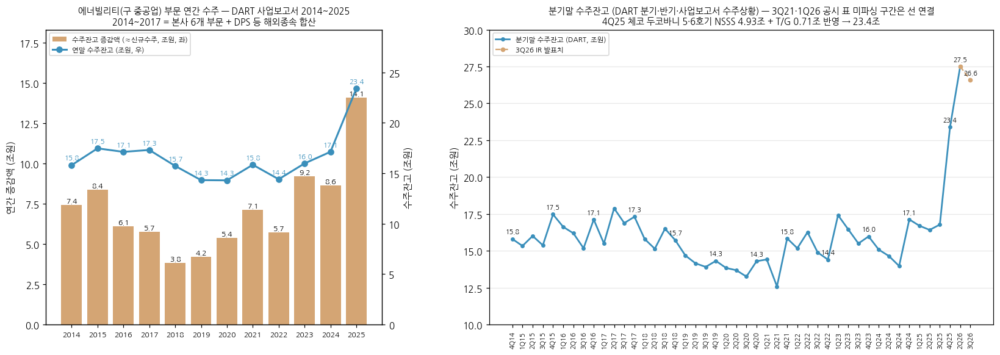

**수주 구성 (에너빌리티 부문, 조원 — 3Q26 IR):**

| 구분 | 2025 실적 | 2026 9M 실적 | 4Q26 추진 | 2026 계획 |
|------|----------|-------------|----------|----------|
| 원자력 (대형원전 주기기·시공·서비스·SMR) | 6.8 | **0.4** | 1.2 + 대형원전 α | 4.9 |
| 가스/수소 (GT 기자재·서비스·복합 STG) | 1.3 | **3.8** | 0.7 | 3.2 |
| 복합 EPC | 3.4 | 3.4 | 0.5 | 3.0 |
| 신재생 (해상풍력·연료전지·수력) | 0.9 | 0.0 | 0.7 | 1.2 |
| 기타 (토목·건축·주단·서비스) | 2.2 | 2.4 | 0.0 | 1.1 |
| **합계** | **14.7** | **10.0** | **3.3 + α** | **13.3** |

**사업부별 분기 시계열 (1Q14 ~ 3Q26, 51분기 — DART 영업부문 주석):**

각 차트 = 매출 (bar, 좌축) + OPM (line, 우축) 통합 — 사업부별 1개 차트

**매핑 노트 (부문 정의 변경):**
- **에너빌리티 부문** = 1Q14~3Q18 "발전·Water·산업·주단·건설·도소매업 등" 6개 부문 합산 → 4Q18~4Q21 "두산중공업" 단일 부문 (DART 사업보고서(2018.12) "사업부 간 시너지 제고"로 통합, 3Q18 6개 합 3,751.3 = 2019.09 비교표시 두산중공업 3,751.3 일치 확인) → 1Q22~ "두산에너빌리티" 부문. 2021~3Q22는 이후 매각된 Doosan Babcock·두산메카텍 포함 (중단영업조정은 별도 행)
- **두산밥캣 / 舊 두산인프라코어**: 1Q14~4Q20 = "두산인프라코어(주)" 부문 (밥캣 포함, 공작기계·엔진 등) → 1Q21~ = "두산밥캣" 부문. 2021 분기는 DART 2022 분기·반기·사업보고서의 비교표시(인프라코어/밥캣 분리 재작성) 사용. ⚠ 1Q21 밥캣 OP 407.4 / 2Q21 -96.1, 인프라코어 1Q21 -117.8 / 2Q21 345.7은 DART 비교표시 원문 그대로 — 1H21 밥캣 합계 311.3(OPM 12.4%)은 정상 범위이므로 분기 간 배분 이슈로 판단, 차트는 1H 평균 OPM으로 표시
- **두산퓨얼셀**: 2021-04 ㈜두산 현물출자로 편입 → 2Q21~
- **두산건설** 1Q14~4Q21 (2021 경영권 이전 → 중단영업), **두산엔진** 1Q14~2Q18 (2018 매각) — 표에만 표기
- 산출: 분기·반기보고서는 누적(YTD) 공시 → 2Q = 1H − 1Q, 3Q = 9M − 1H, **4Q = FY − 9M**. 2014 분기 = DART 2015 분기·반기·사업보고서 비교표시. 2025.12 이후 매출 = "외부고객 매출액" 표 (부문 영업수익은 내부매출 포함으로 표시 방식 변경)
- ⚠ 4Q17~4Q20: FY는 2024 기재정정본, 9M은 최초 공시본 → **정정 효과가 4Q에 집중** (예: 4Q17 에너빌리티 OP -80.6 중 -95.5가 정정분)
- 3Q26 = IR 잠정치 (분기보고서 제출 전, IR 내부관리연결 기준이라 DART 부문 수치와 정의 상이)

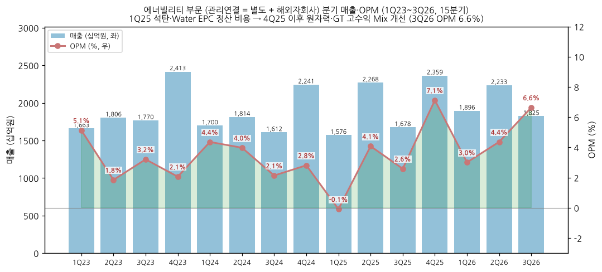
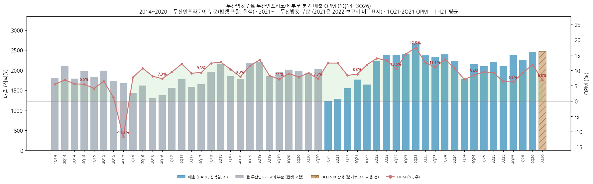
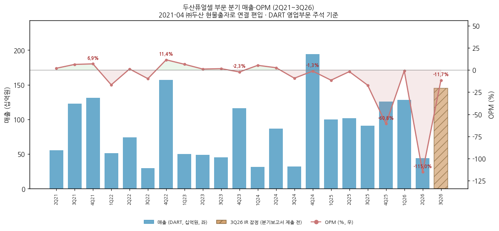

**사업부별 분기 표 (DART, 십억원):**

| 분기 | 에너빌리티 매출 | OP | OPM | 인프라코어(밥캣 포함) 매출 | OP | OPM | 두산밥캣 매출 | OP | OPM | 퓨얼셀 매출 | OP | 두산건설 매출 / OP | 두산엔진 매출 / OP | 연결 매출 | 연결 OP |
|---|---|---|---|---|---|---|---|---|---|---|---|---|---|---|---|
| 1Q14 | 1,700.2 | 99.7 | 5.9% | 1,808.8 | 98.9 | 5.5% | - | - | - | - | - | 497.7 / 25.0 | 164.2 / -19.2 | 4,170.8 | 205.0 |
| 2Q14 | 1,726.7 | 116.9 | 6.8% | 2,113.3 | 145.5 | 6.9% | - | - | - | - | - | 509.1 / 28.1 | 243.4 / -12.9 | 4,592.5 | 281.5 |
| 3Q14 | 1,724.8 | 71.1 | 4.1% | 1,790.8 | 100.4 | 5.6% | - | - | - | - | - | 545.1 / 23.4 | 185.7 / -7.5 | 4,246.4 | 189.6 |
| 4Q14 | 2,112.3 | 34.9 | 1.7% | 1,974.9 | 108.3 | 5.5% | - | - | - | - | - | 582.2 / 56.3 | 292.5 / -0.1 | 4,961.9 | 202.0 |
| 1Q15 | 1,635.5 | 73.8 | 4.5% | 1,832.4 | 75.5 | 4.1% | - | - | - | - | - | 451.0 / 14.9 | 118.3 / -11.8 | 4,037.2 | 154.2 |
| 2Q15 | 1,664.7 | 89.1 | 5.4% | 1,983.7 | 128.5 | 6.5% | - | - | - | - | - | 353.1 / 10.5 | 189.7 / -6.6 | 4,191.2 | 226.8 |
| 3Q15 | 1,529.8 | 65.8 | 4.3% | 1,728.6 | 20.0 | 1.2% | - | - | - | - | - | 439.9 / 4.0 | 165.3 / -26.8 | 3,863.6 | 66.7 |
| 4Q15 | 1,809.2 | 30.6 | 1.7% | 1,669.3 | -196.6 | -11.8% | - | - | - | - | - | 416.2 / -196.2 | 217.6 / -18.5 | 4,112.3 | -385.7 |
| 1Q16 | 1,304.9 | 88.9 | 6.8% | 1,433.2 | 111.2 | 7.8% | - | - | - | - | - | 405.7 / 24.5 | 164.7 / 1.7 | 3,308.5 | 227.6 |
| 2Q16 | 1,449.2 | 74.9 | 5.2% | 1,618.1 | 173.5 | 10.7% | - | - | - | - | - | 178.6 / 1.8 | 208.9 / 1.8 | 3,463.9 | 255.3 |
| 3Q16 | 1,257.1 | 49.4 | 3.9% | 1,301.9 | 105.8 | 8.1% | - | - | - | - | - | 304.5 / 2.3 | 190.7 / 0.8 | 3,059.2 | 154.4 |
| 4Q16 | 2,080.5 | 72.9 | 3.5% | 1,375.2 | 100.3 | 7.3% | - | - | - | - | - | 363.7 / -15.8 | 237.2 / -0.0 | 4,061.1 | 153.8 |
| 1Q17 | 1,341.9 | 69.4 | 5.2% | 1,561.4 | 148.4 | 9.5% | - | - | - | - | - | 324.5 / 11.2 | 207.1 / 7.0 | 3,437.9 | 236.8 |
| 2Q17 | 1,418.0 | 61.3 | 4.3% | 1,773.2 | 214.7 | 12.1% | - | - | - | - | - | 390.4 / 19.4 | 236.2 / 7.2 | 3,824.6 | 305.9 |
| 3Q17 | 1,329.7 | 41.7 | 3.1% | 1,584.3 | 143.9 | 9.1% | - | - | - | - | - | 390.7 / 12.1 | 196.2 / 2.8 | 3,506.6 | 199.9 |
| 4Q17 | 1,565.0 | -80.6 | -5.2% | 1,648.2 | 153.8 | 9.3% | - | - | - | - | - | 397.8 / 16.3 | 129.4 / -3.5 | 3,749.7 | 87.6 |
| 1Q18 | 1,254.2 | 49.4 | 3.9% | 1,956.6 | 241.6 | 12.3% | - | - | - | - | - | 343.8 / 14.3 | 108.6 / -1.1 | 3,573.7 | 305.3 |
| 2Q18 | 1,310.5 | 72.7 | 5.5% | 2,143.9 | 273.1 | 12.7% | - | - | - | - | - | 360.2 / 13.2 | 90.8 / -22.7 | 3,833.4 | 361.5 |
| 3Q18 | 1,186.5 | 10.0 | 0.8% | 1,845.6 | 191.5 | 10.4% | - | - | - | - | - | 343.6 / 12.5 | - | 3,387.5 | 211.7 |
| 4Q18 | 1,690.7 | 69.8 | 4.1% | 1,783.1 | 142.0 | 8.0% | - | - | - | - | - | 464.8 / -92.2 | - | 3,949.0 | 122.1 |
| 1Q19 | 1,300.5 | 66.0 | 5.1% | 2,182.4 | 250.0 | 11.5% | - | - | - | - | - | 337.5 / 7.1 | - | 3,828.7 | 322.3 |
| 2Q19 | 1,348.5 | 63.7 | 4.7% | 2,199.5 | 297.2 | 13.5% | - | - | - | - | - | 416.4 / 21.3 | - | 3,977.6 | 385.4 |
| 3Q19 | 1,254.2 | -36.3 | -2.9% | 1,856.2 | 154.6 | 8.3% | - | - | - | - | - | 445.8 / 19.4 | - | 3,567.4 | 138.9 |
| 4Q19 | 1,684.7 | -99.9 | -5.9% | 1,946.1 | 138.6 | 7.1% | - | - | - | - | - | 556.7 / 33.2 | - | 4,196.7 | 71.8 |
| 1Q20 | 1,423.9 | -134.4 | -9.4% | 2,008.7 | 181.0 | 9.0% | - | - | - | - | - | 395.8 / 12.4 | - | 3,837.0 | 56.5 |
| 2Q20 | 1,152.7 | -212.1 | -18.4% | 1,975.2 | 154.3 | 7.8% | - | - | - | - | - | 464.3 / -4.0 | - | 3,604.7 | -50.3 |
| 3Q20 | 1,237.5 | -14.5 | -1.2% | 1,928.0 | 176.1 | 9.1% | - | - | - | - | - | 481.7 / 15.4 | - | 3,658.8 | 171.7 |
| 4Q20 | 1,587.6 | 71.6 | 4.5% | 2,020.2 | 147.2 | 7.3% | - | - | - | - | - | 525.3 / 13.4 | - | 4,143.2 | 231.3 |
| 1Q21 | 1,223.0 | 58.5 | 4.8% | 1,256.5 | -117.8⚠ | -9.4%⚠ | 1,224.8 | 407.4⚠ | 33.3%⚠ | - | - | 286.9 / 16.9 | - | 2,367.1 | 241.9 |
| 2Q21 | 1,208.2 | 79.3 | 6.6% | 1,143.1 | 345.7⚠ | 30.2%⚠ | 1,283.6 | -96.1⚠ | -7.5%⚠ | 55.6 | 1.0 | 329.1 / 24.1 | - | 2,328.7 | 225.0 |
| 3Q21 | 1,449.5 | 88.3 | 6.1% | 304.9 | 12.9 | 4.2% | 1,545.7 | 129.7 | 8.4% | 122.7 | 7.6 | 326.4 / 13.3 | - | 2,929.9 | 223.5 |
| 4Q21 | 1,720.5 | 36.1 | 2.1% | - | - | - | 1,761.3 | 154.3 | 8.8% | 131.2 | 9.0 | 449.5 / 28.9 | - | 3,365.2 | 178.9 |
| 1Q22 | 1,548.0 | 73.9 | 4.8% | - | - | - | 1,640.6 | 194.4 | 11.8% | 51.2 | -8.6 | - | - | 3,071.3 | 192.1 |
| 2Q22 | 1,784.4 | 39.4 | 2.2% | - | - | - | 2,218.2 | 309.5 | 14.0% | 74.1 | 0.8 | - | - | 3,767.7 | 327.7 |
| 3Q22 | 1,701.4 | 35.9 | 2.1% | - | - | - | 2,378.7 | 316.9 | 13.3% | 29.6 | -2.9 | - | - | 3,960.3 | 314.6 |
| 4Q22 | 2,068.9 | 18.0 | 0.9% | - | - | - | 2,383.7 | 250.8 | 10.5% | 157.2 | 17.9 | - | - | 4,621.8 | 271.7 |
| 1Q23 | 1,578.5 | 85.3 | 5.4% | - | - | - | 2,404.9 | 369.7 | 15.4% | 49.9 | 3.2 | - | - | 4,041.0 | 364.6 |
| 2Q23 | 1,806.1 | 33.4 | 1.9% | - | - | - | 2,672.1 | 466.6 | 17.5% | 49.2 | 0.5 | - | - | 4,539.4 | 494.7 |
| 3Q23 | 1,732.5 | 56.6 | 3.3% | - | - | - | 2,366.0 | 297.6 | 12.6% | 45.6 | 0.7 | - | - | 4,155.0 | 311.4 |
| 4Q23 | 2,413.0 | 49.7 | 2.1% | - | - | - | 2,315.6 | 256.1 | 11.1% | 116.2 | -2.7 | - | - | 4,854.5 | 296.7 |
| 1Q24 | 1,663.0 | 74.1 | 4.5% | - | - | - | 2,394.5 | 326.0 | 13.6% | 31.7 | 1.6 | - | - | 4,097.9 | 358.1 |
| 2Q24 | 1,814.5 | 72.2 | 4.0% | - | - | - | 2,236.5 | 239.5 | 10.7% | 86.5 | 2.2 | - | - | 4,150.5 | 309.8 |
| 3Q24 | 1,574.5 | 34.3 | 2.2% | - | - | - | 1,777.7 | 125.7 | 7.1% | 32.0 | -3.0 | - | - | 3,395.6 | 114.8 |
| 4Q24 | 2,240.8 | 63.1 | 2.8% | - | - | - | 2,142.3 | 180.2 | 8.4% | 194.1 | -2.6 | - | - | 4,589.1 | 234.9 |
| 1Q25 | 1,538.7 | -1.4 | -0.1% | - | - | - | 2,098.2 | 200.0 | 9.5% | 99.7 | -11.5 | - | - | 3,748.6 | 142.5 |
| 2Q25 | 2,249.2 | 92.4 | 4.1% | - | - | - | 2,201.4 | 204.2 | 9.3% | 101.5 | -1.9 | - | - | 4,569.0 | 271.1 |
| 3Q25 | 1,659.8 | 43.4 | 2.6% | - | - | - | 2,115.2 | 133.6 | 6.3% | 90.8 | -15.6 | - | - | 3,880.3 | 137.1 |
| 4Q25 | 2,341.2 | 167.9 | 7.2% | - | - | - | 2,377.0 | 148.3 | 6.2% | 126.1 | -76.6 | - | - | 4,859.9 | 212.1 |
| 1Q26 | 1,872.8 | 57.0 | 3.0% | - | - | - | 2,247.2 | 207.0 | 9.2% | 128.4 | -1.3 | - | - | 4,261.1 | 233.5 |
| 2Q26 | 2,214.6 | 97.5 | 4.4% | - | - | - | 2,447.8 | 291.7 | 11.9% | 44.3 | -50.9 | - | - | 4,724.8 | 314.3 |
| **3Q26 (IR 잠정)** | 1,824.9 | 121.1 | 6.6% | - | - | - | 2,463.5 | 167.4 | 6.8% | 145.2 | -17.0 | - | - | 4,449.5 | 261.2 |

(DART 분기·반기·사업보고서 영업부문 주석 — 매출 = 순매출액(외부고객), OP = 부문 영업손익(연결조정 전). 연결 = 각 보고서 "연결 후 금액" (2021은 2022 보고서 비교표시 계속영업 기준, 2020 이전은 인프라코어 포함). 분기 합 검증: 2023 에너빌리티 7,530.2 / 2024 7,292.8 / 2025 7,788.9 = 사업보고서 연간치 일치. ⚠ 표시 = 위 매핑 노트 참조)

**참고: IR 기준 사업부별 분기 표 (1Q23~3Q26, 십억원 — v1.0 데이터, 회사 IR "내부관리연결"):**

| 분기 | 연결 매출 | 연결 OP | 에너빌리티 매출 | 에너빌리티 OP | 밥캣 매출 | 밥캣 OP | 퓨얼셀 매출 | 퓨얼셀 OP | 에너빌리티 수주 | 수주잔고 (조) |
|------|------|------|------|------|------|------|------|------|------|------|
| 1Q23 | 4,041.0 | 364.6 | 1,662.9 | 85.3 | 2,405.1 | 369.7 | 49.9 | 3.2 | 4,304.9 | - |
| 2Q23 | 4,539.4 | 494.7 | 1,806.2 | 33.4 | 2,672.1 | 466.6 | 49.2 | 0.5 | 859.1 | - |
| 3Q23 | 4,155.0 | 311.4 | 1,769.6 | 56.7 | 2,366.0 | 297.6 | 45.6 | 0.7 | 710.1 | - |
| 4Q23 | 4,854.5 | 296.7 | 2,413.2 | 49.7 | 2,315.6 | 256.1 | 116.2 | -2.7 | 3,011.9 | 15.97 |
| 1Q24 | 4,097.9 | 358.1 | 1,700.1 | 74.1 | 2,394.6 | 326.0 | 31.7 | 1.7 | 628.4 | 15.17 |
| 2Q24 | 4,150.5 | 309.8 | 1,814.4 | 72.1 | 2,236.6 | 239.5 | 86.5 | 2.2 | 1,263.5 | - |
| 3Q24 | 3,395.6 | 114.8 | 1,611.5 | 34.4 | 1,777.7 | 125.7 | 32.0 | -3.0 | 1,283.1 | 14.84 |
| 4Q24 | 4,589.1 | 234.9 | 2,240.8 | 63.0 | 2,142.3 | 180.2 | 261.6 | -2.6 | 3,956.0 | 16.00 |
| 1Q25 | 3,748.6 | 142.5 | 1,575.6 | -1.4 | 2,098 | 200 | 100 | -12 | 1,720.8 | 16.15 |
| 2Q25 | 4,569.0 | 271.1 | 2,267.7 | 92.4 | 2,201 | 204 | 128 | -2 | 2,036.5 | 16.01 |
| 3Q25 | 3,880.4 | 137.1 | 1,678.3 | 43.4 | 2,115 | 134 | 91 | -16 | 1,633.0 | 16.42 |
| 4Q25 | 4,859.9 | 212.1 | 2,359.4 | 168.0 | 2,377 | 148 | 136 | -77 | 9,338.0 | 23.05 |
| 1Q26 | 4,261.1 | 233.5 | 1,895.9 | 57.0 | 2,247 | 207 | 145 | -1 | 2,785.7 | 24.25 |
| 2Q26 | 4,724.8 | 314.3 | 2,233.0 | 97.4 | 2,448 | 292 | 44 | -51 | 4,336.8 | 26.35 |
| **3Q26** | **4,449.5** | **261.2** | **1,824.9** | **121.1** | **2,463.5** | **167.4** | **145.2** | **-17.0** | **2,876.6** | **26.58** |

(수주잔고는 각 분기 IR 자료 당시 발표치 — 환율에 따라 사후 변동: 예 2Q26 26.35조 → 3Q26 IR 비교 컬럼에서 25.53조로 재표시. 1Q24·4Q24 = 1Q25 IR, 3Q24 = 3Q25 IR. 3Q26 밥캣 = 두산밥캣 3Q26 잠정 (딜사이트 2026-10-29), 퓨얼셀 = 두산퓨얼셀 3Q26 잠정 (2026-10-28). 분기 합 검증: 2023 연결 17,589.9 / 2024 16,233.1 / 2025 17,057.9 / 9M26 13,435.4 — 회사 공시와 일치)

**연결 분기 장기 시계열 (DART 분기·사업보고서, 십억원, 2014~2022):**

| 연도 | 1Q 매출 / OP | 2Q 매출 / OP | 3Q 매출 / OP | 4Q 매출 / OP (= FY − 9M) |
|------|------|------|------|------|
| 2014 | 4,171 / 205 | 4,593 / 282 | 4,246 / 190 | 4,962 / 202 |
| 2015 | 4,037 / 154 | 4,191 / 227 | 3,864 / 67 | 4,112 / -386 |
| 2016 | 3,308 / 228 | 3,598 / 262 | 3,059 / 154 | 4,061 / 154 |
| 2017 | 3,438 / 237 | 3,825 / 306 | 3,483 / 196 | 3,750 / 88 |
| 2018 | 3,574 / 305 | 3,833 / 362 | 3,388 / 212 | 3,949 / 122 |
| 2019 | 3,829 / 322 | 3,978 / 385 | 3,567 / 139 | 4,197 / 72 |
| 2020 | 3,837 / 56 | 3,605 / -50 | 3,659 / 172 | 4,143 / 231 |
| 2021 | 4,005 / 372 | 2,901 / 255 | 3,461 / 243 | 2,171 / 127 |
| 2022 | 3,071 / 192 | 3,835 / 328 | 3,960 / 315 | 4,622 / 272 |

(분기 = 각 분기보고서 당기 3개월 / 4Q = 해당연도 사업보고서 FY − 3Q 누적. ⚠ 2017~2020 FY는 2024 기재정정본·분기는 최초 공시본이라 4Q에 정정 효과가 몰림 / 2021 1Q는 인프라코어 포함, 2Q 이후 중단영업 제외 → 2021 행은 기준 혼재. 2014~2015 = DART 영업부문 주석 "연결 후 금액" (2015 보고서 기준 — 이후 2016 중단영업(공작기계·CPE·HRSG 등) 재작성 전이라 연간 표 14.47조/-0.03조와 기준 차이, 4Q15 OP -386 = 두산건설·인프라코어 손실). 사업부별 분기는 위 51분기 DART 표 참조. 1Q23~2Q26 연결 분기는 위 15분기 표와 OpenDART 일치 확인, 3Q26은 분기보고서 제출 전이라 IR 잠정치)

**3Q26 핵심 (분기 데이터만 반영, 연간 표는 2025 결산 기준 유지):**
- 연결 매출 **4.45조원** (+14.7% YoY, -5.8% QoQ) / 영업이익 **2,612억원** (+90.6% YoY, OPM 5.9%) / 순이익 149억 (지배 -137억)
- 에너빌리티 부문: 매출 1.82조 (+8.7% YoY, -18.3% QoQ) / 영업이익 **1,211억 (OPM 6.6%, 2023년 이후 분기 최고)** — 원자력·GT 고수익 Mix
- 수주 2.88조 (-33.7% QoQ), **수주잔고 26.58조 (사상 최대, +70.9% YoY)** / 9M26 누적 수주 10.0조 (목표 13.3조 대비 75.2%)
- 가스터빈: 2026 누적 GT 13기·ST 11기·LTSA 6건 / 대형원전 수주 9M 0.4조 (연초 계획 4.9조 대비 지연)
- 재무: 연결 순차입금 4.45조 (+1.84조 YTD), 부채비율 145.6% / 에너빌리티 부문 순차입금 4.48조, 부채비율 159.2%, 현금 4,438억

**12분기+ 시계열 (1Q23 ~ 3Q26, 연결):**

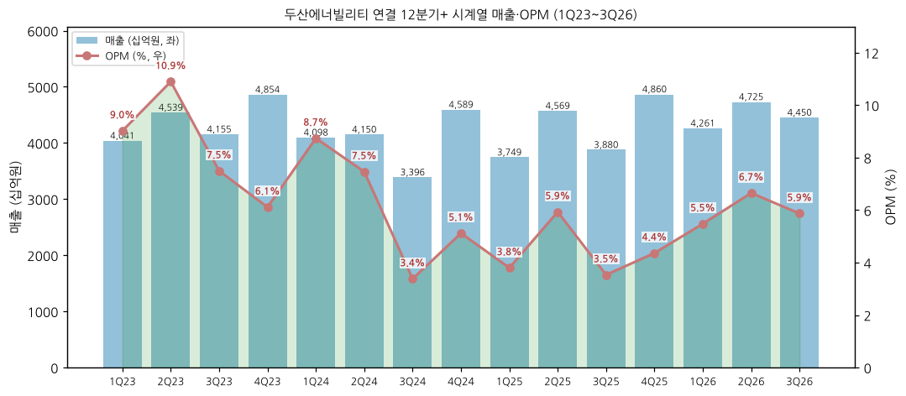

| 분기 | 매출 (조) | 영업이익 (억) | OPM | 메모 |
|------|------|---------|-----|------|
| 1Q23 | 4.04 | 3,646 | 9.0% | 밥캣 호황 |
| 2Q23 | 4.54 | 4,947 | 10.9% | ← 연결 OPM 정점 (밥캣 OPM 17.5%) |
| 3Q23 | 4.16 | 3,114 | 7.5% | 밥캣 감익 전환 |
| 4Q23 | 4.85 | 2,967 | 6.1% | |
| 1Q24 | 4.10 | 3,581 | 8.7% | |
| 2Q24 | 4.15 | 3,098 | 7.5% | 밥캣-로보틱스 합병안 발표 (7월) |
| 3Q24 | 3.40 | 1,148 | 3.4% | 밥캣 북미 딜러 재고조정 |
| 4Q24 | 4.59 | 2,349 | 5.1% | 에너빌리티 수주 4.0조 |
| 1Q25 | 3.75 | 1,425 | 3.8% | 에너빌리티 적자 (석탄·Water EPC 정산) |
| 2Q25 | 4.57 | 2,711 | 5.9% | |
| 3Q25 | 3.88 | 1,371 | 3.5% | 밥캣 관세 부담 |
| 4Q25 | 4.86 | 2,121 | 4.4% | 체코 원전 9.3조 수주 / 퓨얼셀 -766억 |
| 1Q26 | 4.26 | 2,335 | 5.5% | 원전·GT 매출 인식 본격화 |
| 2Q26 | 4.72 | 3,143 | 6.7% | 밥캣 관세 환급 효과 |
| **3Q26** | **4.45** | **2,612** | **5.9%** | **에너빌리티 OPM 6.6%, 잔고 26.6조** |

### ② 사업부별 개요 (매출 비중 큰 순서, 직관적 설명)

**두산밥캣 — 매출 비중 51.5% (2025)**

"미국에서 많이 쓰는 작은 굴삭기·로더·잔디깎이 같은 소형 장비를 만드는 자회사."

- **Compact Equipment**: 스키드 스티어 로더·컴팩트 트랙 로더 (북미 1위 브랜드 Bobcat), 미니 굴삭기, 텔레핸들러
- **Ground Maintenance / Portable Power**: 잔디깎이(제로턴 모어), 이동식 발전기·컴프레서
- **Material Handling**: 지게차 (舊 두산산업차량)
- 지분 48.23% (1H26) — 과반 미만이나 실질 지배력으로 연결

**에너빌리티 부문 — 매출 비중 45.7% (2025, DART)**

"발전소의 심장(원자로·터빈·발전기)을 만들고, 발전소 자체를 지어주는 사업부."

- **원자력**: APR1400 원자로·증기발생기·원자로냉각재펌프 등 NSSS 주기기 + 터빈발전기(STG), 원전 시공, 가동원전 서비스, 사용후핵연료 Cask
    - 프로젝트: 신한울 3·4 (국내), 체코 두코바니 5·6 (2025 수주), UAE 바라카 (기수행), 미국 AP1000 주기기 (Vogtle 3·4·V.C. Summer 공급 실적)
    - **SMR**: NuScale (모듈 제작, 2026-10 1개 모듈 계약), X-energy (Xe-100, 16모듈 핵심소재 예약), TerraPower (Natrium 주기기 3종 GV·RSS·CBS 공급계약), 영국 GBE-N·체코 i-SMR
- **가스/수소**: 국산 대형 가스터빈 **DGT6-300H (S2)** + 증기터빈 + 장기서비스(LTSA)
    - 국내: 김포·하동·고양창릉·신일산 복합 / 해외: 북미 데이터센터向 GT 7기·ST 6기 (2026 누적)
    - 수소 전소·혼소 터빈 개발
- **복합 EPC**: 해외 가스복합 발전소 (사우디 PP12, 카타르 Peaking, 오만 Misfah·Duqm, 베트남 O Mon 3·4, 사우디 Jafurah)
- **신재생**: 국산 10MW 해상풍력 터빈 (금오도 160MW·굴업도 250MW 고정가격 낙찰), 수력
- **기타**: 주단조 소재 (창원), Water(담수)·석탄 EPC (Phase-out 중)

**두산퓨얼셀 — 매출 비중 2.5% (2025, DART)**

"수소로 전기를 만드는 건물·발전용 연료전지(PAFC·SOFC)를 만드는 자회사."

- 발전용 PAFC (국내 CHPS 입찰 시장), SOFC 양산 준비, 수소 트럭·선박용 연료전지
- 지분 30.33% — 2025 영업적자 -1,057억 (키움), 3Q26 -170억

### ③ 사업부별 디테일

**현재 가장 잘나가는 제품·사업부 (top-seller):**

- **대형 가스터빈 (에너빌리티 가스/수소)**
    - 2026 9M 가스/수소 수주 3.8조 — 계획 3.2조 이미 초과
    - 미국 H급 GT 18기 발주 중 두산 7기 = GE 6기·MHI 4기·Siemens 1기 대비 최다 (McCoy 1Q26, 2Q26 IR)
    - 빅테크 데이터센터向 GT 첫 수출 공급실적 확보 (3Q26 IR)
- **두산밥캣 (이익 기여 1위)**
    - 2025 영업이익 6,860억 (연결 OP의 90%) / 3Q26 OP 1,674억 (+25.3% YoY)

**향후 큰 매출 기대 신제품·사업부 (growth):**

- **대형원전 주기기**
    - 체코 두코바니 5·6 (잔고 반영), 국내 11차 전기본 신규 2기 + 12차 전기본 추가 기대
    - 미국 AP1000 (웨스팅하우스, DOE $175억 금융지원 5개 PJT), 폴란드 2기, 베트남 2기 파이프라인 (3Q26 IR)
    - 2030 원자력 매출 가이던스 3.5조 (FY25 IR) vs 2025 1.5조
- **SMR**
    - 창원 SMR 전용 제작공장 신축 중 — 2028 하반기 완공, 연 20모듈 생산 (2Q26 IR)
    - 4Q26 SMR 수주 추진 1.0조
- **가스터빈 서비스 (LTSA)** — 설치기반 확대에 따른 고마진 반복매출 (키움 가정: 2031 50기)
- **해상풍력** — 2030년까지 연평균 1.5조 수주 추진 (2Q26 IR)

**이익 outlier (회사 공시 기준):**

- 두산밥캣 OPM 7.8% (2025) > 연결 4.5% > 에너빌리티 3.9% (DART 영업부문, 외부매출 기준)
- 에너빌리티 3Q26 OPM 6.6% — 성장사업(원자력·가스) 매출 비중 22%(FY24) → 72%(FY25) 전환 효과 (1Q25 IR)
- 두산퓨얼셀 OPM -25.3% (2025, DART 외부매출 4,181억 기준) — 연결 이익 희석 요인

### ④ 주요 경쟁사 (사업부별)

| 사업부 | 주요 경쟁사 |
|--------|-------------|
| 원자력 주기기 (NSSS) | Framatome (佛), Westinghouse (美, AP1000 자체 설계), MHI (日), BWXT (美) |
| 원전 대형 주단조 | 일본제강소 (JSW), 중국 一重·二重, Framatome Creusot |
| SMR 기자재 | BWXT, ATI·Curtiss-Wright 등 북미 공급망, 일본 IHI |
| 대형 가스터빈 | GE Vernova, Siemens Energy, Mitsubishi Power (MHI) — 글로벌 3강 + 두산 |
| 증기터빈 | GE Vernova, Siemens Energy, 東方·哈爾濱·上海電氣 |
| 발전 EPC | 현대건설·삼성물산 (국내), Larsen & Toubro, SEPCOIII, 중국 EPC |
| 해상풍력 터빈 | Siemens Gamesa, Vestas, 명양 (中), 유니슨 (국내) |
| 소형 건설장비 (밥캣) | Caterpillar, Deere, Kubota, CNH (Case), Takeuchi |
| 연료전지 (퓨얼셀) | Bloom Energy (SK에코플랜트 합작), FuelCell Energy, 한화 |

### ⑤ 주요 매출처 (DART 공시 기준)

> DART 사업보고서는 에너빌리티 부문 고객명을 익명("그룹사 A", "고객사 B·C")으로만 공시 — 고객명 매칭은 단일판매·공급계약 공시(실명)로 보완

**① 매출 10% 이상 고객 (DART 수익 주석, 십억원):**

| 구분 | 2021 | 2022 | 2023 | 2024 | 2025 |
|------|------|------|------|------|------|
| 연결: 그룹사 A | 1,356 | 1,655 | 2,122 | 2,261 | 2,404 |
| 연결 매출 대비 | 12.3% | 10.7% | 12.1% | 13.9% | 14.1% |
| 별도: 그룹사 A | 1,170 | 1,499 | 1,863 | 2,072 | 2,308 |
| 별도: 고객사 B | 342 | 657 | 820 | 541 | - |
| 별도: 고객사 C | 530 | 417 | 334 | - | - |

(DART 사업보고서(2022.12)·(2023.12)·(2024.12)·(2025.12) 수익 주석 "매출액의 10% 이상을 차지하는 고객". 그룹사 A는 실명 비공개 — 아래 공급계약 상대방 구성상 한국전력·한국수력원자력 등 한전 그룹으로 추정 (추정임을 명시). 연결 매출 대비 비중은 본 문서 계산)

**② 주요 단일판매·공급계약 (DART 반기보고서(2026.06) "단일판매·공급계약 이행현황", 계약금액 십억원):**

| 순위 | 계약 | 계약상대방 | 계약금액 | 계약기간 |
|------|------|-----------|---------|---------|
| 1 | 체코 Dukovany 5·6 NSSS | 한국수력원자력 | 4,929.0 | 2025-12 ~ 2038-04 |
| 2 | 신한울 3·4 원자로설비 | 한국수력원자력 | 2,338.1 | 2023-03 ~ 2033-10 |
| 3 | El-Dabaa NPP 터빈아일랜드 시공 | 한국수력원자력 | 1,595.4 | 2022-11 ~ 2029-04 |
| 4 | 카자흐 Shymkent(Turkistan) CCPP | PGU Turkestan LLP | 1,152.2 | 2023-03 ~ 미정 |
| 5 | 사우디 Rumah #1 IPP | Remal Energy | 1,128.3 | 2025-03 ~ 2028-05 |
| 6 | 사우디 Nairyah #1 IPP | Naseem Energy | 1,122.3 | 2025-03 ~ 2028-05 |
| 7 | 신한울 3·4 주설비 공사 | 한국수력원자력 | 1,091.8 | 2024-04 ~ 2033-10 |
| 8 | 베트남 O Mon IV | PVN | 964.0 | 2025-06 ~ 2028-12 |
| 9 | 사우디 PP12 Expansion CCGT | SEC | 886.8 | 2025-03 ~ 2028-05 |
| 10 | Jafurah Phase II Cogeneration | 한국전력공사 | 837.0 | 2026-06 ~ 2029-06 |
| - | 체코 Dukovany 5·6 T/G | 한국수력원자력 | 711.1 | 2025-12 ~ 2038-04 |
| - | 대형 가스터빈 패키지 2건 (2025-12-17·2026-03-06) | 공시 유보 | 유보 | ~2028-09 / ~2029-11 |

→ 한국수력원자력 계약 합계 10.67조 (위 표 5건) — 원전 주기기·시공의 최대 발주처
→ 중동(사우디 SEC·Remal·Naseem·한전 Jafurah) 복합화력 계약 합계 4.51조 (Jafurah 1단계 0.54조 포함 5건) → 2025 에너빌리티 중동 매출 3.12조 (DART 사업보고서(2025.12) 지역별)

**③ 두산퓨얼셀 주요 매출처 (DART 사업보고서(2025.12) II-4, 2025):** ㈜삼천리이에스 1,108억 (24.4%) / ㈜유에이치파워 605억 (13.3%) / 기타 2,835억 (62.3%) — 합계 4,548억 (내부매출 포함 부문 영업수익)

**④ 두산밥캣 판매경로 (DART 사업보고서(2025.12), Compact Equipment·Portable Power):** 전문판매딜러 88.5% / 직접판매 10.0% / 판매대리점 1.5% — NA·EMEA·ALAO 지역 딜러망

**⑤ 연도별 주요 신규 수주 (DART 사업보고서 "당해년도 체결된 주요 신규 수주상황", 억원):**
- 2025: 체코 두코바니 #5,6 원자로설비 49,290 · Rumah #1 IPP 11,283 · Nairyah #1 IPP 11,223 · O Mon 4 9,640 · PP12 Expansion 8,868 · 체코 T/G 7,111 · 야월해상풍력 EPC 5,750 · 대형 가스터빈 패키지(공개 유보)
- 2024: 함안복합 파워블록 5,817 · 분당열병합 GT 2,398 · Taiba Qassim 1,468
- 2023: 신한울 #3,4 NSSS 23,381 · Turkistan CCPP 11,522 · 신한울 3,4 주설비 10,918 · 신한울 #3,4 TG 5,320
- 2022: El-Dabaa NPP 15,954 · Tuwaiq Casting Forging 10,764 · Shuaibah 3 IWP 8,587 · Guam Ukudu 6,346
- 2021: Yanbu Ph.4 IWP 8,123 · 당진기지 저장탱크 5,002 · 네팔 Upper Trishuli 4,238
- 2020: Jawa #9,10 16,723 · 김포열병합 3,182 · Sellafield 3,263
- 2019: Van Phong 1 5,547 · 순천도시개발 4,930 · Sellafield 3,825
- 2018: 삼척화력 1,2호기 EPC 17,831
- 2017: Thabametsi 11,561 · 남양주백봉 공동주택 5,026 · Shuaibah ph.4 RO 4,739
- 2016: Obra C/Jawaharpur 24,031 · Fadhili 10,530 · Subic Redondo 9,709
- 2015: Pudimadaka 10,565 · Song Hau 1 9,758 · 강릉안인화력 6,645
- 2014: 신고리 #5,6 20,992 · Nghi Son II 18,129

**보조 (IR·언론, DART 미공시):** 북미 데이터센터向 GT 7기·ST 6기 (2026 1H 누적, 2Q26 IR) / 오만 가스복합 약 9,300억 (2026-08, ZDNet) — DART 대형 가스터빈 패키지 계약은 상대방·금액 공시 유보

### ⑥ 생산 CAPA + 임직원 추이

**생산 거점 (DART 사업보고서(2025.12) II-3 "생산설비의 현황": 에너빌리티 = 국내 성남·창원 / 해외 미국·인도·체코):**

| 거점 | 사업부 | 주요 생산 품목 |
|------|--------|---------------|
| 창원 본사 공장 (한국) | 에너빌리티 | 주단조 소재, 원자로·증기발생기, 가스·증기터빈, 발전기, 풍력 터빈 / SMR 전용 공장 신축 중 (2028 하반기, 연 20모듈 — IR) |
| 두산스코다파워 (체코 Plzeň, 지분 67%, 2025-01 프라하 증시 상장) | 에너빌리티 | 증기터빈 (원천기술) |
| Doosan Power Systems India (인도) | 에너빌리티 | 보일러·EPC (Obra-C·Jawaharpur 수행) |
| DTS (미국) | 에너빌리티 | 가스터빈 서비스 |
| ~~두산비나 (베트남)~~ | 에너빌리티 | **2025-12 Doosan Enerbility Vietnam 지분 매각** (DART 사업보고서(2025.12) — 생산실적은 12월 매각 전까지 포함) |
| 두산밥캣 (미국·체코·독일·프랑스·인도·중국 / 국내 인천, 멕시코 몬테레이 신공장) | 밥캣 | 로더·굴삭기·Portable Power·지게차·유압기기(두산모트롤) |
| 두산퓨얼셀 (서울·익산·군산) | 퓨얼셀 | PAFC·SOFC |

**생산능력 (DART 사업보고서(2025.12), 연간):**

| 사업부문 | 품목 | 2023 | 2024 | 2025 | 단위 |
|---------|------|------|------|------|------|
| 에너빌리티 | 원자로·증기발생기 (국내) | 7,000 | 7,000 | 7,000 | MW |
| | 스팀터빈 (국내 / 해외) | 6,000 / 853 | 6,000 / 680 | 6,000 / 1,159 | MW |
| | 가스터빈 (국내) | 2,700 | 3,040 | 3,040 | MW |
| | 발전기 (국내) | 9,000 | 9,000 | 9,000 | MW |
| | 보일러 (국내 / 해외) | 3,500 / 3,791 | - | - | MW (2024~ 보일러 사업 축소) |
| | 풍력터빈 기자재 (국내) | 111 | 111 | 220 | MW |
| | 주조품 / 단조품·특수강 | 22,000 / 144,300 | 22,000 / 144,300 | 22,000 / 144,300 | 톤 |
| 두산밥캣 | Compact Equipment (해외) | 120,200 | 115,300 | 125,000 | 대 |
| 두산퓨얼셀 | 연료전지 (국내) | 232 | 132 | 205 | MW |

**가동률 추이 (DART 각 사업보고서 II-3 "가동률"):**

| 연도 | 에너빌리티 보일러·터빈·원자력 (M/H) | 주단 (톤) | 인프라코어/밥캣 Compact (대) |
|------|------|------|------|
| 2014 | 90.2% | 99.5% | 58.9% (굴삭기·휠로더·SSL·CTL) |
| 2015 | 83.8% | 99.3% | 66.6% |
| 2016 | 76.4% | 92.5% | 47.2% (굴삭기·휠로더) |
| 2017 | 72.5% | 89.9% | 87.2% |
| 2018 | 64.2% | 98.2% | 88.4% (해외) |
| 2019 | 72.3% | 92.0% | 83.5% (해외) |
| 2020 | 56.2% | 70.5% | - |
| 2021 | 65.6% | 94.6% | 70.9% (밥캣 Compact) |
| 2022 | 69.9% | 90.2% | 74.5% |
| 2023 | 69.6% | 71.1% | 83.0% |
| 2024 | 70.0% | 62.1% | 68.2% |
| 2025 | 63.4% (터빈·원자력) | 62.6% | 61.2% |

(2025 에너빌리티 생산능력 1,625,327 M/H·실적 1,029,927 M/H. 2014~2017 품목명 "발전" 부문. 가동률 = 생산실적 ÷ 생산능력. 2020 인프라코어 해외 행은 v1.1 미추출)

**임직원 수 추이 (두산에너빌리티 별도, DART 각 사업보고서 VIII "직원 등 현황"):**

| 연도 | 총 직원 | 평균 근속 (년) | 1인 평균 급여 (백만원) | 연간 급여총액 (억원) | 비고 |
|------|----------|------|------|------|------|
| 2014 | 8,178 | 12.4 | 69 | 6,049 | |
| 2015 | 7,779 | 13 | 70 | 5,635 | |
| 2016 | 7,728 | 14 | 72 | 5,555 | |
| 2017 | 7,610 | 14 | 74 | 5,833 | |
| 2018 | 7,294 | 15.0 | 68 | 5,316 | |
| 2019 | 6,721 | 15.4 | 70 | 5,016 | |
| 2020 | 5,587 | 14.0 | 62 | 4,188 | ← 명예퇴직·휴업 |
| 2021 | 5,622 | 14.4 | 65 | 3,871 | |
| 2022 | 5,816 | 13.7 | 77 | 4,768 | |
| 2023 | 5,965 | 13.5 | 80 | 5,058 | |
| 2024 | 6,174 | 13 | 95 | 6,211 | |
| 2025 | 6,233 | 13 | 100 | 6,682 | |

(DART 사업보고서 각 연도 — 2014 사업보고서는 2016 정정본. 통합보고서 2017~2024 수치와 일치)

---

## 4. 재무 구조

> **재무제표 수치 출처: OpenDART fnlttSinglAcntAll (연결 CFS, 2026-11-03 조회)** — 2015~2025 연간 + 2016~2Q26 분기. 2015~2019는 차기 보고서의 전기 컬럼(중단영업 재작성·2024 기재정정 반영), 2020~2025는 당기 컬럼. 2014는 OpenDART 미제공 → 2016 통합보고서 연결재무제표. 3Q26은 분기보고서 제출 전 → 3Q26 IR 잠정치. 사업부·수주·순차입금은 회사 IR, 2024~2025 감가상각·2026E는 키움증권

### ① 손익계산서 (12년 연결, 조원, 좌→우 시간순)

| 연도 | 매출 | 매출원가 | 매출총이익 | GPM | 판관비 | CIR | 영업이익 | OPM | 순이익 | NPM | 지배순이익 |
|------|------|----------|-----------|-----|--------|-----|----------|-----|--------|-----|---------|
| 2014 | 16.04 | 13.43 | 2.61 | 16.3% | 1.99 | 12.4% | 0.62 | 3.9% | -0.09 | -0.5% | -0.09 |
| 2015 | 14.47 | 12.28 | 2.19 | 15.1% | 2.21 | 15.3% | -0.03 | -0.2% | -1.75 | -12.1% | -1.04 |
| 2016 | 13.95 | 11.53 | 2.43 | 17.4% | 1.63 | 11.7% | 0.80 | 5.7% | -0.22 | -1.5% | -0.17 |
| 2017 | 13.84 | 11.48 | 2.36 | 17.0% | 1.54 | 11.1% | 0.82 | 5.9% | -0.20 | -1.4% | -0.38 |
| 2018 | 14.74 | 12.18 | 2.57 | 17.4% | 1.57 | 10.6% | 1.00 | 6.8% | -0.43 | -2.9% | -0.53 |
| 2019 | 15.57 | 13.05 | 2.52 | 16.2% | 1.60 | 10.3% | 0.92 | 5.9% | -0.22 | -1.4% | -0.51 |
| 2020 | 15.24 | 12.93 | 2.31 | 15.2% | 1.90 | 12.5% | 0.41 | 2.7% | -0.62 | -4.1% | -0.85 |
| 2021 | 10.99 | 9.16 | 1.83 | 16.7% | 0.96 | 8.8% | 0.87 | 7.9% | 0.65 | 5.9% | 0.50 |
| 2022 | 15.42 | 12.87 | 2.56 | 16.6% | 1.45 | 9.4% | 1.11 | 7.2% | -0.45 | -2.9% | -0.77 |
| 2023 | 17.59 | 14.57 | 3.02 | 17.2% | 1.55 | 8.8% | 1.47 | 8.3% | 0.52 | 2.9% | 0.06 |
| 2024 | 16.23 | 13.50 | 2.73 | 16.8% | 1.71 | 10.5% | 1.02 | 6.3% | 0.39 | 2.4% | 0.11 |
| 2025 | 17.06 | 14.31 | 2.74 | 16.1% | 1.98 | 11.6% | 0.76 | 4.5% | 0.21 | 1.2% | 0.08 |

(연결 기준, OpenDART — 2014만 2016 통합보고서. 2017~2020 2024 기재정정 반영. EPS: 2023 87원 / 2024 174원 / 2025 132원 (키움))

**영업외 구조 특이점:** 2015~2020, 2022 연속 순손실 — 영업이익을 금융비용(이자 0.3조+/년)·기타영업외손실(해외 EPC 클레임·손상)·비지배지분(밥캣 이익의 52%)이 잠식. 지배순이익은 12년 중 4개년만 흑자.

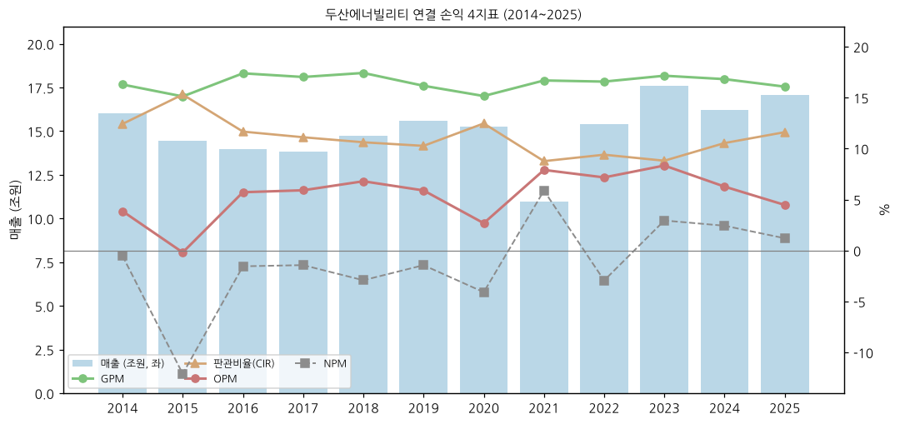

### ② 재무상태표 (12년 연결, 조원, 좌→우 시간순)

| 연도 | 자산총계 | 부채총계 | 자본총계 | 지배지분 | 자본 YoY | 부채비율 |
|------|---------|---------|---------|---------|----------|----------|
| 2014 | 27.55 | 19.87 | 7.68 | 4.66 | - | 258.9% |
| 2015 | 27.26 | 20.23 | 7.03 | 3.58 | -8.5% | 288.0% |
| 2016 | 24.83 | 18.01 | 6.82 | 3.48 | -2.9% | 264.0% |
| 2017 | 24.93 | 18.45 | 6.48 | 3.30 | -5.1% | 284.9% |
| 2018 | 24.81 | 18.69 | 6.12 | 2.71 | -5.5% | 305.3% |
| 2019 | 24.77 | 18.79 | 5.99 | 2.35 | -2.2% | 313.9% |
| 2020 | 25.57 | 18.46 | 7.11 | 3.19 | +18.7% | 259.8% |
| 2021 | 23.72 | 14.91 | 8.81 | 6.09 | +23.9% | 169.3% |
| 2022 | 23.05 | 12.97 | 10.08 | 7.11 | +14.4% | 128.7% |
| 2023 | 24.64 | 13.80 | 10.84 | 7.12 | +7.6% | 127.3% |
| 2024 | 26.31 | 14.65 | 11.66 | 7.50 | +7.6% | 125.7% |
| 2025 | 27.51 | 15.50 | 12.01 | 7.79 | +3.0% | 129.1% |
| 3Q26 | 28.21 | 16.72 | 11.49 | - | -4.4% (YTD) | 145.6% |

(2014 = 2016 통합보고서, 2015~2019 = OpenDART 차기 보고서 전기 컬럼(정정 반영), 2020~2025 = OpenDART 당기, 3Q26 = 3Q26 IR)

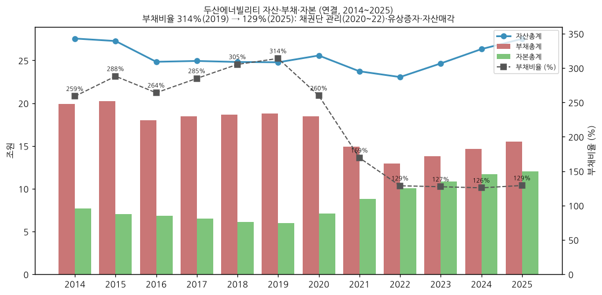

### ③ 현금흐름표 (연결, 십억원)

| 연도 | 영업CF | 투자CF | 재무CF | CapEx (유형) | 배당지급 (연결) | 자사주 취득 (연결) | FCF |
|------|--------|--------|--------|--------------|----------|------------|-----|
| 2015 | -74.4 | -379.7 | 1,058.6 | 388.7 | 84.2 | - | -463.1 |
| 2016 | 967.6 | 804.8 | -2,251.6 | 290.9 | 94.5 (+자회사 53.3) | - | 676.7 |
| 2017 | 429.3 | -457.1 | 703.6 | 277.3 | 67.9 (+자회사 47.8) | - | 152.0 |
| 2018 | 989.6 | -793.0 | -110.1 | 231.4 | 14.9 (+자회사 50.7) | 0.1 | 758.2 |
| 2019 | 433.7 | -579.7 | -530.5 | 377.4 | 14.4 (+자회사 61.9) | - | 56.3 |
| 2020 | 295.2 | -526.0 | 1,226.2 | 263.0 | 0 (+자회사 30.2) | - | 32.2 |
| 2021 | 1,027.7 | -1,265.7 | -308.4 | 284.7 | 0 (+자회사 0.7) | 2.0 | 743.0 |
| 2022 | 625.1 | -71.1 | -1,132.5 | 348.7 | 0 (+자회사 88.3) | 0.0 | 276.4 |
| 2023 | 2,070.6 | -816.6 | -52.9 | 395.6 | 0 (+자회사 80.0) | 0.0 | 1,675.0 |
| 2024 | 242.2 | -821.4 | 608.4 | 461.5 | 0 (+자회사 86.3) | 64.8* | -219.3 |
| 2025 | 751.8 | -310.6 | -287.9 | 403.1 | 0 (+자회사 108.1) | 138.7* | 348.7 |

(FCF = 영업CF − 유형자산 CapEx. 2015~2025 = OpenDART (2015~2019 차기 보고서 전기 컬럼, 2020~ 당기 — 2015~2020은 인프라코어 포함). 배당 = "배당금의 지급"(지배기업) + 괄호 "종속기업의 배당금 지급"(밥캣 등 비지배주주) OpenDART CF 계정. * 2024~2025 자기주식 취득 = 키움 2026-07-28 (종속기업 자기주식 포함, OpenDART 계정 미표기). 2014 미확보)

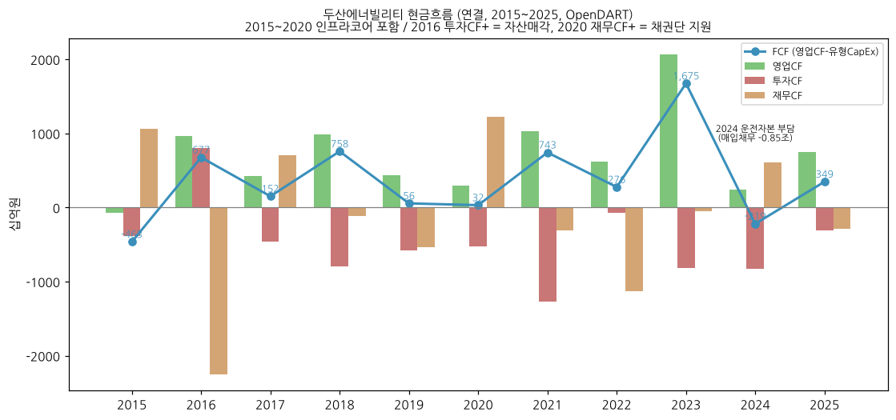

### ④ CapEx 추이

| 연도 | CapEx 유형 (십억) | CapEx 무형 (십억) | 총 CapEx (십억) | 감가상각 (유형+무형, 십억) |
|------|-----------------|-----------------|---------------|------------|
| 2015 | 388.7 | 253.9 | 642.6 | - |
| 2016 | 290.9 | 248.7 | 539.6 | - |
| 2017 | 277.3 | 277.9 | 555.2 | - |
| 2018 | 231.4 | 309.8 | 541.2 | - |
| 2019 | 377.4 | 385.4 | 762.8 | - |
| 2020 | 263.0 | 240.0 | 503.0 | - |
| 2021 | 284.7 | 203.3 | 488.0 | - |
| 2022 | 348.7 | 196.0 | 544.7 | - |
| 2023 | 395.6 | 207.6 | 603.2 | - |
| 2024 | 461.5 | 192.2 | 653.7 | 491.0 |
| 2025 | 403.1 | 295.0 | 698.1 | 557.3 |
| 2026E | 700.0 | 200.0 | 900.0 | 576.8 |

(OpenDART 현금흐름표 유형·무형자산 취득. 2015~2020 인프라코어 포함. 감가상각·2026E = 키움증권. 2019 무형 385억 = 가스터빈 개발비 자산화 정점)

**주요 CapEx 항목:**
- 창원 SMR 전용 제작공장 신축 (2028 하반기 완공, 연 20모듈 — 2Q26 IR)
- 가스터빈 생산·서비스 Capacity 증설 검토 ("국내외 수요 지속 및 협의 물량 확대에 따라 생산·서비스 Capacity 증설 검토", 3Q26 IR)
- 두산밥캣 멕시코 신공장 (밥캣 CapEx)

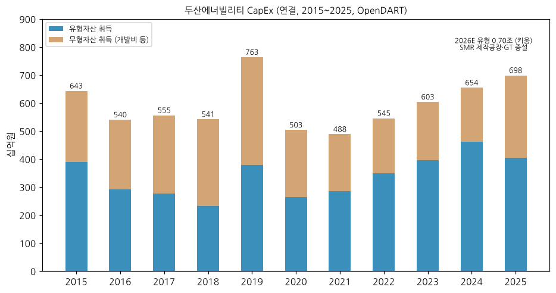

### ⑤ 부채구조 (연결, 조원)

| 연도 | 유동자산 | 유동부채 | 비유동부채 | 부채총계 | 유동비율 | 부채비율 |
|------|---------|----------|------------|----------|---------|----------|
| 2014 | - | 11.13 | 8.74 | 19.87 | - | 258.9% |
| 2015 | 10.72 | 12.46 | 7.78 | 20.23 | 86.1% | 288.0% |
| 2016 | 9.03 | 11.58 | 6.43 | 18.01 | 78.0% | 264.0% |
| 2017 | 9.20 | 11.81 | 6.64 | 18.45 | 77.9% | 284.9% |
| 2018 | 9.78 | 11.52 | 7.17 | 18.69 | 84.9% | 305.3% |
| 2019 | 9.31 | 13.87 | 4.91 | 18.79 | 67.1% | 313.9% |
| 2020 | 9.95 | 13.07 | 5.39 | 18.46 | 76.1% | 259.8% |
| 2021 | 8.42 | 10.13 | 4.79 | 14.91 | 83.1% | 169.3% |
| 2022 | 8.10 | 8.06 | 4.91 | 12.97 | 100.5% | 128.7% |
| 2023 | 9.64 | 9.60 | 4.20 | 13.80 | 100.5% | 127.3% |
| 2024 | 10.05 | 8.95 | 5.71 | 14.65 | 112.3% | 125.7% |
| 2025 | 10.77 | 10.11 | 5.40 | 15.50 | 106.6% | 129.1% |

**순차입금 (조원):**

| 시점 | 연결 순차입금 | 에너빌리티 부문 순차입금 | 에너빌리티 부채비율 |
|------|------------|---------------------|---------------|
| 2024말 | 2.85 | 2.61 | 140.1% |
| 2025말 | 2.61 | 2.66 | 139.1% |
| 2Q26 | 4.10 | 4.03 | 151.6% |
| **3Q26** | **4.45** | **4.48** | **159.2%** |

(IR 자료 기준. 2026 순차입 급증 = 대형 PJT 운전자본 + 자사주 매입. 연결 총차입금 6.23조, 이자비용 3,259억 (2025, 키움) / 이자 지급액 3,723억 (2025, OpenDART CF))

**재무위기 이력 (2019~2022):** 2019말 연결 유동차입금 7.41조·유동부채가 유동자산을 4.42조 초과 → 감사인 "계속기업 존속능력 중요한 불확실성" 강조사항 기재 (2019 통합보고서 수록 감사보고서) → 2020 채권단 지원 → 2022-02 졸업

### ⑥ 배당·자사주 추이

| 사업연도 | 보통주 DPS | 우선주 DPS | 현금배당총액 (억원) | 현금배당수익률 (보통) | 자사주 | 비고 |
|------|------|------|------|------|------|------|
| 2012 (제50기) | 750원 | - | 668 | 1.7% | - | DART 사업보고서(2014.12) |
| 2013 (제51기) | 750원 | - | 741 | 2.2% | - | 배당성향 107.1% |
| 2014 (제52기) | 750원 | 932원 | 864 | 3.1% | - | 지배순손실에도 배당 |
| 2015 (제53기) | 850원 | 932원 | 963 | 3.8% | - | DART 사업보고서(2015.12) |
| 2016 (제54기) | 550원 | 932원 | 707 | 2.0% | - | DART 사업보고서(2016.12) — 마지막 보통주 배당 |
| 2017 (제55기) | **0원** | 1,356원 | 175 | - | - | 우선주(전환우선주)만 배당 — DART 사업보고서(2018.12) |
| 2018 (제56기) | 0원 | 1,356원 | 175 | - | - | 상동 |
| 2019~2025 | 무배당 | - | 0 | - | - | DART 사업보고서(2019.12)~(2025.12) |
| 1H26 | 무배당 | - | 0 | - | **1,304억 취득** (보유 1,428,328주, 0.22%) | 1H26 검토보고서 |

(DPS·배당총액·수익률 = DART 각 사업보고서 I-6 "배당에 관한 사항". OpenDART CF "배당금의 지급"(2015 842억·2016 945억·2017 679억·2018 149억·2019 144억)은 전년도 결산배당의 지급 시점 기준이라 사업연도 배당총액과 1년 시차. 회사 정책: "투자를 통한 매출·이익 성장 극대화로 주주가치 제고 — 성장 단계 기업으로 배당보다 투자 우선" — '26 사업계획 IR p.18~19)

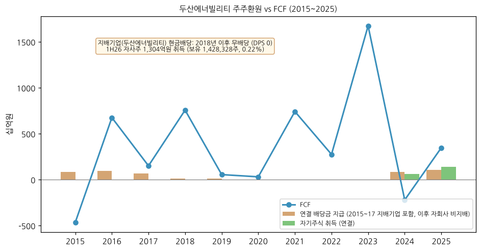

### ⑦ 재무 비율 (12년)

| 연도 | ROE (지배) | ROA | 부채비율 | 유동비율 | 이자보상배율 |
|------|-----|-----|----------|----------|--------------|
| 2014 | - | - | 258.9% | - | - |
| 2015 | -25.2% | -6.4% | 288.0% | 86.1% | -0.0x |
| 2016 | -4.8% | -0.8% | 264.0% | 78.0% | 1.6x |
| 2017 | -11.2% | -0.8% | 284.9% | 77.9% | 1.8x |
| 2018 | -17.7% | -1.7% | 305.3% | 84.9% | 2.3x |
| 2019 | -20.4% | -0.9% | 313.9% | 67.1% | 2.1x |
| 2020 | -30.9% | -2.5% | 259.8% | 76.1% | 1.0x |
| 2021 | 10.7% | 2.6% | 169.3% | 83.1% | 2.4x |
| 2022 | -11.7% | -1.9% | 128.7% | 100.5% | 4.0x |
| 2023 | 0.8% | 2.2% | 127.3% | 100.5% | 4.2x |
| 2024 | 1.5% | 1.5% | 125.7% | 112.3% | 2.7x |
| 2025 | 1.1% | 0.8% | 129.1% | 106.6% | 2.0x |

**주요 비율 의미:**
- **ROE**: 지배순이익/평균 지배지분 — 2015~2022 대부분 음수 (지배기업 별도 손실 + 비지배지분 유출)
- **ROA**: 연결 순이익/평균 자산
- 부채비율: 314% (2019) → 126% (2024) 정상화 후 2026 재상승 (3Q26 145.6%)
- 이자보상배율: 영업이익 / 현금흐름표 이자 지급액 (OpenDART) — 2022~2023 4배대 → 2025 2.0배로 하락 (키움 손익 이자비용 기준 2024 3.1x · 2025 2.3x)

(ROE·ROA·유동비율·이자보상배율은 OpenDART 수치로 본 문서 계산. 2021~2022 ROE는 메리츠 공시치와 일치)

---

## 5. 지배 구조

### ① 그룹·계열 관계

- **본사 위치**: 경상남도 창원시 성산구 두산볼보로 22
- **최대주주**: ㈜두산 (두산그룹 지주회사) — "두산 외 28인" 30.68%
- **주요 종속기업 (1H26 검토보고서):**
    - 두산밥캣㈜와 그 종속기업 — 48.23% (상장, 과반 미만 실질지배)
    - 두산퓨얼셀㈜와 그 종속기업 — 30.33% (상장, 실질지배)
    - Doosan Skoda Power a.s. (체코) — 67.00%
    - 두산큐벡스㈜ (골프장) — 100%
    - 두산밥콕 (영국), 두산비나 (베트남), DTS (미국) 등 해외 법인
- 외화공모사채 관련 두산밥캣 보통주 담보 제공 (1H26 검토보고서 주석)

### ② 주주 구분 (2026-11-02 기준, FnGuide/WISEreport)

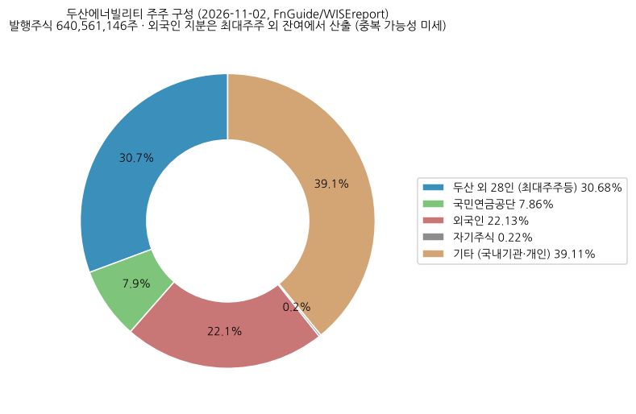

**5% 이상 주주:**

| 주주명 | 보유 주식수 | 지분율 | 비고 |
|--------|-------------|--------|------|
| ㈜두산 외 28인 | 196,541,983 | 30.68% | 최대주주 + 특수관계인 |
| 국민연금공단 | 50,356,245 | 7.86% | |
| 자기주식 | 1,428,328 | 0.22% | 1H26 취득 |

**전체 주주 구분:**

| 구분 | 지분율 | 비고 |
|------|--------|------|
| 최대주주 + 특수관계인 | 30.68% | FnGuide 2026-11-02 |
| 외국인 | 22.13% | FnGuide 2026-11-02 (유동비율 68.89%) |
| 국민연금 | 7.86% | |
| 자기주식 | 0.22% | |
| 기타 국내기관 + 개인 | ~39.1% | 잔여 산출 |

### ③ 임원·이사회 (DART 반기보고서(2026.06) 기준일 2026-06-30)

**등기임원 (이사 7인 = 사내이사 3 + 독립이사 4):**

| 성명 | 직위 | 담당 | 주요 약력 | 소유주식 | 재직 | 임기만료 |
|------|------|------|----------|---------|------|---------|
| 박지원 (1965) | 회장 · 사내이사 · 이사회 의장 | 대표이사 CEO | 연세대 경영학, 美 뉴욕대 MBA / 현 ㈜두산 부회장 | 335,935주 | 25년 5개월 | 2029-03 |
| 정연인 (1963) | 부회장 · 사내이사 | 대표이사 COO | 부산대 기계설계 / 前 두산인프라코어 전무 | 15,000주 | 10년 9개월 | 2028-03 |
| 박상현 (1966) | 사장 · 사내이사 | 대표이사 CFO | 연세대 경영학, 美 듀크대 MBA / 前 두산밥캣 대표이사·CFO | 20,188주 | 5년 11개월 | 2027-03 |
| 이은형 (1963) | 독립이사 | 감사위원, 내부거래위원장 | 국민대 경영학부 교수 / 前 SC제일은행 이사회 (에쓰오일 독립이사 겸직) | - | | 2029-03 (2026 재선임) |
| 이은항 (1966) | 독립이사 | 감사위원장 | 세무법인 삼환 세무사 / 前 국세청 차장 (효성중공업 독립이사 겸직) | - | | 2027-03 |
| 정진택 (1960) | 독립이사 | 독립이사후보추천위원장 | DGIST 이사장 / 前 고려대 총장(제20대) (HDC 독립이사 겸직) | - | | 2028-03 |
| 민원기 (1963) | 독립이사 | 보상위원장 | KAIST 김재철AI대학원 초빙특임교수 / 前 과기정통부 제2차관 | - | | 2029-03 (2026-03-31 신규) |

- 주요 미등기임원 (사장): **김종두 — 원자력BG** / **송용진 — 전략·혁신부문** (DART 반기보고서(2026.06)). 2026-10-16 인사(박상현 부회장 승진·송용진 COO 선임 — SBS Biz)는 3Q26 분기보고서 제출 전이라 DART 미반영 → 정연인 대표이사 COO의 이후 직책은 3Q26 분기보고서로 확인 필요
- 이사회 내 위원회: 감사위원회 · 내부거래위원회 · 독립이사후보추천위원회 (독립이사 4인 + 외부 자문단 3인) · 보상위원회 — 모두 독립이사 4인 구성
- 1H26 이사회 출석률: 박지원 86% / 정연인 86% / 박상현 100% / 독립이사 86~100% (2026-2차 이사회 정연인 불참)
- 이사 변동 이력 (DART 사업보고서(2025.12) I-2): 2021-03 박상현 사내이사 신규 / 2023-03 박지원 재선임·이은형·최태현 신규 / 2024-03 박상현 재선임·이은항 신규 / 2025-03 정연인 재선임·정진택 신규 / 2026-03 박지원 재선임·이은형 재선임·민원기 신규 (최태현 퇴임)

**외부 감사인 (DART 각 사업보고서 V "회계감사인의 명칭 및 감사의견"):**

| 사업연도 | 감사인 | 감사의견 | 강조사항·핵심감사사항 |
|---------|--------|---------|------------|
| 2012 (제50기) | 삼정 | 적정 | |
| 2013~2015 (제51~53기) | 한영 | 적정 | |
| 2016 (제54기) | 안진 | 적정 | |
| 2017 (제55기) | 삼정 | 적정 | 수주산업 핵심감사항목 강조사항 |
| 2018 (제56기) | 삼정 | 적정 | KAM: 수익인식·미청구공사 회수가능성 |
| 2019 (제57기) | 삼정 | 적정 | **계속기업 관련 중요한 불확실성** |
| 2020 (제58기) | 삼정 | 적정 | 재무구조개선 계획 강조사항 |
| 2021~2024 (제59~62기) | 삼정 | 적정 | KAM: 총계약원가 추정·영업권/종속기업투자 손상 |
| **2025 (제63기)~** | **삼일** | 적정 | KAM: 투입법 수익인식 정확성·영업권 손상 (강조사항 없음) |

(2025 감사보수 19.95억원·계약시간 18,200h — DART 반기보고서(2026.06). 2017~2020 재무제표는 2024 금융위 감리조치로 재작성 — 감사인은 당시 삼정)

---

## 6. 기타 팩트

### ① R&D 인프라

| 구분 | 2021 | 2022 | 2023 | 2024 | 2025 |
|------|------|------|------|------|------|
| 연구개발비용 (연결, 십억원) | 428.4 | 371.2 | 397.7 | 393.1 | 413.2 |
| **R&D / 매출 비율 (연결)** | **3.9%** | **2.4%** | **2.3%** | **2.4%** | **2.4%** |

| 구분 | 2014 | 2015 | 2016 | 2017 | 2018 | 2019 | 2020 | 2021 |
|------|------|------|------|------|------|------|------|------|
| 연구개발비 (본사, 억원) | 1,568 | 1,665 | 1,932 | 2,241 | 2,338 | 2,391 | 1,674 | 1,692 |
| R&D / 별도 매출 | 2.85% | 3.24% | 4.11% | 5.2% | 5.7% | 6.5% | 4.9% | 4.7% |

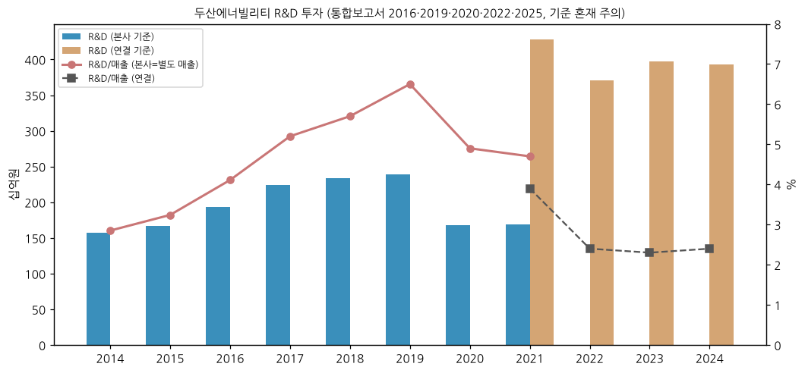

(2025 = DART 사업보고서(2025.12) II-6: 연구개발비용 계 4,221억 − 정부보조금 89억 = 4,132억, 이 중 개발비 자산화 1,507억 / 매출 대비 2.47%(보조금 차감 전). chart7은 v1.0 그대로(2025 미반영). 이전 = 통합보고서 2016·2019·2020·2022·2024·2025 — 2021년까지 본사 기준, 2022 보고서 이후 연결 기준으로 산정 기준 변경)

**R&D 핵심 영역:** 대형 가스터빈 (DGT6-300H S1/S2, 380MW급 H급·수소 혼소/전소), SMR 제작기술, 10MW 해상풍력 (국산화율 70% 수준 — 2Q26 IR), 사용후핵연료 Cask, 3D 프린팅 GT 부품

### ② 진행 중 corporate action — 10년치 M&A·구조조정

```
2026  · X-energy 16모듈 핵심소재 예약·NuScale 모듈 계약 (SMR 사업 확대)
      · 자사주 1,304억 취득 (1H26)
2025  · Doosan Skoda Power 프라하 증시 IPO(01) / Doosan Enerbility Vietnam(두산비나) 지분 매각(12) (DART 사업보고서(2025.12))
2024  · 두산밥캣 분할·두산로보틱스 합병안 발표(07) → 철회(12) ★ / Doosan HF Controls 지분 매각(04) / 두산밥캣 두산모트롤 100% 인수(10)
2022  · 사명 변경 (두산에너빌리티, 04), 채권단 관리 종료 / 유상증자 / 두산메카텍·Doosan Babcock Ltd. 매각 (DART 사업보고서(2025.12) I-2)
2021  · 두산인프라코어 사업부문 매각·투자사업부문 흡수합병(07) → 두산밥캣 직접 보유 ★ / ㈜두산 두산퓨얼셀 현물출자(04) / 유상증자
2020  · 채권단 긴급 지원 3조원+, 자산매각 (두산타워·클럽모우 등), 유상증자
      · 두산건설 포괄적 주식교환 → 완전자회사화 (2020-03-10, 신주 6,891,058주 — DART 사업보고서(2020.12)) → 2021 경영권 이전 (중단영업)
2019  · NuScale Power 우선주 지분투자 (2019-07, 뉴스케일코리아 경유 — DART 사업보고서(2019.12))
2018  · 두산엔진 지분 매각 (2018 통합보고서 중단영업 주석: "두산엔진 사업부문 매각 완료")
2017  · 해상풍력 5.5MW 기술 인수 / 미국 GT 서비스 ACT 인수 (현 DTS)
2016  · 미국 ESS 1Energy Systems 인수 (현 두산그리드텍)
```

(2016~2025 = DART 사업보고서 I-2 "회사의 연혁"(합병·경영활동 중요사실)·사업결합 주석·자본금 변동 / 2026 = IR·언론)

### ③ R&D·사업 마일스톤 — 10년치

```
2026  · TerraPower 주기기 3종 공급계약, 창원 SMR 공장 착공, 미국 H급 GT 18기 중 7기 수주
2025  · 체코 두코바니 5·6 주기기 계약 ★, DGT6 가스터빈 첫 해외 수출, 수주 14.7조
2025  · (보완) 10MW 해상풍력 터빈 고정가격 입찰 공공트랙 낙찰 1H25 (3Q25 IR) — 1.5년간 누적 699MW (2Q26 IR)
2024  · 두산밥캣 분할합병안 발표·철회
2023  · 신한울 3·4호기 주기기 수주, 사용후핵연료 Cask 종합설계 우선협상 (10-20)
2024  · (보완) GT 초기 모델 S1 15,000시간+ 상업운전, S2 모델로 안동·분당·함안 수주 (DART 사업보고서(2024.12))
2022  · 김포 GT 실증 완료 추진·표준복합 참여, 수소액화플랜트·수소터빈 개발 (DART 사업보고서(2022.12))
2019  · NuScale 지분투자 (2019-07 MOU·우선주 취득, 뉴스케일코리아 USD 50백만 풋옵션 약정 — DART 사업보고서(2019.12)) → 2024-06말 NuScale Power Corp. 3,902,061주(1.77%) 보유 (DART 반기보고서(2024.06))
2020  · 국산 GT 실증 (김포열병합) 착수
2019  · 국내 최초 발전용 대형 가스터빈 개발 (2020·2025 통합보고서 연혁) ★
2017  · 5.5MW 해상풍력 기술 인수
2016  · ESS 사업 진출
```

### ④ 주요 리스크

- **대형원전 수주 지연** — 2026 9M 원자력 수주 0.4조 (연초 계획 4.9조), 4Q26 대형원전은 "+α조" 미정량 (3Q26 IR)
- **순차입금 재증가** — 에너빌리티 부문 순차입금 2.66조 (2025말) → 4.48조 (3Q26), 부채비율 159.2% / 이자보상배율 2.3배
- **저수익 EPC 잔존** — 2025 매출의 46% (복합EPC 3.59조, 키움 분해) / 1Q25 석탄·Water PJT 정산 비용으로 부문 적자 전례
- **두산밥캣 사이클** — 북미 금리·주택경기·관세 (2025 관세 부담 → 2Q26 환급) / 연결 이익의 대부분 의존
- **두산퓨얼셀 적자** — 2025 OP -1,057억, 3Q26 -170억
- **지배구조 이벤트** — 2024 밥캣 분할합병안 철회 전례 (소액주주 반발·금감원 정정요구)
- **환율** — 해외 수주·수주잔고 원화 환산 변동 (2Q26 잔고 26.35조 → 3Q26 비교 25.53조 재표시)
- **정책** — 국내 전기본(12차) 신규원전·SMR 반영 여부, 미국 DOE 금융지원·한미 원전 협력 이행 속도
- **계속기업 강조사항 전례 (2019)** — 재무 재악화 시 신용 리스크 재부각 가능
- **소송·중재 (DART)** — 계류 소송·중재 가액: 연결 2,022억 (2025말, DART 사업보고서(2025.12)) → **2,273억 (1H26, DART 반기보고서(2026.06))**, 2021말 912억 → 2024말 1,963억으로 증가 추세. 주요 건: ① 한국남동발전 입찰참가자격 4개월 제한처분 취소소송 (창원지법 2023구합14037, 2023-12 제기 — 사유 "설계기준 미달 설비 납품", 패소 시 4개월 공공공사 입찰 제한) ② 한빛5호기 용접문제 관련 한수원 6개월 입찰제한 처분 취소소송 → 2025-10-31 항소심 승소, 2025-11-22 확정
- **부동산 PF 우발채무 (DART 반기보고서(2026.06))** — 건축 사업(공동주택·지식산업센터) 책임준공 미이행 시 조건부 채무인수약정 **5,365억 (1H26, 전기말 2,166억 → 2.5배)**, 보증한도 8,650억·9개 현장 (최대 부산 해운대 1,630억·전남 순천 1,130억). 수주 확대 국면에서 비주력 건축 PF 익스포저 증가
- **담보 제공** — 에너빌리티 유형자산 2.79조 장부가에 1.27조 담보설정 (산업은행 등, DART 사업보고서(2025.12)) / 외화공모사채 관련 두산밥캣 보통주 담보 (1H26 검토보고서)

### ⑤ ESG 등급

| 평가기관 | 등급 | 비고 |
|---------|------|------|
| KCGS (한국ESG기준원) | 미확보 | DART 미공시 — v1.2 외부 확인 |
| MSCI ESG | 미확보 | |
| 동반성장지수 | **최우수** (2024) | 2019~2023 5년 연속 우수 (2025 통합보고서) |

- 통합보고서: GRI·SASB·TCFD·UNGC 기준 발간, 한국품질재단 제3자 검증 (2025 통합보고서)
- ESG위원회 (위원장 COO 대표이사)

### ⑥ 인증·라이선스

- **원자력**: ASME N·NPT·KEPIC 등 원자력 기기 제작 인증 보유 (DART 사업보고서(2020.12) "ASME STAMP, ML, ISO 9001 인증 획득" 기재 — 전체 인증 목록은 DART 미공시) / 미국 AP1000 Vogtle 3·4·V.C. Summer 주기기 공급 실적 (2Q26 IR)
- **품질·환경**: ISO 9001 / 14001 / 45001 (2025 통합보고서 품질경영 — 세부 인증 목록 v1.1 대조)
- **풍력**: 10MW 해상풍력 터빈 형식인증 (Underwriters Laboratories, "International Certified First/Largest Korean Offshore Wind Turbine" — 3Q25 IR)
- **가스터빈**: DGT6-300H 국산 GT 실증·상업운전 실적

---

## Version Log

**v1.1 (2026-11-04) — DART 정기공시 원문 47건 gap-fill:**
- ① DART 원문 XML 47건(사업보고서 12·분기/반기 35) python 파싱 → 본문 의존 항목 전면 DART 기준 교체
- ② 사업부별 분기 시계열 15분기 → **51분기 (1Q14~3Q26)**: 에너빌리티(구 6개 부문→두산중공업→두산에너빌리티 매핑) · 舊 인프라코어/두산밥캣 · 퓨얼셀(2Q21~) · 두산건설·두산엔진. 4Q = FY − 9M, 연간 합 = 사업보고서 일치 검증. chart2 3종 재생성
- ③ 수주: DART "주요사업부문별 수주상황"으로 연간 2014~2025 + 분기말 잔고 4Q14~2Q26 확보 (2019 증감 4.19조·잔고 14.31조, 2014 7.42조·15.80조 신규). chart3 재생성
- ④ 매출처(10% 고객 그룹사 A 2.40조 = 연결 14.1%, 단일판매공급계약 실명 22건) · 생산능력·가동률 12년 · 지역별 매출 5년 · 수출비중 · 임직원 12년(급여총액 포함) · 등기임원 약력·이사회 · 감사인 이력(2025~ 삼일) · 소송(2,273억)·PF 우발(5,365억) · DPS 2012~2025 · 2024 기재정정 사유(금융위 감리, Obra-C/Jawaharpur·Doha RO·서남해) · 연혁/M&A "DART 대조 필요" 항목 해소
- ⑤ 연간 5년 사업부 표를 IR(내부관리연결) → DART 영업부문 기준으로 전환 (IR 수치는 참고 행으로 병기). 연결 분기 장기 시계열 2014~2015 추가

**v1.2 보완 후보 (잔여):**
- 3Q26 분기보고서 (2026-11-14 전후 제출 예정) → 3Q26 DART 부문 수치·수주잔고·임원 변동(2026-10-16 인사) 교체
- 분기 수주잔고 미파싱 3개 분기 (3Q21·1Q22 연결 합계 표 구조 상이·1Q26) — 원문 수동 확인
- 1Q21·2Q21 밥캣/인프라코어 OP 분기 배분 이상치 (DART 2022 비교표시 원문 그대로) 원인 확인
- chart7 R&D 2025 반영, ESG 등급 (KCGS·MSCI), 2014 이전(60분기 초과분) segment — 2014년 이전 원문 미보유
- 에너빌리티 제품별(원자력·가스·EPC) 매출 분해는 DART 미공시 → 키움 추정 유지

**v1.0 (2026-11-03) — 첫 작성:**
- ① 6개 섹션·15종 차트 (v4.8 표준 12종 + chart2 3개 사업부 + chart3 수주·수주잔고)
- ② 12년 연결 손익·재무상태표 + 11년 현금흐름·CapEx (2015~2025) — OpenDART `dart_financials` (2017~2020 2024년 기재정정본) + 2014는 2016 통합보고서
- ③ 15분기 사업부별 시계열 (1Q23~3Q26) — 연결·에너빌리티·밥캣·퓨얼셀·수주·수주잔고, 분기 합 = 연간 공시치 검증 완료
- ④ 3Q26 (2026-10-29 발표) 반영 — 3Q26 IR PDF (텍스트 레이어 없음 → 이미지 판독)
- ⑤ 시장 데이터 verify: 2026-11-03 주가·시총 (Yahoo), 2026-11-02 주주·외국인·컨센서스 (FnGuide), ATH 2026-05-07 (NewsSpace)

**데이터 확보 한계 (v1.0 작성 시점):**
- ❌ DART 본문: `dart_download_reports` 47건 전부 failed, dart.fss.or.kr 호스트 접속 "Server disconnected" → 사업보고서 본문 PDF 0건 (재무제표는 OpenDART API로 확보 ✅)
- ❌ FnGuide comp 페이지 404 리다이렉트, WISEreport 재무 ajax 빈 응답, stockanalysis 403
- ❌ 회사 IR 목록 페이지 (`/kr/investment/ir`) 500 오류 → 다운로드 ID (`/kr/investment/ir/down/{N}`) 탐색으로 우회

**v1.0 당시 보완 후보 (→ v1.1에서 대부분 해소):**
- DART 사업보고서 본문 batch → ① 지역별 매출 ② 매출처·수주현황 ③ 임원 약력·감사인 ④ 소송·우발채무 ⑤ 배당 DPS 정확치 ⑥ 2024 기재정정 사유 원문
- OpenDART 분기 CFS (2016~2026 이미 다운로드, `financials/`) → 연결 분기 시계열 40분기+ 확장 (정정·중단영업 재작성 기준 정렬 필요)
- 분기 segment 2015~2022 (60+분기 목표) — 과거 IR 자료 (`/ir/down/` 하위 ID 400~494 구간 미탐색) 또는 DART 분기보고서
- 수주잔고 2014~2022 연말치, 2019 관리연결 수주
- ESG 등급 (KCGS·MSCI), 인증 목록 대조
- 정연인 부회장 현 직책 (2026-10 COO 교체 후) DART 임원현황 확인
