# 롯데케미칼 — 기업 개요 (v1.0)

> 마지막 update: 2026-11-25 (v1.0 — 첫 작성. 3Q26 분기보고서(2026-11-13 제출)·IR 3Q26 실적발표(2026-11-06) 반영)
> 입력 source: OpenDART fnlttSinglAcntAll (연결 CFS, 2015 사업보고서\~3Q26 분기보고서, 44개 JSON — 2013·2014는 2015 사업보고서 전전기·전기 컬럼) + DART 정기공시 원문 XML 52건(감사보고서 첨부 포함 64개 파일) (사업·반기·분기보고서 2013.12\~2026.09, 기재정정본 우선 — 이번 버전 본문 파싱은 16건: 2013.12·2014.03\~2015.12 분기 6건·2015.12·2018.12·2021.12·2023.12·2024.12·2025.12·2026.09) + OpenDART 기업개황·최대주주·임원·직원·배당·자기주식·주식총수 (2025 사업보고서) + 롯데케미칼 IR 실적발표 PDF 31건 (3Q18\~3Q26, irgo 경유 — 2Q21·3Q21 2건은 다운로드 실패, 후속 분기 PDF의 5분기 차트로 대체) + Yahoo Finance (011170.KS 월간 2000-02\~2026-11, 일간 2011·2017-11\~2018-04·2024-11\~2026-11) + 네이버 증권 일별 시세 API (2025-09-02\~2026-11-25, 300거래일) + 언론 (머니투데이·MTN·뉴시스·서울신문·IB토마토·한국경제·새경제·CEO스코어데일리 등, 2024-11\~2026-11)
> 갱신 주기: 매분기 (실적 리뷰 모드 호출 시)
> 워치리스트: **대분류 소재 / 섹터 정유·화학 / 서브섹터: 화학 (LG화학(석유화학 부문)·롯데케미칼·금호석유화학·한화솔루션(케미칼 부문)) 및 정유·화학 (6사 통합)** (`earnings/watchlist.md` 84\~86행, 137행) — 2026-11-23 추가 섹터, 4Q26부터 리뷰
> **Fact verify cutoff**: 2026-11-24 (주가 2026-11-24 종가 **43,250원** [네이버 증권 일별 시세 API — Yahoo 011170.KS 같은 날 봉은 44,450원으로 장중 스냅샷 추정이라 네이버 종가 채택], 발행주식 42,775,419주 [DART 사업보고서(2025.12)·분기보고서(2026.09), 자기주식 608,272주 포함] → 시가총액 **1.85조원** [계산]. 사상 최고 종가 **475,000원 (2018-03-02)** [뉴시스 2024-11-22, 수정주가 452,441원] × 당시 발행주식 34,275,419주 → 시총 **16.28조원** [계산] (뉴시스 "한때 시가총액 16조") → 고점 대비 **-90.9%**. 2026년 고점 종가 118,000원 (2026-04-29, 시총 5.05조) [네이버] → 고점 대비 -63.3%. YTD **-38.5%** (2025-12-30 종가 70,300원), 1년 **-41.9%** (2025-11-24 종가 74,500원) [네이버 증권]. 2026-11-23 종가 42,950원 = 최근 300거래일 최저)

---

## 1. 기업 분류

- **Primary 분류: 사이클 — 석유화학 스프레드 사이클 (Deep Cyclical, 현재 장기 다운사이클 + 구조조정 국면)** — 매출의 약 2/3가 NCC(납사분해설비) 기반 범용 석유화학(에틸렌·PE·PP·BTX 등). 이익은 제품-원료 스프레드(에틸렌-나프타 등)와 유가 변동에 따른 래깅효과(재고평가손익)에 좌우되며, 12년 OPM이 +19.2%에서 -5.1%까지 24%p 이상 흔들림
- **Secondary 노트: 구조조정·자산 재편형 턴어라운드 + 스페셜티(첨단소재) 완충** — 2022\~2025 4년 연속 영업적자, 2024-11 회사채 재무특약(EOD) 이슈 → 2026 정부 주도 NCC 감축(대산 H&L Advanced 50:50 합작 2026-09 출범, 여수 여천NCC 통합 추진)으로 기초화학 연결 축소 진행. 첨단소재(ABS·PC 컴파운딩)는 OPM 1\~11%로 상대적으로 안정, 롯데에너지머티리얼즈(동박)는 적자

### ① 정량 근거

**📊 Summary Box (12년, 2014\~2025 연결):**

| 지표 | 값 |
|------|-----|
| 매출 CAGR (2014→2025, 11년) | **+2.0%** (14.86조 → 18.48조) — 유가 연동 판가 영향이 커서 매출은 물량보다 유가 사이클을 따라감 (2015·2020 유가 급락기 매출 -21%·-19%) |
| OPM 평균 | **5.8%** (12년 단순평균, 최고 19.2% 2016 · 최저 -5.1% 2025) |
| OPM 정점 평균 | **18.8%** (2016·2017 슈퍼사이클 평균) / 2차 정점 2021 8.5% |
| OPM 저점 평균 | **0.1%** (2014 2.4% · 2020 2.9% · 2025 -5.1%) |
| 사이클 주기 | **약 5\~6년** (저점 2014 → 2020 → 2025: 6년·5년 / 정점 2016\~17 → 2021: 4\~5년) [계산] |
| 사이클 회수 (12년) | **2회 완결 + 3번째 진행** (① 2014 저점→2016\~17 정점→2020 저점, ② 2020→2021 정점→2025 저점, ③ 2026 1H 반등(중동 전쟁 래깅) 후 3Q26 재적자) |

```
[전사 손익 시계열 (12년, 연결, DART)]
연도   매출(조)  영업이익  순이익   OPM    NPM   지배순이익  비고
2014    14.86     0.35    0.14    2.4    1.0     0.15   ← 하반기 유가 급락 → 재고손실, OPM 저점
2015    11.71     1.61    0.99   13.8    8.5     0.99   ← 저유가 → 에틸렌-나프타 스프레드 확대, 1차 반등
2016    13.22     2.54    1.84   19.2   13.9     1.84   ← 슈퍼사이클, 롯데정밀화학(2/29)·롯데첨단소재(4/29) 인수
2017    15.87     2.93    2.28   18.5   14.4     2.24   ← 영업이익 2.93조 사상 최대
2018    16.55     1.97    1.64   11.9    9.9     1.58   ← 4Q 유가 급락·미중 무역분쟁 → 4Q 영업이익 1,004억
2019    15.12     1.11    0.76    7.3    5.0     0.71   ← LC USA(ECC) 가동, 미국·중국 증설 → 스프레드 하락
2020    12.22     0.36    0.18    2.9    1.4     0.16   ← 코로나 + 대산공장 폭발사고(2020-03), 1Q 적자
2021    18.12     1.54    1.43    8.5    7.9     1.35   ← 리오프닝 반등, 상반기 1.2조 → 4Q 295억
2022    22.28    -0.76    0.03   -3.4    0.1     0.06   ← 고유가·중국 증설 → 적자 전환, 일진머티리얼즈 인수 결정
2023    19.95    -0.35   -0.04   -1.7   -0.2    -0.05   ← 롯데에너지머티리얼즈 편입(2023-04), 적자 지속
2024    20.43    -0.89   -1.83   -4.4   -8.9    -1.71   ← LC Titan 등 손상, 순손실 1.83조, 11월 EOD 이슈
2025    18.48    -0.94   -2.48   -5.1  -13.4    -2.04   ← 순손실 2.48조(손상·중단사업), LCPL 매각

9M26: 매출 16.07조 / 영업이익 -978억 / 순이익 -618억 (1Q 735억·2Q 1,101억 흑자 → 3Q -2,814억)
OPM range: -5.1 ~ 19.2% = 24.3%p  (사이클 분류 기준 충족)
```

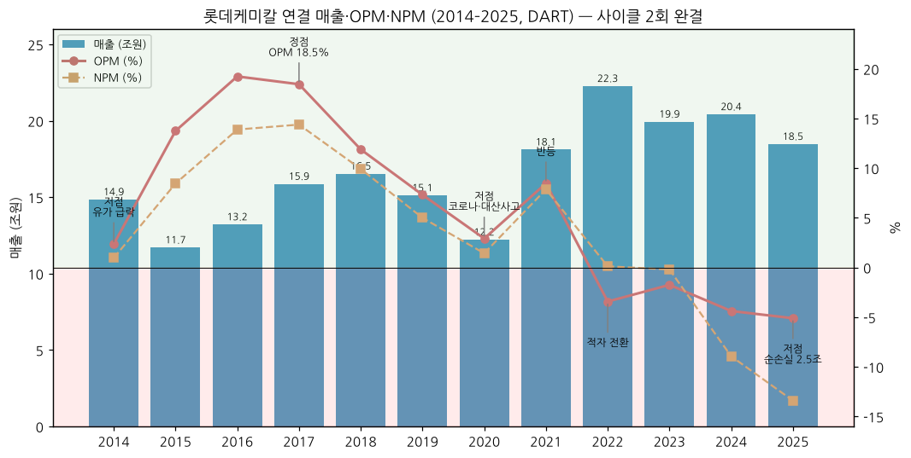

(2013·2014는 2015 사업보고서의 전전기·전기 컬럼. 2024는 당초 보고치(매출 20.43조·영업손실 8,941억) — 2025 사업보고서에서 중단영업(LCPL 매각) 반영으로 19.89조·-9,145억으로 재작성됨. 2022·2023 분기·연간도 후속 보고서에서 소폭 재작성됨. 이 문서는 **각 연도 사업보고서 당초 보고치**를 기본으로 하고 재작성은 주석 처리 [DART 사업보고서(2023.12)·(2024.12)·(2025.12)])

**사이클 변곡점 annotation (분기 기준):**

| 변곡점 | 시점 | 분기 영업이익 | 트리거 |
|---|---|---|---|
| 정점 | 1Q17 | 8,148억 (OPM 20.4%) | 에틸렌 스프레드 사상 최고권, 롯데첨단소재 연결 1년차 |
| 급락 | 4Q18 | 1,004억 (2.6%) | 유가 급락 → 부정적 래깅, 미중 무역분쟁 구매관망 |
| 저점 | 1Q20 | -860억 (-2.6%) | 코로나 수요 충격 + 대산공장 폭발사고(2020-03-04)로 대산 가동 중단 |
| 반등 정점 | 1Q21 | 6,238억 (15.0%) | 리오프닝·미국 한파 공급차질 → 스프레드 급등 |
| 적자 전환 | 2Q22 | -214억 (-0.4%) | 고유가 원가 부담 + 중국 대규모 증설, 수요 둔화 |
| 바닥 확인 실패 | 3Q24 | -4,136억 (-8.0%) | 중국 자급률 상승·역내 공급과잉, LC Titan 손상 |
| 최대 순손실 | 4Q25 | -4,335억 / 순손실 -1.60조 | 유형자산 손상·LCPL 매각 관련, 순손실 연간 2.48조 |
| 반짝 흑자 | 1Q26\~2Q26 | 735억 → 1,101억 | 2026-03 중동(미국-이란) 전쟁 → 원료가 급등기 긍정적 래깅 |
| 재적자 | 3Q26 | -2,814억 (-5.2%) | 원료가 상승분 판가 미전가 → 스프레드 축소 약 -4,900억 [IR 3Q26, 머니투데이 2026-11-06] |

### ② 산업 분류

- 산업: **석유화학 (NCC 기반 에틸렌 체인) + 합성수지 컴파운딩(첨단소재) + 정밀화학 + 전지소재(동박)**
- DART 업종: 20111 석유화학계 기초 화학물질 제조업 [OpenDART 기업개황] / KRX 화학
- 워치리스트 섹터: **정유·화학** / 서브섹터: **화학**, **정유·화학** (대분류 소재)
- 사업부 매출 비중 (2025, 연결조정 전): 기초화학 67.5% · 첨단소재 27.5% · 정밀화학 9.5% · 전지소재 3.7% (연결조정 -8.2%) [DART 사업보고서(2025.12) II-1]
- 국내 에틸렌 CAPA: 롯데케미칼 별도 NC 3,521천톤 (여수·대산, 2025) — 국내 최대권. 해외 LC Titan NC 1,299천톤(말레이시아), LC USA EL 1,000천톤(미국 루이지애나 ECC) [DART 사업보고서(2025.12) II-3]. 단, 대산 NC 1,100천톤은 2026-09 H&L Advanced(공동기업)로 이관 [MTN 2026-09-01]

### ③ 분류 결정 논리

(1) **가장 매출 큰 사업부 기준** 적용 시: 기초화학 = 연결조정 전 매출의 62% (2025, 12.48조 / 부문합 20.00조) [DART 사업보고서(2025.12) 부문정보]. 기초화학 OPM은 IR 기준 3Q17 +18%대(Olefin 25.5%) → 3Q24 -10.5% → 3Q26 -5.8%로, 유가·스프레드에 따라 부호가 바뀌는 범용 석유화학 → **사이클**
(2) **이익 비중 sub-rule**: IR 부문 데이터가 있는 2019·2021 기초화학(올레핀+아로마틱+LC Titan+LC USA) 영업이익이 전사의 88%·86% (2020은 50%) [IR 4Q20·4Q21, 계산], 2022\~2025 불황기에는 기초화학 적자가 전사 적자의 100% 이상을 설명 (예: 2025 부문 영업손실 기초화학 -8,577억 vs 전사 -9,431억, 첨단소재 +1,237억·정밀화학 +744억·전지소재 -1,585억) [DART 사업보고서(2025.12) 부문정보] → 전사 이익의 방향 = 기초화학 스프레드 → **사이클 확정**
(3) **Boundary case 처리 — "구조조정으로 사이클 노출이 줄어드는가"**: 2026-09 대산 NCC(110만톤)를 H&L Advanced(롯데 50% · HD현대오일뱅크 50%, 공동기업)로 넘겼고 [MTN 2026-09-01], 여수 기초소재도 여천NCC(한화솔루션·DL케미칼)와 1/3씩 지분 통합법인을 추진 중 [서울신문 2026-07-22]. 두 건이 완료되면 롯데케미칼 연결 NCC는 국내 여수 일부 + LC Titan + LC USA로 줄고, 지분법손익으로 바뀌는 부분이 커진다. 회사는 "대산·여수 연결 제외 시 연결 수익성 개선, 각 프로젝트별 약 3,000억 현금흐름 개선"을 제시 [머니투데이·새경제 2026-11-06]. 그러나 ① 지분법손익도 같은 스프레드 사이클을 따르고 (3Q26 지분법손익 -1,764억 [IR 3Q26]), ② 2025 사업부 비중상 기초화학이 여전히 60%대 → **Primary 사이클 유지, 구조조정은 Secondary(턴어라운드 옵션)**. 첨단소재(27%)는 ABS·PC 범용 수지 비중이 73%(2025 ABS 36%·PC 37%) [DART 사업보고서(2025.12) II-2]라 이 역시 스프레드 영향을 받는 "준사이클"
(4) **국내·글로벌 피어 cross-ref**:
→ **LG화학 (석유화학 부문)**: 같은 NCC 기반이지만 연결 전체로는 첨단소재·LG에너지솔루션(배터리) 비중이 커서 전사 분류는 "성장(배터리)+사이클(석화)" 혼합. 석유화학 부문만 떼면 롯데케미칼 기초화학과 같은 사이클 → 롯데케미칼은 **배터리 완충 없는 순수 석화 사이클 노출**이 차별점. 2026-07 한국기업평가가 LG화학 등급 AA+→AA 하향 [한국경제 2026-07-01] (`LG화학_기업개요.md`와 교차 확인 필요 — 같은 날 병렬 작성)
→ **한화솔루션 (케미칼 부문)**: PE·PVC·CA 중심 케미칼 + 신재생(큐셀) 혼합. 여천NCC(50%) 지분으로 여수 재편에서 롯데와 파트너 (`한화솔루션_기업개요.md` 교차 확인)
→ **금호석유화학**: NCC가 없는 합성고무(NB라텍스·SBR)·페놀 다운스트림 — 원료 BD 가격과 고무 수요 사이클. 순차입금이 낮아 같은 사이클이라도 재무 리스크는 롯데보다 작다는 점이 대비 (`금호석유화학_기업개요.md` 교차 확인)
→ **대한유화**: 울산 단일 NCC 순수 석화주. 2026-03 중동 전쟁 직후 석화주 급등·급락 구간에서 "대한유화 일주일새 -36%, LG화학 -28%" [뉴시스 2026-03-09] — 롯데와 같은 고베타 사이클 패턴
→ **S-Oil·SK이노베이션(석유 부문)**: 정유는 정제마진 사이클로 화학과 원료(나프타) 사슬이 연결됨. S-Oil 샤힌 프로젝트(울산, 에틸렌 180만톤급) 가동이 국내 에틸렌 공급을 늘리는 변수 — 롯데 CFO "샤힌 때문에 단기 급반등 어렵다" [머니투데이 2026-11-06] (`S-Oil_기업개요.md`·`SK이노베이션_기업개요.md` 교차 확인)
→ **글로벌 Dow·LyondellBasell·SABIC**: 에탄(셰일가스)·중동 가스 원료 기반이라 나프타 NCC보다 원가 곡선 하단 — 같은 다운사이클에서 흑자를 유지하는 경우가 많음. 롯데도 LC USA(에탄 ECC)를 보유하지만 전사 비중은 작다. 이번 버전에서는 글로벌 피어 수치를 검증하지 않음 (다음 버전 보강)

### ④ 적정 밸류에이션 방법

- **PBR 1순위 (사이클 바닥 = 자산가치 할인율로 평가)** — 적자 구간이 길어 PER은 4년째 산출 불가, EBITDA도 바닥에서 0에 근접해 EV/EBITDA가 폭주(2022 95배, 2025 54배 [계산]). 장치산업이라 자본(유형자산)이 가치의 하한선 역할
→ 연말 PBR (지배지분 기준, [계산]): 2014 0.85배 / 2015 1.11배 / 2016 1.35배 / 2017 1.10배 / 2018 0.75배 / 2019 0.58배 / 2020 0.74배 / 2021 0.52배 / 2022 0.53배 / 2023 0.42배 / 2024 0.18배 / 2025 0.24배
→ 현재 **0.15배** (시총 1.85조 / 3Q26 지배지분 12.28조) — 12년 최저권. 2026-04 고점 118,000원 기준으로도 약 0.41배. 단, 2024\~2025 누적 지배순손실 3.75조로 자본이 2023말 15.54조 → 3Q26 12.28조로 21% 감소 — "PBR이 싸다"는 자본 잠식이 멈춘다는 전제가 필요
- **EV/EBITDA 2순위 (정상화 이익 기준)** — 현재 EV 13.11조 (시총 1.85 + IR 순차입금 6.47(차입금 8.77조 − 현금예금 2.30조) + 비지배지분 4.79) / LTM EBITDA 0.82조 (IR 4Q25 -974억 + 1Q26 4,128억 + 2Q26 4,581억 + 3Q26 511억) = **15.9배** [계산]. 호황기(2015\~2018·2021) 연말 EV/EBITDA 3.5\~4.6배 — 정상 EBITDA 2\~3조를 회복하면 현재 EV는 4\~7배 수준
- **PER은 사용 불가** — 2022 지배순이익 616억(PER 124배), 2023\~2025 순손실. 호황기 PER 5.5\~6.9배(2016\~2018·2021)는 정점 이익 기준이라 사이클주 특성상 "낮은 PER = 고점" 신호
- **SOTP 보조 (구조조정 국면 특수)**: 상장 자회사 지분 — 롯데정밀화학 44.06%·롯데에너지머티리얼즈 46.94% (유효지분) [IR 3Q26], LC Titan 75.86% (말레이시아 상장). 공동기업 H&L Advanced 50%·롯데지에스화학 50%·롯데MCC 50% 등 [IR 3Q26]. 상장 자회사 시가 합산은 이번 버전 미검증 (다음 버전 보강)
- **피어 차별화**: LG화학은 배터리(LG에너지솔루션) 지분가치 SOTP가 본체, 금호석유화학은 순현금에 가까워 PER·PBR 병행이 가능한 반면, 롯데케미칼은 순차입금 6\~7조·비지배지분 4.8조로 EV에서 주식 비중이 14%에 불과(시총 1.85조 / EV 13.1조) — **레버리지가 커서 스프레드 1%p 개선에 주가 탄력이 가장 큰 구조** (2026-01\~04 +68%, 이후 -63%)

#### ④-1 정유·화학 6사 공통 비교 박스 (통일 기준, 2026-11-28 통합 검수)

> 6개 문서(S-Oil·SK이노베이션·LG화학·롯데케미칼·금호석유화학·한화솔루션)에 **같은 표**를 넣었다. 본문 ④의 회사별 수치는 각 사 고유 정의(IR 순차입금, 우선주 포함 시총 등)라 이 표와 소수점 차이가 날 수 있음 — **6사 비교는 이 표 기준**.

| 지표 (2026-11-24 종가, 3Q26 말 기준) | S-Oil | SK이노베이션 | LG화학 | 롯데케미칼 | 금호석유화학 | 한화솔루션 |
|---|---|---|---|---|---|---|
| 서브섹터 | 정유 | 정유 (석유 부문) | 화학 (석유화학 부문) | 화학 | 화학 | 화학 (케미칼 부문) |
| Primary 분류 | 사이클 (정제마진) | 사이클 (정제마진) + 지주형 혼합 | 이중 사이클 (석화 + LGES) | 사이클 (NCC 스프레드, 구조조정) | 사이클 (합성고무 스프레드) | 이중 사이클 (석화 + 태양광) |
| 밸류 1순위 지표 | PBR | PBR + SOTP | SOTP (LGES 지분) | PBR | PBR | PBR (+SOTP 보조) |
| 보통주 시가총액 (조원) | 10.63 | 15.57 | 15.07 | 1.85 | 2.30 | 4.49 |
| LTM 매출 (조원, 4Q25\~3Q26) | 41.05 | 101.28 | 51.80 | 20.78 | 7.56 | 16.17 |
| LTM 영업이익 (조원) / OPM | 3.98 / 9.7% | 9.65 / 9.5% | 0.70 / 1.3% | -0.53 / -2.6% | 0.38 / 5.0% | 0.00 / 0.0% |
| 3Q26 OPM | 11.8% | 12.9% | 3.6% | -5.2% | -1.1% | 2.3% |
| LTM 지배순이익 (조원) | 2.90 | 1.53 | -2.28 | -1.34 | 0.38 | -0.10 |
| LTM EBITDA (조원) | 4.77 | 12.77 | 6.89 | 0.82 | 0.70 | 0.88 |
| 순차입금 (조원, 차입금·사채 − 현금및현금성자산, 리스 제외) | 7.16 | 19.88 | 26.86 | 7.17 | -0.02 (순현금) | 11.09 |
| 비지배지분 (조원) | 0.00 | 11.31 | 11.80 | 4.79 | 0.00 | 2.71 |
| EV (조원) = 시총 + 순차입금 + 비지배지분 | 17.79 | 46.76 | 53.73 | 13.81 | 2.28 | 18.29 |
| **EV/EBITDA (LTM)** | **3.7배** | **3.7배** | **7.8배** | **16.8배** | **3.3배** | **20.8배** |
| **PBR** (보통주 시총 / 3Q26 지배기업 소유주지분) | **0.93배** (11.42조) | **0.61배** (25.52조) | **0.47배** (31.81조) | **0.15배** (12.28조) | **0.34배** (6.67조) | **0.45배** (10.07조) |
| **PER** (보통주 시총 / LTM 지배순이익) | **3.7배** | **10.2배** | 적자 | 적자 | **6.1배** | 적자 |

(출처: 종가 = 각 문서 헤더 Fact verify cutoff (Yahoo Finance 일간, 롯데케미칼은 네이버 종가) × DART 보통주 발행주식총수 — 우선주는 6사 통일을 위해 제외. 매출·영업이익·지배순이익 = OpenDART fnlttSinglAcntAll 연결 (LTM = 2025 연간 + 9M26 누적 − 9M25 누적). 차입금·현금·지배지분·비지배지분 = DART 3Q26 연결 재무상태표 (SK이노베이션은 유동성장기부채 5.93조 포함). EBITDA = 각 문서 ④의 LTM EBITDA — S-Oil·금호석유화학은 영업이익 + DART 감가상각(금호는 2025 연간 대용), SK이노베이션·롯데케미칼·한화솔루션은 IR 분기 EBITDA 4개 합산, LG화학은 LTM 영업이익 + IR 감가상각이라 **EBITDA 정의는 회사별로 완전히 같지 않다**. 모두 [계산])

→ **읽는 법**: 2026년은 **정유가 정점, 화학이 저점**인 국면이 표에 그대로 찍혀 있다. ① **정유 2사(S-Oil·SK이노베이션)** = LTM OPM 9\~10%·EV/EBITDA 3.7배 — 이익 정점의 저배수 (사이클주는 이익 정점에서 배수가 가장 낮아 보인다는 점 주의). ② **LG화학** = 석화 적자를 LGES 이익이 메우는 구조라 EV/EBITDA 7.8배 — 석화 피어가 아니라 SOTP로 본다. ③ **롯데케미칼·한화솔루션** = EBITDA가 붕괴해 EV/EBITDA 16\~21배, PER 산출 불가 — 지금은 PBR(0.15·0.45배)과 정상화 이익으로만 비교 가능. ④ **금호석유화학** = 6사 중 유일한 순현금, EV/EBITDA 3.3배 — 3Q26 분기 적자에도 재무 리스크가 가장 작다.

### ⑤ 분기 재평가 트리거 (분류 변경 조건)

- **기초화학(연결) 매출 비중 50% 미만** + 첨단소재·정밀화학 합산 영업이익이 2개 연도 연속 전사 영업이익의 과반 → 사이클 → "스페셜티 혼합형" transition 검토 (대산·여수 연결 제외 완료 시점 2027년 재점검)
- **기초화학 분기 OPM 2개 분기 연속 +5% 이상** (2021 이후 없음) → 업사이클 진입 판단, 밸류 프레임을 PBR → EV/EBITDA·PER로 이동
- **지배지분 자본 10조 미만** 또는 **NICE·한신평 무보증 등급 A+ 이하** → 사이클주 → "재무 위기형" 하향 (현재 무보증 AA- [DART 사업보고서(2025.12) I-1, IB토마토 2026-09-07])
- **정부 NCC 감축(목표 270\~370만톤) 이행 + 중국 에틸렌 증설 전망 추가 하향** (회사 추정 글로벌 신증설 1,700만톤 → 1,000\~1,100만톤 [머니투데이 2026-11-06]) → 사이클 저점 통과 신호로 재평가

---
## 2. 회사 개요

### ① 기본 사항

- **회사명**: 롯데케미칼(주) (LOTTE CHEMICAL CORPORATION) / KRX 011170 (유가증권시장 1991-05-30 상장, 당시 호남석유화학) [DART 사업보고서(2021.12) 연결주석 1]
- **본사**: 서울특별시 송파구 올림픽로 300 롯데월드타워 [OpenDART 기업개황]
- **설립**: 1976-03-16 호남석유화학(주) 설립 → 2009-01-01 롯데대산유화 흡수합병 → 2012-12-27 케이피케미칼 흡수합병 + 사명 롯데케미칼로 변경 → 2020-01-01 롯데첨단소재 흡수합병 [OpenDART 기업개황, DART 사업보고서(2021.12)]
- **지배구조**: 롯데지주 25.31% 최대주주, 롯데물산 20.00%, LOTTE Holdings(일본) 9.19% 등 특수관계인 합계 54.58% (2025말) [DART 사업보고서(2025.12) 최대주주 현황]. IR 기준 특수관계인 56.03%·자기주식 1.46%·외국인 8.10% (2026-09말) [IR 3Q26]
- **사업 한 줄 정의**: 여수·대산(→2026-09 합작 이관)·울산 NCC와 말레이시아 LC Titan·미국 LC USA(에탄 크래커)를 기반으로 에틸렌·프로필렌·BTX → PE·PP·MEG·PIA 등 범용 석유화학을 생산하는 국내 최대권 NCC 업체 + ABS·PC 컴파운딩(첨단소재)·ECH·셀룰로스(롯데정밀화학)·동박(롯데에너지머티리얼즈) 보유
- **대표이사**: 신동빈 회장 · 이영준 (화학군 PSO 총괄대표, 기초소재 대표 겸임) · 주우현 (첨단소재 대표, 2026-03 선임 예정 안건) — OpenDART 기업개황 대표 "신동빈, 이영준, 주우현". CFO 성낙선 (화학군 PSO 재무혁신본부장) [DART 사업보고서(2025.12) VIII]
- **신용등급 (회사채)**: AA+ (2023-02, 한신평·한기평) → AA (2023-06 정기평가) → AA/Negative (2024-06) → 2025-01 롯데월드타워 담보 은행 보증으로 보증사채 AAA 수시평가 / **무보증(61-1·61-2회) AA-** (2025-06 한신평·NICE) [DART 사업보고서(2025.12) I-1]. NICE 무보증·기업신용 AA- 유지 (2026-09 기준) [IB토마토 2026-09-07]
- **직원 (별도)**: 4,349명 (남 3,555 · 여 794, 평균 근속 남 15.5년·여 10.3년, 1인 평균 급여 남 1.05억·여 0.70억, 2025말) [DART 사업보고서(2025.12) 직원 현황]

### ② 최근 12년 손익·자본 추이 (조원, 연결, DART)

| 연도 | 매출 | YoY | 영업이익 | 순이익 | 자본총계 | 자본 YoY |
|---|---|---|---|---|---|---|
| 2014 | 14.86 | -9.6% | 0.35 | 0.14 | 6.47 | +2.8% |
| 2015 | 11.71 | -21.2% | 1.61 | 0.99 | 7.56 | +16.8% |
| 2016 | 13.22 | +12.9% | 2.54 | 1.84 | 9.40 | +24.4% |
| 2017 | 15.87 | +20.0% | 2.93 | 2.28 | 12.25 | +30.4% |
| 2018 | 16.55 | +4.2% | 1.97 | 1.64 | 13.54 | +10.5% |
| 2019 | 15.12 | -8.6% | 1.11 | 0.76 | 14.05 | +3.8% |
| 2020 | 12.22 | -19.2% | 0.36 | 0.18 | 13.71 | -2.4% |
| 2021 | 18.12 | +48.2% | 1.54 | 1.43 | 15.45 | +12.7% |
| 2022 | 22.28 | +22.9% | -0.76 | 0.03 | 17.26 | +11.7% |
| 2023 | 19.95 | -10.5% | -0.35 | -0.04 | 20.23 | +17.2% |
| 2024 | 20.43 | +2.4% | -0.89 | -1.83 | 19.99 | -1.2% |
| 2025 | 18.48 | -9.5% | -0.94 | -2.48 | 17.63 | -11.8% |

(연결, OpenDART fnlttSinglAcntAll. 2013: 매출 16.44조·영업이익 0.49조·자본 6.29조. 2016 자본 +24%는 2015\~2016 고이익 누적 + 인수, 2022\~2023 자본 증가는 2022-11 유상증자(8,500,000주) + 롯데에너지머티리얼즈 편입에 따른 비지배지분 증가(2022말 2.82조 → 2023말 4.69조) 때문. 3Q26 자본총계 17.08조 (지배 12.28조 · 비지배 4.79조) [DART 분기보고서(2026.09)])

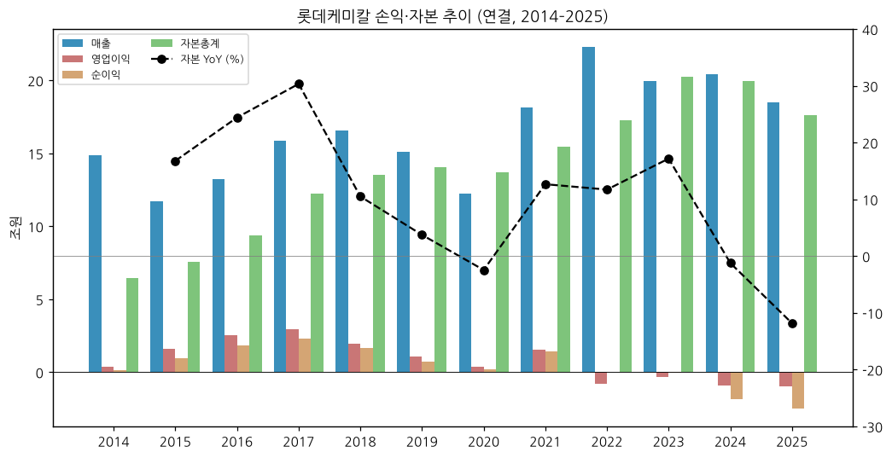

### ③ 회사 주가 역사 ★ narrative 영역

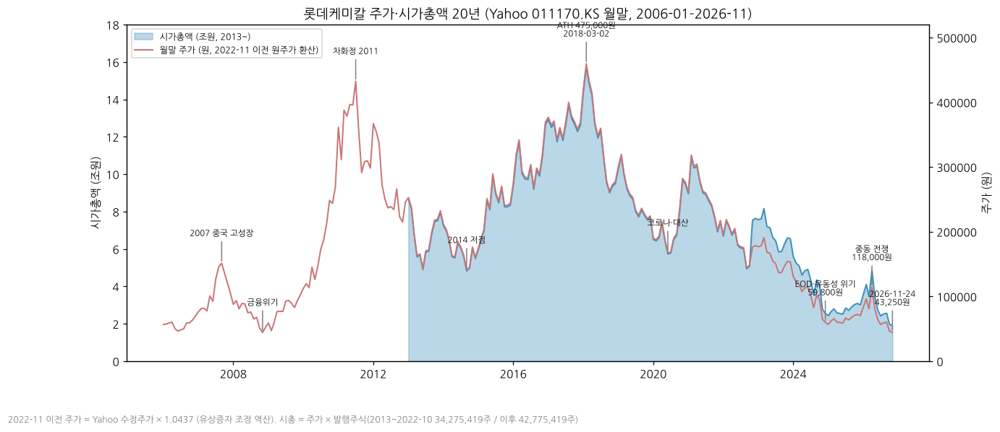

> 가격 처리: Yahoo 011170.KS 가격은 2022-11 유상증자(신주 8,500,000주, 발행주식 34,275,419 → 42,775,419주)를 반영한 수정주가. 2018-03-02 원주가 종가 475,000원 vs Yahoo 455,090원 → 계수 **1.0437** 역산, 2022-11 이전 원주가 ≈ Yahoo × 1.0437 [계산]. 검증: 2017말 DPS 10,500원/시가배당률 2.89% 역산 363,300원 vs 환산 368,400원 (오차 1.4%) [DART 사업보고서(2018.12)]. 시가총액은 KP케미칼 합병 후 발행주식이 확정된 2013년부터 계산 (2012 이전 호남석유화학 주식수는 이번 버전 미검증 → 주가만 표시)

(1) 2000\~2007: 중국 고성장 + 호남석유화학 재평가
→ 2000-11 월말 5,455원 (20년 최저, 환산) → 2007-09 151,152원 — 중국 WTO 가입 이후 석화 수요 급증 [Yahoo, 계산]

(2) 2008\~2011: 금융위기 급락 → "차화정" 랠리
→ 2008-11 44,295원 (금융위기 저점) → 2011-07 월말 432,434원 (8배+). 2010-11 말레이시아 Titan 인수 [DART 사업보고서(2018.12) 연혁], 중국 경기부양 수혜로 "차·화·정(자동차·화학·정유)" 주도주 [일반 시장 서술]

(3) 2012\~2015-1H: 중국 증설·유가 하락 다운사이클
→ 2012-12 KP케미칼 합병·롯데케미칼 사명 변경. 2014-09 월말 140,641원 (시총 4.8조) — 2014 영업이익 3,509억(OPM 2.4%) 저점

(4) 2015-2H\~2018-1Q: 에틸렌 슈퍼사이클 → 사상 최고가
→ 저유가로 나프타 원가 하락 + 신증설 공백 → 2015 영업이익 1.61조 → 2017 2.93조. 2016 롯데정밀화학·롯데첨단소재 인수
→ **2018-03-02 종가 475,000원 사상 최고, 시총 약 16.3조** [뉴시스 2024-11-22, 계산]

(5) 2018-2Q\~2020: 미국 셰일 ECC·중국 증설 + 코로나
→ 2018-4Q 유가 급락 → 4Q18 영업이익 1,004억. 2019 LC USA(ECC 100만톤) 가동 → 2020-03 대산공장 폭발사고·코로나 → 2020-06 월말 167,168원

(6) 2021: 리오프닝 반짝 반등
→ 1Q21 영업이익 6,238억 → 2021-02 월말 318,320원 → 4Q21 영업이익 295억으로 급감하며 재하락

(7) 2022\~2024: 4년 적자 + 롯데그룹 유동성 위기
→ 2022-10 일진머티리얼즈(현 롯데에너지머티리얼즈) 지분 인수 결정(LBM 경유) + 2022-11 유상증자 [DART 사업보고서(2025.12) I-2]. 2022\~2024 연속 영업적자
→ 2024-11 회사채 재무특약(3개년 누적 EBITDA/이자비용 5배 이상) 미달로 기한이익상실(EOD) 사유 발생 → 롯데그룹 "유동성 위기설" 확산, 10월말 9만원대 → 60,000원대 [뉴시스 2024-11-22]
→ 2024-11-27 사채권자집회 소집 공고 → 12-19 롯데월드타워에서 공모 회사채 14개 재무특약 조정 가결, 롯데월드타워(6조원 이상 평가)를 담보로 은행 보증 추가 [뉴시스 2024-12-19]
→ 2024-12 월말 59,800원 (시총 2.56조)

(8) 2025\~2026: 구조조정 + 중동 전쟁 롤러코스터
→ 2025 영업손실 9,431억, 순손실 2.48조. 2025-11-12 LC Pakistan(75.01%) 매각 완료 [DART 사업보고서(2025.12) II-2]
→ 2026-03 미국-이란 전쟁 → 나프타 가격 4주 연속 상승(+36.5%) [뉴시스 2026-03-19] → 석화주 급등락 (대한유화 일주일 -36%, LG화학 -28% [뉴시스 2026-03-09]) → 원료가 상승기 긍정적 래깅으로 1Q26 10분기 만에 흑자(735억) [MTN 2026-05-11] → **2026-04-29 종가 118,000원 (시총 5.05조)** [네이버]
→ 2026-06-01 롯데대산석화 물적분할 → 2026-09-01 HD현대케미칼과 합병, H&L Advanced 출범 (50:50) [MTN 2026-06-01·09-01]. 2026-07-22 여수 재편(여천NCC 통합) 정부 승인 [서울신문 2026-07-22]
→ 3Q26 영업손실 2,814억 (역래깅·스프레드 축소) [IR 3Q26] → 2026-11-23 종가 42,950원 (300거래일 최저) → **2026-11-24 43,250원, 시총 1.85조** [네이버]

### ④ 회사의 주요 연혁

```
1976-03-16   호남석유화학(주) 설립 [OpenDART]
1991-05-30   유가증권시장 상장 [DART 사업보고서(2021.12)]
2009-01-01   롯데대산유화 흡수합병 (대산 NCC 확보)
2010-11      말레이시아 Titan Chemicals 인수 → LC Titan (2017 재상장) [DART 사업보고서(2018.12)]
2012-12-27   케이피케미칼 흡수합병, 사명 롯데케미칼로 변경
2014-04      Lotte Chemical USA 설립 / 2015-06 Westlake(구 Axiall)와 90:10 에탄크래커 합작(LACC) — 총사업비 약 $31억
2016-02-29   롯데정밀화학(구 삼성정밀화학) 인수
2016-04-29   롯데첨단소재(구 삼성SDI 케미칼) 인수
2019         LC USA 에탄크래커(에틸렌 100만톤)·EG(70만톤) 가동
2020-01-01   롯데첨단소재 흡수합병
2020-03-04   대산공장 폭발사고 (가동 중단, 2020-4Q 재가동) [IR 4Q20]
2022-10-11   LBM 경유 일진머티리얼즈 최대주주 지분 취득 계약 → 2023-03 롯데에너지머티리얼즈로 사명 변경
2022-11      유상증자 8,500,000주 (발행주식 42,775,419주)
2023-06·09   중국 삼강낙천화공·낙천화학(가흥) 매각
2024-12-19   사채권자집회 — 공모채 14개 재무특약 조정, 롯데월드타워 담보 은행보증
2025-11-12   LOTTE Chemical Pakistan(75.01%) 매각 완료
2025-4Q     롯데지에스화학 공동기업 전환 [IR 3Q26]
2026-06-01   대산공장 물적분할 → 롯데대산석화
2026-09-01   롯데대산석화 + HD현대케미칼 합병 → H&L Advanced (롯데 50% : HD현대오일뱅크 50%)
2026-07-22   여수 재편안 정부 승인 — 여천NCC 1공장 + 롯데 여수공장 통합법인(롯데·한화솔루션·DL케미칼 각 1/3) 추진, 2027-1H 목표
```
(출처 표기 없는 항목: DART 사업보고서(2021.12) 연결주석 1·(2018.12) 계열회사 연혁·(2025.12) I-2. 2019 LC USA 가동 시점은 IR 4Q20 부문표(LC USA 2Q19부터 실적)로 확인)

---
## 3. 비즈니스 모델

### ① 실적 추이 (연결 → 부문 → 제품 3단계 위계)

**(1) 5년 연간 — 연결 · 부문(IR) · 제품(DART) (억원)**

| 구분 | 2021 | 2022 | 2023 | 2024 | 2025 | 3Q26 누적 |
|---|---|---|---|---|---|---|
| **연결 매출** | 181,205 | 222,761 | 199,464 | 204,304 | 184,830 | 160,720 |
| **연결 영업이익** | 15,356 | -7,626 | -3,477 | -8,941 | -9,431 | -978 |
| 연결 OPM | 8.5% | -3.4% | -1.7% | -4.4% | -5.1% | -0.6% |
| ├ 기초화학 매출 | 139,665 | 168,552 | 139,233 | 137,100 | 126,593 | 111,128 |
| ├ 기초화학 영업이익 | 13,255 | -9,763 | -5,009 | -8,233 | -8,480 | -1,688 |
| ├ 첨단소재 매출 | 46,681 | 47,894 | 41,763 | 43,959 | 41,084 | 32,677 |
| ├ 첨단소재 영업이익 | 3,633 | 1,699 | 2,348 | 1,797 | 2,057 | 1,786 |
| ├ 롯데정밀화학 매출 | - | 24,637 | 17,687 | 16,705 | 17,528 | 16,223 |
| ├ 롯데정밀화학 영업이익 | - | 4,043 | 1,547 | 504 | 744 | 1,166 |
| ├ 롯데에너지머티리얼즈 매출 | - | - | 8,090 | 9,022 | 6,775 | 6,437 |
| ├ 롯데에너지머티리얼즈 영업이익 | - | - | 119 | -645 | -1,452 | -432 |
| *제품별 매출 (DART, 2023\~2025만 공시)* | | | | | | |
| 기초화학 소계 | - | - | 134,702 | 133,063 | 124,801 | - |
| ├ PE | - | - | 34,366 | 32,457 | 27,986 | - |
| ├ PP | - | - | 21,955 | 22,761 | 21,302 | - |
| ├ BTX | - | - | 8,165 | 6,746 | 6,805 | - |
| ├ 기타(EG·PIA·PET 등) | - | - | 74,036 | 76,558 | 68,707 | - |
| 첨단소재 소계 | - | - | 50,408 | 54,713 | 50,867 | - |
| ├ ABS | - | - | 16,823 | 19,067 | 18,487 | - |
| ├ PC | - | - | 20,806 | 21,362 | 18,925 | - |
| ├ 기타(건자재 등) | - | - | 12,780 | 14,284 | 13,455 | - |
| 정밀화학 소계 | - | - | 17,686 | 16,705 | 17,527 | - |
| ├ 암모니아계 | - | - | 6,609 | 5,556 | 5,765 | - |
| ├ 염소계(ECH·가성소다) | - | - | 5,686 | 5,450 | 6,556 | - |
| ├ 셀룰로스계 | - | - | 4,975 | 5,288 | 5,206 | - |
| 전지소재 소계 | - | - | 6,454 | 9,023 | 6,775 | - |
| ├ Elecfoil(동박) | - | - | 5,306 | 6,991 | 5,989 | - |
| 연결조정 | - | - | -13,606 | -14,556 | -15,140 | - |

(연결: OpenDART. 부문: IR 실적발표 분기 수치 합산 [IR 각 분기, 계산] — 기초화학 = 롯데케미칼 기초소재(올레핀+아로마틱) + LC Titan + LC USA (2024-1Q부터 회사가 통합 공시, 2021\~2022는 각 부문 IR 수치를 합산, 2023은 회사 재작성치), 부문간 내부거래 포함이라 부문 합 ≠ 연결. 롯데정밀화학은 IR상 2022-1Q부터 부문 공시, 롯데에너지머티리얼즈는 2023-04 연결 편입(IR의 2Q22\~1Q23 수치는 편입 전 참고치). 제품: DART 사업보고서(2025.12) II-2 주요 제품 현황(백만원 → 억원). 2024·2023 제품표 합계는 2025 사업보고서 재작성 기준(2024 19.89조))

**(2) 사업부 재편 매핑 (IR 부문 기준)**

```
~2018        Olefin(롯데케미칼) / Aromatics(LCPL·LCUK·KP켐텍 포함) / LC Titan / 롯데첨단소재(자회사)
2019         + LC USA (2Q19 가동)  /  LCUK 매각(4Q19, 소급 제외)
2020-1Q      롯데첨단소재 합병 → 첨단소재 사업부 (Olefin의 PC·PM 일부 이관)
2022-1Q      Olefin + Aromatics → 기초소재 통합  /  롯데정밀화학 부문 신설(연결)
2023-2Q      롯데에너지머티리얼즈(동박) 연결 편입 (2023-04)
2024-1Q      기초소재 + LC Titan + LC USA (+롯데GS화학) → 기초화학 통합 공시
2025-4Q      롯데GS화학 공동기업 전환  /  2025-11 LCPL 매각(중단영업)
2026-09-01   대산(롯데대산석화) → H&L Advanced 합병, 기초화학 연결 제외 (3Q26 기초화학은 7~8월만 포함)
DART 보고부문(2023~): 기초화학 / 첨단소재 / 정밀화학 / 전지소재
```

**(3) 사업부별 분기 시계열 (IR, 억원)** — 기초화학 영업이익은 3Q17부터, 매출은 1Q19부터 (2017\~2018 IR PDF는 부문 매출이 막대 차트 이미지라 숫자 추출 불가)

| 분기 | 기초화학 매출 | 기초화학 OP | OPM | 첨단소재 매출 | 첨단소재 OP | OPM | 정밀화학 매출 | 정밀화학 OP | 에너지머티리얼즈 매출 | 에너지머티리얼즈 OP |
|---|---|---|---|---|---|---|---|---|---|---|
| 3Q17 | - | 6,810 | - | - | 1,010 | - | - | - | - | - |
| 4Q17 | - | 6,349 | - | - | 826 | - | - | - | - | - |
| 1Q18 | - | 5,935 | - | - | 901 | - | - | - | - | - |
| 2Q18 | - | 6,399 | - | - | 779 | - | - | - | - | - |
| 3Q18 | - | 4,574 | - | - | 590 | - | - | - | - | - |
| 4Q18 | - | 1,059 | - | - | 88 | - | - | - | - | - |
| 1Q19 | 30,037 | 2,767 | 9.2% | 7,050 | 314 | 4.5% | - | - | - | - |
| 2Q19 | 33,070 | 3,075 | 9.3% | 7,666 | 588 | 7.7% | - | - | - | - |
| 3Q19 | 32,732 | 2,758 | 8.4% | 7,617 | 547 | 7.2% | - | - | - | - |
| 4Q19 | 29,207 | 1,172 | 4.0% | 7,034 | 363 | 5.2% | - | - | - | - |
| 1Q20 | 25,731 | -1,080 | -4.2% | 8,087 | 410 | 5.1% | - | - | - | - |
| 2Q20 | 19,930 | 262 | 1.3% | 7,226 | 243 | 3.4% | - | - | - | - |
| 3Q20 | 22,031 | 1,102 | 5.0% | 8,633 | 995 | 11.5% | - | - | - | - |
| 4Q20 | 23,613 | 1,503 | 6.4% | 8,852 | 827 | 9.3% | - | - | - | - |
| 1Q21 | 32,594 | 5,347 | 16.4% | 10,414 | 1,157 | 11.1% | - | - | - | - |
| 2Q21 | 33,396 | 4,846 | 14.5% | 11,823 | 1,260 | 10.7% | - | - | - | - |
| 3Q21 | 35,074 | 2,296 | 6.5% | 12,566 | 765 | 6.1% | - | - | - | - |
| 4Q21 | 38,601 | 766 | 2.0% | 11,878 | 451 | 3.8% | - | - | - | - |
| 1Q22 | 42,902 | 143 | 0.3% | 13,142 | 545 | 4.1% | 6,523 | 1,103 | - | - |
| 2Q22 | 42,605 | -1,027 | -2.4% | 12,345 | 713 | 5.8% | 6,863 | 1,295 | (1,884) | (252) |
| 3Q22 | 43,006 | -4,658 | -10.8% | 11,613 | 121 | 1.0% | 6,285 | 1,204 | (1,697) | (229) |
| 4Q22 | 40,039 | -4,221 | -10.5% | 10,794 | 320 | 3.0% | 4,966 | 441 | (1,712) | (151) |
| 1Q23 | 36,035 | -519 | -1.4% | 10,495 | 455 | 4.3% | 5,250 | 420 | (1,636) | (61) |
| 2Q23 | 35,243 | -1,789 | -5.1% | 10,988 | 751 | 6.8% | 4,312 | 691 | 1,982 | 15 |
| 3Q23 | 33,675 | -334 | -1.0% | 10,684 | 755 | 7.1% | 4,012 | 351 | 2,177 | 30 |
| 4Q23 | 34,280 | -2,367 | -6.9% | 9,596 | 387 | 4.0% | 4,113 | 85 | 2,295 | 13 |
| 1Q24 | 35,489 | -1,304 | -3.7% | 10,317 | 444 | 4.3% | 3,994 | 108 | 2,417 | 43 |
| 2Q24 | 34,490 | -1,494 | -4.3% | 11,344 | 757 | 6.7% | 4,221 | 171 | 2,627 | 30 |
| 3Q24 | 35,083 | -3,688 | -10.5% | 11,217 | 381 | 3.4% | 4,204 | 103 | 2,114 | -317 |
| 4Q24 | 32,038 | -1,747 | -5.5% | 11,081 | 215 | 1.9% | 4,286 | 122 | 1,864 | -401 |
| 1Q25 | 32,455 | -1,133 | -3.5% | 11,082 | 729 | 6.6% | 4,456 | 188 | 1,580 | -460 |
| 2Q25 | 26,874 | -2,161 | -8.0% | 10,455 | 560 | 5.4% | 4,247 | 87 | 2,049 | -311 |
| 3Q25 | 33,833 | -1,225 | -3.6% | 10,222 | 575 | 5.6% | 4,434 | 276 | 1,437 | -343 |
| 4Q25 | 33,431 | -3,961 | -11.8% | 9,325 | 193 | 2.1% | 4,391 | 193 | 1,709 | -338 |
| 1Q26 | 34,490 | 455 | 1.3% | 10,233 | 615 | 6.0% | 5,107 | 327 | 1,598 | -50 |
| 2Q26 | 39,403 | 23 | 0.1% | 11,551 | 1,325 | 11.5% | 5,863 | 619 | 1,942 | -169 |
| 3Q26 | 37,235 | -2,166 | -5.8% | 10,893 | -154 | -1.4% | 5,253 | 220 | 2,897 | -213 |

(괄호 = 연결 편입 전 참고치. 각 분기 값은 그 분기를 포함한 가장 최근 IR PDF 수치(재작성 반영) [IR 3Q18\~3Q26 31건, 계산])

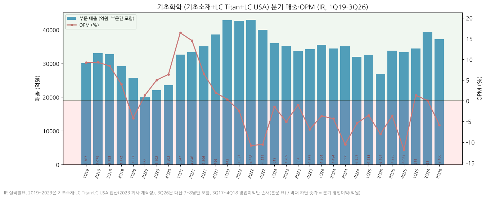

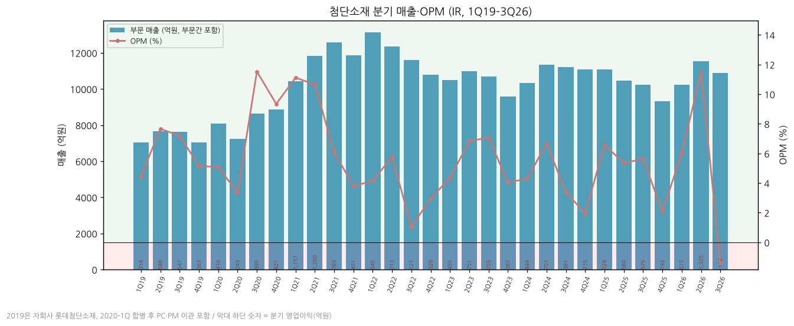

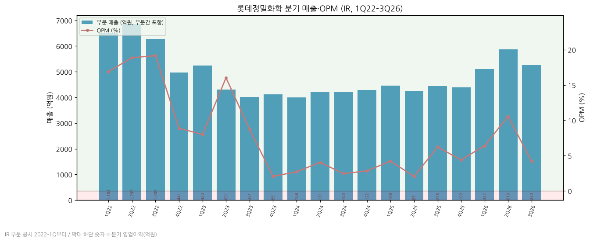

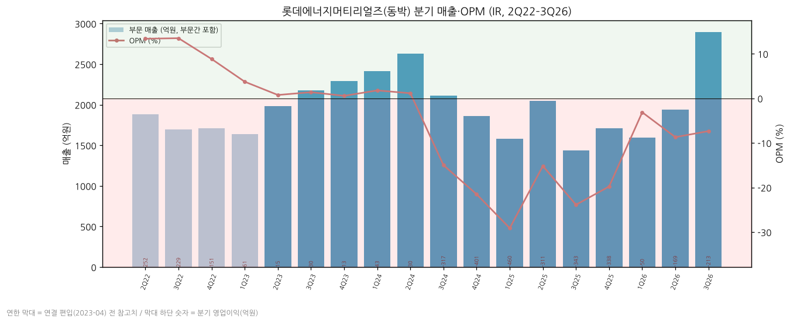

**(4) 전사 분기 시계열 (연결, DART, 억원) — 1Q13\~3Q26, 55개 분기**

| 분기 | 매출 | YoY | 영업이익 | OPM | 순이익 | 출처 |
|---|---|---|---|---|---|---|
| 1Q13 | 41,712 | - | 1,174 | 2.8% | 1,137 | XML |
| 2Q13 | 41,612 | - | 696 | 1.7% | 248 | XML |
| 3Q13 | 40,393 | - | 1,717 | 4.3% | 1,531 | XML |
| 4Q13 | 40,672 | - | 1,287 | 3.2% | -58 | XML |
| 1Q14 | 38,734 | -7.1% | 683 | 1.8% | 478 | XML |
| 2Q14 | 37,820 | -9.1% | 843 | 2.2% | 517 | XML |
| 3Q14 | 37,083 | -8.2% | 1,422 | 3.8% | 1,007 | XML |
| 4Q14 | 34,954 | -14.1% | 560 | 1.6% | -564 | XML |
| 1Q15 | 27,996 | -27.7% | 1,780 | 6.4% | 1,198 | XML |
| 2Q15 | 31,786 | -16.0% | 6,398 | 20.1% | 4,602 | XML |
| 3Q15 | 30,347 | -18.2% | 4,845 | 16.0% | 2,394 | XML |
| 4Q15 | 27,004 | -22.7% | 3,088 | 11.4% | 1,713 | XML |
| 1Q16 | 26,845 | -4.1% | 4,736 | 17.6% | 3,457 | API |
| 2Q16 | 34,411 | +8.3% | 6,939 | 20.2% | 4,603 | API |
| 3Q16 | 34,266 | +12.9% | 6,432 | 18.8% | 4,514 | API |
| 4Q16 | 36,714 | +36.0% | 7,335 | 20.0% | 5,798 | API |
| 1Q17 | 39,960 | +48.9% | 8,148 | 20.4% | 6,414 | API |
| 2Q17 | 38,533 | +12.0% | 6,322 | 16.4% | 5,155 | API |
| 3Q17 | 39,902 | +16.4% | 7,662 | 19.2% | 6,310 | API |
| 4Q17 | 40,350 | +9.9% | 7,165 | 17.8% | 4,967 | API |
| 1Q18 | 41,232 | +3.2% | 6,620 | 16.1% | 5,432 | API |
| 2Q18 | 43,302 | +12.4% | 7,013 | 16.2% | 5,790 | API |
| 3Q18 | 42,476 | +6.5% | 5,036 | 11.9% | 4,543 | API |
| 4Q18 | 38,440 | -4.7% | 1,004 | 2.6% | 654 | API |
| 1Q19 | 37,218 | -9.7% | 2,957 | 7.9% | 2,237 | API |
| 2Q19 | 40,346 | -6.8% | 3,461 | 8.6% | 2,713 | API |
| 3Q19 | 39,400 | -7.2% | 3,146 | 8.0% | 2,141 | API |
| 4Q19 | 34,270 | -10.8% | 1,508 | 4.4% | 476 | API |
| 1Q20 | 32,756 | -12.0% | -860 | -2.6% | -902 | API |
| 2Q20 | 26,822 | -33.5% | 329 | 1.2% | 307 | API |
| 3Q20 | 30,455 | -22.7% | 1,938 | 6.4% | 1,478 | API |
| 4Q20 | 32,197 | -6.0% | 2,162 | 6.7% | 871 | API |
| 1Q21 | 41,683 | +27.3% | 6,238 | 15.0% | 5,379 | API |
| 2Q21 | 43,520 | +62.3% | 5,940 | 13.6% | 5,009 | API |
| 3Q21 | 44,419 | +45.9% | 2,883 | 6.5% | 3,128 | API |
| 4Q21 | 51,582 | +60.2% | 295 | 0.6% | 740 | API |
| 1Q22 | 55,863 | +34.0% | 826 | 1.5% | 1,166 | API |
| 2Q22 | 55,110 | +26.6% | -214 | -0.4% | 362 | API |
| 3Q22 | 56,829 | +27.9% | -4,239 | -7.5% | -311 | API |
| 4Q22 | 54,959 | +6.5% | -4,000 | -7.3% | -940 | API |
| 1Q23 | 49,323 | -11.7% | -262 | -0.5% | 2,267 | API |
| 2Q23 | 50,024 | -9.2% | -770 | -1.5% | -1,403 | API |
| 3Q23 | 48,157 | -15.3% | 281 | 0.6% | 328 | API |
| 4Q23 | 51,961 | -5.5% | -2,726 | -5.2% | -1,584 | API |
| 1Q24 | 50,861 | +3.1% | -1,353 | -2.7% | -604 | API |
| 2Q24 | 52,480 | +4.9% | -1,112 | -2.1% | -1,071 | API |
| 3Q24 | 52,002 | +8.0% | -4,136 | -8.0% | -5,138 | API |
| 4Q24 | 48,961 | -5.8% | -2,341 | -4.8% | -11,442 | API |
| 1Q25 | 47,899 | -5.8% | -1,322 | -2.8% | -2,463 | API |
| 2Q25 | 41,971 | -20.0% | -2,449 | -5.8% | -4,713 | API |
| 3Q25 | 47,861 | -8.0% | -1,326 | -2.8% | -1,636 | API |
| 4Q25 | 47,099 | -3.8% | -4,335 | -9.2% | -15,950 | API |
| 1Q26 | 49,905 | +4.2% | 735 | 1.5% | 335 | API |
| 2Q26 | 56,864 | +35.5% | 1,101 | 1.9% | 1,945 | API |
| 3Q26 | 53,951 | +12.7% | -2,814 | -5.2% | -2,898 | API |

(API = OpenDART fnlttSinglAcntAll 3개월 금액, 4Q = 연간 − 3Q 누적, 1Q는 같은 해 반기보고서의 누적 − 2Q(재작성 반영 — 1Q25는 LCPL 중단영업 재분류로 당초 49,018억 → 47,899억). XML = 2013\~2015 분기·반기보고서 원문의 연결 포괄손익계산서 3개월 컬럼 [DART 분기보고서(2014.03\~2015.09)], 4Q = 사업보고서 연간 − 3Q 누적. 1Q13 이전은 미수집 → 60분기 표준까지 5개 분기 부족)

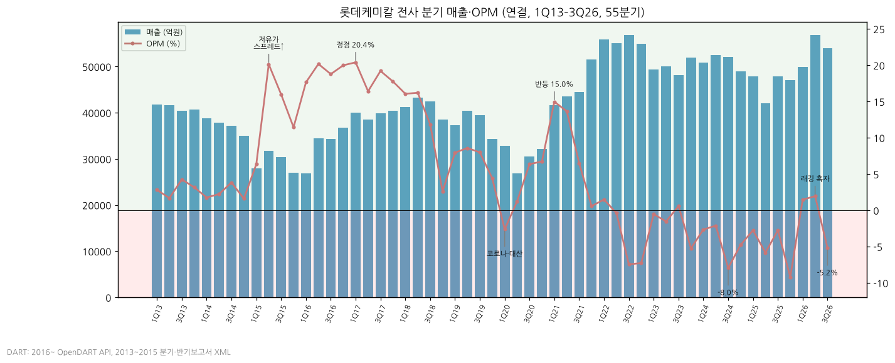

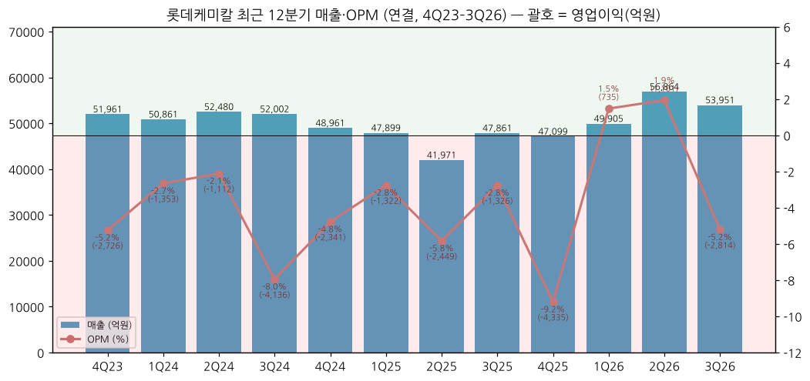

### ② 사업부별 개요 (매출 비중 큰 순서, 2025 DART 부문 매출 기준)

| 사업부 | 2025 매출(부문간 포함) | 비중 | 2025 영업이익 | 주요 제품 | 주요 법인 |
|---|---|---|---|---|---|
| 기초화학 | 12.48조 | 62.4% | -8,577억 | 에틸렌·프로필렌·BTX·PE·PP·EG·PIA·PET | 롯데케미칼 기초화학, LC Titan(75.86%), LC USA(90.34%) |
| 첨단소재 | 5.09조 | 25.4% | +1,237억 | ABS·PC·컴파운드·인조대리석·이스톤 | 롯데케미칼 첨단소재, 롯데엔지니어링플라스틱, 헝가리·튀르키예 법인 |
| 정밀화학 | 1.75조 | 8.8% | +744억 | ECH·가성소다·메셀로스·애니코트·암모니아 | 롯데정밀화학(44.06%) |
| 전지소재 | 0.68조 | 3.4% | -1,585억 | 동박(Elecfoil) | 롯데에너지머티리얼즈(46.94%), LBM USA |

(DART 사업보고서(2025.12) II-1·부문정보, 부문합 20.00조 대비 비중. 유효지분율 IR 3Q26)

### ③ 사업부별 디테일

**(1) 기초화학 — 스프레드·래깅이 전부**
→ CAPA (2025, 톤/년): 롯데케미칼 별도 NC 3,521천·PE 1,050천·PP 1,100천·BTX 955천·PIA 520천·PET 520천 / LC Titan NC 1,299천·PE 1,015천·PP 640천 / LC USA EL 1,000천·MEG 800천 [DART 사업보고서(2025.12) II-3]
→ 가동률 하락이 다운사이클을 보여줌: 별도 NC 87.8%(2023) → 81.0%(2024) → **73.0%(2025)**, LC Titan NC 63.8% → 55.2% → **45.0%**, PET 69.7% → 25.1%. 반면 에탄 기반 LC USA EL은 95.8%(2025) [DART 사업보고서(2025.12)]
→ 평균 판가 ($/톤): PE 969 → 938 → 861, PP 881 → 893 → 846, 벤젠 897 → 983 → 749 (2023→2025) [DART 사업보고서(2025.12) II-2]
→ 3Q26 원문 코멘트: "원료가 상승분의 제품 가격 반영 지연에 따른 스프레드 축소, 환율 하락 영향으로 수익성 감소" / 4Q26 전망: "글로벌 공급 부담 및 수요 회복 지연으로 약세 시황 지속 전망" [IR 3Q26]
→ **시사점**: 1H26 흑자는 원료가 급등기의 "긍정적 래깅"(싸게 산 원료로 비싸게 판매)이었고, 3Q26엔 반대로 원가 상승을 판가에 못 옮기며 스프레드 영향 약 -4,900억, 재고평가손실 환입 +2,800억, 환율·운임 -800억 [새경제 2026-11-06] — 이익의 방향이 유가 경로에 따라 분기마다 뒤집히는 구조
→ 1Q26 컨퍼런스콜 원문: (CFO 성낙선) 중동 리스크로 원료가가 오르며 긍정적 래깅이 발생 / (기초소재 곽희섭 상무) 역래깅 시점 예측은 "성급하다", "제품 가격은 전쟁 전보다 높고 스프레드도 전쟁 전 대비 개선" [MTN 2026-05-11] → 시사점: 회사도 1H26 개선을 구조적 회복이 아닌 일시적 효과로 인식

**(2) 첨단소재 — 유일한 흑자 버팀목, 그러나 범용 수지 비중 73%**
→ 2025 매출 5.09조: ABS 36.3%·PC 37.2%·기타(건자재 등) 26.5% [DART 사업보고서(2025.12) II-2]. 평균 판가 ABS $1,303 → 1,201, PC $1,821 → 1,528 (2023→2025)
→ IR 분기 OPM 1.0%(3Q22) \~ 11.5%(2Q26), 3Q26 -1.4%로 2019 이후 첫 적자 [IR]. 원문: "스프레드 축소 및 부정적 래깅 효과, 환율 하락 영향으로 수익성 감소" / 전망: "주요 제품 판매량 증가 및 점진적 개선 예상되나, 환율 하락 및 운임 상승 부담 지속" [IR 3Q26]
→ 투자: 율촌(순천/광양) LEP 컴파운딩 50만톤(투자 3,061억), 2026-09부터 24개 라인 전량 가동 [IR 3Q26, 머니투데이 2026-11-06]

**(3) 롯데정밀화학 — 염소·셀룰로스 계열, 2026 개선**
→ 분기 영업이익 1,295억(2Q22 정점) → 87억(2Q25) → 619억(2Q26) → 220억(3Q26). 원문(3Q26): "주요제품 국제가 및 환율 하락, 매출량 감소 등으로 매출액 및 영업이익 감소" / 전망: "계절적 비수기 도래 및 환율 약세 영향 지속되며 약보합" [IR 3Q26]. ECH 평균가 $1,211 → 1,428 (2023→2025) [DART]. TMAC(반도체 현상액 원료) 9천톤 증설 130억, 2028-2H [IR 3Q26]

**(4) 롯데에너지머티리얼즈 — 동박, 2024-3Q 이후 적자**
→ 분기 매출 2,627억(2Q24) → 1,437억(3Q25) → 2,897억(3Q26, QoQ +49.2%), 영업손실 -460억(1Q25) → -213억(3Q26). 원문: "북미 ESS 및 글로벌 EV 고객향 판매량 증가로 매출 확대 및 수익성 소폭 개선" / 전망: "북미 ESS·EV 수요 확대 및 말레이시아 신규 라인 가동되며 판매량 및 수익성 점진적 개선" [IR 3Q26]
→ 2025 전지소재 부문 영업손실 -1,585억 [DART 부문정보] — 인수(2022-10 계약) 당시 기대했던 성장축이 아직 이익 기여 못 함

**(5) 수소에너지 (신사업)**: 롯데SK에너루트 연료전지 발전 20MW 2기(2025-05·2026-01) + 40MW(2026-2H), 총 투자 3,830억 중 롯데 486억 [IR 3Q26 Appendix]

### ④ 주요 경쟁사 (사업부별)

| 사업부 | 국내 | 해외 |
|---|---|---|
| 기초화학 (NCC·PE·PP) | LG화학, 한화토탈에너지스, 여천NCC(한화솔루션·DL), SK지오센트릭, 대한유화, S-Oil(샤힌) | 중국 Sinopec·PetroChina·민영 대형 석화(Rongsheng·Hengli 등), 중동 SABIC, 미국 Dow·LyondellBasell·ExxonMobil |
| 첨단소재 (ABS·PC) | LG화학(ABS 세계 1위권), 금호석유화학(ABS), 삼양사(PC) | 중국 ABS·PC 신증설사, SABIC(PC), Covestro(PC), Chi Mei(ABS) |
| 정밀화학 (ECH·셀룰로스) | 한화솔루션(가성소다) | Dow·Shin-Etsu(셀룰로스), 중국 ECH사 |
| 전지소재 (동박) | SK넥실리스, 솔루스첨단소재 | 중국 동박사(Nuode·Jiayuan 등) |

(경쟁사 목록은 산업 일반 정보 기준 — DART 사업보고서는 경쟁사 실명을 공시하지 않아 이번 버전은 미검증, 다음 버전에서 각 사 공시로 교차 확인)

### ⑤ 주요 매출처

- DART: **"영업특성상 연결실체 매출액의 10% 이상을 차지하는 주요 고객은 없음"** [DART 사업보고서(2025.12) 부문정보] — 범용 석화제품을 다수 가공업체·트레이더에 판매
- 지역별 매출 (2025, IR, 주요 자회사 단순합산): 한국 32% · 아시아태평양 27% · 중국 16% · 유럽/아프리카 13% · 미주/중동 12% [IR 3Q26 Appendix]. 부문 외부매출 고객 소재지 기준 국내 6.52조·중국 3.15조·유럽 2.23조·미국 1.57조 (2025) [DART 부문정보]
- 제품별 (IR, 2025 전체): ABS/PC 21% · NC/BTX 15% · PE 12% · PP 11% · EO/EG 6% · BD/SM 5% · PTA/PET 4% · 기타(정밀화학·LEM 포함) 26%

### ⑥ 생산 CAPA + 임직원

| 법인 | 품목 | CAPA(천톤) | 2023 가동률 | 2024 | 2025 |
|---|---|---|---|---|---|
| 롯데케미칼 별도 | NC(에틸렌 등) | 3,521 | 87.8% | 81.0% | 73.0% |
|  | PE | 1,050 | 93.4% | 88.8% | 80.1% |
|  | PP | 1,100 | 92.2% | 88.5% | 82.4% |
|  | BTX | 955 | 70.0% | 54.3% | 53.3% |
|  | PIA | 520 | 85.5% | 72.5% | 69.7% |
|  | PET | 520 | 69.7% | 47.2% | 25.1% |
| LC Titan | NC | 1,299 | 63.8% | 55.2% | 45.0% |
|  | PE | 1,015 | 80.5% | 74.4% | 64.1% |
|  | PP | 640 | 66.3% | 57.4% | 42.8% |
| LC USA | EL(에탄크래커) | 1,000 | 85.7% | 55.6% | 95.8% |
|  | MEG | 800 | - | 96.0% | 75.7% |

(DART 사업보고서(2025.12) II-3. 2026-09 대산 NC(110만톤)는 H&L Advanced로 이관되어 3년 내 가동 중단 예정 [MTN 2026-09-01]. 별도 직원 4,349명(2025말) — 연도별 시계열은 다음 버전 보강)

---
## 4. 재무 구조 (12년 시계열)

> 출처: OpenDART fnlttSinglAcntAll 연결 (2014 = 2015 사업보고서 전기 컬럼). 단위 억원(손익·CF), 조원(BS). 감가상각비: 2014\~2022 연결 CF 조정항목(감가상각비+무형자산상각비), 2023\~2025 DART 부문정보 "감가상각비 및 무형상각비" 연결 합계(사용권자산 포함 추정). EBITDA = 영업이익 + 감가상각비 [계산]

### ① 손익계산서 (12년 연결, 억원)

| 연도 | 매출 | 매출총이익 | GPM | 판관비 | CIR(판관비/매출) | 영업이익 | OPM | EBITDA | 세전이익 | 순이익 | NPM | 지배순이익 | EPS(원) |
|---|---|---|---|---|---|---|---|---|---|---|---|---|---|
| 2014 | 148,590 | 8,004 | 5.4% | 4,495 | 3.0% | 3,509 | 2.4% | 8,426 | 2,773 | 1,437 | 1.0% | 1,469 | 4,359 |
| 2015 | 117,133 | 20,670 | 17.6% | 4,559 | 3.9% | 16,111 | 13.8% | 20,988 | 14,214 | 9,907 | 8.5% | 9,925 | 29,458 |
| 2016 | 132,235 | 32,667 | 24.7% | 7,225 | 5.5% | 25,443 | 19.2% | 31,734 | 24,874 | 18,372 | 13.9% | 18,358 | 54,488 |
| 2017 | 158,745 | 37,926 | 23.9% | 8,629 | 5.4% | 29,297 | 18.5% | 36,209 | 30,847 | 22,846 | 14.4% | 22,439 | 65,625 |
| 2018 | 165,450 | 27,528 | 16.6% | 7,854 | 4.7% | 19,674 | 11.9% | 26,524 | 22,527 | 16,419 | 9.9% | 15,792 | 46,074 |
| 2019 | 151,235 | 19,147 | 12.7% | 8,075 | 5.3% | 11,073 | 7.3% | 18,388 | 12,486 | 7,567 | 5.0% | 7,150 | 23,833 |
| 2020 | 122,230 | 11,533 | 9.4% | 7,964 | 6.5% | 3,569 | 2.9% | 11,878 | 2,467 | 1,753 | 1.4% | 1,585 | 4,623 |
| 2021 | 181,205 | 24,639 | 13.6% | 9,283 | 5.1% | 15,356 | 8.5% | 23,372 | 19,023 | 14,256 | 7.9% | 13,457 | 39,260 |
| 2022 | 222,761 | 2,833 | 1.3% | 10,459 | 4.7% | -7,626 | -3.4% | 1,414 | -3,926 | 278 | 0.1% | 616 | 1,802 |
| 2023 | 199,464 | 7,813 | 3.9% | 11,290 | 5.7% | -3,477 | -1.7% | 8,249 | -4,523 | -392 | -0.2% | -500 | -1,199 |
| 2024 | 204,304 | 3,299 | 1.6% | 12,239 | 6.0% | -8,941 | -4.4% | 3,966 | -22,581 | -18,256 | -8.9% | -17,105 | -40,565 |
| 2025 | 184,830 | 2,620 | 1.4% | 12,051 | 6.5% | -9,431 | -5.1% | 2,897 | -27,100 | -24,762 | -13.4% | -20,371 | -48,311 |

(2022 GPM 1.3%·2024 1.6%·2025 1.4% — 매출총이익이 판관비도 못 덮는 구간. 2024 세전 -2.26조·2025 -2.71조에는 유형자산·영업권 손상 등 기타영업외비용(2025 1.43조) 포함 [OpenDART 2025 FY CIS]. 9M26: 매출 16.07조, 영업손실 -978억, 지배순손실 -143억 [DART 분기보고서(2026.09)])

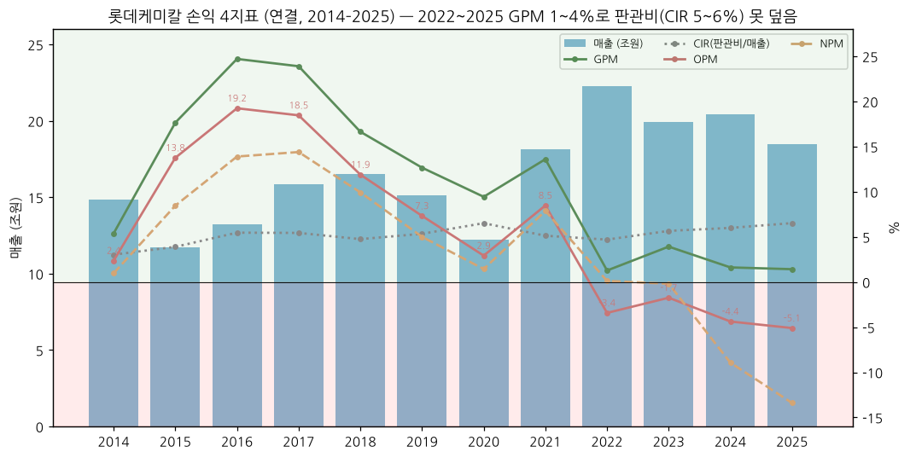

### ② 재무상태표 (12년 연결, 조원)

| 연도말 | 자산 | 유동자산 | 현금 | 재고 | 유형자산 | 부채 | 차입금·사채 | 리스부채 | 자본 | 지배지분 | 비지배지분 | 부채비율 |
|---|---|---|---|---|---|---|---|---|---|---|---|---|
| 2014 | 10.32 | 4.32 | 0.95 | 1.53 | 3.98 | 3.85 | 2.60 | 0.00 | 6.47 | 6.44 | 0.03 | 60% |
| 2015 | 11.47 | 5.41 | 1.94 | 1.16 | 3.96 | 3.91 | 2.41 | 0.00 | 7.56 | 7.52 | 0.03 | 52% |
| 2016 | 15.87 | 5.85 | 2.20 | 1.48 | 5.55 | 6.47 | 4.19 | 0.00 | 9.40 | 9.36 | 0.04 | 69% |
| 2017 | 19.55 | 8.23 | 1.69 | 1.54 | 6.72 | 7.30 | 4.20 | 0.00 | 12.25 | 11.49 | 0.77 | 60% |
| 2018 | 20.80 | 8.14 | 1.33 | 1.78 | 8.04 | 7.25 | 4.79 | 0.00 | 13.54 | 12.73 | 0.81 | 54% |
| 2019 | 20.04 | 7.22 | 1.35 | 1.68 | 7.51 | 5.99 | 3.50 | 0.13 | 14.05 | 13.20 | 0.85 | 43% |
| 2020 | 19.39 | 6.88 | 1.52 | 1.56 | 7.17 | 5.67 | 3.25 | 0.12 | 13.71 | 12.85 | 0.87 | 41% |
| 2021 | 22.87 | 9.43 | 1.60 | 2.79 | 7.50 | 7.42 | 3.55 | 0.12 | 15.45 | 14.41 | 1.04 | 48% |
| 2022 | 26.78 | 9.47 | 2.81 | 2.55 | 10.73 | 9.52 | 6.17 | 0.16 | 17.26 | 14.45 | 2.82 | 55% |
| 2023 | 33.48 | 9.81 | 2.70 | 2.80 | 14.27 | 13.24 | 9.83 | 0.19 | 20.23 | 15.54 | 4.69 | 65% |
| 2024 | 34.55 | 8.98 | 2.11 | 2.82 | 16.08 | 14.56 | 10.41 | 0.26 | 19.99 | 14.35 | 5.64 | 73% |
| 2025 | 31.12 | 7.99 | 1.87 | 2.91 | 14.59 | 13.49 | 9.40 | 0.22 | 17.63 | 12.58 | 5.04 | 77% |
| 3Q26 | 28.94 | 7.88 | 1.60 | 2.72 | - | 11.86 | 8.77 | 0.20 | 17.08 | 12.28 | 4.79 | 69% |

(차입금·사채 = 재무상태표 "차입금및사채" 등 차입 계정 합계 [계산]. 2022\~2024 차입금 6.17조 → 10.41조: LC USA·인니 LINE 프로젝트·일진머티리얼즈 인수(약 2.7조) 자금. 3Q26 차입금 8.77조로 감소 = 대산(롯데대산석화) 연결 제외 효과 — IB토마토는 "H&L어드밴스드가 공동기업으로 전환되면 연결 순차입금 약 1조 감소, 실제 현금 상환과는 다름" 지적 [IB토마토 2026-09-07]. IR 순차입금비율 38.0%(FY25) → 37.9%(3Q26) [IR 3Q26])

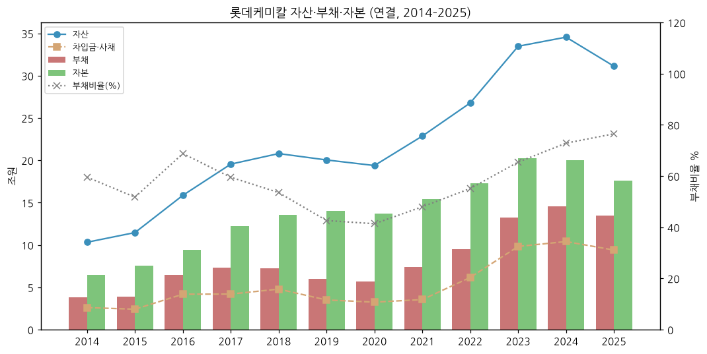

### ③ 현금흐름표 (12년 연결, 억원)

| 연도 | 영업CF | 투자CF | 재무CF | CapEx(유형+무형) | FCF(영업CF−CapEx) | 배당금 지급 |
|---|---|---|---|---|---|---|
| 2014 | 3,085 | -3,906 | 476 | 2,910 | 175 | 337 |
| 2015 | 25,956 | -12,735 | -3,339 | 3,639 | 22,318 | 337 |
| 2016 | 27,006 | -35,646 | 11,005 | 15,950 | 11,056 | 842 |
| 2017 | 31,290 | -47,176 | 11,145 | 20,226 | 11,065 | 1,348 |
| 2018 | 13,809 | -17,631 | 448 | 18,478 | -4,669 | 4,115 |
| 2019 | 12,779 | 6,624 | -19,000 | 10,353 | 2,425 | 3,967 |
| 2020 | 13,108 | -6,385 | -4,789 | 8,045 | 5,063 | 2,404 |
| 2021 | 14,862 | -14,584 | -71 | 7,753 | 7,109 | 1,593 |
| 2022 | -1,675 | -6,883 | 21,320 | 26,000 | -27,675 | 3,502 |
| 2023 | 7,895 | -50,746 | 41,957 | 36,458 | -28,562 | 1,897 |
| 2024 | 15,424 | -19,482 | -1,875 | 22,551 | -7,127 | 2,254 |
| 2025 | 4,889 | -5,810 | -1,488 | 16,346 | -11,457 | 832 |

(FCF 누적: 2015\~2021 +5.44조 → 2022\~2025 -7.48조 [계산]. 2026 상반기 영업CF -6,870억·FCF -1조149억 [IB토마토 2026-09-07])

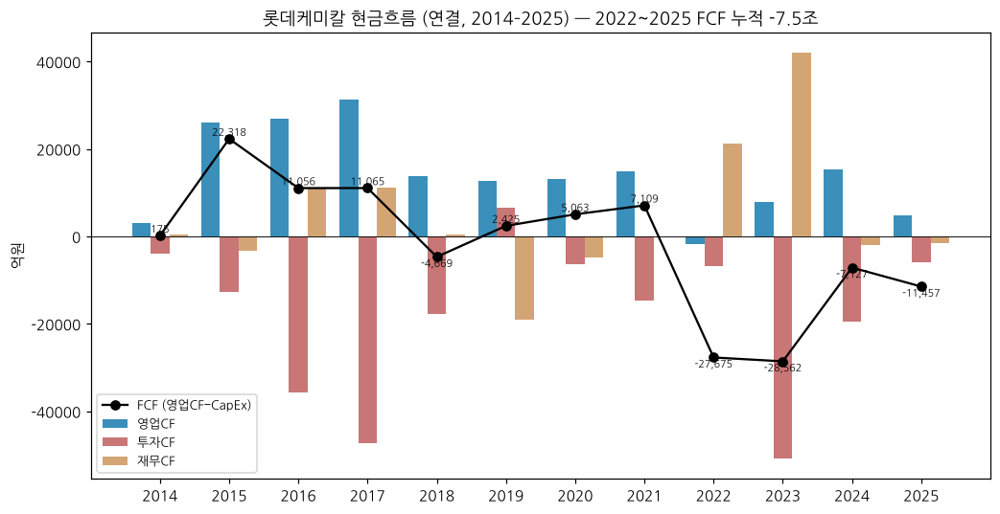

### ④ CapEx 추이 (12년, 억원)

| 연도 | 유형자산 취득 | 무형자산 취득 | 합계 | CapEx/매출 | 감가상각비 | CapEx/감가상각 | 사이클 annotation |
|---|---|---|---|---|---|---|---|
| 2014 | 2,910 | 0 | 2,910 | 2.0% | 4,916 | 0.6배 | 저점 — 투자 최소 |
| 2015 | 3,554 | 85 | 3,639 | 3.1% | 4,877 | 0.7배 |  |
| 2016 | 15,881 | 69 | 15,950 | 12.1% | 6,292 | 2.5배 | 업사이클 증설 개시(LC Titan·여수·LC USA) |
| 2017 | 20,199 | 27 | 20,226 | 12.7% | 6,912 | 2.9배 | LC USA ECC 건설 정점 |
| 2018 | 18,464 | 14 | 18,478 | 11.2% | 6,850 | 2.7배 |  |
| 2019 | 8,922 | 1,431 | 10,353 | 6.8% | 7,316 | 1.4배 | LC USA 가동 후 감소 |
| 2020 | 8,022 | 23 | 8,045 | 6.6% | 8,309 | 1.0배 | 코로나 긴축 |
| 2021 | 7,733 | 20 | 7,753 | 4.3% | 8,015 | 1.0배 |  |
| 2022 | 25,926 | 74 | 26,000 | 11.7% | 9,041 | 2.9배 | 다운사이클 진입에도 인니 LINE 투자 |
| 2023 | 36,400 | 58 | 36,458 | 18.3% | 11,726 | 3.1배 | CapEx 정점 3.6조 (LINE·LC USA·동박) |
| 2024 | 22,381 | 170 | 22,551 | 11.0% | 12,907 | 1.7배 |  |
| 2025 | 16,213 | 133 | 16,346 | 8.8% | 12,328 | 1.3배 | 긴축 — 자산 경량화 |

(2014 무형자산 취득 0.09억. 인니 LINE 프로젝트(라인 프로젝트, 총사업비 약 39억$) 등 개별 프로젝트 투자 분해는 이번 버전 미검증 — 다음 버전에서 사업보고서 "투자계획" 표로 보강)

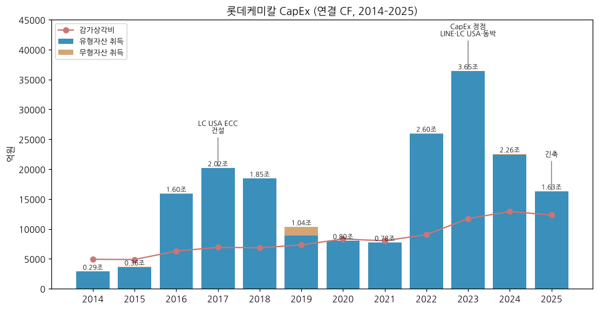

### ⑤ 부채구조 + 채무증권 발행 history

- 차입금·사채 (연결): 2.60조(2014) → 4.79조(2018) → 3.25조(2020) → **10.41조(2024, 정점)** → 9.40조(2025) → 8.77조(3Q26) [OpenDART, IR 3Q26]
- 2026-06말 총차입금 10조4,754억, 순차입금 8조2,698억, 현금성자산 2조2,056억, 순차입금의존도 25.2% (2025말 22.2%) [IB토마토 2026-09-07]
- **2024-11 재무특약(EOD) 이슈**: 공모 회사채에 "3개년 누적 EBITDA/이자비용 5배 이상" 특약 → 미달로 기한이익상실 사유 발생 → 2024-12-19 사채권자집회에서 14개 공모채 특약 조정(법원 인가 후 삭제) 가결, 롯데월드타워 담보로 은행 보증 추가. 당시 가용 유동성 약 4조(예금 약 2조 포함), 해외 자회사 지분 활용 약 1.3조 유동성 확보 계획 [뉴시스 2024-12-19]
- 등급 경로: 회사채 AA+(2023-02) → AA(2023-06) → AA/N(2024-06) → 보증사채 AAA(2025-01 수시) / 무보증 61-1·61-2회 AA-(2025-06) [DART 사업보고서(2025.12)]
- 2026-11: 회사채 8,000억 상환으로 롯데월드타워 담보 해지 보도 · H&L Advanced 신종자본증권 5,000억 보증 결정 보도 [마이데일리바이트 뉴스 요약 2026-11-24 — 원문 기사 미확인, 다음 버전 DART 공시로 확인 필요]

### ⑥ 배당·자사주 추이 (12년)

| 사업연도 | DPS(원) | 배당총액(억원) | 시가배당률 | 연결 배당성향 | 비고 |
|---|---|---|---|---|---|
| 2014 | 1,000 | 337 | 0.59% | 22.9% |  |
| 2015 | 2,500 | 842 | 1.04% | 8.5% |  |
| 2016 | 4,000 | 1,348 | 1.14% | 7.3% |  |
| 2017 | 10,500 | 3,599 | 2.89% | 16.0% | DPS 정점 (2017·2018 10,500원) |
| 2018 | 10,500 | 3,599 | 3.66% | 22.8% |  |
| 2019 | 6,700 | 2,296 | 2.88% | 32.1% |  |
| 2020 | 3,600 | 1,234 | 1.37% | 77.9% | 코로나·대산 사고 |
| 2021 | 8,300 | 2,845 | 3.65% | 19.6% |  |
| 2022 | 3,500 | 1,190 | 2.00% | 427.6% | 유상증자 후 주식수 42.78백만주 |
| 2023 | 3,500 | 1,476 | 2.25% | - | 연결 순손실에도 3,500원 유지 |
| 2024 | 2,000 | 843 | 3.64% | - | 중간배당 1,000원 포함 |
| 2025 | 1,000 | 422 | 1.27% | - | 중간배당 500원 포함, 감배 |

(DART 사업보고서 배당에 관한 사항 (2015.12·2018.12·2021.12·2024.12·2025.12) — 배당총액은 DART 현금배당금총액(백만원)을 억원 환산. 배당정책: "별도 손익 기준 배당성향 30% 지향" [IR 3Q26]. 2026 중간배당 500원 [IR 3Q26]. 자기주식 608,272주 보유(신탁 취득분, 2025 변동 없음) [DART 자기주식 현황]. 2022·2023 CF상 자기주식 취득 497억·500억은 연결 종속회사 관련으로 추정 (지배기업 자사주 수 변동 없음) — 다음 버전 확인)

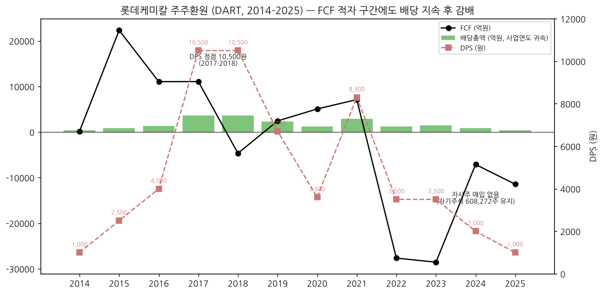

### ⑦ 재무 비율 (12년)

| 연도 | ROE(지배) | ROA | 부채비율 | 유동비율 | 순차입금/EBITDA | 이자보상배율(영업이익/이자지급) |
|---|---|---|---|---|---|---|
| 2014 | 2.3% | 1.4% | 60% | 210% | 1.9배 | 4.0배 |
| 2015 | 14.2% | 9.1% | 52% | 252% | 0.2배 | 23.0배 |
| 2016 | 21.7% | 13.4% | 69% | 170% | 0.6배 | 30.9배 |
| 2017 | 21.5% | 12.9% | 60% | 217% | 순현금 | 32.4배 |
| 2018 | 13.0% | 8.1% | 54% | 206% | 0.1배 | 28.7배 |
| 2019 | 5.5% | 3.7% | 43% | 264% | 0.3배 | 11.4배 |
| 2020 | 1.2% | 0.9% | 41% | 240% | 0.1배 | 3.6배 |
| 2021 | 9.9% | 6.7% | 48% | 206% | 0.1배 | 29.3배 |
| 2022 | 0.4% | 0.1% | 55% | 148% | 21.3배 | -6.8배 |
| 2023 | -0.3% | -0.1% | 65% | 150% | 8.2배 | -1.0배 |
| 2024 | -11.4% | -5.4% | 73% | 106% | 20.8배 | -2.0배 |
| 2025 | -15.1% | -7.5% | 77% | 104% | 25.7배 | -2.3배 |

(ROE·ROA 평균잔액 기준 [계산]. 순차입금 = 차입금·사채 − 현금 − 단기금융상품(BS 계정 기준이라 IR 순차입금과 차이). 2014 ROE는 2013 기초자본 사용)

---

## 5. 지배 구조

### ① 그룹·계열 관계

- 기업집단 **롯데** 소속 (공정거래법상 계열회사, 2018말 국내 92개사) [DART 사업보고서(2018.12)]. 동일인 신동빈 회장 — 롯데케미칼 대표이사 겸임 (재직 21.6년, 임기 2027-03) [DART 사업보고서(2025.12) VIII]
- 지분 구조: 롯데지주 25.31% · 롯데물산 20.00% · LOTTE Holdings(일본) 9.19% · 롯데문화재단 0.03% · 임원 소량 → 특수관계인 54.58% [DART 사업보고서(2025.12)]
- 롯데그룹 유동성 연계: 2024-11 그룹 상징 롯데월드타워(롯데물산 소유)를 롯데케미칼 회사채 보증 담보로 제공 [뉴시스 2024-11-29·12-19] → 계열 신용이 롯데케미칼 재무에 직접 연결된 구조. 한 언론은 "케미칼 신용등급 내리면 물산·캐피탈도 동반 강등" 우려 보도 (다음/한국경제TV, 제목 기준)
- 주요 종속·공동기업 (유효지분, 2026-09말) [IR 3Q26]: 종속 — LBM USA 100%, LC USA 90.34%, LC Titan 75.86%, 롯데에너지머티리얼즈 46.94%(실질지배), 롯데정밀화학 44.06%(실질지배) / 공동기업 — H&L Advanced 50%, 롯데베르살리스엘라스토머스 50%+1주, 롯데지에스화학 50%, 롯데엠시시 50%, 한덕화학 50%, Kor-UZ Gas Chemical 49% / 관계 — 롯데SK에너루트 45%, 롯데건설 44.02%, 롯데에어리퀴드에너하이 40%

### ② 주주 구분

| 주주 | 지분율 (2026-09말, IR) |
|---|---|
| 특수관계인 합계 | 56.03% |
| ├ 롯데지주㈜ | 25.31% |
| ├ 롯데물산㈜ | 20.00% |
| ├ LOTTE Holdings(일본) | 9.19% |
| ├ 롯데문화재단 | 0.03% |
| 자기주식 | 1.46% |
| 외국인 | 8.10% |
| 기타(국내 기관·개인) | 34.4% [계산] |

(IR 3Q26 Appendix. IR 특수관계인 56.03%는 자기주식 포함 등 산정 기준 차이로 DART 54.58%와 다름. 외국인 지분율 8.10%는 2018 IR 당시 Free Float 46.7% 대비 크게 축소 — 외국인 시계열은 KRX 데이터로 다음 버전 보강)

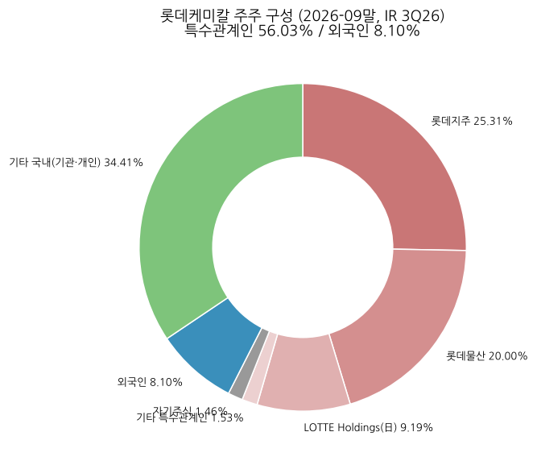

### ③ 임원·이사회

- 사내이사(대표이사): **신동빈** (1955년생, 회장, 콜럼비아대 MBA), **이영준** (1965년생, 화학군 PSO 총괄대표·기초소재 대표 겸임, 전 롯데첨단소재 PC사업본부장·제일모직 여수사업장 공장장, KAIST 고분자공학 박사, 임기 2029-03), **주우현** (1972년생, 첨단소재 대표, 전 롯데지주 경영개선팀장·롯데정밀화학 경영본부장) [DART 사업보고서(2025.12) VIII]
- 사내이사 **성낙선** (CFO, 화학군 PSO 재무혁신본부장)
- 대표이사 변동: 김교현 (2023-12 사임) → 이훈기·황진구 (2024-12 사임) → 황민재 (2025-03 선임, 2025-11 사임) → 2026-03 주총에서 이영준·성낙선 재선임, 주우현 신규 선임 안건 [DART 사업보고서(2025.12) I-2] — 4년 적자 동안 경영진 교체가 잦았음
- 이영준 대표: 석유화학 구조조정 공로로 은탑산업훈장 수훈 (2026-11 보도) [마이데일리바이트 뉴스 요약]

---

## 6. 기타 팩트

### ① R&D 인프라

| 연도 | 연구개발비(억원) | 매출 대비 |
|---|---|---|
| 2014 | 399 | 0.27% |
| 2015 | 527 | 0.45% |
| 2016 | 636 | 0.48% |
| 2017 | 917 | 0.58% |
| 2018 | 924 | 0.56% |
| 2019 | 846 | 0.56% |
| 2020 | 800 | 0.65% |
| 2021 | 925 | 0.51% |
| 2022 | 1,024 | 0.46% |
| 2023 | 1,204 | 0.60% |
| 2024 | 1,482 | 0.73% |
| 2025 | 1,351 | 0.73% |

(DART 사업보고서 연구개발활동 (2015.12·2018.12·2021.12·2023.12·2024.12·2025.12). R&D/매출 0.3\~0.7% — 범용 장치산업 특성상 낮음. 2025 연구과제는 이차전지 분리막용 HDPE/PP, 초고분자량 PE, PCR(재활용) PP(국내 최초 FDA NOL), 기체분리막 탄소포집 등 스페셜티·친환경 중심 [DART 사업보고서(2025.12) II-6])

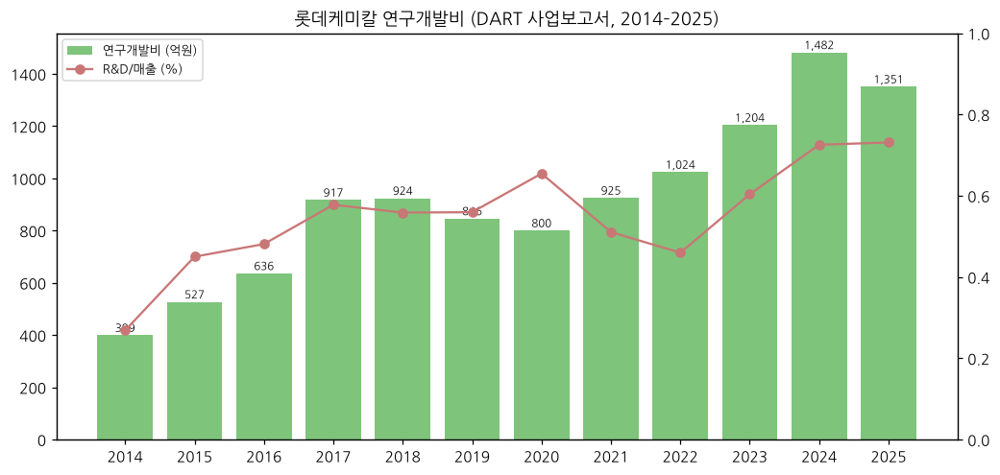

### ② 진행 중 corporate action — 10년치 주요 이벤트

| 시점 | 이벤트 | 출처 |
|---|---|---|
| 2016-02·04 | 롯데정밀화학·롯데첨단소재 인수 (삼성 화학 계열) | DART 사업보고서(2018.12) |
| 2020-01 | 롯데첨단소재 흡수합병 | DART 사업보고서(2021.12) |
| 2021-07 | 데크항공 지분 100% 매각 | DART 사업보고서(2025.12) |
| 2022-10\~2023-03 | 일진머티리얼즈 인수 → 롯데에너지머티리얼즈 | DART 사업보고서(2025.12) |
| 2022-11 | 유상증자 850만주 | DART 주식총수 |
| 2023 | 중국 삼강낙천화공(6월)·낙천화학 가흥(9월) 매각, 케이피켐텍 청산(11월) | DART 사업보고서(2025.12) |
| 2024-12 | 사채권자집회·롯데월드타워 담보 은행보증 | 뉴시스 2024-12-19 |
| 2025-02-19 → 11-12 | LC Pakistan 75.01% 매각 결정 → 완료 | DART 사업보고서(2025.12) |
| 2025-4Q | 롯데지에스화학 공동기업 전환 | IR 3Q26 |
| 2026-02 | 롯데·HD현대 대산 재편안 정부 승인, 정부 2.1조 지원 패키지 | 서울신문 2026-02-26, MTN 2026-09-01 |
| 2026-06-01 | 대산공장 물적분할 → 롯데대산석화 | MTN 2026-06-01 |
| 2026-09-01 | H&L Advanced 출범 (50:50, 대산 NCC 110만톤 3년 내 중단, 양사 1.2조 추가 출자 예정) | MTN 2026-09-01 |
| 2026-07-22 | 여수 재편 승인 — 여천NCC 2·3공장 중단(에틸렌 139만톤 감축), 1공장+롯데 여수 통합법인(롯데·한화·DL 1/3씩), 2027-1H 목표 | 서울신문 2026-07-22, 머니투데이 2026-11-06 |

### ③ 기술·설비 마일스톤 — 10년치

- 2019 LC USA 에탄크래커(에틸렌 100만톤·EG 70만톤, 총사업비 약 $31억, Westlake 90:10 합작) 가동 [DART 사업보고서(2018.12)·IR]
- 2026-09 율촌 LEP 컴파운딩(ABS·PC 50만톤, 3,061억) 24개 라인 전량 가동 [IR 3Q26, 머니투데이 2026-11-06]
- 수소: 울산 연료전지 20MW(2025-05)·20MW(2026-01)·40MW(2026-2H) [IR 3Q26]
- 롯데에너지머티리얼즈 말레이시아 신규 동박 라인 가동 예정 [IR 3Q26]

### ④ 주요 리스크

(1) **스프레드·래깅 리스크** — 3Q26 스프레드 축소만으로 약 -4,900억 [새경제 2026-11-06]. 중동 정세·유가 경로에 따라 분기 이익이 ±수천억 흔들림
(2) **중국·중동 증설 + 국내 샤힌** — 회사 추정 글로벌 에틸렌 신증설 1,000\~1,100만톤, S-Oil 샤힌 가동으로 "단기 급반등 어렵다" [머니투데이 2026-11-06]
(3) **재무·신용** — 차입금 8.77조, 무보증 AA-, 2026 상반기 FCF -1조 [IB토마토 2026-09-07]. 석화업계 2026 상반기 신용등급 상향 0곳 [머니투데이 2026-07-23 제목]
(4) **구조조정 실행·우발채무** — H&L Advanced 신종자본증권 5,000억 보증(보도), 1.2조 추가 출자, 여수 통합법인 공정위 심사 [MTN 2026-08-21 제목: "대산·여수 구조조정에 롯데케미칼 지분 연결…공정위 협조 우려"]
(5) **그룹 신용 연계** — 롯데월드타워 담보·계열 동반 강등 우려 [뉴시스 2024-11-29]
(6) **손상 리스크** — 2024·2025 대규모 손상 선례 (2025 기타영업외비용 1.43조), LC Titan 가동률 45% [DART]
(7) **환율** — 3Q26 원화 강세(환율 하락)가 기초화학·첨단소재·정밀화학 공통 감익 요인으로 명시 [IR 3Q26]. 수출 비중이 높아 원/달러 하락 = 마진 축소

### ⑤ ESG 등급

- 이번 버전에서는 지속가능경영보고서·MSCI/KCGS 등급을 확보하지 못함 (WebFetch 사용 한도 소진) — **다음 버전 보강 필수**
- 사업보고서상 기체분리막 탄소포집·PCR 재활용 소재·수소 사업을 친환경 전략으로 제시 [DART 사업보고서(2025.12) II-6]

### ⑥ 인증·라이선스

- PCR PP 국내 최초 FDA NOL 인증 [DART 사업보고서(2025.12) II-6]. 지적재산권 등록 1,133건(국내특허 745·해외특허 188, 2018말) [DART 사업보고서(2018.12)]

---

## Version Log

- **2026-11-28 v1.0 통합 검수**: 정유·화학 6사(S-Oil·SK이노베이션·LG화학·롯데케미칼·금호석유화학·한화솔루션) 병렬 작성 후 교차 검수 — 1장 ④-1 '정유·화학 6사 공통 비교 박스'(보통주 시총·PBR·PER·EV/EBITDA 통일 정의) 6문서 동일 삽입

- **v1.0 (2026-11-25)**: 첫 작성 — Phase 1 source 점검 (OpenDART 재무 JSON 44개(2015 FY\~3Q26, 2015 1Q\~3Q·2026 FY는 미제공), 정기공시 XML 64건 보유·16건 본문 파싱, 기업개황·주주·임원·직원·배당·자기주식·주식총수, IR PDF 31건(3Q18\~3Q26), Yahoo 월간·일간, 네이버 일별 300거래일, 언론) + v4.8 6개 섹션 + 차트 16종 (12종 표준 + chart2 부문 4종(기초화학·첨단소재·정밀화학·에너지머티리얼즈) + chart13 전사 55분기)
- **데이터 처리 결정**: ① 연간은 각 연도 사업보고서 당초 보고치(2024·2025 재작성은 주석) ② 분기 1Q = 반기 누적 − 2Q (재작성 반영), 4Q = 연간 − 3Q 누적 ③ 1Q13\~4Q15 분기는 분기·반기보고서 XML 3개월 컬럼 ④ 부문은 IR 수치, 기초화학 = 기초소재+LC Titan+LC USA로 2017\~2023 소급 합산 ⑤ 2022-11 이전 주가 = Yahoo × 1.0437 (2018-03-02 원주가 역산) ⑥ 2026-11-24 종가는 네이버(43,250원) 채택 — Yahoo 일봉(44,450원)과 불일치 ⑦ 감가상각비 2023\~2025는 부문정보 합계 사용
- **source audit 메모**: device_bash 소켓 오류(listen EIO)로 컨테이너에서 작업 후 device_commit_files로 기록. WebFetch 5시간 한도 소진으로 지속가능경영보고서·ESG·일부 언론 원문 미확보
- 잔여 보완 후보: ① 1Q12\~4Q12 분기(2012\~2013 분기보고서 XML 추가 수집) → 60분기 표준 충족 ② 2017\~2018 부문 매출(IR 차트 이미지 → OCR) 및 2014\~2016 부문 손익(사업보고서 부문정보 재파싱) ③ 지속가능경영보고서·MSCI/KCGS ESG 등급 ④ 외국인 지분율 시계열(KRX) ⑤ 상장 자회사(롯데정밀화학·LEM·LC Titan) 시가 SOTP ⑥ 글로벌 피어(Dow·LYB·SABIC) 수치 검증 ⑦ 2026-11 회사채 8,000억 상환·월드타워 담보 해지·H&L 신종자본증권 보증 DART 공시 확인 ⑧ 인니 LINE 프로젝트 투자·가동 현황 ⑨ 연도별 임직원 시계열 ⑩ 정유·화학 6사(S-Oil·금호석유화학·SK이노베이션·LG화학·한화솔루션) 기업개요와 분류·밸류 프레임 정합성 통합 검수