> 종목: 삼성SDI (006400.KS / 삼성SDI 주식회사 / SAMSUNG SDI CO., LTD., DART corp_code 00126362)
> 섹터: 배터리 (워치리스트 섹터 T2) / 서브섹터: 배터리 셀
> 작성 시각: 2026-11-14 KST (**v1.0** — 첫 작성. source 6종 전수 점검 후 완성본)
> 적용 구조: v4.8 (6개 섹션 + 12종 차트 표준, chart2는 2·2b·2c·2d·2e 5종 분할 — 2e는 AMPC 포함/제외 영업이익)
> 데이터: 12년 연결 연간(2014~2025, OpenDART) + 63분기 연결(1Q11~3Q26, 회사 IR·OpenDART) + **49분기 사업부별 매출(3Q14~3Q26) + 27분기 사업부별 영업이익(1Q20~3Q26, 회사 IR)** + DART 영업부문 연간(2014~2025) + AMPC 7분기(1Q25~3Q26) + 20년 Yahoo 시가총액
> 출처: **DART 사업보고서 2025(rcept 20260310002954, 최우선 정성자료)·2024(20250311001275)·2023(20240312000853)·2022 정정(20230313000726)·2021(20220308000915)·2020(20210309000252)·2019(20200330003729)·2018(20190329003979)·2017 첨부정정(20180330001740)·2016·2015 정정(20160630000416)·2014 정정(20150527000239), 반기보고서 2026.06(20260814003578)** / OpenDART 전체재무제표 연결(CFS) 2015~2Q26 / OpenDART 2025 FY 최대주주·임원·직원·배당·자기주식·주식총수 / **회사 IR 실적발표 PDF 61건(1Q11~3Q26, 최신 3Q26 = 2026-10-29)** / 삼성SDI 지속가능경영보고서 2026 / BT `earnings-review/2026-Q1·Q2_삼성SDI_리뷰.md` / Yahoo Finance v8 006400.KS 월간 25년·일간 2년(2026-11-13 종가) / 시장 보조: 삼성SDI IR 주가 페이지(외국인 지분율), SNE리서치(점유율), stockanalysis(피어 멀티플)
> **Fact verify cutoff**: 2026-11-14 (시가총액·ATH·외국인 지분율·글로벌 점유율·피어 멀티플 — 각 항목에 기준일 별도 표기)

# 삼성SDI 기업 개요 (v1.0 — 배터리 T2, 각형 EV·ESS 중심 2차전지 + 반도체·디스플레이 소재)

> ⚠️ **시계열 단절 5회 — 모든 표·차트 해석 시 주의**
> ① **2014.07.01** (구)제일모직 흡수합병 → 케미칼·전자재료 부문 편입(합병신주 보통주 23,206,189주). 같은 날 **PDP 사업 중단**(1H14 PDP·태양광 중단영업 재작성 → 2014 연간 매출 54,742억은 1~2Q 당시 보고 합과 불일치)
> ② **2016.02~04** 케미칼 부문 물적분할(에스디아이케미칼) → 지분 90% 롯데케미칼 매각 완료(2016.04.29). 2015년은 2016 사업보고서에서 케미칼 중단영업 재작성(75,693 → **49,549억**, OP -598 → **-2,675억**). 2016 순이익엔 매각이익(중단영업 1조 896억) 포함
> ③ **2024~2025** 전자재료 **편광필름 사업 양도**(2024 매각예정 분류 → 2025 매각 완료). 2023년을 재작성(227,083 → **214,368억**, OP 16,334 → **15,455억**), 2024·2025 사업보고서 사업부 매출·R&D 모두 편광필름 제외
> ④ **2026.08** GM 합작법인(SDI-GM Synergy Cells, 인디애나) GM 지분 전량 인수(8/11, 단독 체제) + **삼성디스플레이(SDC) 지분 1/3(1,308만주, 주당 34만원, 4.45조) 매각(8/27 완료)** → 3Q26 투자자산 14.1조 → 8.5조, 지분법이익 축소 구조 전환
> ⑤ **3Q26 IR 매출 재작성** — 3Q25·4Q25·1Q26·2Q26 매출이 +196·+798·+804·+1,077억 상향(영업이익 불변). 차이가 각 분기 AMPC와 일치 → **AMPC를 매출로 표시하는 계정 변경으로 추정**(회사 미공시, ⚠️추정). 본 리포트 분기표는 DART(구기준)와 IR(신기준)을 병기

---

## ① 기업 분류

(1) Primary / Secondary 분류

**⚠️ Boundary Case — 정량 룰은 강한 사이클, 매출 축은 EV 사이클에서 ESS(전력·AI 데이터센터) 성장으로 이동 중**

12년 OPM range -17.8%(2016)~+9.0%(2022) = **+26.8%pt (cutoff ±10%pt의 2.7배)** → 정량 룰상 사이클. 진폭의 원인은 ① 2016 케미칼 매각·소형전지 손상·Note7 리콜, ② 2024~2025 전기차 캐즘(EV 가동률 급락) — 두 번 모두 **배터리 부문 이익이 전사 이익을 좌우**한 결과다.

**Primary 분류: 사이클 (EV 수요·고객 OEM 생산 사이클 + 설비 가동률 레버리지)**

→ 배터리 부문 매출 비중 **94%(2026 상반기, DART)** — EV·ESS·소형전지 모두 고정비가 큰 장치산업으로 가동률에 따라 OPM이 출렁임

→ 배터리 OPM 4Q22 6.7% → 3Q25 **-22.2%** → 3Q26 **+8.2%** (회사 IR, 신기준) — 3년 내 30%pt 진폭

**Secondary 노트: 고성장 (미국 ESS·AI 데이터센터 BBU secular)**

→ 2026년 북미 ESS 수주 **60GWh+** 확보, SPE(스텔란티스 JV)·울산 라인은 2028년까지 가동 물량 확보 (회사 3Q26 컨콜, 비즈워치 2026-10-29)

→ 3Q26 배터리 매출 4.41조(YoY +55.3%) 성장 동력은 ESS·BBU(배터리 백업 유닛)·전동공구·EV 원형 (회사 IR p.4, 뉴스토마토 2026-10-29)

**Entity 구조 (2026.06말, DART 반기보고서 — 연결 종속회사 22개, 상장 0)**

→ **(1) 배터리 = 에너지솔루션** (매출 94%) — 중대형(EV 각형 P5·P6, ESS SBB·UPS) + 소형(원형 전동공구·BBU·e-mobility, 파우치 IT). 브랜드 PRiMX

→ **(2) 전자재료** (매출 6%) — 반도체 소재(EMC·SOH·CMP 슬러리), 디스플레이 소재(OLED 증착소재, 폴더블 접착소재 FOCA, QD Ink), Novaled(독일)

→ **(3) 지분법 투자** — 삼성디스플레이 **15.2% → 약 10.2%**(2026.08 매각 후, 6월말 장부 13.83조), 에코프로이엠 40%(양극재 JV) 등

→ **(4) 북미 JV** — StarPlus Energy(스텔란티스 FCA US, SDI 51% 연결, 인디애나 코코모), SDI-GM Synergy Cells(2026.08 단독 전환, 인디애나 뉴칼라일)

(2) Summary Box (12년 연결 시계열 + 사이클 통계)

| 지표 | 12년 평균 (2014~2025) | 정점 | 저점 | 2025년 |
|---|---|---|---|---|
| 매출 (연결, 억원) | 113,467 | **227,083 (2023)** | 52,008 (2016) | **132,667** |
| 영업이익 (연결, 억원) | 4,333 | **18,080 (2022)** | -17,224 (2025) | **-17,224** |
| 지배순이익 (억원) | 6,401 | **20,092 (2023)** | -6,495 (2025) | **-6,495** |
| OPM (연결, %) | 1.3% | **9.0% (2022)** | -17.8% (2016) | **-13.0%** |

```
[삼성SDI 12년 연결 손익 시계열 (억원, DART 당시 보고 기준)]
연도      매출        OP      OPM    지배NI
2014     54,742       708     1.3%     -838   ← 7월 제일모직 합병(케미칼·전자재료 편입), PDP 철수(중단손실 2,324)
2015     75,693      -598    -0.8%      538   ← 케미칼 포함 마지막 해 (재작성 49,549 / -2,675)
2016     52,008    -9,263   -17.8%    2,194   ← OPM 12년 최저 — 저점① (1Q16 소형전지 손상 -7,038, 4Q Note7 리콜), 케미칼 매각이익 1.09조
2017     63,216     1,169     1.8%    6,572   ← 흑자 전환, 헝가리 EV 공장 준공(2017.05)
2018     91,583     7,150     7.8%    7,012   ← EV 1차 랠리, 국지 정점
2019    100,974     4,622     4.6%    3,565   ← 국내 ESS 화재 충당(4Q19 OPM 0.7%) — 국지 저점
2020    112,948     6,713     5.9%    5,747   ← EV 2차 랠리 시작, 시총 급등
2021    135,532    10,676     7.9%   11,698   ← 첫 OP 1조, 스텔란티스 JV MOU
2022    201,241    18,080     9.0%   19,521   ← OPM·OP 정점 (매출 +48%, P5 Gen5 확판) — 정점
2023    227,083    16,334     7.2%   20,092   ← 매출 정점 (재작성 214,368 / 15,455, 편광필름 제외)
2024    165,922     3,633     2.2%    5,993   ← EV 캐즘 진입, 4Q24 8년 만의 분기 적자
2025    132,667   -17,224   -13.0%   -6,495   ← 저점② (3Q25 OPM -19.4% 분기 최저), 유상증자 1.65조

OPM range: -17.8% ~ +9.0% = +26.8%pt (cutoff ±10%pt의 2.7배 → 사이클)
사이클: 저점 2016 → 정점 2022 → 저점 2025 (저점→저점 9년, 저점→정점 6년)
2026 9M(IR 신기준): 매출 122,189억 / OP 4,560억 (OPM 3.7%) — 회복 국면
```

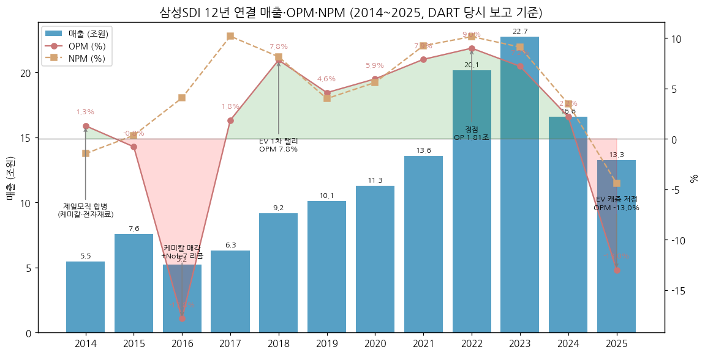

**📊 사이클 통계 (12년 연결)**

| 지표 | 값 |
|---|---|
| 매출 CAGR (11년, 2014→2025) | **+8.4%** (2014는 합병 반기분 포함 — 케미칼 매각 후 2015R 49,549 기준 10년 CAGR +10.4%) |
| 매출 CAGR (8년, 2014→2022 정점) | **+17.8%** |
| OPM 평균 | **1.3%** (2016·2025 적자 2년 제외 시 5.4%) |
| OPM 정점 평균 | **8.4%** (2018 7.8%, 2022 9.0%) |
| OPM 저점 평균 | **-15.4%** (2016 -17.8%, 2025 -13.0%) |
| OPM range | **+26.8%pt** |
| 사이클 주기 | 저점→저점 9년(2016→2025), 정점→정점 4년(2018→2022) |
| 사이클 회수 (12년) | **정점 2회(2018 국지·2022) / 저점 2회(2016·2025) + 국지 저점 2019** |

**글로벌 셀 피어 마진 비교 (출처: BT 1Q26·2Q26 리뷰, stockanalysis 2026-10)**

→ **삼성SDI** — 3Q26 OPM **8.7%** (AMPC 1,225억 제외 시 6.1%) / 2025 연간 -13.0%

→ **LG에너지솔루션** — 1Q26 OPM -3.2% → 2Q26 흑전 컨센 (BT 섹터 메모리 tracking_variables)

→ **CATL** — 영업이익률 **16.5%** (TTM, stockanalysis 2026-10-23)

→ **Panasonic Energy** — 사업부 마진 미추출 [미확보] (모회사 Panasonic HD 기준 멀티플만 아래 ⑥에 표기)

(3) 정량적 분류 근거

→ **매출 구성의 급변** — 배터리 부문 매출 2023 20.4조 → 2025 12.4조(-39%, DART 영업부문) → 2026 9M 11.5조(IR, 신기준) 회복

→ **이익의 주인 = 배터리** — 2022 영업이익 기여 배터리 69% / 전자재료 31%, 2025 배터리 -1.85조 vs 전자재료 +1,295억 (DART). 전자재료는 연 1~5천억대 안정 이익이지만 배터리 적자를 상쇄하지 못함

→ **수출 비중** — 2025 연결 수출 116,568억 / 매출 132,667억 = **87.9%**, 2026 상반기 **81.2%** (DART 매출실적) → 원/달러·유로 환율 민감

→ **ESS 비중 확대** — 1Q26 ESS 매출 비중 약 25% (BT 1Q26 리뷰, 셀사이드 추정) → 2Q26 약 21%(관세 일회성 조정 전, 하나증권 추정) → 3Q26 ESS·BBU가 성장 주도 (회사 IR 정성). ⚠️ 회사는 EV/ESS/소형 매출 분해를 공시하지 않음

→ **AMPC(IRA 45X) 의존도** — 1Q25~1Q26 5개 분기 연속 AMPC 제외 시 적자, **3Q26 처음으로 AMPC 제외 흑자(+2,853억)** (뉴스토마토 2026-10-29)

(4) 산업 분류

→ **한국표준산업분류(DART 기재)** — 일차전지 및 이차전지 제조업 (업종코드 28202, 2024.07.01 변경)

→ **KRX 업종** — 전기·전자 (유가증권시장, 1979.02.27 상장)

→ **워치리스트 섹터** — 배터리 T2 / 서브섹터 배터리 셀

→ **사업 성격** — 리튬이온 2차전지(각형 EV·ESS, 원형 소형) + 반도체·디스플레이 소재 + 삼성디스플레이 지분법 투자(잔여 약 10.2%)

(5) 분류 결정 논리

(1) **가장 매출 큰 사업부 기준** — 배터리 94% → 배터리 셀 = 고정비 장치산업 + OEM 출하 사이클 → **사이클**

(2) **이익 비중 sub-rule** — 영업이익도 배터리가 결정(2016·2025 적자, 2022 정점 모두 배터리 주도). 전자재료(OPM 15~25%)는 사이클 완충재일 뿐 분류를 바꾸지 못함 → 사이클 유지

(3) **Boundary case 처리** — 3Q26부터 매출 성장 동력이 EV에서 **ESS·BBU(AI 데이터센터 전력)**로 이동. 북미 ESS 수주 60GWh+, 2028년까지 라인 물량 확보 = 수주 기반 secular 성장 성격 → **Primary 사이클 + Secondary 고성장(ESS)**. 단 ESS 실적 기간이 2개 분기에 불과하고 AMPC·관세 등 정책 변수 의존이 커서 격상은 보류

(4) **글로벌 피어 대비** — CATL은 LFP·중국 내수 규모로 OPM 16%대 지속 성장형, LG에너지솔루션은 2024~25 적자 진입이 SDI보다 늦고 얕았음(사이클 시차 — BT 섹터 가설 2). 삼성SDI는 **각형 프리미엄 + 고객 집중(BMW·Stellantis·VW)** 구조라 고객 EV 판매 사이클에 더 민감 → 피어 중 사이클 진폭 최대

(6) 적정 밸류에이션 방법

→ **1차 — P/B (사이클 밴드)**: 배터리가 이익의 전부이고 2016·2025처럼 적자 연도가 반복 → 이익 기준(PER)이 깨지는 구간이 잦음. 순자산(지배지분 24.3조, 2026.06말)이 하한을 받침. 밴드: 저점 **0.83배**(2024말, 시총 16.40조 / 지배지분 19.77조) ~ 정점 **2.95배**(2021말, 43.36조 / 14.70조) [계산: stockanalysis 연말 시총 ÷ DART 지배지분]. 현재 **약 1.59배** [계산: 시총 38.52조(2026-11-13) ÷ 2Q26 지배지분 24.30조] / stockanalysis 1.50배(2026-10-01)

→ **2차 — Forward EV/EBITDA·PER (회복기 보조)**: 흑자 전환 이후 셀사이드는 2027E 기준 P/E(하나 24배)·EV/EBITDA(삼성 11.8배) 적용 (BT 2Q26 리뷰). stockanalysis Forward P/E 38.3배, EV/EBITDA 23.9배(2026-10-01)

→ **3차 — SOTP 보정**: 잔여 SDC 지분(약 10.2%) 가치 — 2026.08 매각가(주당 34만원) 기준 약 9.1조(삼성증권 추정, BT 2Q26 리뷰). 시총의 약 24%라 SOTP 병행 필수 [계산]

→ **피어 차별화** — CATL P/B 2.62배·Fwd P/E 10.2배(2026-10-23), LG에너지솔루션 P/B 2.79배·Fwd P/E 68.8배·EV/EBITDA 25.2배(2026-10-02), Panasonic HD P/B 1.78배·Fwd P/E 19.2배(2026-10-15) [stockanalysis]. 삼성SDI는 LGES 대비 P/B 할인(1.5~1.6배 vs 2.8배) — ESS CAPA 규모 차이(26년말 북미 LGES 60GWh vs SDI 30GWh, NH증권)와 EV 고객 점유율 하락이 할인 요인

→ **삼성전자 대비**: 삼성전자도 PBR 사이클 밴드가 1순위지만, 삼성SDI는 적자 연도가 실제로 발생하고 지분법 자산(SDC)이 커서 **PBR + SOTP** 조합

(7) 분기 재평가 트리거 (**분류 변경 조건** — 실적 추적 변수는 ⑥ 섹션)

→ ① **ESS(전력+BBU) 매출 비중 40%+ 4분기 유지 + AMPC 제외 OPM 5%+ 4분기 연속** → Primary **고성장(ESS secular)** 격상, EV 사이클은 Secondary 강등

→ ② **ESS 수주 공백 2분기 연속 + 배터리 OPM 재적자 전환** → Pure 사이클 확정 (ESS 성장 가설 철회)

→ ③ **잔여 SDC 지분 전량 매각 또는 대규모 M&A·분할**로 자산 구성이 바뀔 때 → 밸류에이션 1차 방법(PBR) 재검토, 분류 재작성

---

## ② 회사 개요

(1) 기본 사항

| 항목 | 내용 |
|---|---|
| 회사명 (한글) | 삼성SDI 주식회사 |
| 회사명 (영문) | SAMSUNG SDI CO., LTD. |
| 종목코드 | 006400 (보통주), 006405 (우선주) — KRX 유가증권시장, 1979.02.27 상장 |
| **설립일** | **1970년 1월 20일** (삼성-NEC 설립 → 1999.11 삼성SDI 상호 변경) |
| 본사 주소 | 경기도 용인시 기흥구 공세로 150-20 |
| **대표이사** | **최주선** (사장, 1963.05, KAIST 전기전자공학, 前 삼성디스플레이 대표이사 사장·삼성전자 DS 미주총괄 부사장, 이사회 의장 겸임, 2025.03 선임) — DART 2025 FY |
| 발행주식수 | 보통주 **80,585,530주** (자기주식 3,331,391 / 유통 77,254,139) + 우선주 1,617,896주 — 2025말·2026.06말 동일 (DART) |
| 주요주주 | 삼성전자 **19.44%** + 특수관계인 = 최대주주 등 **20.21%** / 국민연금 **8.04%** / 우리사주 2.25% (2026.06말, DART) |
| 연결 종속회사 | **22개** (헝가리·미국·말레이시아·중국·베트남 등, 상장 0) — 2026.06말 DART |
| **신용등급** | 회사채·회사 **AA** (한국기업평가 2025.06 정기평가, NICE 2023.06) — DART 반기보고서 |
| 임직원 (별도) | **12,826명** (2025말) → 12,763명 (2026.06말) — 에너지솔루션 11,174 / 전자재료 1,589 |
| 시가총액 | **38조 5,199억원** (보통주, 삼성SDI IR 주가 페이지 2026-11-13 15:30 / 종가 478,000원 × 80,585,530주 일치) |
| 52주 범위 | **259,000 ~ 723,000원** (Yahoo v8 meta, 고점 2026-04-30 장중) |
| 외국인 지분율 | **24.54%** (삼성SDI IR 주가 페이지, 2026-11-13) |

(2) 12년 손익·자본 추이 (연결 — OpenDART 전체재무제표)

| 연도 | 매출 (억) | OP (억) | OPM | 순이익 (억) | 지배NI (억) | 자본총계 (억) | 자산총계 (억) | 기준 |
|---|---|---|---|---|---|---|---|---|
| 2014 | 54,742 | 708 | 1.3% | -803 | -838 | 118,269 | 159,685 | 2015 사업보고서 전기 (합병 하반기분 포함, PDP 중단) |
| 2015 | 75,693 | -598 | -0.8% | 257 | 538 | 112,532 | 162,253 | 당시 보고 (재작성 49,549 / -2,675, 케미칼 중단) |
| 2016 | 52,008 | -9,263 | -17.8% | 2,111 | 2,194 | 109,641 | 149,003 | 당시 보고 (케미칼 매각이익 포함) |
| 2017 | 63,216 | 1,169 | 1.8% | 6,432 | 6,572 | 114,520 | 157,515 | 당시 보고 (재작성 63,466) |
| 2018 | 91,583 | 7,150 | 7.8% | 7,450 | 7,012 | 122,252 | 193,497 | 당시 보고 |
| 2019 | 100,974 | 4,622 | 4.6% | 4,024 | 3,565 | 126,603 | 198,521 | 당시 보고 |
| 2020 | 112,948 | 6,713 | 5.9% | 6,310 | 5,747 | 133,589 | 215,342 | 당시 보고 |
| 2021 | 135,532 | 10,676 | 7.9% | 12,504 | 11,698 | 151,967 | 258,332 | 당시 보고 |
| 2022 | 201,241 | 18,080 | 9.0% | 20,394 | 19,521 | 172,175 | 302,575 | 당시 보고 (정정) |
| 2023 | 227,083 | 16,334 | 7.2% | 20,660 | 20,092 | 199,072 | 340,389 | 당시 보고 (재작성 214,368 / 15,455, 편광필름 제외) |
| 2024 | 165,922 | 3,633 | 2.2% | 5,755 | 5,993 | 215,672 | 405,973 | 2024 사업보고서 (20250311001275) |
| **2025** | **132,667** | **-17,224** | **-13.0%** | **-5,849** | **-6,495** | **235,701** | **422,553** | 2025 사업보고서 (20260310002954) |
| 2Q26 누적 | 73,452 | 482 | 0.7% | 5,277 | 3,141 | 268,362 | 476,219 | 2026 반기보고서 |
| 3Q26 (분기) | 46,856 | 4,078 | 8.7% | 3,422 | 2,946 | 249,252 | 415,068 | 회사 IR 2026-10-29 (분기보고서 미공시) |

→ 11년 매출 CAGR **+8.4%** / 자본총계 CAGR **+6.5%** (2014→2025) [계산]
→ 2025 ROE(지배, 평균자본) **-3.2%** [계산: -6,495 / ((197,664+214,429)/2)]
→ 2025 자본 +2.0조 중 1.65조는 유상증자(보통주 11,821,000주, 2025.06.13 신주 상장 — DART 연혁, CF 유상증자 16,549억)
→ 2Q26 누적 순이익 5,277억 중 지분법이익(SDC 중심) 1H26 5,164억 — 영업 외 이익 의존 (IR p.7)

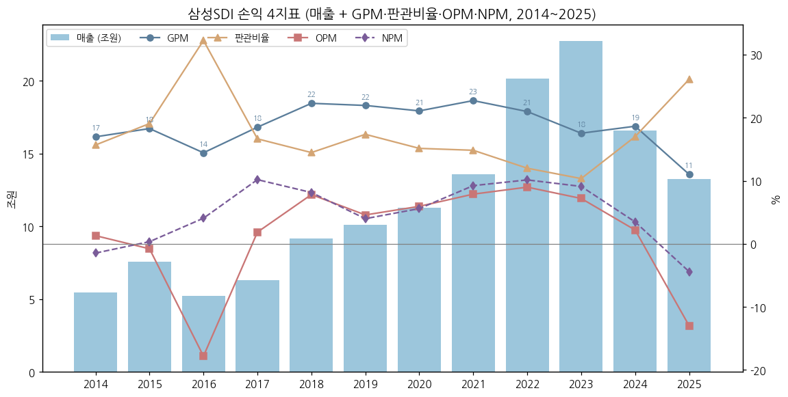

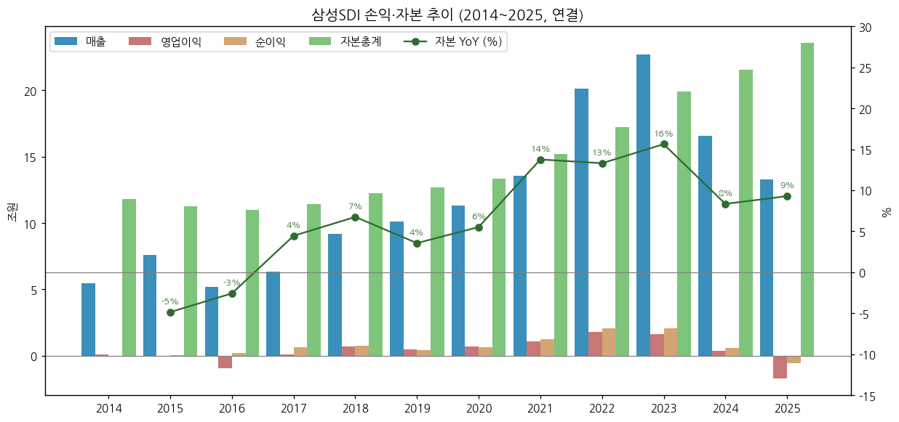

(3) 주가 역사 (20년)

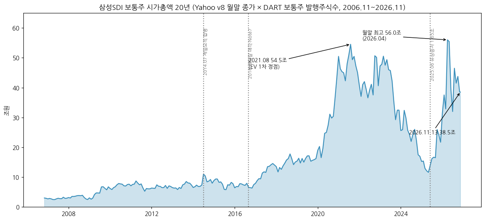

→ (출처: Yahoo Finance v8 006400.KS 월간 2006.11~2026.11 종가 × DART 보통주 발행주식수 이력: 2014.06 이전 45,558,341주[계산: 2014말 68,764,530 − 합병신주 23,206,189] / 2014.07~2025.05 68,764,530주 / 2025.06~ 80,585,530주. 우선주 제외)

→ **2006~2013 PDP·소형전지 시절** — 시총 3~8조 박스권 (PDP 적자, 소형 리튬이온 세계 1위권)

→ **2014~2016 합병·구조조정** — 제일모직 합병(2014.07) 후 케미칼 매각·Note7 리콜로 2016년 시총 6조대 저점 (주가 2016 한때 10만원 미만)

→ **2017~2021 EV 1·2차 랠리** — 헝가리 공장·BMW 고객 기반으로 재평가. **2021-08-31 종가 793,000원, 시총 54.5조** (Korea Economic Daily 2021-08-31), 장중 고점 **828,000원**(2021.08, Yahoo 월간 고가) = **주가 ATH**

→ **2022~2025.05 EV 캐즘 하락** — 2024말 시총 16.40조(stockanalysis), 일간 종가 저점 **160,200원(2025-05-23, Yahoo)**

→ **2025.06~2026.04 ESS 재평가** — 유상증자(1.65조) 후 북미 ESS·SDC 매각 기대로 반등. **일간 종가 최고 712,000원(2026-04-29) × 80,585,530주 = 57.4조** [계산] = **시가총액 ATH** (월말 기준 최고 56.0조, 2026.04)

→ **2026.07~11 변동** — 2Q26 실적 전 358,500원(2026-07-30) 저점 → SDC 매각·GM JV 단독전환 후 577,000원(8월말) → 2026-11-13 종가 **478,000원, 시총 38.5조** (ATH 대비 -33%)

(4) 주요 연혁 (DART 사업보고서 연혁·합병 등에 관한 사항)

| 시기 | 내용 |
|---|---|
| 1970.01 | 삼성-NEC 설립 (브라운관) |
| 1979.02 | 유가증권시장 상장 |
| 1999.11 | 삼성SDI 상호 변경 |
| 2000 | 리튬이온 2차전지 사업 진출 |
| 2008.09~2012 | 보쉬와 자동차전지 JV SB리모티브 설립 → 2012 보쉬 지분 인수 → **2013.01.01 흡수합병** |
| 2011.07 | 삼성전자 태양전지 사업 양수 (2014 중단) |
| **2014.07.01** | **(구)제일모직 흡수합병** (케미칼·전자재료 편입), **PDP 사업 중단** |
| 2014.07~08 | BMW 전기차 배터리 공급 MOU, 중국 시안 EV 배터리 공장 기공 |
| 2015.02 | 마그나 배터리팩 사업(오스트리아 그라츠) 인수 → SDIBS |
| **2016.02 / 04.29** | **케미칼 물적분할 → 에스디아이케미칼 지분 90% 롯데케미칼 매각 완료** |
| 2016 | 갤럭시노트7 배터리 리콜 (4Q16 손실) |
| 2017.05 | 헝가리 괴드 EV 배터리 공장 준공 |
| 2017.02 | 중국 우시 편광필름 공장 준공 (2024~25 매각) |
| 2020.11 | 에코프로비엠과 양극재 JV 에코프로이엠 착공 (2022.10 CAM7 준공) |
| 2021.10 / 2022.05 | 스텔란티스와 북미 JV MOU / 합작계약 (→ StarPlus Energy, 인디애나 코코모) |
| 2023.10 | 현대자동차 배터리 공급계약 |
| 2024.08.28 | GM과 미국 배터리 JV 본계약 (SDI-GM Synergy Cells, 인디애나 뉴칼라일) |
| 2024~2025 | **편광필름 사업 양도** (중단영업, 2025 매각 완료) |
| 2025.06.13 | **유상증자 신주 상장 (보통주 11,821,000주, 약 1.65조)** |
| 2025.10 / 12 | BMW와 전고체 실증 협약 / 미국 대형 에너지기업 ESS용 LFP 공급계약 |
| 2026.03 | 미국 에너지기업 ESS용 각형 배터리 공급계약, 엘앤에프 LFP 양극재 장기공급 계약 |
| 2026.04.20 | 메르세데스-벤츠 EV 배터리 공급계약 |
| **2026.08.11** | **GM JV 지분 전량 인수 → 단독 공장(시너지셀즈, ESS 전용 기지로 지정)** |
| **2026.08.27** | **삼성디스플레이 지분 1,308만 8,235주(약 1/3) 4.45조 매각 완료** (주당 34만원) |
| 2026.10 | SPE에서 고용량 각형 LFP(ESS) 셀 양산 개시 |

→ (출처: DART 2014·2017·2021·2025 사업보고서 연혁, 2026 반기보고서, 비즈워치 2026-09-29·10-29. 1999·2000·2008 항목은 회사 연혁 기재 문구 기반, 세부 일자 [미확보])

---

## ③ 비즈니스 모델

(1) 실적 추이 통합 표 (5년 연간 — 3단계 위계: 사업부 / 수출·내수 / 제품)

**(1-1) 사업부 기준 (회사 IR · DART 영업부문, 억원)**

| 사업부 | 2022 | 2023R | 2024 | 2025 | 2026 9M (IR 신기준) |
|---|---|---|---|---|---|
| 연결 매출 | 201,241 | 214,368 | 165,922 | 132,667 | 122,189 |
| 배터리 매출 | 175,663 | 204,061 | 156,912 | 123,841 | 114,714 |
| 전자재료 매출 | 25,578 | **10,307** | 9,010 | 8,826 | 7,475 |
| 연결 영업이익 | 18,080 | 15,455 | 3,633 | -17,224 | 4,560 |
| 배터리 OP / OPM | 12,538 / 7.1% | 13,424 / 6.6% | 1,456 / 0.9% | **-18,519 / -15.0%** | 3,446 / 3.0% |
| 전자재료 OP / OPM | 5,542 / 21.7% | **2,031 / 19.7%** | 2,177 / 24.2% | 1,295 / 14.7% | 1,114 / 14.9% |
| 연결 OPM | 9.0% | 7.2% | 2.2% | -13.0% | 3.7% |

→ (출처: 2022 = DART 2022 사업보고서 / 2023R·2024 = 회사 4Q24 IR(2025-01-24) 편광필름 제외 재작성 / 2025 = DART 2025 사업보고서 / 2026 9M = 회사 1Q26·2Q26·3Q26 IR 합산, 1Q26·2Q26 매출은 3Q26 IR 재작성치(AMPC 포함 추정) [계산])
→ 2023R 전자재료 매출 10,307억 — 편광필름 제외. 재작성 전 23,022억(전자재료 OP 2,910억)

**(1-2) 수출·내수 (DART 매출실적, 억원)**

| 부문 | 2024 수출 / 내수 | 2025 수출 / 내수 | 1H26 수출 / 내수 |
|---|---|---|---|
| 배터리(에너지솔루션) | 136,744 / 20,168 | **108,782 / 15,059** | 55,568 / 13,166 |
| 전자재료 | 7,921 / 1,089 | 7,786 / 1,040 | 4,051 / 667 |
| **연결 합계** | **144,665 / 21,257 (수출 87.2%)** | **116,568 / 16,099 (87.9%)** | **59,619 / 13,833 (81.2%)** |

→ (출처: DART 2026 반기보고서 매출실적 3개년 표. 수출에는 로컬수출 포함, 편광필름 매출 제외)

**(1-3) 제품 단가 (DART 주요 제품 가격변동추이)**

| 품목 | 2023 | 2024 | 2025 | 1H26 |
|---|---|---|---|---|
| 소형전지 (원/개) | 3,585 | 3,287 | 2,930 | 2,923 |
| EMC (원/톤) | 74,086,577 | 77,480,564 | 84,620,547 | 96,398,376 |
| 양극활물질 매입가 ($/kg) | 49.60 | 32.68 | 27.05 | 24.79 |

→ (출처: DART 2025 사업보고서·2026 반기보고서)
→ EV/ESS/소형 세부 매출은 **회사 미공시**. 셀사이드 2Q26 추정: EV 약 1.5조(40~43%) / ESS 약 0.78~0.81조(21~23%) / 소형 약 1.2조(33~34%) / 전자재료 0.25조(7%) (하나·대신증권, BT 2Q26 리뷰) ⚠️추정

(2) 사업부별 분기 시계열

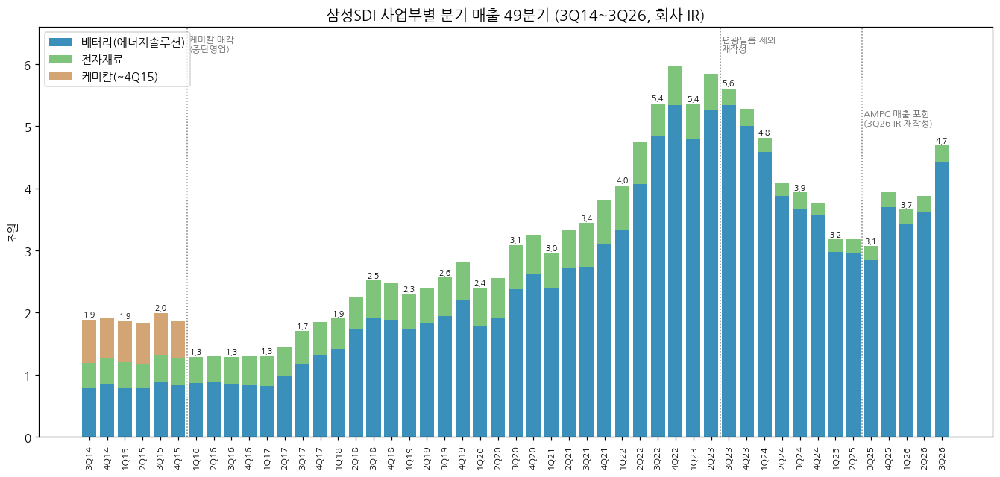

**(2-0) 사업부별 분기 매출·영업이익 — 최근 12분기 (회사 IR 최신 재작성 기준, 억원)**

| 분기 (억원) | 4Q23 | 1Q24 | 2Q24 | 3Q24 | 4Q24 | 1Q25 | 2Q25 | 3Q25 | 4Q25 | 1Q26 | 2Q26 | **3Q26** |
|---|---|---|---|---|---|---|---|---|---|---|---|---|
| 연결 매출 | 52,735 | 48,162 | 40,859 | 39,357 | 37,545 | 31,768 | 31,794 | 30,714 | 39,385 | 36,568 | 38,765 | **46,856** |
| 연결 OP | 2,953 | 2,491 | 2,410 | 1,299 | -2,567 | -4,341 | -3,978 | -5,913 | -2,992 | -1,556 | 2,038 | **4,078** |
| 연결 OPM | 5.6% | 5.2% | 5.9% | 3.3% | -6.8% | -13.7% | -12.5% | -19.3% | -7.6% | -4.3% | 5.3% | **8.7%** |
| 배터리 매출 | 49,983 | 45,818 | 38,729 | 36,721 | 35,645 | 29,809 | 29,612 | 28,396 | 37,018 | 34,348 | 36,267 | **44,099** |
| 전자재료 매출 | 2,752 | 2,344 | 2,130 | 2,636 | 1,900 | 1,959 | 2,182 | 2,318 | 2,367 | 2,220 | 2,498 | **2,757** |
| 배터리 OP | 2,262 | 2,145 | 2,081 | 635 | -2,683 | -4,524 | -4,308 | -6,301 | -3,385 | -1,766 | 1,593 | **3,619** |
| 전자재료 OP | 691 | 346 | 329 | 664 | 116 | 183 | 330 | 388 | 393 | 210 | 445 | **459** |
| 배터리 OPM | 4.5% | 4.7% | 5.4% | 1.7% | -7.5% | -15.2% | -14.5% | -22.2% | -9.1% | -5.1% | 4.4% | **8.2%** |
| 전자재료 OPM | 25.1% | 14.8% | 15.4% | 25.2% | 6.1% | 9.3% | 15.1% | 16.7% | 16.6% | 9.5% | 17.8% | **16.6%** |
| AMPC | - | 1~3Q 합 649 | ← | 103 | [미확보] | 1,090 | 660 | 200 | 798 | 805 | 1,077 | **1,225** |
| AMPC 제외 OP | - | - | - | 1,196 | - | -5,431 | -4,638 | -6,113 | -3,790 | -2,361 | 961* | **2,853** |
| 순이익 | 4,933 | 2,867 | 3,012 | 2,304 | -2,427 | -2,160 | -1,667 | 57 | -2,078 | 561 | 4,716 | **3,422** |

→ (출처: 4Q23·4Q24 = 4Q24 IR(2025-01-24) p.4 / 1Q24 = 1Q25 IR(2025-04-25) p.4 / 2Q24·1Q25·2Q25 = 2Q25 IR(2025-07-31) p.4 / 3Q24 = 3Q25 IR(2025-10-28) / 4Q25 = 4Q25 IR(2026-02-02) / 1Q26 = 1Q26 IR / **3Q25·2Q26·3Q26 및 3Q25~2Q26 연결 매출 = 3Q26 IR(2026-10-29) p.4·7 재작성치**. 4Q25·1Q26 배터리 매출은 3Q26 IR 연결 매출 − 전자재료 [계산])
→ **AMPC 출처**: 1~3Q24 합 649억·3Q24 103억 = CEO스코어데일리(2024-10-30·12-12) / 1Q25~1Q26 = 다올증권(BT 1Q26 리뷰 인용) / 2Q26 = IBK·삼성증권(BT 2Q26 리뷰) / 3Q26 = 뉴스토마토(2026-10-29). *2Q26 AMPC 제외 961억에는 미국 상호관세 환급 1,960억(전액 ESS 귀속, DS증권) 포함 → 관세·AMPC 모두 제외 시 **-999억**
→ **매출 기준 주의**: 3Q25~2Q26 연결 매출은 3Q26 IR 신기준. DART 분기보고서(구기준)는 30,518 / 38,587 / 35,764 / 37,688억 — 차이 = 해당 분기 AMPC(196·798·804·1,077) ⇒ AMPC 매출 표시 변경 추정. 1Q25·2Q25는 재작성치 미공시(구기준)
→ 3Q26은 IR 발표치(2026-10-29), **3Q26 분기보고서 미공시**(작성 시점 기준) — 공시 후 대조 필요

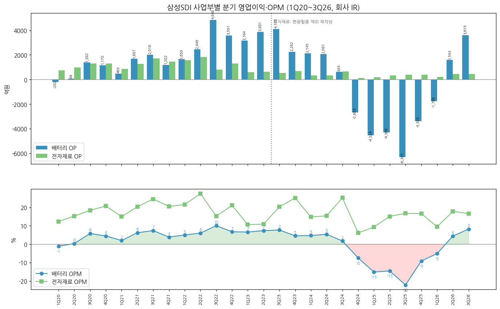

**(2-0a) 사업부별 분기 영업이익 — 1Q20~3Q23 (회사 IR, 억원)**

| 분기 | 1Q20 | 2Q20 | 3Q20 | 4Q20 | 1Q21 | 2Q21 | 3Q21 | 4Q21 | 1Q22 | 2Q22 | 3Q22 | 4Q22 | 1Q23 | 2Q23 | 3Q23 |
|---|---|---|---|---|---|---|---|---|---|---|---|---|---|---|---|
| 배터리 매출 | 17,936 | 19,187 | 23,818 | 26,292 | 23,870 | 27,118 | 27,409 | 31,073 | 33,190 | 40,716 | 48,340 | 53,416 | 47,978 | 52,701 | 53,398 |
| 배터리 OP | -202 | 64 | 1,382 | 1,170 | 469 | 1,687 | 2,018 | 1,202 | 1,650 | 2,449 | 4,848 | 3,591 | 3,164 | 3,881 | 4,118 |
| 배터리 OPM | -1.1% | 0.3% | 5.8% | 4.5% | 2.0% | 6.2% | 7.4% | 3.9% | 5.0% | 6.0% | 10.0% | 6.7% | 6.6% | 7.4% | 7.7% |
| 전자재료 매출 | 6,020 | 6,381 | 7,037 | 6,222 | 5,762 | 6,225 | 6,989 | 7,087 | 7,304 | 6,692 | 5,340 | 6,243 | 5,570 | 5,705 | 2,632R |
| 전자재료 OP | 742 | 974 | 1,292 | 1,292 | 863 | 1,265 | 1,717 | 1,455 | 1,573 | 1,841 | 811 | 1,317 | 590 | 621 | 534R |

→ (출처: 각 분기 IR 및 다음 해 IR 전년동기 컬럼. 2020~2022 "에너지 및 기타" = 연결 − 전자재료 [계산]. 전자재료 OP = 연결 OP − 배터리 OP [계산]. 3Q23R = 2024 3Q IR 편광필름 제외 재작성(재작성 전 6,082 / 842))
→ 2019 이전 IR은 사업부 영업이익 미공시 → 연간은 아래 (2-1) DART 영업부문으로 보완

**(2-0b) 사업부별 분기 매출 — 3Q14~4Q19 (회사 IR, 억원)**

| 분기 | 3Q14 | 4Q14 | 1Q15 | 2Q15 | 3Q15 | 4Q15 | 1Q16 | 2Q16 | 3Q16 | 4Q16 | 1Q17 | 2Q17 | 3Q17 | 4Q17 |
|---|---|---|---|---|---|---|---|---|---|---|---|---|---|---|
| 배터리 | 7,939 | 8,592 | 7,950 | 7,800 | 8,868 | 8,484 | 8,629 | 8,744 | 8,501 | 8,368 | 8,231 | 9,876 | 11,679 | 13,191 |
| 전자재료 | 3,929 | 4,048 | 4,038 | 3,959 | 4,333 | 4,091 | 4,264 | 4,416 | 4,386 | 4,647 | 4,805 | 4,655 | 5,380 | 5,334 |
| 케미칼 | 7,040 | 6,450 | 6,664 | 6,673 | 6,770 | 6,038 | - | - | - | - | - | - | - | - |

| 분기 | 1Q18 | 2Q18 | 3Q18 | 4Q18 | 1Q19 | 2Q19 | 3Q19 | 4Q19 |
|---|---|---|---|---|---|---|---|---|
| 배터리 | 14,171 | 17,273 | 19,223 | 18,793 | 17,301 | 18,214 | 19,517 | 22,084 |
| 전자재료 | 4,899 | 5,188 | 5,982 | 5,972 | 5,721 | 5,812 | 6,143 | 6,104 |

→ (출처: 각 분기 IR p.1~2 「실적」 표, 2014~2018은 십억원 표기 → 억원 환산. 2016부터 케미칼 중단영업)

**(2-1) DART 영업부문 연간 (연결조정 전, 억원 / OPM)**

| 부문 | 2014 | 2015R | 2016 | 2017 | 2018 | 2019 | 2020 | 2021 | 2022 | 2023R | 2024 | 2025 | 1H26 |
|---|---|---|---|---|---|---|---|---|---|---|---|---|---|
| 배터리 매출 | 33,275 | 33,127 | 34,302 | 43,324 | 69,542 | 77,193 | 87,288 | 109,469 | 175,663 | 204,061 | 156,912 | 123,841 | 68,734 |
| 배터리 OP | -263 | -4,957 | -11,039 | -1,086 | 3,974 | 555 | 2,413 | 5,376 | 12,538 | 13,424 | 1,456 | -18,519 | -173 |
| 배터리 OPM | -0.8% | -15.0% | -32.2% | -2.5% | 5.7% | 0.7% | 2.8% | 4.9% | 7.1% | 6.6% | 0.9% | -15.0% | -0.3% |
| 전자재료 매출 | 7,977 | 16,421 | 17,706 | 20,142 | 22,041 | 23,781 | 25,660 | 26,063 | 25,578 | 10,307 | 9,010 | 8,826 | 4,718 |
| 전자재료 OP | 836 | 2,282 | 1,776 | 2,255 | 3,176 | 4,067 | 4,300 | 5,300 | 5,542 | 2,031 | 2,177 | 1,295 | 655 |
| 전자재료 OPM | 10.5% | 13.9% | 10.0% | 11.2% | 14.4% | 17.1% | 16.8% | 20.3% | 21.7% | 19.7% | 24.2% | 14.7% | 13.9% |

→ (출처: 2014·2015R·2016 = DART 2016 사업보고서 부문정보(백만원) / 2017~2020 = 2018·2019·2020 사업보고서 / 2021~2022 = 회사 4Q21·4Q22 IR(DART 2022 사업의 개요와 일치) / 2023R·2024 = 회사 4Q24 IR 재작성 / 2025·1H26 = DART 2025 사업보고서·2026 반기보고서 사업의 개요. 2014 케미칼(하반기) 매출 13,490 / OP 136, 2014 전자재료는 합병 후 하반기분)
→ 2016 배터리 OP -1.10조 = 1Q16 소형전지 손상 + 4Q16 Note7 리콜 / 2019 배터리 OP 555억 = 국내 ESS 화재 관련 충당(4Q19)

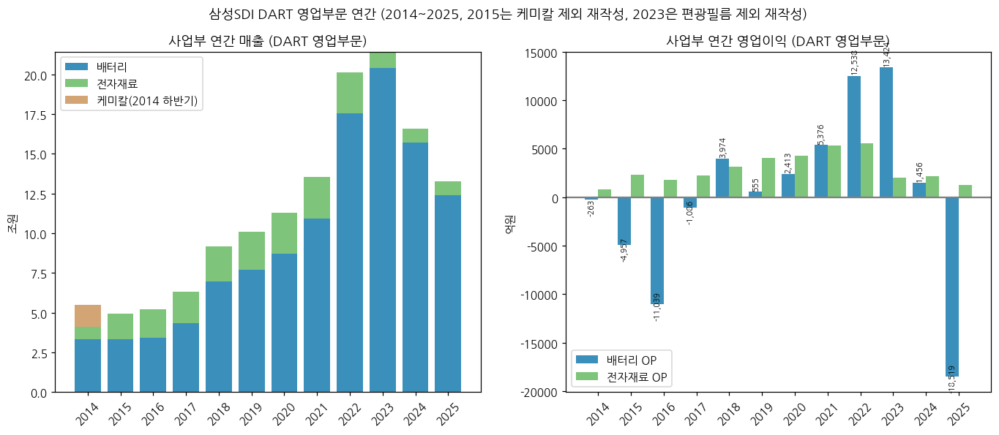

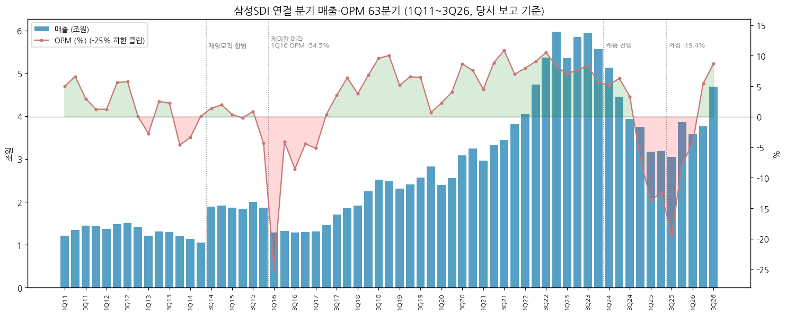

→ (출처: 1Q11~4Q15 회사 IR 당시 보고(2011 1~3Q는 구 K-IFRS 영업이익 정의), 1Q16~2Q26 OpenDART 분기 3개월값(4Q = 연간 − 3Q 누적), 3Q26 회사 IR. 1Q14·2Q14는 PDP 포함 당시 보고, 2014 연간은 재작성치라 합이 불일치. 1Q16 OPM -54.5%는 차트에서 -25%로 클립)

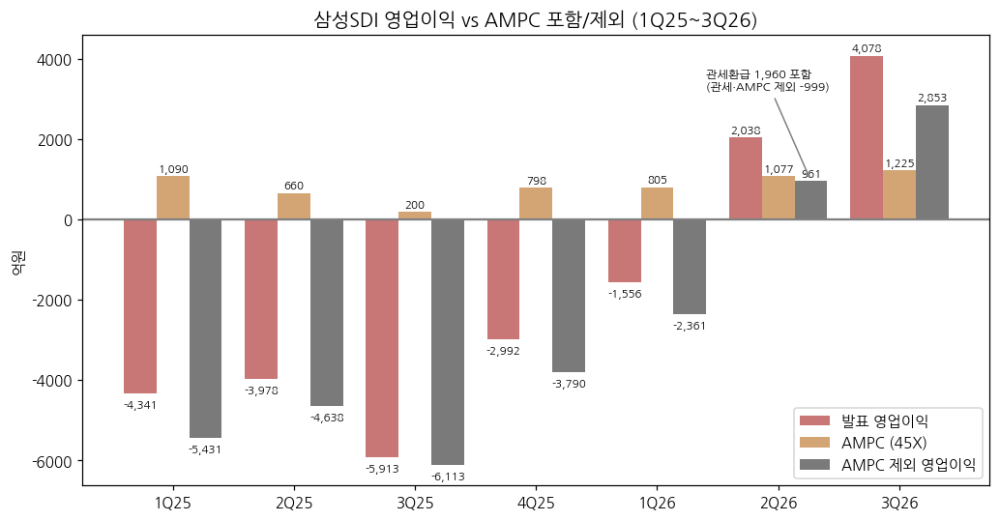

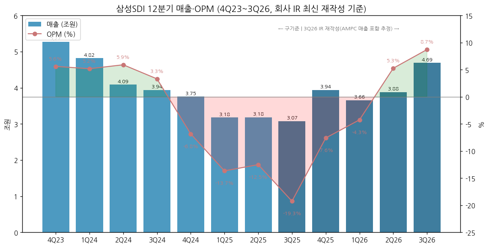

(3) 사업부별 디테일 (매출 비중 큰 순서)

(3-1) **배터리 — 중대형 EV (2Q26 매출 약 40%, 셀사이드 추정)**
→ 각형 P5(Gen5)·P6(하이니켈 NCA) — 주요 고객 BMW·Stellantis·VW(DART 판매경로 기재 고객), 현대차·기아(2023.10 계약, 유럽 보급형 아이오닉3·EV2), 메르세데스-벤츠(2026.04 계약)
→ 생산: 헝가리 괴드(유럽), 중국 시안, 울산, 미국 SPE(스텔란티스 JV)
→ 2024~2025 캐즘: BMW·VW향 출하 감소(점유율 하락), 미국 보조금 종료로 북미 EV 라인 ESS 전환 (BT 2Q26 리뷰)
→ 4Q26 전망: 유럽 보급형 차종 공급 본격화로 출하량 증가, 미국 EV는 당분간 약세 (회사 3Q26 컨콜, 비즈워치 2026-10-29)
→ 46파이 원형 EV셀·LFP 각형 EV 개발 진행 (DART 연구개발실적)

(3-2) **배터리 — 중대형 ESS (2Q26 약 21%, 3Q26 성장 주도)**
→ 제품: SBB 1.5·2.0(전력용 컨테이너형), UPS·BBU(데이터센터 백업), 각형 NCA → **2026.10 각형 LFP(SPE 22GWh 라인)** 양산 개시
→ 2026년 북미 ESS 수주 **60GWh+**, SPE·울산 2028년까지 가동 물량 확보, 시너지셀즈(구 GM JV)를 ESS 전용 기지로 단계 증설 (회사 3Q26 컨콜)
→ 북미 ESS CAPA 2026말 약 30GWh → 2028말 50GWh 목표 (신영증권·비즈워치)
→ 회사 북미 ESS 수요 전망: 2026 130GWh+ → 2030 190GWh+ → 2035 240GWh+ (회사 3Q26 IR p.5, SDI Marketing)
→ Non-PFE(금지외국기업 요건) 충족 LFP 공급망 구축 — 엘앤에프 LFP 양극재 장기계약(2026.03)

(3-3) **배터리 — 소형 (2Q26 약 33%)**
→ 원형(전동공구·BBU·e-bike·휴머노이드), 파우치(스마트폰 — 삼성전자 고객). 생산능력 2,520백만개(2025), 가동률 73%(1H26) (DART)
→ 소형전지 평균단가 3,585원(2023) → 2,923원(1H26), 3Q26 흑자전환 전망(셀사이드)
→ 휴머노이드·우주항공 배터리 2027년부터 공급 확대, 2028년 소형 매출 내 비중 10%+ 목표 / 휴머노이드용 전고체 2027 하반기 상용화 목표 (회사 3Q26 컨콜)

(3-4) **전자재료 (매출 6%, OPM 15~25%)**
→ 반도체 소재: EMC(에폭시 몰딩 컴파운드, 구미 생산능력 4,655톤/2025·가동률 28%/1H26), SOH·패터닝 소재, 신규 메모리업체 패키징 소재 진입(2Q26)
→ 디스플레이 소재: OLED 증착소재, 폴더블 접착소재(FOCA, Flip/Fold 시리즈), QD Ink, Novaled(독일 드레스덴)
→ 3Q26 매출 2,757억(YoY +18.9%) / OP 459억(+18.3%) — 반도체 패터닝·폴더블 필름 소재 견인 (뉴스토마토 2026-10-29)
→ 편광필름 양도(2024~25)로 매출 규모는 2.3조 → 0.9조로 축소, 마진은 상승

(4) 주요 경쟁사 (사업부별)

| 사업부 | 국내 | 해외 |
|---|---|---|
| EV 배터리 | LG에너지솔루션, SK온 | CATL, BYD, Panasonic Energy, CALB, Gotion |
| ESS 배터리 | LG에너지솔루션 | CATL, BYD, EVE, Hithium, Tesla(Megapack 셀 내재화) |
| 소형 원형·파우치 | LG에너지솔루션 | Panasonic, Murata, ATL, EVE |
| 전자재료(EMC·OLED) | 솔브레인, 덕산네오룩스 | Resonac, Sumitomo Bakelite, UDC, Merck |

**글로벌 점유율 (SNE리서치, 2026년 1~9월 EV 배터리 사용량)**
→ 전 세계: CATL 39.1% / BYD 15.2% / LG에너지솔루션 8.2% / SK온 2.8% / 한국 3사 합계 12.6% (연합뉴스 인용 2026-11-02) → 삼성SDI 약 **1.6%** [계산: 12.6 − 8.2 − 2.8]
→ 비중국 시장: CATL 33.7% / LGES 16.4% / BYD 10.8% / SK온 6.6% / **삼성SDI 3.5% (15.0GWh, YoY -34.4%)** (더팩트 2026-11-04)
→ ESS 점유율: 상반기 북미 ESS 출하 기준 중국 업체 70~75% (LS증권, BT 2Q26 리뷰). 삼성SDI 단독 ESS 점유율 [미확보]

(5) 주요 매출처

→ DART 2026 반기보고서 판매경로: **BMW, 삼성전자, Stellantis, Volkswagen Group 등** (기재 순서 = 알파벳·가나다 혼합, 매출 비중 미공시)
→ 판매 경로: 에너지솔루션 직접 공급 94% / 대리점 6%, 전자재료 직접 95% / 5%
→ 수주 상황: "기본공급 계약 후 거래처 생산계획에 따라 납품 — 물량 미확정" → 수주잔고 금액 미공시 (DART)
→ 추정 순서(정성): EV는 BMW·Stellantis·VW·현대차, ESS는 미국 유틸리티·에너지기업(2025.12·2026.03 공급계약 상대 비공개), 소형은 삼성전자·전동공구 업체 [추정]

(6) 생산 CAPA + 임직원 추이

**생산능력·가동률 (DART, 별도 공시 품목만)**

| 품목 / 사업장 | 2023 | 2024 | 2025 | 1H26 | 1H26 가동률 |
|---|---|---|---|---|---|
| 소형전지 (백만개, 천안·톈진 등) | 2,721 | 2,621 | 2,520 | 1,178 | 73% |
| EMC (톤, 구미) | - | 4,971 | 4,655 | 2,290 | 28% |

→ 중대형(EV·ESS) GWh CAPA는 DART 미공시. 셀사이드: 북미 ESS 2026말 30GWh(울산 10 + 중국 3 + 북미 29 = ESS 42GWh, IBK) / NH: 시너지셀즈 단독 전환 후 36→45GWh 가능 (BT 2Q26 리뷰) ⚠️추정
→ 생산거점: 국내 울산·천안·구미·청주 / 해외 헝가리 괴드, 미국 코코모(SPE)·뉴칼라일(시너지셀즈), 오스트리아 그라츠(팩), 중국 시안·톈진, 말레이시아 스렘반, 베트남 박닌 (DART)
→ 시설투자 1H26 1조 928억(에너지솔루션 1조 809억) (DART)

**임직원 (별도, DART 각 연도 사업보고서)**

| 연도 | 2014 | 2015 | 2016 | 2017 | 2018 | 2019 | 2020 | 2021 | 2022 | 2023 | 2024 | 2025 | 2026.06 |
|---|---|---|---|---|---|---|---|---|---|---|---|---|---|
| 직원 수 | 11,371 | 11,084 | 9,115 | 9,334 | 10,390 | 11,179 | 11,107 | 11,315 | 11,935 | 12,452 | 13,341 | **12,826** | 12,763 |

→ 2016 감소 = 케미칼 분할·매각. 2025 평균 근속 12.6년, 1인 평균급여 9,500만원 (DART 2025)

---

## ④ 재무 구조 (12년 연결, OpenDART)

(1) 손익계산서

| 연도 | 매출 | 매출총이익 | 판관비 | 영업이익 | 세전이익 | 순이익 | 지분법이익 | GPM | 판관비율 | OPM | NPM |
|---|---|---|---|---|---|---|---|---|---|---|---|
| 2014 | 54,742 | 9,287 | 8,579 | 708 | 1,994 | -803 | 1,903 | 17.0% | 15.7% | 1.3% | -1.5% |
| 2015 | 75,693 | 13,831 | 14,430 | -598 | 391 | 257 | 2,799 | 18.3% | 19.1% | -0.8% | 0.3% |
| 2016 | 52,008 | 7,506 | 16,769 | -9,263 | -8,207 | 2,111 | 2,452 | 14.4% | 32.2% | -17.8% | 4.1% |
| 2017 | 63,216 | 11,691 | 10,522 | 1,169 | 8,241 | 6,432 | 6,954 | 18.5% | 16.6% | 1.8% | 10.2% |
| 2018 | 91,583 | 20,401 | 13,251 | 7,150 | 10,362 | 7,450 | 3,422 | 22.3% | 14.5% | 7.8% | 8.1% |
| 2019 | 100,974 | 22,152 | 17,530 | 4,622 | 5,646 | 4,024 | 1,786 | 21.9% | 17.4% | 4.6% | 4.0% |
| 2020 | 112,948 | 23,806 | 17,092 | 6,713 | 8,034 | 6,310 | 2,927 | 21.1% | 15.1% | 5.9% | 5.6% |
| 2021 | 135,532 | 30,776 | 20,100 | 10,676 | 16,633 | 12,504 | 5,300 | 22.7% | 14.8% | 7.9% | 9.2% |
| 2022 | 201,241 | 42,207 | 24,127 | 18,080 | 26,523 | 20,394 | 10,397 | 21.0% | 12.0% | 9.0% | 10.1% |
| 2023 | 227,083 | 39,819 | 23,485 | 16,334 | 24,861 | 20,660 | 10,172 | 17.5% | 10.3% | 7.2% | 9.1% |
| 2024 | 165,922 | 30,936 | 28,201 | 3,633 | 5,273 | 5,755 | 8,012 | 18.6% | 17.0% | 2.2% | 3.5% |
| 2025 | 132,667 | 14,617 | 34,593 | -17,224 | -13,640 | -5,849 | 8,382 | 11.0% | 26.1% | -13.0% | -4.4% |

→ 단위 억원. 판관비 = OpenDART 판매비와관리비 (기타영업수익 별도, 2025 2,752억). 2014 순이익에는 PDP·태양광 중단손실 -2,324억, 2016은 케미칼 매각 중단이익 +1조 896억, 2025는 편광필름 중단이익 +2,900억 포함
→ **지분법이익(대부분 SDC)이 세전이익을 받친 구조**: 2017~2025 누적 지분법이익 5.7조 vs 누적 영업이익 4.7조 [계산]. SDC 지분 1/3 매각으로 연간 지분법이익 약 2,500억 감소 예상(DB증권, BT 2Q26 리뷰)
→ 2026: 1Q 매출총이익 6,652(18.2%) / 2Q 10,450(27.0%) / 3Q 13,712(29.3%) — IR 신기준, 2Q는 관세환급 포함

(2) 재무상태표

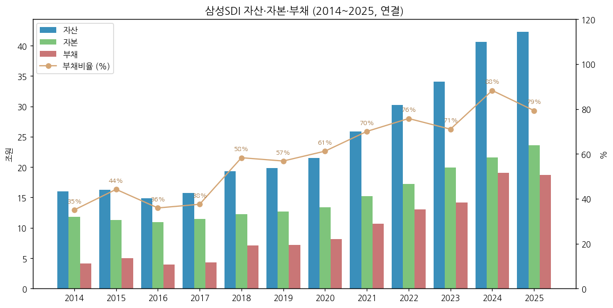

| 연도 | 자산 | 부채 | 자본 | 지배주주지분 | 현금성자산 | 차입금 | 관계기업투자 | 부채비율 | 유동비율 |
|---|---|---|---|---|---|---|---|---|---|
| 2014 | 159,685 | 41,416 | 118,269 | 115,864 | 6,275 | 17,778 | 49,790 | 35% | 157% |
| 2015 | 162,253 | 49,721 | 112,532 | 110,120 | 12,880 | 17,497 | 51,729 | 44% | 149% |
| 2016 | 149,003 | 39,362 | 109,641 | 107,221 | 10,117 | 9,506 | 55,256 | 36% | 179% |
| 2017 | 157,515 | 42,995 | 114,520 | 112,573 | 12,090 | 14,246 | [미추출] | 38% | 135% |
| 2018 | 193,497 | 71,245 | 122,252 | 119,340 | 15,166 | 32,537 | [미추출] | 58% | 138% |
| 2019 | 198,521 | 71,918 | 126,603 | 123,249 | 11,563 | 35,685 | 67,632 | 57% | 138% |
| 2020 | 215,342 | 81,753 | 133,589 | 129,776 | 15,460 | 39,118 | 71,434 | 61% | 114% |
| 2021 | 258,332 | 106,365 | 151,967 | 147,043 | 23,257 | 46,180 | 78,854 | 70% | 115% |
| 2022 | 302,575 | 130,400 | 172,175 | 164,857 | 26,143 | 51,482 | 89,403 | 76% | 121% |
| 2023 | 340,389 | 141,316 | 199,072 | 185,114 | 15,245 | 57,178 | 99,962 | 71% | 108% |
| 2024 | 405,973 | 190,301 | 215,672 | 197,664 | 18,851 | 115,779 | 101,866 | 88% | 95% |
| 2025 | 422,553 | 186,852 | 235,701 | 214,429 | 18,040 | 108,839 | 114,268 | 79% | 89% |
| 2026.06 | 476,219 | 207,857 | 268,362 | 242,988 | 15,055 | 121,109 | 141,053* | 77% | 77% |
| **2026.09** | **415,068** | **165,816** | **249,252** | [미공시] | **23,573** | **85,214** | **84,734*** | **66.5%** | **120%** |

→ 단위 억원. 차입금 = 단기차입금(유동성 포함) + 장기차입금 (OpenDART, 회사 IR 차입금과 일치 확인 2023~2025). *2026.06·09 관계기업 칸은 IR 「투자자산」. 2017·2018 관계기업투자는 OpenDART 계정 매핑 실패 [미추출]
→ 2026.09: SDC 매각 대금 유입으로 차입금 -3.59조, 현금 +8,518억 (회사 3Q26 IR p.3). 단 투자자산 -5.63조·자본 -1.91조의 회계 처리(잔여 지분 분류·처분손익·세금) 세부는 **3Q26 분기보고서 공시 후 확인 [미확보]**
→ 순차입금: 2025말 9.08조 → 2026.09 **6.16조** [계산]

(3) 현금흐름표

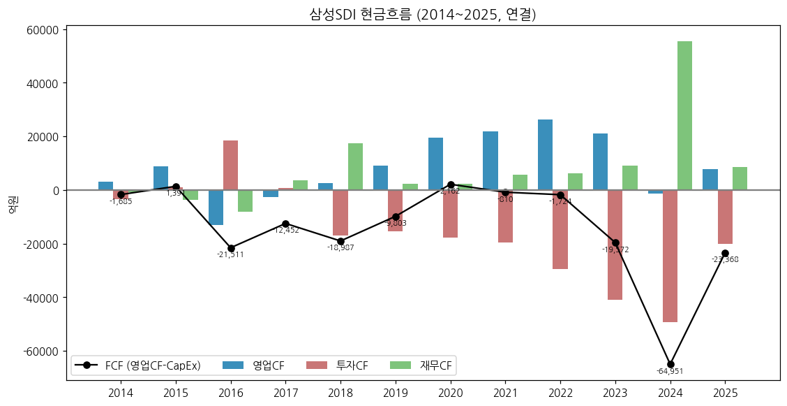

| 연도 | 영업CF | 투자CF | 재무CF | CapEx | FCF |
|---|---|---|---|---|---|
| 2014 | 3,106 | -3,276 | -838 | 4,791 | -1,685 |
| 2015 | 8,811 | 1,153 | -3,547 | 7,420 | 1,391 |
| 2016 | -13,095 | 18,543 | -8,187 | 8,416 | -21,511 |
| 2017 | -2,501 | 893 | 3,534 | 9,951 | -12,452 |
| 2018 | 2,606 | -17,047 | 17,561 | 21,593 | -18,987 |
| 2019 | 9,231 | -15,351 | 2,389 | 19,034 | -9,803 |
| 2020 | 19,488 | -17,784 | 2,406 | 17,326 | 2,162 |
| 2021 | 21,760 | -19,495 | 5,827 | 22,570 | -810 |
| 2022 | 26,411 | -29,462 | 6,287 | 28,135 | -1,724 |
| 2023 | 21,035 | -41,048 | 9,027 | 40,607 | -19,572 |
| 2024 | -1,376 | -49,197 | 55,444 | 63,575 | -64,951 |
| 2025 | 7,924 | -19,986 | 8,648 | 31,292 | -23,368 |
| 1H26 | 1,094 | -11,146 | 6,377 | 11,441 | -10,347 |

→ 단위 억원. CapEx = 유형자산 취득 + 무형자산 취득. FCF = 영업CF − CapEx
→ **12년 중 FCF 흑자 2년(2015·2020)** — 배터리 증설 자금을 차입·자산매각(2016 케미칼, 2025 편광필름, 2026 SDC)·유상증자(2025)로 조달해 온 구조
→ 2016 투자CF +1.85조 = 케미칼 매각 대금 / 2024 재무CF +5.54조 = 차입 확대(북미 JV)

(4) CapEx

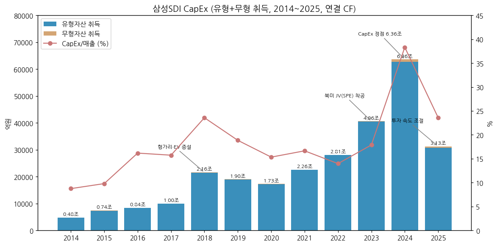

→ 2014~2017 연 0.5~1.0조 → 2018 2.16조(헝가리·EV 증설) → 2023 4.06조(북미 SPE) → **2024 6.36조 정점** → 2025 3.13조(속도 조절) → 1H26 1.14조
→ 사이클 annotation: EV 1차 증설(2018~19) / 북미 JV(2023~24) / ESS 전환·LFP(2026~). SPE는 미국 DOE 대출 담보(STARPLUS 지분 51%) 제공 (DART 반기 주석)

(5) 부채구조

| 항목 | 2022 | 2023 | 2024 | 2025 | 2026.06 | 2026.09 |
|---|---|---|---|---|---|---|
| 차입금 (억) | 51,482 | 57,178 | 115,779 | 108,839 | 121,109 | 85,214 |
| 현금성자산 (억) | 26,143 | 15,245 | 18,851 | 18,040 | 15,055 | 23,573 |
| 순차입금 (억) | 25,339 | 41,933 | 96,928 | 90,799 | 106,054 | 61,641 |
| 이자지급 (CF, 억) | 811 | 2,213 | 3,246 | 3,499 | 1,373 (1H) | - |
| 이자보상배율 (OP/이자지급) | 22.3배 | 7.4배 | 1.1배 | 적자 | 0.4배 (1H) | - |

→ (출처: OpenDART 연결 BS·CF, 2026.09는 회사 IR. 이자비용 대신 CF 이자지급액 사용 — 자본화 이자 포함 여부 차이 가능)
→ 신용등급 AA 유지(한국기업평가 2023~2025). 회차별 회사채 발행 내역 [미확보]

(6) 배당·자사주

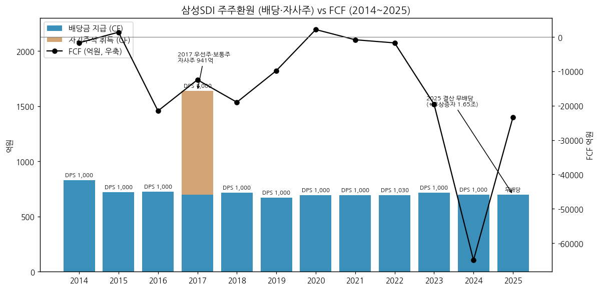

| 결산기 | DPS 보통주 (원) | 배당금 지급 (CF, 억) | 배당성향 (연결) | 배당수익률 (보통주) | 자사주 |
|---|---|---|---|---|---|
| 2014 | 1,000 | 830 | - | - | 합병 단주·매수청구 취득 |
| 2015 | 1,000 | 721 | 130.6% | 0.87% | - |
| 2016 | 1,000 | 727 | 30.9% | 0.92% | - |
| 2017 | 1,000 | 700 | 10.1% | 0.49% | 보통주·우선주 장내 취득(CF 941억) |
| 2018 | 1,000 | 717 | 9.5% | 0.46% | - |
| 2019 | 1,000 | 669 | 18.8% | 0.44% | - |
| 2020 | 1,000 | 692 | 11.6% | 0.18% | - |
| 2021 | 1,000 | 693 | 5.7% | 0.2% | - |
| 2022 | 1,030 | 695 | 3.5% | 0.2% | - |
| 2023 | 1,000 | 716 | 3.3% | 0.2% | - |
| 2024 | 1,000 | 697 | 11.2% | 0.4% | - |
| **2025** | **무배당** | 699 (2024 결산분) | - | - | - |

→ (출처: DART 2016~2025 사업보고서 주요배당지표, dart_api 2025 FY 배당. 우선주 DPS는 보통주 +50원(1,050원). CF 배당금은 전년 결산분 지급)
→ 2025 결산 적자로 **무배당** + 유상증자 1.65조 → 2025년 주주환원 순유입 마이너스. 자기주식 보통주 3,331,391주(4.1%) 장기 보유, 소각 이력 없음(2004 이익소각 이후)

(7) 재무비율 (연결)

| 지표 | 2021 | 2022 | 2023 | 2024 | 2025 | 2026.06 |
|---|---|---|---|---|---|---|
| ROE (지배, 평균자본) | 8.5% | 12.5% | 11.5% | 3.1% | -3.2% | - |
| ROA (연결 NI/평균자산) | 5.3% | 7.3% | 6.4% | 1.5% | -1.4% | - |
| 부채비율 | 70% | 76% | 71% | 88% | 79% | 77% (9월말 66.5%) |
| 유동비율 | 115% | 121% | 108% | 95% | 89% | 77% (9월말 120%) |
| 이자보상배율 | 21.9배 | 22.3배 | 7.4배 | 1.1배 | 적자 | 0.4배 |
| 순차입금 | 2.29조 | 2.53조 | 4.19조 | 9.69조 | 9.08조 | 10.61조 (9월말 6.16조) |

→ [계산] OpenDART 연결 기준. 2015~2020 ROE: 0.5% / 2.0% / 6.0% / 6.0% / 2.9% / 4.5%

---

## ⑤ 지배 구조

(1) 그룹·계열 관계

```
삼성생명 (삼성전자 8.51%) ──▶ 삼성전자 ──(19.44%)──▶ 삼성SDI (최대주주 등 20.21%)
                                                      │
          ┌───────────────┬─────────────────┬────────┴────────┬──────────────────┐
     삼성디스플레이     StarPlus Energy     SDI-GM Synergy     에코프로이엠        해외 생산법인
   15.2% → 약 10.2%     51% (연결)         Cells 100%          40% (지분법)      헝가리·말레이시아·
  (2026.08 1/3 매각)  (FCA US 49%)       (2026.08 단독)     (양극재 JV)       중국·베트남·오스트리아
```

→ (출처: DART 2026 반기보고서 최대주주·관계기업 주석, 비즈워치 2026-09-29. 매각 후 SDC 잔여 지분율은 매각 전 15.2% × (1−1/3) [계산, 공시 확인 전])
→ SDC 지분 20% 미만이나 이사회 의결권 행사로 관계기업 분류(2026.06말 장부 13.83조). 매각 후 분류 유지 여부 [미확보]

(2) 주주 구분

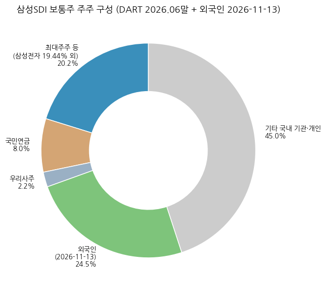

| 주주 | 2024말 | **2025말** | 2026.06말 | 비고 |
|---|---|---|---|---|
| 삼성전자 | 19.58% | **19.44%** | 19.44% | 2025 유상증자 참여 (13,462,673 → 15,663,968주) |
| 삼성문화재단·복지재단 | 0.83% | 0.71% | 0.71% | |
| 삼성생명(특별계정)·임원 | 0.08% | 0.06% | 0.06% | |
| **최대주주 등 합계** | **20.49%** | **20.21%** | **20.21%** | |
| 국민연금공단 | 확인 불가 | **6.92%** | **8.04%** | 5% 이상 주주 |
| 우리사주조합 | - | 2.81% | 2.25% | |
| 소액주주 | - | 68.6% (593,685명) | 70.14% (766,880명) | 1% 미만 주주 |
| 외국인 | - | - | - | **24.54%** (2026-11-13, 삼성SDI IR) |

→ (출처: dart_api 2025 FY 최대주주, DART 2025 사업보고서·2026 반기보고서 5% 주주·소액주주. 차트는 기준일이 다른 외국인 지분을 함께 표시 — 국내 기관·개인 잔여는 [계산])

(3) 임원·이사회 (2026.06말, DART 반기보고서)

| 성명 | 직위 | 출생 | 담당 | 주요 경력 |
|---|---|---|---|---|
| **최주선** | 대표이사 사장 (사내) | 1963.05 | 이사회 의장 | 前 삼성디스플레이 대표이사 사장, 삼성전자 DS 미주총괄, KAIST |
| 오재균 | 사내이사 | - | (2026.03 신규) | 세부 [미확보] |
| 윤종원 | 독립이사 | - | (2026.03 신규) | 세부 [미확보] |
| 유승원 | 독립이사 | - | (2026.03 신규) | 세부 [미확보] |
| 이미경 | 독립이사 | 1964.04 | 지속가능경영위원장 (재선임) | 환경재단 대표 |

→ 2026.03 정기주총: 김종성·박진 사내이사 사임, 권오경·김덕현·최원욱 독립이사 임기만료 → 이사회 5인(사내 2 / 독립 3) (DART 반기보고서 경영진 변동). 신규 이사 약력은 반기보고서 임원현황 미추출 [미확보]

---

## ⑥ 기타 팩트

(1) R&D 인프라

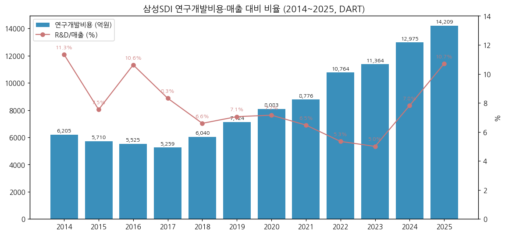

| 연도 | 2014 | 2015 | 2016 | 2017 | 2018 | 2019 | 2020 | 2021 | 2022 | 2023 | 2024 | 2025 | 1H26 |
|---|---|---|---|---|---|---|---|---|---|---|---|---|---|
| 연구개발비용 (억) | 6,205 | 5,710 | 5,525 | 5,259 | 6,040 | 7,124 | 8,083 | 8,776 | 10,764 | 11,364 | 12,975 | **14,209** | 8,586 |
| R&D/매출 | 11.3% | 7.5% | 10.6% | 8.3% | 6.6% | 7.1% | 7.2% | 6.5% | 5.3% | 5.0% | 7.8% | **10.7%** | 11.7% |

→ (출처: DART 각 사업보고서 연구개발비용 표. 2015 재작성치(케미칼 제외) 5,389억, 2024·2025는 편광필름 제외. 비율은 [계산] 연결 매출 대비 — 2024·2025·1H26은 DART 기재 비율과 동일)
→ 연구조직: 연구소(수원, 해외연구소 포함), 생산기술연구소, 중대형·소형·전자재료사업부 개발실, ASB(전고체)사업화추진팀 (DART)
→ 특허: 등록 22,322건(국내 6,414 / 해외 15,742) (DART 2026 반기)

(2) 진행 중 corporate action (10년치 M&A·자본거래)

| 시기 | 내용 | 규모 |
|---|---|---|
| 2014.07 | (구)제일모직 흡수합병 | 합병신주 23,206,189주 |
| 2015.02 | 마그나 배터리팩 사업 인수 (SDIBS) | [미확보] |
| 2016.04 | 케미칼(에스디아이케미칼) 90% 롯데케미칼 매각 | 중단영업이익 1조 896억 |
| 2020~22 | 에코프로이엠 양극재 JV (40%) | - |
| 2022.05 | StarPlus Energy (스텔란티스 JV, 51%) | - |
| 2024.08 | SDI-GM Synergy Cells JV 본계약 | - |
| 2024~2025 | 편광필름 사업 양도 | 매각예정자산 1.04조(2024말), 중단이익 2,900억(2025) |
| 2025.06 | 주주배정 유상증자 | 1조 6,549억 (보통주 11,821,000주) |
| **2026.08.11** | **GM 보유 JV 지분 전량 인수** | 인수가 [미확보] (NH: GM 누적출자 약 2,750억보다 낮을 전망) |
| **2026.08.27** | **삼성디스플레이 지분 1,308만 8,235주 매각** | 4.45조 (세후 약 3.3조, 비즈워치) |

(3) R&D·사업 마일스톤 (10년치)

→ 2017.05 헝가리 EV 공장 / 2019.11 BMW 차세대 배터리 공급계약 / 2021~22 P5(Gen5) 양산 / 2024 SBB 1.5 출시
→ 2025.10 BMW 전고체 실증 협약 / 2026.06 피지컬AI용 전고체 공개, 2027 하반기 양산 목표(첫 적용 휴머노이드 유력)
→ 2026.10 미국 SPE 각형 LFP ESS 셀 양산, 연내 SBB 2.0 공급 / 46파이 원형(xEV·M-Mobility) 개발 / 소듐 배터리 연구 (DART·BT 2Q26 리뷰)

(4) 주요 리스크

→ **EV 고객 점유율 하락** — 비중국 EV 사용량 점유율 6.7% → 3.5%(2026 1~9월 YoY, SNE리서치). BMW·VW향 출하 감소
→ **AMPC·관세 등 정책 의존** — AMPC 제외 흑자는 3Q26이 처음. 2030년 AMPC 축소에 대비해 고객사와 납품가 협의 중(회사 3Q26 컨콜). 미국 IAA·OBBBA·Non-PFE 요건 변화
→ **북미 ESS 경쟁** — 중국 업체 북미 ESS 출하 점유율 70~75%(LS증권), GM의 ESS(소듐) 진출 계획
→ **지분법이익 축소** — SDC 1/3 매각으로 연 약 2,500억 감소, 순이익 변동성 확대
→ **재무 레버리지·FCF** — 12년 중 FCF 흑자 2년, 순차입금 6.16조(2026.09), 2025 무배당·유상증자 이력
→ **환율** — 수출 비중 81~88%(DART)
→ **가동률** — 소형 73%, EMC 28%(1H26, DART), 헝가리 EV 가동률(NH 추정 26년 55%)
→ **소송·우발채무** — 세부 [미확보] (반기보고서 우발부채 주석 미추출)

(5) ESG 등급

→ **MSCI ESG AA** (리더 그룹), **DJ Best-In-Class Indices World 편입**(2004년 국내 최초 이래 국내 최다) — 삼성SDI 지속가능경영보고서 2026
→ RE100 가입(2022), 2025년 재생에너지 전환율 **38%** (약 53만톤 감축) — 같은 보고서
→ 온실가스 배출량(별도) 2024 532,677 → 2025 514,445 tCO2e (DART 2026 반기)
→ KCGS(한국ESG기준원) 등급 [미확보]

(6) 인증·라이선스

→ ISO 14001·ISO 50001(주요 사업장), 울산·천안 녹색기업 지정 (DART)
→ 2차전지 업계 최초 카본 트러스트 탄소발자국 인증(2023.06), 전 사업장 폐기물 매립 제로 플래티넘(2024.11) (DART 연혁)
→ 기타 제품 인증(UL 등) 목록 [미확보]

---

## Version Log

| 버전 | 일자 | 내역 |
|---|---|---|
| v1.0 | 2026-11-14 | 첫 작성. source 6종 전수 점검: ① DART 정기보고서 **본문 XML** 47건(2014.12~2026.06 — 기존 source 폴더 PDF 41건은 열어 보니 전부 첨부 감사·검토보고서라 `_attachments_pdf/`로 분리 후 본문 재수집) ② 첨부(연결·별도 감사보고서 XML) ③ 회사 IR 실적 PDF 61건(1Q11~3Q26, 2Q26·3Q26 신규) ④ 지속가능경영보고서 2026 ⑤ Yahoo v8 월간 25년·일간 2년(2026-11-13) ⑥ 시장 보조(외국인 지분율·SNE리서치·stockanalysis 피어). 차트 16종(12종 표준 + chart2 확장 2b·2c·2d·2e) |

**자료 audit (v1.0)**: DART 원문 ✅ / OpenDART 재무 ✅ (CFS 43건) / dart_api ✅ / 회사 IR 실적 PDF ✅ (61건) / 지속가능경영보고서 ✅ (2026) / Yahoo 주가 ✅ / 시장 보조 ✅ / **3Q26 분기보고서 ❌ (작성 시점 미공시)**

**잔여 보완 후보 (v1.1)**
→ 3Q26 분기보고서 공시 후: IR 발표치 대조, SDC 잔여 지분 회계 분류·처분손익, 지배주주지분, AMPC 매출 표시 변경 여부 확정
→ 4Q24 AMPC, 2015~2019 분기 사업부 영업이익(IR 미공시 — DART 분기 부문정보로 보완 가능)
→ EV/ESS/소형 매출 분해(회사 미공시 — 컨콜 정성 + 셀사이드 컨센으로 별도 표), 중대형 GWh CAPA
→ 2026.03 신규 이사 약력, 회사채 회차별 발행 내역, 우발채무·소송, KCGS 등급
→ 2017·2018 관계기업투자 계정 매핑, OFS(별도) 시계열
