# 삼성물산 — 기업 개요 (v1.0)

> 마지막 update: 2026-11-25 (3Q26 분기보고서 2026-11-16 제출분 반영)
> 입력 source: OpenDART fnlttSinglAcntAll (연결 CFS 44개·별도 OFS 45개 JSON, 2015 FY\~3Q26 + 2014 비교컬럼) + DART 정기공시 원문 XML 48건 (사업보고서 2014\~2025, 분기·반기 1Q15\~3Q26) + OpenDART 기업개황·최대주주·임원·직원·배당·자기주식·주식총수 (2025 사업보고서) + 삼성물산 IR (irgo 경유 2019년 1\~3분기 실적자료 3건) + Yahoo Finance (028260.KS 월간 2015-01\~2026-11, 일간 2024-11\~2026-11-25, 보유 상장사 6종 종가) + 언론·증권사 인용 (비즈워치·CEO스코어데일리·SBS Biz·스마트투데이·머니투데이(SK증권)·아시아경제)
> 갱신 주기: 매분기 (실적 리뷰 모드 호출 시)
> 워치리스트: 건설·건설기계 섹터 (2026-11-23 추가, T1 아님 → 표준 깊이) / 서브섹터: 건설 (label = "건설 부문") — 4Q26부터 리뷰
> **Fact verify cutoff**: 2026-11-25 (주가·시총·보유지분 가치 = 2026-11-25 종가, Yahoo Finance v8. 3Q26 = DART 분기보고서 확정치)

---

## 1. 기업 분류

- **Primary 분류: 지속성장** (전사 OPM 2016 0.5% → 2025 8.1% 계단식 상승 — 이익의 2/3를 바이오가 만듦)
- **Secondary 노트: 사이클(건설·상사) + 지주회사(NAV) 성격** — 주가는 영업이익보다 보유 상장지분 가치(삼성전자·삼성바이오로직스·삼성생명)에 더 크게 반응. 워치리스트 편입 이유인 **건설 부문은 삼성전자 팹 투자에 연동된 사이클**

### ① 정량 근거

**📊 Summary Box (합병 후 10년, 2016\~2025 연결 — 2014·2015는 합병 단절로 제외):**

| 지표 | 전사 | 건설 부문 |
|------|-----|-----|
| 매출 CAGR (2016→2025, 9년) | **+4.2%** (28.1조 → 40.7조) | **+1.0%** (12.95조 → 14.15조) |
| OPM 평균 | **4.4%** | **4.3%** |
| OPM 정점 평균 | 8.1% (2025, 정점 갱신 중 — 사이클 정점 아님) | **6.2%** (2018 6.4% · 2022 6.0%) |
| OPM 저점 평균 | 0.5% (2016) | **1.3%** (2016 0.3% · 2021 2.3%) |
| 사이클 주기 | 사이클 미검출 (2019\~2020 소폭 조정 후 5년 연속 상승) | 약 4년 (peak-to-peak 2018→2022) |
| 사이클 회수 | - | 정점 2회 / 저점 2회 (2025 3.8%는 3차 저점 후보) |

```
[전사 OPM 시계열 (12년, 연결, OpenDART)]
연도   매출(조)  영업이익  순이익  OPM    NPM
2014     5.13     0.21     0.46   4.2    8.9   ← 제일모직(패션·에버랜드 리조트·건설(E&A)·급식) 단독 숫자
2015    13.34     0.04     2.69   0.3   20.1   ← 2015-09-01 구 삼성물산 흡수합병 (구 물산 4개월만 반영) / 순이익은 합병 관련 일회성
2016    28.10     0.14     0.02   0.5    0.1   ← 합병 후 첫 온기. 1Q16 건설 -4,145억 (호주 로이힐 손실)
2017    29.28     0.88     0.48   3.0    1.6
2018    31.16     1.10     1.75   3.5    5.6   ← 건설 OPM 6.4% 1차 정점 (평택 P1 등 하이테크), 서초사옥 매각 등 일회성 약 1조 (IR 3Q19)
2019    30.76     0.87     1.05   2.8    3.4
2020    30.22     0.86     1.16   2.8    3.8   ← 코로나 (리조트·패션 적자)
2021    34.46     1.20     1.83   3.5    5.3   ← 3Q21 건설 -1,297억 (해외 현장 비용)
2022    43.16     2.53     2.54   5.9    5.9   ← 바이오로직스가 Bioepis 100% 인수 (2Q22\~ 연결) + 하이테크 2차 사이클
2023    41.90     2.87     2.72   6.9    6.5   ← 건설 매출 19.3조 사상 최대
2024    42.10     2.98     2.77   7.1    6.6
2025    40.74     3.29     3.91   8.1    9.6   ← 건설 -24% (하이테크 준공) vs 바이오 영업이익 2.19조 (+69%)

OPM range (2016~2025): 0.5% ~ 8.1% — 사이클 하락 없이 '바이오 믹스 상승'으로 단조 증가
```

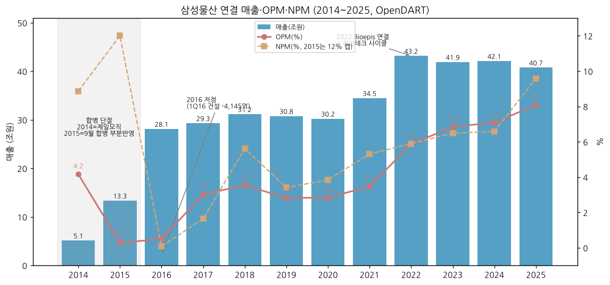

(2014 = 2015 사업보고서 전기 컬럼, 제일모직 연결. 2015 = 제일모직 1\~8월 + 합병법인 9\~12월. 2015 순이익 2.69조·세전 2.78조는 사업결합 관련 일회성 이익이 대부분이라 NPM 차트는 12%로 캡)

**이익 구성 (영업이익 비중, DART 사업부문별 요약 재무현황):**

| 연도 | 건설 | 상사 | 패션 | 리조트+급식 | 바이오 |
|---|---|---|---|---|---|
| 2018 | 70% | 13% | 2% | 13% | 1% |
| 2021 | 21% | 25% | 8% | 5% | 41% |
| 2025 | 16% | 8% | 4% | 5% | **67%** |
| 9M26 | 20% | 12% | 4% | 4% | **60%** |

### ② 산업 분류

- 산업: **복합기업 (건설·상사·패션·리조트/급식·바이오 CDMO)** — 사이클 산업 list 중 건설(하이테크·주택)·상사(원자재 트레이딩) 포함
- DART 업종 코드 467 (기타 전문 도매업 계열 분류) / KRX 유통업 / 대표 사업은 건설·바이오
- 워치리스트 섹터: **건설·건설기계** (T1 아님) / 서브섹터: **건설** — 국내 시공능력 상위, 하이테크(반도체 팹) 시공 1위권

### ③ 분류 결정 논리

(1) **가장 매출 큰 사업부 기준**: 상사 (2025 매출 14.64조, 35.9%) ≈ 건설 (14.15조, 34.7%) → 둘 다 사이클 → 이 기준만 보면 사이클
(2) **사이클 사업부 이익 비중 우선 sub-rule**: 2025 영업이익의 **67%가 바이오** (2.19조, OPM 36.8%) / 건설 16% / 상사 8% → 이익 변동을 지배하는 것은 장기계약 CDMO(바이오로직스 수주잔고 최소구매물량 기준 94억 달러, 3Q26) → **지속성장**으로 결정. 단 바이오 지분율은 43.06%라 지배주주 귀속 이익은 이보다 작음 (2025 연결 순이익 3.91조 중 지배 2.44조)
(3) **Boundary case 처리 (지주회사 성격 vs 건설 사이클 vs 바이오 성장)**:
- 지주회사 성격: 상장 보유지분 가치 **94.0조** (2026-11-25 종가, 삼성전자 4.49%·바이오로직스 43.06%·삼성생명 19.34% 등) vs 시가총액 **39.5조** → 주가의 1차 변수는 보유지분, 특히 삼성전자 주가 (2026-07 SK증권: 삼성전자 고점 대비 -42.5% 때 물산 NAV -30.8%, 주가 -46.6%)
- 건설 사이클: 매출의 1/3이지만 영업이익 기여 16\~20% — 하이테크(삼성전자 팹) 발주 사이클에 따라 OPM 0.3\~6.4% 진폭
- 바이오 성장: 영업이익 60\~67%, 연결로 잡히지만 시장 가치는 '지분가치'로 따로 평가됨
- → **Primary 지속성장 (이익 기준) + Secondary 사이클(건설)·지주(NAV)** 병기. 실적 리뷰는 건설 부문 델타를 1순위로 추적하되, 밸류에이션 판단은 NAV로
(4) **피어 대비**:
- 국내 대형 건설사 (현대건설·GS건설·DL이앤씨) = 주택·플랜트 사이클 단독 / **삼성물산 건설 = 그룹 하이테크 캡티브 비중이 높아 주택 사이클보다 삼성전자 CapEx 사이클을 탐** (3Q26 하이테크 매출 비중 약 50%, 9M26 수주의 58%)
- 지주회사 (SK㈜·LG) = 상장 자회사 지분가치 + 자체사업 / **삼성물산 = 지분가치 + 연결 자체사업(건설·상사·바이오) 규모가 큼** — 단, 최대 자산(삼성전자 지분)이 연결 대상이 아닌 FVOCI 금융자산이라 영업이익에 안 잡힘 (배당수익만 유입: 2025 배당금 수취 7,437억)

### ④ 적정 밸류에이션 방법 (밸류에이션 다이얼)

- **NAV·SOTP 우선** — 상장지분 가치 − 할인율 + 자체사업 가치 − 순차입
  - 2026-11-25 상장지분 단순 합계 94.0조 (세전) / 시총 39.5조 → **상장지분 대비 -58%** (자체사업 가치·순현금 반영 전 단순 비교)
  - SK증권 (2026-07-30): NAV 할인율 **61.7%** (최근 1년 최대), 목표가 590,000 → 450,000원
  - 아시아경제 (2026-06-20): DS·LS·IBK 목표가 620,000\~630,000원 — 삼성전자·삼성생명·바이오로직스 지분이 NAV의 90% 이상
- **PBR 보조** — 지배자본 88.2조 (3Q26, 보유주식 9월말 시가 평가 반영) 대비 시총 39.5조 → **PBR 0.45배**. 단 자본은 삼성전자 주가에 따라 분기마다 수십조 출렁 (2Q26 지배자본 105.6조 → 3Q26 88.2조)
- **PER은 참고만** — 2025 EPS 14,905원 기준 PER 16.3배, 2025 연결 순이익의 약 38%가 비지배(바이오 2사 소수주주) 몫
- **주주환원 수익률** — 정책상 관계사 배당수익의 60\~70% 환원 (2026\~2028 정책, 최소 DPS 2,500원) → 삼성전자 배당이 곧 물산 배당. DS투자증권 추정 2026 DPS 23,050원 (2026-06, 증권사 추정치)
- **건설 부문 단독 가치**는 피어 PBR/PER 대신 영업이익 멀티플 (SOTP 내 소비중) — 건설 부문 영업이익 연 0.5\~1.0조

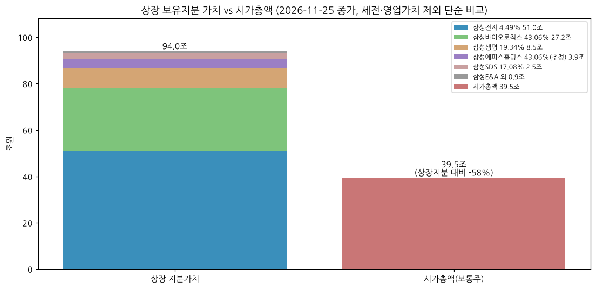

### ⑤ 분기 재평가 트리거 (분류 변경 조건)

- 바이오 부문 영업이익 비중이 **4개 분기 연속 50% 아래** (건설·상사 회복으로) → Primary를 '사이클 + 지속성장' 혼합으로 재검토
- 건설 부문 OPM **2분기 연속 6% 이상** + 하이테크 수주잔고 증가 지속 → 건설 사이클 '상승 국면' 판정 (3Q26 6.2% — 1분기째)
- 건설 부문 분기 영업이익 **적자 전환** (2016·2021 사례) → 사이클 저점 판정
- 삼성전자 지분 처분·지배구조 개편(보험업법 개정, 삼성생명 지분 변화 등) → 지주회사 프레임 재정의
- NAV 할인율 **40% 이하로 축소** (주주환원 확대 효과) → PBR·배당수익률 중심으로 밸류에이션 축 전환

---

## 2. 회사 개요

### ① 기본 사항

- **회사명**: 삼성물산주식회사 (SAMSUNG C&T CORPORATION) / KRX 028260 (보통주), 02826K (우선주)
- **본사**: 서울특별시 강동구 상일로6길 26 (OpenDART 기업개황)
- **설립**: 1963-12-23 (존속법인 = 구 제일모직(전 삼성에버랜드)) / 1938 삼성상회가 그룹 모태. 2015-09-01 구 삼성물산 흡수합병 후 사명 변경
- **대표이사**: 오세철 (건설부문장) · 이재언 (상사부문장) · 송규종 (OpenDART 기업개황 2026-11 조회)
- **그룹**: 삼성그룹의 사실상 지주회사 — 이재용 회장 외 특수관계인 36.02% (2025말, 우선주 포함 총수 기준) → 삼성물산 → 삼성생명 19.34% / 삼성전자 4.49% / 삼성바이오로직스 43.06% / 삼성에피스홀딩스 43.06%
- **사업 한 줄 정의**: 삼성전자 팹·초고층·발전 플랜트를 짓는 건설, 철강·화학·에너지 트레이딩 상사, 빈폴·갤럭시 패션, 에버랜드·웰스토리(급식), 그리고 연결 자회사 삼성바이오로직스(CDMO 84.5만 리터)·삼성에피스홀딩스(바이오시밀러 11종)를 거느린 그룹 지배구조 정점의 복합기업
- 연결 종속회사 139개 (국내 19·해외 120, 2025말) — 국내 상장 종속회사: 삼성바이오로직스, 삼성에피스홀딩스

### ② 최근 12년 손익·자본 추이 (조원, 연결, DART)

| 연도 | 매출 | YoY | 영업이익 | 순이익 | 지배순이익 | 자본총계 | 자본 YoY |
|---|---|---|---|---|---|---|---|
| 2014 ※ | 5.13 | - | 0.21 | 0.46 | 0.46 | 5.29 | - |
| 2015 ※ | 13.34 | (단절) | 0.04 | 2.69 | 2.75 | 18.31 | (단절) |
| 2016 | 28.10 | (단절) | 0.14 | 0.02 | 0.11 | 21.11 | +15.2% |
| 2017 | 29.28 | +4.2% | 0.88 | 0.48 | 0.64 | 25.15 | +19.2% |
| 2018 | 31.16 | +6.4% | 1.10 | 1.75 | 1.71 | 22.55 | -10.3% |
| 2019 | 30.76 | -1.3% | 0.87 | 1.05 | 1.05 | 26.69 | +18.4% |
| 2020 | 30.22 | -1.8% | 0.86 | 1.16 | 1.04 | 32.95 | +23.4% |
| 2021 | 34.46 | +14.0% | 1.20 | 1.83 | 1.64 | 33.15 | +0.6% |
| 2022 | 43.16 | +25.3% | 2.53 | 2.54 | 2.04 | 31.96 | -3.6% |
| 2023 | 41.90 | -2.9% | 2.87 | 2.72 | 2.22 | 39.90 | +24.8% |
| 2024 | 42.10 | +0.5% | 2.98 | 2.77 | 2.23 | 37.26 | -6.6% |
| 2025 | 40.74 | -3.2% | 3.29 | 3.91 | 2.44 | 57.50 | +54.3% |
| 3Q26 (9M) | 34.47 | +15.2% | 2.89 | 2.80 | 2.00 | 96.49 | +67.8% (vs 2025말) |

(※ 2014 = 제일모직 단독, 2015 = 합병 부분 반영 — 시계열 비교 불가. 자본 급변은 대부분 삼성전자·삼성생명 지분의 FVOCI 평가: 2025 기타포괄손익 +16.85조)

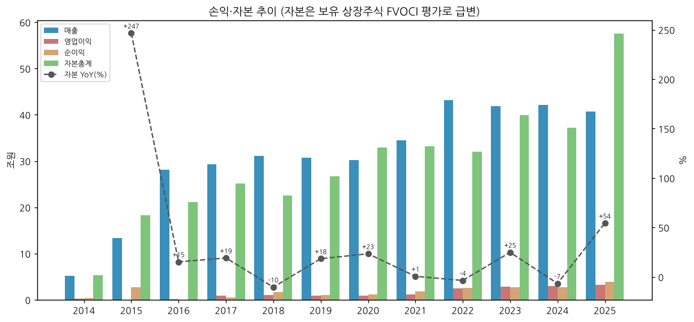

### ③ 회사 주가 역사 ★ narrative 영역

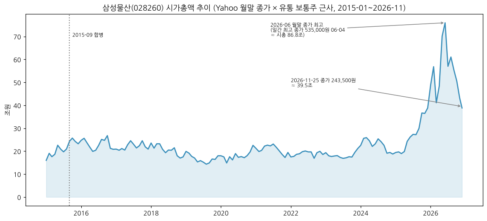

**시가총액 데이터:** Yahoo Finance 028260.KS 월간 종가 (2015-01\~2026-11) × 유통 보통주 근사 (합병 전 115.97백만주 / 2015-09\~2024 163.46백만주 / 2025\~ 162.17백만주 — 자기주식 제외. 구 제일모직 상장일 2014-12-18 이전·구 삼성물산(000830) 주가는 미포함)
- **2026-11-25 종가 243,500원 (-8.3% DoD) → 시총 약 39.5조원** (보통주 162,167,581주 기준)
- **사상 최고 (종가): 2026-06-04 535,000원 → 시총 약 86.8조원** / 장중 최고 565,000원 (같은 날, Yahoo 일간) / 2026 52주 최저 222,000원
- 2026-06 고점 → 2026-11-25 **-54%** (삼성전자 2026-11-25 종가 170,700원, 같은 날 -9.9%)
- 합병 후 2015-09\~2025 박스권: 시총 약 15\~27조 (주가 10\~16만원대), NAV 할인 확대 구간

**사이클 history:**

```
[2014-12] 제일모직 상장 (2014-12-18)
[2015-05~09] 제일모직–구 삼성물산 합병 결의 (2015-05-26) → 합병 (2015-09-01)
  · 엘리엇 등 반대, 합병비율 논란 → 이후 장기 소송 (5-④ 리스크)
[2016] 로이힐 손실 + 건설 부진 → 주가 10만원대
[2016-11] 삼성바이오로직스 상장 — 바이오 지분가치 부각
[2017-2018] 하이테크 1차 사이클 (평택 P1) — 건설 OPM 6.4% (2018)
[2019-2020] 코로나, 리조트·패션 적자 — 시총 15조 내외 (저점권)
[2021-01] 삼성전자 특별배당 기대 → 단기 급등 (월중 고가 160,000원)
[2022-2025] 하이테크 2차 사이클 + Bioepis 연결 — 이익은 사상 최대, 주가는 박스권 (NAV 할인 확대)
[2025 하반기~2026-06] 삼성전자 주가 급등(AI 메모리) → 지분가치 폭증 → 2026-06-04 535,000원
  · 6월 증권사 목표가 62~63만원 (DS·LS·IBK, 2026-06-20 아시아경제)
[2026-07~11] 삼성전자 조정 → NAV 동반 하락, 주가는 NAV보다 더 빠지며 할인율 61.7% (SK증권 2026-07-30)
  · 2026-11-25 243,500원 (고점 대비 -54%)
```

### ④ 주요 연혁

```
1938-03   삼성상회 설립 (대구) — 삼성그룹 모태, 구 삼성물산의 뿌리
1963-12   동화부동산 설립 → 중앙개발 → 삼성에버랜드 (존속법인 설립일)
1976-04   용인자연농원 개장 → 1996 에버랜드 BI, 캐리비안베이 개장
2013-12   삼성에버랜드, 제일모직 패션사업 양수 / 급식사업 물적분할(삼성웰스토리 설립)
2014-07   삼성에버랜드 → 제일모직으로 사명 변경 / 2014-12-18 유가증권시장 상장
2015-09   제일모직–구 삼성물산 합병 (합병기일 09-01, 신주 56,317,483주 발행) → 사명 삼성물산
2016-11   삼성바이오로직스 상장 (연결 종속, 당시 지분 43.4%)
2017~     3개년 단위 주주환원정책 시작 (2017-2019 / 2020-2022 / 2023-2025 / 2026-2028)
2018      서초사옥 매각 등 일회성 이익 약 1조 (IR 3Q19)
2022-04   삼성바이오로직스, 삼성바이오에피스 잔여지분 인수 → 100% 자회사 (바이오 부문 확대)
2022      건설 비전 "Creating Futurescape" 선포
2023-02   '23~'25 주주환원정책 — 관계사 배당수익 60~70% 환원, 자사주 전량 5년 분할 소각
2024-04   자사주 보통 1,888,889주·우선 159,835주 소각
2025-11   삼성바이오로직스 인적분할 → 삼성에피스홀딩스 신설 (분할기일 11-01, 상장)
2026-01   보유 자사주 잔여 7,807,563주 + 1,400주 소각 결정 → 3Q26 자기주식 0주
2026-02   '26~'28 주주환원정책 — 배당수익 60~70% 환원 유지, 최소 DPS 2,000 → 2,500원
2026-03   삼성바이오로직스, 미국 Human Genome Sciences 인수 완료 (생산능력 84.5만 리터)
2026-06   주가 사상 최고 535,000원 (06-04 종가)
2026-10   건설 2026 수주 목표 23.5조 → 30.1조 상향 (3Q26 실적 발표)
```

---

## 3. 비즈니스 모델

### ① 실적 추이 (전사 → 사업부문 → 건설 상품/지역 3단계 위계)

**연간 5년 통합 표 (조원, DART 사업부문별 요약 재무현황, 내부거래 배분 후):**

| 항목 | 2021 | 2022 | 2023 | 2024 | 2025 | 9M26 |
|------|------|------|------|------|------|------|
| **연결 매출액** | **34.46** | **43.16** | **41.90** | **42.10** | **40.74** | **34.47** |
| └ 사업부문별 | | | | | | |
| &nbsp;&nbsp;&nbsp;&nbsp;└ **건설** | **10.99** | **14.60** | **19.31** | **18.65** | **14.15** | **11.87** |
| &nbsp;&nbsp;&nbsp;&nbsp;└ 상사 | 17.35 | 20.22 | 13.27 | 13.00 | 14.64 | 13.02 |
| &nbsp;&nbsp;&nbsp;&nbsp;└ 패션 | 1.77 | 2.00 | 2.05 | 2.00 | 2.02 | 1.66 |
| &nbsp;&nbsp;&nbsp;&nbsp;└ 리조트 (에버랜드·골프·조경) | 0.52 | 0.76 | 0.78 | 0.78 | 0.72 | 0.49 |
| &nbsp;&nbsp;&nbsp;&nbsp;└ 급식/식자재유통 (웰스토리) | 2.26 | 2.59 | 2.80 | 3.12 | 3.26 | 2.64 |
| &nbsp;&nbsp;&nbsp;&nbsp;└ 바이오 (바이오로직스·에피스홀딩스) | 1.57 | 3.00 | 3.69 | 4.55 | 5.95 | 4.79 |
| └ 건설 지역별 | | | | | | |
| &nbsp;&nbsp;&nbsp;&nbsp;└ 건설 내수 | 7.20 | 9.37 | 10.06 | 9.88 | 6.62 | 5.73 |
| &nbsp;&nbsp;&nbsp;&nbsp;└ 건설 수출(해외) | 3.79 | 5.22 | 9.25 | 8.77 | 7.53 | 6.13 |
| **연결 영업이익** | **1.20** | **2.53** | **2.87** | **2.98** | **3.29** | **2.89** |
| &nbsp;&nbsp;&nbsp;&nbsp;└ **건설** | **0.25** | **0.87** | **1.03** | **1.00** | **0.54** | **0.59** |
| &nbsp;&nbsp;&nbsp;&nbsp;└ 상사 | 0.30 | 0.40 | 0.36 | 0.30 | 0.27 | 0.35 |
| &nbsp;&nbsp;&nbsp;&nbsp;└ 패션 | 0.10 | 0.18 | 0.19 | 0.17 | 0.12 | 0.11 |
| &nbsp;&nbsp;&nbsp;&nbsp;└ 리조트 | -0.03 | 0.06 | 0.07 | 0.06 | 0.02 | -0.01 |
| &nbsp;&nbsp;&nbsp;&nbsp;└ 급식/식자재 | 0.09 | 0.07 | 0.13 | 0.16 | 0.15 | 0.12 |
| &nbsp;&nbsp;&nbsp;&nbsp;└ 바이오 | 0.49 | 0.95 | 1.09 | 1.30 | 2.19 | 1.73 |
| **매출 YoY (%)** | **+14.0** | **+25.3** | **-2.9** | **+0.5** | **-3.2** | **+15.2** |
| &nbsp;&nbsp;&nbsp;&nbsp;└ 건설 YoY | -6.1 | +32.8 | +32.3 | -3.4 | -24.2 | +17.4 |
| &nbsp;&nbsp;&nbsp;&nbsp;└ 바이오 YoY | +34.8 | +91.4 | +23.1 | +23.1 | +30.9 | +12.6 |
| **영업이익 YoY (%)** | **+39.5** | **+111.4** | **+13.5** | **+3.9** | **+10.4** | **+17.2** |
| **OPM 전사 (%)** | **3.5** | **5.9** | **6.9** | **7.1** | **8.1** | **8.4** |
| &nbsp;&nbsp;&nbsp;&nbsp;└ **건설 OPM** | **2.3** | **6.0** | **5.4** | **5.4** | **3.8** | **5.0** |
| &nbsp;&nbsp;&nbsp;&nbsp;└ 상사 OPM | 1.7 | 2.0 | 2.7 | 2.3 | 1.9 | 2.7 |
| &nbsp;&nbsp;&nbsp;&nbsp;└ 패션 OPM | 5.7 | 9.0 | 9.4 | 8.5 | 6.1 | 6.7 |
| &nbsp;&nbsp;&nbsp;&nbsp;└ 리조트 OPM | -6.2 | 7.5 | 8.5 | 7.5 | 2.6 | -2.6 |
| &nbsp;&nbsp;&nbsp;&nbsp;└ 급식 OPM | 3.9 | 2.8 | 4.6 | 5.0 | 4.7 | 4.7 |
| &nbsp;&nbsp;&nbsp;&nbsp;└ 바이오 OPM | 31.4 | 31.5 | 29.4 | 28.5 | 36.8 | 36.2 |

(9M26 YoY는 9M25 대비. 회사 IR·언론은 리조트+급식을 '리조트부문'으로 합산 발표 (2025 리조트부문 매출 3.99조 = 0.72 + 3.26). 건설 원가율·GPM은 DART 부문 공시에 없음 → IR 미확보로 미기재)

**사업부문별 10년 연간 (억원, DART):**

| 연도 | 건설 매출 | 건설 OP | 건설 OPM | 상사 매출 | 상사 OP | 바이오 매출 | 바이오 OP | 패션 OP | 리조트+급식 OP |
|---|---|---|---|---|---|---|---|---|---|
| 2015 ※ | 42,440 | -1,302 | -3.1% | 35,969 | 523 | 539 | -199 | -89 | 910 |
| 2016 | 129,528 | 343 | 0.3% | 105,384 | 701 | 2,945 | -762 | -452 | 1,565 |
| 2017 | 119,829 | 5,014 | 4.2% | 125,549 | 1,497 | 4,598 | 172 | 327 | 1,802 |
| 2018 | 121,190 | 7,730 | 6.4% | 141,131 | 1,459 | 5,407 | 129 | 255 | 1,466 |
| 2019 | 116,524 | 5,396 | 4.6% | 138,617 | 1,062 | 7,016 | 460 | 323 | 1,427 |
| 2020 | 117,020 | 5,313 | 4.5% | 132,516 | 935 | 11,636 | 2,471 | -357 | 209 |
| 2021 | 109,889 | 2,514 | 2.3% | 173,545 | 2,961 | 15,680 | 4,916 | 1,003 | 566 |
| 2022 | 145,982 | 8,749 | 6.0% | 202,175 | 3,969 | 30,012 | 9,469 | 1,803 | 1,295 |
| 2023 | 193,101 | 10,343 | 5.4% | 132,660 | 3,603 | 36,946 | 10,879 | 1,934 | 1,944 |
| 2024 | 186,547 | 10,013 | 5.4% | 129,967 | 3,003 | 45,473 | 12,961 | 1,705 | 2,153 |
| 2025 | 141,486 | 5,355 | 3.8% | 146,361 | 2,718 | 59,511 | 21,914 | 1,231 | 1,709 |

(※ 2015 = 합병 후 9\~12월 구 물산 부문(건설·상사) + 제일모직 연간(패션·레저·급식·바이오). 2016\~2017 공시상 '건설(구 물산)'으로 표기되고 구 제일모직 건설(E&A 성격)은 2016부터 건설에 통합. 레저 → 리조트 명칭 변경. 구 삼성물산(000830) 2014 이전 건설·상사 숫자는 본 자료(028260 공시)에 포함되지 않아 미병기)

**사업부문별 분기 시계열 (43분기 = 1Q16\~3Q26, DART 사업부문별 요약 재무현황 누적값 차분):**

각 차트 = 매출 (bar, 좌축) + OPM (line, 우축). 양수 초록·음수 빨강 음영.

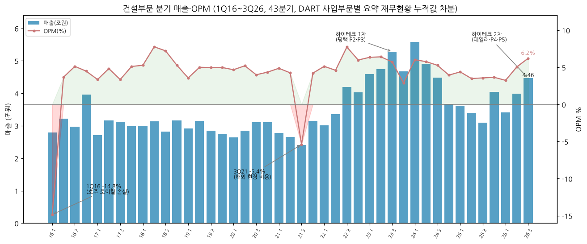
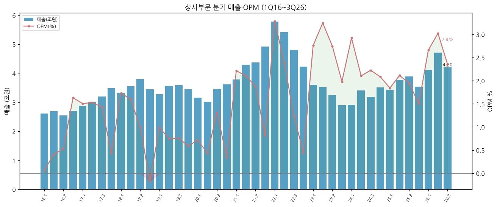
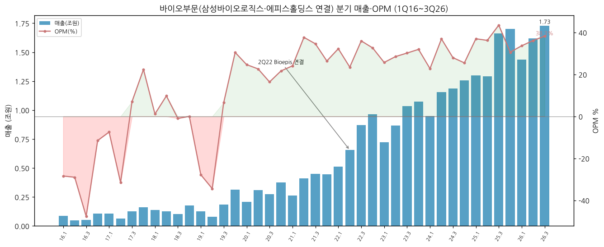
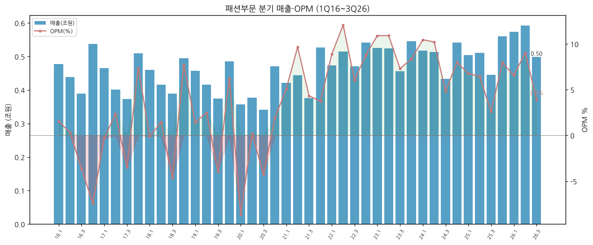
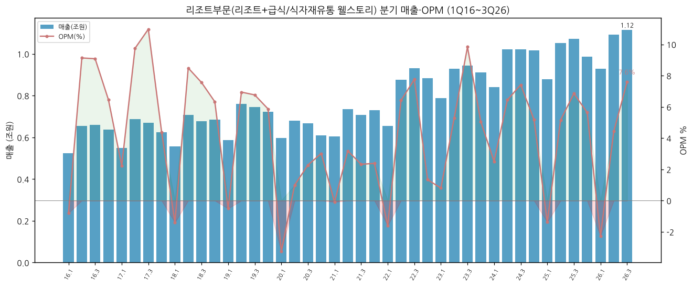

**건설 부문 분기 매출·영업이익 매트릭스 (억원, DART):**

| 연도 | 1Q 매출 | 2Q | 3Q | 4Q | 1Q OP | 2Q OP | 3Q OP | 4Q OP | 연간 매출 | 연간 OPM |
|---|---|---|---|---|---|---|---|---|---|---|
| 2016 | 27,929 | 32,220 | 29,772 | 39,606 | -4,145 | 1,184 | 1,528 | 1,777 | 129,528 | 0.3% |
| 2017 | 27,105 | 31,632 | 31,265 | 29,827 | 911 | 1,529 | 1,048 | 1,526 | 119,829 | 4.2% |
| 2018 | 29,953 | 31,326 | 28,242 | 31,670 | 1,582 | 2,433 | 2,040 | 1,675 | 121,190 | 6.4% |
| 2019 | 29,175 | 31,523 | 28,460 | 27,366 | 1,042 | 1,578 | 1,415 | 1,362 | 116,524 | 4.6% |
| 2020 | 26,420 | 28,419 | 31,068 | 31,112 | 1,236 | 1,481 | 1,242 | 1,354 | 117,020 | 4.5% |
| 2021 | 27,749 | 26,586 | 24,073 | 31,480 | 1,352 | 1,132 | -1,297 | 1,327 | 109,889 | 2.3% |
| 2022 | 30,185 | 33,593 | 41,896 | 40,308 | 1,550 | 1,546 | 3,241 | 2,412 | 145,982 | 6.0% |
| 2023 | 45,995 | 47,507 | 52,823 | 46,776 | 2,920 | 3,047 | 3,025 | 1,351 | 193,101 | 5.4% |
| 2024 | 55,839 | 49,150 | 44,819 | 36,739 | 3,365 | 2,833 | 2,362 | 1,452 | 186,547 | 5.4% |
| 2025 | 36,201 | 33,947 | 30,897 | 40,440 | 1,587 | 1,184 | 1,106 | 1,478 | 141,486 | 3.8% |
| 2026 | 34,127 | 39,883 | **44,645** | - | 1,108 | 2,021 | **2,775** | - | (9M 118,655) | (9M 5.0%) |

(4Q = 연간 − 9M 누적. 차분 결과 부문 합계 = DART 연결 분기 매출·영업이익과 일치 확인. IR 교차검증: 3Q19 IR 건설 매출 2.846조·영업이익 1,420억 = DART 차분 28,460억·1,415억)

**3Q26 핵심 (분기 데이터만 반영, 연간 합산은 FY26 결산 후 v2.0에서 갱신):**
- 전사 매출 **12조 80억** (+18.3% YoY, +0.1% QoQ) / 영업이익 **1조 1,428억** (+15.0% YoY, OPM 9.5%) / 순이익 8,009억 (지배 5,580억)
- **건설 매출 4조 4,645억 (+44.5% YoY, +11.9% QoQ) / 영업이익 2,775억 (+151.0% YoY, OPM 6.2%)** — 3Q22(7.7%) 이후 최고 분기 OPM. 상품별 (비즈워치 2026-10-28): 건축(하이테크 포함) 3.19조 (+54.7%) / 플랜트 1.12조 (+34.4%) / 토목 0.16조 (-19.3%) — 하이테크가 매출의 약 50%
- 상사 4.20조 (+8.1%) / 영업이익 989억 (+30.9%) — 트레이딩 호조
- 바이오 1.73조 (+4.2%) / 영업이익 6,620억 (-8.3%, OPM 38.3%) — 3Q25 고베이스(7,223억)
- 패션 4,981억 / 197억, 리조트 1,811억 / 217억, 급식 9,343억 / 629억
- 9M26 건설 신규수주 **19.3조**, 그중 하이테크 **11.2조 (58%)** — 연초 하이테크 목표 6.8조 초과 (CEO스코어데일리 2026-10-29). 연간 수주 목표 23.5조 → **30.1조** 상향

**12분기 시계열 (4Q23 \~ 3Q26, 억원):**

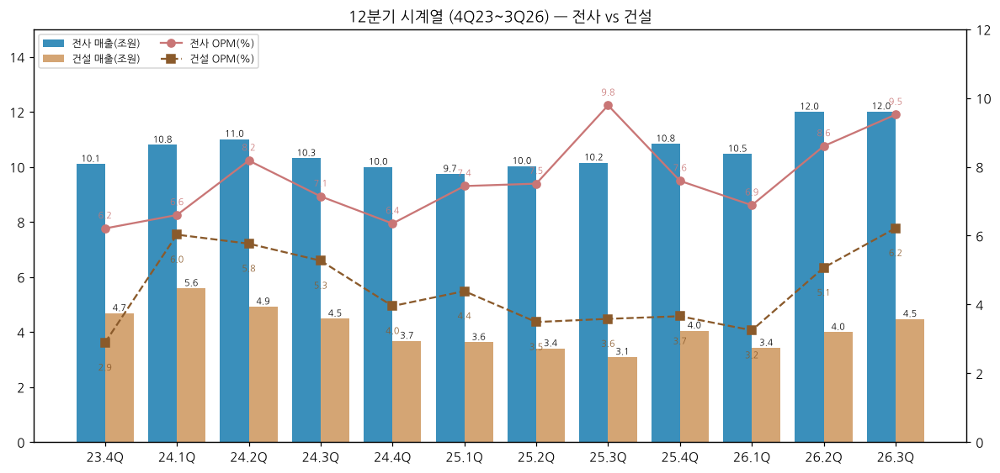

| 분기 | 전사 매출 | 전사 OP | 전사 OPM | 건설 매출 | 건설 OP | 건설 OPM | 상사 OP | 바이오 OP | 메모 |
|---|---|---|---|---|---|---|---|---|---|
| 2023-4Q | 100,997 | 6,270 | 6.2% | 46,776 | 1,351 | 2.9% | 573 | 3,431 | |
| 2024-1Q | 107,958 | 7,123 | 6.6% | **55,839** | 3,365 | 6.0% | 849 | 2,156 | 건설 분기 매출 사상 최대 |
| 2024-2Q | 110,048 | 9,004 | 8.2% | 49,150 | 2,833 | 5.8% | 715 | 4,273 | |
| 2024-3Q | 103,099 | 7,361 | 7.1% | 44,819 | 2,362 | 5.3% | 709 | 3,325 | |
| 2024-4Q | 99,928 | 6,346 | 6.4% | 36,739 | 1,452 | 4.0% | 729 | 3,206 | 하이테크 준공 → 매출 감소 시작 |
| 2025-1Q | 97,368 | 7,244 | 7.4% | 36,201 | 1,587 | 4.4% | 632 | 4,804 | |
| 2025-2Q | 100,221 | 7,526 | 7.5% | 33,947 | 1,184 | 3.5% | 798 | 4,675 | |
| 2025-3Q | 101,510 | 9,934 | 9.8% | **30,897** | 1,106 | 3.6% | 756 | 7,223 | 건설 매출 저점 |
| 2025-4Q | 108,324 | 8,223 | 7.6% | 40,440 | 1,478 | 3.7% | 532 | 5,213 | |
| 2026-1Q | 104,658 | 7,204 | 6.9% | 34,127 | 1,108 | 3.2% | 1,094 | 4,836 | |
| 2026-2Q | 119,951 | 10,317 | 8.6% | 39,883 | 2,021 | 5.1% | 1,422 | 5,855 | 하이테크 2차 매출 본격화 |
| **2026-3Q** | **120,080** | **11,428** | **9.5%** | **44,645** | **2,775** | **6.2%** | **989** | **6,620** | **건설 YoY +44.5% / OP +151%** |

**건설 수주·수주잔고:**

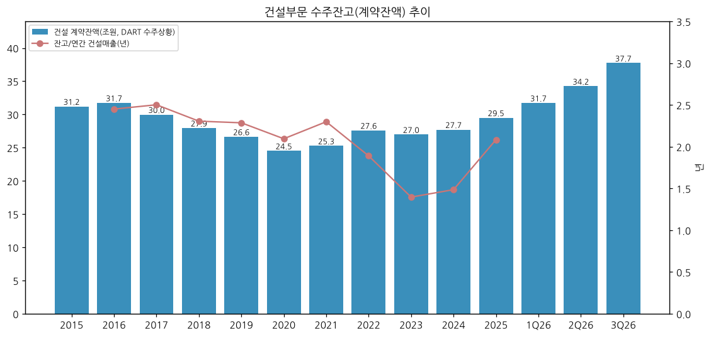

**DART 수주상황 계약잔액 (조원, 건설계약 기준):**

| 시점 | 총 도급액 | 계약잔액 | └ 건설사업 | └ 주택사업 | 잔고/연간 건설매출 |
|---|---|---|---|---|---|
| 2015말 | 76.06 | 31.21 | - | - | - |
| 2016말 | 75.40 | 31.74 | - | - | 2.5년 |
| 2017말 | 76.03 | 29.98 | - | - | 2.5년 |
| 2018말 | 70.82 | 27.95 | - | - | 2.3년 |
| 2019말 | 67.23 | 26.64 | - | - | 2.3년 |
| 2020말 | 66.97 | 24.52 | - | - | 2.1년 |
| 2021말 | 74.07 | 25.27 | 19.70 | 5.57 | 2.3년 |
| 2022말 | 83.30 | 27.60 | 22.13 | 5.46 | 1.9년 |
| 2023말 | 88.47 | 26.98 | 20.85 | 6.12 | 1.4년 |
| 2024말 | 99.49 | 27.71 | 22.18 | 5.53 | 1.5년 |
| 2025말 | 98.68 | 29.50 | 21.29 | 8.21 | 2.1년 |
| 1Q26 | 92.41 | 31.73 | - | - | - |
| 2Q26 | 98.69 | 34.25 | - | - | - |
| **3Q26** | **106.47** | **37.74** | **24.98** | **12.76** | (연환산 약 2.4년) |

(DART 계약잔액은 회사 IR 수주잔고와 정의가 다를 수 있음 — 예: 3Q19 IR 잔고 23.0조 vs DART 2019말 26.6조)

→ 잔고/매출 배수 2023 1.4년 (하이테크 매출 소진) → 3Q26 2.4년 수준 회복. **주택 잔고 5.5조(2024) → 12.8조(3Q26)로 2배+** (대치은마 2.1조·잠실주공5 1.4조 등 정비사업) + 하이테크 신규(테일러 FAB2 2.8조)가 동시 유입

- 3Q26 신규수주 8.8조 (비즈워치): 미국 테일러 T1 FAB2 2.8조 / 대치은마 2.1조 / 잠실주공5 1.4조 / 평택 P5 FAB2 골조 0.6조 / 기흥 삼성디스플레이리서치 0.4조 / 평택 P4 Ph2 0.2조 / 방글라데시 다카공항 0.1조
- 주택 시공권 확보 2.6조 (성수3 재개발 1.8조, 여의도 목화 0.5조, 마포한강삼성 리모델링 0.3조) — 잔고 미반영
- 국내 수주 점유율: 9M26 국내 수주 13.7조 / 국내 건설시장 177.7조 = **약 7.7%**, 해외 수주 10.4억 달러 = 국내기업 해외수주의 약 5.0% (DART 3Q26, 대한건설협회·해외건설협회)

### ② 사업부별 개요 (매출 비중 큰 순서, 9M26)

**상사부문 — 매출 37.8% / 영업이익 12%**
"철강·화학·에너지·테크 소재를 41개국 70개 거점에서 사고파는 트레이딩 + 신재생 개발."
- 산업재1(철강·코일센터·스테인리스 정밀재), 산업재2(합성수지·화학·비료·동정광), 에너지(태양광·풍력 개발, LNG 발전연료, 데이터센터), 테크(반도체·EV 소재·장비)
- 매출의 97%가 수출·삼국간 거래 (9M26 수출 12.60조 / 내수 0.41조) — 원자재 가격·환율 민감, OPM 1\~3%

**건설부문 — 매출 34.4% / 영업이익 20%** ★ 워치리스트 편입 이유
"삼성전자 팹·초고층·발전 플랜트·래미안을 짓는 국내 시공 상위 건설사."
- **빌딩/하이테크**: 삼성전자 평택 P1\~P5·미국 테일러 팹, 삼성디스플레이 — 3Q26 매출 약 50%가 하이테크. 초고층(부르즈 칼리파, 메르데카118, 타이페이101)
- **플랜트**: 가스복합화력 (방글라데시 메그나갓, 강릉안인화력), 신재생, 원전 (UAE 원전 시공 참여, 새울 3·4호기 주관사)
- **토목/인프라**: 인천대교, 싱가포르·홍콩 지하철, 사우디 리야드 메트로
- **주택**: 래미안 — 수익성 우선 선별 수주 기조에서 2025\~2026 정비사업 수주 확대 (주택 계약잔액 3Q26 12.76조)
- **신사업**: 태양광·ESS, 그린수소, SMR (선진 SMR 기술 보유기업 GVH 파트너십), CVC 벤처투자 (DART 3Q26)
- 내수/해외 매출: 2025 내수 6.62조 · 해외 7.53조 (해외 53%) — 테일러 팹 등 미국 하이테크가 해외로 집계

**바이오부문 — 매출 13.9% / 영업이익 60%**
"연결 자회사 삼성바이오로직스(CDMO)와 삼성에피스홀딩스(바이오시밀러)."
- 바이오로직스: 송도 1\~5공장 78.5만 리터 + 미국 HGS 인수(2026-03)로 **84.5만 리터**. 수주잔고 최소구매물량 기준 94.35억 달러 (3Q26 DART)
- 에피스홀딩스(→ 삼성바이오에피스): 바이오시밀러 11종 글로벌 상업화 (레미케이드·허셉틴·엔브렐·휴미라·아바스틴·루센티스·솔리리스·아일리아·스텔라라·프롤리아·엑스지바)
- 물산 지분 43.06% (양사 동일) — 과반 미만이나 실질 지배력으로 연결 (DART 주석)

**급식/식자재유통 (삼성웰스토리, 100%) — 매출 7.7% / 영업이익 4%**
"단체급식·식자재 유통." 9M26 매출 2.64조, OPM 4.7%

**패션부문 — 매출 4.8% / 영업이익 4%**
"빈폴·갤럭시·구호·르베이지·에잇세컨즈 + 수입 편집숍(10꼬르소꼬모·비이커) + SSF샵." 9M26 OPM 6.7%

**리조트부문 — 매출 1.4% / 영업이익 적자(9M26)**
"에버랜드·캐리비안베이, 골프장 162홀, 조경." 계절성 큼 (1Q 적자, 2Q·3Q 흑자)

### ③ 사업부별 디테일

**현재 가장 잘나가는 사업 (top-seller):**
- **바이오 (CDMO)** — 2025 영업이익 2.19조 (OPM 36.8%), 전사 이익의 67%
- **건설 하이테크** — 9M26 하이테크 수주 11.2조 (연간 12조+ 전망, 회사 사상 최대 — CEO스코어데일리), 3Q26 건설 OPM 6.2%. 회사는 2027년에도 하이테크 매출이 크게 늘 것으로 언급 (비즈워치)

**향후 큰 매출 기대 사업 (growth, 2026-11 기준):**

| 영역 | 내용 | 상태 (2026-11) |
|---|---|---|
| 하이테크 | 미국 테일러 FAB2, 평택 P5 FAB2 골조·P4 Ph2 | 3Q26 수주 반영, 2027 매출 본격 |
| 4Q26 파이프라인 | 건축·토목·플랜트·주택 약 10조 — 동남아 대형교량(11월 목표), 호주 가스발전, 대만 복합화력, 서남아 신규공항, 삼성SDS 구미 AIDC 증액 | 회사 발표 (비즈워치 2026-10-28) |
| 주택 정비사업 | 여의도 시범 등 핵심권역 선별 수주 | 시공권 확보 2.6조 (3Q26) |
| SMR·원전 | GVH 파트너십, UAE·새울 원전 시공 경험 | 수주 미확인 — LS증권은 원전·SMR을 미반영 재평가 요인으로 언급 (2026-06) |
| 바이오 | 바이오로직스 생산능력 확대·HGS 인수, 에피스 신규 시밀러 | 진행 중 |

**이익 outlier:**
- 건설 1Q16 **-4,145억** (OPM -14.8%) — 호주 로이힐 프로젝트 손실 / 3Q21 **-1,297억** (OPM -5.4%) — 해외 현장 비용
- 리조트 2020 -822억 (코로나), 패션 2016·2020 적자
- 바이오 3Q25 7,223억 (분기 최대, OPM 43.5%)

### ④ 주요 경쟁사 (사업부별)

| 사업부 | 주요 경쟁사 |
|--------|-------------|
| 건설 — 하이테크 | 삼성E&A(설계·FAB 유틸리티), SK에코플랜트(SK하이닉스 캡티브), 미국 현지 GC (Bechtel 등) |
| 건설 — 주택·정비사업 | 현대건설(디에이치), GS건설(자이), DL이앤씨(아크로), 대우건설(푸르지오), 포스코이앤씨 |
| 건설 — 플랜트·인프라 | 현대건설, 대우건설, DL이앤씨, 해외 EPC (Bechtel·Fluor·중국 EPC) |
| 상사 | LX인터내셔널, 포스코인터내셔널, 일본 종합상사 (미쓰비시상사·이토추 등) |
| 바이오 CDMO / 시밀러 | Lonza, WuXi Biologics, Fujifilm Diosynth / Pfizer·Amgen·Sandoz·셀트리온 (DART) |
| 패션 | 한섬, 신세계인터내셔날, LF |
| 리조트·급식 | 롯데월드 / 아워홈, 현대그린푸드, CJ프레시웨이 |

### ⑤ 주요 매출처

> DART는 고객별 매출액을 공시하지 않음. 건설 하이테크의 최대 고객은 **삼성전자** (평택·테일러 팹), 삼성디스플레이 — 3Q26 하이테크가 건설 매출의 약 50% (비즈워치), 9M26 건설 수주의 58% (CEO스코어데일리)

- 주요 하이테크 수주 (3Q26): 테일러 FAB2 2.8조, 평택 P5 FAB2 골조 0.6조, 기흥 SDR 0.4조, 평택 P4 Ph2 0.2조
- 과거 대형 현장 (DART 수주상황): 강릉안인화력 1·2호기 (강릉에코파워, 기본도급 3.9조), 사우디 리야드 메트로, 카자흐스탄 발하쉬, 말레이시아 KL118 (메르데카118), 방글라데시 다카공항
- 계열 매출 의존: 건설 하이테크·급식(웰스토리)·상사 일부가 그룹 계열사 대상 → 그룹 CapEx·고용 사이클과 연동

### ⑥ 생산 CAPA + 임직원

- 건설: 수주산업 → CAPA 지표 = **계약잔액 37.7조 (3Q26, 연환산 매출 대비 약 2.4년)**
- 바이오: 84.5만 리터 (송도 78.5만 + 미국 HGS 6만, 2026-03)
- 상사: 해외 거점 41개국 70개 (2026-09)
- 리조트: 에버랜드·캐리비안베이, 골프장 162홀

**임직원 (삼성물산 별도, 2025말, DART 사업보고서 VIII):**

| 부문 | 남 | 여 | 계 | 평균근속(남) |
|---|---|---|---|---|
| 건설 | 5,195 | 633 | 5,828 | 15.8년 |
| 상사 | 504 | 259 | 763 | 14.5년 |
| 패션 | 562 | 806 | 1,368 | 14.6년 |
| 리조트 | 919 | 383 | 1,302 | 17.2년 |
| **합계** | **7,180** | **2,081** | **9,261** | 15.8년 |

- 건설 인력 중 기간제 1,276명 (22%, 현장 계약직) / 1인 평균 급여 남 1.32억·여 0.92억 (2025)
- 바이오로직스·에피스홀딩스·웰스토리 등 종속회사 인력은 별도 법인이라 미포함

---

## 4. 재무 구조

> **재무제표 수치: OpenDART fnlttSinglAcntAll (연결 CFS), 2026-11-25 조회.** 2014 = 2015 사업보고서 전기 컬럼(제일모직). 2015 = 합병 부분 반영. 3Q26 = DART 분기보고서 확정치. **자본·자산은 보유 상장주식(삼성전자·삼성생명·SDS 등) FVOCI 평가로 크게 변동** — 상장주식 장부가 2024말 21.68조 → 2025말 44.64조 → 3Q26 94.94조 (DART 3Q26 시장위험 주석)

### ① 손익계산서 (12년 연결, 조원)

| 연도 | 매출 | 매출원가 | 매출총이익 | GPM | 판관비 | CIR | 영업이익 | OPM | 세전이익 | 순이익 | NPM | 지배순이익 | EPS(원) |
|---|---|---|---|---|---|---|---|---|---|---|---|---|---|
| 2014 ※ | 5.13 | 3.50 | 1.63 | 31.8% | 1.42 | 27.7% | 0.21 | 4.2% | 0.15 | 0.46 | 8.9% | 0.46 | 4,284 |
| 2015 ※ | 13.34 | 11.20 | 2.15 | 16.1% | 2.11 | 15.8% | 0.04 | 0.3% | 2.78 | 2.69 | 20.1% | 2.75 | 20,636 |
| 2016 | 28.10 | 24.77 | 3.33 | 11.9% | 3.19 | 11.4% | 0.14 | 0.5% | 0.09 | 0.02 | 0.1% | 0.11 | 650 |
| 2017 | 29.28 | 25.63 | 3.65 | 12.5% | 2.77 | 9.5% | 0.88 | 3.0% | 0.83 | 0.48 | 1.6% | 0.64 | 3,879 |
| 2018 | 31.16 | 27.17 | 3.99 | 12.8% | 2.88 | 9.2% | 1.10 | 3.5% | 2.38 | 1.75 | 5.6% | 1.71 | 10,384 |
| 2019 | 30.76 | 26.96 | 3.80 | 12.4% | 2.94 | 9.5% | 0.87 | 2.8% | 1.53 | 1.05 | 3.4% | 1.05 | 6,366 |
| 2020 | 30.22 | 26.85 | 3.37 | 11.1% | 2.51 | 8.3% | 0.86 | 2.8% | 1.47 | 1.16 | 3.8% | 1.04 | 6,278 |
| 2021 | 34.46 | 30.43 | 4.02 | 11.7% | 2.82 | 8.2% | 1.20 | 3.5% | 2.48 | 1.83 | 5.3% | 1.64 | 9,913 |
| 2022 | 43.16 | 37.12 | 6.04 | 14.0% | 3.51 | 8.1% | 2.53 | 5.9% | 3.33 | 2.54 | 5.9% | 2.04 | 12,460 |
| 2023 | 41.90 | 35.33 | 6.57 | 15.7% | 3.70 | 8.8% | 2.87 | 6.9% | 3.55 | 2.72 | 6.5% | 2.22 | 13,556 |
| 2024 | 42.10 | 35.00 | 7.11 | 16.9% | 4.12 | 9.8% | 2.98 | 7.1% | 3.72 | 2.77 | 6.6% | 2.23 | 13,629 |
| 2025 | 40.74 | 33.05 | 7.69 | 18.9% | 4.39 | 10.8% | 3.29 | 8.1% | 4.26 | 3.91 | 9.6% | 2.44 | 14,905 |

(※ 합병 단절. EPS = DART 보통주 기본주당순이익. CIR = 판관비/매출)

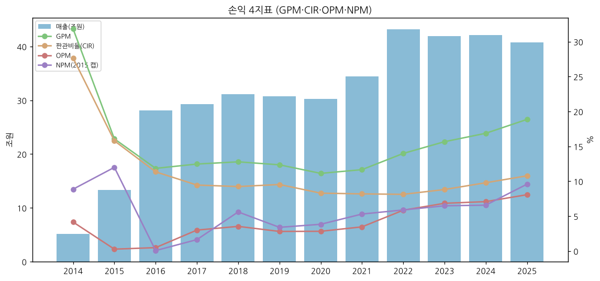

→ **GPM 11.9%(2016) → 18.9%(2025)**: 저마진 상사·건설 비중 하락 + 고마진 바이오(OPM 30%대) 비중 상승이 만든 믹스 개선. 세전이익 > 영업이익 구조 (배당수익·지분법 등 영업외 이익이 매년 0.5\~1조)

### ② 재무상태표 (12년 연결, 조원)

| 연도 | 자산총계 | 부채총계 | 자본총계 | 지배지분 | 부채비율 | 유동비율 | 현금성자산 |
|---|---|---|---|---|---|---|---|
| 2014 ※ | 9.51 | 4.23 | 5.29 | 5.28 | 80.0% | 156.5% | 0.30 |
| 2015 ※ | 42.36 | 24.05 | 18.31 | 16.50 | 131.3% | 82.7% | 2.07 |
| 2016 | 44.46 | 23.35 | 21.11 | 18.30 | 110.6% | 90.7% | 2.70 |
| 2017 | 49.05 | 23.90 | 25.15 | 22.56 | 95.0% | 84.7% | 2.99 |
| 2018 | 42.41 | 19.86 | 22.55 | 19.95 | 88.1% | 105.0% | 2.90 |
| 2019 | 45.91 | 19.21 | 26.69 | 24.10 | 72.0% | 107.5% | 2.70 |
| 2020 | 54.33 | 21.39 | 32.95 | 30.20 | 64.9% | 118.5% | 2.40 |
| 2021 | 55.25 | 22.09 | 33.15 | 30.21 | 66.6% | 127.5% | 2.25 |
| 2022 | 58.98 | 27.02 | 31.96 | 26.68 | 84.5% | 123.8% | 4.20 |
| 2023 | 66.13 | 26.23 | 39.90 | 34.24 | 65.7% | 128.6% | 3.12 |
| 2024 | 61.99 | 24.73 | 37.26 | 31.07 | 66.4% | 136.8% | 3.62 |
| 2025 | 86.53 | 29.04 | 57.50 | 49.91 | 50.5% | 154.0% | 3.46 |
| 2Q26 | 163.77 | 50.06 | 113.71 | 105.55 | 44.0% | 150.0% | 4.86 |
| **3Q26** | **140.72** | **44.23** | **96.49** | **88.15** | **45.8%** | **148.8%** | **4.39** |

(2015 지배지분 = 자본총계 − 비지배지분 1.81조로 산출. 2Q26 자산 163.8조는 6월말 삼성전자 주가 반영 → 3Q26 140.7조)

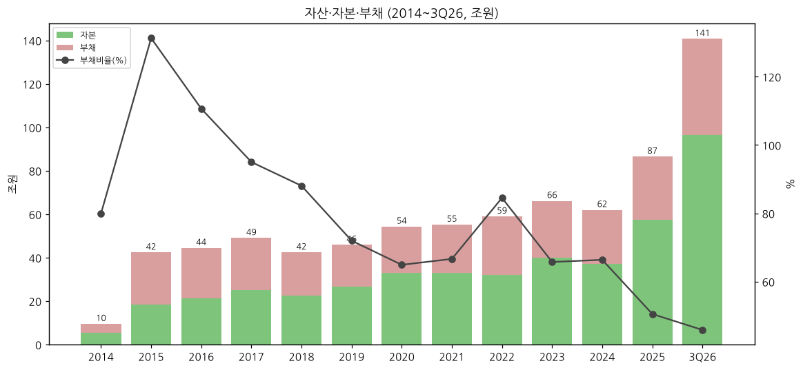

### ③ 현금흐름표 (12년 연결, 억원)

| 연도 | 영업CF | 투자CF | 재무CF | CapEx(유형) | CapEx(무형) | 배당지급 | 배당수취 | FCF |
|---|---|---|---|---|---|---|---|---|
| 2014 ※ | 1,431 | 544 | -456 | 1,856 | 164 | n/a | 349 | -589 |
| 2015 ※ | -623 | 23,686 | -5,274 | 2,595 | 411 | n/a | 765 | -3,630 |
| 2016 | 13,554 | -8,121 | 1,224 | 4,847 | 482 | 839 | 2,784 | 8,226 |
| 2017 | 13,124 | 2,799 | -11,167 | 6,780 | 641 | 908 | 4,274 | 5,703 |
| 2018 | 16,784 | 1,678 | -18,847 | 5,404 | 644 | 3,299 | 6,294 | 10,736 |
| 2019 | 7,708 | 6,071 | -16,124 | 3,451 | 426 | 3,299 | 7,880 | 3,831 |
| 2020 | 12,679 | -8,484 | -6,163 | 2,849 | 369 | 3,299 | 6,780 | 9,462 |
| 2021 | 11,957 | -8,044 | -6,851 | 5,370 | 498 | 3,794 | 10,979 | 6,089 |
| 2022 | 26,183 | -31,957 | 25,608 | 11,057 | 1,463 | 6,928 | 6,682 | 13,663 |
| 2023 | 27,987 | -21,054 | -18,181 | 12,287 | 1,974 | 3,764 | 6,893 | 13,725 |
| 2024 | 33,069 | -17,595 | -12,983 | 16,281 | 1,657 | 4,173 | 7,200 | 15,130 |
| 2025 | 30,237 | -18,398 | -12,769 | 17,364 | 1,691 | 4,255 | 7,437 | 11,182 |
| 9M26 | 39,040 | -17,317 | -11,395 | 4,881 | 1,451 | 4,583 | 7,342 | 32,708 |

(FCF = 영업CF − 유·무형자산 취득. 배당지급 = 지배주주 배당(비지배 제외). 배당수취 = 영업CF 내 관계사·투자주식 배당금 수취. 2022 재무CF +2.56조·투자CF -3.20조 = 바이오로직스 Bioepis 인수·유상증자 관련)

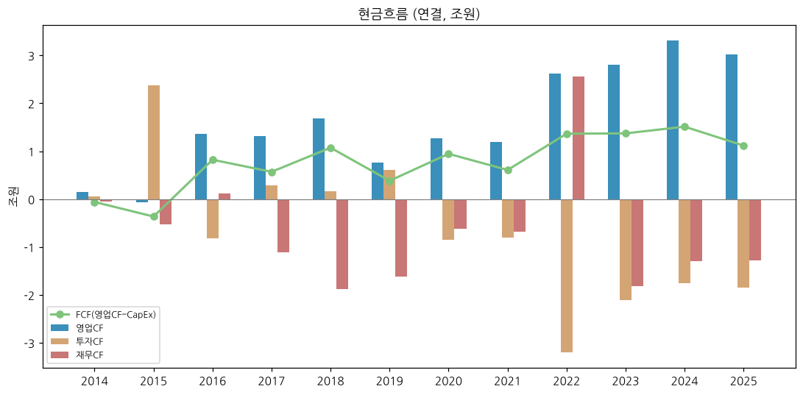

### ④ CapEx 추이 (12년, 억원)

| 연도 | 유형 | 무형 | 총 CapEx | CapEx/매출 |
|---|---|---|---|---|
| 2014 ※ | 1,856 | 164 | 2,020 | 3.94% |
| 2015 ※ | 2,595 | 411 | 3,006 | 2.25% |
| 2016 | 4,847 | 482 | 5,328 | 1.90% |
| 2017 | 6,780 | 641 | 7,421 | 2.53% |
| 2018 | 5,404 | 644 | 6,048 | 1.94% |
| 2019 | 3,451 | 426 | 3,877 | 1.26% |
| 2020 | 2,849 | 369 | 3,217 | 1.06% |
| 2021 | 5,370 | 498 | 5,868 | 1.70% |
| 2022 | 11,057 | 1,463 | 12,519 | 2.90% |
| 2023 | 12,287 | 1,974 | 14,262 | 3.40% |
| 2024 | 16,281 | 1,657 | 17,939 | 4.26% |
| 2025 | 17,364 | 1,691 | 19,055 | 4.68% |

- 2022\~2025 CapEx 급증은 **바이오로직스 4·5공장** 투자 — 건설·상사는 CapEx가 작은 수주·트레이딩 사업. 건설 사이클 판단은 CapEx보다 **수주잔고·하이테크 발주**가 중요

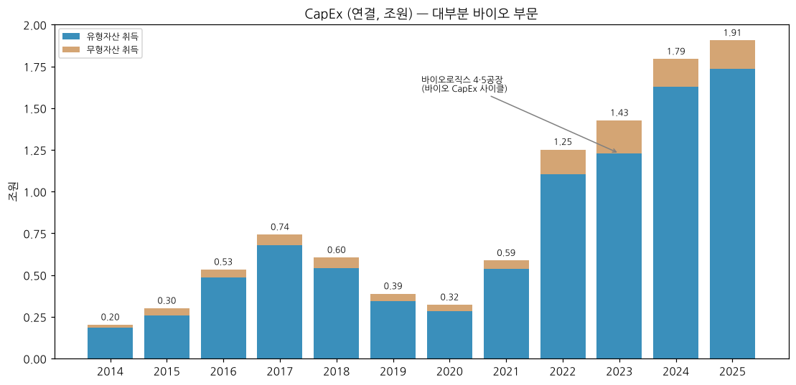

### ⑤ 부채구조 + 신용등급

- 부채비율 2015 131% → 2025 50.5% → 3Q26 45.8% (자본이 지분가치 평가로 커진 영향 큼)
- 영업이익/금융비용: 2016 0.4배 → 2025 **17.7배** (금융비용 2016 3,545억 → 2025 1,856억)
- **신용등급**: 회사채 **AA+ (Stable)** (DART 2025 사업보고서 신용등급 표)
- 3Q26 기준 이자의 지급 9M 1,340억 / 현금성자산 4.39조

### ⑥ 배당·자사주 추이 (12년)

| 사업연도 | DPS 보통주(원) | 배당총액(억, 지급 기준 다음해) | 지배순이익(억) | 비고 |
|---|---|---|---|---|
| 2015 | 500 | 839 | 27,468 | 합병 첫해 |
| 2016 | 550 | 908 | 1,074 | |
| 2017 | 2,000 | 3,299 | 6,398 | 1차 정책 (2017\~2019) |
| 2018 | 2,000 | 3,299 | 17,128 | |
| 2019 | 2,000 | 3,299 | 10,501 | |
| 2020 | 2,300 | 3,794 | 10,355 | 2차 정책 (2020\~2022) |
| 2021 | 4,200 | 6,928 | 16,350 | 삼성전자 특별배당 수취분 환원 |
| 2022 | 2,300 | 3,764 | 20,441 | |
| 2023 | 2,550 | 4,173 | 22,183 | 3차 정책 (2023\~2025) |
| 2024 | 2,600 | 4,255 | 22,303 | 2024-04 자사주 일부 소각 |
| 2025 | 2,800 | 4,583 (공시 배당총액 4,583억) | 24,391 | 배당성향 18.8% |

(DPS = 연결 CF 배당금 지급액 ÷ 유통 보통주로 역산 후 DART 배당 공시(2023\~2025 2,550·2,600·2,800원)와 대조. 2015\~2022 DPS는 지급액 역산치 ⚠️추정 — 우선주는 +50원)

- **주주환원 정책**: 2017년부터 3개년 단위. '23\~'25: 관계사 배당수익의 60\~70% 환원 (최소 DPS 2,000원) + 보유 자사주 전량 분할 소각 → **이행 완료 (3Q26 자기주식 0주, 누적 이익소각 보통주 21,533,800주)**
- **'26\~'28 정책 (2026-02)**: 배당수익 60\~70% 환원 유지, **최소 DPS 2,500원**으로 상향, DPS는 매년 이사회 확정
- 2026E DPS: DS투자증권 23,050원 추정 (삼성전자 배당 확대 가정, 2026-06 — 증권사 추정, 회사 확정 아님)

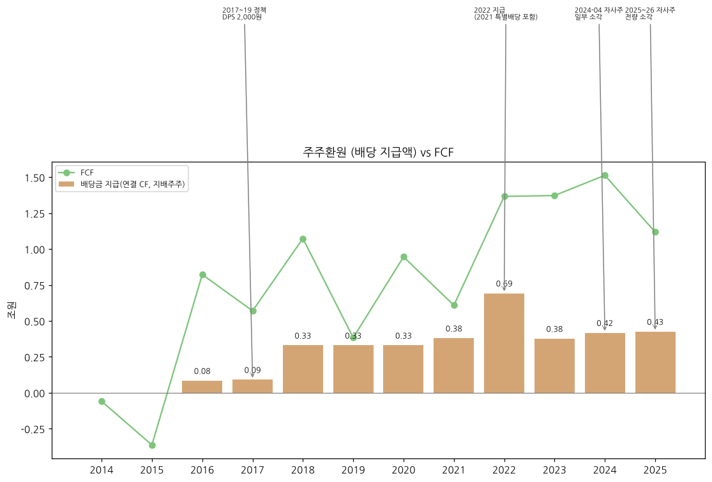

### ⑦ 재무 비율

| 연도 | ROE(지배) | ROA | 부채비율 | 유동비율 | OP/금융비용 |
|---|---|---|---|---|---|
| 2016 | 0.6% | 0.0% | 110.6% | 90.7% | 0.4x |
| 2017 | 3.1% | 1.0% | 95.0% | 84.7% | 2.8x |
| 2018 | 8.1% | 3.8% | 88.1% | 105.0% | 3.7x |
| 2019 | 4.8% | 2.4% | 72.0% | 107.5% | 4.5x |
| 2020 | 3.8% | 2.3% | 64.9% | 118.5% | 4.5x |
| 2021 | 5.4% | 3.3% | 66.6% | 127.5% | 6.8x |
| 2022 | 7.2% | 4.5% | 84.5% | 123.8% | 6.4x |
| 2023 | 7.3% | 4.3% | 65.7% | 128.6% | 8.6x |
| 2024 | 6.8% | 4.3% | 66.4% | 136.8% | 11.1x |
| 2025 | 6.0% | 5.3% | 50.5% | 154.0% | 17.7x |

**주요 비율 의미:**
- **ROE**: 지배순이익 / 평균 지배지분 — 분모(자본)에 보유주식 평가이익이 쌓여 ROE는 구조적으로 낮게 나옴 (2025 6.0%). 지주형 기업은 ROE보다 NAV 할인율로 판단
- **OP/금융비용**: 이자보상 대용 (금융비용에 외환손실 포함) — 2025 17.7배로 이자 부담은 사실상 없음

---

## 5. 지배 구조

### ① 그룹·계열 관계

```
이재용 회장 외 특수관계인 (36.02%, 2025말 / 우선주 포함 총수 기준)
        │
   삼성물산 (028260)
   ├── 삼성생명 19.34%  ──→ 삼성전자 (삼성생명이 최대주주 측 핵심 보유)
   ├── 삼성전자 4.49% (298,818,100주)
   ├── 삼성바이오로직스 43.06% (19,932,350주, 연결)
   ├── 삼성에피스홀딩스 43.06% (연결, 2025-11 인적분할 신설) → 삼성바이오에피스 100%
   ├── 삼성SDS 17.08% (13,215,822주)
   ├── 삼성E&A 등 기타 상장주식
   └── 삼성웰스토리 100%, 서울레이크사이드 100%, 삼우종합건축사사무소 100% 등
```

- 연결 종속회사 139개 (국내 19·해외 120, 2025말). 바이오 2사는 지분 과반 미만이나 실질 지배력으로 연결 (DART 주석)
- 삼성생명의 삼성전자 지분은 본 리포트에서 원문 미확인 (생명 공시 참조 필요) ⚠️

### ② 주주 구분

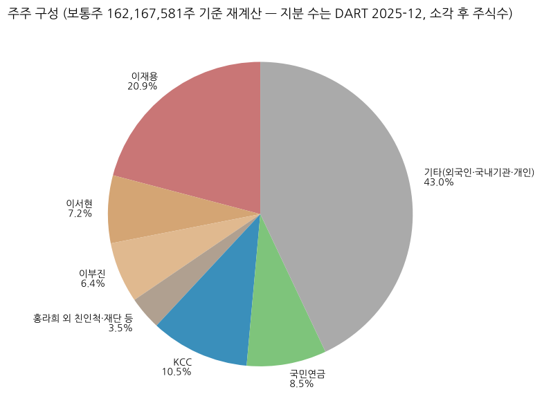

**5% 이상 주주 (보통주, DART 2025 사업보고서, 발행 보통주 169,976,544주 기준 → 괄호는 2026 소각 후 162,167,581주 기준 재계산):**

| 주주명 | 주식수 | 지분율 (2025말 공시) | 소각 후 재계산 |
|--------|--------|------|------|
| 이재용 (최대주주) | 33,880,220 | 19.93% | 20.89% |
| ㈜KCC | 17,009,518 | 10.01% | 10.49% |
| 국민연금공단 | 13,727,452 | 8.08% | 8.46% |
| 이서현 | 11,662,168 | 6.86% | 7.19% |
| 이부진 | 10,456,450 | 6.15% | 6.45% |
| **최대주주 및 특수관계인 계** | **61,745,892** | 36.02% (우선주 포함 총수 대비) | **38.08%** |

- 특수관계인 구성 (2025말): 이재용·이부진·이서현·홍라희 1.81백만주·이유정 0.6백만주, 삼성문화재단 1.14백만주·삼성생명공익재단 2.0백만주·삼성복지재단, 삼성생명 특별계정
- 소액주주 107,908명 / 72,174,873주 (42.46%, 2025말)
- 외국인 지분율: 미확보 ⚠️ (다음 버전에서 KRX 조회)
- 발행주식 (3Q26): 보통주 162,167,581주 / 우선주 1,467,590주 (액면 100원), 자기주식 0주

### ③ 임원·이사회

**대표이사 (등기, DART 2025 사업보고서):**
- **오세철 대표이사 사장** (1962.11) — 건설부문장, 경영위원회 위원장. 인디애나대 경영학 석사, 삼성물산 중동지원팀장·글로벌조달실장·플랜트사업부장 출신
- **이재언 대표이사 사장** (1968.11) — 상사부문장. 서강대 화학공학, 상사 일본총괄·소재사업부장 출신
- 정해린 대표이사 사장 (1964.11, 2025말 등기) — 2026-11 기업개황 대표자명은 오세철·이재언·송규종 → **2026 중 대표이사 변경(송규종 선임)** 확인 필요 ⚠️

**사외이사 (2025말):** 정병석 (이사회 의장, 전 노동부 차관) / 제니스 리 (보상위원장, 전 볼보건설기계코리아 CFO) / 이상승 (하버드 경제학 박사) / 최중경 (감사위원장, 전 지식경제부 장관) / 김경수 (율촌 변호사, 전 고검장)
- 이사회 의장 = 사외이사, 감사위원회·ESG위원회·보상위원회 운영. 사내이사 이준서 (부사장, 패션 경영지원 출신)

**외부감사인:** 삼일회계법인 (2025\~, 감사위원회 선정 — 직전 지정감사인 한영 계약 2024말 종료)

---

## 6. 기타 팩트

### ① R&D 인프라

| 연도 | 2016 | 2017 | 2018 | 2019 | 2020 | 2021 | 2022 | 2023 | 2024 | 2025 |
|---|---|---|---|---|---|---|---|---|---|---|
| 연구개발비용 (억원) | 1,206 | 863 | 798 | 1,435 | 1,777 | 1,983 | 3,836 | 4,760 | 5,576 | 5,813 |
| **R&D / 연결 매출** | **0.43%** | **0.29%** | **0.26%** | **0.47%** | **0.59%** | **0.58%** | **0.89%** | **1.14%** | **1.32%** | **1.43%** |

(DART 사업보고서 II-6 '연구개발비용 계'. 2022부터 삼성바이오에피스 연결로 급증 — 2025 개발비 자산화 608억·연구비 5,205억)

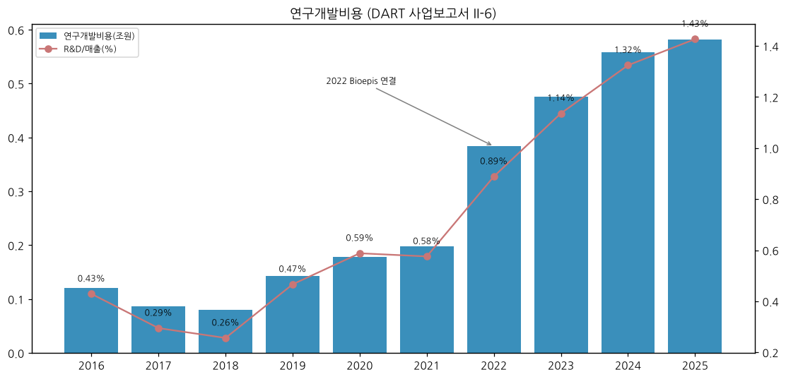

- 바이오: 에피스홀딩스 개발본부·임상의학본부 등 (바이오시밀러 파이프라인), 바이오로직스 CDO
- 건설: 건설기술 연구 (초고층·하이테크·스마트건설·SMR), CVC 펀드 벤처투자

### ② 진행 중 corporate action — 10년치 주요 이벤트

```
2026  · 자사주 잔여분 소각 완료 (1월 결정, 3Q26 자기주식 0주)
      · '26~'28 주주환원정책 (2월) — 최소 DPS 2,500원
      · 바이오로직스 HGS 인수 (3월), 건설 수주 목표 30.1조로 상향 (10월)
2025  · 삼성바이오로직스 인적분할 → 삼성에피스홀딩스 (분할기일 11-01)
      · 자사주 7,807,563주 소각 (2025 중)
      · 외부감사인 삼일회계법인으로 변경
2024  · 자사주 보통 1,888,889주·우선 159,835주 소각 (04-19)
2023  · '23~'25 주주환원정책 (2월) — 자사주 전량 5년 분할 소각
2022  · 바이오로직스, 바이오에피스 100% 인수 (Biogen 지분)
2018  · 서초사옥 매각, 바이오젠 콜옵션 관련 처분이익 등 일회성 약 1조 (IR 3Q19)
2017  · 3개년 주주환원정책 도입
2016  · 삼성바이오로직스 상장 (11월)
2015  · 제일모직–구 삼성물산 합병 (09-01)
```

### ③ 건설·바이오 마일스톤 — 10년치

```
2026  · 미국 테일러 T1 FAB2 2.8조, 평택 P5 FAB2 골조 0.6조 수주 (3Q)
      · 하이테크 9M 수주 11.2조 — 연간 12조+ 전망 (회사 사상 최대)
      · 대치은마 2.1조·잠실주공5 1.4조 정비사업 수주, 성수3 시공권
      · 바이오로직스 84.5만 리터 (HGS 인수)
2025  · 건설 하이테크 대형 PJ 준공 → 건설 매출 -24%
      · 바이오 영업이익 2.19조 (+69%)
2022~24 · 하이테크 2차 사이클 (건설 매출 2023 19.3조 사상 최대)
      · 바이오로직스 4공장 가동, 5공장 건설
2019  · 방글라데시 메그나갓 복합발전 7,316억, 아산 디스플레이 8라인 5,585억 수주 (IR 3Q19)
2017~18 · 하이테크 1차 사이클 (평택 P1) — 건설 OPM 6.4% (2018)
2016  · 호주 로이힐 손실 (1Q16 건설 -4,145억)
```

### ④ 주요 리스크

- **삼성전자 주가 = NAV·자본 변동성**: 보유 상장주식 1% 변동 시 기타포괄손익 7,073억 변동 (3Q26 DART). 2026-11-25 하루 삼성전자 -9.9% → 물산 -8.3%
- **NAV 할인 고착**: 상장지분 단순 대비 -58% (2026-11-25), SK증권 61.7% (2026-07) — 지배구조 디스카운트·세금 이슈
- **건설 하이테크 의존**: 하이테크(삼성전자) 비중 매출 약 50%·수주 58% → 삼성전자 팹 투자 축소 시 2025년처럼 매출 -24% 급감 가능
- **해외 현장 손실 이력**: 1Q16 로이힐 -4,145억, 3Q21 -1,297억 — 해외 매출 비중 53% (2025)
- **중동 지정학**: DART 3Q26은 이란 사태·호르무즈 긴장으로 중동 메가 프로젝트 순연을 전망
- **2015 합병 관련 소송**: 합병비율·의결 과정 관련 형사·민사·국제중재(엘리엇·메이슨 ISDS 등)가 장기 진행 — 본 리포트에서 판결·판정 원문 미확인 ⚠️ (이재용 회장 부당합병 혐의는 2025년 대법원 무죄 확정으로 보도됨 — 다음 버전에서 원문 검증)
- **지배구조 규제**: 보험업법 개정(삼성생명 보유 삼성전자 지분 평가 기준) 등 그룹 지분 구조 변화 시 물산 역할 재정의 가능
- **환율**: 상사 매출 97% 수출·삼국간, 건설 해외 53%, 바이오 수출 97%

### ⑤ ESG 등급

| 평가기관 | 등급 | 비고 |
|---------|------|------|
| KCGS (한국ESG기준원) | 미확보 ⚠️ | 다음 버전 보강 |
| MSCI ESG | 미확보 ⚠️ | |
| 이사회 구성 | 사외이사 의장, ESG위원회 운영 | DART 2025 사업보고서 |

### ⑥ 인증·라이선스

- 회사채 신용등급 **AA+ (Stable)** (DART 2025)
- 건설: 초고층(부르즈 칼리파·메르데카118·타이페이101), 원전 시공 (UAE 원전 시공 참여, 새울 3·4호기 주관사), 인천대교
- 바이오: 바이오시밀러 11종 글로벌 상업화 (미국·유럽·캐나다·호주·브라질·일본 등)

---

## Version Log

**v1.0 (2026-11-25) — 신규 작성**
- ① OpenDART 재무 JSON: 연결 CFS 44개 (2015 FY\~3Q26) + 별도 OFS 45개 (보관, 본문 미사용) → 12년 손익·재무상태·현금흐름·CapEx 전부 DART 원값. 2014 = 2015 사업보고서 전기 컬럼(제일모직)
- ② DART 정기공시 원문 XML 48건 파싱: 사업부문별 요약 재무현황 (2015\~3Q26 누적) → **사업부문별 43분기 시계열 (1Q16\~3Q26, 누적 차분, 부문 합 = 연결 일치 검증)**, 건설 계약잔액 2015\~3Q26, 건설 내수/수출, R&D, 임직원, 타법인출자·FVOCI 상장주식 보유수, 주주환원정책, 자사주 소각, 인적분할
- ③ OpenDART info 6종 (최대주주·임원·직원·배당·자기주식·주식총수, 2025)
- ④ IR: irgo 경유 2019년 1\~3분기 실적자료 3건만 확보 (3Q19로 건설 상품별·잔고 교차검증). samsungcnt.com IR 최근 자료 미확보 → 3Q26 건설 상품별 매출·수주는 언론 인용
- ⑤ 차트 18종: chart1·1b·2(×5: 건설·상사·바이오·패션·리조트+급식)·4·5·6·7·8·9·10·11·12 + chart13 (건설 수주잔고) + chart14 (상장지분 가치 vs 시총)
- ⑥ 시장 데이터: Yahoo Finance 2026-11-25 종가 (삼성물산·삼성전자·바이오로직스·삼성생명·에피스홀딩스·SDS·E&A)

**잔여 보완 후보 (v1.1):**
- samsungcnt.com IR 3Q26 실적 PDF 확보 → 건설 상품별(빌딩·하이테크·인프라·플랜트·주택) 분기 시계열, 건설 원가율, IR 기준 신규수주·수주잔고
- 구 삼성물산(000830) 2010\~2014 건설·상사 숫자 병기 (OpenDART 000830 공시원문 별도 수집 필요)
- 에피스홀딩스 보유 주식수 DART 원문 확인 (현재 바이오로직스 분할비율로 역산한 10,714,355주 ⚠️추정)
- 외국인 지분율, ESG 등급, 2026 대표이사 변경 내역, 2015 합병 소송 판결 원문
