> 종목: 삼성전기 (009150.KS / SAMSUNG ELECTRO-MECHANICS CO., LTD.)
> 섹터: IT 하드웨어 — 전자부품·기판 (MLCC·반도체 패키지기판·카메라모듈)
> 작성 시각: 2026-11-25 KST
> 적용 구조: v4.8 (6개 섹션 + 12종 차트)
> 데이터: 12년 연간(2014\~2025) + 47분기(1Q15\~3Q26) 사업부별 시계열
> 출처: OpenDART fnlttSinglAcntAll(2015\~3Q26 연결) · DART 정기보고서 공시원문 52건(2014\~2026.09) · 삼성전기 IR 실적발표 33건(2018\~3Q26) · Yahoo Finance v8 · 언론 보도

# 삼성전기 기업 개요 (v1.0)
> **Fact verify cutoff**: 2026-11-25 (주가·시가총액 = 2026-11-24 종가 기준 이투데이·Yahoo Finance 확인 / ATH = Yahoo Finance 일봉 2026-06-19 / 점유율 = 2025 사업보고서·언론 보도)

> **데이터 기준 주의**: 연간 표(2014\~2025)는 **각 연도 사업보고서 원공시**(2014는 2015 사업보고서 비교표시 재작성치) 기준. 분기·사업부 시계열(1Q15\~3Q26)은 **다음 해 보고서의 전기 비교표시(재작성) 기준**으로 맞춰 4Q 역산 왜곡을 없앴다. 중단영업(2019 PLP·RFPCB, 2021 HDI·Wi-Fi 모듈, 2024 통신모듈) 재분류 때문에 연간 표와 분기 합이 일부 연도에서 다르다.

---

## 1. 기업 분류

- **Primary 분류: 사이클** (Cyclical) — 수동소자(MLCC) 재고 사이클 + 스마트폰·PC 세트 수요에 연동되는 IT 부품
- **Secondary 노트: AI 데이터센터 secular 노출 급확대** — 서버·AI 가속기용 MLCC, 서버 CPU·AI 가속기용 FC-BGA가 이익을 주도. 3Q26 영업이익의 **92%**(컴포넌트 4,287억 + 패키지 2,092억 / 전사 6,910억)가 두 사업부에서 발생

### (1) 정량 근거

**📊 Summary Box (12년 2014\~2025, 연결 원공시):**

| 지표 | 값 |
|------|-----|
| 매출 CAGR (11년, 2014→2025) | **+5.8%** (6.10조 → 11.31조) |
| OPM 평균 | **7.7%** |
| OPM 정점 평균 | **13.9%** (2018 12.4% MLCC 슈퍼사이클 · 2021 15.4% 코로나 IT 특수) |
| OPM 저점 평균 | **3.8%** (2016 0.4% · 2024 7.1% — 2023 7.2%와 사실상 동일한 바닥) |
| 사이클 주기 | 약 3년 (peak-to-peak 2018→2021), 2026년 3번째 정점 진행 중 (3Q26 OPM 18.4% — 분기 기준 12년 최고) |
| 사이클 회수 (12년) | 정점 2회 (2018·2021) + 진행 1회 (2026) / 저점 3회 (2014·2016·2023\~24) |

```
[삼성전기 OPM 시계열 (12년, 연결 원공시)]
연도   매출(조)  영업이익(조)  순이익(조)   OPM     NPM
2014     6.10      0.06        0.51      1.1%    8.3%   ← 저점: 영업이익 649억, 순이익은 기타수익 1.22조로 방어
2015     6.18      0.30        0.02      4.9%    0.3%   ← 비주력 사업 정리(중단영업 -3,016억)
2016     6.03      0.02        0.02      0.4%    0.4%   ← 저점②: ACI(기판) 적자 확대
2017     6.84      0.31        0.18      4.5%    2.6%   ← MLCC 업사이클 진입
2018     8.19      1.02        0.69     12.4%    8.4%   ← 정점①: MLCC 슈퍼사이클 (컴포넌트 OPM 31.5%)
2019     8.04      0.73        0.53      9.1%    6.6%   ← MLCC 재고조정, PLP 양도
2020     8.21      0.83        0.62     10.1%    7.6%   ← 코로나 언택트 IT 수요
2021     9.68      1.49        0.92     15.4%    9.5%   ← 정점②: 코로나 IT 특수 (OPM 15.4%)
2022     9.42      1.18        0.99     12.6%   10.5%   ← 하반기 IT 수요 급랭
2023     8.91      0.64        0.45      7.2%    5.1%   ← 저점③: IT 재고조정 (OPM 7.2%)
2024    10.29      0.74        0.70      7.1%    6.8%   ← 서버·전장 MLCC 회복 시작
2025    11.31      0.91        0.73      8.1%    6.5%   ← AI 서버 MLCC·FC-BGA 성장, 매출 사상 최대

OPM range: 0.4% ~ 15.4% = 15.0%pt
분기 기준 range: 4Q16 -3.5% ~ 3Q26 18.4% = 21.9%pt (메모리 종목 대비 진폭은 작지만 부품 업종 중에서는 큰 편)
```

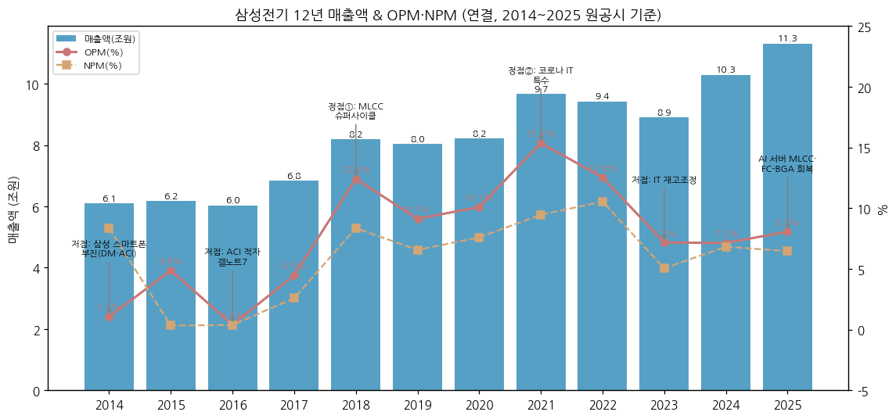

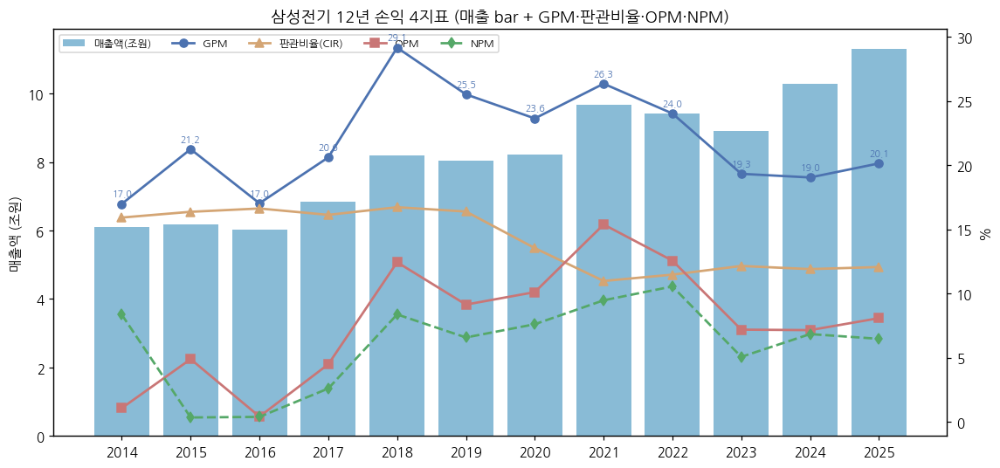

### (2) 산업 분류

- 산업: **전자부품 — 수동소자(MLCC)·반도체 패키지기판(FC-BGA/BGA)·카메라모듈**
- DART 업종코드: **2622** (한국표준산업분류 '전자부품 제조업' 계열)
- MSCI Sector: Information Technology — Electronic Equipment, Instruments & Components
- 워치리스트 섹터: **IT 하드웨어 — 전자부품·기판** (피어: LG이노텍·이수페타시스·대덕전자·심텍 / 글로벌: Murata·TDK·Taiyo Yuden·Yageo, Ibiden·Unimicron·Shinko·AT&S, Sunny Optical)
- 글로벌 점유율 (2025 사업보고서): **MLCC 23%** (회사 추정, 2024 23%·2023 21%) · **BGA(패키지기판) 15%** (Prismark 금액 기준, 2024 16%) · **카메라모듈 9%** (회사 추정, 2024 11%)
- 언론 보도 기준: MLCC 전체 시장 무라타 약 40%·삼성전기 약 25% (IB토마토 2025-09), **AI 서버용 MLCC 삼성전기 약 40%** (회사 측 자료, MTN 2026-09)

### (3) 분류 결정 논리

(1) **가장 매출 큰 사업부 기준** 적용 시 컴포넌트(2025 매출 46%, 영업이익 67%) → MLCC = 전형적 재고 사이클 부품 → **사이클**

(2) **사이클 사업부 영업이익 비중 우선 sub-rule**: 12년 중 MLCC가 전사 영업이익의 대부분을 차지 (2018 컴포넌트 영업이익 1.12조 / 전사 1.15조 = 97%). 컴포넌트 OPM이 1Q15 16.6% → 3Q18 38.2% → 4Q22 1.6% → 3Q26 22.8%로 출렁이며 전사 사이클을 결정 → Primary 사이클 유지

(3) **Boundary case 처리**: 2024년부터 AI 서버·전장 MLCC와 서버/AI 가속기 FC-BGA가 성장 동력으로 부상. 회사는 'GPU·ASIC당 MLCC 용량 매년 2배'('AI MLCC 법칙', 3Q26 실적 보도자료)를 제시하고, 2027년분 1조722억원 MLCC 공급계약(2026-09 공시)과 빅테크 10여 곳 장기공급계약(LTA)을 확보 → **Primary 사이클 + Secondary AI 데이터센터 secular** 표기. 장기공급계약 비중이 커지면 재고 사이클 진폭이 줄어들 수 있음

(4) **피어 cross-reference**:
   - **Murata 대비**: 동일 MLCC 1·2위 구도. Murata는 MLCC 비중이 더 높은 pure 부품사, 삼성전기는 기판·카메라모듈을 함께 보유 → 카메라모듈(OPM 3\~7%)이 이익 변동을 희석하지만 기판이 사이클 진폭을 키우는 이중 구조
   - **Ibiden·Unimicron 대비**: 패키지솔루션은 FC-BGA 사이클(2021\~22 정점 → 2023\~25 공급과잉 → 2026 AI 가속기 재정점)을 공유
   - **LG이노텍 대비**: LG이노텍은 카메라모듈(애플) 비중이 압도적 → 고객·세트 사이클 / 삼성전기는 MLCC 재고 사이클 → 같은 IT 부품이라도 분류 근거가 다름

### (4) 적정 밸류에이션 방법

- **PBR (사이클 기준) 1순위** — 컴포넌트 영업이익 비중 67%(2025)·92%(3Q26, 패키지 포함) 반영. 12년 자본총계 4.64조 → 9.80조 (+7.0% CAGR)로 장부가치가 꾸준해 사이클 위치 판단에 적합
  - 사이클 정점 PBR 상한 vs 저점 PBR 하한 밴드 활용. 2026-11-24 종가 기준 PBR 약 **6.3배** (시총 64.1조 / 3Q26 지배주주 자본 10.22조) — 2026-06-19 ATH 당시 약 **16.6배**. 과거 사이클 밴드를 크게 벗어난 구간이라 밴드 상단 재설정 여부가 핵심 논점
- **PER (12MF) 보조** — AI 서버 MLCC·FC-BGA 장기계약 매출이 늘어나는 만큼 이익 가시성을 반영. TTM(4Q25\~3Q26) 순이익 약 1.29조 기준 PER 약 50배 (비지배 포함 근사)
- **EV/EBITDA** — 감가상각비 연 0.86조(2025, 세그먼트 주석) 규모의 장치산업 특성 반영
- **피어 차별화**: Murata·Taiyo Yuden은 PER 중심으로 평가되는 경우가 많은 반면, 삼성전기는 MLCC 재고 사이클 + 기판 사이클 이중 노출로 PBR 우선 + PER 보조 혼합이 적절

### (5) 분기 재평가 트리거

- **AI·서버·전장(고부가) MLCC 매출 비중이 컴포넌트 매출의 50%+ 도달 공시 시** → 사이클 → 지속성장 Secondary 격상 검토
- **컴포넌트 OPM이 2개 분기 연속 QoQ ±3%pt 이내로 안정 + 장기공급계약 매출 비중 공개 시** → 재고 사이클 진폭 축소 → 사이클 → 지속성장 transition 후보
- **패키지솔루션 영업이익이 컴포넌트를 2개 분기 연속 상회 시** → 분류 근거 사업부 교체 (FC-BGA 사이클 기준으로 재평가)
- **컴포넌트 OPM 10% 하회 (2개 분기 연속)** → AI secular 노출 과대평가 → Secondary 노트 삭제, Pure Cyclical

---

## 2. 회사 개요

(1) 기본 사항

| 항목 | 내용 |
|---|---|
| 회사명 (한글) | 삼성전기주식회사 |
| 회사명 (영문) | SAMSUNG ELECTRO-MECHANICS CO., LTD. |
| 종목코드 | 009150 (보통주) / 009155 (우선주), KRX 유가증권시장 |
| 설립일 | 1973년 8월 8일 (자본금 81백만원으로 설립) |
| 상장일 | 1979년 2월 27일 |
| 본사 주소 | 경기도 수원시 영통구 매영로 150 (매탄동) |
| 홈페이지 | https://www.samsungsem.com |
| 대표이사 | 장덕현 사장 (1964년생, 美 University of Florida 전자공학 박사, 前 삼성전자 S.LSI 센서사업팀장, 2022-03 선임·2025-03 재선임) |
| 최대주주 | 삼성전자 23.69% (보통주 17,693,084주) |
| 발행주식수 (2025말) | 보통주 74,693,696주 / 우선주 2,906,984주 (자기주식 보통주 2,000,000주·우선주 53,430주) |
| 연결 종속회사 | 14개사 (주요 종속회사 8개, 국내 상장 없음) — 생산: 중국 천진·고신, 필리핀, 베트남 / 판매: 미주·유럽·아시아 / 인도 R&D 법인 |
| 국내 사업장 | 수원(본사·R&D·마케팅), 세종(패키지기판), 부산 녹산(MLCC) |
| 임직원 (2025말) | 12,173명 (남 9,278 / 여 2,895, 기간제 포함), 평균 근속 16년, 1인 평균 급여 1.15억원(남)·0.92억원(여) |
| 신용등급 | 2012년 회사채·CP 전액 상환 이후 신용평가 미실시 (마지막: 회사채 AA, CP A1) |
| 시가총액 | **64.09조원** (2026-11-24 종가 858,000원, 이투데이) / ATH 종가 2,270,000원 (2026-06-19, 장중 2,417,000원) ≈ 보통주 169.6조원 |

(2) 12년 손익·자본 추이 (Summary Table, 연결 원공시)

| 연도 | 매출 (조원) | OP (조원) | OPM | NI (조원) | 자본총계 (조원) | 자산총계 (조원) | OCF (조원) | CapEx (조원) |
|---|---|---|---|---|---|---|---|---|
| 2014 | 6.10 | 0.06 | 1.1% | 0.51 | 4.6 | 7.7 | 0.37 | 0.88 |
| 2015 | 6.18 | 0.30 | 4.9% | 0.02 | 4.3 | 7.3 | 0.54 | 1.21 |
| 2016 | 6.03 | 0.02 | 0.4% | 0.02 | 4.3 | 7.7 | 0.68 | 1.06 |
| 2017 | 6.84 | 0.31 | 4.5% | 0.18 | 4.3 | 7.8 | 0.72 | 1.54 |
| 2018 | 8.19 | 1.02 | 12.4% | 0.69 | 4.9 | 8.6 | 1.56 | 1.21 |
| 2019 | 8.04 | 0.73 | 9.1% | 0.53 | 5.4 | 8.7 | 1.02 | 1.57 |
| 2020 | 8.21 | 0.83 | 10.1% | 0.62 | 5.9 | 9.2 | 1.59 | 0.78 |
| 2021 | 9.68 | 1.49 | 15.4% | 0.92 | 6.9 | 9.9 | 1.73 | 0.88 |
| 2022 | 9.42 | 1.18 | 12.6% | 0.99 | 7.7 | 11.0 | 1.58 | 1.35 |
| 2023 | 8.91 | 0.64 | 7.2% | 0.45 | 8.0 | 11.7 | 1.18 | 1.26 |
| 2024 | 10.29 | 0.74 | 7.1% | 0.70 | 9.0 | 12.8 | 1.43 | 0.83 |
| 2025 | 11.31 | 0.91 | 8.1% | 0.73 | 9.8 | 14.6 | 1.49 | 1.25 |

→ 11년 매출 CAGR: **5.8%** / 11년 자본 CAGR: **7.0%** / 자산총계 7.72조(2014) → 14.60조(2025)

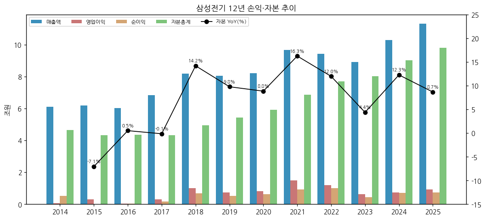

(3) 주가 역사 (20년 narrative)

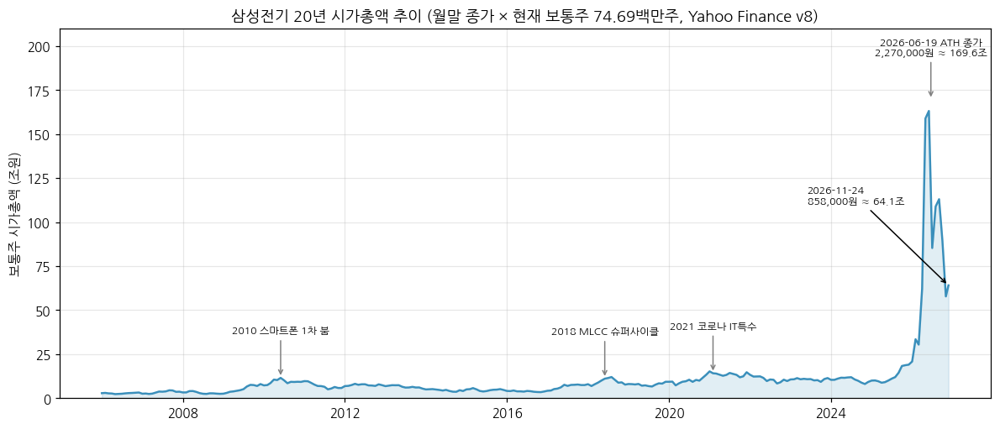

→ **주가·시가총액 변천사** (연말 종가 Yahoo Finance v8, 시총 = 종가 × 현재 보통주 74.69백만주 근사):
- 2009\~2010: 스마트폰 1차 붐 + LED 기대 → 연말 종가 97,500원(2009) → 130,000원(2010), 시총 약 9.7조
- 2011\~2016: 장기 박스권 (연말 92,100원 → 56,700원). 갤럭시 의존 부품사 디레이팅, 2016 기판 적자
- 2017\~2018: MLCC 슈퍼사이클 → 연말 106,500원(2017)·108,000원(2018), 컴포넌트 OPM 30%대
- 2020\~2021: 코로나 IT 특수 → 2020 연말 204,000원(시총 약 15.2조), 2021 OPM 15.4%
- 2022\~2024: IT 재고조정 → 연말 142,700원 → 134,100원으로 횡보
- 2025: AI 서버 MLCC·FC-BGA 기대 → 연말 279,000원 (+108% YoY)
- **2026: AI 데이터센터 부품 재평가 랠리** — 5월 상장 후 첫 100만원 돌파, 시총 100조원 돌파·코스피 5위(언론 보도), **2026-06-19 종가 2,270,000원(ATH, 장중 2,417,000원) ≈ 169.6조**. 이후 하락 전환해 2026-11-24 종가 858,000원(시총 64.1조, ATH 대비 -62%)

(4) 주요 연혁

| 연도 | 내용 |
|---|---|
| 1973.08 | 설립 (자본금 81백만원) |
| 1979.02 | 한국거래소 유가증권시장 상장 |
| 2015.01\~04 | 자기주식 보통주 200만주 장내 취득 (1,457억원, 주가 안정 목적) |
| 2015 | 비주력 사업 정리 — 세후 중단영업손실 3,016억원 인식 |
| 2019.06 | PLP(패널레벨패키지) 사업 삼성전자 양도 |
| 2021.10 | 베트남 법인 RFPCB 생산·판매 중단 결정 (영업정지금액 4,278억원) |
| 2021.12 | Wi-Fi·5G mmWave 안테나 모듈 사업 한화솔루션에 양도 (600억원) |
| 2022.03 | 장덕현 대표이사 선임 (경계현 前 대표 중도사임) |
| 2024.09 | 통신모듈 생산·판매 중단 결정 (170억원) → 광학통신솔루션 → 광학솔루션으로 사업부 명칭 변경 |
| 2026.09 | 글로벌 대형기업과 2027년분 MLCC 공급계약 1조722억원 체결 (2024 매출의 9.5%, 역대 최대) |

---

## 3. 비즈니스 모델

(1) 실적 추이 통합 표 (5년 연간, 사업부 → 제품 → 지역 3단계 위계, 억원)

| 구분 | 2021 | 2022 | 2023 | 2024 | 2025 | 9M26 |
|---|---|---|---|---|---|---|
| **컴포넌트** (MLCC·인덕터·칩저항) 매출 | 47,718 | 41,323 | 39,030 | 44,620 | 51,985 | 49,409 |
| └ 영업이익 (OPM) | 10,635 (22.3%) | 6,077 (14.7%) | 3,616 (9.3%) | 4,397 (9.9%) | 6,094 (11.7%) | 8,677 (17.6%) |
| **패키지솔루션** (FC-BGA·BGA) 매출 | 16,792 | 20,883 | 17,174 | 20,347 | 23,018 | 24,357 |
| └ 영업이익 (OPM) | 2,622 (15.6%) | 4,646 (22.2%) | 1,766 (10.3%) | 1,576 (7.7%) | 1,352 (5.9%) | 3,694 (15.2%) |
| **광학솔루션** (카메라모듈) 매출 | 32,241 | 32,040 | 32,720 | 37,974 | 38,142 | 30,530 |
| └ 영업이익 (OPM) | 1,611 (5.0%) | 1,104 (3.4%) | 1,224 (3.7%) | 1,376 (3.6%) | 1,687 (4.4%) | 1,748 (5.7%) |
| **합계 매출** | 96,750 | 94,246 | 88,924 | 102,941 | 113,145 | 104,296 |
| **합계 영업이익 (OPM)** | 14,869 (15.4%) | 11,828 (12.6%) | 6,605 (7.4%) | 7,350 (7.1%) | 9,133 (8.1%) | 14,119 (13.5%) |

→ 사업부 수치는 DART 영업부문 주석(누적) 차분, 재작성 기준. 2021은 HDI·Wi-Fi 모듈 중단영업 제외 기준이라 원공시 연간 매출(9.68조)과 같음

**제품·가격 (2025 사업보고서):** MLCC 평균판매가격 +0.9% YoY · 반도체패키지기판 ASP +4.1% · 카메라모듈 ASP +14.0% / 생산 가동률 컴포넌트 93% · 패키지솔루션 70% · 광학솔루션 66%

**지역별 매출 (연결 법인 소재지 기준, 9M26 누적 · 억원, DART 3분기보고서 주석):**

| 지역 | 9M26 | 비중 | 9M25 | YoY |
|---|---|---|---|---|
| 국내(내수) | 3,258 | 3.1% | 3,370 | -3.3% |
| 국내(수출) | 28,380 | 27.2% | 23,864 | +18.9% |
| 중국 | 40,866 | 39.2% | 31,942 | +27.9% |
| 동남아 | 23,525 | 22.6% | 18,287 | +28.6% |
| 미주 | 4,097 | 3.9% | 3,068 | +33.5% |
| 유럽 | 3,257 | 3.1% | 2,896 | +12.5% |
| 일본 | 913 | 0.9% | 697 | +31.1% |
| **합계** | **104,296** | 100% | **84,123** | **+24.0%** |

→ 2025 연간 수출 비중 **96.2%** (수출 10.89조 / 내수 0.43조). 주요 고객: 국내=삼성전자·TSMC·Google / 중국·동남아=삼성전자·Xiaomi·Tesla / 일본=Shinko·Sony / 미주=Intel·Future·Bosch / 유럽=Bosch·Continental·Rutronik (3Q26 주석)

**① 사업부별 47분기 시계열 (1Q15\~3Q26, 매출 bar + OPM line)**

사업부 매핑: **컴포넌트** = LCR사업부문(\~3Q17) → 컴포넌트솔루션(4Q17\~2020) → 컴포넌트(2021\~) / **패키지솔루션** = ACI사업부문(\~3Q17, HDI·RFPCB 포함) → 기판솔루션(4Q17\~2020) → 패키지솔루션(2021\~, 반도체 패키지기판 단일) / **광학솔루션** = DM사업부문(\~3Q17, 카메라·통신모듈) → 모듈솔루션 → 광학통신솔루션(2021\~2024) → 광학솔루션(2024\~, 카메라모듈 단일)

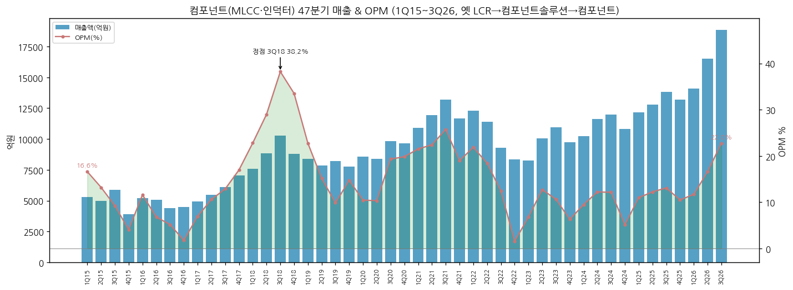

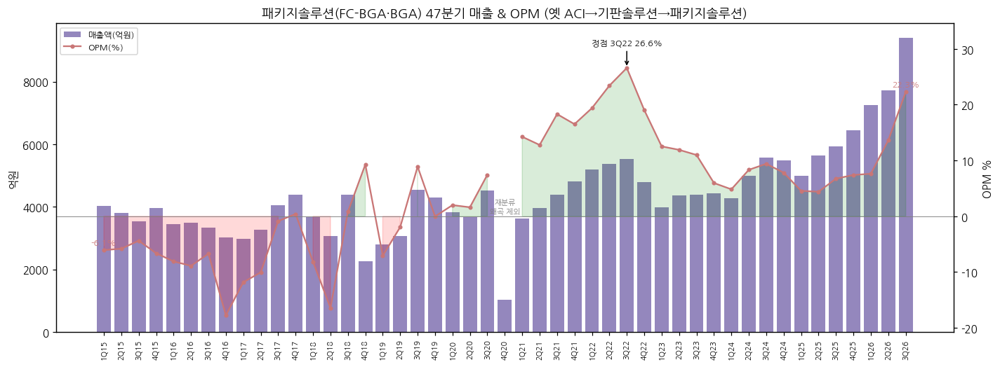

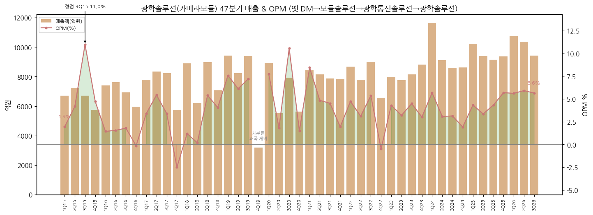

| 분기 | 전사 매출 | 전사 OP | OPM | 컴포넌트 매출 | 컴포 OPM | 패키지 매출 | 패키지 OPM | 광학 매출 | 광학 OPM |
|---|---|---|---|---|---|---|---|---|---|
| 1Q15 | 16,026 | 851 | 5.3% | 5,310 | 16.6% | 4,019 | -6.1% | 6,697 | 1.9% |
| 2Q15 | 16,021 | 941 | 5.9% | 4,985 | 13.2% | 3,814 | -5.8% | 7,222 | 4.2% |
| 3Q15 | 16,095 | 1,015 | 6.3% | 5,868 | 9.2% | 3,526 | -4.4% | 6,702 | 11.0% |
| 4Q15 | 13,620 | 206 | 1.5% | 3,917 | 4.1% | 3,960 | -6.6% | 5,743 | 4.7% |
| 1Q16 | 16,043 | 429 | 2.7% | 5,194 | 11.6% | 3,455 | -8.1% | 7,395 | 1.4% |
| 2Q16 | 16,164 | 152 | 0.9% | 5,053 | 6.8% | 3,481 | -8.9% | 7,630 | 1.6% |
| 3Q16 | 14,673 | 128 | 0.9% | 4,397 | 5.2% | 3,340 | -6.7% | 6,936 | 1.8% |
| 4Q16 | 13,451 | -465 | -3.5% | 4,482 | 1.7% | 3,016 | -17.7% | 5,952 | -0.1% |
| 1Q17 | 15,705 | 255 | 1.6% | 4,930 | 6.9% | 2,975 | -11.8% | 7,800 | 3.4% |
| 2Q17 | 17,099 | 707 | 4.1% | 5,494 | 10.6% | 3,264 | -10.1% | 8,340 | 5.4% |
| 3Q17 | 18,411 | 1,032 | 5.6% | 6,111 | 12.9% | 4,060 | -0.9% | 8,240 | 3.4% |
| 4Q17 | 17,170 | 1,068 | 6.2% | 7,035 | 17.0% | 4,395 | 0.4% | 5,740 | -2.5% |
| 1Q18 | 20,188 | 1,540 | 7.6% | 7,602 | 22.8% | 3,678 | -8.2% | 8,907 | 1.2% |
| 2Q18 | 18,098 | 2,068 | 11.4% | 8,829 | 29.0% | 3,068 | -16.4% | 6,201 | 0.2% |
| 3Q18 | 23,612 | 4,445 | 18.8% | 10,268 | 38.2% | 4,376 | 0.8% | 8,968 | 5.4% |
| 4Q18 | 18,123 | 3,446 | 19.0% | 8,802 | 33.5% | 2,259 | 9.3% | 7,062 | 4.1% |
| 1Q19 | 20,623 | 2,423 | 11.8% | 8,380 | 22.7% | 2,807 | -7.1% | 9,437 | 7.6% |
| 2Q19 | 19,170 | 1,638 | 8.5% | 7,867 | 15.2% | 3,060 | -1.9% | 8,243 | 6.1% |
| 3Q19 | 22,159 | 1,892 | 8.5% | 8,201 | 9.9% | 4,548 | 8.9% | 9,410 | 7.2% |
| 4Q19 | 15,231 | 1,456 | 9.6% | 7,750 | 14.7% | 4,288 | -0.0% | 3,194 | 9.9% |
| 1Q20 | 21,333 | 1,663 | 7.8% | 8,576 | 10.5% | 3,837 | 2.0% | 8,920 | 7.7% |
| 2Q20 | 17,601 | 1,027 | 5.8% | 8,396 | 10.3% | 3,678 | 1.6% | 5,527 | 1.8% |
| 3Q20 | 22,289 | 3,074 | 13.8% | 9,832 | 19.3% | 4,520 | 7.4% | 7,938 | 10.6% |
| 4Q20 | 16,310 | 3,363 | 20.6% | 9,646 | 19.8% | 1,024 | 133.3% | 5,640 | 1.5% |
| 1Q21 | 22,914 | 3,567 | 15.6% | 10,884 | 21.5% | 3,616 | 14.3% | 8,413 | 8.4% |
| 2Q21 | 24,059 | 3,581 | 14.9% | 11,953 | 22.4% | 3,970 | 12.8% | 8,137 | 4.8% |
| 3Q21 | 25,478 | 4,558 | 17.9% | 13,209 | 25.7% | 4,395 | 18.3% | 7,874 | 4.5% |
| 4Q21 | 24,299 | 3,162 | 13.0% | 11,672 | 19.0% | 4,811 | 16.5% | 7,817 | 1.9% |
| 1Q22 | 26,168 | 4,105 | 15.7% | 12,292 | 21.9% | 5,196 | 19.4% | 8,679 | 4.7% |
| 2Q22 | 24,556 | 3,601 | 14.7% | 11,401 | 18.4% | 5,364 | 23.4% | 7,791 | 3.1% |
| 3Q22 | 23,837 | 3,110 | 13.0% | 9,298 | 12.4% | 5,525 | 26.6% | 9,014 | 5.4% |
| 4Q22 | 19,684 | 1,012 | 5.1% | 8,331 | 1.6% | 4,798 | 19.1% | 6,555 | -0.5% |
| 1Q23 | 20,218 | 1,401 | 6.9% | 8,255 | 6.8% | 3,976 | 12.5% | 7,986 | 4.3% |
| 2Q23 | 22,205 | 2,050 | 9.2% | 10,065 | 12.7% | 4,374 | 11.9% | 7,766 | 3.2% |
| 3Q23 | 23,567 | 1,881 | 8.0% | 10,959 | 10.6% | 4,396 | 11.0% | 8,147 | 4.5% |
| 4Q23 | 22,999 | 1,143 | 5.0% | 9,750 | 6.3% | 4,428 | 6.0% | 8,821 | 3.0% |
| 1Q24 | 26,139 | 1,836 | 7.0% | 10,230 | 9.5% | 4,280 | 4.8% | 11,630 | 5.7% |
| 2Q24 | 25,726 | 2,115 | 8.2% | 11,603 | 12.2% | 4,992 | 8.3% | 9,131 | 3.1% |
| 3Q24 | 26,153 | 2,249 | 8.6% | 11,970 | 12.1% | 5,582 | 9.4% | 8,601 | 3.1% |
| 4Q24 | 24,923 | 1,150 | 4.6% | 10,817 | 5.1% | 5,493 | 7.8% | 8,612 | 1.9% |
| 1Q25 | 27,386 | 2,005 | 7.3% | 12,163 | 11.0% | 4,994 | 4.6% | 10,230 | 4.3% |
| 2Q25 | 27,846 | 2,130 | 7.6% | 12,807 | 12.2% | 5,646 | 4.4% | 9,393 | 3.4% |
| 3Q25 | 28,890 | 2,603 | 9.0% | 13,812 | 13.1% | 5,932 | 6.7% | 9,146 | 4.3% |
| 4Q25 | 29,021 | 2,395 | 8.3% | 13,203 | 10.5% | 6,446 | 7.4% | 9,373 | 5.7% |
| 1Q26 | 32,091 | 2,806 | 8.7% | 14,085 | 11.7% | 7,250 | 7.6% | 10,756 | 5.6% |
| 2Q26 | 34,572 | 4,404 | 12.7% | 16,494 | 16.6% | 7,716 | 13.6% | 10,362 | 5.9% |
| 3Q26 | 37,633 | 6,910 | 18.4% | 18,830 | 22.8% | 9,390 | 22.3% | 9,413 | 5.6% |

→ 단위 억원. ⚠ 4Q19 광학(매출 3,194억)·4Q20 패키지(매출 1,024억·OP 1,365억)는 중단영업 재분류 기준 차이로 4Q 역산값이 왜곡된 분기 — 추세 해석 시 제외. 2015\~3Q17 사업부 영업이익은 연결조정 전 금액이라 합계가 전사와 다를 수 있음

**3Q26 핵심 박스**

> - 매출 **3조7,633억원** (+30% YoY, +9% QoQ, 분기 사상 최대) / 영업이익 **6,910억원** (+165% YoY, +57% QoQ, OPM 18.4% — 분기 기준 12년 최고)
> - 컴포넌트 1조8,830억원 (+36% YoY), OPM 22.8% — 서버·네트워크·파워 등 AI 데이터센터용 중심 믹스 개선. 'GPU·ASIC당 MLCC 용량 매년 2배' 제시
> - 패키지솔루션 9,390억원 (+58% YoY), OPM 22.3% — 서버 CPU·AI 가속기·네트워크용 FC-BGA 공급 확대, ADAS 기판 증가. 2022년 분기 정점(3Q22 26.6%)에 근접
> - 광학솔루션 9,413억원 (+3% YoY, -9% QoQ), OPM 5.6% — 2억화소 폴디드줌·폴더블 공급, 차세대 EV 플랫폼용 카메라모듈
> - 4Q26 가이던스(정성): AI 데이터센터 고사양 수요 지속, 서버 CPU·AI 가속기용 신규 FC-BGA 적기 공급 및 CAPA 확대, 전략 거래선 플래그십 카메라 양산 시작

**① 직전 12분기 시계열 (4Q23\~3Q26)**

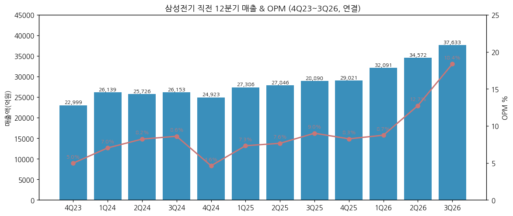

| 분기 | 4Q23 | 1Q24 | 2Q24 | 3Q24 | 4Q24 | 1Q25 | 2Q25 | 3Q25 | 4Q25 | 1Q26 | 2Q26 | 3Q26 |
|---|---|---|---|---|---|---|---|---|---|---|---|---|
| 매출(억원) | 22,999 | 26,139 | 25,726 | 26,153 | 24,923 | 27,386 | 27,846 | 28,890 | 29,021 | 32,091 | 34,572 | 37,633 |
| 영업이익(억원) | 1,143 | 1,836 | 2,115 | 2,249 | 1,150 | 2,005 | 2,130 | 2,603 | 2,395 | 2,806 | 4,404 | 6,910 |
| OPM | 5.0% | 7.0% | 8.2% | 8.6% | 4.6% | 7.3% | 7.6% | 9.0% | 8.3% | 8.7% | 12.7% | 18.4% |
| 매출 YoY | +16.8% | +29.3% | +15.9% | +11.0% | +8.4% | +4.8% | +8.2% | +10.5% | +16.4% | +17.2% | +24.2% | +30.3% |

(2) 사업부별 개요 (2025 매출 비중 순)

| 사업부 | 2025 매출 | 비중 | 2025 영업이익 | 이익 비중 | 주요 제품 | 주요 원재료 (매입처) |
|---|---|---|---|---|---|---|
| 컴포넌트 | 5조1,985억 | 45.95% | 6,094억 | 66.7% | MLCC, 파워인덕터, 칩저항, 탄탈 커패시터 | PASTE/POWDER (SHOEI·GUANGBO), FILM (TORAY·COSMO) |
| 광학솔루션 | 3조8,142억 | 33.71% | 1,687억 | 18.5% | 모바일·전장 카메라모듈 (폴디드줌, OIS, 고화소) | 센서 IC (삼성전자·SONY), 액추에이터 (ACTRO·해성옵틱스) |
| 패키지솔루션 | 2조3,018억 | 20.34% | 1,352억 | 14.8% | FC-BGA (서버·PC CPU, AI 가속기, 네트워크, ADAS), BGA (AP·메모리) | CCL/PPG (MITSUBISHI·RESONAC), 도금 약품 (ATOTECH) |

(3) 사업부별 디테일

**컴포넌트 (이익 엔진)**
- 12년 사이클의 주인공. 컴포넌트 OPM 정점 3Q18 38.2%(MLCC 슈퍼사이클) → 저점 4Q22 1.6% → 3Q26 22.8%
- 성장 축: AI 서버(초고용량·소형), 전장(150℃ 이상 고온·고압, ADAS·파워트레인), 위성인터넷·Solar. 2025 R&D 성과: 서버향 초고용량 MLCC, 전장 ADAS용 초고용량 최초품, 전장용 소형 고전압
- 2025 CAPA 1조1,159억개·생산 1조363억개·가동률 93%. 2025 시설투자 7,219억원(전사 1조1,549억의 62%) 집중

**패키지솔루션 (사이클 증폭기)**
- ACI 시절(2015\~2018) 만성 적자(연 -560\~-1,349억) → 2019 PLP 양도·2021 RFPCB/HDI 철수로 반도체 패키지기판 단일화 → 2022 OPM 22.2% 정점 → 2025 5.9% → 9M26 15.2%
- FC-BGA: 서버 CPU·AI 가속기·네트워크용 고다층·대면적 제품 확대. 2025 BGA 점유율 15% (Prismark). 가동률 70%로 증설 여력 보유

**광학솔루션 (매출 규모, 낮은 마진)**
- 12년 내내 OPM 1\~7%대. 최대 거래선 삼성전자 플래그십 + 중화권 스마트폰·글로벌 EV 플랫폼으로 다변화
- 2024-09 통신모듈 중단으로 카메라모듈 단일 사업부. 2025 ASP +14%, 생산량 98백만개(가동률 66%)

(4) 주요 경쟁사

| 사업부 | 글로벌 경쟁사 |
|---|---|
| 컴포넌트 (MLCC) | Murata(1위), Taiyo Yuden, TDK, Yageo, Kyocera(AVX), 풍화고과(Fenghua) |
| 패키지솔루션 (FC-BGA) | Ibiden, Shinko, Unimicron, AT&S, Nan Ya PCB, Kinsus / 국내: LG이노텍, 대덕전자, 심텍(BGA) |
| 광학솔루션 | LG이노텍, Sunny Optical, O-Film, Q-Tech, 파트론 |

(5) 주요 매출처

- 매출 10% 이상 거래처: **삼성전자와 그 종속기업** — 2025 매출 3조938억원 (전사 27%), 2024 2조9,855억원. 9M26 2조4,794억원 (전사 24%, 비중 하락 = 고객 다변화)
- 지역별 주요 고객 (3Q26 주석, 알파벳·가나다 순 아님 — 회사 기재 순): 삼성전자, TSMC, Google, Xiaomi, Tesla, Shinko, Sony, Intel, Future, Bosch, Continental, Rutronik
- 2027년분 MLCC 1조722억원 계약 상대는 '글로벌 대형기업'으로만 공시 (기업명 비공개)

(6) 생산 CAPA + 임직원

| 사업부 | 2023 CAPA | 2024 CAPA | 2025 CAPA | 2025 생산 | 가동률 |
|---|---|---|---|---|---|
| 컴포넌트 (억개) | 12,568 | 12,419 | 11,159 | 10,363 | 93% |
| 패키지솔루션 (천㎡) | 784 | 788 | 810 | 565 | 70% |
| 광학솔루션 (백만개) | 158 | 158 | 149 | 98 | 66% |

→ 임직원 2025말 12,173명: 컴포넌트 3,990 / 패키지솔루션 3,192 / 광학솔루션 915 / 기타(R&D·지원) 4,076. 연간 급여총액 1.34조원

---

## 4. 재무 구조 (12년 시계열, 연결 원공시, 억원)

(1) 손익계산서

| 연도 | 매출 | 매출총이익 | GPM | 판관비 | 판관비율 | 영업이익 | OPM | 세전이익 | 순이익 | NPM |
|---|---|---|---|---|---|---|---|---|---|---|
| 2014 | 61,004 | 10,354 | 17.0% | 9,705 | 15.9% | 649 | 1.1% | 8,162 | 5,089 | 8.3% |
| 2015 | 61,763 | 13,116 | 21.2% | 10,102 | 16.4% | 3,013 | 4.9% | 3,668 | 206 | 0.3% |
| 2016 | 60,330 | 10,268 | 17.0% | 10,024 | 16.6% | 244 | 0.4% | 321 | 229 | 0.4% |
| 2017 | 68,385 | 14,084 | 20.6% | 11,022 | 16.1% | 3,062 | 4.5% | - | 1,773 | 2.6% |
| 2018 | 81,930 | 23,875 | 29.1% | 13,694 | 16.7% | 10,181 | 12.4% | 9,404 | 6,850 | 8.4% |
| 2019 | 80,408 | 20,508 | 25.5% | 13,169 | 16.4% | 7,340 | 9.1% | - | 5,280 | 6.6% |
| 2020 | 82,087 | 19,397 | 23.6% | 11,106 | 13.5% | 8,291 | 10.1% | 7,829 | 6,238 | 7.6% |
| 2021 | 96,750 | 25,479 | 26.3% | 10,611 | 11.0% | 14,869 | 15.4% | 14,913 | 9,154 | 9.5% |
| 2022 | 94,246 | 22,631 | 24.0% | 10,803 | 11.5% | 11,828 | 12.6% | 11,868 | 9,935 | 10.5% |
| 2023 | 89,094 | 17,209 | 19.3% | 10,815 | 12.1% | 6,394 | 7.2% | 5,432 | 4,505 | 5.1% |
| 2024 | 102,941 | 19,592 | 19.0% | 12,242 | 11.9% | 7,350 | 7.1% | 7,973 | 7,032 | 6.8% |
| 2025 | 113,145 | 22,774 | 20.1% | 13,640 | 12.1% | 9,133 | 8.1% | 8,958 | 7,310 | 6.5% |

→ 2014 세전이익(8,162억)이 영업이익(649억)을 크게 웃도는 것은 영업외 기타수익 1.22조원 때문. 2015\~2016 순이익 급감은 중단영업손실(2015 -3,016억) 영향


(2) 재무상태표

| 연도 | 자산총계 | 유동자산 | 현금성자산 | 재고자산 | 유형자산 | 부채총계 | 총차입금 | 자본총계 | 부채비율 |
|---|---|---|---|---|---|---|---|---|---|
| 2014 | 77,186 | 35,540 | 6,880 | 8,412 | 29,259 | 30,758 | 17,131 | 46,428 | 66.2% |
| 2015 | 72,695 | 27,300 | 10,353 | 6,790 | 32,984 | 29,541 | 20,416 | 43,154 | 68.5% |
| 2016 | 76,626 | 28,124 | 7,958 | 8,272 | 37,144 | 33,250 | 24,436 | 43,376 | 76.7% |
| 2017 | 77,674 | 24,788 | 4,446 | 9,189 | 41,547 | 34,359 | 25,689 | 43,315 | 79.3% |
| 2018 | 86,449 | 35,253 | 10,024 | 11,156 | 45,580 | 36,984 | 24,541 | 49,465 | 74.8% |
| 2019 | 86,742 | 35,075 | 8,038 | 12,713 | 45,145 | 32,442 | 19,628 | 54,301 | 59.7% |
| 2020 | 92,255 | 41,503 | 14,798 | 13,379 | 44,244 | 33,151 | 18,441 | 59,104 | 56.1% |
| 2021 | 99,414 | 45,983 | 11,852 | 18,184 | 46,394 | 30,702 | 9,924 | 68,711 | 44.7% |
| 2022 | 109,972 | 48,883 | 16,771 | 19,016 | 52,353 | 33,037 | 14,213 | 76,935 | 42.9% |
| 2023 | 116,579 | 52,084 | 16,692 | 21,195 | 56,033 | 36,275 | 15,215 | 80,303 | 45.2% |
| 2024 | 127,924 | 58,917 | 20,133 | 22,508 | 59,332 | 37,765 | 15,579 | 90,159 | 41.9% |
| 2025 | 145,959 | 70,976 | 27,012 | 24,130 | 62,216 | 47,986 | 21,918 | 97,973 | 49.0% |
| 3Q26 | 170,612 | 90,277 | 41,137 | 24,112 | 68,847 | 65,623 | 34,263 | 104,988 | 62.5% |

→ 총차입금 = 단기차입금 + 장기차입금 + 유동성장기차입금 (리스부채 제외). 3Q26은 IR 자료 총차입금 기준

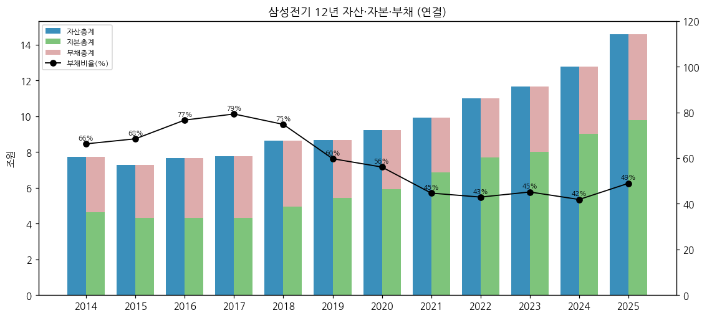

(3) 현금흐름표

| 연도 | 영업CF | 투자CF | 재무CF | 유형 CapEx | 무형 CapEx | FCF |
|---|---|---|---|---|---|---|
| 2014 | 3,726 | -3,722 | -218 | 8,599 | 209 | -5,082 |
| 2015 | 5,371 | -2,212 | 303 | 11,962 | 93 | -6,685 |
| 2016 | 6,796 | -11,863 | 2,813 | 10,519 | 72 | -3,794 |
| 2017 | 7,177 | -12,323 | 1,961 | 14,763 | 678 | -8,265 |
| 2018 | 15,587 | -6,981 | -2,358 | 11,952 | 125 | 3,509 |
| 2019 | 10,213 | -5,170 | -6,195 | 15,480 | 260 | -5,526 |
| 2020 | 15,881 | -7,324 | -2,095 | 7,567 | 237 | 8,077 |
| 2021 | 17,312 | -8,451 | -11,810 | 8,442 | 309 | 8,561 |
| 2022 | 15,754 | -13,276 | 1,931 | 12,965 | 486 | 2,303 |
| 2023 | 11,804 | -10,228 | -1,731 | 12,098 | 471 | -765 |
| 2024 | 14,298 | -8,059 | -3,091 | 7,760 | 507 | 6,032 |
| 2025 | 14,901 | -12,229 | 4,181 | 11,921 | 542 | 2,438 |
| 9M26 | 22,676 | -18,062 | 9,765 | 17,314 | 392 | 4,970 |

→ FCF = 영업CF − 유형자산 취득 − 무형자산 취득. 12년 FCF 합계 약 +0.08조로 사실상 0 — 번 돈을 증설에 재투자하는 장치산업 구조

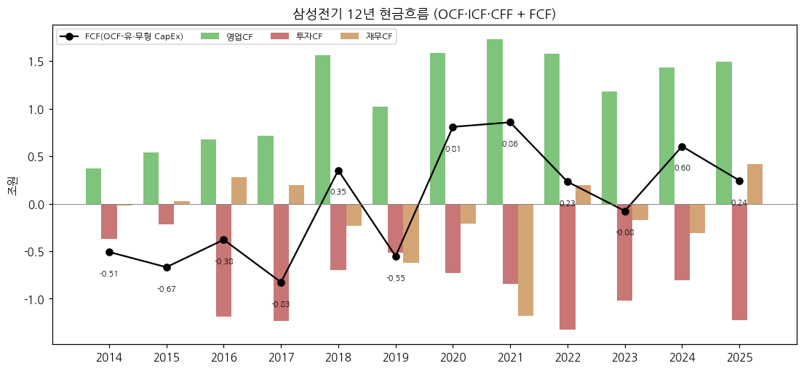

(4) CapEx

| 연도 | 총 CapEx (억원) | CapEx/매출 | 주요 투자 |
|---|---|---|---|
| 2014 | 8,808 | 14.4% | - |
| 2015 | 12,056 | 19.5% | 1조원대 진입 |
| 2016 | 10,590 | 17.6% | - |
| 2017 | 15,441 | 22.6% | MLCC 업사이클 증설 |
| 2018 | 12,077 | 14.7% | MLCC 슈퍼사이클 |
| 2019 | 15,739 | 19.6% | 12년 최대 (1.57조) |
| 2020 | 7,804 | 9.5% | 코로나로 축소 (0.78조) |
| 2021 | 8,751 | 9.0% | - |
| 2022 | 13,451 | 14.3% | FC-BGA 투자 확대 |
| 2023 | 12,569 | 14.1% | - |
| 2024 | 8,266 | 8.0% | 업황 둔화로 축소 (0.83조) |
| 2025 | 12,463 | 11.0% | 컴포넌트 7,219억 중심 (전사 시설투자 1조1,549억) |
| 9M26 | 17,706 | 17.0% | AI MLCC·FC-BGA 증설 (9M 기준 이미 2025 연간의 1.4배) |

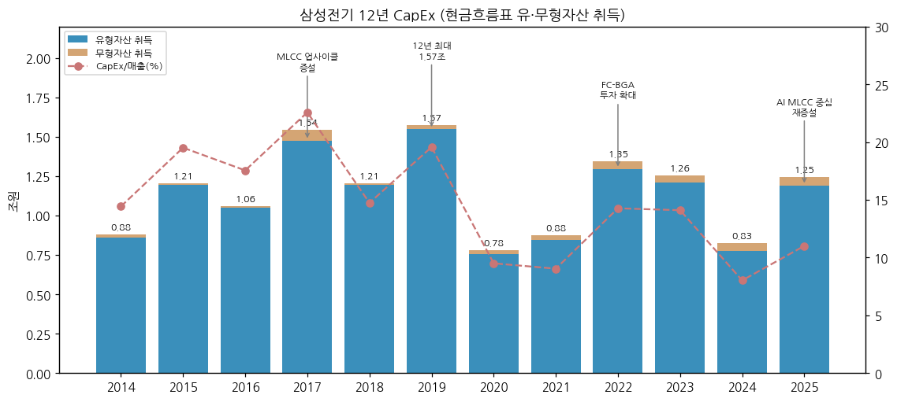

(5) 부채구조 + 채무증권 발행 history

| 연도 | 단기차입금 | 장기차입금 | 유동성장기차입금 | 총차입금 | 현금성자산 | 순차입금 |
|---|---|---|---|---|---|---|
| 2014 | 6,711 | 5,967 | 4,454 | 17,131 | 6,880 | 10,251 |
| 2015 | 6,911 | 10,166 | 3,338 | 20,416 | 10,353 | 10,063 |
| 2016 | 8,423 | 12,777 | 3,236 | 24,436 | 7,958 | 16,478 |
| 2017 | 12,038 | 8,976 | 4,675 | 25,689 | 4,446 | 21,243 |
| 2018 | 9,620 | 10,601 | 4,320 | 24,541 | 10,024 | 14,518 |
| 2019 | 5,692 | 12,197 | 1,738 | 19,628 | 8,038 | 11,589 |
| 2020 | 4,062 | 12,332 | 2,047 | 18,441 | 14,798 | 3,643 |
| 2021 | 565 | 6,198 | 3,161 | 9,924 | 11,852 | -1,928 |
| 2022 | 8,103 | 3,366 | 2,744 | 14,213 | 16,771 | -2,558 |
| 2023 | 10,679 | 2,165 | 2,371 | 15,215 | 16,692 | -1,477 |
| 2024 | 13,138 | 0 | 2,441 | 15,579 | 20,133 | -4,554 |
| 2025 | 20,034 | 1,884 | 0 | 21,918 | 27,012 | -5,094 |

→ 2021년부터 **순현금** 전환. 회사채·CP는 2012년 전액 상환 이후 발행 없음 (사업보고서 신용평가 항목) — 차입은 은행 단기차입 중심(해외법인 운영자금)

(6) 배당·자사주

| 연도 | 보통주 DPS (원) | 현금배당총액 (억원) | 연결 배당성향 | 자사주 매입 (억원) |
|---|---|---|---|---|
| 2014 | 750 | 583 | 11.6% | - |
| 2015 | 500 | 379 | 338.9% | 1,457 |
| 2016 | 500 | 379 | 257.8% | - |
| 2017 | 750 | 568 | 35.1% | - |
| 2018 | 1,000 | 757 | 11.5% | - |
| 2019 | 1,100 | 832 | 16.2% | - |
| 2020 | 1,400 | 1,059 | 17.5% | - |
| 2021 | 2,100 | 1,588 | 17.8% | - |
| 2022 | 2,100 | 1,588 | 16.2% | - |
| 2023 | 1,150 | 870 | 20.6% | - |
| 2024 | 1,800 | 1,361 | 20.0% | - |
| 2025 | 2,350 | 1,777 | 25.2% | - |

→ 배당성향 15\~25% 정책형 배당. 2015\~2016 배당성향 300% 내외는 순이익 급감(중단영업) 때문. 자사주는 2015년 200만주(보통주 2.68%) 매입 후 소각 없이 보유. 2025 결산 DPS 2,350원(우선주 2,400원), 시가배당률 0.9%

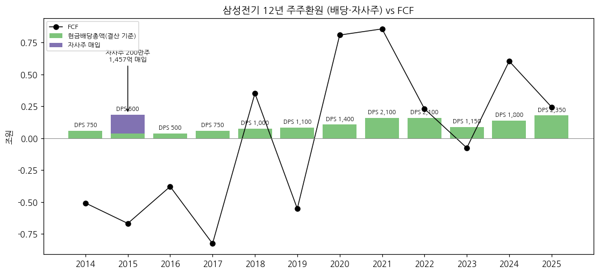

(7) 재무비율

| 연도 | ROE | ROA | 부채비율 | 유동비율 | 이자보상배율 (OP/금융원가) |
|---|---|---|---|---|---|
| 2014 | 11.0% | 6.6% | 66.2% | 165% | 1.9배 |
| 2015 | 0.5% | 0.3% | 68.5% | 154% | 8.5배 |
| 2016 | 0.5% | 0.3% | 76.7% | 138% | 0.5배 |
| 2017 | 4.1% | 2.3% | 79.3% | 101% | 4.6배 |
| 2018 | 13.8% | 7.9% | 74.8% | 140% | 11.3배 |
| 2019 | 9.7% | 6.1% | 59.7% | 190% | 9.4배 |
| 2020 | 10.6% | 6.8% | 56.1% | 217% | 17.3배 |
| 2021 | 13.3% | 9.2% | 44.7% | 206% | 37.4배 |
| 2022 | 12.9% | 9.0% | 42.9% | 194% | 25.5배 |
| 2023 | 5.6% | 3.9% | 45.2% | 180% | 9.4배 |
| 2024 | 7.8% | 5.5% | 41.9% | 193% | 10.1배 |
| 2025 | 7.5% | 5.0% | 49.0% | 186% | 12.0배 |

→ ROE = 연결 당기순이익 / 기말 자본총계. 이자보상배율은 금융원가 전체(이자 외 외환손실 일부 포함 가능) 기준 근사

---

## 5. 지배 구조

(1) 그룹·계열 관계

- 삼성그룹 계열 전자부품 계열사. 최대주주 **삼성전자 23.69%** (2025말, 최근 5년 변동 없음). 삼성전자는 동시에 최대 고객(매출 27%)이자 카메라모듈 센서 IC 매입처
- 특수관계 계열: 삼성생명보험(특별계정) 0.10%. 이재용 회장 등 총수 일가 직접 보유 없음 (삼성전자 경유 간접 지배)
- 연결 종속회사 14개 (해외 생산법인: 천진·고신(중국), 필리핀, 베트남 / 판매법인 미주·유럽·아시아 / 인도 R&D)

(2) 주주 구분 (보통주, 2025-12-31 주주명부)

| 주주 | 주식수 | 지분율 |
|---|---|---|
| 삼성전자(주) | 17,693,084 | 23.69% |
| 국민연금공단 | 8,213,036 | 11.00% |
| 자기주식 | 2,000,000 | 2.68% |
| 삼성생명보험(특별계정) | 77,210 | 0.10% |
| 등기임원 (장덕현·김성진·최재열·여윤경) | 9,262 | 0.01% |
| 소액주주 (1% 미만, 195,857명) | 39,565,200 | 52.97% |

→ 외국인 지분율은 DART 정기보고서 항목이 아니어서 미기재 (KRX 일별 데이터로 보강 필요 — Version Log 잔여 과제)

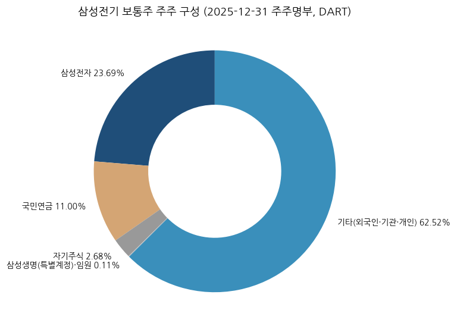

(3) 임원·이사회 (2025말, 7인 — 사내 3 / 사외 4)

| 성명 | 직위 | 구분 | 담당 | 주요 경력 |
|---|---|---|---|---|
| 장덕현 | 사장 (대표이사) | 사내 | 경영전반 총괄, 경영위원회 위원장 | 삼성전자 S.LSI사업부 Sensor사업팀장 / 美 Univ. of Florida 전자공학 박사 |
| 김성진 | 부사장 | 사내 | 경영지원 총괄 (CFO) | 삼성전자 무선사업부 지원팀장 / 고려대 경제학 |
| 최재열 | 부사장 | 사내 | 컴포넌트사업부 총괄 | 삼성전기 MLCC개발팀장 / 연세대 세라믹공학 석사 |
| 최종구 | 이사회 의장 | 사외 | 감사·보상·추천위원회 | 前 금융위원회 위원장 |
| 여윤경 | 이사 | 사외 | 감사위원장 | 이화여대 경영대학 교수 |
| 이윤정 | 이사 | 사외 | ESG위원장 | 김·장 법률사무소 변호사 |
| 정승일 | 이사 | 사외 | 내부거래위원장 | 前 한국전력공사 사장 |

→ 최종구·여윤경 사외이사 임기 2026-03-15 만료 (2026 정기주총 변동 사항은 2026 반기보고서로 확인 필요)

---

## 6. 기타 팩트

(1) R&D 인프라

| 연도 | 연구개발비 (억원) | 매출 대비 |
|---|---|---|
| 2014 | 5,640 | 9.2% |
| 2015 | 4,410 | 7.1% |
| 2016 | 4,016 | 6.7% |
| 2017 | 4,602 | 6.7% |
| 2018 | 5,324 | 6.5% |
| 2019 | 5,458 | 6.8% |
| 2020 | 4,831 | 5.9% |
| 2021 | 5,672 | 5.9% |
| 2022 | 5,771 | 6.1% |
| 2023 | 5,878 | 6.6% |
| 2024 | 6,663 | 6.5% |
| 2025 | 7,870 | 7.0% |

→ 각 연도 사업보고서 원공시 (2023은 이후 중단사업 재작성 시 5,558억). 조직: 수원 R&D Center + 선행설비 Lab + AI솔루션팀 + 인도 R&D 법인(소프트웨어)

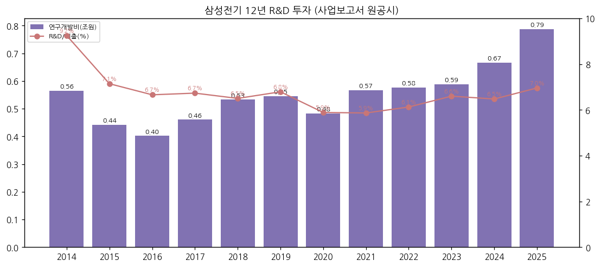

(2) 진행 중 corporate action (10년)

| 시점 | 내용 | 규모 |
|---|---|---|
| 2015 | 자기주식 보통주 200만주 취득 | 1,457억원 |
| 2015 | 비주력 사업 정리 (중단영업) | 세후 손실 3,016억원 |
| 2019.06 | PLP 사업 삼성전자 양도 | — |
| 2021.10 | 베트남 RFPCB 사업 중단 | 영업정지금액 4,278억원 |
| 2021.12 | Wi-Fi·5G mmWave 안테나 모듈 → 한화솔루션 양도 | 600억원 |
| 2024.09 | 통신모듈 사업 중단 | 170억원 |
| 2026.09 | 2027년분 MLCC 공급계약 (글로벌 대형기업) | 1조722억원 |

(3) R&D 마일스톤 (사업보고서 연구개발 실적)

| 연도 | 주요 개발 |
|---|---|
| 2023 | 전장용 고전압·최고용량 MLCC, 차세대 CPU용 기판, Server용 고성능 패키지기판, 전장 ADAS용 기판, 1000V급 xEV 급속충전용 MLCC, 렌즈 분리형 폴디드줌 |
| 2024 | ADAS용 초고용량 전장 MLCC(최초), Server향 초고용량 MLCC, 네트워크용 고성능 패키지기판, 부품 내장 노트PC 기판, 2억화소 초접사 모듈, 폴더블 초슬림 모듈 |
| 2025 | 고부가 Server CPU용 FC-BGA, **고성능 AI 가속기용 FC-BGA**, AI PC용 CPU 기판(부품 내장), ARM CPU 임베딩 기판, 전장 ADAS 초고용량 최초품 MLCC, 2억화소 연속줌(3.2\~4.3배) 카메라모듈 |

(4) 주요 리스크

- **환율**: 수출 비중 96%, 원재료 일부 달러·엔화 매입 → 원/달러 상승 시 매출·이익 증가 구조 (해외법인 환산 포함)
- **고객 집중**: 삼성전자 의존도 27%(2025) — 갤럭시 플래그십 판매가 광학솔루션·MLCC에 직접 영향
- **MLCC 재고 사이클**: 2018 정점 → 2019 급락, 2021 정점 → 2022 하반기 급락 반복. AI 서버 수요 둔화 시 재현 가능
- **FC-BGA 공급과잉**: 2023\~2025 업계 증설로 가동률 70% — AI 가속기 외 PC·일반 서버 수요 약세 시 가격 하락
- **주가 변동성**: 2026-06 ATH 이후 5개월 -62% — 밸류에이션 재조정 리스크 (PBR 6배대)
- 2025 사업보고서상 중요한 소송·제재: 해당 정보 별도 정리 필요 (공시원문 XI장 — 잔여 과제)

(5) ESG

- 이사회 내 ESG위원회 운영 (위원장 이윤정 사외이사), 경영위원회·감사·내부거래·보상·사외이사후보추천위원회 구성
- 외부 ESG 등급(KCGS·MSCI)은 이번 버전에서 미확인 — 잔여 과제

(6) 인증·라이선스

- 유해물질공정관리 QC-080000 (HSPM) — 컴포넌트·광학솔루션 사업장 단계적 취득 (수원 기점)
- 전장 부품 공급을 위한 자동차 품질 인증(IATF 16949 등)은 사업보고서 기재 확인 필요

---

## Source Audit

- ✅ OpenDART 재무 JSON 44건 (연결, 2015 FY\~3Q26; 2014는 2015 비교표시) → 연간·분기 시계열
- ✅ DART 정기보고서 공시원문 52건 (2013.12\~2026.09, 사업·반기·분기) → 영업부문 주석(사업부 매출·영업이익 1Q15\~3Q26), 사업의 내용, R&D, 배당
- ✅ OpenDART 기업개황·최대주주·임원·직원·배당·자기주식·주식총수 (2025 사업보고서)
- ✅ 삼성전기 IR 실적발표 PDF 33건 (2018-04\~2026-10, 5건 다운로드 실패) — 2024년 이후 텍스트 추출로 교차검증, 2018\~2023 PDF는 이미지형이라 수치 추출 불가
- ✅ Yahoo Finance v8 (월봉 2000\~2026, 일봉 1년) / 이투데이 시세(2026-11-24) / 언론 보도 (시총 100조·ATH, MLCC 계약, 점유율)
- ❌ 2014년 이전 분기·사업부 시계열 (OpenDART 2015\~ 제공, 2014 분기보고서 주석 형식 상이) → 분기 시계열 47분기 (표준 60+분기 미달)
- ❌ CSR/지속가능경영보고서 미수집 (ESG 등급·인증·R&D 거점 디테일), 외국인 지분율
- ⚠ 2014 연간은 2015 사업보고서 재작성치(원공시 매출 7.14조 아님). 4Q19 광학·4Q20 패키지 분기값은 재분류 왜곡

## Version Log

- **v1.0 (2026-11-25)**: 최초 작성. v4.8 6개 섹션 + 12종 차트 (chart1·1b·2×3·4·5·6·7·8·9·10·11·12). 3Q26 분기보고서(2026-11-16 공시) 확정치 반영
- 잔여 보완 후보: ① 2011\~2014 분기 사업부 시계열 공시원문 보강(60+분기) ② 지속가능경영보고서(ESG 등급·인증) ③ 외국인 지분율 시계열 ④ 사업보고서 소송·우발부채 정리 ⑤ 4Q26 실적 발표 후 분기 시계열·12분기 차트 갱신, 2026 연간 결산 후 v2.0
