> 종목: 삼성중공업 (010140.KS / 삼성중공업주식회사 / Samsung Heavy Industries Co., Ltd. / SHI)
>
> 섹터: 조선 (섹터 T2 주도 후보) / 서브섹터: 조선
>
> 작성 시각: 2026-11-14 KST (**v1.2** — 회사 IR 실적발표 28건(2018.1Q~2026.3Q)·DART 기업개황 보강 / v1.1 — OpenDART 재무 API 검증 반영 / v1.0 — 신규 작성, 1번 섹션 표준 5요소 적용)
>
> 적용 구조: v4.8 (6개 섹션 + 12종 표준 차트 + 보조 chart2 전사 47분기 시계열·chart3 신규수주/수주잔고)
>
> 데이터: 12년 연결 연간(2014~2025, DART OpenAPI 재무제표 정확값, 2013 참고치 포함) + 47분기 전사 시계열(1Q15~3Q26) + 15분기 사업부별(1Q23~3Q26, DART 영업부문 주석 누계 차분 / 3Q26은 IBK 추정) + 사업부문별 연간 매출 14년(2012~2025, DART '매출실적') + 연도별 회사 가이던스·상선/해양 신규수주(2017~2026, IR) + 인도기준 수주잔고 스냅샷(2018.10~2026.9, IR 실적발표) + 20년 Yahoo 시가총액 시계열
>
> 출처: **DART OpenAPI fnlttSinglAcntAll (corp_code 00126478, 연결 CFS) 사업·분기·반기보고서** + **DART 원문 document.xml** (사업보고서 2014~2025 12건, 분기·반기 2023.1Q~2026.2Q 11건 — 사업부문별 매출·영업부문 주석·연구개발·주주·임원·직원·신용등급·소송·증자) + **DART 기업개황·정기보고서 API** (company.json — 업종코드 3111, 최대주주·임원·직원·배당·자기주식·주식총수 2025 사업보고서) + **삼성중공업 IR 실적발표 28건** (irgo 경유, 2018-05 1Q18 ~ 2026-11 3Q26 — 4Q18·2Q21·3Q21·4Q22·1Q24·3Q24·4Q24 발표자료 미확보, 1Q26은 이미지 PDF라 텍스트 추출 불가) + **삼성중공업 IR** (2026.3분기 경영실적 PDF, 1Q26·2Q26 경영실적, 회사소개 IR deck 2015-01·2017-01·2019-02·2020-02·2021-02·2022-01·2023-01·2024-01·2025-01·2025-12·2026-01) + **IBK투자증권 3Q26 Review (2026-10-30, 장성호)** + **Yahoo Finance 010140.KS 월간 시계열** + 사용자 제공 컨센서스(2026E~2028E)
>
> **데이터 기준 시점**: 손익 = **3Q26 잠정실적** (2026-10-29 IR 발표, 외부감사인 검토 전). DART 3Q26 분기보고서는 미공시(법정기한 11월 중순) → 재무상태표 상세는 2Q26 반기보고서, 3Q26은 IR 요약 BS만 반영. 3Q26 사업부별 값은 회사 미공시(v1.2에서 3Q26 IR 원문 18p 재확인 — 조선해양/토건·상선/해양 구분 손익 없음) → IBK 추정치로 대체 표기 유지
>
> **Fact verify cutoff**: 2026-11-03 (시가총액·주가 = Yahoo Finance 2026-11-03 17,280원 × 발행주식 880,114,845주 = 15.2조 기준. 점유율·피어 OPM은 다음 갱신 시 재검증 필요)

# 삼성중공업 기업 개요 (v1.2 — 조선 T2 주도 후보, Primary 사이클 + 8년 적자 후 턴어라운드 완료 국면 + Secondary FLNG 해양 optionality)

## 기업 분류

① Primary / Secondary 분류

(1) 결론

→ **Primary: 사이클 (조선 수주-인도 장기 사이클 + 해양플랜트 프로젝트 손실 사이클 — 2015~2022 8년 연속 영업적자를 거친 턴어라운드형 사이클)**

→ **Secondary: FLNG·해양생산설비 프로젝트 optionality (FLNG 신조 발주 11기 중 7기 수주, 점유율 64% — IR 3Q26) + 신사업 옵션(부유식 데이터센터 FDC·미국 MRO·FSMR, 현재 매출 0) — 지속성장 근거로는 아직 미확정**

(2) Primary 근거

→ 12년(2014~2025) OPM range **-19.8%(2021) ~ +8.1%(2025) = 27.9%pt** — cutoff ±10%pt의 약 2.8배. 한화오션(49.7%pt)보다 작고 HD현대중공업(분할 후 7개년 21.2%pt)보다 큰 진폭

→ 12년 중 영업적자 **8개년 연속** (2015~2022), 순손실 9개년 (2015~2023) — 누적 영업손실 **-6.4조**, 누적 순손실 **-7.0조** (2015~2022). 2011~2014 해양플랜트(드릴십·FPSO·CPF) 고점 수주 → 2015 해양 원가 폭증 → 2016 수주절벽($0.5B) → 2018~2022 저선가·저조업 + 드릴십 재고 손상 + 강재가 급등의 3중 손실이 이어진 전형적 장기 사이클

→ 매출 12년 CAGR **-1.7%** (128,791억 → 106,500억) — 2013년 정점(148,345억) 대비 아직 미회복. 반면 2022 → 2025 3년 CAGR **+21.5%** (2021~2022 LNGC 고선가 수주 물량 인도)

(3) Secondary 근거

→ FLNG: Prelude(인도)·Petronas Dua(인도)·Coral Sul(인도) / Petronas Tiga·Cedar·Coral Norte(건조 중) / Delfin 1(설계 중, 2026 수주 29억$) — 해양설비 수주잔고 **4기 83억$ = 전체 잔고의 23%** (2026.9말). Delfin 2(미국 4.3Mtpa)·Western LNG(캐나다 6.0Mtpa) 수주 협상 중

→ 단 해양은 과거 손실의 원천(2Q15 분기 OP -15,481억, 해양생산설비 원가증가)이자 수주 시점이 lumpy(2025 해양 수주 8억$ vs 목표 40억$, 20% 달성) → 이익 안정성(secular) 근거가 아니라 **프로젝트 optionality**로만 분류

→ 신사업: FDC(2025.10 삼성그룹-OpenAI MOU, 2026.4 50MW·2026.7 200MW AiP, 2028 상업화 목표), 미국 사업(2026.3 현지법인, Vigor MRO 입찰·GD NASSCO 공동건조·Conrad LNG 벙커링), FSMR(2025 ABS 개념설계 인증) — 매출 기여 0, 분류 영향은 노트 수준

(4) Entity 구조 (DART 보고부문 2개)

→ **조선해양** — 2025 매출 102,268억 (연결 96.0%), 부문이익 7,887억 (OPM 7.7%) — LNG운반선·컨테이너선·원유운반선(셔틀탱커·VLCC)·VLGC/VLAC + FLNG·FPSO·FPU 등 해양플랫폼

→ **토건** — 2025 매출 4,232억 (4.0%), 부문이익 1,158억 — 토목·건축·하이테크(삼성전자 평택캠퍼스 FAB 마감공사 등) 공사

→ **주요 종속·관계사** — 연결 종속회사 9개 (주요 3개): 삼성중공업(영성)유한공사(중국 블록), Samsung Heavy Industries Nigeria Ltd.·SHI-MCI FZE(나이지리아 해양), SHI Mozambique, Samsung Heavy Industries Rus, Samsung Heavy Industries India, SVIC 73호 신기술투자조합 등. 관계기업: Zvezda-Samsung Heavy Industries LLC(49%), KC LNG Tech(16.6%)

② Summary Box (12년 연결 시계열 + 사이클 통계)

(1) 12년 평균·정점·저점

| 지표 | 12년 평균 (2014~2025) | 정점 | 저점 | 2025년 | 9M26 (잠정) |
|---|---|---|---|---|---|
| 매출 (연결, 억원) | 84,594 | **128,791 (2014)** | 52,651 (2018) | **106,500** | 92,834 |
| 영업이익 (연결, 억원) | -3,865 | **8,622 (2025)** | -15,019 (2015) | **8,622** | 9,365 |
| 당기순이익 (연결, 억원) | -5,322 | **5,358 (2025)** | -14,927 (2020) | **5,358** | 7,937 |
| OPM (%) | -6.0% (단순) / -4.6% (매출가중) | **8.1% (2025)** | -19.8% (2021) | **8.1%** | **10.1%** |

→ 참고: 2013년 매출 148,345억 / OP 9,142억 / OPM 6.2% (DART 2014 사업보고서 비교 컬럼) — 1차 사이클 말기 이익 수준. 2006~2012 연간은 미확보

(2) 1번 섹션 표준 6지표

| 지표 | 값 |
|---|---|
| 매출 CAGR (12년, 2014→2025) | **-1.7%** (3년 2022→2025 **+21.5%**) |
| OPM 평균 (12년) | **-6.0%** (단순 평균) |
| OPM 정점 평균 | **+4.8%** (2014 1.4% / 2025 8.1%) — 2013 6.2% 포함 시 +5.2%. 현재 사이클은 9M26 10.1%·3Q26 10.7%로 정점 갱신 진행 중 |
| OPM 저점 평균 | **-17.7%** (2015 -15.5% / 2021 -19.8%) |
| 사이클 주기 | **약 6년(저점 간)** — 저점 2015 → 2021 = 6년. 이익 정점 2013 → 2025~26 = 약 12~13년. 상위 장기 조선 슈퍼사이클은 2007~2008 정점 → 2025~2026 재정점 (약 18년) |
| 사이클 회수 (12년) | **정점 2회 / 저점 2회** (정점 2014·2025~ / 저점 2015·2021, 2016 -1.4%는 저점 사이 일시 반등) |

(3) 12년 손익 사이클 history book (억원, K-IFRS 연결, DART)

```
[삼성중공업 12년 연결 손익 시계열 (억원)]
연도    매출       OP        OPM      NI
2013  148,345    9,142     6.2%    6,322   ← (참고) 1차 사이클 말기 정점권, 해양플랜트 매출 확대
2014  128,791    1,830     1.4%    1,473   ← 정점 이탈: 드릴십·해양 공정 부담, 2014.9 삼성엔지니어링 합병 무산
2015   97,144  -15,019   -15.5%  -12,121   ← 1차 저점: 해양생산설비 원가증가 일괄 반영 (2Q15 분기 OP -15,481억, OPM -107.5%)
2016  104,142   -1,472    -1.4%   -1,388   ← 수주절벽 ($0.5B), 2016.3 토지 자산재평가 + 2016.11 1.1조 유상증자
2017   79,012   -5,242    -6.6%   -3,407   ← 고정비 부담 + 시추설비 예상손실 반영 (4Q17 OP -5,959억)
2018   52,651   -4,093    -7.8%   -3,882   ← 매출 12년 최저, 강재가 인상 + 시추설비 선가 하락. 2018.4 1.4조 유상증자
2019   73,497   -6,166    -8.4%  -13,154   ← 건조 계약 중재·취소 반영으로 NI 급감, 2019.11 미 DOJ 기소유예(벌금 7,500만$)
2020   68,603  -10,541   -15.4%  -14,927   ← 코로나 + 드릴십 재고자산 가치 하락 + 중재 패소 (2Q20 OP -7,077억)
2021   66,220  -13,120   -19.8%  -14,521   ← 2차 저점: 강재가 급등 공사손실충당금 + 드릴십 손상. 2021.7 무상감자 80% → 11월 1.3조 유상증자
2022   59,447   -8,544   -14.4%   -6,274   ← 8년 연속 적자 마지막 해, LNGC 대량 수주(94억$)·드릴십 매각 착수
2023   80,094    2,333     2.9%   -1,556   ← 연간 흑자전환 (1Q23 분기 흑전), 고선가 LNGC 건조 증가. 영업외 손실로 NI 적자 지속
2024   99,031    5,027     5.1%      539   ← 2024.6 러시아 Zvezda LNGC·셔틀탱커 17척 계약취소 통보 → 중재
2025  106,500    8,622     8.1%    5,358   ← 12년 최고 OPM, 가이던스(매출 10.5조·OP 6,300억) 초과 달성
9M26   92,834    9,365    10.1%    7,937   ← 분기 OPM 9.4% → 10.1% → 10.7% 상승. 3Q26 매도 선물환 청산 이익(IR) — 약 2,800억(IBK 추정)으로 NI 급증
2026E 127,801   13,728    10.7%    9,187   ← 컨센서스 (사용자 제공). 회사 가이던스 매출 12.8조 (IR 2026-02, OP 가이던스 미제시)
2027E 148,045   20,073    13.6%   14,932   ← 컨센서스
2028E 161,094   24,144    15.0%   18,217   ← 컨센서스

OPM range: -19.8% ~ +8.1% = 27.9%pt (cutoff ±10%pt의 약 2.8배 → 사이클 분류 확정)
사이클 회수: 정점 2회(2014, 2025~) / 저점 2회(2015, 2021)
```

→ **교차검증**: 사용자 화면 연간 과거치(매출·OP·NI)는 이번 요청에 제공되지 않아 **대조 미실시** — DART OpenAPI 연결 확정치만 사용. 분기 합계(1Q~4Q)는 2015~2025 전 연도에서 연간 확정치와 ±2억 이내 일치

→ **IR 잠정 vs DART 확정 차이 1건**: 2020년 IR(2021-02 deck)은 4Q20 영업이익 **+26억**(PDC 중재 충당금 환입 1,340억 포함)으로 발표했으나 DART 사업보고서 확정 2020 OP는 -10,541억(4Q20 역산 **-2,851억**) → 차이 -2,877억. v1.2 IR 원문 확인: 2021-02 IR의 +26억 구성 = PDC 중재 충당금 환입 +1,340억 / SK LNG선 화물창 수리비 충당 -350억 / 신규수주 유조선 공사손실충당금 -330억 / 경상 고정비 -634억. 다음 발표인 **1Q21 IR(2021-05)은 4Q20 OP를 △2,852억으로 이미 수정 표기**(2022-02 IR도 -2,851억) → 잠정 발표 후 감사 확정 과정에서 수정된 것은 IR로 확인되나, **수정 사유는 IR에 설명 없음**(원인 미검증 유지). 참고로 DART 2020 사업보고서는 2021.2 Petrobras 드릴십 중개 관련 합의금(812백만 헤알) 지급 합의를 기재 — 4Q20 수정과의 연관 여부는 공시상 미확인. 본 문서는 DART 확정치 사용

→ NI는 비지배 포함 당기순이익 기준. 지배주주 NI: 2015 -12,054 / 2019 -13,108 / 2020 -14,824 / 2024 639 / 2025 5,455억

→ 2006~2012년 연간은 DART OpenAPI 재무 API 범위(2015 사업연도~, 비교 컬럼으로 2013~2014) 밖이라 **미확보** — Version Log 잔여 보완 후보

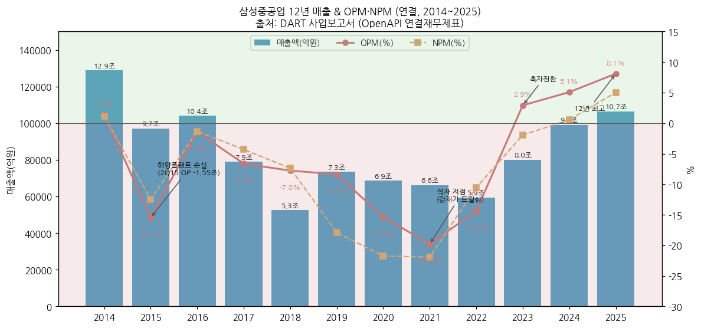

③ 정량적 분류 근거

→ **수주-인도 lag 구조**: 계약부채(선수금 성격) 2021말 26,284억 → 2024말 54,630억 → 2025말 45,805억(인도 증가) → 2Q26 54,339억, IR 3Q26 선수금 52,661억 — 헤비테일(인도 시 잔금) + 2~3년 전 수주 선가가 현재 OPM을 결정

→ **수주연도 mix = 이익률 driver**: IR 3Q26 "100% 환헤지 정책 유지, '22년 수주분은 낮은 환율·선가, '24년 이후 수주분 비중 증가" — 상선 매출 중 '24년 이후 수주분 비중 1Q26 35% → 2Q26 45% → 3Q26 55%

→ **해양 비중 하락 = 사이클 순도 상승**: 운반선/해양 매출비중 2016년 43%/57% → 2019년 62%/38% → 2020E 70%/30% (IR 2020-02 deck) → 2021E 상선 75%/해양 25% (IR 2021-02 연간 전망, 실적치는 미공시). 단 2026 Coral Norte·Delfin 1 수주로 해양 잔고 비중이 다시 23%로 상승 → 해양 프로젝트 리스크 재노출

→ **수주잔고**: 2026.9말 인도기준 **363억$ / 156척·기** (상선 152척 280억$ — LNGC 71척 170억$), 매출기준 35조원 — 2025 매출 대비 약 3.3년치 visibility (IR 3Q26)

→ **분기 OPM 진폭**: 47분기 중 최저 2Q15 **-107.5%**, 최고 3Q26 **10.7%** / 1Q23 흑전 이후 15분기 연속 영업흑자

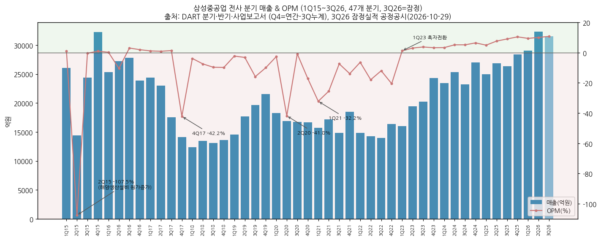

④ 산업 분류

→ **DART 업종** — 업종코드 **3111** (KSIC 선박 및 수상 부유 구조물 건조업, DART 기업개황 company.json 2026-11 조회) — 결산월 12월, 법인등록번호 110111-0168595

→ **KRX 업종** — 유가증권시장 운송장비·부품 (1994.01.28 상장)

→ **워치리스트 섹터** — 조선 (섹터 T2 주도 후보), 서브섹터 조선

→ **비교 피어** — 국내 HD현대중공업(HD한국조선해양 자회사)·한화오션 / 해외 중국 CSSC 계열(후동중화 등 LNGC), 일본 이마바리 / FLNG·해양: 싱가포르 Seatrium, 중국 Wison

⑤ 분류 결정 논리 (4단계 sub-logic)

(1) **가장 매출 큰 사업부 기준** — 조선해양 2025 매출 96% · 부문이익 87%(토건 1,158억 포함 합산 대비) → 조선해양 선가·수주 사이클이 Primary driver → **사이클**

(2) **secular 변수 sub-rule** — FLNG 독점적 지위(점유율 64%)와 미국 LNG 수출 증설(LNGC 2026E 95척·2027E 105척 발주 전망, Clarksons 2026.9)은 사이클 진폭을 줄이는 요인이나, 해양 매출은 프로젝트 단위 lumpy + 과거 손실 이력 → secular 격상 조건(해양 매출 비중 40%+ & 해양 마진 ≥ 상선 4분기 연속) 미충족. 신사업(FDC·MRO·FSMR) 매출 0 → **사이클 유지**

(3) **Boundary case 처리** — 2015~2022 8년 연속 적자 + 3차례 주주배정 유상증자(1.1조·1.4조·1.3조) + 2021 무상감자 80%는 "구조적 Turnaround" 성격이 강하나, 2023 흑전 → 2025 OPM 8.1% → 3Q26 10.7%로 15분기 연속 흑자 정착 → Primary를 Turnaround로 두지 않고 **Primary 사이클 + "턴어라운드 완료" 태그**. 이익잉여금이 아직 결손(2025말 -16,028억, 3Q26 -8,063억)이라 배당 재개 전 단계라는 점은 밸류에이션 다이얼에 반영

(4) **피어 cross-reference** — HD현대중공업 FY25 OPM 11.6% (1~3Q26 15~16%) / 한화오션 FY25 9.1% (9M26 13.8%) vs 삼성중공업 FY25 8.1% (9M26 10.1%) → 국내 3사 동일 LNGC 고선가 사이클 공유. 삼성중공업은 3사 중 OPM 레벨이 가장 낮고(2022 수주 저환율 물량 잔존), 진폭은 한화오션보다 작음. 차별점은 방산(한화오션 특수선·HD현대중공업 함정)이 아닌 **FLNG 해양** → **동일 Primary 사이클, Secondary만 FLNG 프로젝트 optionality로 차별화**

⑥ 적정 밸류에이션 방법 (사업부 mix → method 다이얼)

(1) 1순위 — **P/B 밴드 (사이클 기준)**

→ 조선해양 이익 비중 90%+ = 선가 사이클 종목 → 12년 중 적자 8~9년이라 PER은 저점에서 무의미. 자본은 3차례 증자로 4~6조 밴드를 유지(2014 5.6조 → 2020 3.7조 → 2025 4.1조) → P/B가 사이클 위치를 가장 안정적으로 보여줌

→ 현재(2026-11-03, 17,280원, 시총 15.2조): **P/B 3.7x** (IR 3Q26 자본 41,254억 기준) / 2025말 자본(40,950억) 기준 3.7x. 2026-04 월말 고점(32,350원, 시총 28.5조) 당시 2025말 자본 기준 **7.0x**

→ 한화오션 P/B 2.2x 대비 높음 — 삼성중공업은 누적 결손(이익잉여금 -0.8조)으로 자본 분모가 작고, 수주잔고/자본 비율이 커서 P/B가 구조적으로 높게 나옴

(2) 2순위 — **Forward PER (정점 이익 할인)**

→ 컨센 2026E NI 9,187억 기준 **PER 16.6x**, 2027E 10.2x, 2028E 8.3x (E) — 2026E NI에는 3Q26 선물환 일회성 이익(약 2,800억, IBK)이 포함되어 있어 경상 PER은 더 높음. 2026-04 고점 당시 2026E PER 약 31x

→ IBK(2026-10-30) 방법론: 12M fwd EPS × Target PER 16.5배(2025년 대형 조선 3사 평균 PER 50% 할인) → 목표주가 29,000원

(3) 3순위 — **수주잔고 cross-check**

→ 시가총액 / 수주잔고(363억$, 원화 약 50.8조 @1,400원) ≈ **0.30x**, 매출기준 잔고 35조 대비 0.43x — 잔고 마진(조선해양 부문 OPM 10~12%) 지속 기간으로 이익 하방을 점검하는 보조 지표

→ 순현금: IR 3Q26 현금·예금 20,393억 - 차입금 11,051억 = **순현금 약 9,342억** (2025말 순차입 12,752억에서 전환) → EV 약 14.3조, 2026E EV/EBITDA 약 8.5x (E, EBITDA = 컨센 OP + 감가상각 약 3,100억 가정)

(4) 희석·환원 변수

→ 희석성 증권(CB·BW·영구채) **없음** (DART 2025 '미상환 전환사채·신주인수권부사채·조건부자본증권 해당없음'). 자기주식 25,964,429주(2.95%) 보유 — 전량 '배당가능이익 범위 이내 장내 직접취득' 분, 2025년 중 취득·처분·소각 0주 (DART 2025 자기주식 현황). 정관상 발행할 주식 총수 15억주(보통 14.4억·우선 0.6억)

→ 2015 이후 **11년 연속 무배당**(FY2014 결산배당이 마지막), 이익잉여금 결손 해소 전까지 배당 불가 구조 — IBK DPS 2026F~2028F 0원

(5) **삼성전자 대비**: 삼성전자는 DS 사이클 비중으로 PBR + PER 혼합, 삼성중공업은 조선해양 단일 사이클이라 **PBR 단독 우선 + PER은 정점 확인용 보조** — 최대주주가 삼성전자(15.23%)이나 삼성전자 밸류에이션 체계와 연동되지 않으며, FLNG·FDC 프리미엄은 해양 수주가 매출로 전환·흑자 확인되기 전까지 적용 불가

⑦ 분기 재평가 트리거 (분류 변경 조건 — 실적 추적 변수는 6번 섹션)

→ ① **해양(FLNG·FPSO) 매출 비중 40%+ & 해양 마진이 상선 이상인 상태 4분기 연속** 시 → Secondary FLNG를 **Primary 사이클 + 프로젝트형 지속성장 boundary**로 격상 (현재 해양 잔고 비중 23%)

→ ② **상선 신규수주 2개년 연속 -30% 이상 감소 + 전사 OPM 2분기 연속 하락** 시 → 사이클 "정점 → 하강 국면" 재태깅 (P/B 밴드 하단 적용, 2014→2015 패턴 재현 경계)

→ ③ **해양 대형 공사손실(분기 OP -3,000억 이하) 재발 또는 Zvezda 중재 패소로 선수금 8억$ 초과 손실 확정** 시 → "턴어라운드 완료" 태그 철회, **Primary 구조적 Turnaround 재분류 검토**

→ ④ **FDC·미국 MRO·FSMR 등 신사업 매출 비중 10%+ (또는 FDC 상업 수주 1건 이상 + 수익성 공시)** 시 → Secondary에 신사업 secular 노트 신설, PER 프리미엄 혼합 검토

---

## 회사 개요

① 기본 사항

| 항목 | 내용 |
|---|---|
| 회사명 (한글) | 삼성중공업주식회사 (1974년 설립 이래 상호 변경 없음) |
| 회사명 (영문) | Samsung Heavy Industries Co., Ltd. |
| 종목코드 | 010140 (KRX 유가증권시장, 1994.01.28 상장) / 우선주 010145는 2023.07.17 상장폐지(상장주식수 요건 미충족) |
| 설립일 | **1974년 8월 5일** |
| 본사 | 경기도 성남시 분당구 판교로 227번길 23 (2016.03~, 판교 R&D센터) / 조선소 경남 거제 / 대덕 R&D센터 |
| 홈페이지 | www.samsungshi.com (대표전화 031-5171-7000) |
| DART 업종코드 | **3111** (선박 및 수상 부유 구조물 건조업) / 법인등록번호 110111-0168595 / 사업자등록번호 120-81-52780 / 결산월 12월 (DART 기업개황) |
| 대표이사 | **최성안** 부회장 (1960.12, 서울대 기계공학, 전 삼성엔지니어링 대표이사(2018~2022), 2023.03 대표 선임, 2026.03 재선임 — 임기 2029.03) |
| 발행주식수 | **880,114,845주** (보통 880,000,000 + 우선 114,845, 액면 1,000원) / 자기주식 25,964,429주 (2.95%) / 유통주식 854,150,416주 (DART 2025 주식총수) |
| 사업 한 줄 정의 | LNG운반선·컨테이너선·원유운반선 등 고부가 상선 + FLNG·FPSO·FPU 해양생산설비를 건조하는 조선·해양 기업 (토건 부문 4%) |
| 최대주주 | **삼성전자 15.23% + 특수관계인(삼성생명·삼성전기·삼성SDI·제일기획·삼성물산·대표이사) = 20.84%** (2026.6말, DART 반기보고서) |
| 2대 주주 | 국민연금공단 7.3% (2026.6말) / 7.6% (2025말) |
| 신용등급 | **기업신용·회사채 A- / CP·전단채 A2-** (한국기업평가·NICE, 2025.06 BBB+ → A- 상향, 2025.09 회사채 본평정) |
| 연결 종속회사 | 9개 (국내 1·해외 8, 주요 3개, 2025말) |
| 임직원 | 직원 11,155명 + 소속 외 근로자 18,098명 (2026.6말, DART) / 2025말 직원 10,589명 |

② 12년 손익·자본 추이 (연결, DART OpenAPI 확정값, 억원)

| 연도 | 매출 | 영업이익 | OPM | 당기순이익 | 자본총계 | 자산총계 | 비고 |
|---|---|---|---|---|---|---|---|
| 2014 | 128,791 | 1,830 | 1.4% | 1,473 | 55,732 | 171,222 | 정점 이탈 |
| 2015 | 97,144 | -15,019 | -15.5% | -12,121 | 42,657 | 173,016 | 1차 저점 (해양 손실) |
| 2016 | 104,142 | -1,472 | -1.4% | -1,388 | 62,753 | 172,175 | 증자 1.1조 + 토지재평가 |
| 2017 | 79,012 | -5,242 | -6.6% | -3,407 | 57,975 | 138,181 | 수주절벽 여파 |
| 2018 | 52,651 | -4,093 | -7.8% | -3,882 | 67,463 | 142,829 | 증자 1.4조, 매출 저점 |
| 2019 | 73,497 | -6,166 | -8.4% | -13,154 | 52,489 | 136,001 | 중재·계약취소 |
| 2020 | 68,603 | -10,541 | -15.4% | -14,927 | 37,182 | 129,222 | 드릴십 손상 |
| 2021 | 66,220 | -13,120 | -19.8% | -14,521 | 40,973 | 121,386 | 2차 저점, 감자·증자 1.3조 |
| 2022 | 59,447 | -8,544 | -14.4% | -6,274 | 35,719 | 144,917 | 적자 8년차 |
| 2023 | 80,094 | 2,333 | 2.9% | -1,556 | 34,092 | 155,934 | 영업 흑전 |
| 2024 | 99,031 | 5,027 | 5.1% | 539 | 37,495 | 171,946 | 순이익 흑전 |
| **2025** | **106,500** | **8,622** | **8.1%** | **5,358** | **40,950** | **149,489** | 12년 최고 OPM |
| 3Q26 (잠정) | 9M 92,834 | 9M 9,365 | 10.1% | 9M 7,937 | 41,254 | 160,392 | IR 요약 BS |

→ (출처: DART OpenAPI fnlttSinglAcntAll 연결 — 2015~2025 사업보고서, 2014는 2015 사업보고서 전기 컬럼. 3Q26은 IR 2026.3분기 경영실적 p.13)

→ 12년 자본 CAGR **-2.8%** (55,732억 → 40,950억) — 3차례 주주배정 증자(총 약 3.8조 유입) + 2016 토지 재평가(재평가차익 세전 1.15조)에도 2015~2023 누적 순손실(-7.1조)이 자본을 잠식. 2Q26 자본 47,104억 → 3Q26 41,254억 감소(-5,850억, 누적 NI +7,937억에도 감소) — v1.2 IR 3Q26 p.13 역산: 이익잉여금 2Q26 -12,769억(DART) → 3Q26 -8,063억(+4,706억 ≈ 3Q NI 4,708억)으로 이익은 정상 적립, 따라서 **이익잉여금 외 항목(기타포괄손익누계액 등, IR 미세분)이 약 -1.06조 감소** (참고: DART 기타포괄손익누계액 2025말 13,459억 → 2Q26 16,424억). IR은 자본 감소 사유를 설명하지 않음 → 3Q26 매도 선물환 청산(위험회피회계 관련 OCI의 손익 재분류) 연관 여부는 **추정, 미검증** — DART 3Q26 분기보고서 자본변동표로 확인 필요

→ 2025 ROE(지배, 평균자본) **13.7%** — 2014(2.7%) 이후 최고. IBK 2026F ROE 23.5%

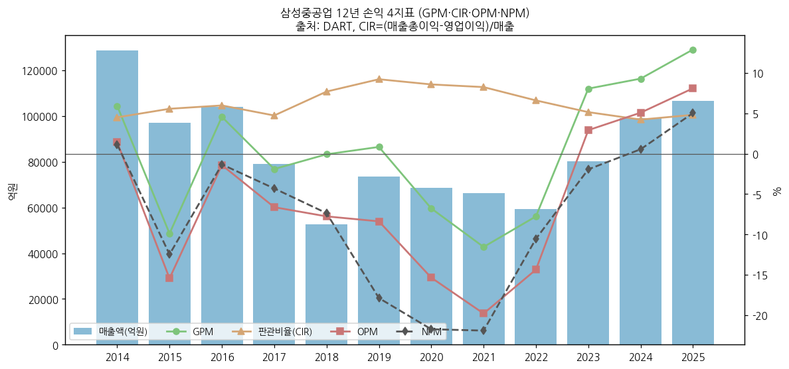

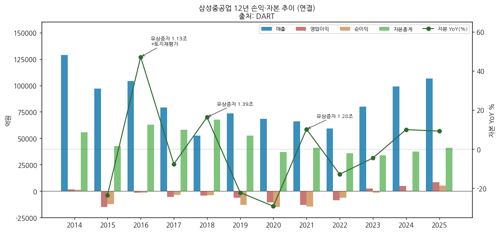

③ 회사 주가 역사 (시가총액 20년)

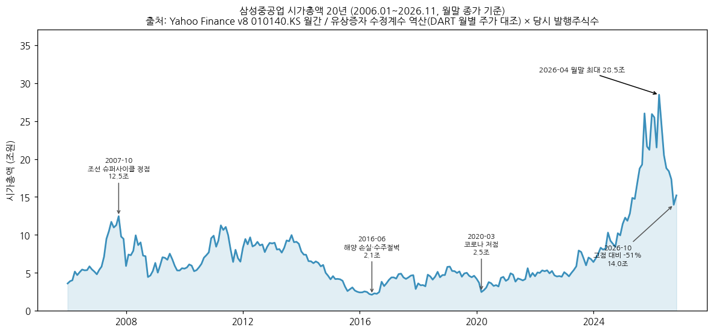

→ (출처: Yahoo Finance v8 010140.KS 월간 종가 2006.01~2026.11 × 시점별 발행주식수. Yahoo는 주주배정 유상증자(2016.11·2018.4·2021.11)의 권리락을 과거 가격에 소급 조정 → DART 월별 주가와 대조해 수정계수(0.734·0.835·0.934)를 역산, 당시 주식수(230.9백만·390.0백만·630.0백만·880.0백만주)를 곱한 **근사치**. 2021.7 무상감자는 액면 5,000 → 1,000원 감액으로 주식수 불변)

(1) 구간별 narrative

(1-1) 2006~2008 1차 조선 슈퍼사이클

→ 2007.10 월말 시총 약 **12.5조** (2025년 이전 20년 최고) — 드릴십·LNGC·초대형 컨테이너선 수주 붐. 2008.10 금융위기로 4.5조까지 급락

(1-2) 2010~2014 드릴십·해양플랜트 붐

→ 2011.04 월말 시총 약 **11.3조** 회복 — 드릴십·FPSO·CPF(Ichthys)·FLNG(Prelude) 대량 수주. 이 시기 해양 고위험 수주가 2015 손실의 원인

(1-3) 2015~2016 해양 손실·수주절벽

→ 2Q15 1.5조 영업손실 → 2015.12 시총 약 2.5조 → **2016.06 월말 약 2.1조 (20년 최저)**. 2016 수주 $0.5B (절벽)

(1-4) 2016~2022 증자 3회 + 장기 적자

→ 2016.11 1.1조 → 2018.4 1.4조 → 2021.11 1.3조 증자로 연명. 2018.12 약 4.7조, 2020.03 코로나 저점 약 2.5조, 2022.12 약 4.5조

(1-5) 2023~2026.4 조선 2차 슈퍼사이클

→ 2023 흑전 → 2023.12 6.8조 → 2024.12 9.9조 → 2025.12 21.2조 → **2026.04 월말 종가 32,350원, 시총 약 28.5조 (20년 월말 최고)**. 52주 장중 최고 35,350원 (Yahoo meta)

(1-6) 2026.5~ 급락 구간

→ 2026.09 월말 약 17.3조 → **2026.10 월말 15,880원, 약 14.0조 (4월 고점 대비 -51%)** → 2026-11-03 17,280원, 시총 15.2조. IBK(10/29 기준) 6개월 절대수익률 -52%, 목표주가 37,000 → 29,000원 하향(장기 환율 가정 1,450 → 1,400원). 급락의 직접 원인(환율·피어 동반 하락·수급)은 본 v1.0에서 **미검증**

④ 주요 연혁

→ **1974.08.05** 삼성중공업 설립 (국내 조선 생산은 거제조선소 단일 체제, 중국 영성·영파 블록 법인)

→ **1994.01.28** 유가증권시장 상장

→ **2011.09** 국내 조선업계 최초 멤브레인형 화물창 독자모델 개발 / **2011~2014** Prelude FLNG(2011, 30억$)·Ichthys CPF(2012, 27억$)·Egina FPSO(2013, 30억$)·Petronas Dua FLNG(2014, 16억$) 등 대형 해양 수주

→ **2014.09.01** 삼성엔지니어링과 합병계약 체결 → **2014.11.19** 합병계약 해제 (이사회 결의, DART 2014)

→ **2015** 해양생산설비 원가증가로 영업손실 1.5조 (2Q15 일괄 반영)

→ **2016.03** 본사 판교 이전 + 토지 재평가모형 변경 / **2016.11.16** 주주배정 유상증자 159,124,614주 (주당 7,170원, 약 1.1조)

→ **2018.04.23** 주주배정 유상증자 240,000,000주 (주당 5,870원, 약 1.4조)

→ **2019.11** 드릴십 중개수수료 관련 미 법무부(DOJ)와 벌금 7,500만$(약 900억원) 조건 기소유예합의

→ **2020.4Q** PDC(Pacific Drilling) 중재 승소로 충당금 환입 1,340억 (IR 2021-02)

→ **2021.07.26** 무상감자 80% (액면 5,000 → 1,000원) → **2021.11.08** 주주배정 유상증자 250,000,000주 (주당 5,130원, 약 1.3조) / 2021 신규수주 122억$ (컨테이너선 44척)

→ **2021** 러시아 Zvezda 조선소와 LNG 프로젝트·쇄빙선 파트너십 (Samsung Heavy Industries Rus, Zvezda-SHI LLC 설립)

→ **2021.11~2024.12** 재고 드릴십 처리: Crete(2021.11)·West Dorado(2022.11)·Santorini(2022.12)·Zonda(2023.04) 등 매각계약 → 2024.1·2·4·12월 4척 인도로 드릴십 재고 해소

→ **2023** 연간 영업 흑자전환 (8년 만), 2023.03 최성안 대표이사 선임, 2023.07 메탄올 추진 컨테이너선 16척(4조원)·2023.12 대형 해양생산설비(2조원) 수주

→ **2024.02** 미 정부 Zvezda SDN 지정 → **2024.06.11** 선주 측 LNGC 10척·셔틀탱커 7척 계약취소·선수금 반환 요구 → 2024.07.09 회사 중재 신청 → **2025.06.18** 회사가 17척 계약해지 통지, 기수령 선수금 8억$(LNGC 6억$ + 셔틀탱커 2억$) 유보

→ **2025.06** 신용등급 BBB+ → **A-** 상향 (한기평·NICE) / 2025.10 삼성그룹(전자·물산·중공업·SDS)-OpenAI FDC MOU

→ **2026.03** 미국 현지법인 설립, 최성안 대표 재선임·이연승 독립이사 선임 / 2026 1~7월 해양 수주 44억$ (Coral Norte FLNG 15억$, Delfin 1 FLNG 29억$)

→ **2026.10.29** 3Q26 잠정실적: 매출 31,504억(+19.6% YoY) / OP 3,384억(+42.1% YoY, OPM 10.7%) / 세전 6,107억 / NI 4,708억(+235.6% YoY, 선물환 청산·재분류 이익 포함)

→ (v1.2 IR 보강) **2025.2Q** IR "러시아 PJT 계약취소 확정"에 따른 기발주 기자재 취소 예상비용 충당 — 같은 기간 인도기준 수주잔고 2025.4말 319억$ → 7말 265억$ / **2023.4Q** SK해운 중재 관련 일시 충당 약 0.4조(세전 -3,578억) / **2021.1Q** 강재가 인상(-1,190억)·신규선 공손충(-1,230억)·시추선 평가손(-2,140억) 등 일회성 손실 4,400억 → 2021 연간 OP 가이던스 -7,600억으로 하향(실적 -13,120억)

---

## 비즈니스 모델

① 실적 추이 통합 표 (사업부별 연간, DART 영업부문 주석, 억원)

| 구분 | 2023 | 2024 | 2025 | 9M26 |
|---|---|---|---|---|
| **매출액 (연결)** | **80,094** | **99,031** | **106,500** | **92,834** |
| 조선해양 (순매출) | 72,457 | 91,224 | 102,268 | 87,927 (1H 57,767 + 3Q 30,160E) |
| 토건 (순매출) | 7,637 | 7,807 | 4,232 | 5,712 (1H 3,562 + 3Q 2,150E) |
| **영업이익 (연결)** | **2,333** | **5,027** | **8,622** | **9,365** |
| 조선해양 부문이익 | 2,030 | 2,935 | 7,887 | 9,837 (1H 6,247 + 3Q 3,590E) |
| 토건 부문이익 | 718 | 2,463 | 1,158 | 65 (1H 35 + 3Q 30E) |
| 미배분·조정 (역산) | -415 | -371 | -423 | -537 |
| **OPM (연결)** | **2.9%** | **5.1%** | **8.1%** | **10.1%** |
| 조선해양 OPM | 2.8% | 3.2% | 7.7% | 11.2% |
| 토건 OPM | 9.4% | 31.5% | 27.4% | 1.1% |

→ (출처: DART 사업보고서·반기보고서 연결재무제표 주석 '영업부문' — 부문 순매출(내부매출 제거 후)·부문이익. 3Q26 부문값은 회사 미공시(v1.2: 3Q26 IR 원문에도 부문별 매출·이익 없음 확인) → **IBK 3Q26P 추정치**(조선해양 30,160억·토건 2,150억은 기타 조정 -800억 반영 전 수치라 합계가 연결 31,504억과 불일치). 미배분·조정 = 연결 OP - 부문이익 합, 본사 공통비 성격으로 추정)

→ **토건 이익 변동**: 2024 부문이익 2,463억(OPM 31.5%) 중 2Q24 단일 분기 2,139억 — 같은 분기 조선해양 -750억과 동시 발생 → 부문 간 손익 재배분 또는 하이테크 공사 정산 일회성으로 추정(내용 **미검증**). 토건은 삼성전자 평택캠퍼스 등 하이테크 공사 의존

(1) 사업부문별 연간 매출 14년 (DART 사업보고서 '매출실적', 연결조정 전, 억원)

| 연도 | 조선해양 | 토건 (2014~2018 E&I) | 내부매출·연결조정 | 연결 매출 | 조선해양 비중 | 운반선/해양 비중 (IR) |
|---|---|---|---|---|---|---|
| 2012 | 136,609 | 9,328 | -1,043 | **144,894** | 94% | - |
| 2013 | 143,710 | 6,079 | -1,444 | **148,345** | 96% | - |
| 2014 | 130,549 | 4,250 | -6,008 | **128,791** | 97% | - |
| 2015 | 102,869 | 4,947 | -10,672 | **97,144** | 95% | - |
| 2016 | 114,962 | 1,536 | -12,356 | **104,142** | 99% | 43% / 57% |
| 2017 | 88,522 | 633 | -10,143 | **79,012** | 99% | 51% / 49% |
| 2018 | 59,380 | 411 | -7,140 | **52,651** | 99% | 51% / 49% |
| 2019 | 76,467 | 288 | -3,258 | **73,497** | 100% | 62% / 38% |
| 2020 | 70,825 | 221 | -2,443 | **68,603** | 100% | 70% / 30% (E) |
| 2021 | 68,021 | 180 | -1,981 | **66,220** | 100% | - |
| 2022 | 56,324 | 4,822 | -1,699 | **59,447** | 92% | - |
| 2023 | 74,339 | 7,660 | -1,905 | **80,094** | 91% | - |
| 2024 | 93,100 | 7,917 | -1,986 | **99,031** | 92% | - |
| 2025 | 104,363 | 4,452 | -2,315 | **106,500** | 96% | - |

→ (출처: DART 사업보고서 II '매출실적' — 2014(2012~2014)·2016(2014~2016)·2017(2015~2017)·2019(2017~2019)·2022(2020~2022)·2025(2023~2025). 조선해양 비중 = 조선해양 / (조선해양+토건). 운반선/해양 비중은 IR 회사소개 2020-02 p.3 그래프 판독)

→ **수출 비중**: 조선해양 매출의 99% 이상이 수출(2025 수출 103,486억 / 내수 877억) — USD 계약, 100% 환헤지 정책(IR 3Q26)

→ 2015~2018 연결조정 -6,000 ~ -12,000억 = 조선해양 부문 내 종속회사(영성·영파 블록 법인 등) 내부거래 — 2019 이후 축소

→ **운반선/해양 분기 매출 분리 공시는 미확보** (DART 보고부문은 조선해양 단일. v1.2에서 IR 실적발표 28건 전수 확인 — 상선/해양 매출 분리 표 없음, 정성 언급만 존재: 2Q24 "해양부문 매출 조기 확대"('24.4월 ZLNG 생산착수), 2Q25 "低선가 컨선 매출 감소 → FLNG 매출 증가", 2026 가이던스 "FLNG 3기(ZLNG·Cedar·Coral Norte) 공정 진행으로 해양 매출 증가") — Version Log 잔여 보완 후보 유지

(2) 사업부별 분기 시계열 (1Q23~3Q26, 15분기, DART 영업부문 주석 누계 차분, 억원)

| 분기 | 조선해양 매출 | 조선해양 이익 | 조선해양 OPM | 토건 매출 | 토건 이익 | 토건 OPM | 부문 매출 합 |
|---|---|---|---|---|---|---|---|
| 1Q23 | 14,143 | 261 | 1.8% | 1,907 | 23 | 1.2% | 16,050 |
| 2Q23 | 17,734 | 668 | 3.8% | 1,723 | 3 | 0.2% | 19,457 |
| 3Q23 | 18,607 | 904 | 4.9% | 1,647 | -19 | -1.2% | 20,254 |
| 4Q23 | 21,972 | 197 | 0.9% | 2,359 | 711 | 30.1% | 24,331 |
| 1Q24 | 21,650 | 832 | 3.8% | 1,828 | 33 | 1.8% | 23,478 |
| 2Q24 | 22,053 | -750 | -3.4% | 3,266 | 2,139 | 65.5% | 25,319 |
| 3Q24 | 22,177 | 1,211 | 5.5% | 1,053 | 78 | 7.4% | 23,230 |
| 4Q24 | 25,344 | 1,642 | 6.5% | 1,659 | 214 | 12.9% | 27,003 |
| 1Q25 | 23,552 | 1,170 | 5.0% | 1,390 | 169 | 12.2% | 24,942 |
| 2Q25 | 26,025 | 2,035 | 7.8% | 804 | 96 | 11.9% | 26,829 |
| 3Q25 | 25,534 | 2,094 | 8.2% | 814 | 373 | 45.8% | 26,348 |
| 4Q25 | 27,156 | 2,589 | 9.5% | 1,223 | 521 | 42.6% | 28,379 |
| 1Q26 | 27,488 | 2,846 | 10.4% | 1,535 | 40 | 2.6% | 29,023 |
| 2Q26 | 30,279 | 3,401 | 11.2% | 2,028 | -5 | -0.2% | 32,307 |
| 3Q26 (IBK 추정) | 30,160 | 3,590 | 11.9% | 2,150 | 30 | 1.4% | 32,310 |

→ (출처: DART 분기·반기·사업보고서 연결 주석 '영업부문' 누계값의 분기 차분, 4Q = 연간 - 3Q 누계. 부문 매출 합 = 연결 매출과 일치(부문 순매출 기준). 부문이익 합과 연결 OP 차이는 미배분 공통비. 3Q26 = IBK 추정치(회사 미공시))

→ 1Q15~4Q22 사업부별 분기는 **미확보** (DART 원문은 2023~ 분기만 확보. v1.2 IR 2018~2022 실적발표에도 조선해양/토건 구분 손익 없음 — 전사 손익·일회성 요인만 공시) — 단 2022 이전 토건 매출은 연 200~5,000억으로 전사 손익 영향 미미

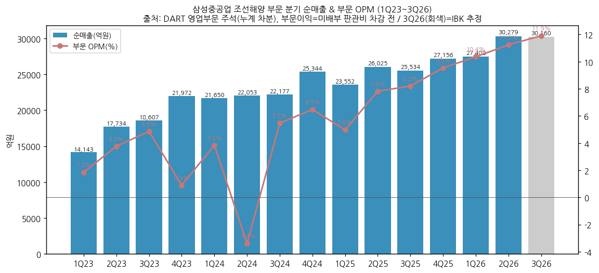

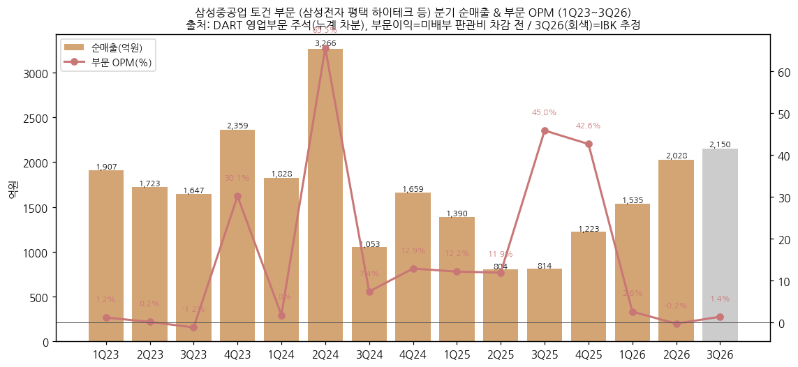

(3) 전사 분기 시계열 (1Q15~3Q26, 47분기, 억원)

| 분기 | 매출 | 영업이익 | OPM | 순이익 | 매출 YoY | OP YoY |
|---|---|---|---|---|---|---|
| 1Q15 | 26,099 | 263 | 1.0% | 109 | - | - |
| 2Q15 | 14,395 | -15,481 | -107.5% | -11,550 | - | - |
| 3Q15 | 24,364 | -100 | -0.4% | -250 | - | - |
| 4Q15 | 32,287 | 299 | 0.9% | -429 | - | - |
| 1Q16 | 25,301 | 61 | 0.2% | 159 | -3.1% | -77% |
| 2Q16 | 27,208 | -2,838 | -10.4% | -2,124 | +89.0% | 적지 |
| 3Q16 | 27,778 | 841 | 3.0% | 1,286 | +14.0% | 흑전 |
| 4Q16 | 23,855 | 464 | 1.9% | -709 | -26.1% | +55% |
| 1Q17 | 24,370 | 274 | 1.1% | 587 | -3.7% | +349% |
| 2Q17 | 22,997 | 206 | 0.9% | 227 | -15.5% | 흑전 |
| 3Q17 | 17,519 | 236 | 1.3% | 234 | -36.9% | -72% |
| 4Q17 | 14,126 | -5,959 | -42.2% | -4,456 | -40.8% | 적전 |
| 1Q18 | 12,408 | -478 | -3.9% | -595 | -49.1% | 적전 |
| 2Q18 | 13,466 | -1,006 | -7.5% | -1,427 | -41.4% | 적전 |
| 3Q18 | 13,138 | -1,272 | -9.7% | -802 | -25.0% | 적전 |
| 4Q18 | 13,639 | -1,337 | -9.8% | -1,057 | -3.4% | 적지 |
| 1Q19 | 14,575 | -333 | -2.3% | -1,026 | +17.5% | 적지 |
| 2Q19 | 17,704 | -563 | -3.2% | -3,094 | +31.5% | 적지 |
| 3Q19 | 19,646 | -3,120 | -15.9% | -5,832 | +49.5% | 적지 |
| 4Q19 | 21,571 | -2,150 | -10.0% | -3,201 | +58.2% | 적지 |
| 1Q20 | 18,266 | -478 | -2.6% | -2,270 | +25.3% | 적지 |
| 2Q20 | 16,915 | -7,077 | -41.8% | -7,042 | -4.5% | 적지 |
| 3Q20 | 16,768 | -134 | -0.8% | -74 | -14.6% | 적지 |
| 4Q20 | 16,654 | -2,851 | -17.1% | -5,541 | -22.8% | 적지 |
| 1Q21 | 15,746 | -5,068 | -32.2% | -5,359 | -13.8% | 적지 |
| 2Q21 | 17,155 | -4,379 | -25.5% | -4,474 | +1.4% | 적지 |
| 3Q21 | 14,854 | -1,102 | -7.4% | -1,238 | -11.4% | 적지 |
| 4Q21 | 18,465 | -2,571 | -13.9% | -3,450 | +10.9% | 적지 |
| 1Q22 | 14,838 | -949 | -6.4% | -1,039 | -5.8% | 적지 |
| 2Q22 | 14,261 | -2,557 | -17.9% | -391 | -16.9% | 적지 |
| 3Q22 | 14,001 | -1,679 | -12.0% | -2,016 | -5.7% | 적지 |
| 4Q22 | 16,345 | -3,359 | -20.6% | -2,828 | -11.5% | 적지 |
| 1Q23 | 16,051 | 196 | 1.2% | 93 | +8.2% | 흑전 |
| 2Q23 | 19,458 | 589 | 3.0% | 232 | +36.4% | 흑전 |
| 3Q23 | 20,254 | 759 | 3.7% | 356 | +44.7% | 흑전 |
| 4Q23 | 24,332 | 790 | 3.2% | -2,236 | +48.9% | 흑전 |
| 1Q24 | 23,478 | 779 | 3.3% | 78 | +46.3% | +297% |
| 2Q24 | 25,320 | 1,307 | 5.2% | 740 | +30.1% | +122% |
| 3Q24 | 23,230 | 1,199 | 5.2% | 714 | +14.7% | +58% |
| 4Q24 | 27,004 | 1,742 | 6.5% | -994 | +11.0% | +121% |
| 1Q25 | 24,943 | 1,231 | 4.9% | 901 | +6.2% | +58% |
| 2Q25 | 26,830 | 2,048 | 7.6% | 2,123 | +6.0% | +57% |
| 3Q25 | 26,348 | 2,381 | 9.0% | 1,403 | +13.4% | +99% |
| 4Q25 | 28,379 | 2,962 | 10.4% | 930 | +5.1% | +70% |
| 1Q26 | 29,023 | 2,731 | 9.4% | 1,000 | +16.4% | +122% |
| 2Q26 | 32,307 | 3,250 | 10.1% | 2,228 | +20.4% | +59% |
| **3Q26 (잠정)** | **31,504** | **3,384** | **10.7%** | **4,708** | **+19.6%** | **+42%** |
→ (출처: 1Q15~2Q26 DART OpenAPI 분기·반기·사업보고서 연결 3개월 값, 4Q = 연간 - 3Q 누적. 3Q26 = IR 잠정실적(2026-10-29). 순이익 = 비지배 포함. 4Q20은 IR 잠정(+26억)과 DART 확정(-2,851억) 불일치 — 1번 섹션 참조)

→ **4Q26E 컨센 역산** (2026E - 9M26): 매출 약 34,967억 / OP 약 4,363억 (OPM 약 12.5%) / NI 약 1,250억 — IBK 4Q26E OP 4,410억(OPM 12.2%)과 유사. NI는 3Q26 일회성 이익 선반영으로 4Q 역산치가 낮음

→ **회사 가이던스 역산**: 2026 매출 가이던스 12.8조(IR 2026-02, 3Q26 IR에서 수정 언급 없음) - 9M26 92,834억 = **4Q26 내재 매출 약 35,166억** (3Q26 대비 +11.6%) — 컨센 역산(34,967억)과 부합. 영업이익 가이던스는 2026년 미제시(2023~2025는 제시)

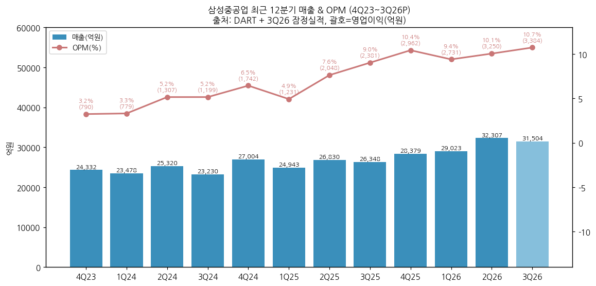

② 사업부별 개요 (매출 비중 큰 순서, 2025 기준)

(1) 조선해양 — 매출 96% / 부문이익의 87%

→ **상선**: LNG운반선(174K CBM, 쇄빙 LNGC 포함) 중심 + 컨테이너선(메탄올·LNG DF 초대형)·원유운반선(VLCC·S-Max·A-Max, 셔틀탱커)·VLGC/VLAC/VLEC

→ **해양**: FLNG(부유식 LNG 생산설비)·FPSO·FPU·CPF·고정식 플랫폼 — 과거 드릴십(시추설비) 포함, 2024 재고 드릴십 처분 완료

→ 수주잔고(2026.9말, 인도기준): 상선 152척 280억$ (77%) — LNGC 71척 170억$ / 컨테이너선 26척 49억$ / 탱커 38척 38억$ / VLGC·VLAC 등 17척 23억$ + 해양설비 4기 83억$ (23%) — IR 3Q26 p.3

(2) 토건 — 매출 4%

→ 토목·건축·하이테크(반도체 FAB 마감공사) — 주요 발주처 삼성전자 평택캠퍼스(P3·P4 FAB동 마감공사 등, DART 주요계약). 수주잔고 7,421억 (2025말)

③ 사업부별 디테일

(1) 상선 — 이익 엔진

(1-1) 수주연도 mix와 환율

→ 3Q26 매출 -3% QoQ(조업일수 60 → 55일)에도 OPM 10.1% → 10.7% — "'24년 이후 높은 환율·신조선가가 적용된 수주분의 매출 비중 증가" (IR 3Q26 p.2). 상선 매출 중 '24년 이후 수주분 1Q26 35% → 3Q26 55%

→ IBK: 2026년 1~7월(원/달러 1,400원 상회 구간)에 102억$ 수주 → 2027 하반기부터 매출 비중 확대, 2028 최대 비중 → 100% 헤지 구조상 장기 적용 환율 상승 효과

→ Clarksons 기준 174K LNGC 선가 2023 265.0 → 2024 260.0 → 2025 248.0백만$, 15~16.5K TEU 컨테이너선 193.5 → 204.0 → 194.0백만$, VLCC 128~129백만$ (DART 2025 '가격변동추이') — 선가 정점 통과 신호는 2028~2029 매출에 반영될 변수

(1-2) 수주 흐름

→ 상선 수주: 2024년 73억$ (LNGC 53억$·22척) → 2025년 71억$ (LNGC 28억$·11척, 셔틀탱커 13억$, 컨테이너 17억$, COT 10억$) → 2026년 1~10월 80억$ (목표 57억$의 140%)

→ 시황(IR 3Q26): LNGC 2026 1~9월 69척 발주, Clarksons 2026E 95척·2027E 105척 / 유조선 2026 1~9월 369척(VLCC 172척), 선령 15년+ 노후선 46% / 컨테이너선은 2024~2025 대량 발주 인도 부담, USTR 중국 건조선 입항료(2027.1 시행 예정)가 국내 조선소 기회

(2) 해양 — optionality이자 변동성 원천

(2-1) FLNG 포트폴리오

→ 인도 완료: Prelude(2011~2017, 30억$)·Petronas Dua(2014~2020, 16억$)·Coral Sul(2017~2021, 25억$) / 건조 중: Petronas Tiga(2023~, 15억$)·Cedar(2023~, 16억$)·Coral Norte(2023~, 24억$) / 설계 중: Delfin 1(2026~, 29억$) — IR 3Q26 p.12

→ 2026 해양 수주 44억$ (목표 82억$의 54%) — Delfin 2·Western LNG 협상 중. 연간 수주 목표 139억$ 대비 1~10월 124억$ (89%)

(2-2) 역사적 손실 원천

→ 2015 해양생산설비 원가증가(OP -1.5조), 2017~2018 시추설비 예상손실·선가 하락, 2019~2021 드릴십 재고자산 가치 하락 — 해양은 삼성중공업 손익 저점의 반복 원인

(3) 신사업 (매출 0, IR 3Q26 p.4~5·11)

→ **미국 사업**: 2026.3 현지법인 설립 / Vigor Marine Group과 미 해군 군수지원함 MRO 입찰·MSRA 취득 추진 / GD NASSCO NGLS 개념설계(2026.4 선정, 2028 초 최종 사업자) / Conrad Shipyard LNG 벙커링(2026.7 Jones Act 12K 벙커링선 인증) / Saronic 조선소 자동화

→ **FDC(부유식 데이터센터)**: 2026.4 50MW·2026.7 200MW AiP(ABS·로이드), Mousterian·ABB·Capital·Supermicro MOU, 특허 약 40건 출원, 2028 상업화 목표

→ **Net Zero**: Amogy 암모니아 연료전지, FSMR(용융염원자로, 2025 ABS 개념설계 인증, 2026.7 Sargent & Lundy MOU)

④ 주요 경쟁사 (사업부별)

(1) 상선 (LNGC·컨테이너·탱커)

→ 국내 — HD현대중공업·HD현대삼호 (HD한국조선해양 계열), 한화오션

→ 해외 — 중국 CSSC 계열(후동중화·장난·다롄), 일본 이마바리·JMU

→ 국내 수주 점유율(천GT, 선박 부문, 한국조선해양플랜트협회): 삼성중공업 2023 23.6% → 2024 20.2% → 2025 **18.6%** (한화오션 30.9%, HD현대중공업 25.1%, 현대삼호 17.9%)

(2) 해양 (FLNG·FPSO)

→ 국내 — 한화오션 (FPSO·고정식), HD현대중공업 해양플랜트

→ 해외 — 싱가포르 Seatrium, 중국 Wison·COOEC, 일본 MODEC(FPSO 운영)

→ FLNG 신조 발주 **11기 중 7기 수주, 점유율 64%** (IR 3Q26 p.9)

(3) 토건

→ 삼성물산·삼성E&A 등 하이테크 건설사 (경쟁 구도 상세 미확보)

⑤ 주요 매출처

→ DART 주요계약 상대방: 오세아니아지역 선주(LNGC 다수)·아시아지역 선주·버뮤다·유럽·아프리카 선주, 2024년 삼성전자(평택 FAB 공사) — 선주 실명 비공시

→ 매출 10% 이상 단일 고객 공시는 본 v1.0에서 **미확보** (영업부문 주석 '주요 고객' 파싱 필요)

→ **수주잔고 (DART 2025말, 원화)**: 조선해양 272,884억 + 토건 7,421억 = **280,305억** / **IR 2026.9말 인도기준 363억$, 매출기준 35조**

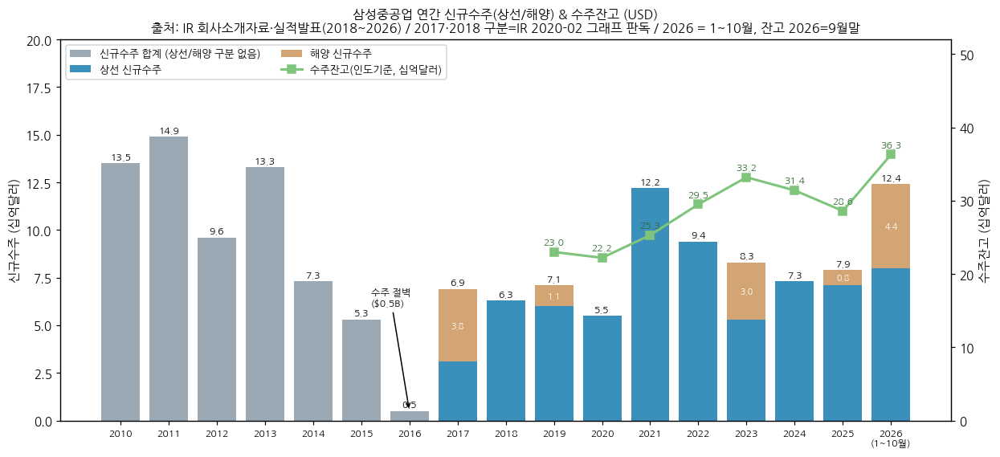

→ 신규수주(억$): 2014 73 → 2015 53 → **2016 5 (수주절벽)** → 2017 69 → 2018 63 → 2019 71 → 2020 55 → **2021 122** → 2022 94 → 2023 83 → 2024 73 → 2025 79 → 2026.1~10월 124 / 인도기준 수주잔고(억$): 2019.1월 184 → 2019말 230 → 2020말 222 → 2021말 253 → 2022말 295 → 2023말 332 → 2024말 314 → 2025말 286 → 2026.9말 **363** (IR 회사소개 각 연도, 2010~2013 수주는 IR 막대 판독치)

(1) 연도별 회사 가이던스 vs 실적 + 상선/해양 수주 (IR 실적발표, v1.2 신규)

| 연도 | 매출 가이던스 | 매출 실적 (억원) | OP 가이던스 (억원) | OP 실적 (억원) | 수주목표 (상선/해양, 억$) | 수주실적 (상선/해양, 억$) |
|---|---|---|---|---|---|---|
| 2017 | - | 79,012 | - | -5,242 | - | 69 (31 / 38)† |
| 2018 | 5.1조 | 52,651 | -2,400 | -4,093 | 82 (51 / 31) | 63 (63 / 0)† |
| 2019 | 7.1조 (1Q19) | 73,497 | 미제시 | -6,166 | 78 (58 / 20) | 71 (60 / 11) |
| 2020 | 7.6조 | 68,603 | 미제시 | -10,541 | 84 (59 / 25) | 55 (55 / 0) |
| 2021 | 7.1조 → 6.9조 (1Q21) | 66,220 | 미제시 → -7,600 (1Q21) | -13,120 | 78 (46 / 32) → 91 (71 / 20) | 122 (122 / 0) |
| 2022 | 7.0조 | 59,447 | 미제시 | -8,544 | 88 (73 / 15) | 94 (94 / 0) |
| 2023 | 8.0조 | 80,094 | 2,000 | 2,333 | 95 (64 / 31) | 83 (53 / 30) |
| 2024 | 9.7조 | 99,031 | 4,000 | 5,027 | 97 (72 / 25) | 73 (73 / 0) |
| 2025 | 10.5조 | 106,500 | 6,300 | 8,622 | 98 (58 / 40) | 79 (71 / 8) |
| 2026 | **12.8조** | 9M 92,834 (72.5%) | 미제시 | 9M 9,365 | **139 (57 / 82)** | 1~10월 124 (80 / 44) |

→ (출처: 각 연도 IR 실적발표 '경영 전망/목표'·'수주실적' 페이지 — 2018-05·2019-05·2020-02·2021-02/05·2022-02·2023-05·2024-02/08·2025-05/08/11·2026-02/07/11. 매출·OP 실적은 DART 확정치. †2017·2018 상선/해양 구분은 IR 2020-02 '연도별 운반선/해양 신규수주' 그래프 판독치. 2022 해양 0은 IR 2023-05 "상선 '22년 94억불" 기술로 역산, 2024 해양 0은 IR deck 상선 73억$ 기준)

→ **가이던스 달성 패턴**: 적자기 OP는 제시된 해 모두 가이던스 미달(2018 -2,400 → -4,093억 / 2021 수정 전망 -7,600 → -13,120억, 4Q21 IR: 강재단가 공손충 -760억·드릴십 -440억·임금협상/희망퇴직 -650억 등). 매출은 2018·2019 초과, 2020~2022 미달(코로나 공정순연·해양 수주 지연) → 흑자 전환 후(2023~2025) OP 3년 연속 가이던스 초과(+17% / +26% / +37%), 매출도 부합~초과. 수주는 2021(122억$, 수정 목표 91억$의 134%)·2022(94억$, 107%)만 목표 초과, 나머지는 미달 — 특히 **해양 수주는 2019~2025 7년 누적 목표 188억$(2021 당초 32억$ 기준) 대비 실적 49억$(26%)**로 lumpy, 2026은 1~10월 44억$(목표 82억$의 54%)

(2) 인도기준 수주잔고 스냅샷 (IR 실적발표, 억$)

| 시점 | 수주잔고 | 상선 | 해양 생산설비 | 시추설비(드릴십) | 해양+시추 비중 | 매출기준 잔고 (조원) |
|---|---|---|---|---|---|---|
| 2018.10말 | 185 | - | 32% | 19% | 51% | 2018말 12.3 |
| 2019.4말 | 199 | 106 | 65 | 28 | 47% | - |
| 2019말 | 230 | - | 28% | 12% | 40% | - |
| 2020.6말 | 199 | 122 | 49 | 28 | 39% | - |
| 2020말 | 222 | 145 | 49 | 28 | 35% | 12.0 |
| 2021말 | 253 | 214 | 11 | 28 | 15% | 19.7 |
| 2022.10말 | 286 | 258 | 0 | 28 | 10% | 2022말 26.7 |
| 2023.7말 | 332 | 295 | 15 | 22 | 11% | 2023.9말 29.8 |
| 2024.1말 | 325 | 279 | 30 | 16 | 14% | 2023말 30.3 (2025-05 IR은 28.4) |
| 2024.7말 | 329 | 294 | 30 | 5 | 11% | 2024.6말 32.3 |
| 2025.4말 | 319 | 289 | 30 | 0 | 9% | 2025.3말 32.3 |
| 2025.7말 | 265 | 228 | 37 | 0 | 14% | 2025.6말 25.7 |
| 2025말 | 286 | 248 | 38 | 0 | 13% | 28.0 |
| 2026.6말 | 355 | 272 | 83 | 0 | 23% | - |
| **2026.9말** | **363** | **280** | **83** | 0 | **23%** | **35** |

→ (출처: 각 분기 IR 실적발표 '수주잔고 구성' 표. 2018.10말·2019말은 비중(%)만 공시. 매출기준 잔고는 IR 문구 인용 — 2015년 24.1 → 2016말 10.0 → 2017년 10.8조 포함. 2023말 매출기준 잔고는 IR 간 불일치(2024-02 IR 30.3조 vs 2025-05 IR 28.4조))

→ **해석**: 시추설비(재고 드릴십 5척, 28억$)가 2019~2023 잔고에 묶여 있다가 2024년 인도로 소멸 → 해양 비중이 2022년 10%까지 하락했다가 Coral Norte·Delfin 1 수주로 2026년 23%로 재상승. 2025.4말 → 7말 잔고 -54억$은 2Q25 IR이 언급한 "러시아 PJT 계약취소 확정" 시점과 일치(잔고 차감 금액 자체는 IR 미기재)

⑥ 생산 CAPA + 임직원 추이

(1) 생산 설비 (DART 2025)

| 항목 | 내용 |
|---|---|
| 조선소 | 거제 (토지 4,266천㎡ 등, 장부가 토지 2.0조·건물 0.86조·구축물 1.30조) / 중국 영성 블록 법인 (2025.07 보온공장 준공) |
| 생산능력 조선 (천CGRT) | 2023 4,188 → 2024 4,512 → 2025 3,911 |
| 생산실적 조선 (천CGRT) | 2023 3,623 → 2024 4,211 → 2025 4,154 |
| 생산능력 해양 (천TON) | 2023 0.2 → 2024 6.5 → 2025 25.3 (FLNG 공사 재개) |
| 가동률 (2025) | 조선 111% / 해양 102% / 합계 111% (실제 28,372천M/H) |
| 시설투자 | 2025 보완투자 2,241억 (작업장 합리화) / 2026 계획 4,300억 (생산능률 향상) |

(2) 임직원 (DART 직원 현황, 기간제 포함)

| 연도말 | 직원 수 | 평균 근속 | 1인 평균급여 | 소속 외 근로자 |
|---|---|---|---|---|
| 2014 | 13,788 | - | 72백만원 | - |
| 2016 | 11,897 | - | 68백만원 | - |
| 2019 | 10,008 | - | 73백만원 | 106 |
| 2022 | 8,775 | 19.6년 | 84백만원 | 12,901 |
| 2025 | **10,589** | 17.2년 | **107백만원** | 17,504 |
| 2026.6 | 11,155 | 16.9년 | (반기 44백만원) | 18,098 |

→ 2025말 부문별 (DART 2025 직원현황 API): **조선해양 10,301명**(남 9,872 중 기간제 2,074, 남 평균근속 17.6년·1인 평균급여 107백만원) / **토건 288명**(남 평균급여 125백만원) — 2025 급여총액 약 1.12조원

→ 2014 → 2022 직원 -5,013명(-36%) 구조조정 → 2025까지 +1,814명 재확충, 기간제 2022 203명 → 2026.6 2,762명 급증. 1인 평균급여 2022 84 → 2025 107백만원(+27%) — 인건비 단가 상승은 고정비 부담 요인. 2019 소속 외 106명은 집계 기준 차이로 추정

---

## 재무 구조

① 손익계산서 (12년 연결, 억원)

| 연도 | 매출 | 매출총이익 | 판관비 | 영업이익 | 당기순이익 | NI(지배) | GPM | CIR | OPM | NPM |
|---|---|---|---|---|---|---|---|---|---|---|
| 2014 | 128,791 | 7,627 | 5,797 | **1,830** | 1,473 | 1,492 | 5.9% | 4.5% | **1.4%** | 1.1% |
| 2015 | 97,144 | -9,616 | 5,403 | **-15,019** | -12,121 | -12,054 | -9.9% | 5.6% | **-15.5%** | -12.5% |
| 2016 | 104,142 | 4,751 | 6,223 | **-1,472** | -1,388 | -1,212 | 4.6% | 6.0% | **-1.4%** | -1.3% |
| 2017 | 79,012 | -1,504 | 3,737 | **-5,242** | -3,407 | -3,388 | -1.9% | 4.7% | **-6.6%** | -4.3% |
| 2018 | 52,651 | -41 | 4,051 | **-4,093** | -3,882 | -3,879 | -0.1% | 7.7% | **-7.8%** | -7.4% |
| 2019 | 73,497 | 613 | 6,779 | **-6,166** | -13,154 | -13,108 | 0.8% | 9.2% | **-8.4%** | -17.9% |
| 2020 | 68,603 | -4,655 | 5,886 | **-10,541** | -14,927 | -14,824 | -6.8% | 8.6% | **-15.4%** | -21.8% |
| 2021 | 66,220 | -7,657 | 5,463 | **-13,120** | -14,521 | -14,451 | -11.6% | 8.2% | **-19.8%** | -21.9% |
| 2022 | 59,447 | -4,622 | 3,922 | **-8,544** | -6,274 | -6,194 | -7.8% | 6.6% | **-14.4%** | -10.6% |
| 2023 | 80,094 | 6,455 | 4,121 | **2,333** | -1,556 | -1,483 | 8.1% | 5.1% | **2.9%** | -1.9% |
| 2024 | 99,031 | 9,206 | 4,179 | **5,027** | 539 | 639 | 9.3% | 4.2% | **5.1%** | 0.5% |
| 2025 | 106,500 | 13,743 | 5,121 | **8,622** | 5,358 | 5,455 | 12.9% | 4.8% | **8.1%** | 5.0% |

→ 판관비 = 매출총이익 - 영업이익 (대손상각비 포함). 2019 CIR 9.2%·2020 8.6%는 매출 감소 + 대손상각비(2019 연결 CF 조정 2,700억) 영향

→ **영업외 손익 괴리**: 세전이익 - 영업이익 = 2019 -5,226 / 2020 -4,209 / 2023 **-5,290** / 2024 **-8,182** / 2025 -2,117억 — 중재·계약취소 비용, 이자비용(연 1,000~2,700억), 외환·파생 손익. 2023~2024는 영업흑자에도 세전 적자. 반대로 3Q26은 IR 기준 "매도 선물환(Forward Sell) 청산 이익 발생"(세전 3,000 → 6,107억, +104% QoQ) — IBK는 러시아 프로젝트 계약해지에 따라 위험회피 목적 → 매매목적으로 재분류된 선물환에서 **약 2,800억 일회성 이익**으로 추정(IR은 금액·러시아 연관성 미기재) → 3Q26 세전 6,107억 > OP 3,384억

→ (v1.2 IR 보강) 영업외 구성: **2019** -5,226억 = 드릴십 관련 -3,410억(Ensco 중재 합의금, 선물환 회계처리 변경 등) + 이자비용(980억) 등 기타 -1,816억 (IR 2020-02) / **2023** 4Q23 세전 -3,578억 = SK해운 중재 관련 일시 충당 약 -0.4조(중재 패소액·법률비용·이자 일괄 충당, 환입 가능성 언급 — IR 2024-02) / **2024** 4Q24 세전 -4,784억 (구성은 4Q24 IR 미확보로 미검증) / **3Q25** 영업외 -969억(환율 상승에 따른 선물환 평가손·이자) / **4Q25** 영업외 -923억(선물환 평가손·순이자)

→ 2024 NI 539억 > 세전 -3,155억 = 법인세수익 약 3,690억 (이연법인세 인식, IBK 법인세 -369십억)


② 재무상태표 (12년 연결, 억원)

| 연도말 | 자산총계 | 부채총계 | 자본총계 | 부채비율 | 유동비율 | 현금성자산 | 총차입금 | 순차입금 | 계약자산 | 계약부채 | 이익잉여금(결손금) | 재고자산 |
|---|---|---|---|---|---|---|---|---|---|---|---|---|
| 2014 | 171,222 | 115,491 | **55,732** | 207% | 106% | 3,408 | 38,266 | 34,858 | - | - | - | 11,688 |
| 2015 | 173,016 | 130,358 | **42,657** | 306% | 106% | 9,835 | 50,334 | 40,499 | - | - | - | 14,490 |
| 2016 | 172,175 | 109,422 | **62,753** | 174% | 110% | 9,841 | 53,273 | 43,432 | - | - | - | 12,261 |
| 2017 | 138,181 | 80,207 | **57,975** | 138% | 95% | 3,535 | 40,834 | 37,299 | - | - | 31,984 | 12,168 |
| 2018 | 142,829 | 75,366 | **67,463** | 112% | 118% | 9,460 | 29,147 | 19,687 | 32,064 | 22,074 | 28,001 | 14,818 |
| 2019 | 136,001 | 83,512 | **52,489** | 159% | 98% | 3,843 | 38,074 | 34,231 | 24,817 | 15,626 | 15,022 | 23,396 |
| 2020 | 129,222 | 92,039 | **37,182** | 248% | 89% | 9,872 | 48,166 | 38,294 | 21,117 | 17,318 | 301 | 18,206 |
| 2021 | 121,386 | 80,413 | **40,973** | 196% | 79% | 5,712 | 22,470 | 16,758 | 15,326 | 26,284 | -13,552 | 14,876 |
| 2022 | 144,917 | 109,198 | **35,719** | 306% | 91% | 9,192 | 30,634 | 21,442 | 23,192 | 37,574 | -19,589 | 15,735 |
| 2023 | 155,934 | 121,842 | **34,092** | 357% | 82% | 5,838 | 35,512 | 29,674 | 37,839 | 49,922 | -21,687 | 17,292 |
| 2024 | 171,946 | 134,452 | **37,495** | 359% | 78% | 9,560 | 32,182 | 22,622 | 35,727 | 54,630 | -21,360 | 4,525 |
| 2025 | 149,489 | 108,538 | **40,950** | 265% | 79% | 7,726 | 20,478 | 12,752 | 21,765 | 45,805 | -16,028 | 4,896 |
| 2Q26 | 179,594 | 132,490 | **47,104** | 281% | 88% | 8,074 | 11,021 | 2,947 | 33,351 | 54,339 | -12,769 | 4,978 |
| 3Q26 (IR) | 160,392 | 119,138 | **41,254** | 289% | - | 20,393* | 11,051 | -9,342 (순현금) | - | 선수금 52,661 | -8,063 | - |

→ (출처: DART OpenAPI 연결 BS. 총차입금 = 단기차입금 + 유동성장기부채 + 사채 + 장기차입금. 2Q26 = 반기보고서, 3Q26 = IR 3Q26 p.13 요약 BS(*현금·예금). 2014~2017 계약자산·부채는 K-IFRS 1115호 도입(2018) 전 계정이라 미기재, 2014~2016 이익잉여금 미파싱)

→ **자본 변천**: 2014 55,732억 → 2015 42,657억(부채비율 306%) → 2016 증자+재평가 62,753억 → 2018 증자 67,463억(12년 최고) → 2020 37,182억 → 2021 감자·증자 40,973억 → 2023 34,092억(부채비율 357%) → 3Q26 41,254억

→ **재고자산(드릴십)**: 2019 23,396억 정점 → 2024 4,525억 — 재고 드릴십 5척(Crete·West Dorado·Santorini·Zonda 등) 매각·인도로 1.9조 감소 → 2024 OCF 개선·차입 상환의 원천

→ 이익잉여금: 2017 +31,984억 → **2021 결손 전환(-13,552억)** → 2023 -21,687억(최저) → 2025 -16,028억 → 3Q26 -8,063억 — 결손 해소 전까지 배당가능이익 없음

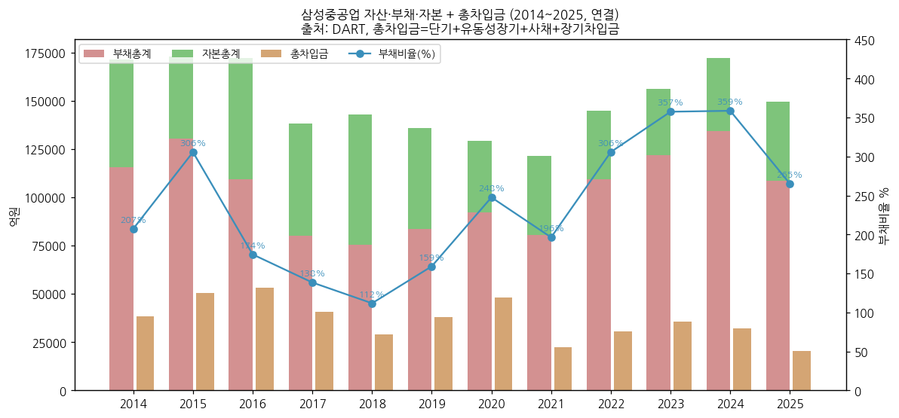

③ 현금흐름표 (12년 연결, 억원)

| 연도 | OCF | ICF | CFF | 유형 CapEx | 무형 CapEx | FCF | 배당 지급 | 유상증자 |
|---|---|---|---|---|---|---|---|---|
| 2014 | -4,575 | -5,213 | 5,031 | 3,665 | 25 | **-8,265** | 1,085 | - |
| 2015 | 6,203 | -10,807 | 11,037 | 6,082 | 0 | **121** | 513 | - |
| 2016 | -15,548 | 1,295 | 13,917 | 2,070 | 5 | **-17,623** | 0 | 11,305 |
| 2017 | 5,401 | -744 | -9,567 | 1,079 | 3 | **4,318** | 0 | - |
| 2018 | 1,655 | 3,693 | 504 | 690 | 0 | **965** | 0 | 13,920 |
| 2019 | -6,812 | -1,177 | 3,657 | 772 | 0 | **-7,585** | 0 | - |
| 2020 | -2,439 | -1,668 | 10,114 | 978 | 3 | **-3,421** | 0 | - |
| 2021 | 8,450 | 998 | -13,691 | 394 | 0 | **8,056** | 0 | 12,757 |
| 2022 | -16,930 | 11,021 | 9,468 | 624 | 0 | **-17,554** | 0 | - |
| 2023 | -5,165 | -1,947 | 3,760 | 1,534 | 0 | **-6,699** | 0 | - |
| 2024 | 6,545 | 3,105 | -5,992 | 1,734 | 0 | **4,811** | 0 | - |
| 2025 | 15,628 | -4,804 | -12,665 | 2,163 | 0 | **13,466** | 11 | - |
| 1H26 | 23,069 | -12,694 | -10,095 | 970 | - | **22,099** | - | - |

→ (출처: DART OpenAPI 연결 CF. FCF = OCF - 유·무형 CapEx. 유상증자 = 현금흐름표 '유상증자' 순유입. 2025 배당 11억은 종속회사 비지배주주 배당으로 추정 — 본사 결산배당은 FY2014가 마지막)

→ **12년 누적 FCF -2.9조** — 헤비테일 계약 구조로 건조량 증가기(2016·2022)에 OCF -1.5 ~ -1.7조. 2016~2021 누적 유상증자 3.8조로 자금 부족을 메움

→ 2025 OCF **+15,628억** (12년 최고) → 1H26 **+23,069억** — 고선가 LNGC 인도 잔금 + 선수금 유입. 1H26 ICF -12,694억은 단기금융상품 등 운용 성격으로 추정(IBK 2026F 투자활동 '기타' -2.36조)

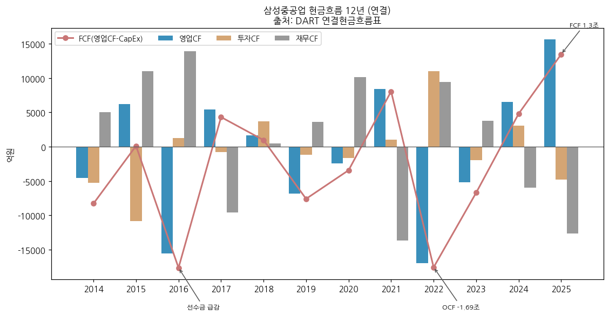

④ CapEx (12년)

→ 2014 3,690억 → **2015 6,082억 (해양 설비 증설 마무리, 12년 최고)** → 2016~2022 연 400~2,100억 (구조조정기 최소 투자, 2021 394억 최저) → 2023 1,534억 → 2025 2,163억 → 2026 계획 4,300억

→ CapEx/매출 2017~2022 평균 약 1.1% → 2025 2.0%

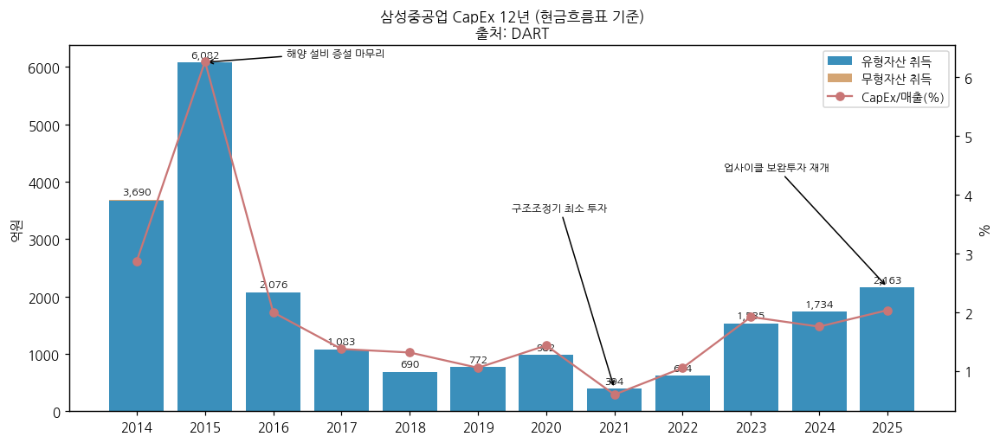

⑤ 부채구조 + 채무증권 발행

(1) 차입 구조

→ 총차입금 2016 **5.3조**(정점) → 2021 2.2조(증자 상환) → 2023 3.6조 → 2025 2.0조 → 3Q26 **1.1조** / 순차입금 2025말 12,752억 → **3Q26 순현금 약 9,342억** (IR 3Q26: 현금·예금 20,393억, 차입금 11,051억)

→ 선수금환급보증(RG): 한국수출입은행 등 한도 USD 11,531백만 (DART 2025 주석)

→ 2025 채무증권: 기업어음(CP, A3+ → A2-) 사모 위주 단기 조달 / 사채 잔액 2,994억 (2Q26)

(2) 신용등급 history (DART)

→ 2023.05 CP A3 (NICE) / 2023.06 기업신용 BBB (한기평) → 2023.12 BBB+ (NICE) → 2024.06 BBB+ (한기평) → **2025.06 A- / CP A2-** (한기평·NICE 동시) → 2025.09 회사채 A- 본평정

(3) 지분증권 발행 history

| 일자 | 형태 | 주식수 | 발행가 | 조달 규모 |
|---|---|---|---|---|
| 2016.11.16 | 주주배정 유상증자 | 159,124,614주 | 7,170원 (액면 5,000) | 약 1.1조 (증자비율 68.89%) |
| 2018.04.23 | 주주배정 유상증자 | 240,000,000주 | 5,870원 (액면 5,000) | 약 1.4조 (증자비율 61.52%) |
| 2021.07.26 | 무상감자 80% | (주식수 불변) | 액면 5,000 → 1,000원 | 자본금 3.15조 → 0.63조 (결손 보전) |
| 2021.11.08 | 주주배정 유상증자 | 250,000,000주 | 5,130원 (액면 1,000) | 약 1.3조 (증자비율 39.68%) |

→ (출처: DART 2018 사업보고서·2025 사업보고서 I-3 '증자(감자)현황'. 발행주식 230.9백만(2015) → 390.0백만(2016) → 630.0백만(2018) → 880.0백만주(2021))

→ 미상환 CB·BW·조건부자본증권 **없음** (DART 2025)

⑥ 배당·자사주

→ 현금흐름표 배당 지급: 2014 1,085억 (FY2013) / 2015 513억 (FY2014) → **FY2015~FY2025 11년 연속 무배당**

→ DART 2025: "배당절차 개선을 포함한 주주환원 정책을 검토 중" / 자기주식 25,964,429주(2.95%) 보유 — DART 2025 자기주식 현황상 전량 **'배당가능이익 범위 이내 취득 – 직접취득 – 장내직접취득'** 분류(신탁·기타취득 0주), 2025년 중 변동 없음. 취득 시점은 2014.10 자기주식 취득 승인 이사회 이후로 추정(연도 미검증), 이후 신규 매입·소각 이력 없음

→ DART 2025 배당 현황: 현금·주식배당 전 항목 '-' (FY2023~FY2025), 연결 EPS FY2025 **639원** / FY2024 75원 / FY2023 -174원, 별도 NI FY2025 5,403억

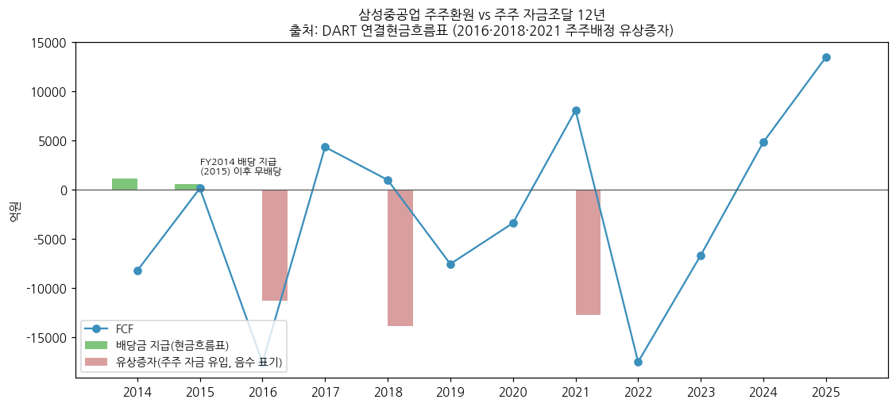

⑦ 재무비율 (12년 연결)

| 연도 | ROE(지배) | ROA | 부채비율 | 유동비율 | 이자보상배율(OP/이자지급) | 순차입금/자본 |
|---|---|---|---|---|---|---|
| 2014 | 2.7% | 0.9% | 207% | 106% | 1.4x | 63% |
| 2015 | -24.7% | -7.0% | 306% | 106% | -13.6x | 95% |
| 2016 | -2.3% | -0.8% | 174% | 110% | -0.9x | 69% |
| 2017 | -5.6% | -2.2% | 138% | 95% | -3.4x | 64% |
| 2018 | -6.2% | -2.8% | 112% | 118% | -3.3x | 29% |
| 2019 | -21.9% | -9.4% | 159% | 98% | -4.8x | 65% |
| 2020 | -33.1% | -11.3% | 248% | 89% | -7.0x | 103% |
| 2021 | -36.9% | -11.6% | 196% | 79% | -9.3x | 41% |
| 2022 | -16.1% | -4.7% | 306% | 91% | -9.2x | 60% |
| 2023 | -4.2% | -1.0% | 357% | 82% | 1.3x | 87% |
| 2024 | 1.8% | 0.3% | 359% | 78% | 1.9x | 60% |
| 2025 | **13.7%** | **3.3%** | **265%** | **79%** | **5.1x** | **31%** |

→ ROE·ROA = 평균 자본(지배)·자산 기준(2014은 기말), 이자보상배율 = 영업이익 / 현금흐름표 이자 지급액. 유동비율 100% 미만은 계약부채(선수금)가 유동부채로 분류되는 조선업 특성

---

## 지배 구조

① 그룹·계열 관계

→ **삼성그룹** 계열 (공정거래법상 기업집단 '삼성') — 최대주주 삼성전자 15.23%, 삼성전자의 최대주주는 삼성생명보험(8.51%), 삼성생명의 최대주주는 삼성물산(19.34%) (DART 2025 VII)

→ 최대주주 변동: 최근 5년간 없음. 삼성전자는 2016·2018·2021 주주배정 증자에 참여해 지분율 15%대 유지(본 v1.0에서 각 증자별 참여율은 미검증)

→ 그룹 내 연계: 삼성전자 평택캠퍼스 FAB 마감공사(토건 매출), 2025.10 삼성전자·삼성물산·삼성SDS와 OpenAI FDC MOU, 대표이사 최성안은 삼성엔지니어링(현 삼성E&A) 대표 출신

② 주주 구분

| 주주 | 주식수 (2026.6말) | 지분율 | 비고 |
|---|---|---|---|
| **삼성전자(주)** (최대주주) | 134,027,281 | **15.23%** | 최근 5년 변동 없음 |
| 삼성생명 (고유+특별계정) | 26,010,262 | 2.96% | 특별계정 장내매매로 소폭 감소 |
| 삼성전기 | 18,150,855 | 2.06% | |
| 삼성SDI | 3,173,594 | 0.36% | |
| 제일기획 | 994,314 | 0.11% | |
| 삼성물산 | 989,379 | 0.11% | |
| 최성안 (대표이사) | 70,000 | 0.01% | 2025말 60,000주 |
| **최대주주·특수관계인 계** | 183,415,685 | **20.84%** | 2025말 20.86% |
| 국민연금공단 | 64,469,338 | 7.3% | 2025말 67,059,586주(7.6%) |
| 우리사주조합 | - | - | 2025말 1,801,510주(0.2%) |
| 자기주식 | 25,964,429 | 2.95% | |
| 외국인 (IBK 2026-10-29) | - | 28.1% | |
| 기타 (개인·국내기관 등, 잔여 추정) | - | 약 41% | |
| **발행주식총수 (보통주)** | **880,000,000** | 100% | + 우선주 114,845주 |

→ (출처: DART 2026 반기보고서 VII. 주주에 관한 사항 / DART 2025 사업보고서 VII / 외국인 지분율 IBK 3Q26 Review 표지. 시점 혼재)

→ 소액주주 667,844명, 소액주주 지분 64.56% (2025말)

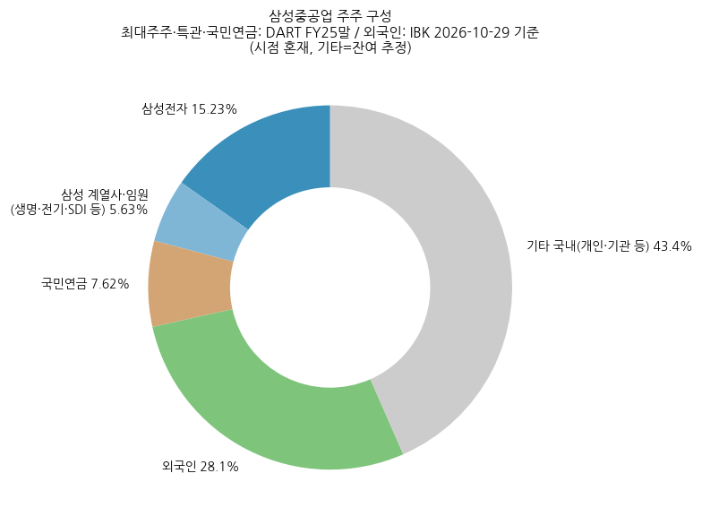

→ 차트는 2025말 DART(국민연금 7.62%) + IBK 외국인 28.1% 기준. 2026.6말 국민연금 7.3%로 소폭 감소

③ 임원·이사회 (DART 2026 반기보고서 VIII, 2026.6.30 기준)

(1) 등기임원 (7명: 사내 3 + 독립이사 4)

| 성명 | 직위 | 출생 | 주요 경력 | 임기만료 |
|---|---|---|---|---|
| **최성안** | 대표이사 부회장 (사내이사) | 1960.12 | 서울대 기계공학 / 전 삼성엔지니어링 대표이사(2018~2022)·화공사업본부장·플랜트사업1본부장 | 2029.03.20 |
| 김경희 | 부사장 (사내이사, 미래사업본부장 겸 ADX총괄) | 1970.02 | 부산대 조선공학 / EPC 경쟁력 강화 T/F 담당임원, 생산지원본부장, 전 경영전략실장 | 2028.03.20 |
| 이왕근 | 부사장 (사내이사, COO 겸 조선해양부문장) | 1970.08 | 서울대 조선해양공학 석사 / 해양사업담당·생산담당 | 2027.03.20 |
| 김상규 | 독립이사 (감사위원) | 1961.02 | 서울대 행정학 석사 / 전 조달청장, 감사원 감사위원 | 2028.03.20 |
| 윤상직 | 독립이사 (감사위원) | 1956.05 | 위스콘신대 법학 박사 / 전 산업통상자원부 장관 | 2027.03.20 |
| 이원재 | 독립이사 (감사위원) | 1964.12 | 요크대 경제학 석사 / 전 국토교통부 제1차관, 한국부동산연구원장 | 2027.03.20 |
| 이연승 | 독립이사 (감사위원) | 1968.02 | 베를린공대 조선해양공학 박사 / 홍익대 조선해양공학부 부교수, 전 한국해양교통안전공단 이사장 | 2029.03.20 |

→ 2026.3 주총: 최성안 재선임, 이연승 신규 선임, 조현욱 사외이사 임기만료 퇴임. 2026 반기보고서부터 사외이사 명칭이 '독립이사'로 변경

→ 이사회 독립이사 비중 4/7 = 57%, 전원 감사위원 — 정부 고위관료 출신 3명(조달청·산업부·국토부)

(2) 주요 미등기임원 (총 34명, 2026.6말)

→ **남궁금성** 부사장 (조선소장 CSO 겸 글로벌사업본부장)

→ **김현조** 부사장 (조선해양연구소장, MIT 해양공학 박사)

→ **안영규** 부사장 (기술개발본부장, 전 해양사업본부장) — 2025말 기준

→ **윤재균** 부사장 (영업본부장) — 2025말 기준

→ **이동현** 상무 (해양사업본부장) / **김경수** 상무 (하이테크본부장) — 2025말 기준

(3) 경영진 변동 (DART 2025 연혁)

→ 대표이사: 박대영(~2018) → 남준우(2018~2021) → **정진택**(2021.3 선임) → **최성안**(2023.3 선임, 2023.3~2024.3 정진택과 각자대표) → 2024.3 정진택 퇴임, 최성안 단독 → 2026.3 재선임

→ 사내이사: 윤종현(2021~2023), 배진한(2022~2025), 이왕근(2024.3~), 김경희(2025.3~)

---

## 기타 팩트

① R&D 인프라

| 연도 | 연구개발비용 계 (억원) | R&D/연결 매출 |
|---|---|---|
| 2014 | 1,054 | 0.8% |
| 2015 | 1,130 | 1.2% |
| 2016 | 924 | 0.9% |
| 2017 | 692 | 0.9% |
| 2018 | 495 | 0.9% |
| 2019 | 508 | 0.7% |
| 2020 | 502 | 0.7% |
| 2021 | 516 | 0.8% |
| 2022 | 616 | 1.0% |
| 2023 | 688 | 0.9% |
| 2024 | 836 | 0.8% |
| 2025 | **1,018** | **1.0%** |

→ (출처: DART 사업보고서 II '연구개발비용' — 경상연구개발비 + 외부수탁과제, 별도 기준 공시치. 2025 경상 1,009억 + 수탁 8억. R&D/매출은 연결 매출 대비 재계산, DART 기재 비율 2025 1.0 / 2024 0.8 / 2023 0.9)

→ **조직**: 조선해양연구소 (거제·대덕·판교) — 극저온제품연구센터(LNG·수소), 친환경연구센터(신연료·탄소저감·실증설비), 선박해양연구센터(선형·유체·해양플로터), 자율운항연구센터, 생산기술연구센터(용접·재료·도장·구조·진동소음), RX센터(팩토리·필드 로봇), 스마트야드연구센터, 디지털사업팀·로보틱스사업팀

→ 업계 유일 LNG 실증 설비 운영, 암모니아 종합실증설비 보유 (IR 3Q26 p.10~11)

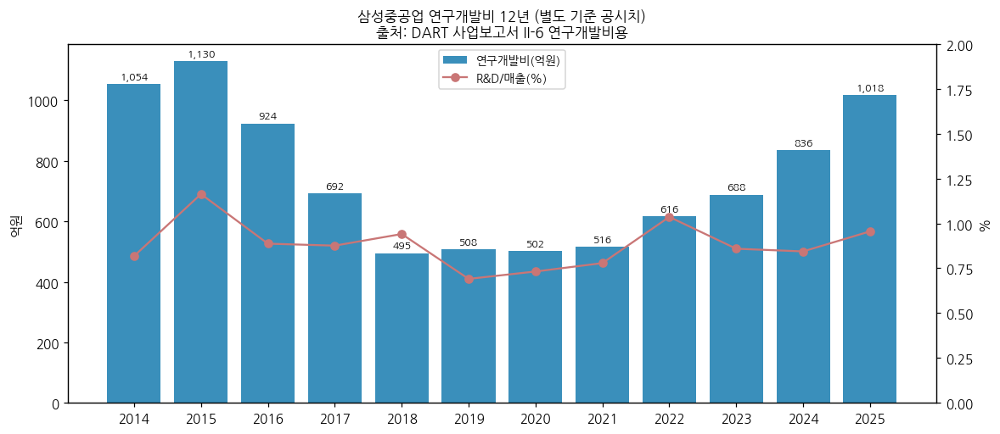

② 진행 중 corporate action (10년)

→ 2014.9~11 삼성엔지니어링 합병 추진 → 해제

→ 2016·2018·2021 주주배정 유상증자 3회 (총 약 3.8조) + 2021.7 무상감자 80%

→ 2021~2024 재고 드릴십 매각 (Curious Crete 사모펀드 구조 활용, 2025 청산)

→ 2024.6~ 러시아 Zvezda LNGC 10척·셔틀탱커 7척 계약 분쟁 → 2025.6.18 계약해지 통지, 선수금 8억$ 유보, 관련 부채 7,507억 인식(2025말) — 중재 진행 중. 2Q25 IR: 러시아 PJT 계약취소 확정 → 기발주 기자재 취소 예상비용 충당. 3Q26 IR: 매도 선물환 청산 이익 발생(금액 미기재) — IBK는 러시아 관련 선물환 재분류 이익 약 2,800억으로 추정

→ 2026.3 미국 현지법인 설립 — MRO·공동건조·LNG 벙커링·조선소 현대화 4개 축 (IR 3Q26 p.4)

→ 2025.07 중국 영성 법인 보온공장 준공 (2024.06 증자)

③ R&D 마일스톤 (DART 연구개발실적 최근 3개년 + IR)

→ 2025: SAVER Wing(풍력보조추진 WAPS) 실운항 검증, 친환경 극저온 단열시스템(한국형 화물창) 실증 기반, CO2 포집 솔벤트·OCCS 실선 검증, 암모니아 연료공급 시스템 실선화, 생성형 AI 초기 선형설계

→ 2024: 컨테이너 유실 방지 구조 실선화, 자율운항 미래형 무인선 SHIFT-AUTO, 선박 폐열회수(ORC) / 2023: 컨테이너선용 암모니아 멤브레인 연료탱크, 선박용 CO2 포집 시스템

→ 디지털: SVESSEL(스마트십 플랫폼)·SVISION(서라운드뷰)·SAS(원격 자율운항) / 2022.11 국내 연안 자율운항 해상 실증 성공

→ 2025 지식재산권 등록: 특허 341건, 실용신안 4건, 디자인 16건, 상표 5건 (DART)

④ 주요 리스크

(1) 소송·우발부채 (DART 2025 XI-2)

→ **원고(제소)**: 13건 소송가액 5,444억원 (한국가스공사 외 — 손해배상 등, 대법원 외 계류)

→ **피고(피소)**: 28건 1,614억원 (한전산업개발 외 — 용역비 등) / 충당부채 미인식 피소 소송·중재 28건 1,614억

→ **Zvezda 중재**: 17척 계약해지 관련 부채 7,507억 인식, 선수금 8억$ 유보 — 중재 결과에 따라 손익 변동 (회사는 유보 선수금 초과 손해 배상 청구 의사)

→ 과거: 2019.11 미 DOJ FCPA 관련 벌금 7,500만$ 기소유예 (드릴십 중개수수료), 2006~2007 Petrobras 드릴십 3척 중개인 위법행위 관련 이슈 (DART 2021)

(2) 환율

→ USD 계약 + 100% 환헤지 정책 — 수주 시점 환율이 이익률을 결정(2022 수주분 저환율). IBK: 장기 환율 가정 1,450 → 1,400원 하향 시 2029년 이후 실적 영향

(3) 원가·노무

→ 후판 가격 2023 1,080 → 2024 908 → 2025 914천원/톤 (DART) — 2021 강재가 급등이 2차 저점의 원인. 직원 1인 평균급여 2022 84 → 2025 107백만원, 소속 외 근로자 1.8만명 의존

(4) 해양 프로젝트

→ FLNG 4기(83억$) 동시 수행 — 2015 해양 손실 패턴 재발 리스크, Delfin 1은 설계 단계

(5) 수주·정책

→ 컨테이너선 발주 둔화(2024~2025 대량 발주 인도), IMO Net-Zero Framework 채택 1년 연기(2026말 결정 예정), USTR 입항료 정책 변화, LNGC 선가 하락(2023 265 → 2025 248백만$)

(6) 주가 변동성

→ 2026.4 월말 고점 대비 -51%(2026.10) — 고 P/B(3.7x) 구간에서 이익 모멘텀 둔화 시 밸류에이션 하방 압력

⑤ ESG 등급

→ **미확보** (KCGS·MSCI 등급 미조회 — 잔여 보완 후보)

→ 1996 녹색경영 선포, 조선업계 최초 ISO 14001 인증, 2023 사내 소각장 폐쇄 (DART 2025 환경 관련 사항)

⑥ 인증·라이선스

→ 조선업계 최초 ISO 50001(에너지경영, 2012.02)·ISO 3834-2(용접품질, 2014.05) 인증 (DART 2014)

→ 2026: Jones Act 준수 12K LNG 벙커링선 선급 인증(2026.7), FDC 50MW·200MW AiP(ABS·로이드), FSMR ABS 개념설계 인증(2025)

→ 미 해군 MSRA(함정정비협약) 취득 추진 중 (미취득) / 선급 인증 개별 목록은 **미확보**

---

## Version Log

**v1.2 (2026-11-14)** — 회사 IR 실적발표 28건 + DART 기업개황·정기보고서 API로 '미확보' 항목 보강

→ **출처**: irgo 경유 IR 실적발표 PDF 28건(2018-05 1Q18 ~ 2026-11 3Q26, pdfplumber 텍스트 추출 — 1Q26은 이미지 PDF라 기존 SHI_IR_1Q26 사용) / DART company.json·2025 사업보고서 API(최대주주·임원·직원·배당·자기주식·주식총수) / quarterly_summary_CFS.md(1Q16~2Q26)와 본문 47분기 표 재대조 → 수치 일치(반올림 차이만), 변경 없음

→ **채운 항목**: ① DART 업종코드 3111·법인/사업자등록번호·수권주식 15억주·유통주식수 ② 2026 회사 가이던스 매출 12.8조·수주 139억$(상선 57/해양 82) 확인, OP 가이던스는 미제시 확인 → 4Q26 내재 매출 35,166억 ③ 2018~2026 연도별 가이던스 vs 실적 + 상선/해양 수주 표 신설 ④ 인도기준 수주잔고 스냅샷 15개 시점(2018.10~2026.9, 상선/생산설비/시추설비) + 매출기준 잔고 시계열 ⑤ 4Q20 +26억 구성(PDC 환입 등)과 1Q21 IR에서 △2,852억으로 수정 표기 사실 확인(수정 사유는 IR 미기재) ⑥ 3Q26 일회성 = IR "매도 선물환 청산 이익" 문구 반영(금액은 IBK 추정 유지) ⑦ 2Q26→3Q26 자본 감소 역산 — 이익잉여금 +4,706억, 이익잉여금 외 항목 약 -1.06조 ⑧ 영업외 손실 구성(2019·4Q23 SK해운 중재 0.4조·3Q25·4Q25) ⑨ 자기주식 취득 방법(배당가능이익 범위 장내 직접취득) ⑩ 2025말 부문별 직원 수, FY2025 연결 EPS 639원 ⑪ 2021E 상선 75/해양 25 매출 비중

→ **확인 결과 미확보 유지**: 3Q26 사업부(조선해양/토건) 값 — 3Q26 IR에 부문 손익 없음 → IBK 추정치 유지 / 상선·해양 분기 매출 분리 — IR 28건 모두 정성 언급만 / 1Q15~4Q22 사업부 분기 — IR에도 부문 구분 없음

→ **수치 변경**: 기존 표 수치 변경 없음 (신규 표·문구 추가만). 차트 chart3_수주잔고 재생성 — 2017~2026 신규수주를 상선/해양 누적 막대로 분리(2010~2016은 합계)

**v1.1 (2026-11-03)** — OpenDART `dart_financials` 검증

→ 연결 연간 12개년 (2014~2025) 손익·재무상태·OCF와 분기 매출·OP 84건을 신규 재무 API (연결) 값과 대조 → 전 항목 일치, 수치 변경 없음

→ 3Q26은 여전히 잠정실적 기준 — DART 3Q26 분기보고서 미제출 (기한 11/16)

v1.0 (2026-11-03)

→ 신규 작성 — v4.8 6개 섹션 + 1번 섹션 표준 5요소 (Summary Box 6지표, 손익 history book annotation, 분류 sub-logic 4단계, 밸류에이션 다이얼 + 삼성전자 비교, 분류 변경 트리거)

→ 데이터: DART OpenAPI 연결 재무 12년(2014~2025, 2013 참고) + 전사 47분기(1Q15~3Q26) + DART 영업부문 주석 사업부별 14분기(1Q23~2Q26) + 3Q26 사업부 IBK 추정 + DART 사업부문 연간 매출 14년(2012~2025) + Yahoo 20년 시가총액

→ 차트 PNG 15개: 표준 12종(chart1·1b·2 조선해양/토건·4·5·6·7·8·9·10·11·12) + 보조 chart2 전사 47분기 시계열·chart3 신규수주/수주잔고 (기존 생성분 재사용, 표 수치와 대조 확인)

→ 기준 시점: 3Q26 잠정실적(2026-10-29 IR). DART 3Q26 분기보고서 공시(11월 중순) 후 3Q26 BS·CF 상세 및 사업부 확정치 반영 필요

→ 사용자 화면 과거 연간값 미제공 → DART 대비 차이 대조 미실시. IR 잠정 vs DART 확정 차이 1건(4Q20 OP +26억 vs -2,851억) 표기

잔여 보완 후보 (v1.2 갱신)

→ **DART 3Q26 분기보고서 반영** (기한 11/16) — 3Q26 사업부(조선해양/토건) 확정치로 IBK 추정치 교체, 3Q26 BS·CF 상세, 자본변동표로 2Q26→3Q26 자본 -5,850억(이익잉여금 외 약 -1.06조) 원인 확정, 선물환 청산이익 금액 확정

→ 2006~2012 연간 손익 (DART API 범위 밖) — 1차 조선 슈퍼사이클(2007~2008) 정점 OPM을 Summary Box에 반영하려면 필요

→ 1Q15~4Q22 사업부별 분기 (2015~2022 분기보고서 원문 영업부문 주석 필요 — IR엔 없음), 상선/해양 매출 분리 시계열 (IR 28건·DART 모두 분리 공시 부재 → 증권사 자료 필요)

→ 4Q20 OP 잠정(+26억) → 확정(-2,851억) 수정 사유 (IR 미기재 — 2020 감사보고서·정정공시 확인 필요)

→ 2Q24 토건 부문이익 2,139억 원인 (2Q24 IR은 "해양·하이테크 매출↑" 정성 언급만), 2024 영업외 손실(4Q24 세전 -4,784억) 구성 — 4Q24 IR 미확보

→ IR 미확보 분기 7건(4Q18·2Q21·3Q21·4Q22·1Q24·3Q24·4Q24) — 해당 시점 수주잔고 스냅샷·일회성 요인 공백, 2016 상선/해양 수주 구분

→ 2026.5~10 주가 급락 원인 검증, 시가총액 일별 ATH 검증 (현재는 월말 종가 기준 2026-04 28.5조)

→ 매출 10% 이상 주요 고객, 선주 실명 / ESG 등급(KCGS·MSCI) / 선급 인증 목록

→ 2016말 이전 직원 평균근속, 2017~2018·2020~2021 직원 수, 2010~2013 신규수주 연도 배열 검증(IR 막대 판독치), 2017·2018 상선/해양 수주 구분(IR 그래프 판독치)

→ 삼성전자의 2016·2018·2021 유상증자 참여율, 자기주식 취득 연도(취득 방법은 v1.2 확인)
