> 종목: 셀트리온 (068270.KS / (주)셀트리온 / Celltrion, Inc.)
> 섹터: 헬스케어 대분류 > 섹터 **바이오** > 서브섹터 **바이오** (실적형 — 삼성바이오로직스·셀트리온·SK바이오팜·유한양행 4종목)
> 작성 시각: 2026-11-25 KST (v1.0 최초 작성) → **2026-11-28 KST v1.1 (DART 정기보고서 41건 재수집·원문 보강)**
> 적용 구조: v4.8 (6개 섹션 + 12종 표준 차트 + chart2 보조 3종 — 총 15종). 연간은 OpenDART 제공 범위(2015\~2025, 11년) + 3Q26 누적, 분기는 1Q16\~3Q26(43분기), 제품별 분기는 회사 IR 1Q24\~1Q25(5분기) + 연간 2022\~2024
> 데이터: 연결 연간 11년(2015\~2025 OpenDART CFS) + 연결 분기 43개(1Q16\~3Q26, 4Q = 연간 − 3Q 누적) + 제품별 매출(회사 IR 2025.05 실적발표 Appendix) + 지역별 순매출(DART 연결주석 2024·2025·3Q25·3Q26) + Yahoo Finance 068270.KS 월간(2005.08\~2026.11)·일간(2024.11\~2026.11) 시계열
> 출처: DART 정기보고서 41건(2015.12\~2026.09, 2021.12·2025.12 사업보고서 본문은 감사보고서 첨부만 확보) — 최신 정성자료 **2026.09 분기보고서(rcept_no 20261116001228, 2026-11-16 공시)** + 2025 사업보고서 감사보고서 첨부(별도·연결, 2026-03-16) / OpenDART 연결재무 JSON 44건(2015 FY\~2026 3Q) / OpenDART 기업개황·주주·임원·직원·배당·자기주식(2023·2025 사업보고서, 2026 3분기) / 회사 IR: irgo 6건(2019.09\~2026.03 — 2025.05 1Q25 실적발표, 2024.11 홍콩 Investor Day 텍스트 추출) / 언론: 데일리팜·바이오스펙테이터·CEO스코어데일리·한국경제·머니투데이(2024.08\~2026.11) / 시장데이터: Yahoo Finance(2026-11-25 종가)

# 셀트리온 기업 개요 (v1.1 — 바이오시밀러 글로벌 직판 통합, 고성장 + 합병 회계 단절기 통과)
> **Fact verify cutoff**: 2026-11-28 (재무는 2026.09 분기보고서까지 확정치. 주가·시가총액·52주 고저·밸류에이션은 2026-11-25 종가 기준 유지 — 2026-11-28 재확인: 2026-11-27 종가 221,000원(+1.8%), 시총 약 51.3조, 52주 고저 변동 없음, Yahoo Finance 단일 소스(수정주가). 제품별 2025\~2026 매출·신규제품 비중·2026 가이던스는 언론 보도 기준 — 회사 IR 원문(2Q25 이후 실적발표 PDF) 미확보)

---

## ① 기업 분류

(1) Primary / Secondary 분류

**Primary 분류: 고성장 (바이오시밀러 파이프라인 확장 + 직판 통합형)**

→ 2015\~2025 매출 CAGR **+21.3%** (6,034억 → 4조 1,625억). 매출 역성장 연도는 2023(-4.7%) 1회뿐 — 회사 설명(2023 사업보고서 경영진단): "코로나19 진단키트 사업 관련 일시적 비용"으로 전체 매출 감소, 바이오시밀러는 +11.6%(부문 기준 +17.6%)
→ 3Q26 누적 매출 4조 1,142억(+45.3% YoY) — 9개월 만에 2025 연간(4조 1,625억)에 근접. 3Q26 단독 1조 5,755억(+53.1%)·영업이익 5,253억(+74.3%)으로 **분기 사상 최대**
→ 성장 엔진이 "램시마·트룩시마·허쥬마 1세대 3종(유럽 침투) → 램시마SC·유플라이마·베그젤마(2세대) → 짐펜트라(美 신약)·스테키마·옴리클로·아이덴젤트 등 3세대"로 교체 — 바이오 매출 중 신규제품 비중 26%(2023) → 38%(2024) → 54%(2025) → **67%(3Q26)** (회사 IR·언론)

**Secondary 노트: 회계 구조 단절형 (2023.12 합병) + 제품 출시 사이클**

→ 이익 변동은 경기가 아니라 **회계·구조 이벤트**가 만든다: ① 2018 4Q 이익 급감(4Q18 OPM 11.7% — 헬스케어向 공급 조정으로 보도 `[언론, 미검증]`), ② 2022 금융당국 회계감리 조치 후 2016\~2021 재무제표 재작성(2022.05.12 기재정정 사업보고서 일괄 제출), ③ **2023.12.28 셀트리온헬스케어 흡수합병 → 1Q24 OPM 2.1%** (PPA 판권 상각 + 공정가치로 인식된 고원가 재고 소진), ④ 2026 3Q 외화관련손실 약 4,058억(영업외) → 3Q26 순이익 784억
→ 합병 회계 효과는 **2025년에 사실상 소멸**: 판권 상각 2024년 1,147억 → 2025년 32억, 고원가 재고 비중 합병 직후 80% → 1Q25 30%(회사 IR) → OPM 2.1%(1Q24) → 35.7%(4Q25) 회복

**Entity 구조 (2026.09)**

→ **(1) (주)셀트리온** — 인천 송도 본사·1·2·3공장(DS+DP 25만L). 바이오시밀러·항체신약 개발·생산 + (합병 후) 글로벌 판매 총괄
→ **(2) 셀트리온제약 (54.99%)** — 국내 상장 자회사. 케미컬의약품(고덱스 등) 제조·판매, 바이오 완제(DP) 일부. 케미컬 부문 매출 3Q26 누적 2,229억(5.4%)
→ **(3) 해외 판매법인 (구 셀트리온헬스케어 법인)** — 유럽·북미·아시아·중남미 직판 법인 (Celltrion USA 등). 2025.12 **Celltrion USA가 Eli Lilly 자회사 Imclone Systems 인수 → Celltrion Branchburg(美 뉴저지, DS 6.6만L)**
→ **(4) 기타** — Celltrion Europe(영국, 임상), Celltrion Global Safety Data Center(필리핀), iQone Healthcare Switzerland(2024 인수), GIFRER BARBEZAT(2026 인수, 프랑스 추정 `[미확인]`) 등
→ 영업부문: **바이오의약품 / 케미컬의약품 / 기타** (DART). 부문 영업이익은 내부거래 조정 전 단순합산만 공시

(2) Summary Box (연결 11년 2015\~2025 + 3Q26 누적)

| 지표 | 11년 평균 (2015\~2025) | 정점 | 저점 | 2025년 | 3Q26 누적 |
|---|---|---|---|---|---|
| 매출 (억원) | 18,431 | **41,625 (2025)** | 6,034 (2015) | **41,625 (+17.0%)** | 41,142 (+45.3% YoY) |
| 영업이익 (억원) | 5,563 | **11,685 (2025)** | 2,212 (2016) | 11,685 (+137.5%) | 12,989 (+87.3% YoY) |
| OPM | 34.0% | **52.6% (2017)** | 13.8% (2024) | 28.1% | 31.6% (3Q26 단독 33.3%) |
| GPM | 56.2% | 73.5% (2017) | 45.2% (2022) | 59.3% | 60.9% |
| 순이익(지배, 억원) | 4,410 | 10,296 (2025) | 1,541 (2015) | 10,296 | 7,914 (+57.9%) |

→ 매출 CAGR(2015→2025) **+21.3%**, 합병 전 구간(2015→2022) +20.9% — 합병 전후 모두 20%대 성장. 단 합병 전 매출은 "셀트리온 → 헬스케어 공급가" 기준, 합병 후는 "최종 고객 판매가" 기준이라 레벨 자체가 다르다 (비교가능성 단절)
→ OPM 사이클: 52.6%(2017 정점) → 32.9%(2018) → 39.6%(2021) → 28.3%(2022) → **13.8%(2024 저점, 합병 PPA)** → 28.1%(2025) → 31.6%(3Q26) — **정점→저점 2회, 평균 약 3\~4년 주기**. 다만 원인이 수요 사이클이 아니라 공급가 조정·회계 이벤트라 "사이클 회수"의 의미는 제한적 `[판단]`
→ 합병 전 9년(2015\~2023) 평균 OPM 36.9% vs 합병 후 3년(2024\~3Q26) 평균 약 25% — 합병 후 OPM은 판매조직(판관비율 30%대)을 안은 구조라 구조적으로 낮다. 대신 마진 "절대액"은 커졌다(헬스케어 유통마진 내재화)

(3) 정량 근거 — 연간 매출·OPM

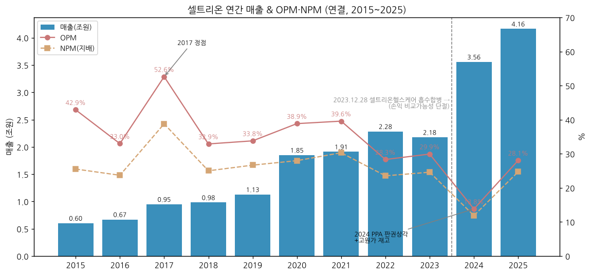

| 연도 | 매출 (억) | YoY | OP (억) | OPM | 사이클 annotation |
|---|---|---|---|---|---|
| 2015 | 6,034 | — | 2,590 | 42.9% | ← 램시마 EU 출시 2년차, 매출 대부분 셀트리온헬스케어向 공급 |
| 2016 | 6,706 | +11% | 2,212 | 33.0% | ← 램시마(인플렉트라) 美 FDA 허가(2016.04), 4Q16 OPM 20.7% |
| 2017 | 9,491 | +42% | 4,996 | **52.6%** | ← **1차 정점**: 트룩시마 EU 허가(2017.02) — 고가 신제품 공급 개시 |
| 2018 | 9,821 | +3% | 3,231 | 32.9% | ← 2018.02 코스피 이전상장, 4Q18 OPM 11.7% (헬스케어向 공급 조정 보도 `[미검증]`) |
| 2019 | 11,285 | +15% | 3,815 | 33.8% | ← 램시마SC EU 허가(2019.11), 3공장 착공 |
| 2020 | 18,491 | +64% | 7,186 | 38.9% | ← 트룩시마·허쥬마 美 확대 + 코로나 관련(렉키로나 개발 등) `[매출 기여 원문 미검증]` |
| 2021 | 19,116 | +3% | 7,569 | 39.6% | ← 유플라이마 EU 허가(2021.02), 렉키로나 국내 조건부 허가 |
| 2022 | 22,840 | +19% | 6,472 | 28.3% | ← 회계감리 조치 → 2016\~2021 재작성(2022.05), 베그젤마 EU·美 허가 |
| 2023 | 21,764 | -5% | 6,515 | 29.9% | ← **2023.12.28 셀트리온헬스케어 흡수합병** (BS만 통합, 손익은 3일분), 진단키트 일시 비용으로 케미컬 -56%, 짐펜트라 美 신약 허가(2023.10) |
| 2024 | 35,573 | +63% | 4,920 | **13.8%** | ← **저점**: 합병 첫해 — 판권 상각 1,147억 + 고원가 재고 + 판관비 1.19조 편입 |
| 2025 | 41,625 | +17% | 11,685 | 28.1% | ← 영업이익 1조 첫 돌파, 美 브랜치버그 공장 인수(12.31), 자사주 9,073억 |
| 3Q26 누적 | 41,142 | +45% | 12,989 | 31.6% | ← 분기 최대(3Q26 5,253억), 신규제품 비중 67%, 2026 가이던스 매출 5.3조·OP 1.8조 |

(4) 산업 분류

| 구분 | 분류 |
|---|---|
| DART 업종 | 21100 — 기초 의약물질 및 생물학적 제제 제조업 |
| KRX | 유가증권시장 (2018.02.09 코스닥 → 코스피 이전상장. 코스닥 등록 2005.07.19) |
| 워치리스트 | 헬스케어 대분류 > **바이오** 섹터 > **바이오** 서브섹터 (실적형 4종목: 삼성바이오로직스·셀트리온·SK바이오팜·유한양행) |
| 최대주주 | (주)셀트리온홀딩스 26.06% (특수관계인 포함 32.90%) — 서정진 회장 지배 |
| 글로벌 피어 | **Sandoz**(바이오시밀러 순수 업체, 2023.10 Novartis 분사) / **Samsung Bioepis**(삼성바이오로직스 100% 자회사) / **Amgen** Biosimilars 사업부 / Biocon Biologics / Alvotech / Fresenius Kabi / Pfizer(Hospira) / 오리지널: J&J(Remicade·Stelara), AbbVie(Humira) |

(5) 분류 결정 논리 (4단계)

→ **(1) 매출 큰 사업부 기준**: 바이오의약품 94.6%(3Q26 누적). 자가면역(램시마·램시마SC·유플라이마·스테키마·앱토즈마)·항암(트룩시마·허쥬마·베그젤마)·기타(옴리클로·아이덴젤트·스토보클로) — 만성질환 장기 투약이라 수요 경기 민감도 낮음(DART "계절성·경기변동 제한적"). 성장은 **신제품 출시 수 × 점유율 침투** 함수 → 고성장
→ **(2) Secular 변수 sub-rule**: 블록버스터 항체 특허만료(Patent Cliff)가 2023(Humira 美)\~2025(Stelara·Prolia·Eylea·Xolair)에 집중, 키트루다(CT-P51)·다잘렉스(CT-P44)·오크레부스(CT-P53)·코센틱스(CT-P55)가 다음 파동. 회사 목표: 상업화 제품 6개(2023) → 11개(2025) → **22개+(2030)** (2024.11 Investor Day). 바이오시밀러 글로벌 상업화 성공 65개사 중 연매출 10억달러+ 4개사(회사 IR)
→ **(3) Boundary case 처리**: ① 2024 OPM 13.8%는 수요 둔화가 아니라 합병 PPA·재고 회계 → 사이클 저점으로 분류하지 않고 "회계 단절"로 처리, ② 2026 3Q 순이익 급감(784억)은 원화 약세 아닌 **원화 강세·환산 관련 외화관련손실(영업외)** → 영업 펀더멘털과 분리, ③ 바이오시밀러는 출시 후 3\~5년 가격 하락(입찰·리베이트)이 구조적이라 "제품별로는 사이클, 포트폴리오로는 고성장" → Primary 고성장 + Secondary 제품 사이클
→ **(4) 글로벌 피어 cross-reference**: Sandoz는 바이오시밀러 + 제네릭 혼합, 매출 성장 한 자릿수 후반·core EBITDA 마진 20%대 초반(2024\~2025, Sandoz 공시 `[미확인 — 본 리포트에서 원문 미검증]`). Samsung Bioepis는 파트너(Organon·Biogen·Sandoz) 판매 모델. Amgen 바이오시밀러는 대형 제약 내 사업부. **셀트리온은 R&D→DS/DP 생산→직판을 수직계열화한 유일한 대형 독립 바이오시밀러사** — OPM 30%대는 Sandoz 대비 높고, 성장률도 높다 → 고성장 분류 유지. 반대로 짐펜트라(美 신약) 실패 시 "바이오시밀러 가격 경쟁형 지속성장"으로 하향 가능 `[판단]`

(6) 적정 밸류에이션 방법 (밸류에이션 다이얼)

| 우선순위 | 방법 | 현재 값 (2026-11-25) | 비고 |
|---|---|---|---|
| 1 | PER (TTM 지배순이익) | 시총 50.36조 / 1조 3,198억 = **약 38.2배** | TTM = 4Q25 5,284 + 3Q26 누적 7,914 (억원, 지배) [계산]. 3Q26 외화관련손실(약 4,058억) 제외 시 약 30배 `[계산·단순가산]` |
| 2 | EV/EBIT (TTM) | (50.36조 + 순차입 약 2.59조) / 1조 7,742억 = **약 29.8배** | 순차입 = 단기금융부채 3.39조 + 장기 0.41조 − 현금 1.01조 − 단기금융자산 0.19조 [계산]. 2026 가이던스 OP 1.8조 기준 약 29.4배 |
| 3 | PBR | 50.36조 / 지배자본 17.32조 = **약 2.9배** | 지배자본 중 영업권 11.88조(합병 영업권) — 유형 자본 대비(P/TBV) 약 14배. PBR은 합병 영업권 때문에 의미 약함 |

→ 사업 mix(바이오시밀러 반복 처방 + 신제품 출시 고성장)상 **PER 1순위**, EV/EBIT 병행. 합병 영업권(11.88조)·개발비 자산화(1.53조) 때문에 자본·EBITDA 지표 왜곡 → PBR·EV/EBITDA는 보조
→ 성장 단계 기업이라 TTM보다 **2026E\~2027E 이익 기준 PER**(가이던스 OP 1.8조)과 PEG가 실전 지표. 순이익은 외화손익(유로·달러 매출채권·차입금 환산) 변동이 커서 OP 기준 EV/EBIT가 더 안정적 `[판단]`
→ 삼성바이오로직스(CDMO, 수주 잔고·CAPA 기반) 대비: 셀트리온은 제품 회사라 파이프라인 출시 일정·점유율이 밸류 핵심

(7) 분기 재평가 트리거 (분류 변경 조건)

→ (1) **짐펜트라 美 매출 연 1조원 이상(회사 목표 블록버스터) + 신규제품 비중 70%+ 유지** → "고성장 + 신약형"으로 격상 검토
→ (2) 반대로 **바이오시밀러 가격 하락으로 분기 매출 YoY 한 자릿수 2분기 연속** 또는 OPM 25% 하회 2분기 연속 → "지속성장(가격경쟁형)"으로 하향
→ (3) 美 의약품 관세(Section 232) 또는 MFN 약가 정책이 美 매출 OPM을 구조적으로 훼손 — 현재는 브랜치버그 현지 생산 + 15\~21개월치 재고(2025.05 회사 발표)로 방어
→ (4) 지배구조 이벤트: 셀트리온제약 합병 재추진(2024.08 주주 반대로 중단), 셀트리온홀딩스 지분 변동 — 밸류 방법 자체는 유지

---

## ② 회사 개요

(1) 기본 사항

| 항목 | 내용 |
|---|---|
| 회사명 (한글) | (주)셀트리온 |
| 회사명 (영문) | Celltrion, Inc. |
| 종목코드 | 068270 (유가증권시장, 2018.02.09 이전상장 / 코스닥 등록 2005.07.19) |
| 설립 | 1991.02.27 (법인 설립일 — 2008.08 (주)오알켐이 구 셀트리온(2002.02 설립)을 흡수합병 후 상호 변경) |
| 본사·공장 | 인천광역시 연수구 아카데미로 23 (송도 1·2·3공장) / 美 뉴저지 브랜치버그(2025.12 인수) |
| 홈페이지 | www.celltrion.com / IR: celltrion.com/ko-kr/investment/ir/ |
| 사업 한 줄 정의 | 세계 최초 항체 바이오시밀러 램시마를 시작으로 11개 바이오시밀러 + 美 신약 짐펜트라를 자체 생산해 유럽·미국 등 전 세계에 직판하는 수직계열화 바이오의약품 기업 |
| 대표이사 | **기우성** (1961.12생, 대표이사, 재직 19.7년 — 前 넥솔바이오텍 부사장·대우자동차) / **서진석** (1984.08생, 이사회 의장·대표이사, KAIST 박사, 서정진 회장 장남) |
| 회장 | **서정진** (1957.10생, 사내이사·그룹 회장, 창업자) |
| 발행주식수 | 보통주 **232,072,877주** (2026.09.30) / 자기주식 4,043,505주(1.74%) |
| 최대주주 | **(주)셀트리온홀딩스 26.06%** (60,475,000주) + 특수관계인 합계 **32.90%** (2026.09) |
| 임직원 | 3,153명 (2025.12, 별도 — 생산직 1,565·연구개발직 805·관리사무직 783). 10년 추이 1,074명(2015) → 2,111명(2019) → 2,529명(2023) → 3,153명(2025) / 연구개발 인력 804명 (2026.09, 박사 73) |
| 시가총액 | **약 50.4조원** (217,000원 × 232.07M주, 2026-11-25 Yahoo Finance 종가 [계산]) — 자기주식 제외 약 49.5조 |
| 52주 고가 / 저가 | 236,667원 (2026-02-24 종가, 장중 239,048원) / 159,400원 (2026-06-08 종가, 장중 158,500원) — Yahoo 수정주가. YTD +25.9% (2025-12-30 172,381원 대비), 1년 +24.8% |
| 상장 후 최고 | 수정종가 기준 2020.12 월말 295,154원 (월중 고가 325,235원, Yahoo 수정주가) / **시가총액 기준 최고는 2026-02-24 약 57.4조** (236,667원 × 당시 주식수 약 242.7M [계산·근사]) |
| 배당 | 2025 결산 주당 750원(총 1,640억, 배당성향 15.9%) — 자본준비금 감액 재원 비과세 배당. 2021 이전은 주식배당 중심 |

(2) 연간 손익·자본 추이 (연결)

| 연도 | 매출 (억) | OP (억) | OPM | NI(지배, 억) | 자본총계 (억) | 자산총계 (억) |
|---|---|---|---|---|---|---|
| 2015 | 6,034 | 2,590 | 42.9% | 1,541 | 18,098 | 27,482 |
| 2016 | 6,706 | 2,212 | 33.0% | 1,590 | 20,609 | 28,838 |
| 2017 | 9,491 | 4,996 | 52.6% | 3,682 | 24,105 | 32,941 |
| 2018 | 9,821 | 3,231 | 32.9% | 2,458 | 25,953 | 35,031 |
| 2019 | 11,285 | 3,815 | 33.8% | 3,010 | 28,729 | 38,596 |
| 2020 | 18,491 | 7,186 | 38.9% | 5,178 | 34,276 | 50,201 |
| 2021 | 19,116 | 7,569 | 39.6% | 5,795 | 40,504 | 56,741 |
| 2022 | 22,840 | 6,472 | 28.3% | 5,378 | 42,742 | 58,917 |
| 2023 | 21,764 | 6,515 | 29.9% | 5,356 | **171,258** | **199,175** |
| 2024 | 35,573 | 4,920 | 13.8% | 4,227 | 175,801 | 210,552 |
| **2025** | **41,625** | **11,685** | **28.1%** | **10,296** | **173,525** | **223,349** |
| 3Q26 누적 | 41,142 | 12,989 | 31.6% | 7,914 | 174,677 | 229,147 |

→ 출처: OpenDART CFS 각 연도 사업보고서(2016\~2021은 2022.05 기재정정 재작성치 반영본) / 2026.09 분기보고서
→ **시계열 단절**: ① **2022.05.12 2016\~2021 사업보고서 일괄 기재정정(재무제표 수정에 따른 감사보고서 재발행)** — 금융당국 회계감리 조치 후속 (위반 내용 상세는 원문 미확인) — 본 표는 OpenDART 재작성 기준, ② **2023.12.28 셀트리온헬스케어 흡수합병**: 합병비율 헬스케어 1주당 셀트리온 약 0.449주 → 신주 69,878,427주 발행(자기주식 배정분 4,009,323주 제외, 공정가치 13.26조) + 기존거래 정산 1.38조 등 **총 이전대가 14.69조 − 식별가능 순자산 공정가치 3.23조 = 영업권 11.46조(잠정) → 2024 측정기간 확정 11.41조(순자산 3.28조)** → 자본 4.3조 → 17.1조, 손익은 2024부터 통합, ③ 2022\~2025 주식배당·무상증자 반복(주식수 증가), ④ 2024\~2026 대규모 자사주 소각(누적 약 1,856만주, 2026.06 기준)

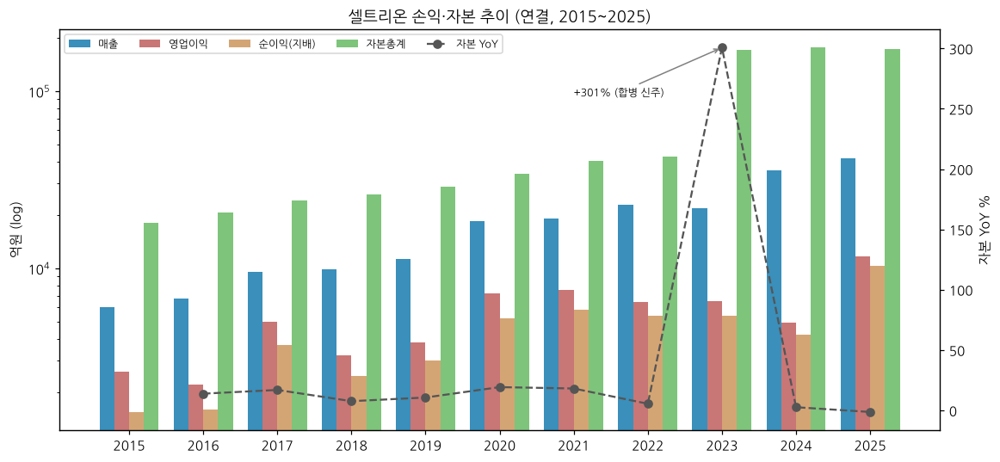

(3) 주가·시가총액 역사

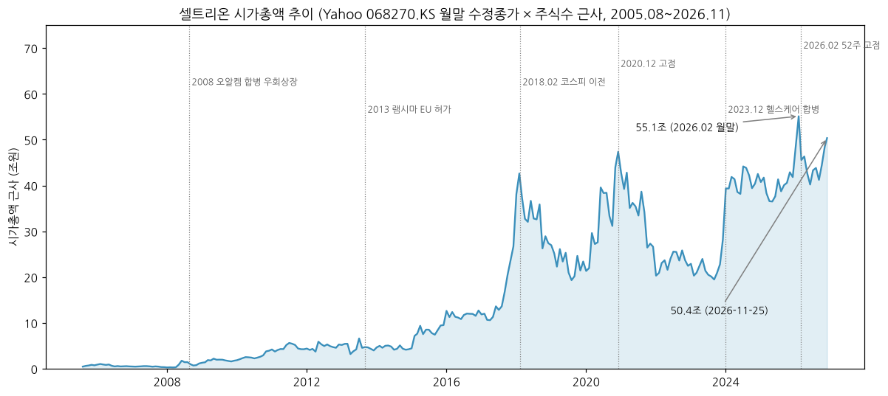

→ (출처: Yahoo Finance 068270.KS 월말 수정종가 × 주식수 근사 — 현재 232.07M주 기준에 ① 2023.12 합병 이전 구간은 합병 전 주식수 비율(140.8M/220.3M) 적용, ② 2024\~2026 소각 주식수(약 1,903만주) 가산. 주식배당·무상증자는 수정주가에 반영. **근사치** — 2020년말 약 47조(companiesmarketcap 2020말 451억달러와 근사), 2024년말 약 42.5조(동 263.8억달러 ≈ 39조로 약간 과대))

| 구간 | 시총(근사) | Narrative |
|---|---|---|
| 2005.08\~2012 | 0.5조 → 5.3조 | 코스닥 등록(2005), 2008 오알켐 합병 우회상장, CMO(BMS 아바타셉트) → 바이오시밀러 전환, 램시마 국내 허가(2012) |
| 2013\~2016 | 5조 → 12.7조 | **램시마 EU 허가(2013.09)** = 세계 최초 항체 바이오시밀러, 공매도 논란·서정진 매각 선언(2013), 美 FDA 허가(2016.04) |
| 2017\~2018.02 | 12.7조 → 약 42.6조 | 트룩시마·허쥬마 EU 허가, 2018.02 코스피 이전상장 |
| 2018.03\~2019 | 42.6조 → 23조 | 헬스케어 재고·회계 논란, 4Q18 이익 급감, 바이오 업종 회계감리 이슈 |
| 2020\~2020.12 | 23조 → **약 47조** | 코로나 치료제(렉키로나)·트룩시마 美 확대 기대 — 수정주가 기준 상장 후 최고(2020.12) |
| 2021\~2022 | 47조 → 22조 | 렉키로나 상업성 소멸, 2022 회계감리·재작성, 美 금리 상승기 바이오 디레이팅 |
| 2023 | 22\~28조(합병 전) → 약 39조(2024.01, 합병 신주 포함) | 3사 합병 추진 → 헬스케어 1단계 합병(2023.12.28), 짐펜트라 FDA 허가(2023.10) |
| 2024\~2025 | 약 42\~44조 횡보 | 합병 PPA로 이익 급감 → 회복, 셀트리온제약 합병 무산(2024.08), 美 관세 리스크 → 브랜치버그 인수 |
| 2026 | 42조 → **약 55\~57조(2월)** → 40조(6월) → 50.4조(11.25) | 1Q26 사상 최대 실적·자사주 1.7조 소각, 6월 52주 저점 후 3Q26 분기 최대 실적으로 반등 |

(4) 주요 연혁

| 일자 | 내용 |
|---|---|
| 1991.02 | (주)오알켐 설립 (현 법인의 모체) |
| 2002.02 | 구 (주)셀트리온 설립 (서정진, 송도) — 동물세포 배양 CMO로 출발 (아시아 최초 CMO, 회사 IR) |
| 2005.07 | 코스닥 등록 (오알켐) |
| 2008.08 | 오알켐이 구 셀트리온 흡수합병 → 상호 (주)셀트리온 |
| 2012 | **램시마(CT-P13) 국내 허가** — 세계 최초 항체 바이오시밀러 |
| 2013.09 | **램시마 EU 허가** (오리지널 전 적응증) |
| 2014.01 | 허쥬마 국내 허가 |
| 2016.04 | 램시마(美명 인플렉트라) 美 FDA 허가 — 화이자 판매 |
| 2016.11 / 2017.02 | 트룩시마 국내 / EU 허가 |
| 2018.02 | 코스피 이전상장 / 허쥬마 EU 허가 |
| 2019.11 | **램시마SC EU 허가** (세계 최초 인플릭시맙 피하주사) |
| 2021.02 | 유플라이마(고농도 휴미라 시밀러) EU 허가 / 렉키로나 국내 조건부 허가 |
| 2022.05 | 회계감리 조치 후 2016\~2021 재무제표 재작성 (기재정정 공시) |
| 2022.08\~09 | 베그젤마 EU·美·국내 허가 / 2022 하반기 유럽 전 제품 직판 전환 완료 |
| 2023.05 / 07 | 유플라이마 美 FDA 허가 / 美 출시 |
| 2023.10 | **짐펜트라(CT-P13 SC) 美 FDA 신약 허가** — 창사 첫 美 신약 |
| 2023.12.28 | **(주)셀트리온헬스케어 흡수합병** — 헬스케어 1주당 셀트리온 0.4492620주, 합병신주 상장 2024.01.12, 영업권 11.46조(잠정) → 11.41조(2024 확정) |
| 2024.03\~ | 짐펜트라 美 출시, 2024.10 美 3대 PBM 처방집 등재 완료 |
| 2024.05\~12 | 옴리클로 EU 허가(졸레어 시밀러 퍼스트무버), 스테키마 국내·EU·美 허가 |
| 2024.08.16 | **셀트리온제약 합병 추진 중단** (특별위원회·주주 설문: 셀트리온 주주 반대 추정 70.4%) |
| 2025.01\~03 | 앱토즈마 美·EU 허가, 스토보클로·오센벨트 EU·美 허가, 옴리클로 美 허가, 스테키마 美 출시(2025.03) |
| 2025.09.23 | **Eli Lilly 美 브랜치버그 DS 공장 인수 계약** (3.3억달러, 약 4,600억원) |
| 2025.10 | 아이덴젤트(아일리아 시밀러) 美 FDA 허가 |
| 2025.12.31 | 브랜치버그 인수 완료 + Lilly와 CMO 계약 4.73억달러(6,787억원, 2029년까지) |
| 2026.03.16 | 글로벌 제약사와 CMO 계약 1.98억달러(2,949억원, 2027.1Q\~2029) |
| 2026.03\~04 | 기업가치제고계획 공시, **자사주 911만주(1조 7,154억) 소각** (4.01) |
| 2026.06 / 2026 중 | 자사주 48.9만주 추가 소각(변경상장 반영) / 무상증자 약 1,092만주 |
| 2026.11.11 | **MSCI ESG 등급 AAA** (A → 2단계 상향) |

---
## ③ 비즈니스 모델

(1) 실적 추이 통합 표 (연결 — 부문별 / 제품별 / 지역별 3단계)

**[1단계] 부문별 매출 (DART 매출실적, 억원)**

| 부문 | 2024 | 2025 | 3Q26 누적 | 비중(3Q26) | 주요 품목 |
|---|---|---|---|---|---|
| 바이오의약품 | 32,318 | 38,825 | **38,908** | 94.6% | 램시마·램시마SC/짐펜트라·트룩시마·허쥬마·유플라이마·베그젤마·스테키마·옴리클로·아이덴젤트·앱토즈마·스토보클로 등 + CMO |
| 케미컬의약품 | 3,223 | 2,722 | 2,229 | 5.4% | 고덱스 외 (셀트리온제약) |
| 용역·기타 | 32 | 78 | 6 | 0.0% | 기타 서비스 |
| **합계** | **35,573** | **41,625** | **41,142** | 100% | |

→ 부문 영업이익(내부거래 조정 전 단순합산, 3Q25 누적): 바이오 7,688억 / 케미컬 316억 / 기타 16억 — 조정 후 연결 OP 6,933억. 2024: 바이오 1조 1,991억 / 케미컬 92억 (조정 −7,168억) — 조정액이 커서 부문 OPM은 참고용
→ 2024 케미컬 감소는 **다케다 프라이머리케어 사업권(아시아태평양) 매각** 영향 (회사 IR 1Q25)

**[2단계] 제품별 매출 (회사 IR, 십억원)**

| 제품 (성분 / 오리지널) | 2022* | 2023* | 2024 | 1Q24 | 2Q24 | 3Q24 | 4Q24 | 1Q25 |
|---|---|---|---|---|---|---|---|---|
| 램시마 IV (인플릭시맙 / Remicade) | 859 | 993 | **1,269** | 299 | 363 | 317 | 289 | 238 |
| 트룩시마 (리툭시맙 / Rituxan) | 448 | 269 | 450 | 101 | 115 | 102 | 132 | 129 |
| 허쥬마 (트라스투주맙 / Herceptin) | 195 | 194 | 197 | 37 | 62 | 49 | 49 | 54 |
| **기존 3종 소계** | 1,502 | 1,456 | 1,915 | 437 | 541 | 468 | 470 | 420 |
| 램시마SC (인플릭시맙 SC, EU 등) | 237 | 322 | 564 | 112 | 111 | 171 | 170 | 135 |
| 유플라이마 (아달리무맙 / Humira) | 39 | 144 | 349 | 67 | 80 | 94 | 108 | 118 |
| 베그젤마 (베바시주맙 / Avastin) | 9 | 49 | 221 | 35 | 40 | 69 | 77 | 58 |
| 짐펜트라 (인플릭시맙 SC, 美 신약) | — | — | 37 | — | 2 | 6 | 28 | 13 |
| 스테키마 (우스테키누맙 / Stelara) | — | — | 20 | — | — | 2 | 18 | 21 |
| **신규 소계** | 285 | 515 | 1,194 | 214 | 233 | 342 | 403 | 347 |
| **바이오 합계** | 1,787 | 1,971 | **3,109** | 651 | 774 | 810 | 873 | 768 |
| Non-바이오 (제약·케미컬·CMO·기타) | 1,001 | 702 | 449 | 86 | 101 | 72 | 190 | 74 |
| **매출 합계** | 2,788 | 2,673 | 3,557 | 737 | 875 | 882 | 1,064 | 842 |

→ *2022·2023 바이오 매출 = **합병 전 셀트리온헬스케어 매출**(최종 판매가), Non-바이오 = 셀트리온 매출 — 회사 IR이 만든 pro-forma 성격으로 DART 연결(2022 2.28조, 2023 2.18조)과 다르다
→ 2025\~2026 제품별 원표(2Q25 이후 IR PDF) **미확보** — 언론 인용 수치만 확보:

| 항목 | 값 | 출처 |
|---|---|---|
| 2025 바이오 매출 | 3조 8,638억 (+24%), 신규제품 비중 54% | 바이오스펙테이터 2026-02-05 |
| 3Q26 신규제품군 매출 | 9,058억 (+약 74% YoY), 바이오 매출 중 67% (+13%p YoY) | 데일리팜 2026-10-27 |
| 3Q26 램시마SC+짐펜트라 | 2,542억 (+19%), 3Q26 누적 7,104억 | 데일리팜 2026-10-27 |
| 3Q26 유플라이마 | 1,832억 (+27%) — 2Q26 유럽 점유율 약 22% 1위(IQVIA) | 데일리팜 2026-10-27 |
| 3Q26 누적 옴리클로 | 3,205억 (전년 499억) — 유럽 26개국, 스페인 점유율 90%+ / 2026.10 美 출시 | 데일리팜 2026-10-27 |

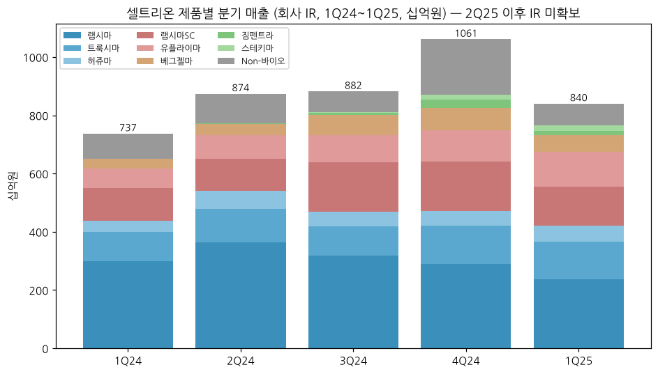

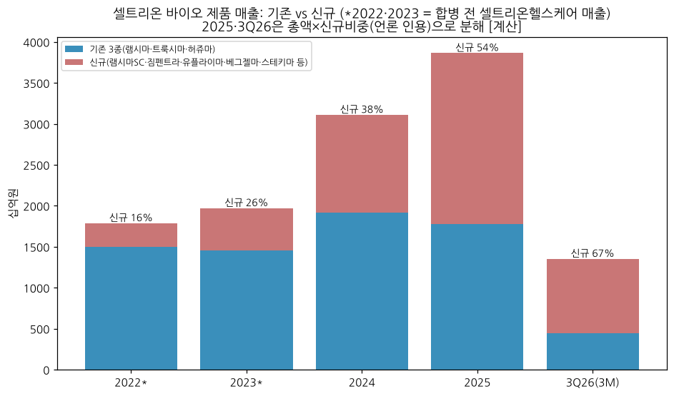

**[3단계] 지역별 순매출 (DART 연결주석, 판매법인 소재지 기준, 억원)**

| 지역 | 2024 | 2025 | YoY | 3Q25 누적 | 3Q26 누적 | YoY | 비중(3Q26) |
|---|---|---|---|---|---|---|---|
| 국내 | 15,550 | 12,621 | -18.8% | 9,982 | 10,310 | +3.3% | 25.1% |
| 아시아 | 1,925 | 3,090 | +60.5% | 1,753 | 2,559 | +46.0% | 6.2% |
| 유럽 | 15,008 | **20,097** | +33.9% | 12,904 | **18,392** | +42.5% | **44.7%** |
| 북미 | 1,681 | 4,200 | +149.8% | 2,650 | **8,418** | **+217.7%** | 20.5% |
| 중남미 | 1,410 | 1,618 | +14.7% | 1,035 | 1,464 | +41.4% | 3.6% |
| **합계** | **35,573** | **41,625** | +17.0% | **28,323** | **41,142** | +45.3% | 100% |

→ **소재지 기준**: "국내"에는 본사가 해외 파트너(간접판매 국가)·CMO 고객에 직접 수출한 매출이 포함 — 실제 최종 소비지 기준 국내 매출은 3Q26 누적 **3,307억(8.0%)**, 해외 3조 7,836억(92.0%) (DART 주석 '국내매출/해외매출' 구분)
→ 북미 급증(3Q26 누적 +218%): 짐펜트라·스테키마·유플라이마 美 처방 확대 + **2026.2Q부터 브랜치버그 공장의 Lilly CMO 공급 개시**(계약상 2026.2Q\~2029.1Q) — CMO 매출 규모 별도 공시 없음 `[미확인]`
→ 10% 이상 단일 고객: 2024 2곳(6,695억·3,889억 — 합병 전 파트너 계약 잔존 추정 `[판단]`) → 2025 없음 → **3Q26 누적 1곳 4,214억(10.2%)** — 실명 미공시 (Lilly CMO 또는 美 PBM/도매상 가능성 `[미확인]`)

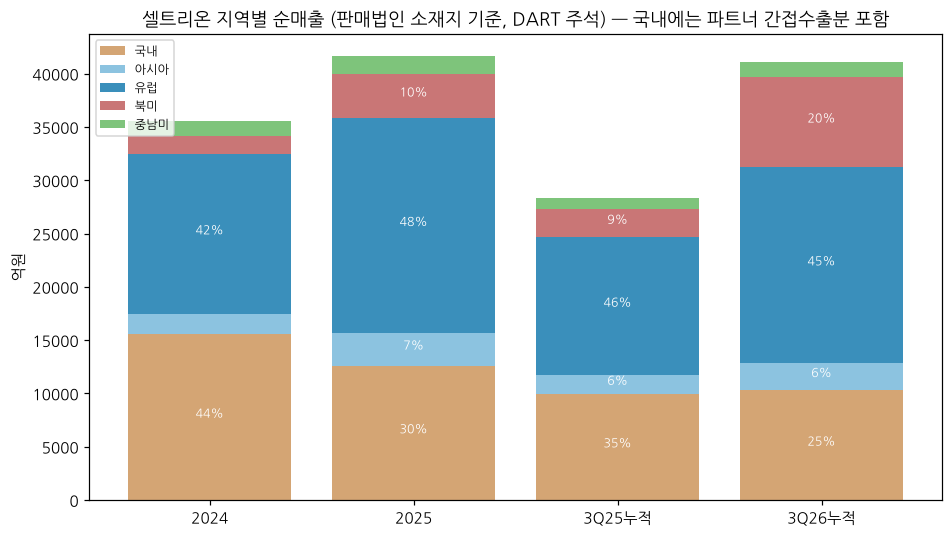

(1-b) 전사 분기 시계열 — 43분기 및 최근 12분기

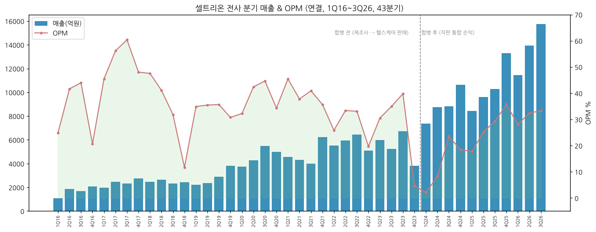

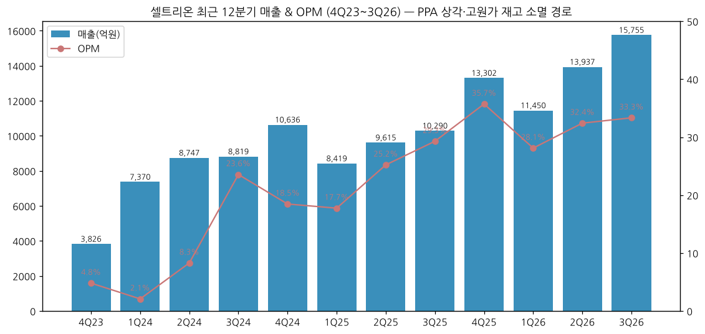

| 분기 | 매출 | OP | OPM | 매출 YoY | OP YoY | 순이익 |
|---|---|---|---|---|---|---|
| 1Q16 | 1,085 | 270 | 24.9% |  |  | 118 |
| 2Q16 | 1,850 | 771 | 41.7% |  |  | 596 |
| 3Q16 | 1,683 | 740 | 44.0% |  |  | 586 |
| 4Q16 | 2,088 | 432 | 20.7% |  |  | 194 |
| 1Q17 | 1,966 | 894 | 45.5% | +81.2% | +231.1% | 671 |
| 2Q17 | 2,461 | 1,383 | 56.2% | +33.0% | +79.4% | 1,152 |
| 3Q17 | 2,321 | 1,401 | 60.4% | +37.9% | +89.3% | 1,140 |
| 4Q17 | 2,743 | 1,318 | 48.0% | +31.4% | +205.1% | 814 |
| 1Q18 | 2,450 | 1,165 | 47.6% | +24.6% | +30.3% | 832 |
| 2Q18 | 2,634 | 1,082 | 41.1% | +7.0% | -21.8% | 830 |
| 3Q18 | 2,311 | 736 | 31.8% | -0.4% | -47.5% | 547 |
| 4Q18 | 2,426 | 284 | 11.7% | -11.6% | -78.5% | 213 |
| 1Q19 | 2,217 | 774 | 34.9% | -9.5% | -33.6% | 630 |
| 2Q19 | 2,350 | 834 | 35.5% | -10.8% | -22.9% | 783 |
| 3Q19 | 2,891 | 1,031 | 35.7% | +25.1% | +40.1% | 616 |
| 4Q19 | 3,827 | 1,177 | 30.8% | +57.7% | +314.4% | 985 |
| 1Q20 | 3,728 | 1,202 | 32.2% | +68.2% | +55.3% | 1,053 |
| 2Q20 | 4,288 | 1,818 | 42.4% | +82.5% | +118.0% | 1,386 |
| 3Q20 | 5,488 | 2,453 | 44.7% | +89.8% | +137.9% | 1,758 |
| 4Q20 | 4,987 | 1,712 | 34.3% | +30.3% | +45.5% | 1,060 |
| 1Q21 | 4,570 | 2,077 | 45.4% | +22.6% | +72.8% | 1,972 |
| 2Q21 | 4,318 | 1,632 | 37.8% | +0.7% | -10.2% | 1,295 |
| 3Q21 | 4,010 | 1,640 | 40.9% | -26.9% | -33.1% | 1,404 |
| 4Q21 | 6,219 | 2,220 | 35.7% | +24.7% | +29.7% | 1,286 |
| 1Q22 | 5,506 | 1,423 | 25.8% | +20.5% | -31.5% | 1,212 |
| 2Q22 | 5,961 | 1,990 | 33.4% | +38.1% | +21.9% | 1,840 |
| 3Q22 | 6,456 | 2,138 | 33.1% | +61.0% | +30.4% | 1,669 |
| 4Q22 | 5,106 | 1,006 | 19.7% | -17.9% | -54.7% | 704 |
| 1Q23 | 5,976 | 1,824 | 30.5% | +8.5% | +28.2% | 1,671 |
| 2Q23 | 5,240 | 1,830 | 34.9% | -12.1% | -8.0% | 1,509 |
| 3Q23 | 6,723 | 2,676 | 39.8% | +4.1% | +25.2% | 2,212 |
| **4Q23** | 3,826 | 184 | **4.8%** | -25.1% | -81.7% | 5 |
| **1Q24** | 7,370 | 154 | **2.1%** | +23.3% | -91.6% | 208 |
| 2Q24 | 8,747 | 725 | 8.3% | +66.9% | -60.4% | 785 |
| 3Q24 | 8,819 | 2,077 | 23.6% | +31.2% | -22.4% | 841 |
| 4Q24 | 10,636 | 1,964 | 18.5% | +178.0% | +967.4% | 2,356 |
| 1Q25 | 8,419 | 1,494 | 17.7% | +14.2% | +870.1% | 1,083 |
| 2Q25 | 9,615 | 2,425 | 25.2% | +9.9% | +234.5% | 633 |
| 3Q25 | 10,290 | 3,014 | 29.3% | +16.7% | +45.1% | 3,319 |
| 4Q25 | 13,302 | 4,752 | 35.7% | +25.1% | +142.0% | 5,279 |
| 1Q26 | 11,450 | 3,219 | 28.1% | +36.0% | +115.5% | 3,498 |
| 2Q26 | 13,937 | 4,518 | 32.4% | +45.0% | +86.3% | 3,713 |
| **3Q26** | 15,755 | 5,253 | **33.3%** | +53.1% | +74.3% | 784 |

→ 출처: dart_quarterly_summary (OpenDART CFS, 4Q = 연간 − 3Q 누적). 순이익 = 당기순이익(비지배 포함)
→ **합병 전(\~3Q23)**: 셀트리온 매출 = 헬스케어向 공급가 → 헬스케어의 재고 정책에 따라 분기 변동 큼(4Q16·4Q18·4Q22 OPM 20% 이하). **4Q23**(매출 3,826억, OP 184억): 부문 차분 [계산: 2023 사업보고서 − 3Q23 분기보고서 누적] — 바이오 3,351억(1\~3Q23 분기 평균 5,123억 대비 −35%), 케미컬 469억(1\~3Q23 평균 844억). 회사 설명은 연간 기준 "코로나19 진단키트 관련 일시적 비용"(케미컬 연간 6,881억 → 3,000억). 바이오 4Q 급감은 원문 설명 없음 — 합병 직전 헬스케어向 공급 조절로 추정 `[판단]`
→ **합병 후(1Q24\~)**: 매출 = 최종 고객 판매가. PPA 경로 — 1Q24 OPM 2.1%(판권 상각 약 600억/분기 + 고원가 재고) → 3Q24 23.5%(판권 상각 대부분 종료) → 1Q25 17.7%(3공장 초기 가동·CMO 외주 물량) → 4Q25 35.7% → 3Q26 33.3%. 원가율: 합병 직후 63% → 1Q25 47% → 3Q25 39%(바이오스펙테이터) → 4Q25 36.1%(헤럴드경제 인용, 증권사 추정) → 3Q26 39.4% [계산: 6,208/15,755]
→ 3Q26 순이익 784억(-76% YoY): 영업이익 5,253억에도 **외화관련손실 3,075억 + 외화관련이익 −983억(전분기 누적분 환입)** 등 기타손익 −3,708억 → 세전 1,032억 (DART 2026.09 연결주석 16). 같은 분기 포괄손익의 **해외사업환산손익 −5,624억**(해외 법인 순자산의 원화 환산가치 감소)이 함께 발생 — 원화 강세(외화 약세) 국면의 외화 자산 환산손실이라는 해석을 뒷받침. 다만 회사의 원인 서술은 분기보고서에 없음 → 방향은 원문 근거, 세부 원인(채권·차입·재고 중 어느 항목)은 `[판단]`

(2) 사업부별 개요 (매출 비중 큰 순서, 3Q26 누적)

| 부문/제품군 | 주요 제품 | 비중 | 생산 | 판매 |
|---|---|---|---|---|
| 신규 바이오 (2세대·3세대) | 램시마SC/짐펜트라, 유플라이마, 베그젤마, 스테키마, 옴리클로, 아이덴젤트, 앱토즈마, 스토보클로·오센벨트 | 바이오의 약 2/3 (3Q26 67%) | 송도 1·2·3공장 DS, DP(셀트리온제약 일부·외부 CMO), 美 브랜치버그 DS | 유럽·북미·아시아·중남미 **직판** (구 헬스케어 법인망) |
| 기존 바이오 (1세대) | 램시마 IV, 트룩시마, 허쥬마 | 바이오의 약 1/3 | 송도 1·2공장 (TI 고역가 공정 전환 — 리터당 생산량 1.6\~2.4배) | 직판 + 일부 파트너(美 인플렉트라 = Pfizer, 美 트룩시마·허쥬마 = Teva 등 `[과거 계약, 현재 구조 미확인]`) |
| CMO | Lilly 의약품(브랜치버그, 2026.2Q\~2029.1Q, 4.73억달러) / 글로벌 제약사(송도, 2027.1Q\~, 1.98억달러) | 미공시 | 브랜치버그·송도 | B2B |
| 케미컬 | 고덱스(간장질환) 외 | 5.4% | 셀트리온제약 공장 `[소재지 미확인]` | 국내 병의원 |

(3) 사업부별 디테일

**램시마 패밀리 (Top-seller — 인플릭시맙 IV + SC)**
→ 램시마 IV: 유럽 처방 점유율 50%대, 美 인플렉트라 20%대 후반 (IQVIA, 회사 IR 1Q25 차트 판독 — 근사) — 유럽에서 오리지널 Remicade를 넘어선 1위
→ 램시마SC: EU5 인플릭시맙 시장 점유율 25%(4Q24, 회사 IR). "IV로 전환 → SC로 재전환" 듀얼 포뮬레이션 효과(DART)
→ **짐펜트라(美 신약)**: 2023.10 FDA 신약 허가 → 바이오시밀러보다 높은 WAC·낮은 리베이트로 NSP 포지셔닝, 美 3대 PBM 처방집 등재(2024.10), 특허 2037\~2040(제형·투여법) (2024.11 Investor Day). 2024 매출 370억 → 3Q26 램시마SC+짐펜트라 분기 2,542억
→ 램시마 IV 개발비 상각 2025.3Q 종료 예정(회사 IR 1Q25) → 원가 개선 요인

**자가면역 2세대 (Growth driver)**
→ 유플라이마: 2024 3,490억(전년 1,440억의 2.4배), 3Q26 분기 1,832억. 고농도·citrate-free, 美 상호교환성(interchangeable) 지위 획득(2025.04)
→ 스테키마: 2024.11 유럽 출시 → 2025.03 美 출시(오리지널 대비 85% 낮은 Low WAC), 코스트코 PBM 선호의약품 등재(회사 IR)
→ 앱토즈마(악템라), 옴리클로(졸레어 — 시밀러 퍼스트무버), 아이덴젤트(아일리아), 스토보클로·오센벨트(프롤리아·엑스지바) 2025 순차 출시 → "하반기 출시 4개 제품 = 추가 성장동력"(회사 IR 2025.05)

**항암 (베그젤마·트룩시마·허쥬마)**
→ 베그젤마 유럽 점유율 1위(약 28\~29%, 4Q24 — 차트 판독 근사), 2024 2,210억(전년 490억의 4.5배)
→ 트룩시마: 美·유럽 점유율 20\~30%대 유지 / 허쥬마: 유럽 1위 바이오시밀러, 일본 점유율 압도적 1위(약 70%대, 회사 IR 차트 판독 근사)

**후속 파이프라인 (DART 2026.09)**
→ 허가 심사: CT-P51(키트루다), CT-P55(코센틱스), CT-P6 SC(허셉틴 SC) / 3상: CT-P44(다잘렉스), CT-P53(오크레부스) / 1상: CT-P45(엔티비오), CT-P52·CT-P68(건선 IL계열)
→ 신약: ADC CT-P70(cMET, FDA 패스트트랙)·CT-P71(Nectin-4, 패스트트랙)·CT-P73(Tissue factor, 패스트트랙), 이중항체 CT-P72(HER2×CD3, Abpro 공동) — 모두 임상 1상

(4) 주요 경쟁사

| 제품군 | 오리지널 | 바이오시밀러 경쟁사 |
|---|---|---|
| 인플릭시맙 (램시마) | J&J Remicade | Pfizer(Inflectra는 셀트리온 제품), Samsung Bioepis(Flixabi/Renflexis), Amgen(Avsola), Sandoz(Zessly) |
| 아달리무맙 (유플라이마) | AbbVie Humira | Sandoz(Hyrimoz), Samsung Bioepis(Hadlima), Amgen(Amjevita), Alvotech/Teva(Simlandi), Boehringer(Cyltezo) 등 10개+ |
| 우스테키누맙 (스테키마) | J&J Stelara | Amgen(Wezlana), Samsung Bioepis(Pyzchiva), Alvotech(Selarsdi), Sandoz 등 |
| 베바시주맙·리툭시맙·트라스투주맙 | Roche Avastin·Rituxan·Herceptin | Amgen, Pfizer, Samsung Bioepis, Biocon, Sandoz |
| 아플리버셉트 (아이덴젤트) | Regeneron Eylea | Samsung Bioepis, Amgen, Sandoz, Biocon, Alvotech |
| 데노수맙 (스토보클로) | Amgen Prolia·Xgeva | Sandoz, Samsung Bioepis, Fresenius 등 |

→ 경쟁 구도 (2024.11 Investor Day): 셀트리온 제품·파이프라인과 같은 물질로 글로벌 임상을 진행한 65개사 중 美·EU 상업화 성공 15개사, 바이오시밀러 연매출 10억달러+ 4개사 → "파이프라인·공급 안정성·판매망을 갖춘 소수 기업만 생존"
→ 경쟁사 표는 공개 정보 기준 정리 `[미확인 — 각사 허가 현황 원문 미검증]`

(5) 주요 매출처

→ DART: 3Q26 누적 매출 10% 이상 고객 **1곳 4,214억** (전년 동기 3,065억), 2025 연간 0곳, 2024 2곳(6,695억·3,889억). 실명 미공시
→ 판매 구조: 유럽(2020 램시마부터 → 2022 하반기 전 제품 직판 완료), 미국(2023 직판 전환), 아시아·중남미·캐나다 직판 — 공공 입찰(tender)·병원·PBM/도매상(美) 채널. 美는 3대 PBM(CVS Caremark·Express Scripts·Optum Rx) 처방집 등재가 핵심
→ 과거 파트너: Pfizer(Hospira, 美 인플렉트라), Teva(美 트룩시마·허쥬마), Mundipharma·Biogaran 등(유럽 초기) `[과거 계약 — 현재 잔존 여부 미확인]`

(6) 생산 CAPA + 임직원 추이

→ 국내: 송도 1·2·3공장 DS+DP **25만L** — 생산능력 연 313배치(1공장 133·2공장 82·3공장 98, 2026.09 DART). 3공장 2024\~2025 가동 개시(초기 원가 부담 → 하반기 완화, 회사 IR)
→ 미국: **브랜치버그 DS 6.6만L** (2025.12.31 인수, 3.3억달러) → 약 7,000억 추가 투자로 **13.2만L 증설 계획** (한국경제 2026-01-02)
→ 신규: 송도 4·5공장 **18만L, 약 1조 2,265억** 투자 계획 (DART 2026.09). CDMO 자회사 설립 계획(2024.09 투자 결정, 국내 20만L 기준 설계·10만L 우선 착공, 2028 가동 목표 — 2024.11 Investor Day)
→ 유형자산 1.82조(2026.09) — 건설중인자산 1,946억

| 연도 | 2015 | 2016 | 2017 | 2018 | 2019 | 2020 | 2021 | 2022 | 2023 | 2024 | 2025 |
|---|---|---|---|---|---|---|---|---|---|---|---|
| 임직원 (별도, 명) | 1,074 | 1,224 | 1,422 | 1,777 | 2,111 | 2,158 | 2,169* | 2,263 | 2,529 | 2,901 | 3,153 |
| 1인 평균 급여 (백만원) | 51 | 51 | 55 | 59 | 69 | 77 | — | 81 | 89 | 103 | — |

→ 출처: 각 연도 사업보고서 VIII. 직원 현황(미등기임원 포함). *2021은 2021.09 분기보고서 값(2021 사업보고서 본문 미확보). 2023은 합병기일(12.28) 이후 헬스케어 인력 일부 반영 추정 `[판단]`. 2026.09 분기보고서는 직원현황 미기재 / 연구개발 인력 804명(2026.09, 박사 73·석사 389)

---

## ④ 재무 구조 (연간 2015\~2025 + 3Q26)

(1) 손익계산서 (억원)

| 연도 | 매출 | 매출원가 | GP | GPM | 판관비 | 판관비율 | OP | OPM | NI(지배) | NPM |
|---|---|---|---|---|---|---|---|---|---|---|
| 2015 | 6,034 | 2,346 | 3,688 | 61.1% | 1,099 | 18.2% | 2,590 | 42.9% | 1,541 | 25.5% |
| 2016 | 6,706 | 2,799 | 3,907 | 58.3% | 1,694 | 25.3% | 2,212 | 33.0% | 1,590 | 23.7% |
| 2017 | 9,491 | 2,512 | 6,978 | 73.5% | 1,982 | 20.9% | 4,996 | 52.6% | 3,682 | 38.8% |
| 2018 | 9,821 | 4,312 | 5,509 | 56.1% | 2,278 | 23.2% | 3,231 | 32.9% | 2,458 | 25.0% |
| 2019 | 11,285 | 4,950 | 6,335 | 56.1% | 2,520 | 22.3% | 3,815 | 33.8% | 3,010 | 26.7% |
| 2020 | 18,491 | 8,215 | 10,277 | 55.6% | 3,091 | 16.7% | 7,186 | 38.9% | 5,178 | 28.0% |
| 2021 | 19,116 | 8,058 | 11,058 | 57.8% | 3,489 | 18.3% | 7,569 | 39.6% | 5,795 | 30.3% |
| 2022 | 22,840 | 12,513 | 10,327 | 45.2% | 3,855 | 16.9% | 6,472 | 28.3% | 5,378 | 23.5% |
| 2023 | 21,764 | 11,246 | 10,519 | 48.3% | 4,004 | 18.4% | 6,515 | 29.9% | 5,356 | 24.6% |
| 2024 | 35,573 | 18,756 | 16,817 | 47.3% | 11,897 | 33.4% | 4,920 | 13.8% | 4,227 | 11.9% |
| 2025 | 41,625 | 16,955 | 24,670 | 59.3% | 12,986 | 31.2% | 11,685 | 28.1% | 10,296 | 24.7% |
| 3Q25 누적 | 28,323 | 12,190 | 16,133 | 57.0% | 9,200 | 32.5% | 6,933 | 24.5% | 5,012 | 17.7% |
| 3Q26 누적 | 41,142 | 16,094 | 25,049 | 60.9% | 12,059 | 29.3% | 12,989 | 31.6% | 7,914 | 19.2% |

→ GPM 단절: 합병 전(2015\~2023) GPM 45\~74%는 "헬스케어向 공급가 − 제조원가", 합병 후 GPM 47%(2024) → 59%(2025) → 61%(3Q26)는 "최종 판매가 − (제조원가 + 공정가치 재고)" — 같은 이름의 다른 지표
→ 판관비 단절: 2023 4,004억 → **2024 1조 1,897억** (판관비율 18% → 33%) — 구 헬스케어 판매조직·마케팅·판권 상각(2024 1,147억)이 편입. 2025 31.2% → 3Q26 29.3%로 레버리지 효과
→ PPA 상각 소멸 경과 (DART 2025 연결주석 무형자산 변동표): **판권 상각 1,147억(2024) → 32억(2025)**, 고객관계 상각 287억(2024) → 288억(2025, 잔존 7\~8.25년 — 연 약 290억 지속), 고원가 재고 비중 합병 직후 80% → 1Q25 30%(회사 IR)
→ **합병 PPA 원문 (2023 사업보고서 연결주석 40 사업결합)**: 인수 재고자산 **공정가치 2조 5,061억** (평가기법: 예상 판매가 − 추가 완성원가·판매비용 − 합리적 이익), 무형자산 3,785억(판권·고객관계 등), 매출채권 6,761억, 식별가능 순자산 3조 2,318억 → 영업권 11조 4,578억 (잠정). **2024 사업보고서에서 측정기간 조정으로 확정: 순자산 3조 2,776억, 영업권 11조 4,120억** — 재고 −27억·무형 −454억·기타유동자산 +874억 등 소폭 수정. **재고의 장부가 대비 공정가치 조정액(step-up)은 원문에 별도 공시 없음** — 2023말 연결 재고 3.04조 중 약 2.5조가 '공정가치(=최종 판매가 근접)'로 들어와 2024\~1Q25 매출원가를 끌어올린 구조

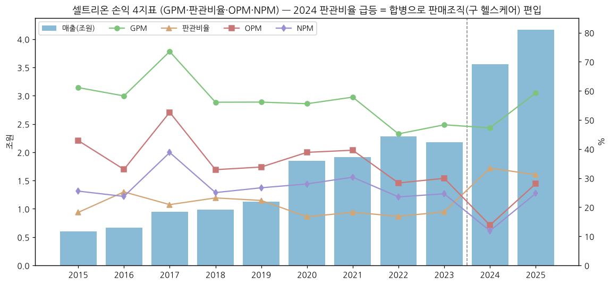

(2) 재무상태표 (억원)

| 연도 | 자산 | 부채 | 자본 | 지배자본 | 현금 | 단기금융자산 | 매출채권 | 재고 | 유형 | 무형(영업권 포함) | 금융부채(단기+장기) | 부채비율 | 유동비율 |
|---|---|---|---|---|---|---|---|---|---|---|---|---|---|
| 2015 | 27,482 | 9,384 | 18,098 | 16,942 | 1,499 | 60 | 6,622 | 2,338 | 8,976 | 6,978 | 8,114 | 51.8% | 165% |
| 2016 | 28,838 | 8,230 | 20,609 | 19,476 | 2,684 | 58 | 7,583 | 1,709 | 8,679 | 7,202 | 6,789 | 39.9% | 203% |
| 2017 | 32,941 | 8,836 | 24,105 | 22,875 | 4,192 | 1,387 | 8,284 | 1,995 | 8,442 | 7,884 | 6,409 | 36.7% | 262% |
| 2018 | 35,031 | 9,078 | 25,953 | 24,865 | 4,105 | 1,216 | 8,077 | 1,629 | 8,814 | 8,850 | 5,167 | 35.0% | 245% |
| 2019 | 38,596 | 9,867 | 28,729 | 27,601 | 5,461 | 817 | 8,144 | 3,067 | 9,236 | 10,082 | 4,993 | 34.3% | 272% |
| 2020 | 50,201 | 15,925 | 34,276 | 33,077 | 6,843 | 140 | 12,524 | 3,843 | 9,463 | 14,042 | 7,987 | 46.5% | 238% |
| 2021 | 56,741 | 16,237 | 40,504 | 39,172 | 11,883 | 316 | 11,011 | 5,781 | 9,504 | 14,916 | 7,444 | 40.1% | 254% |
| 2022 | 58,917 | 16,174 | 42,742 | 41,394 | 5,512 | 433 | 16,219 | 6,164 | 10,070 | 16,223 | 8,195 | 37.8% | 226% |
| 2023 | 199,175 | 27,917 | 171,258 | 169,807 | 5,646 | 1,938 | 9,392 | 30,415 | 12,146 | 133,361 | 18,905 | 16.3% | 203% |
| 2024 | 210,552 | 34,752 | 175,801 | 174,391 | 9,964 | 1,467 | 12,153 | 27,659 | 12,446 | 137,016 | 22,080 | 19.8% | 175% |
| 2025 | 223,349 | 49,824 | 173,525 | 172,085 | 11,192 | 1,203 | 17,904 | 28,035 | 17,026 | 137,783 | 37,400 | 28.7% | 139% |
| 2026.09 | 229,147 | 54,470 | 174,677 | 173,182 | 10,139 | 1,932 | 22,908 | 26,950 | 18,161 | 136,893 | 38,005 | 31.2% | 136% |

→ 2023 합병으로 자산 5.9조 → 19.9조: **영업권 11.41조**(2024 확정 — 잠정 11.46조, 2024.1.1 장부 11.43조) + 판권 1,139억 + 고객관계 2,578억 + 재고 6,164억 → 3.04조(헬스케어 재고 공정가치 인수). 영업권은 바이오의약품 CGU에 배분, 매년 손상검사(할인율 8.26%, 영구성장률 2% — 2025 감사보고서 핵심감사사항)
→ 무형자산 13.69조(2026.09) = 영업권 약 11.8조 + 개발비 약 1.53조(2025말) + 고객관계 2,287억 등. **자본(17.3조)의 약 79%가 무형자산** → 유형 순자산은 약 3.6조 [계산]
→ 재고 2.70조(2026.09) — 매출 대비 재고 회전 약 7.5개월분 [계산: 3Q26 누적 원가 1.61조 기준]. 美 관세 대비 15\~21개월치 재고 확보 발언(2025.05)과 연결
→ 금융부채 3.80조(2026.09, 리스 포함) vs 현금성 1.21조 → 순차입 약 2.59조. 담보 차입: 신한은행 4,191억·산업은행 4,392억·수출입은행 129억(2025말, 유형자산 9,978억 공동담보)

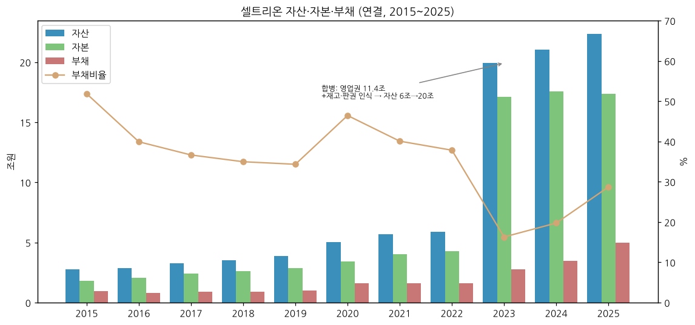

(3) 현금흐름표 (억원)

| 연도 | 영업CF | 투자CF | 재무CF | CapEx(유·무형) | FCF | 자사주 취득 | 배당 지급 | 사업결합 |
|---|---|---|---|---|---|---|---|---|
| 2015 | 776 | -1,669 | 1,304 | 1,846 | -1,070 | 16 | 0 | 0 |
| 2016 | 2,301 | -1,417 | 287 | 1,575 | 726 | 36 | 0 | 0 |
| 2017 | 4,860 | -2,336 | -963 | 970 | 3,890 | 487 | 0 | 0 |
| 2018 | 3,648 | -1,758 | -1,981 | 1,878 | 1,770 | 690 | 0 | 0 |
| 2019 | 4,740 | -2,514 | -859 | 2,861 | 1,879 | 582 | 0 | 0 |
| 2020 | 3,507 | -4,720 | 2,660 | 5,414 | -1,906 | 159 | 0 | 0 |
| 2021 | 9,112 | -3,558 | -693 | 3,216 | 5,896 | 391 | 0 | 0 |
| 2022 | 9 | -2,971 | -3,502 | 3,120 | -3,111 | 2,805 | 1,025 | 0 |
| 2023 | 5,372 | -1,389 | -3,851 | 3,537 | 1,834 | 9,167 | 517 | 0 |
| 2024 | 9,019 | -1,694 | -3,530 | 3,335 | 5,683 | 4,363 | 1,036 | 287 |
| 2025 | 6,461 | -8,604 | 3,393 | 3,317 | 3,143 | 9,073 | 1,538 | 5,358 |
| 3Q25 누적 | 5,062 | -2,309 | -4,154 | 2,230 | 2,831 | 8,497 | 1,538 | 0 |
| 3Q26 누적 | 8,684 | -4,651 | -4,180 | 4,051 | 4,633 | 3,296 | 1,678 | 0 |

→ 2022 영업CF 9억: 매출채권 1.06조 → 1.62조 급증(헬스케어向 채권 — 합병 전 내부 유통 구조의 운전자본 부담). 합병 후 2024 영업CF 9,019억으로 정상화
→ 2025 사업결합 5,358억 = **브랜치버그(Imclone Systems) 인수** (계약 3.3억달러, 2025.12.31 완료). 2025 재무CF +3,393억 — 단기금융부채 순증 1.17조로 자사주 9,073억·배당 1,538억·인수 자금 충당
→ 2025 영업CF 6,461억은 법인세 납부 4,439억(합병 관련 세금 추정 `[미확인]`)으로 일시 위축 → 3Q26 누적 8,684억 회복

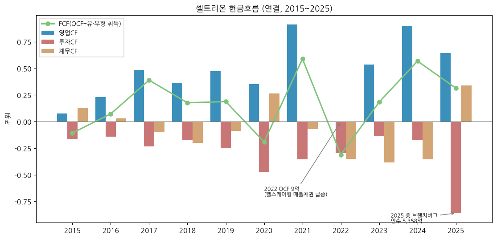

(4) CapEx (억원)

| 연도 | 2015 | 2016 | 2017 | 2018 | 2019 | 2020 | 2021 | 2022 | 2023 | 2024 | 2025 | 3Q26 누적 |
|---|---|---|---|---|---|---|---|---|---|---|---|---|
| 유형 | 506 | 141 | 210 | 794 | 943 | 870 | 634 | 1,112 | 2,100 | 1,351 | 1,082 | 1,752 |
| 무형(개발비 등) | 1,340 | 1,434 | 760 | 1,084 | 1,919 | 4,544 | 2,582 | 2,008 | 1,437 | 1,985 | 2,235 | 2,299 |
| 합계 | 1,846 | 1,575 | 970 | 1,878 | 2,861 | 5,414 | 3,216 | 3,120 | 3,537 | 3,335 | 3,317 | **4,051** |

→ 셀트리온 CapEx의 절반 이상이 **개발비 자산화(무형)** — 바이오의약품은 임상 1상 개시 승인 이후 지출을 자산화(DART 회계정책). 2020 무형 4,544억 = 유플라이마·베그젤마·스테키마 등 동시 임상 3상 피크
→ 유형 사이클: 2018\~2020 3공장(약 6만L) 건설 → 2023 2,100억(3공장·DP) → 2026 4·5공장(18만L, 1.23조) + 브랜치버그 증설(약 7,000억) — **2026\~2028 CapEx 사이클 상향 진입** `[판단]`

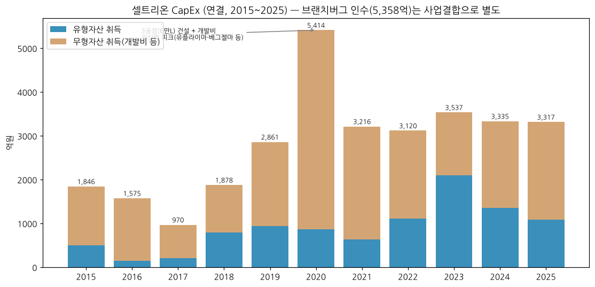

(5) 부채구조 + 채무증권 발행 history

→ 차입 구조: 은행 단기금융부채 중심(단기금융부채 3.39조, 2026.09) — 3Q26 누적 단기금융부채 증가 2.51조·감소 2.28조로 롤오버 반복. 장기금융부채 4,129억
→ 담보 차입(2025말): 산업은행 4,392억(설정 6,240억)·신한은행 4,191억(3,478억)·수출입은행 129억(893억) — 송도 토지·건물·생산시설 공동담보
→ 채무증권: **2024.01부터 사모 기업어음(CP) 반복 발행** — 1회 900\~1,400억, 금리 3.8\~4.2%(2024), 평가등급 **A1**(평가기관은 원문 표 추출 미완) / 2026.09 CP 미상환 잔액 **5,500억**(30일 이내 2,500억·90일 이내 3,000억). 회사채·CB·신종자본증권 미상환 없음 (DART 2026.09 채무증권 발행실적). 회사 신용평가는 "해당사항 없음"(2023·2024 사업보고서) — 장기 신용등급 없음
→ 공급자금융약정(supplier finance) 단기금융부채 별도 인식 (3Q26 증가 243억·감소 521억)

(6) 배당·자사주

| 연도 | 현금배당 지급 (CF, 억) | 해당 결산 DPS / 총액 / 배당성향 | 주식배당·무상증자 | 자사주 매입 (CF, 억) | 자사주 소각 |
|---|---|---|---|---|---|
| 2021 | 0 | FY2020: 현금 0원 / 주식 0.02주 · FY2021: **750원 / 1,025억 / 17.7%** + 주식 0.02주 | 주식배당 | 391 | — |
| 2022 | 1,025 | FY2022: **375원 / 517억 / 9.6%** + 주식 0.04주 | 주식배당 | 2,805 | — |
| 2023 | 517 | FY2023: 500원 / 1,036억 / 19.3% | — | **9,167** | — |
| 2024 | 1,036 | FY2024: 750원 / 1,538억 / 36.4% + 주식배당 102.5억(1,025만주) | — | 4,363 | 343만주 약 7,013억 |
| 2025 | 1,538 | FY2025: 750원 / 1,640억 / 15.9% (비과세 배당) | 주식배당 1,025만주(2025.03 발행) + 무상증자 약 849만주 | **9,073** | 약 497만주 8,950억 |
| 3Q26 누적 | 1,678 | — | 무상증자 약 1,092만주 | 3,296 | **2026.04 911만주 1조 7,154억** + 2026.06 48.9만주 약 1,000억 |

→ 출처: 2022 사업보고서 VI-6 배당에 관한 사항(FY2020\~2022), OpenDART alotMatter(2023·2025 사업보고서), 연결 CF, 회사 IR(2024.11 Investor Day p27\~28), CEO스코어데일리(2026-03-24·06-04). 회사 IR의 'FY2021·2022 주식배당 약 5,200억·8,846억'은 시가 환산 규모로 추정(DART 주식배당금 총액은 액면 기준 27억·55억) `[판단]`
→ 배당 정책(2022 사업보고서): "직접적인 잉여현금흐름에 영향을 주지 않는 주식배당을 매년 2\~5% 수준" + 2021 결산부터 현금·주식 동시배당
→ 주주환원 정책(기업가치제고계획, 2026.03): **2025\~2027 3년 평균 주주환원율 40% 목표** / 2025 실적 주주환원율 약 103%(자사주 소각 포함) / 중장기 현금배당 = **EBITDA − CAPEX의 30%** 목표 (2021 9% → 2023 21%)
→ 2022\~2024 자사주 매입 899만주(1.7조, 15차례) — 2023 한 해 8,860억 매입으로 유가증권시장 1위 (회사 IR)
→ 2026.04 소각분에는 임직원 스톡옵션용 300만주 포함, 잔여 자사주 약 323만주(26%)는 M&A·신기술·시설투자용 (CEO스코어데일리)

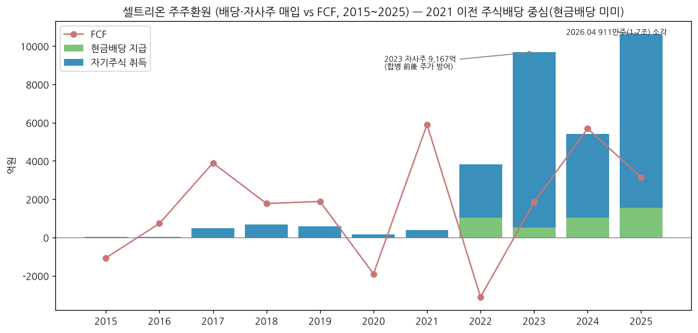

(7) 재무비율

| 연도 | ROE(지배) | ROA | 부채비율 | 유동비율 | OP/금융비용 |
|---|---|---|---|---|---|
| 2015 | 9.1% | 5.8% | 51.8% | 165% | 6x |
| 2016 | 8.7% | 5.3% | 39.9% | 203% | 10x |
| 2017 | 17.4% | 12.2% | 36.7% | 262% | 18x |
| 2018 | 10.3% | 7.0% | 35.0% | 245% | 17x |
| 2019 | 11.5% | 8.2% | 34.3% | 272% | 27x |
| 2020 | 17.1% | 11.8% | 46.5% | 238% | 19x |
| 2021 | 16.0% | 11.1% | 40.1% | 254% | 59x |
| 2022 | 13.4% | 9.4% | 37.8% | 226% | 48x |
| 2023 | 5.1% | 4.2% | 16.3% | 203% | 33x |
| 2024 | 2.5% | 2.0% | 19.8% | 175% | 6x |
| 2025 | 5.9% | 4.8% | 28.7% | 139% | 12x |

→ ROE(지배) = 지배순이익 / 평균 지배자본 (2015는 기말). **2023 합병으로 지배자본이 4.1조 → 17.0조(4.1배)** → ROE 13\~17%(합병 전) → 2.5\~5.9%(합병 후)로 구조적 하락. 무형자산(13.8조)을 뺀 유형자본 기준 ROE는 2025 약 30% [계산·근사: 10,296억 / 약 3.4조] — 합병 전후 ROE 직접 비교 불가
→ OP/금융비용(이자보상 proxy): 금융비용에 외환 관련 항목 일부 포함 — 2024 6배는 PPA로 OP가 눌린 효과

---

## ⑤ 지배 구조

(1) 그룹·계열 관계

→ **셀트리온그룹** (공정거래법상 기업집단, 동일인 서정진): 지배 체인 **서정진 → (주)셀트리온홀딩스(지주, 이사회 의장 서진석) → (주)셀트리온 26.06% → 셀트리온제약 54.99%** + 해외 판매법인
→ (주)셀트리온스킨큐어(화장품, 계열회사) 2.19% 보유. 서정진 회장 직접 4.21%
→ 2023\~2024 3사 합병 구도: ① 2023.12.28 셀트리온 ← 셀트리온헬스케어 흡수합병 완료(1단계), ② 셀트리온 ← 셀트리온제약 합병(2단계)은 **2024.08.16 양사 이사회 "현 시점 합병 추진 않기로"** — 특별위원회 주주 설문에서 셀트리온 주주 찬성 8.7%·반대 36.2%·기권 55.1%(대주주 지분 다수의견 가산 시 반대 70.4%), 주식매수청구 현금 유출·자사주 소멸 우려 (이투데이 2024-08-16)
→ 그룹 내 거래: 셀트리온제약(DP·케미컬)·셀트리온스킨큐어 등과 특수관계자 거래 — 합병으로 구 헬스케어 내부거래는 소멸

(2) 주주 구분 (2026.09.30)

| 주주 | 주식수 | 지분율 | 비고 |
|---|---|---|---|
| (주)셀트리온홀딩스 | 60,475,000 | **26.06%** | 최대주주. 2025말 24.53% → 1.53%p 증가 (2026 최대주주 1,000억 주식 취득 등) |
| 서정진 | 9,775,500 | 4.21% | 회장, 최대주주의 최대주주 |
| (주)셀트리온스킨큐어 | 5,079,169 | 2.19% | 계열회사 |
| 기타 특수관계인 (임원·친인척 약 100인) | 1,029,737 | 0.44% | |
| **최대주주 등 소계** | **76,359,406** | **32.90%** | |
| 국민연금공단 | 17,280,378 | **7.45%** | 5% 이상 주주 |
| Aranda Investments Pte. Ltd. (테마섹 계열) | 7,047,957 | 3.04% | |
| 자기주식 | 4,043,505 | 1.74% | 2025말 12,347,845주(5.35%) → 2026.04 소각 |
| 기타 (소액·기관·외국인) | 127,341,631 | 54.87% | |
| **합계** | **232,072,877** | 100% | |

→ 출처: DART 2026.09 분기보고서 연결주석 1(주요 주주) + VII. 주주에 관한 사항. 기타 = 합계 − 상기 [계산]
→ 외국인 지분율(KRX) **미확보** — DART 미기재
→ Aranda Investments는 싱가포르 테마섹 계열(언론 통칭) `[미확인]`

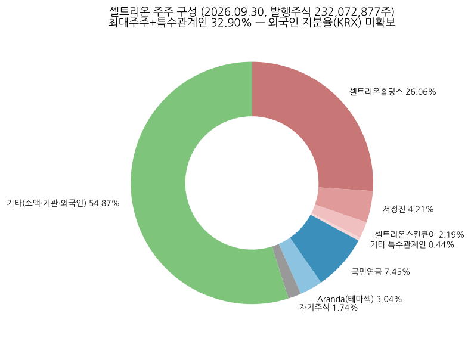

(3) 임원·이사회 (2026.09, 등기임원 9인 — 사내 4·독립 5)

| 성명 | 직위 | 구분 | 주요 경력 |
|---|---|---|---|
| **서정진** | 회장 | 사내이사 (임기 2027.03) | 셀트리온 창업자(2002), 前 그룹 명예회장 → 2023.03 경영 복귀. 前 대우자동차 기획재무 임원 `[경력 일부 언론]` |
| **서진석** | 이사회 의장·대표이사 | 사내이사 (2027.03) | 1984년생, KAIST 박사, 前 셀트리온 제품개발부문장·셀트리온스킨큐어 경영총괄. 셀트리온홀딩스 이사회 의장 |
| **기우성** | 대표이사 | 사내이사 (2029.03) | 재직 19.7년, 前 넥솔바이오텍 부사장·대우자동차 기획실 |
| 신민철 | 사장(관리부문장) | 사내이사 (2029.03) | 재직 21.9년 |
| 고영혜 | 독립이사 | 감사위원 등 | 성균관대 의대 명예교수(병리) |
| 이중재 | 독립이사 | 감사위원 등 | 변호사, 前 김앤장 |
| 윤태화 | 독립이사 | 감사위원 등 | 가천대 회계세무 교수, 포스코퓨처엠 감사위원장, 前 SK하이닉스 독립이사 (2026.03 선임) |
| 최원경 | 독립이사 | 감사위원 등 | 성현회계법인 파트너 |
| 최종문 | 독립이사 | 감사위원 등 | 前 외교부 제2차관·주프랑스 대사 |

→ 독립이사 5인 전원이 감사·성과보수·독립이사후보추천·ESG 위원회 겸임
→ 주요 미등기 임원: 서준석 수석부회장(글로벌판매사업부장, 1987년생, 서정진 차남), 서정수 부회장(비서실장, 동일인 혈족 2촌), 이혁재 사장(경영지원·CDMO TF), 이상준 사장(데이터사이언스연구소), 정순신 사장(법무실장), 권기성 수석부사장(연구개발부문장)
→ 오너 2세 체제: 장남(서진석, 이사회 의장·홀딩스 의장) + 차남(서준석, 판매) — 승계 구조는 홀딩스 지분이 핵심 `[판단]`

---

## ⑥ 기타 팩트

① R&D 인프라

| 연도 | 2015 | 2016 | 2017 | 2018 | 2019 | 2020 | 2021 | 2022 | 2023 | 2024 | 2025 | 3Q26 누적 |
|---|---|---|---|---|---|---|---|---|---|---|---|---|
| 연구개발비용 총액 (억, 연결, 보조금 차감) | 1,842 | 2,605 | 2,251 | 2,888 | 3,031 | 3,848 | 3,980 | 4,123 | 3,427 | 4,200 | 4,824 | 4,468 |
| ㄴ 판관비(비용 처리) | 579 | 879 | 797 | 908 | 1,135 | 1,714 | 1,258 | 1,397 | 1,611 | 1,997 | 2,107 | 1,968 |
| ㄴ 개발비(무형자산 자산화) | 1,256 | 1,727 | 1,454 | 1,980 | 1,896 | 2,133 | 2,722 | 2,726 | 1,816 | 2,202 | 2,717 | 2,500 |
| 자산화 비율 | 68% | 66% | 65% | 69% | 63% | 55% | 68% | 66% | 53% | 52% | 56% | 56% |
| R&D/매출 | 30.5% | 38.9% | 23.7% | 29.4% | 26.9% | 20.8% | 20.8% | 18.1% | 15.7% | 11.8% | 11.6% | 10.9% |

→ 출처: 각 연도 사업보고서 II-6 연구개발비용(연결) — 각 연도의 **가장 최근 공시값** 사용: 2015 = 2016 사업보고서(2016.05 정정), 2016\~2017 = 2018 사업보고서(2018.09 금융위 '제약·바이오 연구개발비 회계처리 감독지침' 반영 소급 재작성), 2021 = 2022 사업보고서, 2023 = 2024 사업보고서, 2024 = 2026.09 분기보고서(2024 사업보고서 원값 4,347억·12.22%에서 제조경비 147억 제외로 재작성). 2015 판관비+개발비 합계와 총액 차이 8억은 제조경비
→ R&D 절대액은 2015 1,842억 → 2025 4,824억(CAGR 약 10%)으로 늘었지만 매출 성장이 더 빨라 **R&D/매출 30%대 → 11%로 하락** — 2023은 합병 전 구조에서 개발비 자산화 감소(1,816억). 합병 후(2024\~) 분모가 최종 판매가 기준 매출로 커진 효과 포함
→ 무형자산 취득(CF, 개발비 외 포함) 12년: 2015 1,340억 → **2020 4,544억(피크)** → 2025 2,235억 — 2020 CF 피크는 다케다 판권 등 개발비 외 취득 포함 추정 `[판단]`
→ 개발비 장부가 1.53조(2025말): 면역질환 9,722억(상각 중 7,617억, 잔존 11년) / 암 4,215억 등. 개발비 손상검사는 2025 감사 핵심감사사항
→ 연구조직: 연구개발부문·제품개발부문·데이터사이언스연구소 — 인력 804명(박사 73·석사 389), AI담당 27명 신설
→ 연구거점: 송도 본사, 보스턴 신약 R&D 센터 진출 계획(2024.11 IR)

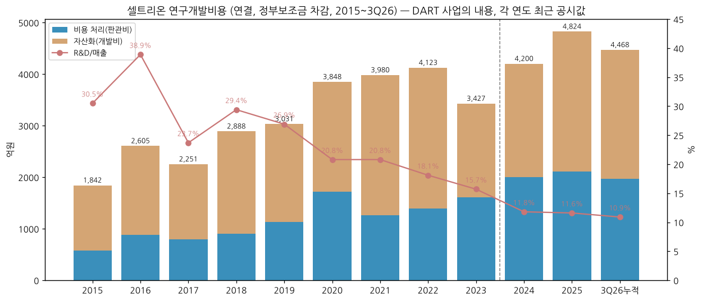

② 진행 중 corporate action (10년)

| 시기 | 내용 |
|---|---|
| 2018.02 | 코스닥 → 코스피 이전상장 |
| 2020 | 다케다 아시아태평양 프라이머리케어 사업권 인수 `[시점·금액 원문 미검증]` → 2024 매각(케미컬 매출 감소 원인, 회사 IR 1Q25) |
| 2022.05 | 회계감리 조치 후 2016\~2021 재무제표 재작성(기재정정) |
| 2022\~2024 | 자사주 899만주(1.7조) 매입 — 2023 8,860억 유가증권시장 1위 |
| **2023.12.28** | **셀트리온헬스케어 흡수합병** (영업권 잠정 11.46조 → 확정 11.41조) |
| 2024 | iQone Healthcare Switzerland 인수 / CDMO 자회사 설립 투자 결정(2024.09) |
| 2024.08.16 | 셀트리온제약 합병 추진 중단 |
| 2025.09\~12 | **Eli Lilly 브랜치버그 DS 공장 인수** (3.3억달러, 사업결합 현금유출 5,358억) + Lilly CMO 4.73억달러 |
| 2025.10\~11 | 포트래이·머스트바이오·Kaigene(최대 7.44억달러)·트리오어 라이선스-인 |
| 2026.03 | 고바이오랩 마이크로바이옴 라이선스(최대 2,052억), 글로벌 제약사 CMO 1.98억달러 |
| 2026.04 | 자사주 911만주(1.72조) 소각 / 기업가치제고계획 |
| 2026 | GIFRER BARBEZAT 인수(3Q26 사업결합) / 송도 4·5공장(18만L, 1.23조) 투자 / 브랜치버그 13.2만L 증설(약 7,000억) |

③ R&D 마일스톤 (10년)

| 시기 | 마일스톤 |
|---|---|
| 2016.04 | 램시마 美 FDA 허가 |
| 2017.02 / 2018.02 | 트룩시마 / 허쥬마 EU 허가 |
| 2019.11 | 램시마SC EU 허가 (2020.07 IBD 등 전 성인 적응증) |
| 2021.02 | 유플라이마 EU 허가 / 렉키로나(코로나 항체치료제) 국내 조건부 허가 |
| 2022.08\~09 | 베그젤마 EU·美·국내 허가 |
| 2023.05 | 유플라이마 美 허가 (2025.04 상호교환성 지위) |
| **2023.10** | **짐펜트라 美 FDA 신약 허가** |
| 2024.05\~12 | 옴리클로 EU, 아이덴젤트 국내, 스테키마 국내·EU·美, 앱토즈마 국내 허가 |
| 2025.01\~03 | 앱토즈마 美·EU, 스토보클로·오센벨트 EU·美, 아이덴젤트 EU, 옴리클로 美 허가 |
| 2025.02\~08 | ADC CT-P70·CT-P71·CT-P73 FDA IND 승인(패스트트랙 지정) |
| 2025.10 | 아이덴젤트 美 FDA 허가 |
| 2025.12 | 이중항체 CT-P72 FDA IND 승인 |
| 진행 | 허가심사: CT-P51(키트루다)·CT-P55(코센틱스)·CT-P6 SC / 3상: CT-P44(다잘렉스)·CT-P53(오크레부스) |
| 중단·정리 | CT-P27(독감 항체) 2상 완료(이후 진행 공시 없음), Paxlovid 제네릭(MPP) WHO 허가 자진 취하(2026.09) |

④ 주요 리스크

→ (1) **美 약가·관세 정책**: 의약품 관세(Section 232)·MFN 약가 — 브랜치버그 현지 생산 + 15\~21개월치 美 판매 재고(2025.05 서정진 회장)로 "최소 2026년까지 영향 없음" 주장. 2027 이후 실제 관세율·MFN 적용 범위가 변수
→ (2) **바이오시밀러 가격 침식**: 유럽 입찰·美 PBM 리베이트 경쟁 — 제품별 출시 3\~5년 후 가격 하락. 회사는 "고수익 제품 중심 tender 선택과 집중"(2026.01)
→ (3) **환율**: 매출 92% 해외(유로·달러). 3Q26 외화관련손실 3,075억 — 영업 밖 순이익 변동성 큼. 원화 강세 시 매출·OP 동시 하락
→ (4) **영업권·개발비 손상**: 영업권 11.88조 + 개발비 1.53조 = 자본의 약 77% — 할인율·성장률 가정 변화 시 대규모 손상 가능성 (감사 핵심감사사항)
→ (5) **짐펜트라 상업화 속도**: 美 신약으로서 처방 확대가 회사 목표(블록버스터) 대비 지연될 경우 밸류에이션 프리미엄 축소
→ (6) **회계·규제 이력**: 2022 회계감리 조치 후 재작성 — 합병으로 내부거래 리스크는 감소했으나 개발비 자산화 비중 높음
→ (7) 소송: 특허 소송(오리지널사와 美 특허 분쟁 등) 다수 — 2026.09 분기보고서 '소송' 25건 언급, 개별 금액 정리 **미완** `[보완 필요]`
→ (8) 지배구조: 오너 2세 승계(홀딩스 지분), 셀트리온제약 합병 재추진 가능성("주주 요청 시 재검토")

⑤ ESG

→ **MSCI ESG AAA** (2026.11.11, 기존 A에서 2단계 상향 — 머니투데이 2026-11-11)
→ 한국ESG기준원(KCGS) **통합 A** — 3년 연속 (머니투데이 2026-11-11; 2024.11 통합등급 2단계 상향해 A 첫 획득 보도)
→ 2025\~2026 지속가능경영보고서 발간(2026.06), 이사회 산하 ESG위원회, TCFD 기반 기후 대응, ISO 14001

⑥ 인증·라이선스

→ 생산: 송도 1·2·3공장 — FDA·EMA cGMP 실사 통과 시설 (DART "글로벌 수준 GMP"), 美 브랜치버그 FDA 승인 상업 생산 시설(Lilly 제품 생산)
→ 품목허가: 바이오시밀러 11개 제품 글로벌 허가 + 美 신약 짐펜트라. 상표권 3,000건+ (ZYMFENTRA·REMSIMA·HERZUMA·TRUXIMA·YUFLYMA·VEGZELMA·OMLYCLO·EYDENZELT·STEQEYMA 등)
→ 짐펜트라 특허: 제형 2037년, 투여법 2038\~2040년 (회사 IR 2024.11)

---

## Version Log

| 버전 | 일자 | 내역 |
|---|---|---|
| v1.1 | 2026-11-28 | DART 정기보고서 41건 재수집(0바이트 43건 삭제 후 재다운로드) → 원문 보강: ① R&D 총액 2015\~2023 채움(chart7 12년 시계열로 교체), ② 연도별 임직원 2015\~2025 (2021은 9월말 값), ③ 합병 PPA 원문(재고 공정가치 2.51조·무형 3,785억·순자산 3.23조·영업권 11.46조·이전대가 14.69조, 합병비율 0.4492620) — 재고 step-up 금액은 원문 미공시 확인, ④ FY2020\~2022 DPS(0원·750원·375원) + 주식배당 비율, ⑤ 4Q23 매출 급감 부문 분해(바이오 3,351억·케미컬 469억) + 회사 설명(진단키트 일시 비용) 반영 — 바이오 급감 원인은 여전히 [판단], ⑥ 3Q26 순이익: 외화손익 + 해외사업환산손익 −5,624억 원문 근거 추가(방향 확인, 세부는 [판단]). 영업권 표기 정정(잠정 11.46조 → 2024 확정 11.41조), CP 발행·A1 등급·미상환 5,500억 및 '장기 신용평가 해당사항 없음' 추가(v1.0 '신용등급 미확보' 해소). Fact verify cutoff 2026-11-28 (주가 2026-11-27 재확인) |
| v1.0 | 2026-11-25 | 최초 작성. OpenDART 연결 재무(2015 FY\~2026 3Q, 44건) + DART 2026.09 분기보고서 본문(5.8MB) + 2025 사업보고서 감사보고서 첨부 2건(별도·연결) + 2021 감사보고서 첨부 1건 + OpenDART 기업개황·주주·임원·직원·배당(2023·2025·2026 3Q) + irgo IR 6건(텍스트 추출 가능 2건: 2025.05 1Q25 실적발표·2024.11 홍콩 Investor Day) + Yahoo 월간·일간 주가. 차트 15종(표준 12종 — chart2는 전사분기 + 보조 3종: 제품별분기·신규기존·지역별). 작업 중 BT PC 디스크 공간 부족(Errno 28)·device_bash 장애로 컨테이너에서 처리 |

**잔여 보완 후보**
→ 2021·2025 사업보고서 **본문** XML 미확보(감사보고서 첨부만 존재) — 2021 임직원·R&D 원표, 2025 경영진단(MD&A) 확인 필요
→ 합병 재고 step-up 금액: 원문 미공시 → 회사 IR·컨퍼런스콜(2024) 확인 필요
→ 연도별 CAPA(생산능력 배치) 시계열, 2018 4Q·4Q23 바이오 공급 급감의 회사 설명(분기 IR)
→ 회사 IR 실적발표 PDF 2Q25\~3Q26 확보 (irgo 미등록 — 셀트리온 IR 사이트 web_fetch) → 제품별 분기 시계열을 1Q24\~3Q26 11분기로 확장, 짐펜트라 단독 매출 분리
→ 2016\~2021 재작성 전·후 차이(2022.05 기재정정) 정리, 합병 전 셀트리온헬스케어 연결 실적(2015\~2023)을 붙인 pro-forma 시계열 구축
→ 외국인 지분율(KRX), 신용등급, 회사채 발행 history, 10% 이상 고객 실체, Lilly CMO 매출 인식 규모 확인
→ 4Q26 실적(2027.02 예상) 후 2026 연간 확정 + 가이던스(매출 5.3조·OP 1.8조) 달성 여부 검증
→ 글로벌 피어(Sandoz·Samsung Bioepis·Amgen Biosimilars) 마진·성장률 원문 검증 후 ① (5)(4) cross-ref 수치화
