# 심텍 — 기업 개요 (v1.0)

> Ticker: **KOSDAQ 222800 — (주)심텍 (SIMMTECH Co., Ltd.)** · 충북 청주 본사 · 설립 2015-07-01 (舊심텍 → 심텍홀딩스 인적분할 신설법인, 2015-08-07 재상장) · 반도체용 PCB 단일 사업 (메모리 모듈 PCB + 패키지 서브스트레이트)
> 마지막 update: 2026-11-25 (v1.0 — 3Q26 분기보고서(2026-11-13 제출) + 3Q26 IR(2026-11-04) 반영)
> 입력 source: OpenDART fnlttSinglAcntAll (연결, 2015 사업보고서\~3Q26, 44개 JSON) + 심텍홀딩스(舊심텍, 036710) 연결 JSON 44개·공시원문 48건 (2013\~2015 반기 분할 전 숫자) + DART 정기공시 원문 XML 45건 (사업보고서 2015\~2025·분기·반기 3Q15\~3Q26) + OpenDART 기업개황·주주·임원·직원·배당 (2016·2019·2022·2025 사업보고서, 3Q26 분기보고서) + 심텍 IR 실적발표 PDF 34건 (1Q18\~3Q26, irgo 경유) + Yahoo Finance (222800.KQ 월간 2015-08\~2026-11, 일간 2024-11-25\~2026-11-24 / 036710.KQ 월간 2000-02\~) + 네이버증권 모바일 API (외국인 지분율·시총, 2026-11-24)
> 갱신 주기: 매분기 (실적 리뷰 모드 호출 시)
> 워치리스트: **IT 하드웨어 / 서브섹터: 전자부품·기판** (삼성전기·LG이노텍·이수페타시스·대덕전자·심텍) (`earnings/watchlist.md` 40행)
> **Fact verify cutoff**: 2026-11-25 (주가 2026-11-24 종가 **109,000원** [Yahoo Finance 222800.KQ·네이버증권], 발행주식 39,783,467주 (2026-11-13 공시서류 제출일, 7회차 영구CB 전환 완료 후) [DART 분기보고서(2026.09)] → 시가총액 **4.34조원** [네이버증권 4조 3,364억 일치]. 사상 최고 종가 **175,000원 (2026-10-06)**, 장중 최고 **182,600원 (같은 날)** → 당시 시총 약 **6.7조원** [계산, 9/30 주식수 38,484,526주]. 고점 대비 **-37.7%**, YTD **+120.9%** (2025말 49,350원), 1년 **+117.6%** (2025-11-24 50,100원). 2년 전 저점 9,950원 (2024-12-09) 대비 **약 11배**)

---

## 1. 기업 분류

- **Primary 분류: 사이클** (Cyclical — 메모리 반도체 출하·재고 사이클에 매출과 가동률이 같이 움직이는 반도체 PCB)
- **Secondary 노트: 고성장 전환 후보 (AI 메모리 모듈·System IC 기판)** — 2026년 SOCAMM(AI 서버용 LPDDR 모듈) PCB·FC-CSP 매출이 붙으며 3Q26 OPM 19.0%로 2022 정점(20.8%)에 근접. 다만 매출의 63%가 메모리 3사(삼성전자·SK하이닉스·Micron)라는 구조는 그대로 → 아직 "사이클 안의 업사이클"로 판정

### ① 정량 근거

**📊 Summary Box (12년, 2014\~2025 연결):**

| 지표 | 값 |
|------|-----|
| 매출 CAGR (2014→2025, 11년) | **+7.1%** (6,638억 → 14,106억) — 2018 일본 Eastern(現 Simmtech Graphics) 인수 효과 포함 |
| OPM 평균 | **3.8%** (12년 단순평균) |
| OPM 정점 평균 | **12.9%** (2016 5.1% · 2022 20.8%) |
| OPM 저점 평균 | **-5.1%** (2019 -1.8% · 2023 -8.5%) — 12년 창 밖 2013 -6.4%도 저점 |
| 사이클 주기 | 약 6년 peak-to-peak (2016→2022) / 저점 간격 4\~6년 (2013→2019→2023) |
| 사이클 회수 (12년) | 정점 2회 / 저점 2회 (2026 진행 중 3번째 업사이클) |

```
[전사 OPM 시계열 (2013~2025, 연결, 억원)]
연도   매출     영업이익   순이익    OPM     NPM
2013    5,263      -334      -276   -6.4    -5.2   ← 舊심텍 적자 (메모리 다운·BOC 부진)
2014    6,638       137        17    2.1     0.3   ← 舊심텍 흑전
2015    6,848       269       122    3.9     1.8   ← 7월 인적분할 → 신설 심텍
2016    7,920       402       293    5.1     3.7   ← 1차 정점 (MSAP 전환 초기)
2017    8,116       338       161    4.2     2.0   ← Eastern(日) 인수 결정
2018   10,075       308        23    3.1     0.2   ← 매출 1조 돌파, Graphics 연결
2019   10,002      -179      -394   -1.8    -3.9   ← 저점 (메모리 재고조정·Graphics 적자)
2020   12,014       897       565    7.5     4.7   ← 회복 (MSAP·서버)
2021   13,658     1,743     1,183   12.8     8.7   ← 업사이클
2022   16,975     3,524     2,461   20.8    14.5   ← 정점 OPM 20.8% (DDR5·MSAP)
2023   10,419      -881    -1,151   -8.5   -11.1   ← 저점 OPM -8.5% (메모리 다운)
2024   12,314      -470      -310   -3.8    -2.5   ← 적자 지속 (가동률↓)
2025   14,106       119    -1,646    0.8   -11.7   ← 영업 흑전, 파생손실로 순손실

OPM range: -8.5% (2023) ~ 20.8% (2022) = 29.3%p
```

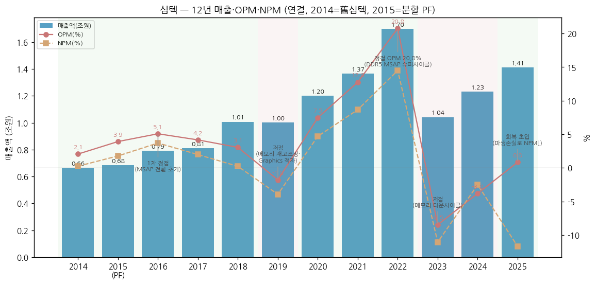

(2013\~2014는 분할 전 舊심텍(현 심텍홀딩스) 연결 [DART 심텍홀딩스 반기보고서(2015.06) 요약연결재무정보]. 2015는 1H15 분할 PCB부문(심텍홀딩스 중단영업 주석) + 2H15 신설 심텍 연결을 합친 **pro forma** — 1H15 숫자는 분할부문 기준이라 연결 범위가 다를 수 있음 [⚠️ 추정 합산]. 2016\~2025는 신설 심텍 연결 [OpenDART fnlttSinglAcntAll]. 2025 순손실 -1,646억은 영업이 아니라 **CB·BW 전환권 파생상품평가손실 1,333억** 때문 (주가 급등으로 전환권 가치 상승) [DART 사업보고서(2025.12) 금융원가 주석])

### ② 산업 분류

- 산업: **반도체 부품 — 반도체용 PCB (메모리 모듈 PCB + 패키지 서브스트레이트)**. 사이클 산업 (메모리 출하량·재고조정에 연동)
- DART 업종: 2622 (인쇄회로기판용 적층판 등 — 전자부품 제조업) / KOSDAQ 상장
- 워치리스트 섹터: **IT 하드웨어 / 서브섹터: 전자부품·기판** (`watchlist.md` 40행)
- 제품 구조 (3Q26 누적 매출 1.47조): **Package Substrate 75.0% / Module PCB 25.0%** [DART 분기보고서(2026.09) II-2]
→ IR 기준으로 다시 나누면 MSAP(FC-CSP·MCP·GDDR·SiP) 61.8% / HDI(모듈 PCB·SOCAMM) 26.6% / Tenting(BOC 등) 11.6% (3Q26 분기)

### ③ 분류 결정 논리

(1) **가장 매출 큰 제품 기준** 적용 시: Package Substrate 75% — 이 중 MCP·GDDR·BOC는 메모리 칩 패키지용, FC-CSP·SiP만 비메모리(System IC). IR 기준 System IC향 매출은 3Q26 약 946억(전사의 18% 수준, 회사 4Q26 전망) [3Q26 IR p4]. 나머지 약 80%가 메모리 칩·모듈용 → 메모리 사이클 노출 → **사이클**
(2) **사이클 제품 이익 비중 우선 sub-rule**: 제품별 영업이익은 미공시. 대신 전사 OPM이 메모리 다운사이클 때마다 적자 전환 (2019 -1.8%, 2023 -8.5%, 2024 -3.8%) — 고정비(감가상각 연 800억 수준) 레버리지가 커서 가동률이 이익을 지배 → **사이클 유지**
(3) **Boundary case 처리**: 2026년 AI향 매출이 새로 붙음 — SOCAMM향(모듈 + MCP) 1Q26 188억 → 2Q26 393억 → 3Q26 약 569억(회사 전망치 기준), 4Q26 989억 전망 [3Q26 IR p5]. System IC향(FC-CSP·SiP) 2026 연간 3,293억 전망(YoY +63%). 두 축 합산이 전사 매출의 30%를 넘고 메모리 다운사이클에서도 OPM 두 자릿수를 지키면 → Secondary "고성장 전환"을 Primary로 격상 검토. 지금은 **Primary 사이클 + Secondary 고성장 전환 후보** 병기
(4) **피어 대비 (전자부품·기판 서브섹터)**:
→ **대덕전자**: 메모리 패키지 기판 + 비메모리 FC-BGA — 같은 메모리 사이클 노출, FC-BGA 비중만큼 사이클 진폭이 다를 수 있음 (각 사 기업개요 참조: `대덕전자_기업개요.md`)
→ **이수페타시스**: 네트워크·AI 가속기용 MLB(고다층 기판) — 메모리가 아니라 빅테크 AI CapEx에 연동, 같은 "기판"이지만 사이클 원천이 다름
→ **삼성전기·LG이노텍**: FC-BGA·카메라모듈 등 다사업 — 심텍은 반도체 PCB 단일 사업이라 메모리 사이클 베타가 가장 높은 편
→ 국내 동종 별도 매출 (2025): 심텍 10,971억 > 대덕전자 10,647억 > 코리아써키트 8,630억 > 티엘비 2,603억 [DART 분기보고서(2026.09) 7-2 (2), 각 사 감사보고서 별도 기준]

### ④ 적정 밸류에이션 방법

- **PBR (사이클 기준) 우선** — 12년 중 적자 연도 4회(2019·2023·2024·2025 순손실), ROE가 -32.1%(2025) \~ +49.5%(2022)로 요동 → 이익 멀티플은 정점·저점에서 왜곡
→ 연말 PBR (지배자본 기준, Yahoo 연말 수정종가 × 발행주식 근사 [계산]): 2022말 약 1.4배 (26,450원 × 31.85M / 6,105억) · 2024말 약 0.8배 (11,030원 × 31.85M / 4,472억) · 2025말 약 3.2배 (49,350원 × 37.34M / 5,757억)
→ 현재 **약 6.4배** (네이버증권 PBR 6.39배, BPS 17,054원) — 과거 사이클 정점 PBR(2022 약 1.4배)을 크게 웃돔 = 시장이 "사이클"이 아니라 "AI 고성장"으로 가격을 매기는 중
- **PER 보조 (선행 기준)** — 컨센서스 추정 PER 22.6배 (추정 EPS 4,819원, 네이버증권 2026-11-24). 3Q26 분기 영업이익 1,018억 × 4 = 연 4,000억대 run-rate가 유지되는지가 PER 정당화 조건
- 대덕전자는 FC-BGA 비중 때문에 PER 비중을 더 두고, 심텍은 메모리 비중이 높아 PBR 밴드를 1순위로 둠. 단, Secondary(SOCAMM·System IC) 비중이 30%를 넘으면 PER 1순위로 전환

### ⑤ 분기 재평가 트리거

- System IC향 + SOCAMM향 매출 합산이 **2개 분기 연속 전사 매출의 30% 이상** → Primary를 "고성장"으로 재분류 검토
- 메모리 출하 둔화 분기(고객 3사 매출 합계가 QoQ 감소)에도 **OPM 10% 이상 유지** → 사이클 진폭 축소 확인, Secondary 격상
- 반대로 전사 OPM이 다시 **0% 이하로 2개 분기** → Secondary 해제, 순수 사이클 복귀
- 고객 집중도 변화: 메모리 3사 매출 비중이 **55% 이하**로 내려가면 사이클 베타 하향 검토 (현재 63%: 삼성전자 33%·SK하이닉스 16%·Micron 14%, 3Q26 누적 [DART 분기보고서(2026.09) 주요 고객 주석])

---

## 2. 회사 개요

### ① 기본 사항

- **회사명**: 주식회사 심텍 (SIMMTECH Co., Ltd.) — 본사 충청북도 청주시 흥덕구 산단로 73 [DART 기업개황]
- **회사명 의미 / 비전**: IR 표어 "ENABLE A BETTER WORLD" [3Q26 IR 표지]. 社名 의미는 공시에서 확인되지 않음
- **사업 한 줄 정의**: 메모리 모듈 PCB 국산화로 출발해, 메모리·비메모리 반도체 칩을 패키지하는 기판(MCP·GDDR·FC-CSP·SiP·BOC)과 서버·PC·SSD·AI 메모리 모듈용 PCB를 만드는 반도체 PCB 전문 기업
- **법인 구조**: 1987-08-24 설립된 舊심텍이 2015-07-01 지주회사(심텍홀딩스, 존속)와 PCB 사업회사(심텍, 신설)로 **인적분할**. 두 회사 모두 2015-08-07 코스닥 변경상장·재상장 [DART 사업보고서(2025.12) I-2 아.]. 최대주주는 심텍홀딩스 31.00% (2026-09-30)
- **세계일류상품**: 메모리 모듈 PCB·BOC (2008), ETS 패턴매립형기판 (2016), GDDR 기판 (2023) — 총 4개 품목 [DART 분기보고서(2026.09) 7-1]

### ② 최근 12년 손익·자본 추이 (억원, 좌→우 시간순)

| 연도 | 매출 | YoY | 영업이익 | OPM | 순이익 | 자본총계 | 자본 YoY |
|---|---|---|---|---|---|---|---|
| 2014 | 6,638 | +26.1% | 137 | 2.1% | 17 | 1,830 | +6.5% |
| 2015 (PF) | 6,848 | +3.2% | 269 | 3.9% | 122 | 1,549 | -15.4% |
| 2016 | 7,920 | +15.7% | 402 | 5.1% | 293 | 1,792 | +15.7% |
| 2017 | 8,116 | +2.5% | 338 | 4.2% | 161 | 2,147 | +19.8% |
| 2018 | 10,075 | +24.1% | 308 | 3.1% | 23 | 2,146 | -0.1% |
| 2019 | 10,002 | -0.7% | -179 | -1.8% | -394 | 1,615 | -24.7% |
| 2020 | 12,014 | +20.1% | 897 | 7.5% | 565 | 2,883 | +78.5% |
| 2021 | 13,658 | +13.7% | 1,743 | 12.8% | 1,183 | 3,813 | +32.3% |
| 2022 | 16,975 | +24.3% | 3,524 | 20.8% | 2,461 | 6,126 | +60.7% |
| 2023 | 10,419 | -38.6% | -881 | -8.5% | -1,151 | 4,704 | -23.2% |
| 2024 | 12,314 | +18.2% | -470 | -3.8% | -310 | 4,485 | -4.7% |
| 2025 | 14,106 | +14.5% | 119 | 0.8% | -1,646 | 5,764 | +28.5% |

(연결. 2014는 舊심텍, 2015는 손익 pro forma(1H 분할부문 + 2H 신설법인)·자본은 신설 심텍 2015말. 2015 자본 YoY -15.4%는 분할로 舊심텍 자본 일부가 존속법인(심텍홀딩스)에 남은 영향 — 실질 감소 아님)

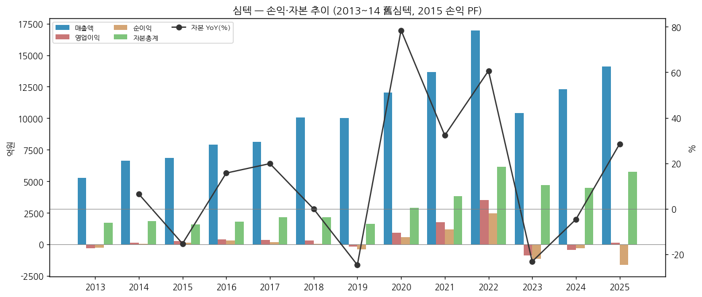

### ③ 회사 주가 역사 ★ 유일한 narrative 영역

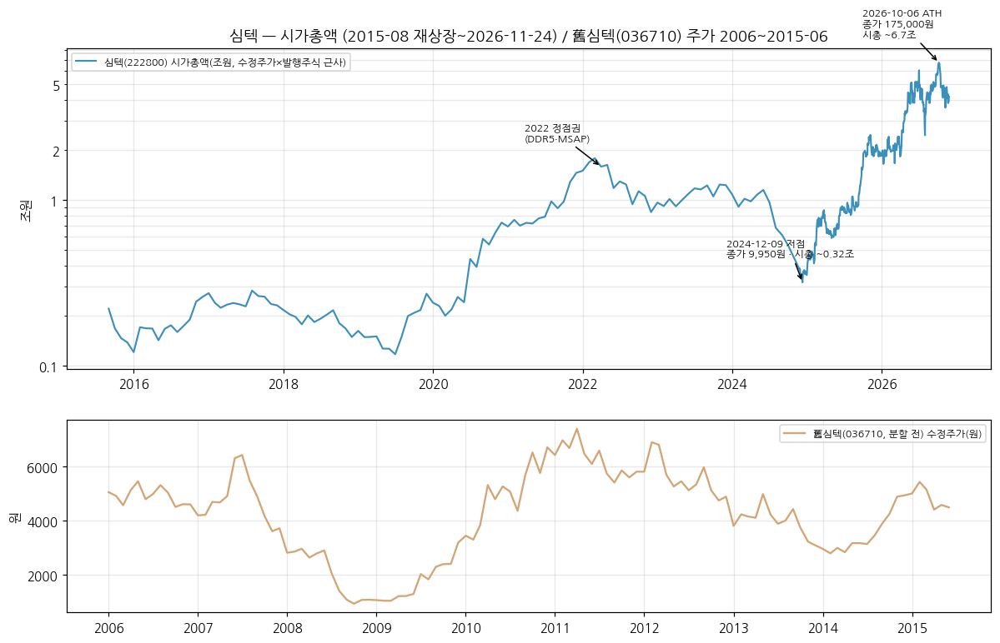

**데이터:** 222800.KQ 월간 2015-08\~2024-10 + 일간 2024-11-25\~2026-11-24 (Yahoo 수정주가) × 연도별 발행주식수 근사. 분할 전은 036710.KQ (舊심텍 → 현 심텍홀딩스) 수정주가만 표시 (시총 비교 불가)

(1) 분할 전 舊심텍 (2006\~2015-06)
→ 2008 금융위기에 1,000원대로 하락 → 2010\~2011 스마트폰·PC 메모리 호황에 7,000원대 회복 → 2012\~2014 BOC·MCP 부진과 2013 적자(OPM -6.4%)로 3,000원대 [Yahoo 036710 수정주가]

(2) 재상장 후 박스권 (2015-08 \~ 2019)
→ 재상장 직후 시총 약 0.2조. 2016\~2017 1차 정점(OPM 5.1%) 때도 0.3조 미만
→ 2018 Eastern(일본) 인수로 매출 1조를 넘겼지만 2019 메모리 재고조정 + Graphics 적자로 1Q19 영업적자 -202억 → 2019-06 저점 약 0.12조

(3) 1차 리레이팅 (2020 \~ 2022-04)
→ 2020-09 주주배정 유상증자로 재무구조 정비, MSAP 기판 전환 + DDR5·서버 수요 → OPM 7.5%(2020) → 12.8%(2021) → 20.8%(2022)
→ 시총 2022년 봄 약 1.6조 정점권 (월말 기준)

(4) 다운사이클 (2022-05 \~ 2024-12)
→ 2023 메모리 감산으로 매출 -38.6%, OPM -8.5%. 2024에도 영업적자 -470억
→ 신용등급 하락: NICE A- (2023-04) → 이크레더블 BB+ (2024-04) → BB- (2025-04) → B+ (2026-05) [DART 분기보고서(2026.09) I-1 사.]
→ **2024-12-09 종가 9,950원, 시총 약 0.32조 — 재상장 후 최저권** [Yahoo 일간]

(5) AI 메모리 모듈 랠리 (2025 \~ 2026-10)
→ 2025 하반기 영업 흑자 복귀 + SOCAMM(AI 서버용 LPDDR 모듈) PCB 양산 기대 → 2025말 49,350원 (YTD +347%)
→ 2026: SOCAMM 모듈 매출 1Q 115억 → 2Q 250억 (QoQ +117%) [2Q26 IR p5], 3Q26 영업이익 1,018억 (OPM 19.0%) [3Q26 IR p3]
→ **2026-10-06 사상 최고 종가 175,000원 (장중 182,600원), 시총 약 6.7조** [Yahoo 일간, 계산]
→ 이후 조정: 2026-11-24 109,000원, 시총 4.34조 (고점 대비 -37.7%)

(6) 주식 수 변화 (희석) — 주가와 함께 봐야 하는 이유
→ 보통주 31,854,143주 (2020-09 유상증자 후 \~2024) → 37,342,218주 (2025말, 4회 CB·5회 BW 전환) → 39,783,467주 (2026-11-13, 7회 영구CB 전환 완료) = **2년간 +24.9%** [DART 사업보고서(2025.12) I-3, 분기보고서(2026.09) I-4]
→ 2026-11-13 현재 잔여 전환가능 주식 없음 — 추가 희석 요인 해소 [DART 분기보고서(2026.09) 주3·주4]

### ④ 회사의 주요 연혁

| 연월 | 내용 |
|---|---|
| 1987.08 | 舊심텍 설립 (청주), 메모리 모듈 PCB 국산화 |
| 1996.09 | BGA(패키지 기판) 전용 라인 설립 |
| 2008.12 | 메모리 모듈 PCB·BOC 세계일류상품 지정 |
| 2010.08 | 중국 시안 법인 신태전자 설립 (메모리 모듈 전용, 현재 32,000㎡/월) |
| 2015.07 | 舊심텍 인적분할 → 심텍홀딩스(존속) / 심텍(신설) |
| 2015.08 | 심텍 코스닥 재상장 (매매개시 2015-08-07) |
| 2016.12 | ETS(패턴매립형기판) 세계일류상품 지정 |
| 2017.12 | 일본 Eastern Co. (STJ Holdings 경유) 종속회사 편입 — MSAP 기판 거점 |
| 2018.06 | 일본 법인 MSAP 생산라인 증설 |
| 2020.01 | Eastern → Simmtech Graphics 상호 변경 |
| 2020.05 | 주주배정 후 실권주 일반공모 유상증자 (2020-09 납입 완료) |
| 2022.12 | 청주 본사 제9공장(F9) 완공 — 고다층 MSAP (건축면적 21,000㎡) |
| 2023.11 | GDDR 기판 세계일류상품 지정 |
| 2023.12 | 무역의날 금탑산업훈장 |
| 2024.03 | 4회차 전환사채 + 5회차 신주인수권부사채 발행 |
| 2024.12 | SK하이닉스 "Best Quality Supplier of the Year for Module PCBs" |
| 2025.06 | 7회차 영구전환사채 (신종자본증권) 발행 |
| 2025.12 | SK하이닉스 "2025 Best Quality Supplier" (2년 연속) |
| 2026 | SOCAMM 모듈 PCB 양산 본격화, 4·5·7회차 CB·BW 전액 전환 완료 (2026-11) |

[DART 사업보고서(2025.12) I-2 연혁, 분기보고서(2026.09) 7-2, 3Q26 IR]

---

## 3. 비즈니스 모델

### ① 실적 추이 (제품별·부문별·고객사별·지역별)

**(1) 5년 연간 통합 표 (억원)**

| 구분 | 2021 | 2022 | 2023 | 2024 | 2025 | 3Q26 누적 |
|---|---|---|---|---|---|---|
| **전사 매출** | 13,658 | 16,975 | 10,419 | 12,314 | 14,106 | 14,729 |
| 전사 영업이익 | 1,743 | 3,524 | -881 | -470 | 119 | 1,784 |
| 전사 OPM | 12.8% | 20.8% | -8.5% | -3.8% | 0.8% | 12.1% |
| **[제품] Package Substrate** | 10,284 | 13,209 | 7,980 | 9,049 | 10,638 | 11,052 |
| → 비중 | 75.3% | 77.8% | 76.6% | 73.5% | 75.4% | 75.0% |
| **[제품] Module PCB** | 3,374 | 3,766 | 2,439 | 3,266 | 3,467 | 3,677 |
| → 비중 | 24.7% | 22.2% | 23.4% | 26.5% | 24.6% | 25.0% |
| [IR 부문] MSAP | - | - | 6,848 | 7,493 | 8,559 | 8,989 |
| [IR 부문] HDI | - | - | 2,441 | 3,266 | 3,467 | 3,676 |
| [IR 부문] Tenting | - | - | 1,131 | 1,576 | 2,079 | 2,063 |
| **[고객] 삼성전자** | - | 34% (S사) | - | 4,197 (34%) | 5,322 (38%) | 4,842 (33%) |
| [고객] SK하이닉스 | - | 23% (H사) | - | 2,589 (21%) | 2,304 (16%) | 2,346 (16%) |
| [고객] Micron | - | 17% (M사) | - | 1,809 (15%) | 1,970 (14%) | 2,111 (14%) |
| **[지역] 한국** | - | - | - | 6,255 | 6,881 | 7,543 |
| [지역] 중국 | - | - | - | 2,734 | 3,510 | 2,735 |
| [지역] 일본 | - | - | - | 178 | 207 | 553 |
| [지역] 기타 | - | - | - | 3,147 | 3,507 | 3,898 |

(제품: DART 주요제품 매출표 [사업보고서 2021·2022·2025, 분기보고서(2026.09)] — 2021은 2022 사업보고서 비교 컬럼. IR 부문: 분기 IR 숫자 합산 (2023은 4Q23 역산 포함 [⚠️ 근사]). 고객: 2022는 사업보고서 익명 표기(S·H·M사), 2024\~3Q26은 연결 주석 실명 [DART]. 지역: 연결 주석 "지역에 대한 공시" (매출 귀속 법인 소재지 기준). **IR HDI = DART Module PCB**, **IR MSAP + Tenting = DART Package Substrate** (2022 이후 숫자 일치 확인))

**(2) 분기 시계열 (1Q15\~3Q26, 47분기 — 1Q15·2Q15는 분할 전 참고치, 억원)**

| 분기 | 매출 | YoY | 영업이익 | OPM | 순이익 | Module PCB | Package Substrate | MSAP | HDI | Tenting |
|---|---|---|---|---|---|---|---|---|---|---|
| 1Q15 ※ | 1,343 | - | 14 | 1.0% | - | - | - | - | - | - |
| 2Q15 ※ | 1,551 | - | 60 | 3.9% | - | - | - | - | - | - |
| 3Q15 | 1,872 | - | 74 | 4.0% | 23 | 626 | 1,186 | - | - | - |
| 4Q15 | 2,083 | - | 121 | 5.8% | 81 | 694 | 1,352 | - | - | - |
| 1Q16 | 1,978 | +47.3% | 63 | 3.2% | 46 | 779 | 1,186 | - | - | - |
| 2Q16 | 1,867 | +20.4% | 60 | 3.2% | 10 | 642 | 1,197 | - | - | - |
| 3Q16 | 2,025 | +8.2% | 115 | 5.7% | 145 | 696 | 1,298 | - | - | - |
| 4Q16 | 2,049 | -1.6% | 164 | 8.0% | 92 | 728 | 1,285 | - | - | - |
| 1Q17 | 1,909 | -3.5% | 53 | 2.8% | 25 | 639 | 1,250 | - | - | - |
| 2Q17 | 1,994 | +6.8% | 79 | 4.0% | 59 | 719 | 1,234 | - | - | - |
| 3Q17 | 2,163 | +6.8% | 116 | 5.4% | 41 | 783 | 1,337 | - | - | - |
| 4Q17 | 2,049 | +0.0% | 89 | 4.3% | 35 | 393 | 1,620 | - | - | - |
| 1Q18 | 2,444 | +28.0% | 60 | 2.5% | 20 | 619 | 1,794 | - | - | - |
| 2Q18 | 2,494 | +25.1% | 81 | 3.2% | 38 | 712 | 1,744 | - | - | - |
| 3Q18 | 2,632 | +21.7% | 111 | 4.2% | 61 | 722 | 1,883 | - | - | - |
| 4Q18 | 2,505 | +22.3% | 55 | 2.2% | -96 | 680 | 1,801 | - | - | - |
| 1Q19 | 2,055 | -15.9% | -202 | -9.8% | -231 | 558 | 1,483 | - | - | - |
| 2Q19 | 2,333 | -6.5% | -82 | -3.5% | -110 | 684 | 1,610 | - | - | - |
| 3Q19 | 2,681 | +1.9% | 7 | 0.3% | -46 | 700 | 1,950 | - | - | - |
| 4Q19 | 2,933 | +17.1% | 99 | 3.4% | -7 | 887 | 2,015 | - | - | - |
| 1Q20 | 2,902 | +41.2% | 137 | 4.7% | 82 | 853 | 2,005 | - | - | - |
| 2Q20 | 3,218 | +37.9% | 307 | 9.5% | 236 | 948 | 2,244 | - | - | - |
| 3Q20 | 3,106 | +15.9% | 307 | 9.9% | 222 | 929 | 2,152 | - | - | - |
| 4Q20 | 2,788 | -4.9% | 147 | 5.3% | 25 | 606 | 2,126 | - | - | - |
| 1Q21 | 2,831 | -2.4% | 153 | 5.4% | 64 | 605 | 2,209 | - | - | - |
| 2Q21 | 3,247 | +0.9% | 312 | 9.6% | 171 | 828 | 2,386 | - | - | - |
| 3Q21 | 3,660 | +17.8% | 504 | 13.8% | 532 | 875 | 2,759 | - | - | - |
| 4Q21 | 3,921 | +40.6% | 774 | 19.7% | 415 | 966 | 2,925 | - | - | - |
| 1Q22 | 4,177 | +47.5% | 848 | 20.3% | 607 | 872 | 3,266 | - | - | - |
| 2Q22 | 4,774 | +47.0% | 1,147 | 24.0% | 848 | 1,116 | 3,698 | - | - | - |
| 3Q22 | 4,743 | +29.6% | 1,166 | 24.6% | 993 | 1,073 | 3,670 | - | - | - |
| 4Q22 | 3,280 | -16.3% | 362 | 11.0% | 13 | 705 | 2,575 | 1,946 | 705 | 630 |
| 1Q23 | 2,039 | -51.2% | -322 | -15.8% | -222 | 532 | 1,507 | 1,232 | 532 | 275 |
| 2Q23 | 2,537 | -46.9% | -216 | -8.5% | -179 | 585 | 1,952 | 1,662 | 585 | 290 |
| 3Q23 | 2,872 | -39.4% | -56 | -1.9% | -61 | 635 | 2,236 | 1,993 | 635 | 243 |
| 4Q23 | 2,970 | -9.5% | -288 | -9.7% | -690 | 686 | 2,285 | 1,961 | 689 | 323 |
| 1Q24 | 2,939 | +44.1% | -149 | -5.1% | -152 | 737 | 2,202 | 1,824 | 737 | 378 |
| 2Q24 | 3,117 | +22.9% | 36 | 1.2% | -159 | 807 | 2,309 | 1,961 | 807 | 348 |
| 3Q24 | 3,248 | +13.1% | 5 | 0.2% | 214 | 907 | 2,341 | 2,023 | 907 | 318 |
| 4Q24 | 3,011 | +1.4% | -362 | -12.0% | -213 | 815 | 2,196 | 1,685 | 815 | 532 |
| 1Q25 | 3,036 | +3.3% | -163 | -5.4% | -358 | 885 | 2,151 | 1,708 | 885 | 443 |
| 2Q25 | 3,408 | +9.3% | 55 | 1.6% | -187 | 922 | 2,486 | 1,963 | 922 | 523 |
| 3Q25 | 3,728 | +14.8% | 124 | 3.3% | 67 | 882 | 2,847 | 2,288 | 882 | 558 |
| 4Q25 | 3,934 | +30.7% | 103 | 2.6% | -1,168 | 779 | 3,155 | 2,600 | 779 | 555 |
| 1Q26 | 4,224 | +39.1% | 137 | 3.2% | 144 | 974 | 3,249 | 2,605 | 974 | 644 |
| 2Q26 | 5,146 | +51.0% | 629 | 12.2% | 449 | 1,278 | 3,868 | 3,072 | 1,278 | 796 |
| 3Q26 | 5,359 | +43.8% | 1,018 | 19.0% | 255 | 1,424 | 3,935 | 3,312 | 1,424 | 623 |

(※ 1Q15·2Q15는 분할 전 PCB부문 숫자 (심텍홀딩스 2015 반기보고서 중단영업 주석) — 연결 범위 다름. 3Q15부터 신설 심텍 연결. 분기 매출·영업이익·순이익은 OpenDART (4Q = 연간 − 3Q 누적). Module PCB·Package Substrate는 DART 정기보고서 주요제품 누계표의 분기 차분 (2016\~2017은 BIB·Build-up 등 기타 제품이 있어 합계가 전사 매출보다 작음, 4Q17 Module PCB 393억은 연간 재분류 영향 [⚠️]). MSAP·HDI·Tenting은 IR 발표 수치 (4Q23은 1Q24 IR의 QoQ 역산 [⚠️ 근사], 4Q24는 IR 잠정 3,032억 기준으로 DART 3,011억과 21억 차이). **15년 60분기 표준 대비 47분기만 확보** — 2015 분할로 그 이전 분기는 舊심텍(심텍홀딩스) 공시에서만 확인 가능, 이번 버전 미반영)

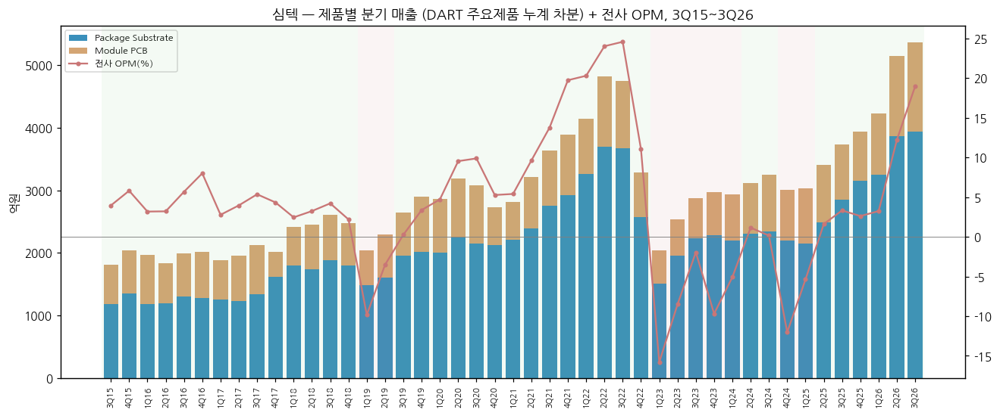

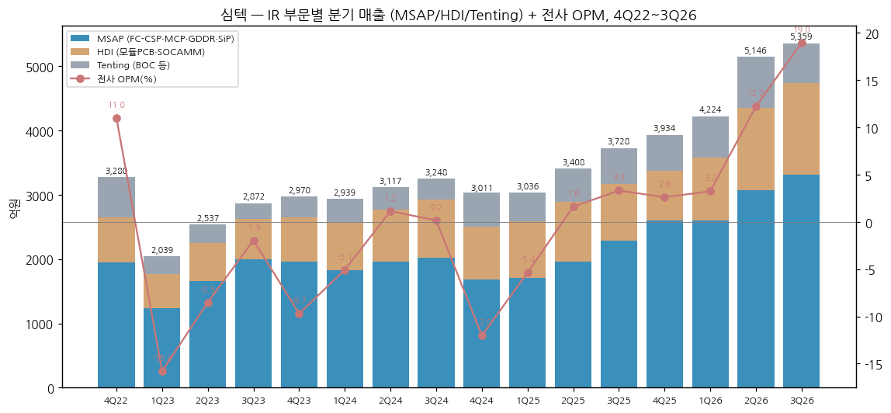

(제품·부문별 영업이익은 회사가 공시하지 않음 → chart2는 매출 bar + **전사 OPM** line으로 대체)

**(3) 최근 12분기 시계열 (4Q23\~3Q26)**

| 분기 | 매출 | QoQ | YoY | 영업이익 | OPM | MSAP | HDI | Tenting |
|---|---|---|---|---|---|---|---|---|
| 4Q23 | 2,970 | +3.4% | -9.5% | -288 | -9.7% | 1,961 | 689 | 323 |
| 1Q24 | 2,939 | -1.0% | +44.1% | -149 | -5.1% | 1,824 | 737 | 378 |
| 2Q24 | 3,117 | +6.1% | +22.9% | 36 | 1.2% | 1,961 | 807 | 348 |
| 3Q24 | 3,248 | +4.2% | +13.1% | 5 | 0.2% | 2,023 | 907 | 318 |
| 4Q24 | 3,011 | -7.3% | +1.4% | -362 | -12.0% | 1,685 | 815 | 532 |
| 1Q25 | 3,036 | +0.8% | +3.3% | -163 | -5.4% | 1,708 | 885 | 443 |
| 2Q25 | 3,408 | +12.3% | +9.3% | 55 | 1.6% | 1,963 | 922 | 523 |
| 3Q25 | 3,728 | +9.4% | +14.8% | 124 | 3.3% | 2,288 | 882 | 558 |
| 4Q25 | 3,934 | +5.5% | +30.7% | 103 | 2.6% | 2,600 | 779 | 555 |
| 1Q26 | 4,224 | +7.4% | +39.1% | 137 | 3.2% | 2,605 | 974 | 644 |
| 2Q26 | 5,146 | +21.8% | +51.0% | 629 | 12.2% | 3,072 | 1,278 | 796 |
| 3Q26 | 5,359 | +4.1% | +43.8% | 1,018 | 19.0% | 3,312 | 1,424 | 623 |

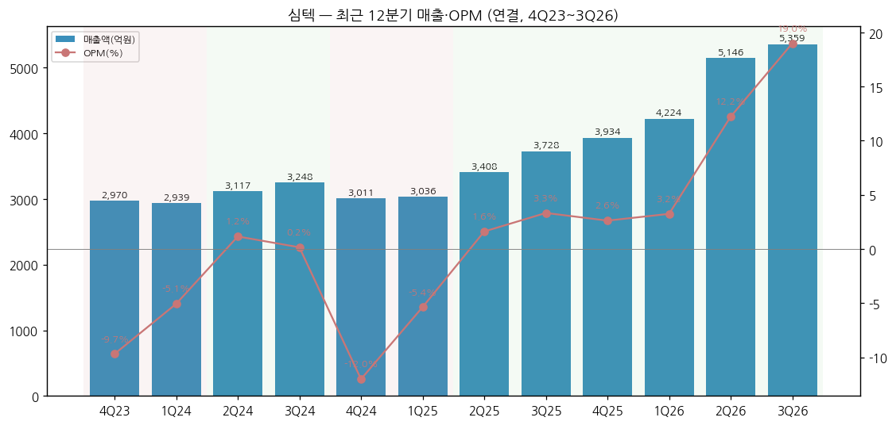

**📌 3Q26 핵심 박스**

→ 매출 **5,359억 (YoY +43.7%, QoQ +4.1%)**, 영업이익 **1,018억 (YoY +722%, QoQ +62%)**, OPM **19.0%** — 2022-3Q(24.6%) 이후 최고 [OpenDART, 3Q26 IR p3]
→ MSAP 3,312억 (YoY +45%): SiP 모듈 기판 QoQ +52%, MCP는 모바일 D램향 성장 가속, FC-CSP는 System IC·전장향 [3Q26 IR p3]
→ HDI 1,424억 (YoY +62%): **SOCAMM 모듈 매출 본격화**, 서버·SSD·PC 모듈 PCB 동반 성장
→ Tenting 623억 (QoQ -22%): BOC — 회사는 "글로벌 Top Level 점유율 전략적 유지"
→ 이익 레버리지: 매출이 QoQ +4%인데 영업이익 +62% — 매출총이익률 18.5% → 26.1% (2Q→3Q), 판관비율 6.3% → 7.1% [3Q26 IR p7 손익표, 계산]
→ 순이익은 255억에 그침: 외화환산손실 235억 + 금융수익 -234억 (원화 강세 환산 영향) [3Q26 IR p7]
→ 회사 전망 (3Q26 IR): 4Q26 System IC향 966억, SOCAMM향 989억 (QoQ +74%) — 2026 SOCAMM 모듈 연간 약 1,475억 + MCP for SOCAMM 약 659억 [3Q26 IR p4\~5, 회사 추정치]
→ 가동률: 3Q26 누적 **80.4%** (2025 연간 75.8%, 2024 69.7%) [DART 분기보고서(2026.09) II-3, 계산]

### ② 제품·부문별 개요 (매출 비중 큰 순서, 직관적 설명)

(1) **MSAP 기판 (Package Substrate 중 고부가, 3Q26 매출 비중 62%)**
→ MSAP(Modified Semi-Additive Process)는 회로선을 아주 가늘게 만드는 공법. 이 공법으로 만드는 기판이 반도체 칩을 포장(패키지)할 때 칩과 메인보드를 이어주는 판
→ 제품: **MCP**(모바일 D램·낸드를 한 패키지에 쌓는 칩용), **GDDR**(그래픽 메모리용), **FC-CSP**(스마트폰 AP·System IC·전장용), **SiP 모듈**(여러 칩을 한 모듈로 — 웨어러블·RF)
→ 한국 청주(F9 고다층 MSAP 포함) + 일본 Simmtech Graphics(나가노)에서 생산

(2) **HDI = 메모리 모듈 PCB (Module PCB, 비중 27%)**
→ D램 칩 여러 개를 한 판에 꽂아 메모리 용량을 늘리는 "메모리 모듈"의 바탕 기판. PC(DIMM)·서버(RDIMM·MRDIMM)·SSD 모듈과 **AI 서버용 SOCAMM**(저전력 LPDDR을 모듈화한 신규 규격)
→ 회사 창업 제품 (1987 국산화). 한국 청주 + 중국 시안(신태전자) 생산
→ SK하이닉스 모듈 PCB 최우수 품질 공급사 2년 연속 (2024·2025)

(3) **Tenting 기판 (Package Substrate 중 범용, 비중 12%)**
→ 구형 공법(Tenting)으로 만드는 BOC(Board on Chip, PC·서버 D램 칩 패키지용) 등. 회사는 저부가 제품으로 분류해 2020년대 초 비중 축소 전략 → 2024\~2025 D램 수요 회복으로 다시 증가 (2025 연간 YoY +34%) [4Q25 IR]

### ③ 제품·부문별 디테일

(1) **Top-seller**: 3Q26 누적 기준 MSAP 8,989억 (61%) — 그중 MCP·GDDR 등 메모리 패키지가 대부분, System IC향(FC-CSP+SiP)은 1Q26 617억 → 2Q26 764억 → 3Q26 946억(E) [3Q26 IR p4]
(2) **Growth**: SOCAMM향 — 모듈 115억(1Q26) → 250억(2Q26), MCP for SOCAMM 73억 → 143억. 회사는 "기판-모듈 일괄 공급"을 강점으로 제시, LPCAMM·CXL 메모리 모듈로 확장 계획 [3Q26 IR p5]
(3) **이익 outlier**: 제품별 이익 미공시. 2020\~2021 IR에서는 한국·중국 공장(심텍 본체)과 일본 Simmtech Graphics를 나눠 공개 — 2021 심텍 본체 OPM 13% vs Graphics OPM 11% (2020 Graphics 흑자전환) [4Q21 IR p3]
(4) **ASP**: 인쇄회로기판 평균 판매단가 108.5만원/㎡(2024) → 112.7만원/㎡(2025) → **151.1만원/㎡ (3Q26 누적, +34%)** — 제품 믹스 개선이 단가에 그대로 찍힘 [DART 분기보고서(2026.09) II-2 나.]
(5) **수주잔고**: 2026-09말 469,444㎡ / 4.80억 달러 (2025말 잔고 + 9개월 수주 − 납품) [DART 분기보고서(2026.09) 4-2]

### ④ 주요 경쟁사 (제품별)

| 제품 | 주요 경쟁사 | 비고 |
|---|---|---|
| 메모리 모듈 PCB (서버·PC·SSD·SOCAMM) | 코리아써키트, 대만 Kinsus·Unimicron 계열, 중국 업체 | 공시: "100% 동일한 경쟁사는 없음" [DART] |
| MCP·GDDR (메모리 패키지 기판) | 대덕전자, 삼성전기(일부), 해성디에스(리드프레임 대체), 대만 Kinsus | |
| FC-CSP·SiP (System IC) | 삼성전기, LG이노텍, 대덕전자, 대만 Unimicron·Kinsus, 일본 Ibiden(고급) | |
| BOC (Tenting) | 해성디에스, 대만 업체 | 회사 "글로벌 Top Level M/S" 주장 [IR] |

(경쟁사 목록은 공시에 실명이 없어 업계 일반 정보 기반 [⚠️ 판단]. 국내 동종 매출 비교는 1-③-(4) 참조)

### ⑤ 주요 매출처 (공시 금액 큰 순서)

| 고객 | 2024 | 2025 | 3Q26 누적 | 3Q26 3개월 |
|---|---|---|---|---|
| 삼성전자 | 4,197억 (34%) | 5,322억 (38%) | 4,842억 (33%) | 1,869억 (35%) |
| SK하이닉스 | 2,589억 (21%) | 2,304억 (16%) | 2,346억 (16%) | 783억 (15%) |
| Micron Technology | 1,809억 (15%) | 1,970억 (14%) | 2,111억 (14%) | 834억 (16%) |
| 3사 합계 | 70% | 68% | 63% | 65% |

[DART 사업보고서(2025.12)·분기보고서(2026.09) 연결 "주요 고객에 대한 공시" — 10% 이상 고객 실명 공시]
→ 3사 외 고객: 패키징 전문(OSAT) ASE·Amkor·JCET·PTI, 중국 CXMT(2024 신규 인증), 그 외 System IC 팹리스 [DART 사업의 내용, 연혁]
→ **특수관계자 판매 경로**: 해외 매출 상당 부분이 심텍홀딩스 계열 판매법인 **SIMMTECH INTERNATIONAL PTE. LTD.(싱가포르)**를 거침 — 2025 매출 4,319억 (전사의 30.6%), 3Q26 누적 4,661억 [DART 특수관계자 주석]. 최종 고객이 아니라 그룹 내 판매 창구라는 점을 고객 집중도와 구분해서 볼 것

### ⑥ 생산 CAPA + 임직원 추이

| 항목 | 2024 | 2025 | 3Q26 (9개월) |
|---|---|---|---|
| HDI (Module) 생산능력 | 528,000㎡ | 528,000㎡ | 396,000㎡ (월 44,000) |
| SPS (Substrate) 생산능력 | 1,164,000㎡ | 1,164,000㎡ | 873,000㎡ (월 97,000) |
| 생산실적 합계 | 1,179,987㎡ | 1,283,336㎡ | 1,020,634㎡ |
| 가동률 | 69.7% | 75.8% | **80.4%** |

[DART 분기보고서(2026.09) II-3 (연결), 가동률 = 생산실적 / 생산능력]
→ 생산거점: 청주 본사(F1\~F9), 중국 시안 신태전자(모듈 PCB 32,000㎡/월), 일본 나가노 Simmtech Graphics(MSAP), 말레이시아 T.E.TECH(검사) [DART 연혁·종속회사 개황]

| 임직원 (별도) | 2016 | 2019 | 2022 | 2025 | 3Q26 |
|---|---|---|---|---|---|
| 인원 | 2,229 | 2,560 | 2,988 | 2,902 | 3,050 |
| 평균 근속 (남/여, 년) | 6.4 / 6.0 | 7.2 / 7.8 | 7.6 / 7.4 | 9.5 / 9.2 | 9.6 / 8.7 |

[OpenDART 직원현황 (사업보고서 2016·2019·2022·2025, 분기보고서 2026.09)]. 2025 남성 1인 평균 급여 6,203만원 [DART]

---

## 4. 재무 구조

### ① 손익계산서 (연결, 억원, 좌→우 시간순)

| 연도 | 매출 | 매출원가 | 매출총이익 | GPM | 판관비 | CIR | 영업이익 | OPM | 순이익 | NPM |
|---|---|---|---|---|---|---|---|---|---|---|
| 2015 (2H) | 3,955 | 3,501 | 454 | 11.5% | 259 | 6.5% | 195 | 4.9% | 104 | 2.6% |
| 2016 | 7,920 | 6,935 | 985 | 12.4% | 583 | 7.4% | 402 | 5.1% | 293 | 3.7% |
| 2017 | 8,116 | 7,101 | 1,015 | 12.5% | 677 | 8.3% | 338 | 4.2% | 161 | 2.0% |
| 2018 | 10,075 | 8,758 | 1,317 | 13.1% | 1,009 | 10.0% | 308 | 3.1% | 23 | 0.2% |
| 2019 | 10,002 | 9,122 | 880 | 8.8% | 1,059 | 10.6% | -179 | -1.8% | -394 | -3.9% |
| 2020 | 12,014 | 10,050 | 1,964 | 16.3% | 1,067 | 8.9% | 897 | 7.5% | 565 | 4.7% |
| 2021 | 13,658 | 10,817 | 2,841 | 20.8% | 1,098 | 8.0% | 1,743 | 12.8% | 1,183 | 8.7% |
| 2022 | 16,975 | 12,163 | 4,811 | 28.3% | 1,288 | 7.6% | 3,524 | 20.8% | 2,461 | 14.5% |
| 2023 | 10,419 | 10,135 | 284 | 2.7% | 1,166 | 11.2% | -881 | -8.5% | -1,151 | -11.1% |
| 2024 | 12,314 | 11,795 | 519 | 4.2% | 989 | 8.0% | -470 | -3.8% | -310 | -2.5% |
| 2025 | 14,106 | 12,872 | 1,234 | 8.7% | 1,115 | 7.9% | 119 | 0.8% | -1,646 | -11.7% |

(OpenDART 연결. 2015는 신설법인 2H15(7\~12월)만. 분할 전 2013\~2014는 1-① 참조. CIR = 판관비/매출)

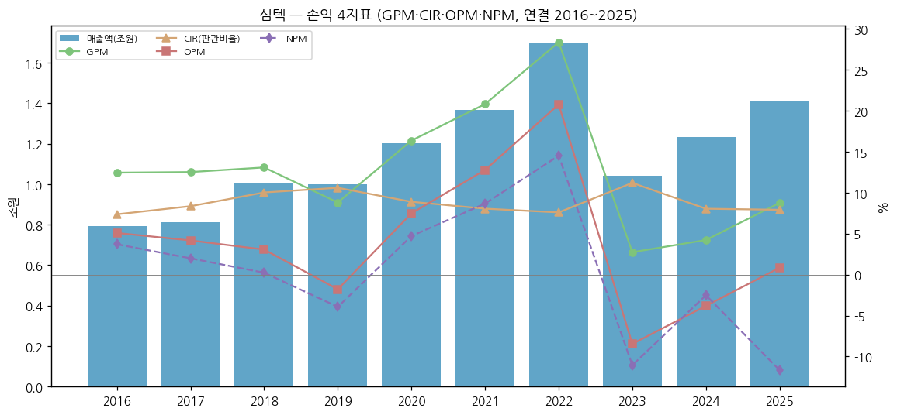

→ GPM이 사이클을 그대로 보여줌: 정점 28.3%(2022) vs 저점 2.7%(2023). 판관비율은 6.5\~11.2%로 안정 → **이익 변동의 원천은 매출원가(가동률·감가상각)**
→ 2025 NPM -11.7%는 영업(0.8%)이 아니라 금융원가 2,296억(파생평가손실 1,333억 포함) 때문

### ② 재무상태표 (연결, 억원, 좌→우 시간순)

| 연도 | 자산총계 | 유동자산 | 현금 | 재고 | 유형자산 | 부채총계 | 유동부채 | 자본총계 | 부채비율 | 유동비율 |
|---|---|---|---|---|---|---|---|---|---|---|
| 2013 (舊) | 5,665 | - | - | - | - | 3,946 | - | 1,719 | 230% | - |
| 2014 (舊) | 6,154 | - | - | - | - | 4,324 | - | 1,830 | 236% | - |
| 2015 | 5,483 | 1,433 | 32 | 838 | 3,535 | 3,935 | 2,897 | 1,549 | 254% | 49% |
| 2016 | 6,012 | 1,916 | 15 | 959 | 3,437 | 4,220 | 3,167 | 1,792 | 236% | 61% |
| 2017 | 7,282 | 2,102 | 122 | 1,306 | 4,594 | 5,134 | 3,932 | 2,147 | 239% | 53% |
| 2018 | 8,133 | 2,524 | 273 | 1,559 | 5,067 | 5,988 | 5,207 | 2,146 | 279% | 48% |
| 2019 | 8,399 | 2,542 | 97 | 1,471 | 5,136 | 6,784 | 5,517 | 1,615 | 420% | 46% |
| 2020 | 7,798 | 1,988 | 171 | 1,238 | 5,125 | 4,915 | 3,501 | 2,883 | 170% | 57% |
| 2021 | 8,574 | 2,451 | 167 | 1,445 | 5,013 | 4,762 | 3,420 | 3,813 | 125% | 72% |
| 2022 | 12,663 | 5,047 | 1,198 | 1,447 | 5,867 | 6,537 | 4,744 | 6,126 | 107% | 106% |
| 2023 | 11,761 | 2,802 | 100 | 1,420 | 6,252 | 7,056 | 4,884 | 4,704 | 150% | 57% |
| 2024 | 14,433 | 5,097 | 1,278 | 1,539 | 6,301 | 9,948 | 7,802 | 4,485 | 222% | 65% |
| 2025 | 16,203 | 7,256 | 540 | 2,398 | 5,722 | 10,440 | 7,945 | 5,764 | 181% | 91% |

(2013\~2014 舊심텍 연결 [심텍홀딩스 반기보고서(2015.06) 요약]. 2015\~ OpenDART)

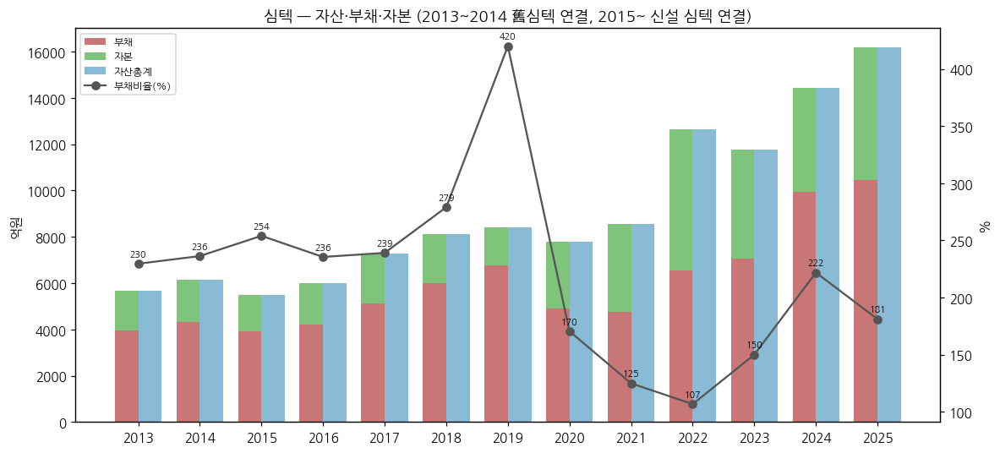

→ 2022 정점에 부채비율 107%·유동비율 106%로 가장 건전 → 2023\~2024 적자 + 차입 확대로 부채비율 222%(2024)
→ 2025 자본 +28.5% (4,485억 → 5,764억): 순손실 -1,646억에도 **CB·BW 전환 + 영구CB(자본) 발행**으로 자본잉여금 1,104억 → 4,048억 [DART 자본변동표]
→ 3Q26말 자산 1조 8,822억, 부채 1조 2,261억, 자본 6,561억, 부채비율 187% [3Q26 IR p8]
→ ⚠️ **장기미수금**: 2025말 장부 1,897억 (총액 2,515억 − 현재가치할인 619억) → 3Q26말 836억으로 감소 [DART 매출채권 주석]. 공시상 상대방·성격 설명은 확인되지 않음 — 다음 버전에서 주석 원문 확인 필요

### ③ 현금흐름표 (연결, 억원)

| 연도 | 영업CF | 투자CF | 재무CF | CapEx | FCF | 감가상각비 |
|---|---|---|---|---|---|---|
| 2015 (2H) | 657 | -158 | -468 | 219 | 438 | 207 |
| 2016 | 395 | -415 | 4 | 409 | -14 | 412 |
| 2017 | 1,330 | -609 | -614 | 553 | 777 | 432 |
| 2018 | 905 | -995 | 233 | 989 | -84 | 636 |
| 2019 | -316 | -737 | 871 | 757 | -1,073 | 723 |
| 2020 | 2,155 | -829 | -1,249 | 861 | 1,293 | 739 |
| 2021 | 1,146 | -805 | -346 | 775 | 371 | 779 |
| 2022 | 4,355 | -2,688 | -628 | 1,602 | 2,753 | 812 |
| 2023 | -934 | -903 | 739 | 1,405 | -2,339 | 799 |
| 2024 | -1,613 | -968 | 3,757 | 1,036 | -2,649 | - |
| 2025 | -1,986 | -188 | 1,443 | 564 | -2,550 | - |

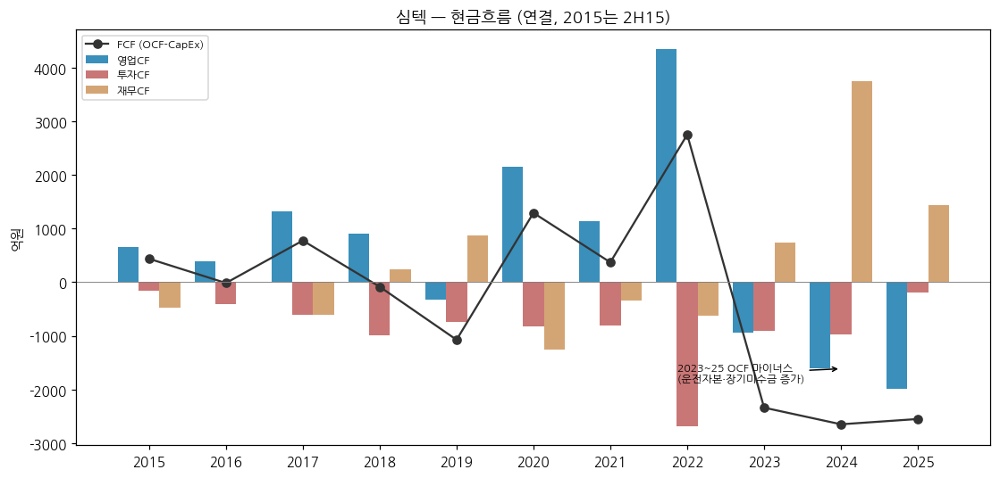

→ 2023\~2025 3년 연속 영업CF 마이너스 (-934 / -1,613 / -1,986억) — 영업이익 적자 + 매출채권·재고·장기미수금 증가. 같은 기간 재무CF +5,939억(차입·CB·BW·영구CB)으로 메움
→ FCF 누적 (2015\~2025): **-3,077억** [계산] — 업사이클 FCF(2020 +1,293, 2022 +2,753)가 다운사이클 투자·운전자본을 못 메운 구조
→ 감가상각비 2024\~2025는 OpenDART 현금흐름표 항목명 변경으로 미추출 [❌]

### ④ CapEx 추이 (연결 현금흐름표 기준, 억원)

| 연도 | 유형 | 무형 | 합계 | CapEx/매출 | 감가상각비 | 비고 |
|---|---|---|---|---|---|---|
| 2015 | 210 | 8 | 219 | 5.5% | 207 | 2H15 (분할 직후) |
| 2016 | 394 | 15 | 409 | 5.2% | 412 | 유지보수 수준 |
| 2017 | 520 | 32 | 553 | 6.8% | 432 | Eastern 인수 준비, MSAP 증설 |
| 2018 | 980 | 9 | 989 | 9.8% | 636 | Eastern(現 Graphics) 연결 + MSAP 증설 |
| 2019 | 750 | 6 | 757 | 7.6% | 723 | 다운사이클에도 MSAP 투자 지속 |
| 2020 | 860 | 1 | 861 | 7.2% | 739 | MSAP 생산능력 확대 |
| 2021 | 766 | 9 | 775 | 5.7% | 779 | MSAP 증설 완료 |
| 2022 | 1,589 | 13 | 1,602 | 9.4% | 812 | F9(청주 9공장) 고다층 MSAP — 사상 최대 |
| 2023 | 1,393 | 12 | 1,405 | 13.5% | 799 | F9 마무리·완공(2022-12) |
| 2024 | 1,033 | 3 | 1,036 | 8.4% | - | 증설 축소 |
| 2025 | 559 | 5 | 564 | 4.0% | - | 투자 최소화 + 유형자산 처분 420억 |

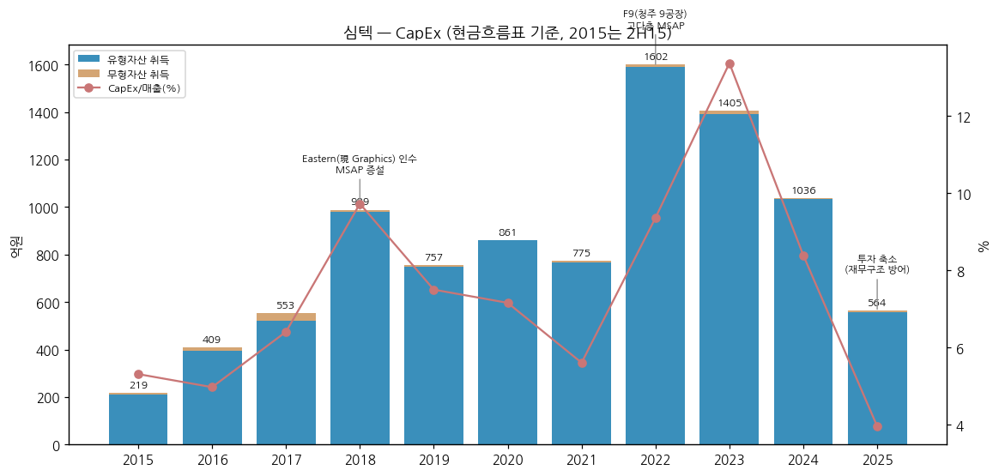

→ 사이클과 반대로 투자: 2019 다운사이클에도 757억, 2022 정점에 1,602억(F9) → 2023 다운사이클에도 1,405억 지속 → 2025 564억으로 축소
→ 2026 상황: 가동률 80%대 진입, 회사는 "가동률 상승에 따른 수익구조 향상"을 제시 [2Q26 IR p4] — 증설 재개 시점이 다음 사이클 체크포인트

### ⑤ 부채구조 + 채무증권 발행 history (억원)

| 연도 | 단기차입금 | 장기차입금 | 사채 | 전환사채(유동 포함) | 신주인수권부사채 | 리스부채 | 총차입 | 순차입 | 순차입/자본 |
|---|---|---|---|---|---|---|---|---|---|
| 2015 | 1,042 | 739 | 0 | 0 | 0 | 0 | 1,781 | 1,749 | 113% |
| 2016 | 1,283 | 554 | 0 | 0 | 0 | 0 | 1,837 | 1,822 | 102% |
| 2017 | 1,248 | 630 | 0 | 0 | 0 | 0 | 1,878 | 1,756 | 82% |
| 2018 | 2,045 | 195 | 0 | 0 | 0 | 0 | 2,239 | 1,967 | 92% |
| 2019 | 2,508 | 217 | 368 | 212 | 0 | 93 | 3,398 | 3,301 | 204% |
| 2020 | 871 | 379 | 14 | 231 | 0 | 60 | 1,556 | 1,385 | 48% |
| 2021 | 284 | 491 | 0 | 449 | 0 | 84 | 1,309 | 1,142 | 30% |
| 2022 | 262 | 381 | 0 | 292 | 0 | 67 | 1,002 | -196 | -3% |
| 2023 | 1,258 | 810 | 0 | 0 | 0 | 64 | 2,132 | 2,032 | 43% |
| 2024 | 3,887 | 905 | 0 | 551 | 110 | 57 | 5,510 | 4,232 | 94% |
| 2025 | 4,421 | 1,015 | 294 | 24 | 0 | 116 | 5,871 | 5,331 | 92% |

(OpenDART 연결 BS 항목. 총차입 = 단기·장기차입금 + 사채 + CB + BW + 리스부채. 회사 공시 순차입금(파생부채 포함)은 2025말 5,258억·순차입금비율 91.2% [DART 자본위험관리 주석])

**채무증권·자본조달 history**
→ 2017.11 / 2020.09: 심텍홀딩스 대상 제3자배정 비상장 상환우선주 (1,593,625주 / 710,660주) — 이후 전액 상환·소각 [DART I-4 주2]
→ 2020.09: 주주배정 후 실권주 일반공모 유상증자 → 보통주 31,854,143주
→ 2024.03.12: **4회차 CB + 5회차 BW** 발행 → 2026-04까지 전액 전환 [DART I-3 주4]
→ 2025.06.20: **7회차 영구전환사채** (자본 인정 신종자본증권, 2025 자본 572억 인식) → 2026-11-09 심텍홀딩스 콜옵션 취득분 165억 포함 전액 전환 [DART V. 채무증권]
→ 2025: 사채 294억 신규 [OpenDART BS]
→ 대출약정: 산업은행 1,516억, 한국수출입은행 USD 3,600만 등 — 재고자산 USD 4,680만 양도담보 제공 [DART 사업보고서(2025.12) 약정 주석]
→ 신용등급: BBB (2022.04 이크레더블) → A- (2023.04 NICE) → BB+ (2024.04) → BB- (2025.04) → **B+ (2026.05 이크레더블, 현금흐름등급 D)** [DART 분기보고서(2026.09) I-1 사.]

### ⑥ 배당·자사주 추이

| 결산연도 | DPS(원) | 배당총액(억원) | 연결 순이익 | 배당성향 | FCF | 자사주 |
|---|---|---|---|---|---|---|
| 2015 | 260 | 57.0 | 104 | 55% | 438 | - |
| 2016 | 200 | 44.6 | 293 | 15% | -14 | - |
| 2017 | 265 | 64.5 | 161 | 40% | 777 | - |
| 2018 | 160 | 38.9 | 23 | 168% | -84 | - |
| 2019 | 160 | 37.0 | -394 | 적자 배당 | -1,073 | - |
| 2020 | 320 | 104.2 | 565 | 18% | 1,293 | - |
| 2021 | 500 | 159.2 | 1,183 | 13% | 371 | - |
| 2022 | 500 | 159.2 | 2,461 | 6% | 2,753 | - |
| 2023 | 160 | 51.0 | -1,151 | 적자 배당 | -2,339 | - |
| 2024 | 100 | 31.9 | -310 | 적자 배당 | -2,649 | - |
| 2025 | 100 | 37.3 | -1,646 | 적자 배당 | -2,550 | - |

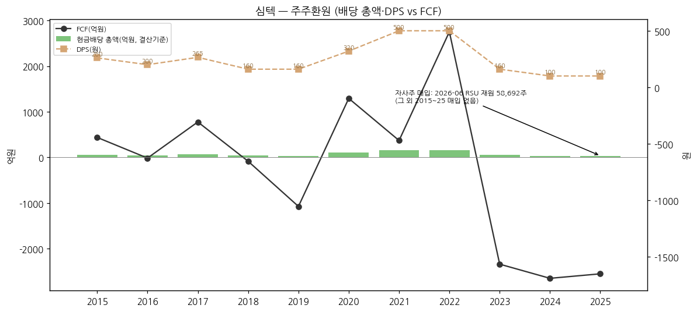

(DPS·배당총액: OpenDART 배당에 관한 사항 (사업보고서 2016·2019·2022·2025). FCF는 연결 현금흐름표 [계산])
→ 결산 현금배당만, 분기배당 없음. 2023\~2025 3년 연속 **적자에도 배당** (DPS 160 → 100 → 100원)
→ 자사주: 2015 분할 단수주 8,266주 외 매입 없음 → 2026-06 양도제한조건부주식(RSU) 재원으로 58,692주 첫 매입, 보유 66,958주 (0.17%) [DART 분기보고서(2026.09) I-4 주5]. 소각 이력 없음

### ⑦ 재무 비율

| 연도 | ROE | ROA | 부채비율 | 유동비율 | 이자보상배율(OP/이자지급) | 순차입/EBITDA |
|---|---|---|---|---|---|---|
| 2016 | 17.5% | 5.1% | 236% | 61% | 7.3배 | 2.2배 |
| 2017 | 8.2% | 2.4% | 239% | 53% | 5.2배 | 2.3배 |
| 2018 | 1.1% | 0.3% | 279% | 48% | 2.7배 | 2.1배 |
| 2019 | -21.0% | -4.8% | 420% | 46% | -1.9배 | 6.1배 |
| 2020 | 25.1% | 7.0% | 170% | 57% | 10.8배 | 0.8배 |
| 2021 | 35.3% | 14.5% | 125% | 72% | 27.1배 | 0.5배 |
| 2022 | 49.5% | 23.2% | 107% | 106% | 75.1배 | -0.0배 |
| 2023 | -21.3% | -9.4% | 150% | 57% | -7.8배 | - |
| 2024 | -6.8% | -2.4% | 222% | 65% | -2.6배 | - |
| 2025 | -32.1% | -10.7% | 181% | 91% | 0.6배 | - |

(ROE·ROA = 연결 순이익 / 기초·기말 평균. 이자보상배율 = 영업이익 / 현금흐름표 이자지급액. 순차입/EBITDA의 EBITDA = 영업이익 + 감가상각비 (2024\~2025 감가상각 미추출로 공란))

---

## 5. 지배 구조

### ① 그룹·계열 관계

→ 기업집단 **심텍홀딩스** — 계열 20개사 (상장 2: 심텍홀딩스·심텍 / 비상장 18) [DART 분기보고서(2026.09) IX]
→ 구조: 전세호 회장 → **심텍홀딩스(036710)** → 심텍(31.00%) → 글로벌심텍(98.55%) → STJ Holdings → Simmtech Graphics(日, 99.26%) / Simmtech HK → 신태전자(中 시안)
→ 홀딩스 쪽 해외 법인: SIMMTECH INTERNATIONAL(싱가포르, 판매), Simmtech Japan·America·Taiwan·SE Asia·India(영업), SUSTIO SDN. BHD.(말레이시아, PCB 제조 법인으로 분류) — 심텍이 SUSTIO에 지급보증 USD 2,200만 제공 [DART 우발부채 주석]
→ 연결 종속회사 8개 (주요 3: 글로벌심텍·신태전자·Simmtech Graphics) [DART I-1]
→ 특수관계자 거래 규모: 홀딩스 계열 판매법인 경유 매출 2025 4,319억(30.6%), STNC Hong Kong 대여 949억(2025) [DART 특수관계자 주석] — 그룹 내 자금·판매 흐름이 큼

### ② 주주 구분

| 주주 | 주식수 | 지분율 | 기준일 |
|---|---|---|---|
| 심텍홀딩스 (최대주주) | 11,930,646 | 31.00% | 2026-09-30 |
| 특수관계인 (계열 임원 5인) | 50,643 | 0.13% | 2026-09-30 |
| 외국인 | - | 7.54% | 2026-11-24 (네이버증권) |
| 자기주식 | 66,958 | 0.17% | 2026-09-30 |
| 기타 (국내 기관·개인) | - | 약 61.2% | 계산 |
| 발행주식 총수 | 38,484,526 (9/30) → 39,783,467 (11/13) | | |

[OpenDART 최대주주 현황 (분기보고서 2026.09), 주식의 총수]
→ 심텍홀딩스 지분율 변화: 33.05% (2025초) → 33.19% (2025말, 12,395,602주) → 31.00% (2026-09, 11,930,646주) — 2026년 중 약 46.5만주 감소 + 전환 희석 [OpenDART]. 7회 영구CB의 홀딩스 콜옵션분 전환(2026-11)으로 4Q26 지분 일부 회복 가능
→ 5% 이상 주주는 심텍홀딩스 외 공시 확인 안 됨 (국민연금 등 [❌ 미확인])

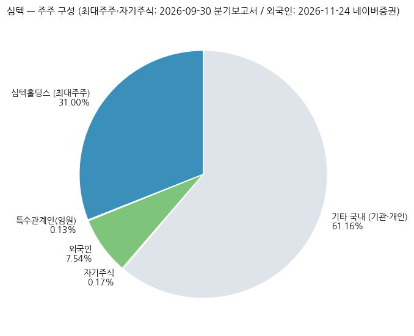

### ③ 임원·이사회 (2025 사업보고서 기준, 3Q26 변동 반영)

**등기임원 (사내 3 / 사외 1 / 감사 1)**

| 이름 | 직위 | 출생 | 주요 경력 |
|---|---|---|---|
| 전세호 | 회장 · 이사회의장 (사내이사) | 1956.05 | 고려대, 미 FDU MBA. 前 심텍 대표이사. 최대주주 측 |
| 전영선 | 사장 · 대표이사 (2024.03\~) | 1982.06 | Washington Univ. in St. Louis. 前 심텍 영업센터장 |
| 김영구 | 사장 · 대표이사 (2022.01\~) | 1967.09 | 충북대 경영대학원 AMP. 前 부사장·전략기획본부장 |
| 한병준 | 사외이사 | 1959.08 | 前 STATS ChipPAC 회장, 前 Amkor |
| 김장래 | 감사 (상근) | 1963.01 | 前 딜로이트안진 FRM Director, 前 김앤장 전문위원 |

→ 각자대표 2인 체제 (전영선·김영구). 감사위원회 없이 상근감사 1인
→ 주요 미등기 임원: 이진환 사장·COO (前 삼성전기 PKG사업팀장, 前 대덕전자 부사장), 김민철 CPO (前 하이닉스 CFO), 정창보 부사장·개발본부장, 오재성 전무·기술센터장 (前 SK하이닉스 PKG개발 부사장), 전원배 전무·경영지원센터장 [OpenDART 임원현황 2025]
→ 반도체 고객사(삼성전자·SK하이닉스) 출신 엔지니어가 품질·개발·설비 라인에 다수 — 고객 공동개발 구조를 반영

---

## 6. 기타 팩트

### ① R&D 인프라

| 연도 | 2015 | 2016 | 2017 | 2018 | 2019 | 2020 | 2021 | 2022 | 2023 | 2024 | 2025 | 3Q26 누적 |
|---|---|---|---|---|---|---|---|---|---|---|---|---|
| R&D/매출 | 0.40% | 0.67% | 1.9% | 2.14% | 2.02% | 1.24% | 1.57% | 0.93% | 1.88% | 1.92% | 3.42% | 3.21% |
| 연구개발비(억원) | 16* | 53* | 154* | 216* | 202* | 149* | 214* | 149 | 196 | 236 | 482 | 473 |

(2022\~ 공시 금액 (전액 비용 처리, 자산화 없음). *2015\~2021은 공시 비율 × 연결 매출 역산 [⚠️ 계산]. [DART 사업보고서 각 연도 6-2, 분기보고서(2026.09)])
→ 조직: 기업부설연구소 (연구개발그룹·메모리제품개발그룹·시스템제품개발그룹), 인원 137명 (박사 2·석사 26) [DART 분기보고서(2026.09)]
→ 특허: 국내 등록 148·해외 1, 출원 중 18 (합계 167건)
→ 2025 R&D 2배 증가 (236억 → 482억) — SOCAMM·System IC 신제품 개발 시기와 일치

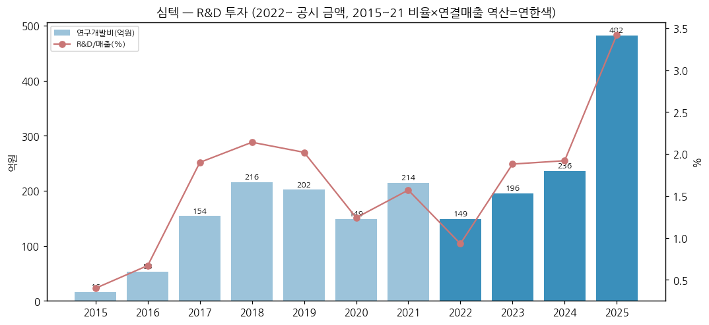

### ② 진행 중 corporate action — 10년치

| 시기 | 내용 |
|---|---|
| 2015.07 | 舊심텍 인적분할 (심텍홀딩스 / 심텍) |
| 2016.07 | STJ Holdings 유상증자 참여 (일본 Eastern 인수 비히클) |
| 2017.12 | STJ Holdings 추가 취득 → Eastern 종속회사 편입 (95.05%) |
| 2017.10 | 심텍홀딩스 대상 상환우선주 발행 결의 (2017-11 발행 1,593,625주) |
| 2018 | 글로벌심텍 설립·현물출자 (해외 지분 정리) |
| 2020.05 | T.E.TECH(M) (말레이시아 검사) 50.44% 취득 |
| 2020.05\~09 | 주주배정 유상증자 (2020-02 결정, 09-16 납입) + 상환우선주 710,660주 |
| 2021.02 | 에이아이테크(PCB 검사) 설립 |
| 2022.03 | 베스틱스(물류) 100% 인수 |
| 2022.01 | Simmtech Graphics, Nippon Via 흡수합병 |
| 2024.03 | 4회 CB + 5회 BW 발행 |
| 2025.06 | 7회 영구CB 발행 |
| 2026.06 | 자사주 58,692주 취득 (RSU 재원) |
| 2026.11 | 4·5·7회차 전액 전환 완료 — 발행주식 39,783,467주 |

[DART 사업보고서(2025.12) I-2·I-3, 분기보고서(2026.09)]

### ③ R&D 마일스톤 — 10년치

→ 2016: ETS(패턴매립형기판) 세계일류상품 — 미세회로 MCP·FC-CSP 기반 기술
→ 2018\~2019: 일본 법인 MSAP 라인 증설, GDDR6용 기판 양산 (3Q19\~) [4Q21 IR 용어설명]
→ 2021\~2022: DDR5용 BOC·모듈 PCB 양산, F9 고다층 MSAP 공장 완공 (2022-12)
→ 2023: GDDR 기판 세계일류상품 (GDDR7 전환 대응)
→ 2024: CXMT 품질 인증 (중국 메모리 신규 고객)
→ 2025\~2026: AI 서버용 SOCAMM 모듈 PCB + MCP for SOCAMM 일괄 공급 양산, LPCAMM·CXL 모듈 개발 [IR]
→ 최근 개발 완료 과제: AiP High Layer 기판, Embedded Active + Cavity 기판, Micro LED용 ETS 기판(글라스 대체), Cu Post 등 [DART 분기보고서(2026.09) 6-2]

### ④ 주요 리스크

→ **메모리 사이클 / 고객 집중**: 삼성전자·SK하이닉스·Micron 3사 63% — 메모리 감산 시 2023처럼 매출 -39% 가능
→ **재무 레버리지·신용**: 신용등급 B+ (2026.05), 단기차입금 4,421억(2025말)·3Q26말 5,570억 [IR], 3년 연속 영업CF 마이너스 이력. 업사이클이 길어지지 않으면 차환 부담
→ **파생·환율 손익 변동**: CB·BW 전환권 평가손실(2025 1,333억)은 전환 완료로 해소. 수출 비중 84.7%(로컬 포함)로 원/달러 환율이 매출·환산손익에 직접 영향 [DART]
→ **특수관계자 거래**: 그룹 판매법인 경유 매출 30%대, 계열사 대여·지급보증 — 이익 귀속·자금 흐름 투명성 점검 필요
→ **장기미수금 성격 미확인** (2025말 1,897억) — 다음 버전 확인 과제
→ 소송·칩스법 등: 공시상 중요 소송 확인 안 됨

### ⑤ ESG 등급

→ ❌ 미확보 — 지속가능경영보고서·KCGS(한국ESG기준원) 등급을 이번 수집에서 찾지 못함
→ 공시상 활동: 삼성전자 DS부문 안전경영대회 ESG 활동 최우수(2022), RBA VAP 인증(시안 법인), ISO 50001 (시안)

### ⑥ 인증·라이선스

→ 세계일류상품 4개 품목 (모듈 PCB·BOC 2008, ETS 2016, GDDR 기판 2023)
→ 시안 법인: ISO 9001·14001·45001, IATF 16949(전장), ISO 50001, IECQ QC080000, RBA VAP [DART 종속회사 연혁]
→ 수상: 무역의날 10억불 수출의 탑(2022)·금탑산업훈장(2023), 코스닥대상 국무총리상(2023), 2024 코스닥 글로벌 선정

---

## Activity 보고 (v1.0)

### ✅ 확보 자료
→ OpenDART 재무 JSON 44개 (심텍, 2015 FY\~3Q26) + 44개 (심텍홀딩스), 분기 요약표 자동 생성 (1Q16\~3Q26)
→ DART 공시원문 XML 45건 (심텍 사업·반기·분기 3Q15\~3Q26) + 48건 (심텍홀딩스 1H15\~) — 주요제품 매출·고객·CAPA·R&D·신용등급·연혁 추출
→ 심텍 IR PDF 34건 (2018-05\~2026-11) — MSAP/HDI/Tenting 16분기, 성장동력(SOCAMM·System IC) 수치
→ OpenDART 기업개황·주주·임원·직원·배당 5개 연도 / Yahoo 주가 3종 / 네이버증권 외국인 지분율·시총

### ❌ 누락 자료
→ 2014년 이전 분기 숫자 (분할 전 舊심텍 분기보고서 — 이번 다운로드 범위 밖) → 분기 시계열 47분기 (표준 60분기 미달)
→ 2014 현금흐름·CapEx (舊심텍), 2012 이전 연간
→ IR PDF 5건 다운로드 실패 (2017-10·2018-02·2021-08·2021-11 등) → 2021\~3Q22 연결 MSAP/HDI/Tenting 분해 미구성 (당시 IR은 심텍 본체·Graphics 별도 공개)
→ 감가상각비 2024\~2025 (OpenDART 항목명 차이), 장기미수금 성격, 5% 이상 기타 주주, ESG 등급·지속가능경영보고서

### ⚠️ 추정·계산 데이터
→ 2015 손익 pro forma (1H 분할부문 + 2H 신설법인), 4Q23 IR 부문 수치 (1Q24 QoQ 역산), 2015\~2021 R&D 금액 (비율 × 매출), 시가총액·PBR (수정주가 × 연도별 발행주식 근사), 경쟁사 목록 [판단]

### 🔗 핵심 source URL
→ DART 심텍 corp_code 01095722 / 심텍홀딩스 00152127 (opendart.fss.or.kr)
→ 심텍 IR: m.irgo.co.kr/IR-COMP/222800 (KIND IR자료실 동일 원본)
→ Yahoo Finance query1.finance.yahoo.com/v8/finance/chart/222800.KQ
→ 네이버증권 m.stock.naver.com/api/stock/222800/integration

### Data Quality Confidence: **85%**
→ 2015\~3Q26 손익·재무·제품 매출은 OpenDART·DART 원문 대조 (분기 합 = 연간 합, IR HDI = DART Module PCB 일치 확인). 차감 요인: 분기 시계열 길이 부족(47Q), 2015 PF 합산, 부문 이익 미공시, 장기미수금·ESG 미확인

---

## Version Log

→ **v1.0 (2026-11-25)**: 최초 작성. 12년 연간 (2014 舊심텍 + 2015 PF + 2016\~2025) + 47분기 (1Q15\~3Q26) + 제품 2분류(DART)·IR 3부문 16분기 + 13종 차트 (chart2를 제품·부문 2종으로 분리)
→ 잔여 보완 후보: 舊심텍(심텍홀딩스) 2011\~2015 분기보고서로 분기 시계열 60Q 확장, 2021\~3Q22 IR 부문 분해(심텍 본체 + Graphics 합산), 감가상각 2024\~2025 보강, 장기미수금 주석 확인, ESG 등급, 2026 결산(사업보고서 2027-03) 반영
