> 종목: 에스비비테크 (389500.KQ / (주)에스비비테크 / SBB TECH Co., Ltd.)
> 섹터: 로봇 — 서브섹터 로봇 부품 (트래킹 피어)
> 작성 시각: 2026-11-14 KST (v1.0 — 최초 작성)
> 적용 구조: v4.8 (6개 섹션 + 12종 표준 차트 + chart2b 제품별 분기 시계열). 2022.10 상장 소형주라 연간은 2020~2025(6년, OpenDART 2022 사업보고서 비교기 포함), 분기는 1Q23~3Q26(15분기)로 축소 적용. **연결 대상 종속회사 없음 → 전 수치 별도(OFS) 기준**
> 데이터: 별도 연간 6년(2020~2025) + 별도 분기 15개(1Q23~3Q26, OpenDART — 4Q = 연간 − 3Q 누적) + 제품별 매출(DART 정기보고서 16건의 'II-4 매출실적' 누적치 → 분기 역산) + Yahoo Finance 389500.KQ 주간 시계열(2022.10~2026.11)
> 출처: DART 정기보고서 16건 (corp_code 00567897) — 최신 2026.09 분기보고서(rcept_no 20261112000519, 2026-11-12 공시), 2025 사업보고서(20260323000721) / OpenDART 재무 JSON 16건(2022 FY~2026 3Q) / 회사 IR: irgo 게시 1건(2026-07-09 '주요 사업 소개') — 분기 실적 IR 미발간 / 언론: 아시아경제 2026-04-16(NH투자증권 리포트 인용), 이투데이 2026-07-22(송진웅 대표 인터뷰) / 시장데이터: Yahoo Finance(2026-11-13 종가)

# 에스비비테크 기업 개요 (v1.0 — 정밀 감속기·반도체 베어링, 적자 기술특례 → 감속기 양산 초입)
> **Fact verify cutoff**: 2026-11-14 (주가·시가총액·52주 고저는 2026-11-13 Yahoo Finance meta 단일 소스 — 2차 소스 교차 확인 미완. 재무는 **2026.09 분기보고서(2026-11-12 공시)까지 반영**)

---

## ① 기업 분류

(1) Primary / Secondary 분류

**⚠️ Boundary Case — 상장 후 한 번도 흑자가 없는 기술특례 부품사 → 3Q26 감속기 양산 매출 첫 확인**

**Primary 분류: 꿈 (국산 하모닉 감속기 → 휴머노이드·모빌리티 액추에이터 옵션가치)**

→ 2020~2025 6년 연속 영업적자. 6년 평균 OPM -71.2%, 평균 영업이익 -43억. GPM 자체가 2023~2025 2~6%로, 매출원가도 못 넘기는 구조였다
→ 시가총액 약 2,062억(2026-11-13) vs 최근 4분기 매출 115억 → PSR 약 18배. 주가는 2024.08 저점(주간 장중 12,000원) → 2026.05 장중 115,000원까지 **약 9.6배** — 휴머노이드·로봇 감속기 국산화 기대가 만든 재평가

**Secondary 노트: 고성장 전환 신호 (3Q26)**

→ 3Q26 매출 48.8억 **+142.9% YoY** (상장 후 분기 최대), 3Q26 누적 93.6억 +86.1% YoY — 이미 2025 연간(72.0억)을 넘었다
→ 성장은 **감속기 한 품목**이 만들었다: 감속기 분기 매출 1Q26 1.2억 → 2Q26 12.9억 → **3Q26 33.0억** (3Q26 매출의 67.6%). 신규 10% 이상 고객 'A사' 3Q26 누적 35.1억 (매출의 37.5%)
→ 감속기 수주잔고 106.7억 (12,962개, 납기 ~2028.03 — DART 2026.09 분기보고서)
→ 다만 3Q26 OPM -35.6% — 여전히 적자. 회사 목표는 "27년 손익분기 매출 달성" (IR 2026-07), 대표 인터뷰는 "2027년 말~2028년 전후 흑자 전환 기대" (이투데이 2026-07-22)

**Entity 구조 (2026.09)**

→ **(1) (주)에스비비테크** — 단일 법인(연결 종속회사 없음), 단일 보고부문 '구동장치 및 부품'
→ **(2) 사업장** — 본사·베어링 공장: 경기 김포시 월곶면 / 감속기·액추에이터: 충남 천안시 입장면(TC) / 사무소: 경기 성남시 분당 (IR 2026-07)
→ **(3) 최대주주** (주)케이피에프(코스닥, 볼트·너트·자동차부품) 39.66% — 송현그룹 계열 (2018.10 인수)
→ 제품 4종: **감속기(ROBO DRIVE)** / ROBO BEARING(반도체 진공로봇용 박형 베어링) / WRIST(웨이퍼 이송로봇 손목 모듈) / HYBRID BEARING(세라믹 등 특수환경 베어링). 제품별 매출만 공시, 제품별 이익 미공개

(2) Summary Box (별도 6년 2020~2025 + 2026 3분기 누적)

| 지표 | 6년 평균 (2020~2025) | 정점 | 저점 | 2025년 | 3Q26 누적 |
|---|---|---|---|---|---|
| 매출 (억원) | 64.4 | **74.7 (2022)** | 51.3 (2023) | **72.0** | **93.6 (+86.1% YoY)** |
| 영업이익 (억원) | -43.4 | -18.4 (2022) | -68.9 (2024) | -68.6 | -65.4 |
| 순이익 (억원) | -54.7 | -9.0 (2024) | -110.1 (2023) | -94.5 | -138.7 (CB 평가손실 72.4억 포함) |
| OPM | -71.2% | -24.6% (2022) | -126.1% (2024) | -95.3% | -69.9% (3Q 단독 -35.6%) |
| GPM | 11.7% | 26.4% (2022) | 1.8% (2024) | 5.6% | 5.7% (3Q 단독 15.3%) |

→ 매출 CAGR(2020→2025) **+1.7%** — 2025년까지는 연 50~75억 박스. 2026년 3분기에야 레벨업
→ 2023 이후 GPM이 한 자릿수로 붕괴: 매출이 51억으로 줄어드는 동안 천안 감속기 라인 증설·인력 증가로 고정비(감가상각비 2022 9.8억 → 2025 18.8억)가 커졌다
→ 순이익은 영업손실보다 **CB 공정가치 평가손익**이 크게 흔든다 (2024 금융수익 73.8억 → 순손실 -9억, 1Q26 평가손실 72.4억 → 분기 순손실 -88억)

(3) 정량 근거 — 연간 매출·OPM

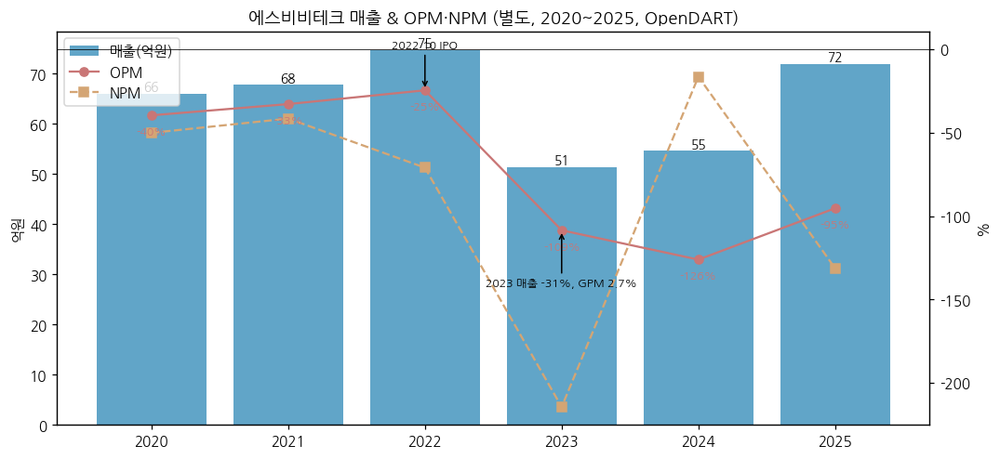

→ 2020~2022 매출 66~75억, OPM -25~-40% → 2022.10 기술특례 상장 → 2023 매출 -31%(반도체 베어링 수요 급감: ROBO BEARING 16.9억 → 9.1억, WRIST 13.0억 → 7.1억)로 GPM 2.7%까지 하락 → 2025 반도체 베어링 회복(+31.7%)에도 적자 지속 → 2026 감속기 양산 공급 시작

(4) 산업 분류

| 구분 | 분류 |
|---|---|
| DART 업종 | 291 — 일반 목적용 기계 제조업 |
| KRX | 코스닥 (2022.10.17 기술특례 상장, 공모가 10,240원) |
| 기업 규모 | 중견기업 (DART 2026.09 — 중소·벤처기업 미해당) |
| 워치리스트 | 로봇 섹터 — 서브섹터 **로봇 부품** / 핵심: Sanhua·Tuopu·현대모비스, 확장: Leaderdrive·로보티즈, **트래킹: 에스비비테크** |
| 정책 | 소부장 으뜸기업(2021.01, 초정밀 구동부품), K-휴머노이드 연합 참여 (IR 2026-07) |

(5) 분류 결정 논리

→ 6년 연속 적자 + 이익 기반 밸류 불가, 주가는 감속기 국산화·휴머노이드 액추에이터 기대를 반영 → **꿈**
→ 3Q26 감속기 33억·수주잔고 107억으로 "매출이 실제로 나오기 시작한" 단계. 4Q26~1H27에도 분기 매출 40억+ 유지·GPM 15%+가 확인되면 고성장으로 재분류 `[판단]`

(6) 적정 밸류에이션 방법

| 우선순위 | 방법 | 현재 값 (2026-11-13) | 비고 |
|---|---|---|---|
| 1 | PSR (최근 4분기 매출) | 시총 2,062억 / 115.2억 = **약 17.9배** | 최근 4분기 = 4Q25 21.7 + 1Q26 17.7 + 2Q26 27.0 + 3Q26 48.8 |
| 2 | PBR | 2,062억 / 자본 184.3억(2026.09) = **약 11.2배** | 누적 결손금 -521.7억 |
| 3 | 수주잔고 배수 | 시총 / 감속기 수주잔고 106.7억 = 약 19배 | 수주는 P/O 단납기 외 별도 (DART 주석) |
| 4 | PER | 적자 — 산정 불가 | 회사 목표 2027 BEP |

(7) 분기 재평가 트리거

→ (1) 감속기 분기 매출 30억+ 유지 여부 (3Q26 33.0억이 A사 일회성 초도물량인지 확인)
→ (2) 분기 GPM 15%+ 유지 → 영업손실 축소 경로 (3Q26 GPM 15.3%, OPM -35.6%)
→ (3) 감속기 수주잔고 증감 (3Q26말 106.7억) + 휴머노이드용 하모닉 감속기·유성기어 감속기 신규 수주 공시
→ (4) **유동성**: 3Q26말 현금 2.6억, 단기차입금 80억, 유동비율 100.5% → 추가 자금조달(유상증자·CB) 가능성
→ (5) A사 매출 의존도 (3Q26 누적 37.5%)

---

## ② 회사 개요

(1) 기본 사항

| 항목 | 내용 |
|---|---|
| 회사명 (한글) | (주)에스비비테크 |
| 회사명 (영문) | SBB TECH Co., Ltd. |
| 종목코드 | 389500 (코스닥, 2022.10.17 기술특례 상장, 공모가 10,240원) |
| 설립 | 2000.11.18 법인 설립 ((주)서한산업 → 2000.12 (주)에스비비 상호변경). 회사 기재상 사업 시작은 1993년 (초경볼·세라믹볼 베어링) |
| 본사·공장 | 경기도 김포시 월곶면 김포대로 2918번길 22 / 천안(감속기·액추에이터) |
| 홈페이지 | www.sbb.co.kr |
| 대표이사 | **류재완** (1965.09생, CEO, 2018.10~ 대표, 서울대 기계설계 석사, 前 대우중공업·나온테크·기단테크·이노스웰) / **송진웅** (1971.03생, 경영총괄, 2024.05~ 각자대표, 연세대 경영, 前 SK C&C·SK텔레콤·글로우원 CFO) |
| 발행주식수 | 보통주 6,663,472주 (2026.09, 2026.02 CB 전환 321,543주 반영) |
| 최대주주 | **(주)케이피에프 39.66%** + 특수관계인 합계 42.41% (2026.09) |
| 임직원 | 133명 (2026.09, 남 116·여 17 — DART) / 108명 (2025말) |
| 시가총액 | **약 2,062억원** (30,950원 × 6.66M주, 2026-11-13 Yahoo Finance) |
| 52주 고가 / 저가 | 115,000원 (2026-05 중순 주간 장중) / 22,800원 — Yahoo Finance meta, 2026-11-13. DART 기준 월간 종가 최고 106,400원(2026.05) |

(2) 연간 손익·자본 추이 (별도)

| 연도 | 매출 (억) | OP (억) | OPM | NI (억) | 자본총계 (억) | 자산총계 (억) |
|---|---|---|---|---|---|---|
| 2020 | 66.1 | -26.2 | -39.6% | -33.1 | 17.8 | 149.9 |
| 2021 | 67.8 | -22.3 | -32.9% | -28.2 | 66.0 | 176.3 |
| 2022 | 74.7 | -18.4 | -24.6% | -53.0 | 220.7 | 307.5 |
| 2023 | 51.3 | -55.7 | -108.5% | -110.1 | 116.1 | 545.3 |
| 2024 | 54.7 | -68.9 | -126.1% | -9.0 | 121.4 | 289.0 |
| **2025** | **72.0** | **-68.6** | **-95.3%** | **-94.5** | **125.0** | **322.3** |
| 3Q26 누적 | 93.6 | -65.4 | -69.9% | -138.7 | 184.3 | 315.5 |

→ 출처: OpenDART OFS 각 연도 사업보고서(2020·2021은 2022 사업보고서 비교기), 2026 3분기보고서
→ **시계열 단절**: ① 2021.12 제3자배정 유상증자, 2022.01 액면분할(5,000 → 500원) ② **2022.10 IPO** 1,254,000주 × 10,240원 = 128.4억 ③ **2023.05 제3회 CB 300억** (KPF 100억·주요경영진 58억 인수) — 당기손익-공정가치 부채로 자산·부채 동시 팽창 ④ 2024.08·11 CB 200억 조기상환 ⑤ 2025 자기주식 212,890주 처분 81억 + 스톡옵션 행사 ⑥ 2026.02 KPF 보유 CB 100억 전환
→ 2020 이전(2019년 이하) 손익은 OpenDART 미제공 — 증권신고서(2022) 요약재무로 보강 필요

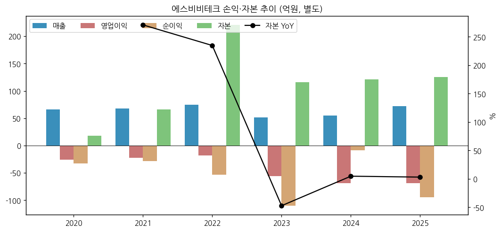

(3) 주가·시가총액 역사

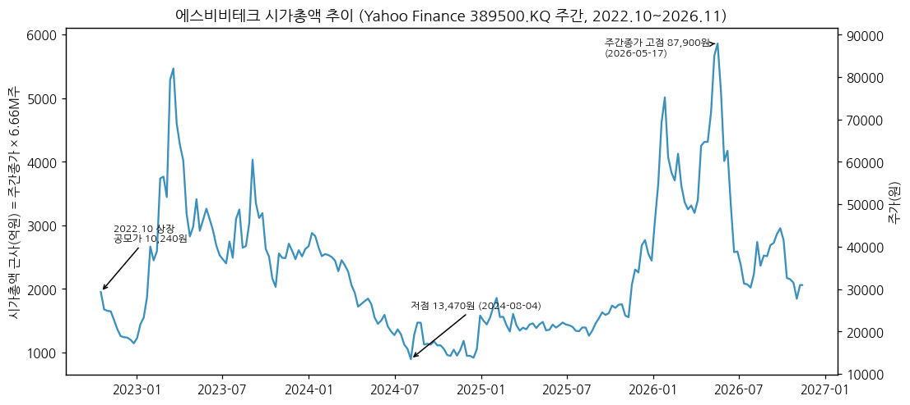

→ (출처: Yahoo Finance 389500.KQ 주간 종가 × 현재 발행주식수 6.66M주 — 2026.02 CB 전환 이전 구간은 시총이 실제보다 약 5% 과대 표시되는 근사치)

→ **2022.10 상장** 공모가 10,240원 → 상장 첫 주 종가 29,300원
→ **2023.02~04** 로봇 테마 속 주간 종가 6만원대 → 2023 하반기 3~4만원대
→ **2024.08 저점** 주간 장중 12,000원 — 1년 새 -67% (아시아경제 2024-09-11 "최근 1년 동안 주가 67% 하락")
→ **2025.12~2026.05** 휴머노이드·감속기 국산화 테마 → 2026.05 중순 장중 115,000원 (Yahoo 52주 고가), 월간 종가 최고 106,400원 (DART)
→ 2026-11-13 30,950원 — 장중 고가 대비 **-73%**. 3Q26 실적(11-12 공시) 직후에도 반등 제한

(4) 주요 연혁

| 시점 | 내용 |
|---|---|
| 1993 | 초경볼(Tungsten Carbide)·세라믹볼 베어링 국산화로 사업 시작 (회사 기재) |
| 2000.11 | 법인 설립 ((주)서한산업 → 12월 (주)에스비비 상호변경) |
| 2002~2006 | ISO 9001 / 벤처기업 / 기술부설연구소 / 이노비즈 |
| 2004.01 | ROBO BEARING 판매 개시 / 2006.01 WRIST 판매 개시 |
| 2008.09 | 감속기(ROBO DRIVE) 판매 개시 / 2009.10 로봇감속기 개발 성공 / 2013 하모닉 감속기 개발 성공 (IR) |
| 2014~2015 | 구미 국방벤처센터 협약 — 방산 감속기 진출 |
| 2018.10 | **송현그룹 (주)케이피에프 인수** — 류재완 대표 취임 |
| 2020.11 | 대한민국 기술대상 장관상 (고정밀 감속기 설계·제조 기술) |
| 2021.01 | 소부장 으뜸기업 선정 (초정밀 구동부품) |
| 2022.10 | 코스닥 기술특례 상장 |
| 2023.05 | 제3회 CB 300억 발행 (운영 50억·시설 250억 → 시설 200억분 2024 조기상환) |
| 2024.05 | 류재완·송진웅 각자대표 체제 |
| 2024.12·2025.12 | 올해의 대한민국 로봇기업 선정 (로봇 부품) |
| 2025.12 | 후속 소형 모빌리티 플랫폼 모듈 수주 (IR) |
| 2026.02 | KPF CB 100억 전환 (321,543주, 전환가 31,100원) |
| 2026.05~06 | 휴머노이드 적용 하모닉 감속기(26.5) / MobED DnL 모듈 조향·편심부 SOP(26.6) (IR 로드맵) |
| 2026.09 | 방산 RCWS 신규 프로젝트 양산·협동로봇 메이커 신규 추진 (IR 로드맵) |
| 2027 (예정) | 유성기어 감속기, 후속 모빌리티 모듈(27.3), 방산 TICN 안테나 제어용(27.3) |

---

## ③ 비즈니스 모델

(1) 실적 추이 통합 표 — 제품별 (억원, DART 매출실적)

| 구분 | 2021 | 2022 | 2023 | 2024 | 2025 | 3Q26 누적 |
|---|---|---|---|---|---|---|
| **매출 합계** | **67.8** | **74.7** | **51.3** | **54.7** | **72.0** | **93.6** |
| 감속기 (ROBO DRIVE) | 10.3 | 20.0 | 20.9 | 18.0 | 14.7 | **47.1** |
| ROBO BEARING | 14.9 | 16.9 | 9.1 | 12.6 | 20.4 | 15.5 |
| WRIST | 13.7 | 13.0 | 7.1 | 8.6 | 15.9 | 14.1 |
| HYBRID BEARING | 6.3 | 7.5 | 5.9 | 4.4 | 9.4 | 6.0 |
| 기타 (상품·시료·모듈 등) | 22.5 | 17.2 | 8.4 | 11.1 | 11.6 | 10.9 |
| **감속기 비중** | 15.2% | 26.8% | 40.7% | 32.9% | 20.4% | **50.3%** |
| 반도체 베어링 3종 비중 | 51.5% | 50.1% | 43.0% | 46.8% | 63.5% | 38.1% |

→ 출처: DART 각 연도 사업보고서·2026.09 분기보고서 'II-4 매출 및 수주상황'(천원 → 억원). 2020: 감속기 13.9 / ROBO BEARING 13.4 / WRIST 12.9 / HYBRID 6.8 / 합계 66.1억
→ 2025까지는 **반도체 장비 베어링(ROBO BEARING·WRIST·HYBRID)이 매출의 절반 이상** — 감속기 회사로 알려졌지만 매출 구조는 반도체 부품사에 가까웠다
→ 2026 '기타'는 거의 전부 'Sample, 시료 외'(3Q26 누적 10.9억)로 재분류
→ **액추에이터(구동모듈) 매출은 별도 품목으로 공시되지 않음** — 감속기 또는 기타에 포함된 것으로 보이나 확인 불가 `[판단]`
→ 3Q26 누적 감속기 47.1억은 **전액 내수** (수출 0). 베어링은 수출 비중 33% (11.7억 / 35.6억)

(2) 지역별 매출 (억원, DART 재무제표 주석)

| 지역 | 2023 | 2024 | 2025 | 3Q25 누적 | **3Q26 누적** | 3Q26 비중 |
|---|---|---|---|---|---|---|
| 대한민국 | 46.4 | 44.3 | 51.9 | 36.7 | **81.6** | 87.1% |
| 아시아 | 4.3 | 10.1 | 19.1 | 12.6 | 11.4 | 12.2% |
| 미주 | 0.4 | 0.1 | 0.7 | 0.7 | 0.4 | 0.5% |
| 유럽 | 0.2 | 0.1 | 0.2 | 0.2 | 0.2 | 0.2% |
| **합계** | **51.3** | **54.7** | **72.0** | **50.3** | **93.6** | 100% |

→ 3Q26 누적 증가분 43.3억 중 국내 +44.8억 — **성장 전부가 국내 감속기 고객**에서 나왔다. 아시아(중화권 반도체 장비향 베어링)는 오히려 -1.2억

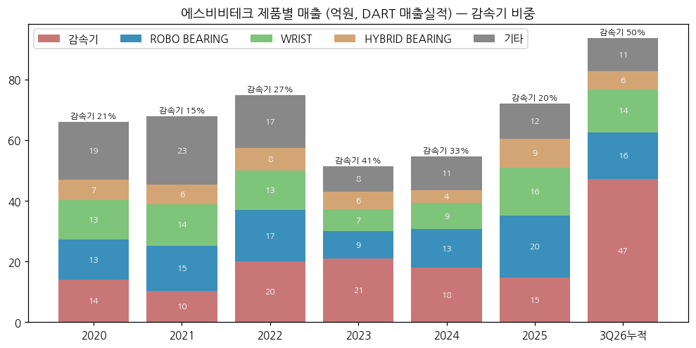

(3) 분기 시계열 (별도, 억원, 1Q23~3Q26 15분기)

| 분기 | 매출액(억원) | 매출총이익 | GPM | 영업이익(억원) | OPM | 매출 YoY | 순이익(억원) |
|---|---|---|---|---|---|---|---|
| 1Q23 | 13.0 | 2.1 | 16.2% | -9.6 | -73.4% | | -9.0 |
| 2Q23 | 13.5 | -1.3 | -9.5% | -14.1 | -104.1% | | -37.8 |
| 3Q23 | 9.0 | 1.1 | 11.7% | -14.9 | -165.7% | | -12.4 |
| 4Q23 | 15.8 | -0.5 | -3.0% | -17.2 | -108.8% | | -51.0 |
| 1Q24 | 11.4 | 0.3 | 2.4% | -17.2 | -150.0% | -12.1% | -24.4 |
| 2Q24 | 16.3 | -2.4 | -14.5% | -17.4 | -106.6% | +20.9% | 49.2 |
| 3Q24 | 11.1 | -0.5 | -4.8% | -18.9 | -169.8% | +24.1% | -16.2 |
| 4Q24 | 15.8 | 3.6 | 22.7% | -15.4 | -98.0% | -0.5% | -17.6 |
| 1Q25 | 11.8 | -0.8 | -7.1% | -19.0 | -161.1% | +2.8% | -18.7 |
| 2Q25 | 18.4 | -2.1 | -11.2% | -19.3 | -104.7% | +12.7% | -21.7 |
| 3Q25 | 20.1 | -1.9 | -9.2% | -21.4 | -106.5% | +80.6% | -21.6 |
| 4Q25 | 21.7 | 8.8 | 40.4% | -9.0 | -41.5% | +37.8% | -32.6 |
| 1Q26 | 17.7 | 1.7 | 9.4% | -18.5 | -104.3% | +50.6% | -88.1 |
| 2Q26 | 27.0 | -3.8 | -14.2% | -29.5 | -109.2% | +47.0% | -32.3 |
| **3Q26** | **48.8** | **7.5** | **15.3%** | **-17.4** | **-35.6%** | **+142.9%** | **-18.4** |

→ 출처: OpenDART fnlttSinglAcntAll (1~3Q = 3개월, 4Q = 연간 − 3Q 누적). 2022 이전 분기는 OpenDART 미제공(상장 전)
→ 2Q24 순이익 +49.2억은 CB 공정가치 평가이익(영업 무관). 1Q26 순손실 -88.1억은 CB 평가손실 72.4억(주가 급등) 때문
→ 4Q 계절성: 4Q24·4Q25 GPM이 연중 최고(22.7%·40.4%) — 연말 결산 원가 조정 효과 추정 `[판단]`

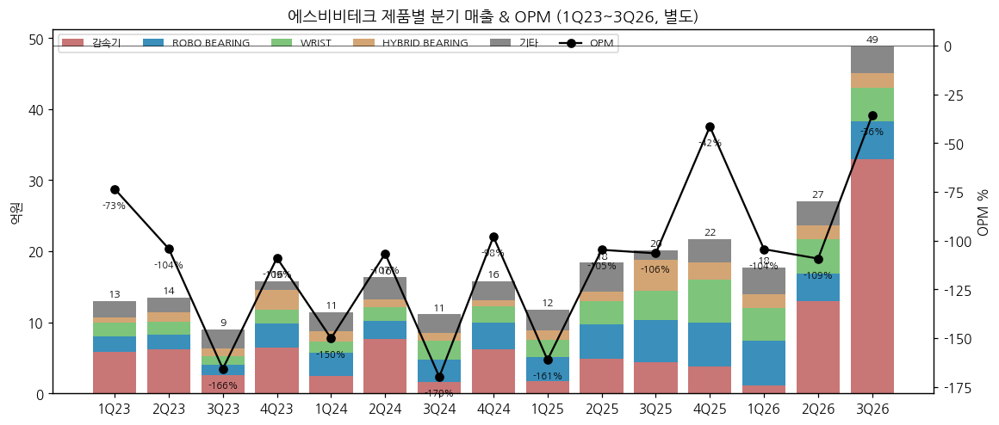

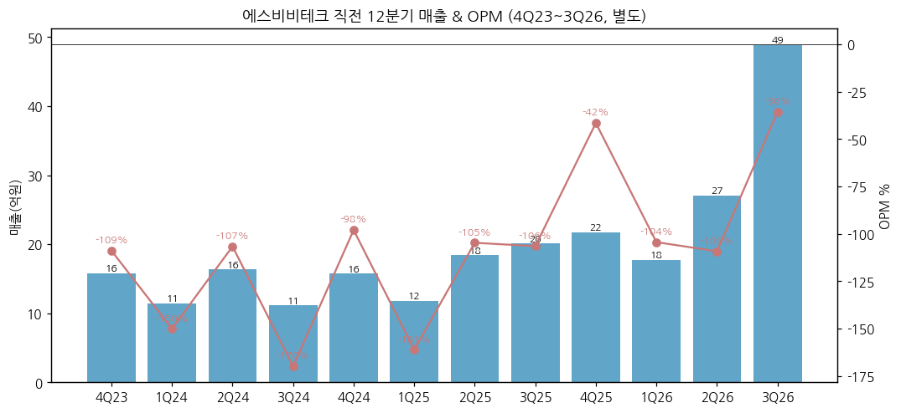

(4) 3Q26 핵심 박스 (최신 공시 분기, 2026-11-12 공시)

| 항목 | 3Q25 | 2Q26 | **3Q26** | QoQ | YoY |
|---|---|---|---|---|---|
| 매출액 (억원) | 20.1 | 27.0 | **48.8** | +80.6% | **+142.9%** |
| ├ 감속기 | 4.4 | 12.9 | **33.0** | +156% | 약 7.5배 |
| ├ ROBO BEARING | 5.9 | 3.9 | 5.3 | +37% | -10% |
| ├ WRIST | 4.1 | 4.9 | 4.7 | -4% | +15% |
| └ HYBRID BEARING·기타 | 5.7 | 5.3 | 5.8 | | |
| 매출총이익 (억원) | -1.9 | -3.8 | **7.5** | 흑전 | 흑전 |
| GPM | -9.2% | -14.2% | **15.3%** | +29.5%p | +24.5%p |
| 판관비 (억원) | 19.5 | 25.7 | **24.8** | | |
| 영업이익 (억원) | -21.4 | -29.5 | **-17.4** | 적자 축소 | 적자 축소 |
| OPM | -106.5% | -109.2% | **-35.6%** | | |
| 당기순이익 (억원) | -21.6 | -32.3 | **-18.4** | | |

→ 출처: OpenDART 2026 3Q 별도 + DART 2026.09 분기보고서 매출실적(3Q 단독 = 3Q 누적 − 반기 누적)
→ 감속기 생산실적 3Q26 누적 **12,934개**(2025 연간 3,056개의 4.2배), 감속기 가동률 24.6%(2025 4.4%) — CAPA(연 7만개) 대비 여유
→ 3Q26 누적 원재료 매입 52.7억 중 수입 30.1억 (2025 연간 수입 3.0억) — 양산 대응 원재료 조달 급증. 재고자산 37.3억(2025말) → 71.7억(2026.09)

(5) 제품별 개요

→ **(1) 감속기 ROBO DRIVE — 3Q26 누적 50.3%**: 파동기어(Strain Wave Gear, 하모닉) 감속기. 웨이브 제너레이터·플렉스플라인·서큘러 스플라인 3개 부품으로 구성, 독자 치형 설계. 협동·SCARA 로봇, 방산(K9 자주포 29축, RCWS, K10 탄약운반장갑차, 폭발물 제거 로봇, TICN 안테나), 소형 모빌리티. 회사 주장 "일본 H사(Harmonic Drive Systems) 근접 성능, H사 대비 60~80% 판가" (IR 2026-07). 유성기어 감속기 2027 출시 예정
→ **(2) ROBO BEARING — 16.6%**: 반도체 진공 로봇 구동부용 초박형 베어링. 반도체 고객 A사(AMAT 설비 적용: VHP·Robo-Bearing·WRIST) 등 (IR 2026-07)
→ **(3) WRIST — 15.1%**: 반도체 웨이퍼 이송 로봇의 손목(HAND) 구동 모듈. 가동률 95.2%(3Q26)로 CAPA 한계
→ **(4) HYBRID BEARING — 6.4%**: 세라믹·스테인리스·엔지니어링 플라스틱 소재 특수환경(고온·고속·내식) 베어링. 방산(K2 흑표 폴란드 Project) 공급 (IR)
→ **(5) 액추에이터·구동모듈 (신규)**: 감속기+모터+드라이버+엔코더+브레이크 통합. 소형 모빌리티 플랫폼 'Mobile Eccentric Droid(MobED)'용 DnL(Drive & Lift) 모듈 조향·편심부 시양산(SOP 2026.06), 후속 모빌리티 플랫폼 모듈 2025.12 수주·2027 시양산 예정 (IR 2026-07). 아시아경제(2026-04-16)는 이를 "글로벌 자동차그룹향 소형 모빌리티 플랫폼"으로 보도

(6) 제품별 디테일

→ 감속기 수주: 2024.01~2026.09 누적 수주 26,058개·182.8억, 기납품 13,096개·76.1억, **잔고 12,962개·106.7억** (납기 2024.01~2028.03). 단, 판매는 P/O 단납기 형태로 잔고 외 매출도 발생 (DART 2026.09)
→ 감속기 판매 전략 4대 시장 (DART 2026.09): ⓐ 협동로봇 → 소형 모빌리티 ⓑ 방위산업 (2건 체계사업 적용 중, 국방과학연구소 출신 인력) ⓒ 서비스·물류 로봇 ⓓ 휴머노이드 (미주 시장 교두보, 글로벌 OEM·Tier-1 협력 목표)
→ CAPA: 감속기 연 70,000개(420억원 기준) / ROBO BEARING 10,000개 / WRIST 800개 / HYBRID 10,000개 (2025 기준). 대표는 "예상 수요를 감당하려면 지금보다 5~10배 매출을 뒷받침할 생산능력 필요", M&A 검토 중 (이투데이 2026-07-22)
→ 유형자산 취득 3Q26 누적 40.7억(기계장치 +21.0억, 공구·비품 +13.0억) — 2023 CB 시설자금을 "2026년 감속기 생산능력 증대" 설비에 사용 (DART 자금사용내역)

(7) 주요 경쟁사

| 구분 | 경쟁사 | 비고 |
|---|---|---|
| 하모닉 감속기 (일본) | **Harmonic Drive Systems(HDS)** | 회사 IR 경쟁 비교 대상 (IR 2026-07) |
| 하모닉 감속기 (중국) | **Leaderdrive(绿的谐波)**, SIMPO | 회사 IR 경쟁 비교 대상. Leaderdrive는 워치리스트 확장 피어 |
| 액추에이터 (한국) | 로보티즈(DYNAMIXEL), 현대모비스(액추에이터 진출) | 워치리스트 피어 `[판단]` |
| 휴머노이드 액추에이터 (중국) | Sanhua, Tuopu | 워치리스트 핵심 피어 `[판단]` |
| 반도체 진공 베어링 | 일본계 베어링사 `[판단]` | DART에 실명 기재 없음 |

→ DART는 "로봇용 감속기·특수 베어링 시장은 여전히 일본 등 일부 글로벌 기업이 높은 점유율"로만 기재 — 국내 점유율 수치 미공시

(8) 주요 매출처

| 10% 이상 고객 (DART 주석) | 2022 | 2023 | 2024 | 2025 | 3Q25 누적 | **3Q26 누적** |
|---|---|---|---|---|---|---|
| A사 | 7.9 | 5.5 | 6.8 | 13.9 | — | **35.1 (37.5%)** |
| B사 | 6.8 | 6.4 | 6.1 | 7.1 | 5.5 | 8.2 |
| C사 | 7.6 | 6.0 | 7.9 | 3.7 | 5.5 | 8.6 |

→ 회사는 연도별로 A·B·C사 명칭을 재지정하므로 연도 간 동일 고객 여부는 확인 불가
→ 3Q26 A사 35.1억은 3Q26 누적 감속기 매출(47.1억, 전액 내수)의 75% — **A사 = 국내 감속기·모빌리티 모듈 고객**으로 추정. IR의 MobED DnL 모듈 SOP(2026.06) 및 "글로벌 자동차그룹향" 보도와 시점이 맞으나 회사 공시로 확인되지 않음 `[판단]`
→ IR 기재 레퍼런스 (2026-07): 방산 — 한화에어로스페이스(K9), 휴니드테크놀로지(HCTR), 국방부 정비창(K10), LIG넥스원(TOD) / 반도체 — AMAT 설비(A사), EBARA 설비(B사, CMP Parts), 300mm 웨이퍼 Hub 베어링(C사) — IR 내 A·B·C사는 주석 A·B·C사와 별개 표기일 수 있음

(9) 임직원

→ 133명 (2026.09: 남 116·여 17, 평균 근속 3.8년, 1인 평균 급여 3Q 누적 3,400만원) / 108명 (2025말, 1인 평균 연봉 남 3,800만·여 2,200만원)
→ 영업조직: 기술영업 7명·기술지원 5명 (DART 2026.09)

---

## ④ 재무 구조 (연간 2020~2025, 별도)

① 손익계산서

| 항목 (억원) | 2020 | 2021 | 2022 | 2023 | 2024 | 2025 | 3Q26 누적 |
|---|---|---|---|---|---|---|---|
| 매출액 | 66.1 | 67.8 | 74.7 | 51.3 | 54.7 | 72.0 | 93.6 |
| 매출원가 | 55.3 | 56.1 | 55.0 | 50.0 | 53.7 | 68.0 | 88.3 |
| 매출총이익 | 10.8 | 11.7 | 19.7 | 1.4 | 1.0 | 4.0 | 5.3 |
| 판관비 | 37.0 | 33.9 | 38.1 | 57.1 | 69.9 | 72.6 | 70.7 |
| 영업이익 | -26.2 | -22.3 | -18.4 | -55.7 | -68.9 | -68.6 | -65.4 |
| 금융수익 | 0.7 | 0.3 | 0.8 | 6.9 | 73.8 | 2.1 | 0.7 |
| 금융비용 | 9.2 | 6.1 | 39.0 | 60.7 | 13.5 | 25.2 | 74.6 |
| 당기순이익 | -33.1 | -28.2 | -53.0 | -110.1 | -9.0 | -94.5 | -138.7 |
| 매출 YoY | — | +2.6% | +10.2% | -31.3% | +6.5% | +31.7% | +86.1% |
| GPM | 16.4% | 17.2% | 26.4% | 2.7% | 1.8% | 5.6% | 5.7% |
| 판관비율 | 56.0% | 50.1% | 51.0% | 111.2% | 127.9% | 100.9% | 75.5% |
| OPM | -39.6% | -32.9% | -24.6% | -108.5% | -126.1% | -95.3% | -69.9% |
| NPM | -50.1% | -41.6% | -71.0% | -214.5% | -16.4% | -131.3% | -148.2% |

→ 연구개발비가 판관비의 큰 축 (2025 연구개발비용 27.5억 vs 판관비 72.6억 — 일부는 원가 배분 가능)
→ 금융비용·수익의 대부분은 CB(당기손익-공정가치 금융부채) 평가손익 — 주가가 오르면 손실, 내리면 이익. 2026.02 CB 전액 전환·상환 완료로 이 변동성은 사라졌다 (3Q26말 FVPL 부채 0)

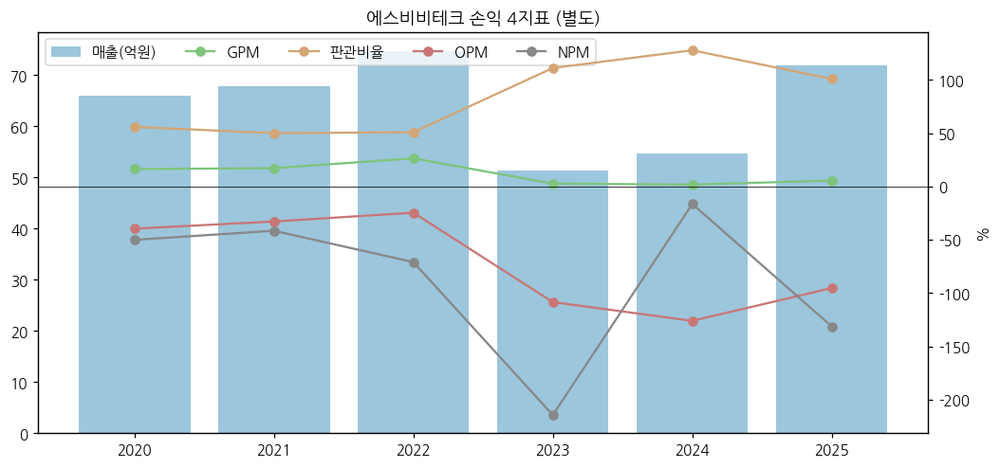

② 재무상태표

| 재무상태 (억원) | 2020 | 2021 | 2022 | 2023 | 2024 | 2025 | 2026.09 |
|---|---|---|---|---|---|---|---|
| 자산총계 | 149.9 | 176.3 | 307.5 | 545.3 | 289.0 | 322.3 | 315.5 |
| 유동자산 | 44.2 | 73.0 | 178.5 | 405.5 | 140.0 | 156.6 | 124.5 |
| 현금및현금성자산 | 8.0 | 36.1 | 137.8 | 21.7 | 21.4 | 93.5 | **2.6** |
| 재고자산 | 10.2 | 17.9 | 24.7 | 20.7 | 15.5 | 37.3 | 71.7 |
| 유형자산 | 99.0 | 102.1 | 120.6 | 131.5 | 139.8 | 155.6 | 181.9 |
| 부채총계 | 132.1 | 110.4 | 86.8 | 429.2 | 167.5 | 197.3 | 131.2 |
| 유동부채 | 80.0 | 63.2 | 74.5 | 417.3 | 160.3 | 189.4 | 123.8 |
| 단기차입금 | 2.6 | 5.0 | 60.0 | 50.0 | 50.0 | 50.0 | 80.0 |
| FVPL 금융부채(CB) | — | — | — | 357.5 | 99.9 | 122.8 | — |
| 자본총계 | 17.8 | 66.0 | 220.7 | 116.1 | 121.4 | 125.0 | 184.3 |
| 결손금 | -88.7 | -116.8 | -169.5 | -279.5 | -288.4 | -383.0 | -521.7 |
| 부채비율 | 742.7% | 167.3% | 39.4% | 369.7% | 138.0% | 157.8% | 71.2% |
| 유동비율 | 55.2% | 115.5% | 239.7% | 97.2% | 87.3% | 82.7% | 100.5% |

→ 2023 자산 545억은 CB 300억 유입분(기타금융자산 운용) — 2024 조기상환으로 원복
→ **2026.09 현금 2.6억** (2025말 93.5억) — 3Q26 누적 영업CF -71.9억·CapEx 40.7억을 기존 현금과 단기차입 30억 증액(하나은행 수출입은행 온렌딩, 2027.06 만기)으로 메웠다. 단기차입금 80억 중 50억은 2026.12.27 만기 (토지·건물 담보)
→ 매출채권 13.3억(2025말) → 29.0억(2026.09) — 감속기 매출 급증 반영

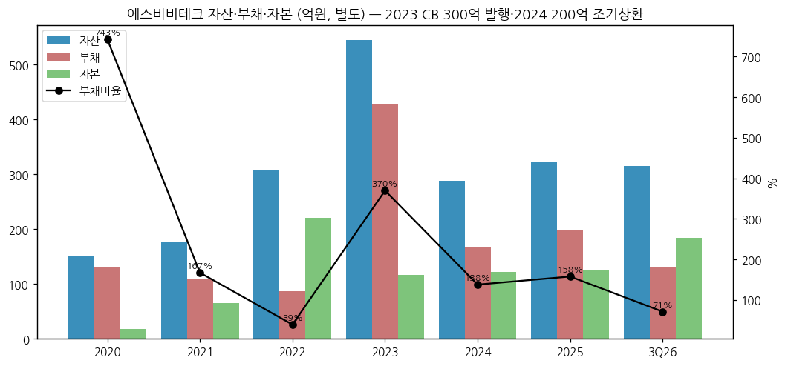

③ 현금흐름표

| 현금흐름 (억원) | 2020 | 2021 | 2022 | 2023 | 2024 | 2025 | 3Q26 누적 |
|---|---|---|---|---|---|---|---|
| 영업활동CF | -11.7 | -17.2 | -21.6 | -31.5 | -40.8 | -70.7 | -71.9 |
| 투자활동CF | 34.5 | -1.5 | -24.0 | -372.7 | 242.3 | 51.6 | -47.3 |
| 재무활동CF | -19.7 | 46.8 | 147.6 | 287.9 | -201.9 | 91.3 | 28.4 |
| 유형자산 취득 | 8.5 | 12.1 | 27.5 | 25.3 | 21.8 | 32.7 | 40.7 |
| 무형자산 취득 | — | — | — | — | 2.5 | 0.0 | — |
| 감가상각비 (사용권 포함) | — | 8.6 | 9.8 | 13.2 | 15.4 | 18.8 | — |
| 배당금 지급 | — | — | — | — | — | — | — |
| FCF (영업CF−CapEx) | -20.1 | -29.3 | -49.2 | -56.8 | -65.1 | -103.4 | -112.6 |

→ 영업CF는 6년 연속 마이너스, 적자 폭이 매년 커졌다 (2025 -70.7억 → 3Q26 누적 이미 -71.9억 — 재고 34억 증가 영향)
→ 2025 재무CF +91.3억 = 자기주식 처분 81.0억 + 스톡옵션 행사 12.7억 — 자사주 매각으로 운영자금 조달

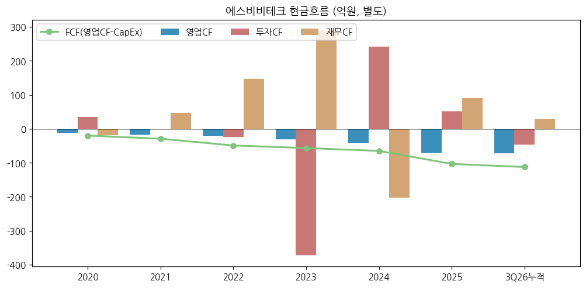

④ CapEx

→ 유형자산 취득 연 8~33억 → **3Q26 누적 40.7억**으로 상장 후 최대 (감속기 생산능력 증대). 감가상각비는 2021 8.6억 → 2025 18.8억으로 2.2배 — 매출이 늘지 않은 2023~2025 GPM을 짓누른 요인
→ 생산설비 장부가 (2026.09, 김포공장): 토지 49.2억 / 건물 13.5억 / 기계장치 80.6억 / 공구·비품 28.7억

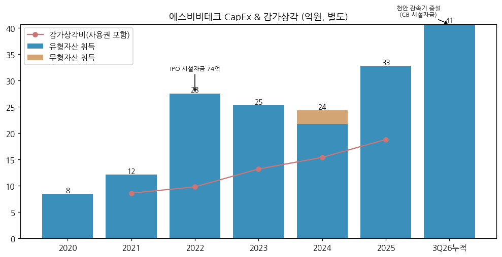

⑤ 부채구조

→ 단기차입금 80억 (하나은행: 운전 37억 4.95% · 시설 13억 4.35% · 수출입은행 온렌딩 30억 4.04%) — 토지·건물 담보
→ 채무증권(회사채·CP) 잔액 없음. 제3회 CB(2023.05, 300억)는 2024 조기상환 200억 + 2026.02 KPF 100억 전환으로 **전액 소멸**

⑥ 배당·자사주

→ 무배당 (과거 배당 이력 없음 — DART). 결손금 -521.7억으로 배당가능이익 없음
→ 자기주식: 2025년 212,890주 전량 처분(81.0억) → 2026.09 보유 0주
→ 희석 요인: 주식선택권 잔여분 (DART 주석 22) — 발행주식수 6,174,904(2024말) → 6,333,904(2025말) → 6,663,472(2026.09)

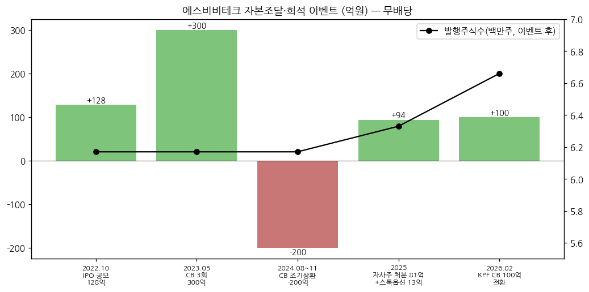

⑦ 재무비율

| 재무비율 | 2021 | 2022 | 2023 | 2024 | 2025 |
|---|---|---|---|---|---|
| ROE (평균자본) | -67.3% | -37.0% | -65.4% | -7.6% | -76.7% |
| ROA (평균자산) | -17.3% | -21.9% | -25.8% | -2.2% | -30.9% |
| 부채비율 | 167.3% | 39.4% | 369.7% | 138.0% | 157.8% |
| 유동비율 | 115.5% | 239.7% | 97.2% | 87.3% | 82.7% |

→ 영업손실로 이자보상배율 산정 무의미 (2025 이자지급 2.3억)

---

## ⑤ 지배 구조

① 그룹·계열 관계

→ **송현그룹** (공정거래법상 기업집단 미지정, 계열사 18개 — 상장 3·비상장 15). 지배 구조: (주)송현홀딩스(대표 김형노, 최대주주 송무현 외 2인 23.10%) → **(주)케이피에프 35.75%** → **(주)에스비비테크 39.66%**
→ (주)케이피에프: 1963.10 설립, 코스닥, 산업용 볼트·너트·자동차부품. 2025 연결 매출 7,439억·영업이익 354억 (DART 2026.09 기재). **감속기 핵심 부품 Flex Spline 단조 소재 금형·열처리 기술 지원** — 시너지 명시
→ 2023.05 CB 300억 중 KPF 100억·주요경영진 58억 인수 → KPF 100억은 2026.02 전환 (KPF 지분 36.65% → 39.66%)

② 주주 구분

| 주주 | 주식수 | 지분율 | 기준 |
|---|---|---|---|
| (주)케이피에프 (최대주주) | 2,642,773 | 39.66% | 2026.09 |
| 송수민 (특수관계인) | 94,500 | 1.42% | 2026.09 |
| 송무현 (특수관계인, 前 사내이사) | 88,855 | 1.33% | 2026.09 |
| **최대주주 등 합계** | **2,826,128** | **42.41%** | 2026.09 |
| 소액주주 | 2,995,042 | 44.94% | 2026.06 (34,079명) |
| 기타 (기관·외국인·5% 미만 법인 등) | — | 약 12.7% | 역산 |

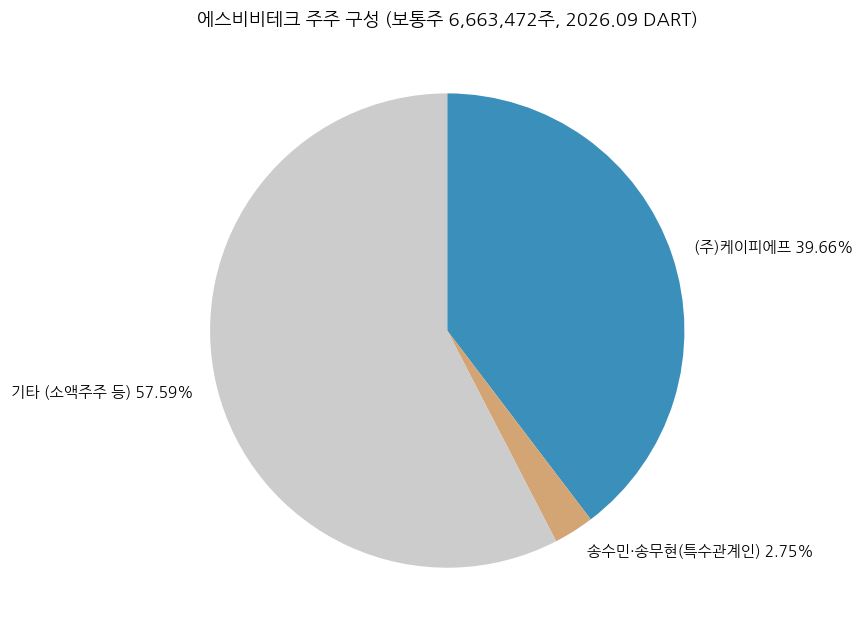

→ 5% 이상 주주는 KPF 단독. 외국인 지분율 미확인

③ 임원·이사회 (DART 2026.09)

| 성명 | 직위 | 주요 경력 |
|---|---|---|
| 류재완 | 대표이사(사내이사), CEO | 1965.09생, 서울대 기계설계 석사, 前 대우중공업(감속기·로봇 개발)·나온테크(LCD Transfer Robot)·기단테크 대표·이노스웰 대표(특수환경용 로봇). 2018.10~ 대표 |
| 송진웅 | 대표이사(사내이사), 경영총괄 | 1971.03생, 연세대 경영, 前 SK C&C·하나로통신·SK텔레콤·플러스자산운용·글로우원 CFO·에스비비테크 COO. 2024.05~ 각자대표 |
| 김연호 | 사외이사 | 2026.03 정기주총 선임 |
| 김현수 | 감사 | 2026.03 정기주총 선임 |
| 이정호 | TC 부센터장(미등기) | 前 알에스티 대표, "하모닉 감속기 국산화 주역" (IR 2026-07) |
| 이래근 / 장현우 | TC 센터장 / PC 센터장(미등기) | 명화공업 출신 (IR 2026-07) |

→ 2026.03 정기주총: 사내이사 송수민·사외이사 박영제·감사 주효종 사임 → 등기이사 3인(대표 2 + 사외 1) + 감사 체제

---

## ⑥ 기타 팩트

① R&D 인프라

| 연도 | 연구개발비용 (억원) | 정부보조금 (억원) | 매출 대비 (총액 기준) |
|---|---|---|---|
| 2020 | 34.8 | — | 52.6% |
| 2021 | 31.5 | — | 46.5% |
| 2022 | 31.8 | — | 42.5% |
| 2023 | 40.3 | — | 78.6% |
| 2024 | 36.2 | 10.7 | 66.2% |
| 2025 | 27.5 | 3.2 | 38.2% |
| 3Q26 누적 | 32.8 | 4.2 | 35.1% |

→ 출처: DART 사업보고서·2026.09 분기보고서 'II-6 연구개발 비용'(연구개발비용 계, 정부보조금 포함 총액). DART 기재 비율은 보조금 차감 여부에 따라 본 표와 다를 수 있음
→ 2025 R&D 축소(36.2억 → 27.5억)가 2025 판관비 증가를 억제. 2026 다시 증가 (휴머노이드 액추에이터·핸드 감속기)

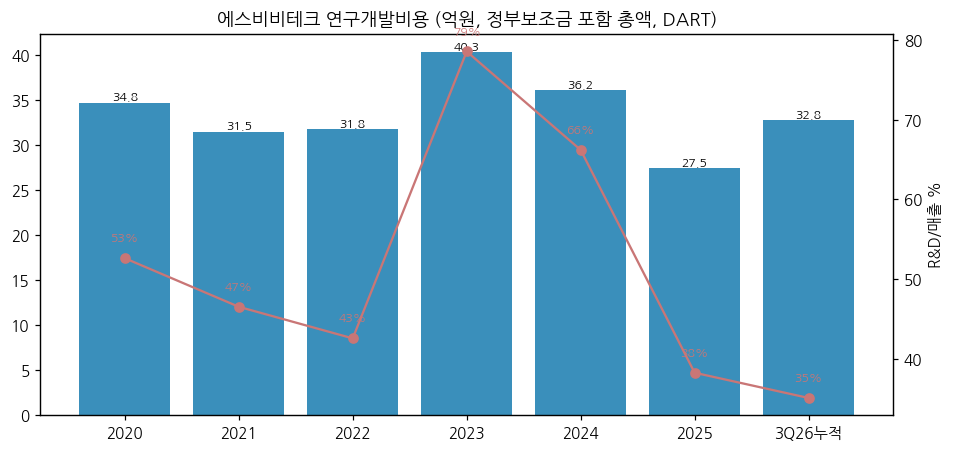

② Corporate action

→ 2018.10 KPF 인수 / 2018.11 우선주 제3자배정 / 2021.12 제3자배정 유상증자 / 2022.01 액면분할 1:10 / **2022.10 IPO 128억** (연구개발 31.9억·시설 74.1억·운영 40.7억 — 전액 사용) / **2023.05 CB 300억** / 2024.08·11 CB 200억 조기상환 / 2025 자사주 81억 처분 / 2026.02 CB 100억 전환
→ 대표 인터뷰 "M&A 적극 검토" (이투데이 2026-07-22), IR "모터·로봇 전장 분야 협업 및 M&A 성장 추진"

③ R&D·제품 마일스톤

→ 2008 감속기 판매 개시 → 2013 하모닉 감속기 개발 → 협동로봇·방산 감속기 국산화 → 2025 협동로봇용 구동모듈(내륜형 모터 + 웨이브 스트레인 감속기)·핸드용 초소형 액추에이터·경량화 감속기·휴머노이드 관절 액추에이터(고객 맞춤 위탁개발) → 2026.1~9 유성기어 기반 고응답성 감속기 시제품, 핸드(그리퍼)용 감속기 시제품, 금속 대체 고분자 경량 감속기, 액추에이터 구조 특허 출원 (DART 2026.09)
→ 공동 연구: 한국로봇융합연구원(KIRO)·한국기계연구원(KIMM)·한국전자기술연구원(KETI) — 으뜸기업 과제

④ 주요 리스크

→ (1) **유동성**: 현금 2.6억(2026.09), 영업CF 연 -70억 수준, 단기차입 50억 2026.12 만기 → 추가 자본 조달·희석 가능성 높음 `[판단]`
→ (2) **고객 집중**: A사 1곳이 3Q26 누적 매출의 37.5% — 초도 양산 물량의 지속성 미확인
→ (3) **수익성**: 6년 연속 영업적자, 결손금 -521.7억. 회사 BEP 목표 2027~2028
→ (4) **반도체 사이클**: 베어링 3종이 2025 매출의 63% — 2023 반도체 다운사이클 때 매출 -31%
→ (5) **경쟁**: HDS(일본)·Leaderdrive(중국) 대비 규모 열위, 판가는 HDS 대비 60~80% (IR)
→ (6) **밸류에이션 변동성**: 2026.05 고점 대비 -73%, PSR 18배

⑤ ESG

→ 별도 ESG 등급 미확인. ISO 14001(2005)·ISO 9001(2002) 인증

⑥ 인증·라이선스

→ 기술특례 상장(2022) / 소부장 으뜸기업(2021) / 이노비즈·기술부설연구소 / 구미 국방벤처센터 협약기업(2014)

---

## Version Log

| 버전 | 일자 | 내역 |
|---|---|---|
| v1.0 | 2026-11-14 | 최초 작성. OpenDART 별도 재무(2020~2026.3Q) + DART 정기보고서 16건(제품별 매출·수주·CAPA) + IR 2026-07. 3Q26 분기보고서(2026-11-12 공시) 반영. 차트 14종 |

**잔여 보완 후보**
→ 2019년 이전 손익 — 2022 증권신고서 요약재무로 보강
→ 52주 고저·시가총액 2차 소스 교차 확인, 외국인 지분율
→ A사 실명·액추에이터(구동모듈) 매출 분리 — 회사 IR·셀사이드 리포트 확보 시
→ 4Q26 이후 자금조달 공시(유상증자·CB) 모니터링
