# 에스엠 (SM Entertainment, KOSDAQ 041510) — 기업 개요 (v1.0)

> 마지막 update: 2026-11-15 작성 (2025 사업보고서 + **2026 3분기 분기보고서(2026-11-13 공시) 확정치** 반영 — IR 잠정(2026-11-04)과 차이는 ③ 데이터 메모 참조)
> 입력 source: **OpenDART fnlttSinglAcntAll 연결재무제표(2015\~3Q26, 2014는 2015 사업보고서 전기 컬럼)** + **DART 정기공시 원문 XML(2025 사업보고서 등)** + OpenDART 기업개황·최대주주·임원·직원·배당·자기주식 JSON(2025 사업보고서) + **회사 IR 실적발표 PDF 34건(irgo, 2018\~3Q26 — 본사 매출 유형·종속법인 실적)** + Yahoo Finance v8 (2001-12\~2026-11-13 월간 시세)
> 갱신 주기: 매분기 (실적 리뷰 모드 호출 시)
> **Fact verify cutoff**: 2026-11-15 (주가 77,800원 = 2026-11-13 종가, Yahoo Finance / 시가총액 약 17,812억원 = 종가 × 보통주 22,894,690주 / 상장 후 최고가 161,200원 = 2023-03 장중(Yahoo 월간 고가, 하이브·카카오 경영권 분쟁 공개매수 국면) / 시총 2차 검증 사이트(companiesmarketcap 등) 조회는 이번 작성에서 미완료 — 직접 계산치)
> 워치리스트: **엔터 섹터 (대분류: 소비재) / 서브섹터 기획사**

---

## 1. 기업 분류

- **Primary 분류: 지속성장 (IP 포트폴리오 분산형 기획사)** — 2014→2025 매출 11년 연속에 가깝게 우상향(역성장 2020년 1회). 동방신기\~Hearts2Hearts까지 데뷔 시기가 다른 20개 안팎 IP가 매년 음반·투어를 나눠 맡아 단일 IP 공백 리스크가 4사 중 가장 작다
- **Secondary 노트: 사이클 (신보 발매 스케줄)** — 분기 단위로는 '대형 신보 유무'에 따라 본사 음반/음원이 반 토막 나는 변동이 있다 (3Q26 신보 판매 550만장 → 167만장, 본사 음반/음원 -51.3% YoY). 연간 OPM도 1.1%\~15.6%로 진폭이 커서 순수 지속성장으로 보기 어렵다

### ① 정량 근거

**📊 Summary Box (12년, 2014\~2025):**

| 지표 | 값 |
|------|-----|
| 매출 CAGR (2014→2025, 11년) | **+13.7%** (2018 SM C&C·키이스트 연결 확대 점프 포함) / 2020→2025 **+15.2%** |
| OPM 평균 (12년) | **8.6%** |
| OPM 정점 평균 | **13.1%** (2014 12.0% · 2023 11.8% · 2025 15.6%) |
| OPM 저점 평균 | **2.1%** (2017 3.0% · 2020 1.1%) |
| 사이클 주기 | 약 **3\~6년** (정점 2014 → 2023 사이에 2017·2020 두 번 저점 — 비음악 자회사 손실·코로나) |
| 사이클 회수 (12년) | 정점 2회(+2023 준정점) / 저점 2회 — 2025 15.6%가 상장 후 최고 OPM, 2026 둔화 중 |

```
[전사 손익 시계열 (12년, 억원, 연결)]
연도   매출     영업이익  순이익    OPM     NPM
2014   2,870      343       18   12.0%     0.6%   ← 정점① EXO 전성기
2015   3,254      364      184   11.2%     5.7%   
2016   3,499      207       42    5.9%     1.2%   
2017   3,654      109      -47    3.0%    -1.3%   ← 저점① 비음악 자회사 부진
2018   6,122      477      234    7.8%     3.8%   ← SM C&C·키이스트 연결 확대(매출 점프)
2019   6,578      404     -162    6.1%    -2.5%   ← 관계기업 손실·법인세로 순손실
2020   5,799       65     -803    1.1%   -13.9%   ← 저점② 코로나 공연 0
2021   7,016      675    1,332    9.6%    19.0%   ← 회복 + 영업외 이익
2022   8,508      910      820   10.7%     9.6%   
2023   9,611    1,135      827   11.8%     8.6%   ← 경영권 분쟁 → SM 3.0, OP 1천억 돌파
2024   9,897      873        8    8.8%     0.1%   ← 자회사 부진·손상차손 (순이익 8억)
2025  11,749    1,830    3,594   15.6%    30.6%   ← 정점② 사상 최대, 디어유 연결 편입
OPM range: 1.1% ~ 15.6% = 14.5%pt
매출은 지속성장형인데 이익률은 '자회사 손익 + 신보 스케줄'로 크게 흔들리는 구조.
2023 SM 3.0(멀티 프로덕션·비핵심 정리) 이후 OPM 바닥이 8%대로 높아짐
```

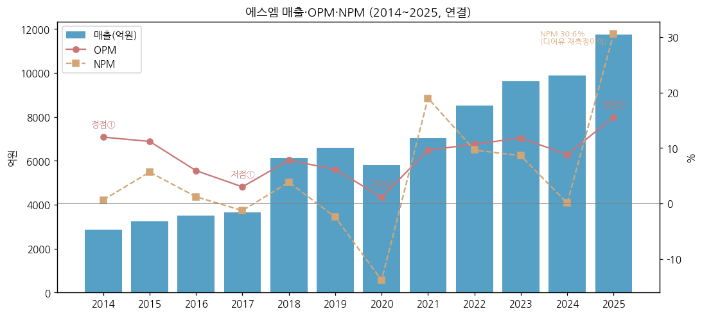

> ⚠️ 데이터 정합성 메모
> → 2014: OpenDART 재무 API 미제공 연도 → 2015 사업보고서 전기(제20기) 컬럼 사용 (2014 영업CF가 -91억으로 잡혀 FCF 왜곡 — 표시만 하고 해석은 제외)
> → 2025 순이익 3,594억(NPM 30.6%): 디어유 지배력 획득 시 기존 보유 지분을 공정가치로 재측정한 처분이익 **2,282억** 포함(관계기업투자이익 2,140억 계정). 일회성 — 영업이익 기준으로 보면 1,830억
> → 3Q26: IR 잠정(2026-11-04) 매출 2,911억·영업이익 355억·순손실 11억 → **분기보고서(2026-11-13) 확정 매출 2,880억·영업이익 336억·순손실 28억** (누적 9,167억 − 반기 6,287억). 본 문서 분기 시계열은 확정치, 본사 매출 유형표(IR)는 잠정치 기준
> → 본사(별도) 매출 유형은 IR PDF에서 추출. 1Q22\~3Q26 중 3Q22는 해당 IR PDF 숫자가 이미지라 미추출. 같은 분기 숫자가 IR마다 재분류된 경우 가장 최근 IR 값 사용 (예: 1Q23 콘서트 192 → 204억)

### ② 산업 분류

- 산업: **K-POP 기획사 (아티스트 IP 기반 음반·음원·공연·MD·라이선스) + 팬 플랫폼(디어유)·드라마(키이스트)·광고(SM C&C) 자회사** — 소비재 내 콘텐츠·팬덤 산업
- 표준산업분류: 59201 (음악 및 기타 오디오물 출판업) — OpenDART 기업개황
- 워치리스트 섹터: **엔터 (대분류 소비재)** / 서브섹터 **기획사** (하이브·JYP·에스엠·와이지 + 확장 큐브엔터)
- 동일 섹터 cross-ref: 디어유(팬덤 플랫폼 서브섹터 — **2025년부터 에스엠 연결 종속회사**, 3Q26 에스엠 연결 영업이익의 약 27%), Tencent Music(음원 글로벌 — 에스엠 지분 9.66% 보유 3대 주주 + 버블 QQ뮤직 파트너), 카카오(최대주주)

### ③ 분류 결정 논리

(1) **가장 매출 큰 사업 기준**: 2025 연결 품목별 매출은 엔터테인먼트 93.7%(음반/음원 27.3%, 매니지먼트(출연료) 23.6%, 공연·영상 콘텐츠 등 42.8%), 광고 5.0%, 기타 1.2%. 본사 기준으로는 음반/음원 36%, MD/라이선싱 29%, 콘서트 18%. 음반은 발매 스케줄에 따라 분기 변동이 크지만, IP 수가 많아 연간 합계는 2023 3,180억 → 2025 3,283억으로 박스권 — 연간 단위로는 지속성장 성격
(2) **이익 기여 우선 sub-rule**: 3Q26 연결 영업이익 355억(IR 잠정) = 본사 284억 + 종속법인 합산 122억 − 연결조정. 본사가 이익의 대부분이고 종속법인은 디어유(92억)를 빼면 거의 0 → '본사 IP 사업 = 이익 엔진, 자회사 = 매출 부풀림' 구조. 2017·2020 저점은 본사가 아니라 비음악 자회사(외식·여행·드라마 제작) 손실이 원인
(3) **Boundary case 처리**: ① 디어유 연결 편입(2025)으로 고마진 구독형 매출(버블)이 연결 이익에 상시 기여 → 지속성장 성격 강화. ② 반대로 신보 판매량(3Q26 167만장, 전년 550만장)이 꺾이는 분기에는 본사 OPM이 16%대로 내려와 사이클 성격이 드러남. 연간 신보 판매량이 2년 연속 감소하면 Primary 재검토
(4) **동종 피어 대비**: 와이지(IP 1개 집중 → 진폭 최대, 사이클 Primary), 하이브(BTS 의존 + 멀티레이블), JYP(IP 분산, OPM 20%대 안정 — 지속성장) 대비 에스엠은 **IP 수 최다 + 자회사 수 최다**. 매출 안정성은 JYP와 같은 군, 이익률은 자회사 때문에 JYP보다 10%pt 가까이 낮다

### ④ 적정 밸류에이션 방법

- **PER (12개월 Forward, 지배순이익 기준)** 우선 — IP 분산으로 이익이 '0 근처로 꺼지는 해'가 적어 PER이 작동. 단 2025처럼 일회성 이익(디어유 재측정 2,282억)이 큰 해는 **영업이익 기반(세후) 이익으로 정상화** 필요
- 현재(2026-11) TTM(4Q25\~3Q26, 3Q26 확정): 매출 12,357억 / 영업이익 1,797억 / 연결순이익 942억 / 지배순이익 약 982억 → **TTM PER 약 18.1배**, 지배자본 10,271억(3Q26) 대비 **PBR 약 1.73배**
- **SOTP 보조** — 상장 자회사 디어유(보유 지분 44.21%, 과반 미만이지만 실질 지배)·SM C&C·키이스트·SM LDG·SM ENT JAPAN(도쿄 상장) 가치와 본사 IP 가치를 분리 평가하는 셀사이드 관행. 디어유 지분 가치가 시총에서 차지하는 비중이 커서 디어유 주가가 에스엠 밸류의 변수
- 피어 차별화: JYP는 PER 단독, 와이지는 PER(활동 연도)+PBR(공백기 하단), 에스엠은 **PER + SOTP(디어유·카카오 그룹 내 지위)** — 이유는 ③(2)의 자회사 비중

### ⑤ 분기 재평가 트리거

- 연결 OPM이 **4개 분기 연속 15%+** 유지 시 → 지속성장 확정, Secondary(사이클) 삭제 검토 (2025: 14.1/15.7/15.0/17.1% — 4Q 연속 충족 직전에 3Q26 11.7%로 이탈)
- 본사 신보 판매량이 **2년 연속 YoY 감소** 시 → Primary를 '사이클'로 재분류 검토 (3Q26 단일 분기 -70%)
- 최대주주(카카오 계열 41.5%) 지분 매각·변경 확정 시 → 지배구조 리스크 해소/확대로 밸류에이션 방법(SOTP 할인율) 재평가

---

## 2. 회사 개요

### ① 기본 사항

| 항목 | 내용 |
|---|---|
| 회사명 | (주)에스엠엔터테인먼트 (SM ENTERTAINMENT CO., Ltd.) |
| 설립 / 상장 | 1995-02-14 법인 설립 / 2000-04 KOSDAQ 상장 |
| 대표이사 | 장철혁·탁영준 공동대표 (2024-03 공동대표 체제) |
| 최대주주 | (주)카카오 21.61% + (주)카카오엔터테인먼트 19.89% = **카카오 계열 41.50%** (2025-12-31) |
| 본사 | 서울특별시 성동구 왕십리로 83-21 (아크로 서울포레스트 디타워, 2021-07 이전) |
| 결산월 | 12월 |
| 직원 | **765명** (본사, 2025-12-31, 정규 709 + 계약 56) — 남 1인 평균 급여 8,934만원 / 여 6,257만원 |
| 사업 한 줄 정의 | **H.O.T.부터 aespa·RIIZE까지 30년간 K-POP 아이돌을 만들어 온 국내 최다 IP 기획사 — 음반·콘서트·MD·출연으로 본사가 돈을 벌고, 디어유(버블)·SM C&C·키이스트·드림메이커 등 자회사로 플랫폼·광고·드라마·공연 제작까지 수직계열화** |
| 주요 아티스트 (2025 사업보고서) | KANGTA, BoA, TVXQ!, SUPER JUNIOR, GIRLS' GENERATION, SHINee, EXO, Red Velvet, NCT 127, NCT DREAM, WayV, aespa, RIIZE, NCT WISH, Hearts2Hearts 등 |

### ② 최근 12년 손익·자본 추이 (억원, 좌→우 시간순)

| 항목 | 2014 | 2015 | 2016 | 2017 | 2018 | 2019 | 2020 | 2021 | 2022 | 2023 | 2024 | 2025 |
|---|---|---|---|---|---|---|---|---|---|---|---|---|
| 매출액 | 2,870 | 3,254 | 3,499 | 3,654 | 6,122 | 6,578 | 5,799 | 7,016 | 8,508 | 9,611 | 9,897 | 11,749 |
| 매출원가 | 1,848 | 2,124 | 2,476 | 2,490 | 4,095 | 4,422 | 3,811 | 4,372 | 5,557 | 6,200 | 6,825 | 7,424 |
| 매출총이익 | 1,022 | 1,130 | 1,023 | 1,164 | 2,027 | 2,156 | 1,988 | 2,644 | 2,950 | 3,410 | 3,072 | 4,325 |
| 판관비 | 679 | 766 | 816 | 1,055 | 1,550 | 1,752 | 1,923 | 1,969 | 2,040 | 2,276 | 2,199 | 2,495 |
| 영업이익 | 343 | 364 | 207 | 109 | 477 | 404 | 65 | 675 | 910 | 1,135 | 873 | 1,830 |
| 세전이익 | 293 | 285 | 226 | 244 | 460 | 110 | -406 | 1,731 | 1,169 | 1,189 | 261 | 3,677 |
| 당기순이익(연결) | 18 | 184 | 42 | -47 | 234 | -162 | -803 | 1,332 | 820 | 827 | 8 | 3,594 |
| 지배주주 순이익 | 60 | 217 | 36 | 43 | 306 | -91 | -702 | 1,335 | 800 | 873 | 183 | 3,472 |
| GPM | 35.6% | 34.7% | 29.2% | 31.9% | 33.1% | 32.8% | 34.3% | 37.7% | 34.7% | 35.5% | 31.0% | 36.8% |
| 판관비율 | 23.6% | 23.5% | 23.3% | 28.9% | 25.3% | 26.6% | 33.2% | 28.1% | 24.0% | 23.7% | 22.2% | 21.2% |
| OPM | 12.0% | 11.2% | 5.9% | 3.0% | 7.8% | 6.1% | 1.1% | 9.6% | 10.7% | 11.8% | 8.8% | 15.6% |
| NPM | 0.6% | 5.7% | 1.2% | -1.3% | 3.8% | -2.5% | -13.9% | 19.0% | 9.6% | 8.6% | 0.1% | 30.6% |
| EPS(원, 지배) | 292 | 1,050 | 169 | 200 | 1,363 | -391 | -3,002 | 5,750 | 3,390 | 3,719 | 795 | 15,166 |

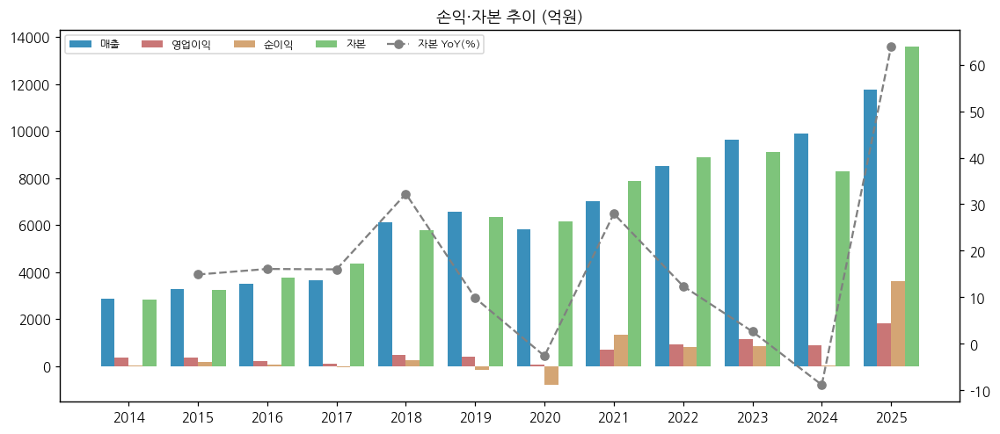

### ③ 회사 주가 역사 ★ narrative 영역

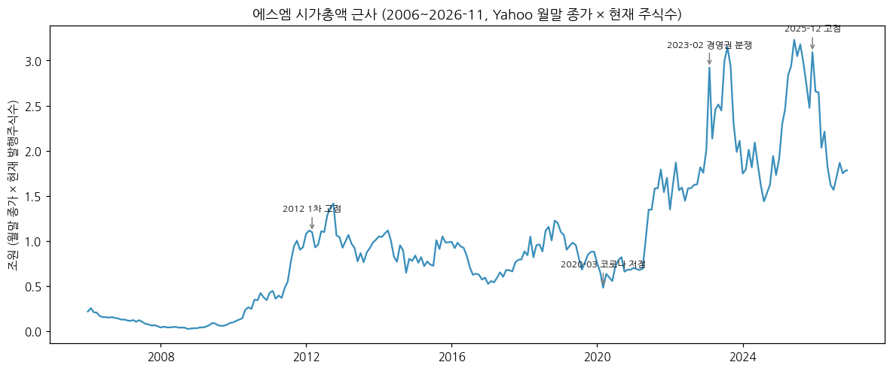

→ 2000-04 KOSDAQ 상장 → 2008 금융위기 저점(월 저가 769원, 액면·수정 전 Yahoo 기준) — 동방신기 분쟁 이전
→ **2010\~2012 1차 랠리 (2012 연간 고가 71,600원)** — 소녀시대·슈퍼주니어 일본 진출, K-POP 1차 한류
→ 2013\~2019 박스권 (연간 고가 39,000\~57,000원) — EXO 데뷔(2012)에도 비음악 자회사 손실로 이익 정체
→ **2020-03 코로나 저점 (월 저가 16,350원)** — 2020 영업이익 65억, 순손실 803억
→ 2021 랠리 (연간 고가 85,000원) — 디어유 상장, 버블·온라인 콘서트, 지배구조 개선 기대
→ **2023-03 상장 후 최고가 (장중 161,200원, Yahoo 월간 고가)** — 2023-02 하이브의 이수만 지분 14.8% 인수 vs 카카오 공개매수(주당 15만원) 경영권 분쟁. 2023-03-28 카카오가 최대주주(20.76%)로 확정되며 급락(2023 연말 92,100원)
→ 2024 저점 55,100원 — 순이익 8억, 자회사 손상차손
→ 2025-12 고점권 (월 고가 137,500원, 2026-01 140,400원) — 2025 사상 최대 영업이익 1,830억 + 디어유 연결
→ **2026-11-13 종가 77,800원 / 시가총액 약 17,812억원** (2026-01 고점 대비 약 -45%) — 2026 신보 판매 둔화, 3Q26 영업이익 -30% YoY(확정)

| 시점 | 주가(원) | 시가총액(억원, 근사) | 사건 |
|---|---|---|---|
| 2012 연간 고가 | 71,600 | 약 16,400 | K-POP 1차 한류 |
| 2020-03 (월저가) | 16,350 | 약 3,700 | 코로나 |
| 2023-03 (월고가) | **161,200 (ATH)** | 약 38,400 (당시 주식수 23,830,901주) | 경영권 분쟁 |
| 2024 연간 저가 | 55,100 | 약 12,600 | 순이익 8억 |
| 2026-01 (월고가) | 140,400 | 약 32,100 | 2025 사상 최대 실적 |
| 2026-11-13 (종가) | 77,800 | 약 17,812 | 현재 |

> 시가총액 근사 = 주가 × 현재 발행주식 22,894,690주 (2023 자기주식 소각 936,211주 반영 전 시점은 오차). Yahoo 시세는 수정주가 아님(배당 조정 전 종가)

### ④ 회사의 주요 연혁

| 연도 | 내용 |
|---|---|
| 1989 | 이수만, SM기획 설립 |
| 1995-02 | (주)에스엠엔터테인먼트 법인 설립 |
| 1996\~2000 | H.O.T.(1996)·S.E.S.(1997)·신화(1998)·BoA(2000) 데뷔 |
| 2000-04 | KOSDAQ 상장 |
| 2004\~2008 | 동방신기(2004)·슈퍼주니어(2005)·소녀시대(2007)·SHINee(2008) 데뷔 |
| 2012 | EXO 데뷔 / SM C&C(구 BT&I) 인수 — 광고·여행 사업 진입 |
| 2014\~2016 | Red Velvet(2014)·NCT(2016) 데뷔 |
| 2018 | 키이스트·FNC애드컬쳐 인수 (드라마·광고) → 연결 매출 3,654억 → 6,122억 점프 |
| 2020 | aespa 데뷔, SuperM, 디어유 '버블' 서비스 본격화 |
| 2021-07 | 본점 이전 (성동구 아크로 서울포레스트 디타워) / 2021-11 디어유 KOSDAQ 상장 |
| 2022-03 | 행동주의 펀드(얼라인파트너스) 주주제안 → 감사 선임 / 2022-12 이수만 개인회사 라이크기획과 프로듀싱 계약 조기 종료 |
| 2023-02 | **SM 3.0**(멀티 프로덕션 센터) 발표 / 하이브, 이수만 지분 14.8% 인수 → 카카오 공개매수 |
| 2023-03 | 카카오 최대주주 확정(20.76%) / 장철혁 대표 선임 / RIIZE(2023-09) 데뷔 |
| 2023\~2024 | 자기주식 매입·소각 936,211주 / 2024-03 장철혁·탁영준 공동대표 / NCT WISH(2024) 데뷔 |
| 2025 | **디어유 구주 인수(1,356억) → 지배력 획득·연결 편입(재측정이익 2,282억)** / SM브랜드마케팅 구주 인수(539억) / 에스엠스튜디오스 흡수합병 / 하이브 보유 지분 9.66% → Tencent Music 인수 / Hearts2Hearts 데뷔 |
| 2026 | 3Q26 확정 매출 2,880억(-10.5% YoY)·영업이익 336억(-30.3%) — 신보 판매 둔화, 원화 강세 외환손실 |

> 연혁 출처: DART 2025 사업보고서 '회사의 연혁'(본점·경영진·최대주주 변동·합병)·연결재무제표 주석(디어유 재측정이익), 5% 주주 현황(Tencent Music) / 아티스트 데뷔 연도·1989 SM기획·2018 인수·2022 행동주의는 공개 보도 기준

---

## 3. 비즈니스 모델

### ① 실적 추이 (본사 매출 유형 · 연결 사업부문)

**2025 연결 품목별 매출 (사업보고서 '주요 제품 등의 매출 현황', 억원)**

| 사업부문 | 품목 | 2025 매출 | 비중 |
|---|---|---|---|
| 엔터테인먼트 | 음반/음원 | 3,206 | 27.3% |
| 엔터테인먼트 | 매니지먼트(출연료) | 2,778 | 23.6% |
| 엔터테인먼트 | 기타(공연·영상 콘텐츠 제작 등) | 5,028 | 42.8% |
| 광고 | 광고대행 (SM C&C) | 591 | 5.0% |
| 기타 | 여행 수수료·기타 | 146 | 1.2% |
| **합계** | | **11,749** | 100% |

**연결 매출 수출/내수 (사업보고서 '매출실적', 억원)**

| 구분 | 2023 | 2024 | 2025 |
|---|---|---|---|
| 수출 | 3,024 | 3,227 | 4,215 |
| 내수 | 6,586 | 6,670 | 7,534 |
| 합계 | 9,611 | 9,897 | 11,749 |
| 수출 비중 | 31.5% | 32.6% | 35.9% |

**본사(별도) 매출 유형 — 연간 합산 (IR, 억원)**

| 유형 | 2023 | 2024 | 2025 | 1\~3Q26 | 2025 비중 |
|---|---|---|---|---|---|
| 본사 매출 | 6,195 | 6,627 | 8,125 | 6,033 | 100.0% |
| 음반/음원 | 3,180 | 2,838 | 3,283 | 1,955 | 40.4% |
| 출연(방송·광고·행사) | 858 | 850 | 902 | 793 | 11.1% |
| 콘서트 | 768 | 1,197 | 1,596 | 1,369 | 19.6% |
| MD/라이선싱 | 1,346 | 1,715 | 2,317 | 1,874 | 28.5% |
| 기타 | 43 | 29 | 29 | 44 | 0.4% |
| 본사 영업이익 | 1,150 | 1,124 | 1,670 | 1,110 | 20.6% |

**본사(별도) 매출 유형 — 분기 시계열 (IR 실적발표, 억원)**

| 분기 | 본사 매출 | 음반/음원 | 출연(방송·광고·행사) | 콘서트 | MD/라이선싱 | 기타 | 본사 영업이익 | 본사 OPM |
|---|---|---|---|---|---|---|---|---|
| 1Q22 | 1,149 | 635 | 155 | 7 | 175 | 176 | 247 | 21.5% |
| 2Q22 | 1,111 | 668 | 134 | 57 | 242 | 10 | 238 | 21.4% |
| 3Q22 | 미추출 | - | - | - | - | - | - | - |
| 4Q22 | 1,527 | 770 | 252 | 75 | 414 | 16 | 239 | 15.7% |
| 1Q23 | 1,282 | 596 | 168 | 204 | 297 | 17 | 195 | 15.2% |
| 2Q23 | 1,389 | 544 | 207 | 200 | 423 | 15 | 280 | 20.2% |
| 3Q23 | 1,887 | 1,134 | 215 | 245 | 289 | 5 | 480 | 25.4% |
| 4Q23 | 1,637 | 906 | 268 | 119 | 337 | 6 | 195 | 11.9% |
| 1Q24 | 1,361 | 551 | 199 | 247 | 360 | 5 | 201 | 14.8% |
| 2Q24 | 1,741 | 718 | 212 | 343 | 458 | 11 | 293 | 16.8% |
| 3Q24 | 1,721 | 729 | 225 | 382 | 379 | 7 | 271 | 15.7% |
| 4Q24 | 1,804 | 840 | 214 | 225 | 518 | 6 | 359 | 19.9% |
| 1Q25 | 1,655 | 678 | 188 | 390 | 394 | 5 | 413 | 25.0% |
| 2Q25 | 2,203 | 990 | 232 | 336 | 639 | 6 | 460 | 20.9% |
| 3Q25 | 2,245 | 967 | 241 | 525 | 503 | 11 | 402 | 17.9% |
| 4Q25 | 2,022 | 648 | 241 | 345 | 781 | 7 | 395 | 19.5% |
| 1Q26 | 1,893 | 575 | 204 | 608 | 474 | 33 | 388 | 20.5% |
| 2Q26 | 2,406 | 909 | 297 | 416 | 779 | 6 | 438 | 18.2% |
| 3Q26 | 1,734 | 471 | 292 | 345 | 621 | 5 | 284 | 16.4% |

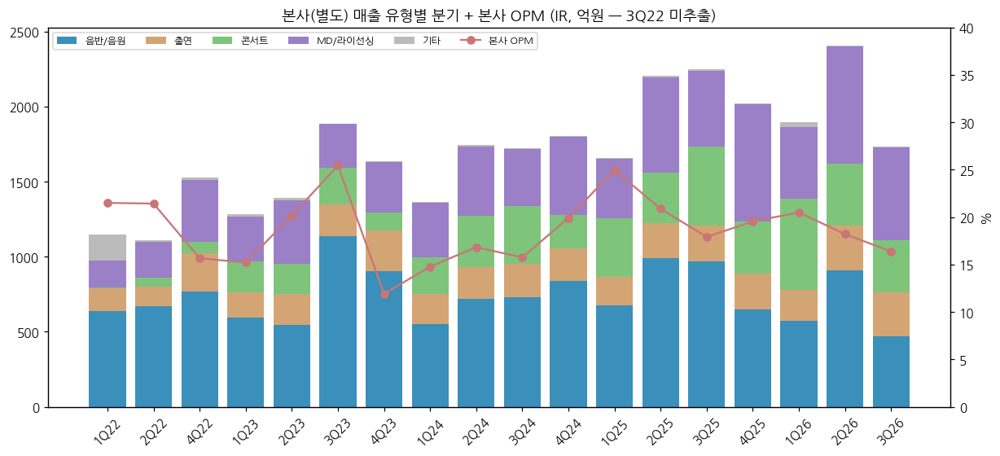

**전사(연결) 분기 시계열 (1Q16\~3Q26, 43분기)**

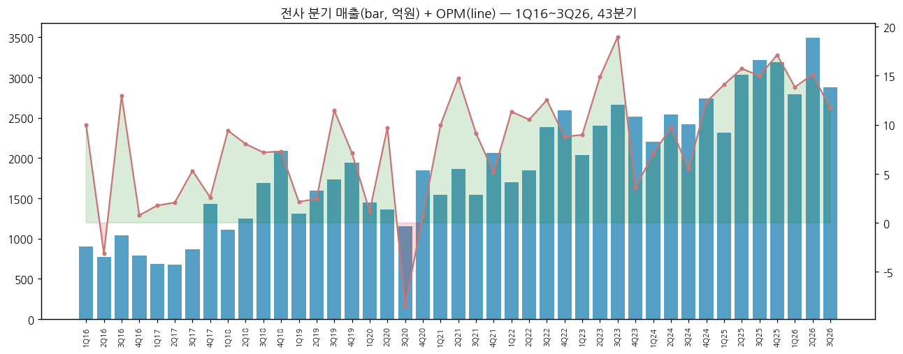

**최근 12분기 (억원, 연결, OpenDART)**

| 분기 | 매출액 | 영업이익 | OPM | 매출 YoY | 영업이익 YoY | 순이익 |
|---|---|---|---|---|---|---|
| 4Q23 | 2,511 | 90 | 3.6% | -3.0% | -60.4% | -528 |
| 1Q24 | 2,201 | 155 | 7.0% | +7.9% | -15.3% | 124 |
| 2Q24 | 2,539 | 247 | 9.7% | +5.9% | -30.8% | 84 |
| 3Q24 | 2,422 | 133 | 5.5% | -9.0% | -73.7% | 37 |
| 4Q24 | 2,736 | 337 | 12.3% | +9.0% | +274.4% | -237 |
| 1Q25 | 2,314 | 326 | 14.1% | +5.1% | +110.3% | 2,527 |
| 2Q25 | 3,029 | 476 | 15.7% | +19.3% | +92.7% | 309 |
| 3Q25 | 3,216 | 482 | 15.0% | +32.8% | +262.4% | 447 |
| 4Q25 | 3,190 | 546 | 17.1% | +16.6% | +62.0% | 311 |
| 1Q26 | 2,791 | 386 | 13.8% | +20.6% | +18.4% | 367 |
| 2Q26 | 3,496 | 529 | 15.1% | +15.4% | +11.1% | 292 |
| 3Q26 (분기보고서 확정) | 2,880 | 336 | 11.7% | -10.4% | -30.3% | -28 |

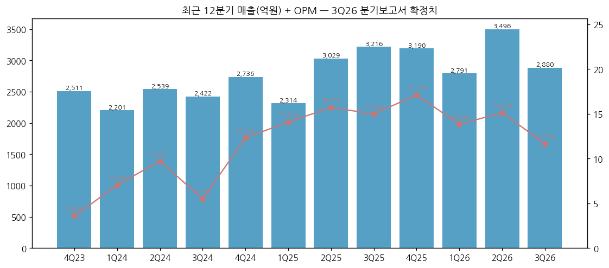

> 📌 **3Q26 핵심 박스 (분기보고서 확정, 2026-11-13)**
> → 연결 매출 2,880억(-10.5% YoY) / 영업이익 336억(-30.3%) / OPM 11.7% / 순손실 28억 (원화 강세에 따른 외화손실 — 금융비용 177억, IR 잠정 기준)
> → 본사: 매출 1,734억(-22.8%) — 음반/음원 471억(-51.3%, 신보 판매 550만장 → 167만장), 콘서트 345억(-34.2%), 반면 MD/라이선싱 621억(+23.5%)·출연 292억(+21.3%)은 성장 지속. 본사 영업이익 284억(-29.2%)
> → 종속법인 합산 매출 1,646억(+12.1%) — 드림메이커(공연 제작) 274억(+223%)·키이스트(드라마) 158억(+336%) 성장, 디어유 매출 228억·영업이익 92억으로 종속법인 이익의 대부분
> → 4Q26 라인업: NCT DREAM 정규, TAEYEON 정규, EXO Unit 미니, RIIZE 콜라보 싱글 + aespa 유럽 투어(1Q27, 9회)·NCT WISH 투어(17회)

**종속법인 실적 (3Q26, IR 잠정, 억원)**

| 법인 | 매출 3Q26 | 매출 3Q25 | YoY | 영업이익 3Q26 | 영업이익 3Q25 | 비고 |
|---|---|---|---|---|---|---|
| SM C&C | 276 | 254 | +8.8% | -17 | -2 | 광고·매니지먼트 |
| SM ENT JAPAN | 230 | 244 | -5.8% | 3 | 26 | 엔화 약세 |
| DEARU (디어유) | 228 | 223 | +2.4% | 92 | 87 | 버블 구독·중국 QQ뮤직 |
| SM BM (브랜드마케팅) | 140 | 189 | -25.8% | 2 | 7 | MD 기획 본사 내재화 |
| SM LDG (라이프디자인그룹) | 76 | 185 | -58.7% | 3 | 23 | 앨범 인쇄 감소 |
| DREAM MAKER | 274 | 85 | +223.2% | 10 | -1 | 공연 제작 |
| KEYEAST | 158 | 36 | +336.3% | 5 | -10 | 드라마 제작 |
| 기타 | 263 | 253 | +4.0% | 14 | 5 | |
| **합계(단순 합산)** | **1,646** | **1,468** | **+12.1%** | **122** | **135** | |

### ② 사업(매출 유형)별 개요 (본사 2025 매출 비중 큰 순서)

| 유형 | 2025 본사 매출(억원) | 비중 | 내용 |
|---|---|---|---|
| 음반/음원 | 3,283 | 40.4% | 실물 앨범·디지털 음원. 유통은 카카오엔터테인먼트 대행. 신보 판매량이 분기 실적을 좌우 |
| MD/라이선싱 | 2,317 | 28.5% | 공연·팝업 MD, 캐릭터(EXO-MUNGCHIZ 등), IP 협업(aespa X PUBG). 2023 이후 가장 꾸준히 성장 |
| 콘서트 | 1,596 | 19.6% | 월드투어·팬미팅. 2023년부터 공연 내재화(드림메이커 협업)로 확대 |
| 출연(방송·광고·행사) | 902 | 11.1% | 아티스트 광고·행사·방송 |
| 기타 | 29 | 0.4% | |

> 2025 본사 매출 합계 8,125억 = 연결 매출의 69%. 나머지는 종속법인(디어유·SM C&C·일본·키이스트·드림메이커 등)

### ③ 사업별 디테일

- **음반/음원 (Top-seller, 변동성 최대)** — 분기 471억\~1,134억. 2023-3Q 1,134억(NCT DREAM·aespa 밀리언셀러) / 2Q25 990억(신보 579만장) → 3Q26 471억(167만장). 2025년 연간 3,283억으로 2023(3,180억)과 비슷 — **연간 박스권, 분기 변동**
- **MD/라이선싱 (Growth)** — 2023 1,346억 → 2024 1,715억 → 2025 2,317억 → 1\~3Q26 1,874억(+22% YoY). 음반 공백 분기를 메우는 완충재. SM BM의 MD 기획 기능을 본사로 내재화
- **콘서트 (Growth)** — 2022 연간 200억 미만 → 2025 1,596억. 1Q26 608억으로 분기 최대. 드림메이커(공연 제작 자회사) 매출도 같이 성장
- **출연 (안정 성장)** — 분기 200\~300억, 2026 들어 +20%대 성장
- **디어유 (연결 편입 후 이익 기여)** — 3Q26 매출 228억·영업이익 92억(OPM 40%). 버블 구독자 3Q26 평균 197만명(QoQ 보합), 일본·QQ뮤직(중국) 구독 증가
- **비핵심 자회사 정리** — SM 3.0 이후 외식(SM F&B)·일부 해외 법인 청산·합병. 2025 에스엠스튜디오스 흡수합병으로 SM C&C·키이스트·SM LDG·디어유를 본사가 직접 보유

### ④ 주요 경쟁사

| 영역 | 국내 | 글로벌 |
|---|---|---|
| 아티스트 IP·음반·공연 | 하이브, JYP, 와이지엔터, 큐브엔터 | Universal Music, Sony Music, Warner Music |
| 팬 플랫폼 | 하이브 위버스 (vs 자회사 디어유 버블) | - |
| 음원 유통 | 카카오엔터테인먼트(유통 대행 = 파트너) | Spotify, Tencent Music(주주·파트너) |
| 공연 프로모션 | - | Live Nation (해외 투어) |
| 드라마·광고 (자회사) | 스튜디오드래곤, 제일기획 등 | - |

### ⑤ 주요 매출처

- 2025 별도기준 **주요 5대 매출처 비중 47.07%** (사업보고서) — 개별 고객명 미공시
- 판매경로: 음반 = 본사(뮤직비즈니스 Center) → **유통 대행 (주)카카오엔터테인먼트** → 도소매·음악 플랫폼 → 소비자
- 추정 구조: 카카오엔터테인먼트(음반·음원 유통 정산 — 최대 매출처로 추정), 해외 투어 프로모터, 일본 음반 유통사, 광고주

### ⑥ 생산 CAPA + 임직원 추이

- 생산 설비: 녹음·트레이닝 스튜디오 등 경자산 모델. 앨범 인쇄는 자회사 SM LDG(라이프디자인그룹) 담당 → 3Q26 인쇄 매출 감소
- CapEx 연 400\~550억(2022\~2025) 중 무형자산(전속계약금·판권 등)이 60\~80% — 사실상 'IP 투자'
- 임직원(본사, 2025-12-31): 765명 (남 216 / 여 549), 평균 근속 남 5년 5개월·여 3년 7개월, 연간 급여 총액 533억

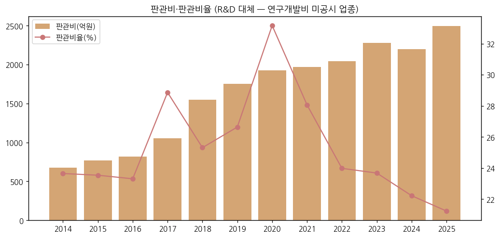

---

## 4. 재무 구조

> 기준: K-IFRS 연결, 억원. 2014 = 2015 사업보고서 전기 컬럼

### ① 손익계산서 (12년, 억원, 좌→우 시간순)

| 항목 | 2014 | 2015 | 2016 | 2017 | 2018 | 2019 | 2020 | 2021 | 2022 | 2023 | 2024 | 2025 |
|---|---|---|---|---|---|---|---|---|---|---|---|---|
| 매출액 | 2,870 | 3,254 | 3,499 | 3,654 | 6,122 | 6,578 | 5,799 | 7,016 | 8,508 | 9,611 | 9,897 | 11,749 |
| 매출원가 | 1,848 | 2,124 | 2,476 | 2,490 | 4,095 | 4,422 | 3,811 | 4,372 | 5,557 | 6,200 | 6,825 | 7,424 |
| 매출총이익 | 1,022 | 1,130 | 1,023 | 1,164 | 2,027 | 2,156 | 1,988 | 2,644 | 2,950 | 3,410 | 3,072 | 4,325 |
| 판관비 | 679 | 766 | 816 | 1,055 | 1,550 | 1,752 | 1,923 | 1,969 | 2,040 | 2,276 | 2,199 | 2,495 |
| 영업이익 | 343 | 364 | 207 | 109 | 477 | 404 | 65 | 675 | 910 | 1,135 | 873 | 1,830 |
| 세전이익 | 293 | 285 | 226 | 244 | 460 | 110 | -406 | 1,731 | 1,169 | 1,189 | 261 | 3,677 |
| 당기순이익(연결) | 18 | 184 | 42 | -47 | 234 | -162 | -803 | 1,332 | 820 | 827 | 8 | 3,594 |
| 지배주주 순이익 | 60 | 217 | 36 | 43 | 306 | -91 | -702 | 1,335 | 800 | 873 | 183 | 3,472 |
| GPM | 35.6% | 34.7% | 29.2% | 31.9% | 33.1% | 32.8% | 34.3% | 37.7% | 34.7% | 35.5% | 31.0% | 36.8% |
| 판관비율 | 23.6% | 23.5% | 23.3% | 28.9% | 25.3% | 26.6% | 33.2% | 28.1% | 24.0% | 23.7% | 22.2% | 21.2% |
| OPM | 12.0% | 11.2% | 5.9% | 3.0% | 7.8% | 6.1% | 1.1% | 9.6% | 10.7% | 11.8% | 8.8% | 15.6% |
| NPM | 0.6% | 5.7% | 1.2% | -1.3% | 3.8% | -2.5% | -13.9% | 19.0% | 9.6% | 8.6% | 0.1% | 30.6% |
| EPS(원, 지배) | 292 | 1,050 | 169 | 200 | 1,363 | -391 | -3,002 | 5,750 | 3,390 | 3,719 | 795 | 15,166 |

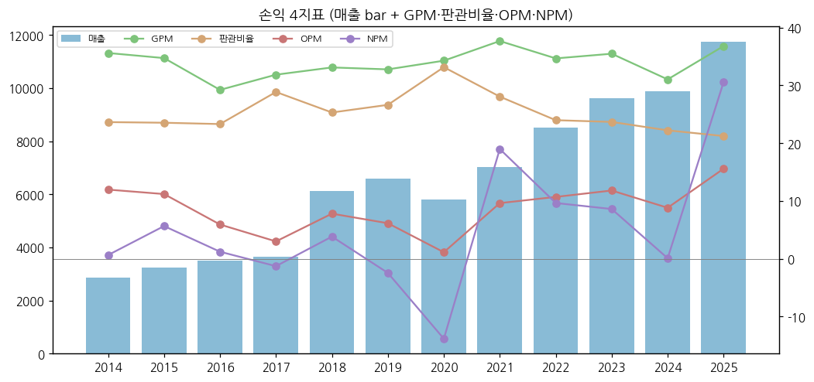

### ② 재무상태표 (12년, 억원)

| 항목 | 2014 | 2015 | 2016 | 2017 | 2018 | 2019 | 2020 | 2021 | 2022 | 2023 | 2024 | 2025 |
|---|---|---|---|---|---|---|---|---|---|---|---|---|
| 자산총계 | 3,827 | 4,597 | 5,251 | 7,975 | 10,025 | 11,156 | 10,689 | 13,149 | 14,630 | 15,410 | 14,191 | 20,077 |
| 유동자산 | 1,966 | 2,266 | 2,934 | 4,408 | 5,374 | 6,287 | 6,465 | 7,695 | 8,414 | 8,583 | 8,140 | 9,805 |
| 현금및현금성자산 | 922 | 1,335 | 1,696 | 1,955 | 2,373 | 2,850 | 2,975 | 3,313 | 3,175 | 3,031 | 3,584 | 3,646 |
| 부채총계 | 1,011 | 1,362 | 1,495 | 3,619 | 4,263 | 4,829 | 4,527 | 5,265 | 5,769 | 6,316 | 5,900 | 6,490 |
| 유동부채 | 849 | 981 | 1,346 | 3,304 | 3,942 | 4,370 | 4,338 | 4,007 | 4,674 | 5,193 | 4,846 | 4,972 |
| 자본총계 | 2,816 | 3,235 | 3,755 | 4,356 | 5,761 | 6,328 | 6,161 | 7,884 | 8,861 | 9,094 | 8,291 | 13,587 |
| 지배주주 자본 | 2,413 | 2,834 | 3,295 | 3,443 | 4,242 | 4,442 | 4,318 | 6,162 | 6,967 | 7,225 | 6,648 | 10,026 |
| 비지배지분 | 402 | 401 | 461 | 914 | 1,519 | 1,886 | 1,843 | 1,722 | 1,894 | 1,869 | 1,643 | 3,561 |

| 최근 분기 | 자산총계 | 부채총계 | 자본총계 | 지배자본 | 현금성자산 | 차입부채 |
|---|---|---|---|---|---|---|
| 1Q26 | 20,100 | 6,561 | 13,539 | 10,005 | 3,354 | 142 |
| 2Q26 | 20,091 | 6,234 | 13,857 | 10,319 | 3,711 | 63 |
| 3Q26 | 19,462 | 5,782 | 13,680 | 10,271 | 3,438 | 61 |

> → 2025 자산 1조 4,191억 → 2조 77억(+41%): 디어유 연결 편입(영업권·고객관계 무형자산 + 디어유 현금) / 비지배지분 1,643억 → 3,561억

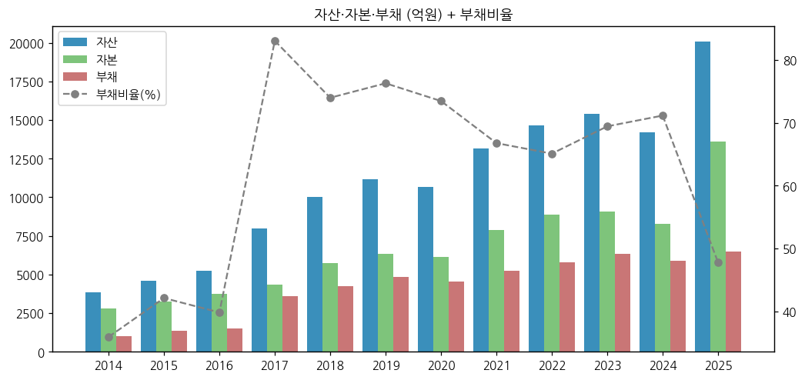

### ③ 현금흐름표 (12년, 억원)

| 항목 | 2014 | 2015 | 2016 | 2017 | 2018 | 2019 | 2020 | 2021 | 2022 | 2023 | 2024 | 2025 |
|---|---|---|---|---|---|---|---|---|---|---|---|---|
| 영업활동CF | -91 | 661 | 212 | 775 | 1,200 | 919 | 454 | 1,226 | 1,149 | 1,130 | 1,357 | 1,949 |
| 투자활동CF | -76 | -682 | -384 | -1,106 | -1,270 | -529 | -425 | -826 | -1,218 | -831 | 557 | -1,500 |
| 재무활동CF | 72 | 420 | 505 | 639 | 460 | 59 | 162 | -68 | -6 | -427 | -1,444 | -335 |
| 유·무형 취득(CapEx) | 344 | 556 | 193 | 358 | 366 | 436 | 413 | 437 | 512 | 534 | 510 | 412 |
| FCF (영업CF-CapEx) | -435 | 105 | 18 | 416 | 834 | 483 | 41 | 789 | 637 | 596 | 846 | 1,537 |

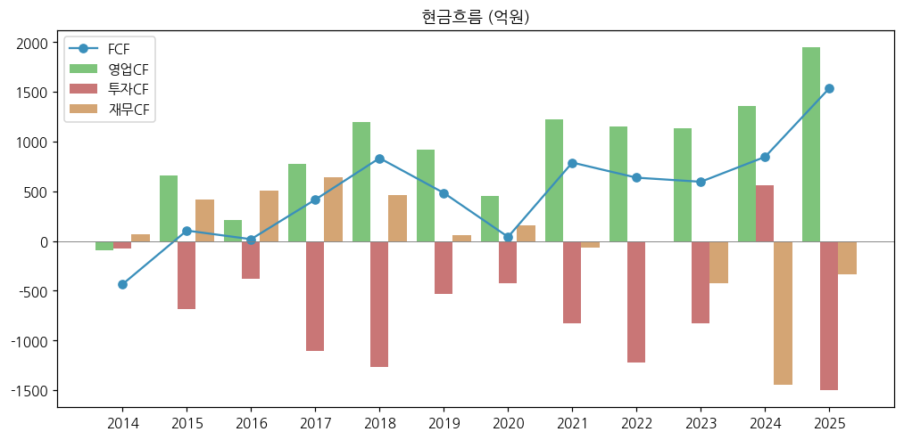

### ④ CapEx 추이 (12년, 억원)

| 항목 | 2014 | 2015 | 2016 | 2017 | 2018 | 2019 | 2020 | 2021 | 2022 | 2023 | 2024 | 2025 |
|---|---|---|---|---|---|---|---|---|---|---|---|---|
| 유형자산 취득 | 262 | 433 | 142 | 105 | 104 | 135 | 81 | 222 | 241 | 191 | 242 | 89 |
| 무형자산 취득 | 82 | 122 | 52 | 253 | 263 | 302 | 332 | 215 | 272 | 343 | 269 | 324 |
| CapEx 합계 | 344 | 556 | 193 | 358 | 366 | 436 | 413 | 437 | 512 | 534 | 510 | 412 |
| CapEx/매출 | 12.0% | 17.1% | 5.5% | 9.8% | 6.0% | 6.6% | 7.1% | 6.2% | 6.0% | 5.6% | 5.2% | 3.5% |

> → 2014\~2015 유형 CapEx 260\~430억: 부동산·사옥 관련 / 2017 이후 무형자산(전속계약금·판권) 비중이 유형보다 큼
> → 2025 유형 89억·무형 324억 — 경자산 IP 투자 모델

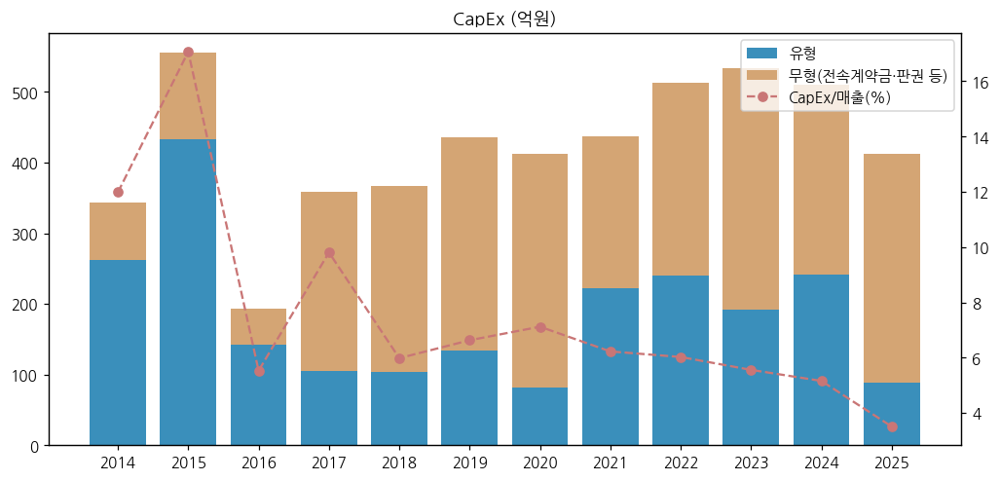

### ⑤ 부채구조 (12년, 억원)

| 항목 | 2014 | 2015 | 2016 | 2017 | 2018 | 2019 | 2020 | 2021 | 2022 | 2023 | 2024 | 2025 |
|---|---|---|---|---|---|---|---|---|---|---|---|---|
| 차입부채(차입금+사채) | 303 | 605 | 568 | 586 | 539 | 635 | 406 | 37 | 86 | 469 | 131 | 138 |
| 현금성자산 | 922 | 1,335 | 1,696 | 1,955 | 2,373 | 2,850 | 2,975 | 3,313 | 3,175 | 3,031 | 3,584 | 3,646 |
| 순현금(현금성-차입) | 618 | 730 | 1,128 | 1,369 | 1,835 | 2,215 | 2,569 | 3,276 | 3,089 | 2,563 | 3,453 | 3,509 |
| 부채비율 | 35.9% | 42.1% | 39.8% | 83.1% | 74.0% | 76.3% | 73.5% | 66.8% | 65.1% | 69.4% | 71.2% | 47.8% |

> → 차입부채 = 차입금 + 전환사채 (리스부채 제외). 2025말 유동리스부채 211억·비유동리스부채 631억 별도
> → 2025 단기차입 400억 차입·402억 상환(연중 운전자금) — 연말 차입부채 138억, 사실상 무차입
> → 3Q26 차입부채 61억 / 현금성자산 3,438억

### ⑥ 배당·자사주 추이 (12년)

| 항목 | 2014 | 2015 | 2016 | 2017 | 2018 | 2019 | 2020 | 2021 | 2022 | 2023 | 2024 | 2025 |
|---|---|---|---|---|---|---|---|---|---|---|---|---|
| 배당금 지급(CF) | 0 | 0 | 0 | 0 | 0 | 0 | 0 | 0 | 47 | 284 | 281 | 129 |
| 자기주식 취득(CF) | 0 | 0 | 0 | 55 | 0 | 0 | 99 | 0 | 0 | 265 | 461 | 0 |
| 지배순이익 | 60 | 217 | 36 | 43 | 306 | -91 | -702 | 1,335 | 800 | 873 | 183 | 3,472 |
| 배당/지배순이익 | 0.0% | 0.0% | 0.0% | 0.0% | 0.0% | N/M | N/M | 0.0% | 5.9% | 32.5% | 153.6% | 3.7% |
| FCF | -435 | 105 | 18 | 416 | 834 | 483 | 41 | 789 | 637 | 596 | 846 | 1,537 |

| 항목 (사업보고서 배당표) | 2023 | 2024 | 2025 |
|---|---|---|---|
| 주당 현금배당(원) | 1,200 | 400 | 1,620 |
| 현금배당 총액(억원) | 281 | 92 | 371 |
| 연결 배당성향 | 32.2% | 50.0% | 10.7% |
| 배당수익률 | 1.3% | 0.5% | 1.3% |

- 2022년 이전 사실상 무배당 → SM 3.0 주주환원 정책으로 배당 시작. 2025 DPS 1,620원(배당성향 10.7% — 일회성 이익 포함 순이익 기준이라 낮게 보임)
- 자기주식: 2023 264억·2024 461억 취득 → 936,211주 소각 (발행주식 23,830,901주 → 22,894,690주). 2025말 자기주식 0주
- 배당금 지급(CF)에는 종속회사 비지배주주 배당이 섞일 수 있어 사업보고서 배당 총액과 다를 수 있음

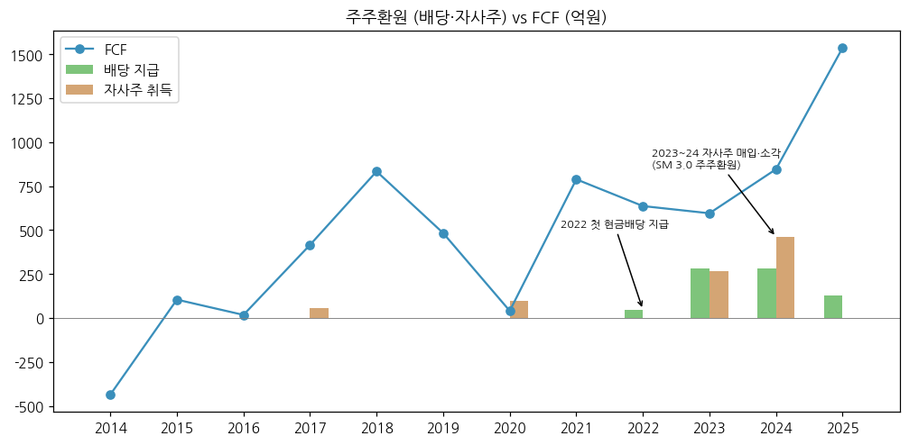

### ⑦ 재무 비율 (12년)

| 항목 | 2014 | 2015 | 2016 | 2017 | 2018 | 2019 | 2020 | 2021 | 2022 | 2023 | 2024 | 2025 |
|---|---|---|---|---|---|---|---|---|---|---|---|---|
| ROE(지배) | 2.5% | 8.3% | 1.2% | 1.3% | 8.0% | -2.1% | -16.0% | 25.5% | 12.2% | 12.3% | 2.6% | 41.6% |
| ROA | 0.5% | 4.4% | 0.9% | -0.7% | 2.6% | -1.5% | -7.4% | 11.2% | 5.9% | 5.5% | 0.1% | 21.0% |
| 부채비율 | 35.9% | 42.1% | 39.8% | 83.1% | 74.0% | 76.3% | 73.5% | 66.8% | 65.1% | 69.4% | 71.2% | 47.8% |
| 유동비율 | 231.5% | 231.0% | 217.9% | 133.4% | 136.3% | 143.9% | 149.0% | 192.0% | 180.0% | 165.3% | 168.0% | 197.2% |
| 매출총이익률 | 35.6% | 34.7% | 29.2% | 31.9% | 33.1% | 32.8% | 34.3% | 37.7% | 34.7% | 35.5% | 31.0% | 36.8% |

> → 2025 ROE 41.6%는 디어유 재측정이익(2,282억) 효과. 제외 시 약 13% 수준
> → 2021 ROE 25.5%도 영업외 이익(세전이익 1,731억 vs 영업이익 675억) 영향

---

## 5. 지배 구조

### ① 그룹·계열 관계

- **카카오 그룹 계열사** — (주)카카오 21.61% + (주)카카오엔터테인먼트 19.89% = 41.50% (2025-12-31). 2023-03 경영권 분쟁 이후 카카오 그룹 편입
- 주요 종속회사(연결): 디어유(팬 플랫폼, 지분 44.21%), 키이스트(드라마·매니지먼트), SM C&C(광고·매니지먼트, 지분 30.32% — 주주간 약정으로 실질 지배), SM ENTERTAINMENT JAPAN, SM브랜드마케팅(MD), SM라이프디자인그룹(앨범 인쇄), 드림메이커(공연 제작), 에스엠컬처파트너스(투자)
- **상장 종속회사 5개** (2025 사업보고서): SM C&C(048550), 디어유(376300), 키이스트(054780), SM LDG(063440), SM ENTERTAINMENT JAPAN(도쿄 4772)
- 2025 지배구조 단순화: 중간지주 성격의 에스엠스튜디오스를 흡수합병 → 하위 종속회사(SM C&C·키이스트·SM LDG·디어유) 직접 보유

### ② 주주 구분

| 주주 | 주식수 | 지분율 | 비고 |
|---|---|---|---|
| (주)카카오 | 4,946,821 | 21.61% | 최대주주 |
| (주)카카오엔터테인먼트 | 4,554,220 | 19.89% | 특수관계인 |
| Tencent Music Entertainment Hong Kong | 2,212,237 | 9.66% | 2025 하이브 보유분 인수 |
| T. Rowe Price Associates | 1,195,259 | 5.22% | 외국계 기관 |
| 소액주주(1% 미만, 39,297명) | 8,486,900 | 37.07% | |
| 발행주식총수 | 22,894,690 | 100% | 자기주식 0주 |

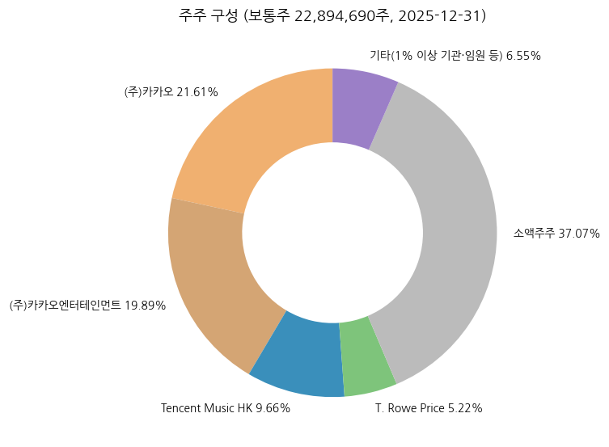

> 외국인 지분율 시계열은 이번 작성에서 미수집 (KRX 데이터 필요) — 5% 이상 주주 기준으로 대체

### ③ 임원·이사회

- 공동대표이사: **장철혁** (2023-03 대표 선임, CFO 출신) · **탁영준** (2024-03 공동대표, 매니지먼트·아티스트 사업 총괄 출신)
- 2023-03 정기주총에서 이사회 전면 교체 (사내이사 장철혁·김지원·최정민, 사외이사 김규식·김태희·문정빈·이승민·조성문) — 이수만 측 경영진 퇴진
- 2025-03 사외이사 이성용, 상근감사 박지호 선임

---

## 6. 기타 팩트

### ① R&D 인프라

- 연구개발비 별도 공시 없음 (콘텐츠 제작비는 매출원가·무형자산). 판관비 추이로 대체 (chart7)
- 제작 체계: SM 3.0 '멀티 프로덕션 센터' — 이수만 1인 프로듀싱에서 복수 센터 체제로 전환(2023)

### ② 진행 중 corporate action (10년치)

| 시점 | 내용 |
|---|---|
| 2018 | 키이스트·FNC애드컬쳐 인수 (SM C&C 산하) |
| 2021-04 | 비음악 계열사 구조개편 (에스엠스튜디오스 중간지주 설립) |
| 2021-11 | 디어유 KOSDAQ 상장 |
| 2022-12 | 라이크기획(이수만 개인회사) 프로듀싱 계약 조기 종료 |
| 2023-02\~03 | 하이브 vs 카카오 경영권 분쟁 → 카카오 최대주주 |
| 2023\~2024 | 자기주식 취득·소각 936,211주 |
| 2025 | 디어유 구주 1,356억 인수(연결 편입) / SM브랜드마케팅 구주 539억 인수 / 에스엠스튜디오스 흡수합병 / 하이브 → TME 지분 이전(9.66%) / 그레이트엠엔터테인먼트 28.44% 취득(60억) |

### ③ 마일스톤 (아티스트·사업)

- 2020 aespa(버추얼 세계관), 2023 RIIZE, 2024 NCT WISH, 2025 Hearts2Hearts 데뷔
- 2026: aespa 'SYNK : COMPLæXITY' 월드투어(북미·유럽 1Q27), NCT 127 5th 투어, EXO 'EXhOrizon'

### ④ 주요 리스크

- **신보 판매 둔화**: 3Q26 신보 판매 167만장(-70% YoY). K-POP 실물 앨범 시장 정체가 본사 최대 매출원(음반/음원 40%)을 직접 압박
- **최대주주 리스크**: 카카오 경영진의 2023 공개매수 기간 SM 시세조종 혐의 재판 (김범수 창업자 2025-10 1심 무죄 보도 — 항소심 경과 확인 필요). 카카오의 SM 지분 처리 방향이 오버행/프리미엄 변수
- **환율**: 3Q26 원화 강세로 외화손실 → 순손실. 일본 매출(SM ENT JAPAN) 엔화 약세 영향
- **자회사 손익 변동**: 2024 순이익 8억(손상차손·자회사 부진) 전례. 디어유 영업권 손상검사 여유가 446억, 할인율 +0.35%p면 손상 발생 (2025 사업보고서)
- **아티스트 재계약·이탈**: 2세대 그룹(EXO·SHINee 등) 멤버 개인 활동 분리 사례

### ⑤ ESG 등급

- 이번 작성에서 미수집 (한국ESG기준원 KCGS 등급 확인 필요)

### ⑥ 인증·라이선스

- 해당 사항 특이점 없음 (콘텐츠 기업 — 음반 제작·공연 관련 일반 사업자)

---

## Version Log

| 버전 | 일자 | 내용 |
|---|---|---|
| v1.0 | 2026-11-15 | 최초 작성 — OpenDART 연결 재무(2014\~3Q26, 43분기), 2025 사업보고서 본문, IR PDF 34건 중 본사 매출 유형 18개 분기 추출, 차트 13종 |

**잔여 보완 후보 (다음 버전)**
- 3Q22 본사 매출 유형 (이미지 PDF → OCR 또는 다른 IR의 전년 동기 컬럼)
- 2016\~2021 본사 매출 유형 (옛 IR 양식 — 이미지 위주)
- 외국인 지분율 시계열, ESG 등급, 시가총액 외부 사이트 교차 검증
- 연간 신보 판매량 시계열 (IR 문구 기준 분기 수치 정리)
