> 종목: 에코프로비엠 (247540.KQ / 주식회사 에코프로비엠 / EcoPro BM Co., Ltd., DART corp_code 01160363)
> 섹터: 배터리 (워치리스트 T2) / 서브섹터: 양극재
> 작성 시각: 2026-11-14 KST (**v1.0** — 첫 작성. source 6종 전수 점검 후 단일 완성본)
> 적용 구조: v4.8 (6개 섹션 + 12종 차트 표준. chart2는 2·2b·2c·2d 4종, 재무건전성 chart4b 추가 — 총 16종)
> 데이터: 연간 9년(2017~2025; 2017~2019 별도, 2020~ 연결) + 2015·2016 매출(회사 IR 차트) + 분기 35분기(1Q18~3Q26; 2018~2019 회사 IR, 1Q20~2Q26 OpenDART, 3Q26 회사 IR 잠정) + **용도별(EV·Non-IT/PT·ESS) 분기 매출 34분기(2Q18~3Q26)** + 고객 집중도 8년 + 수출/내수 9년 + 분기 재무건전성 29개 시점 + 메탈 가격 17개 시점(2022.10~2026.09) + Yahoo 월간 시세(2019.03 상장~2026.11.13)
> 출처: **DART 사업보고서 2025(rcept 20260318001622, 최우선 정성자료)·2024 정정(20250325000761)·2023 정정(20240417000540)·2022(20230321001436)·2021 첨부정정(20220321001523)·2020(20210319000143)·2019(20200330004369)·2018 정정(20190607000162, 부분 정정본), 반기보고서 2026.06(20260814002535)·분기보고서 2026.03(20260515001109)·2025.09(20251114000765) 외 정기보고서 31건(공시원문 XML)** / OpenDART 전체재무제표 연결(CFS) 2020~2Q26(2018·2019는 2020 사업보고서 비교기 = 별도) / OpenDART 2025 FY 최대주주·임원·직원·배당·자기주식·주식총수 / **회사 IR 실적발표 PDF 29건(2019-04~2026-11-05, irgo 경유, source `ir/` 폴더 — 2021.2Q·3Q 발표분 다운로드 실패, 2021.4Q~2023.1Q는 이미지 PDF라 핵심 페이지만 육안 판독)** / Yahoo Finance v8 247540.KQ / alphasquare·stockhub 시세(2026-11-13) / 언론(유상증자·3Q26 컨콜·점유율·ESG 등급) / BT `earnings-review/2026-Q1_에코프로비엠_리뷰.md`, `sectors/배터리/_session_handoff_2026-Q1.md`
> **Fact verify cutoff**: 2026-11-14

# 에코프로비엠 기업 개요 (v1.0 — 배터리 T2, 하이니켈 NCA·NCM 양극재 전업, 삼성SDI·SK온 2사 의존 + 메탈가 래깅형 사이클)

> ⚠️ **시계열 단절 4회 — 모든 표·차트 해석 시 주의**
> ① **2016.05.01** ㈜에코프로 2차전지소재 사업부문 물적분할로 신설(설립등기 2016.05.02). 2015·2016 매출은 회사 IR 차트 수치(분할 전 사업부문 포함)만 확보, 영업이익은 **[미확보]**
> ② **2017~2019 = 별도, 2020~ = 연결** — 2020.02 ㈜에코프로이엠(삼성SDI JV, 지분 60%) 설립으로 연결재무제표 작성 개시. 2019년까지는 연결 대상 없음(별도 = 전사)
> ③ **2022.06 무상증자(1주당 3주) + 유상증자 161만주** — 주식수 2,292만 → 9,788만주. 2021년 이전 DPS·EPS·주가는 무상증자 전 기준(Yahoo 주가는 수정주가)
> ④ **2026.11.05 유상증자 신주 9,900,990주 상장**(발행가 89,500원, 8,861억) — 3Q26말 재무상태표에는 미반영. 시총·PBR은 증자 후 주식수 107,731,424주 기준 [계산]
> 부가: IR 용도 분류가 「Non-IT·EV·ESS·기타(전구체)」(2018~2022) → 「EV·PT(전동공구)·ESS등」(2023~2024) → 「EV·P/A(Power Application)·ESS·기타」(2025~)로 변경. Non-IT ≒ PT ≒ P/A 계보로 연결해 표기. 2025.2Q~3Q 「기타」에는 인도네시아 투자 관련 이익(405억·418억)이 매출로 포함

---

## ① 기업 분류

(1) Primary / Secondary 분류

**⚠️ Boundary Case — 연간 OPM 진폭은 cutoff 직전(9.7%pt)이지만, 매출 진폭은 극단적 사이클형**

9년 연간 OPM range -1.2%~8.5% = **+9.7%pt (cutoff ±10%pt에 0.3%pt 미달)** → 정량 룰만으로는 경계. 그러나 분기 OPM은 10.0%(3Q21) ~ -9.5%(4Q23)로 **+19.5%pt**, 매출은 2023 6.90조 → 2025 2.53조(**-63%**)로 2년 만에 1/3 토막. 양극재는 판가가 메탈가에 연동(pass-through)되는 구조라 **매출 사이클 = 메탈가 사이클 × 출하량 사이클**, 이익은 메탈가 래깅(재고평가) 효과로 증폭된다.

**Primary 분류: 사이클 (메탈가 연동 판가 + EV 수요 사이클 이중 사이클)**

→ 2021~2023 리튬 슈퍼사이클에서 매출 4.6배(1.49조 → 6.90조), 2024 리튬가 급락(수산화리튬 85$/kg → 9.5$/kg, 2022.12 → 2024.12, 회사 IR 메탈 차트)과 EV 캐즘이 겹치며 매출 -60%·OPM -1.2%

→ 분기 OPM은 메탈가 방향에 따라 출렁임 — 하락기 재고평가손실(4Q23 -9.5%, 3Q24 -7.9%), 상승기 래깅 이익(4Q25 8.4%, 일회성 318억 포함)

**Secondary 노트: 꿈(차세대 소재) + Non-EV 다변화형 회복주**

→ EV 매출 비중 1Q23 80%·2Q23 87% → 3Q26 **46%**, P/A(전동공구·BBU·드론) 30%·ESS 22%로 분산 (회사 IR)

→ 헝가리 공장(5.4만톤, 2026.06 1라인 가동), 인도네시아 니켈 제련(BNSI) 지분투자, 전고체 황화물 고체전해질(2027 양산 목표)·LMR·LFP(최대 5만톤 증설 계획)·소듐 양극재 — 실적 기여 전 단계 (3Q26 컨콜, zdnet·MTN 2026-11-05)

**Entity 구조 (2026.06말, DART 반기보고서 — 연결 종속회사 7개, 상장사 없음)**

→ **(1) 에코프로비엠 본체(별도)** — 오창(CAM1~4)·포항(CAM5·5N) 양극재, 연구소. 2025 별도 순이익 922억

→ **(2) ㈜에코프로이엠** (60%, 삼성SDI 40% JV) — 포항 CAM6·CAM7·CAM8, 2025말 자산 1.21조 / 순이익 560억

→ **(3) EcoPro BM Hungary Zrt.** (100%) — 데브레첸, 연산 5.4만톤, 2025말 자산 1.76조 / 순손실 174억

→ **(4) EcoCAM Canada / EcoPro CAM Canada L.P.** (100%, 실질 지배) — 퀘벡 베캉쿠르, 자산 0.41조 (가동 전)

→ **(5) PT ECOPRO ESG INVESTMENT** (51%, 2025.04 설립) — 인도네시아 니켈 제련 투자 지주, 2025 순이익 612억 / EcoPro BM America (100%)

(2) Summary Box (9년 시계열 + 사이클 통계)

| 지표 | 9년 평균 (2017~2025) | 정점 | 저점 | 2025년 | LTM (4Q25~3Q26) |
|---|---|---|---|---|---|
| 매출 (억원) | 23,769 | **69,009 (2023)** | 2,899 (2017) | 25,316 | **22,370** |
| 영업이익 (억원) | 1,028 | **3,807 (2022)** | -341 (2024) | 1,433 | **925** |
| 지배순이익 (억원) | 445 | **2,323 (2022)** | -965 (2024) | 394 | - |
| OPM (%) | 5.6% | **8.5% (2018)** | -1.2% (2024) | 5.7% | **4.1%** |

```
[에코프로비엠 9년 손익 시계열 (억원; 2017~2019 별도 = 전사, 2020~ 연결)]
연도      매출       OP      OPM    지배NI
2015R      756        -       -        -    ← 분할 전 사업부문 (회사 IR 차트, 참고)
2016R    1,410        -       -        -    ← 2016.05 물적분할 신설 (회사 IR 차트, 연간 환산 추정)
2017     2,899      223     7.7%     152    ← 별도. Non-IT(전동공구) NCA 중심, 삼성SDI 원통형 공급
2018     5,892      503     8.5%     369    ← OPM 정점① (NCA 전동공구 호황 + CSG(NCM811) EV 양산 개시)
2019     6,161      371     6.0%     345    ← 저점① (ESS 화재·Non-IT 재고조정, 코발트 급락), 2019.03 코스닥 상장
2020     8,547      548     6.4%     469    ← 연결 개시(에코프로이엠), CAM5 가동, EV 비중 35~41%
2021    14,856    1,150     7.7%   1,008    ← OPM 정점② (3Q21 분기 10.0%), SK이노 NCM 10.1조 장기계약
2022    53,576    3,807     7.1%   2,323    ← 리튬 슈퍼사이클: 매출 3.6배·OP 최고, 판가에 메탈가 전가
2023    69,009    1,560     2.3%     -87    ← 매출 정점 / 하반기 리튬 급락 → 4Q23 OPM -9.5% (재고평가손실)
2024    27,668     -341    -1.2%    -965    ← 저점② (매출 -60%, EV 캐즘 + 역래깅), CapEx 1.03조 피크
2025    25,316    1,433     5.7%     394    ← 흑자 회복 (인니 투자이익 823억 + 내용연수 변경 318억 포함)
3Q26 LTM 22,370     925     4.1%       -    ← 헝가리 가동중단·EV 정체 (3Q26 OPM 2.2%), 2026.11 유증 8,861억

OPM range (연간): -1.2% ~ 8.5% = +9.7%pt (cutoff ±10%pt 직전) / 분기: -9.5% ~ 10.0% = +19.5%pt
매출 진폭: 정점 대비 -63% (2023 → 2025) → 매출 기준으로는 명백한 사이클
사이클 회수: 1.5회 (저점 2019 → 정점 2021~22 → 저점 2024 → 2025~26 회복 시도 중)
```

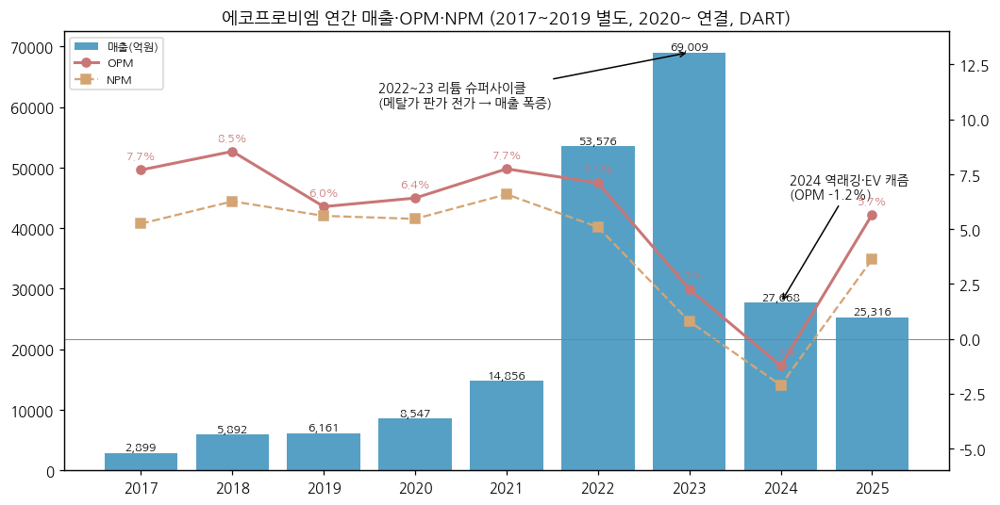

**📊 사이클 통계 (9년)**

| 지표 | 값 |
|---|---|
| 매출 CAGR (8년, 2017→2025) | **+31.1%** |
| 매출 CAGR (6년, 2017→2023 정점) | **+69.6%** (리튬가 상승분 포함 — 물량 성장과 가격 효과 혼재) |
| OPM 평균 | **5.6%** |
| OPM 정점 평균 | **8.1%** (2018 8.5%, 2021 7.7%) |
| OPM 저점 평균 | **2.4%** (2019 6.0%, 2024 -1.2%) |
| OPM range | **+9.7%pt** (연간) / +19.5%pt (분기) |
| 사이클 주기 | 저점→저점 5년(2019→2024), 매출 상승 4년(2019→2023)·하락 2년(2023→2025) |
| 사이클 회수 (9년) | **1.5회** |

**국내외 양극재 피어 마진 비교 (3Q26, 출처: 파이낸셜뉴스 2026-11-05 업계 집계, 회사 IR)**

→ **에코프로비엠** — 매출 5,579억 / OP 120억 / OPM **2.2%** (3Q26)

→ **포스코퓨처엠** — 매출 8,348억 / OP 821억 / OPM 약 **9.8%** [계산] (연결, 음극재·기초소재 포함)

→ **엘앤에프** — 매출 8,744억 / OP **-265억** / OPM 약 **-3.0%** [계산]

→ **셀 메이커 대비 (1Q26)** — 에코프로비엠 OPM 3.5% vs LGES -3.2% / 삼성SDI -4.4% (BT 1Q26 리뷰) — 메탈가 상승기 래깅 수혜는 양극재 고유 패턴

(3) 정량적 분류 근거

→ **판가 = 메탈가 연동** — 원재료(전구체·리튬 등) 매입이 매출원가의 대부분: 2025 원재료 매입 1조 9,303억(전구체·리튬 등 1조 9,068억, 98.8%) / 매출원가 2조 2,618억 = **85%** [계산] (DART 2025 사업보고서 원재료 현황)

→ **GPM 구조적 하락** — GPM 2017 15.4% → 2022 9.6% → 2023 4.3% → 2024 3.4% → 2025 10.7% (OpenDART). EV용 대량생산 + 메탈가 고점 재고가 마진을 압축

→ **용도 mix 변화** — EV 비중 2Q18 27% → 2Q23 **87%**(정점) → 3Q26 **46%**. Non-IT/P/A는 2018 70%대 → 2023 10%대 → 3Q26 30% 재확대 (회사 IR)

→ **수출 비중** — 2023 97.9% → 2025 86.0% → 1H26 90.6% (DART 매출실적, 간접수출 포함) — 국내 셀 3사 해외공장향 간접수출이 대부분

→ **고객 집중** — 매출 10% 이상 고객 2~4사가 매출의 89~98% (DART 주석). 2024 최대 고객 1사 **80.4%**

(4) 산업 분류

→ **한국표준산업분류(DART 기재)** — 28202 축전지 제조업 계열 (일차전지 및 축전지 제조업)

→ **KRX 업종** — 코스닥 (2019.03.05 상장, 2022.11 코스닥 글로벌 세그먼트). 2026-11-13 현재 코스닥 유지(Yahoo exchange KOSDAQ, alphasquare 확인) — 코스피 이전상장 이력 없음

→ **워치리스트 섹터** — 배터리 T2 / 서브섹터 양극재 (동일 서브섹터: 포스코퓨처엠, 트래킹: 엘앤에프)

→ **사업 성격** — 하이니켈(Ni 80%↑) 삼원계 NCA·NCM 양극재 전업. 2023년 글로벌 삼원계 양극재 출하량 **1위**(12만톤, SNE리서치 — 디지털데일리 2024-06-17), 회사는 「글로벌 양극소재 점유율 2년 연속 1위(2022~2023, SNE)」로 기재 (DART 2026 반기보고서)

(5) 분류 결정 논리

(1) **가장 매출 큰 사업 기준** — 양극재 단일 사업(매출 96.7%, 2025). 판가가 메탈가에 연동되어 매출 자체가 원자재 가격 사이클을 그대로 탄다 → 사이클 근거

(2) **이익 sub-rule** — 연간 OPM range 9.7%pt는 cutoff 직전이나, 분기 range 19.5%pt·매출 -63% 진폭 → 이익과 매출 모두 사이클 특성. 다만 연간 OPM 정점이 8.5%에 불과해 "고마진 사이클"이 아닌 **가공 마진(spread) 사업** — 마진 레벨보다 **출하량 × 메탈가 래깅**이 이익을 결정

(3) **Boundary case 처리** — 정량 룰(9.7pp)은 지속성장 쪽, 매출·분기 이익 진폭은 사이클 쪽 → **매출 진폭 우선 적용, Primary 사이클 + Secondary 꿈(차세대 소재)**. 대안: Primary 고성장(EV secular) — 2024~2026 매출 역성장으로 기각

(4) **국내외 피어 비교** — 포스코퓨처엠(음극재·내화물 병행)보다 순수 양극재 노출이 크고, Umicore(귀금속 리사이클·촉매 병행, 2026E P/B 1.7배)보다 성장 옵션 프리미엄이 크다. 엘앤에프와 가장 유사한 순수 하이니켈 양극재 + 단일 고객(테슬라·LGES 대 SDI·SK온) 구조

(6) 적정 밸류에이션 방법

→ **1차 — P/B (사이클 저점 지표)**: 이익이 적자~저수익을 오가는 국면이라 PER은 무의미(2026-11-13 PER 364배, alphasquare). 시총 **9조 7,820억** [계산: 90,800원 × 107,731,424주] / 3Q26 지배지분 1조 6,225억 = **PBR 6.0배**, 유증 대금 8,861억 반영 pro forma 지배지분 2조 5,086억 기준 **3.9배** [계산]. alphasquare 표기 PBR 8.29배(유증 전 기준 추정)

→ **2차 — Forward PER (2028E, 출하량 회복 가정)**: 헝가리 풀가동(2028)·신규 수주(9억달러 LOI, 2028 공급) 이후 정상 이익을 할인. BT 1Q26 리뷰 정리: 28E P/E 86~127배(셀사이드), 글로벌 양극재 동종 평균 48배 대비 프리미엄 논쟁

→ **3차 — EV/EBITDA (보조)**: LTM EBITDA 1,450억(회사 IR 4Q25~3Q26 합산) / EV 약 11.6조 [계산: 시총 9.78조 + 유증 후 순차입금 약 1.47조 + 비지배지분 0.31조] = **약 80배** — 감가상각이 큰 장치산업이라 저점 국면 비교에 보조 활용

→ **피어 P/B (2026-11-13, alphasquare)**: 포스코퓨처엠 **4.09배**(시총 15.52조) / 엘앤에프 **5.45배**(3.27조) / Umicore 1.7배(KB 2026E, 2026-04 기준) → 에코프로비엠 pro forma 3.9~6.0배는 국내 피어 밴드 내

→ **삼성전자 대비**: 삼성전자는 PBR 사이클 밴드, 에코프로비엠은 PBR + 정상화 PER 병행(이익 저점 국면에서 PER 미작동)

(7) 분기 재평가 트리거 (**분류 변경 조건** — 실적 추적 변수는 ⑥ 기타 팩트)

→ ① **Non-EV(P/A+ESS) 매출 비중 4분기 연속 50% 이상 + 연간 OPM 7% 이상** → Secondary를 「지속성장(Non-EV 다변화)」으로 격상, 사이클 진폭 축소 판정

→ ② **신규 고객(LOI 9억달러·완성차 수조원) 본계약 + 헝가리 가동률 70%↑** → Primary 「고성장」 재검토 (출하량 주도 성장 재개)

→ ③ **순차입금비율 150% 초과 또는 회사채 등급 BBB급 강등** → 「사이클 + 재무 리스크」 할인 구간으로 분류 강등

---

## ② 회사 개요

(1) 기본 사항

| 항목 | 내용 |
|---|---|
| 회사명 (한글) | 주식회사 에코프로비엠 |
| 회사명 (영문) | EcoPro BM Co., Ltd. |
| 종목코드 | 247540 (KRX **코스닥**, 2019.03.05 상장) |
| **설립일** | **2016년 5월 2일** (㈜에코프로 2차전지소재 사업부문 물적분할, 분할기일 2016.05.01) |
| 본사 주소 | 충청북도 청주시 청원구 오창읍 2산단로 100 |
| **대표이사** | **최문호** (사장, 1974.04, 서울대 화학공학·한양대 에너지공학 박사, 2016.05~) / **김장우** (부사장·CFO, 1963.12, 고려대 경제학, 前 SK이노베이션 재무실장, 2022.03~) — 각자대표 (DART 2025) |
| 발행주식수 | 97,830,434주 (2026.06말, 자기주식 5,843주) → **107,731,424주** (2026.11.05 유증 신주 9,900,990주 상장 후) [계산] |
| 주요주주 | ㈜에코프로 **40.83%** + 데이지파트너스 3.75% + 근로복지기금·임원 = 최대주주 등 **약 45.2%** (2026.06말, 유증 전) |
| 연결 종속회사 | **7개** (에코프로이엠·헝가리·캐나다 2·캐나다 GP·미국·인니 투자법인) — 2026.06말 DART |
| **신용등급** | 회사채 **A- / Stable** (한국기업평가 2025.06) · **A / Negative** (NICE 2025.06) / 기업신용 BBB+ (이크레더블 2026.04) |
| 임직원 (별도) | **1,192명** (2025말, dart_api 직원) → 1,001명 (2026.06말, DART 반기) |
| 시가총액 | **9조 7,820억원** [계산: 2026-11-13 종가 90,800원(Yahoo) × 107,731,424주] / alphasquare 표기 **9조 6,850억원** (2026-11-13 19:59, 시간외 91,700원 기준) — 주식수 기준 차이 |
| 52주 범위 | **75,600 ~ 260,000원** (Yahoo meta, 고점 2026.01 장중) / alphasquare 75,200~255,907원(수정주가) |
| **역대 최고가** | **장중 584,000원 (2023-07-26, Yahoo 주봉 고가)** — 당일 시총 약 45조원(이투데이, KRX 기준). 월말 종가 기준 최대 시총 **37.2조원**(2023.07, 종가 380,500원) [계산] |
| 외국인 지분율 | **13.51%** (alphasquare, 2026-11-13) / 14.38% (stockhub, 2026-10-27) |

(2) 9년 손익·자본 추이

| 연도 | 매출 (억) | OP (억) | OPM | 순이익 (억) | 지배NI (억) | 자본총계 (억) | 자산총계 (억) | 기준 |
|---|---|---|---|---|---|---|---|---|
| 2017 | 2,899 | 223 | 7.7% | 152 | 152 | 1,152 | 2,963 | 별도 (2019 사업보고서 요약재무) |
| 2018 | 5,892 | 503 | 8.5% | 369 | 369 | 1,605 | 4,645 | 별도 (OpenDART 2020 FY 전전기) |
| 2019 | 6,161 | 371 | 6.0% | 345 | 345 | 3,702 | 6,504 | 별도 (상장 공모 반영) |
| 2020 | 8,547 | 548 | 6.4% | 467 | 469 | 4,673 | 7,990 | 연결 개시 |
| 2021 | 14,856 | 1,150 | 7.7% | 978 | 1,008 | 5,961 | 14,259 | 연결 |
| 2022 | 53,576 | 3,807 | 7.1% | 2,727 | 2,323 | 14,882 | 33,742 | 연결 (유상증자 6,246억) |
| 2023 | 69,009 | 1,560 | 2.3% | 547 | -87 | 15,994 | 43,618 | 연결 (2024 기재정정) |
| 2024 | 27,668 | -341 | -1.2% | -585 | -965 | 19,770 | 43,237 | 연결 (신종자본증권 3,360억 자본 반영) |
| **2025** | **25,316** | **1,433** | **5.7%** | **916** | **394** | **20,160** | **48,820** | 연결 (20260318001622) |

→ 8년 매출 CAGR **+31.1%** / 자본총계 CAGR **+43.0%** [계산: (20,160/1,152)^(1/8)] — 자본 증가의 상당 부분은 상장공모(2019)·유상증자(2022)·신종자본증권(2024) 등 외부 조달
→ 2025 ROE(지배, 평균자본) 약 **2.3%** [계산: 394 / ((17,120+17,288)/2)] — 비지배지분(에코프로이엠 40%)이 순이익의 57%를 가져감(2025 연결 NI 916억 중 지배 394억)
→ 2025 OP 1,433억 중 인니 투자 관련 이익 **823억**(2Q 405억 + 3Q 418억, 회사 IR) + 내용연수 변경 일회성 **318억**(4Q) → 일회성 제외 본업 OP 약 **292억** [계산, OPM 1.2%]

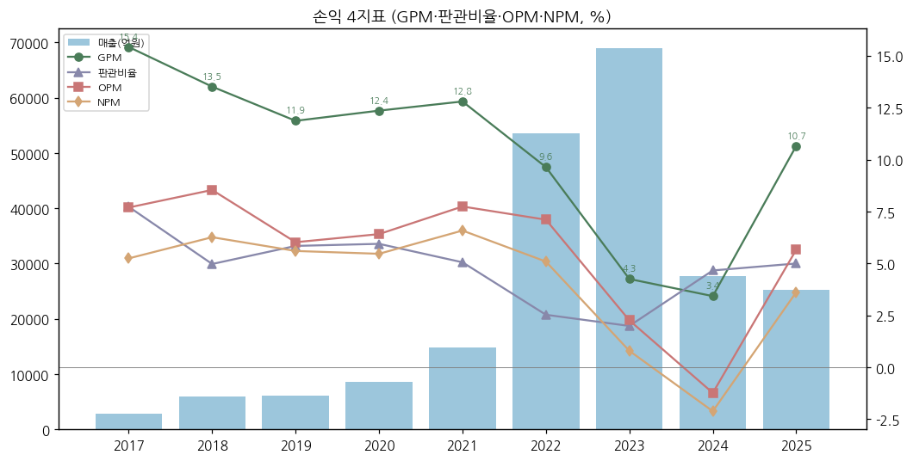

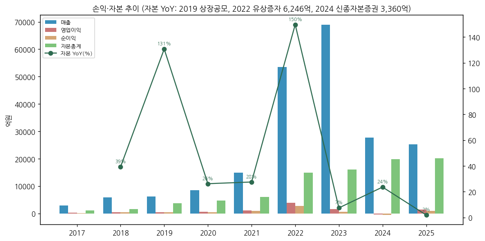

(3) 주가 역사 (2019.03 상장 ~ 2026.11)

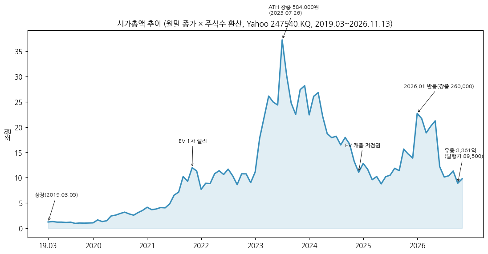

→ (출처: Yahoo Finance v8 247540.KQ 주봉 → 월말 종가 × 주식수. 2022.06 무상증자 전 구간은 Yahoo 수정주가 × 무상증자 환산 주식수(×4)로 계산 — **주식수 단계 근사, 추정**)

→ **2019~2020 상장 초기** — 시총 1~4조. 2019 ESS 화재·Non-IT 재고조정으로 공모가 부근 정체, 2020 EV 비중 확대로 재평가 시작

→ **2021 EV 1차 랠리** — SK이노 NCM 10.1조 장기계약(2021.09) 전후 시총 12조(2021.11)

→ **2023 2차전지 버블 정점** — 2023.07.26 장중 **584,000원**(ATH), 월말 시총 최대 37.2조(2023.07). 리튬가 급락 시작과 함께 하락

→ **2024 EV 캐즘** — 2024.12 시총 11조권, 2025.05 시총 약 8.2조(주간 종가 83,600원)로 저점

→ **2026.01 반등** — 장중 260,000원(52주 고점), 3Q25~4Q25 흑자·코발트 급등(25.09 33$ → 26.03 55.6$/kg)

→ **2026.06~11 급락** — 1.2조 유상증자 증권신고서(2026.06.30) → 금감원 정정요구(07.14) → 주가 하락으로 모집액 8,861억으로 26% 축소(최종 발행가 89,500원, 10.13 확정) + 3Q26 OP 120억(-76% YoY). 2026-11-13 종가 90,800원, 시총 약 9.8조 (ATH 대비 -84%)

(4) 주요 연혁 (DART 사업보고서 연혁·회사 IR)

| 시기 | 내용 |
|---|---|
| 1998~2008 | ㈜에코프로 양극소재 사업 진출, 2008 국내 최초 하이니켈 NCA 상용화 |
| **2016.05** | **㈜에코프로 2차전지소재 사업부문 물적분할로 설립**, 2016 EV용 NCM811(CSG) 양산 성공 |
| 2017.04 | IPO 준비 지정감사인(삼정) 지정 |
| **2019.03.05** | **코스닥 상장** (공모 300만주) |
| 2019.10 | 포항 CAM5 준공 (연산 약 3만톤) |
| 2020.02 | 삼성SDI JV ㈜에코프로이엠 설립 (BM 60% / SDI 40%) |
| 2020.09 | EcoPro BM America 설립 |
| 2021.09 | SK이노베이션 EV용 NCM 장기공급계약 **10조 1,102억** (2024~2026) |
| 2021~2022 | CAM6(에코프로이엠) 준공, CAM7(연산 5.4만톤) 2022.10 준공 |
| **2022.06** | **유상증자 약 6,246억 + 무상증자 1:3 + 자사주 80,474주 소각** |
| 2022.01 | EcoPro BM Hungary 설립 (데브레첸) |
| 2023.02 | EcoCAM Canada 설립 (퀘벡, SK온·포드 협력 거점) |
| 2023.07 | 전환사채 4,400억 발행 (0%, 전환가 214,188원) |
| 2023.12 | 삼성SDI 하이니켈 NCA 장기공급계약 **43조 8,676억** (2024~2028) |
| 2024.05 | ㈜에코프로글로벌 흡수합병, 상호출자제한기업집단 지정(2025.05 공시대상기업집단으로 변경) |
| 2024.06 | 헝가리법인 수출입은행·무역보험공사 ECA 파이낸싱 |
| 2024.10 | 신종자본증권 3,360억 (사모, 30년) |
| 2024.11 | 양극소재 8공장(CAM8) 준공 |
| 2025.04 | PT ECOPRO ESG INVESTMENT(인니, 51%) 설립 — 니켈 제련 투자 |
| 2025.11 | 헝가리 캠퍼스 완공 |
| 2026.06 | 헝가리 1라인 가동 / 1.2조 유상증자 증권신고서 제출(06.30) |
| 2026.09~10 | 헝가리 2라인 준비 중 현지 안전당국 점검으로 일시 중단 → 10월말 재개 (MTN 2026-11-05) |
| **2026.11.05** | **유상증자 신주 9,900,990주 상장** (8,861억, BNSI 니켈 제련소 지분 7,650억 + 헝가리 1,211억) |

---

## ③ 비즈니스 모델

(1) 실적 추이 통합 표 (5년 연간 — 3단계 위계: 용도 / 고객 / 지역)

**(1-1) 용도별 매출 (회사 IR, 억원)**

| 용도 | 2021 | 2022 | 2023 | 2024 | 2025 | 1~3Q26 누적 |
|---|---|---|---|---|---|---|
| 연결 매출 | 14,856 | 53,576 | 69,009 | 27,668 | 25,316 | 17,400 |
| EV | 6,486 | 31,572 | 57,720 | 19,191 | 16,426 | 10,229 |
| Non-IT / PT / P/A | 7,569 | 19,141 | 8,837 | 3,846 | 4,076 | 4,304 |
| ESS | 722 | 2,536 | 2,453 | 4,261 | 3,820 | 2,668 |
| 기타 (전구체·인니 투자이익·연결조정) | 79 | 327 | -1 | 370 | 994 | 199 |
| **EV 비중** | **44%** | **59%** | **84%** | **69%** | **65%** | **59%** |
| 연결 영업이익 / OPM | 1,150 / 7.7% | 3,807 / 7.1% | 1,560 / 2.3% | -341 / -1.2% | 1,433 / 5.7% | 509 / 2.9% |

→ (출처: 2021 = 4Q21 IR(2022-02-11) p.7 분기 합산, 2022 = 4Q22 IR(2023-02-03) p.9(EV 31,572·Non-IT 19,141) + ESS 2,536 [계산: 분기 합산, 4Q22 = 연간−1~3Q], 2023 = 1Q24·2Q24 IR 분기 합산(ESS에 기타 포함), 2024·2025 = 4Q25 IR(2026-02-05) p.5, 1~3Q26 = 각 분기 IR p.5)
→ 용도 구분은 고객사 출하 용도 기준. **사업부(segment)는 DART상 「2차전지소재 단일 부문」** — 용도별 영업이익은 비공개

**(1-2) 고객 집중도 (DART 영업부문 주석 「매출 10% 이상 외부고객」, 억원 / 매출 대비 %)**

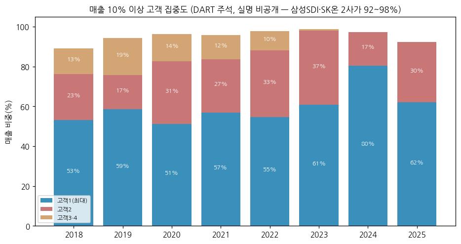

| 고객 | 2018 | 2019 | 2020 | 2021 | 2022 | 2023 | 2024 | 2025 | 1H26 |
|---|---|---|---|---|---|---|---|---|---|
| 고객1 (최대) | 3,132 / 53.2% | 3,609 / 58.6% | 4,376 / 51.2% | 8,440 / 56.8% | 29,320 / 54.7% | 41,927 / 60.8% | **22,252 / 80.4%** | 15,682 / 61.9% | 8,983 / 76.0% |
| 고객2 | 1,360 / 23.1% | 1,049 / 17.0% | 2,689 / 31.5% | 3,994 / 26.9% | 17,841 / 33.3% | 25,645 / 37.2% | 4,655 / 16.8% | 7,692 / 30.4% | 2,004 / 17.0% |
| 고객3·4 | 764 / 13.0% | 1,154 / 18.7% | 1,171 / 13.7% | 1,794 / 12.1% | 5,206 / 9.7% | 608 / 0.9% | - | - | - |
| **합계** | **89.2%** | **94.3%** | **96.4%** | **95.7%** | **97.7%** | **98.8%** | **97.2%** | **92.3%** | **93.0%** |

→ (출처: DART 각 사업보고서·2026 반기보고서 주석. 고객명은 비공개. 본문 기재 주요 매출처: 2022~2023 「삼성SDI, SK온, TMM」, 2024~ 「삼성SDI, SK온」, 주요 매출처 비중 2022 97.7% → 2023 98.8% → 2025 92.3% → 1H26 94.7%)
→ **고객1 = 삼성SDI, 고객2 = SK온(舊 SK이노베이션 배터리) [추정]** — 근거: 삼성SDI NCA 43.9조 장기계약(2024~2028)·에코프로이엠 JV, SK이노 NCM 10.1조(2024~2026). 2024 고객2 비중 급락(37% → 17%)은 SK온 북미(포드·VW) EV 부진과 일치. NH증권은 1Q26 SK온향 비중 24%로 추정 (BT 1Q26 리뷰)

**(1-3) 지역별 — 수출/내수 (DART 매출실적, 억원)**

| 연도 | 수출 | 내수 | 수출 비중 |
|---|---|---|---|
| 2017 | 2,748 | 151 | 94.8% |
| 2018 | 5,355 | 536 | 90.9% |
| 2019 | 5,171 | 990 | 83.9% |
| 2020 | 7,587 | 960 | 88.8% |
| 2021 | 14,089 | 767 | 94.8% |
| 2022 | 51,723 | 1,853 | 96.5% |
| 2023 | 67,590 | 1,419 | 97.9% |
| 2024 | 27,127 | 542 | 98.0% |
| 2025 | 21,778 | 3,538 | 86.0% |
| 1H26 | 10,705 | 1,116 | 90.6% |

→ (출처: DART 각 사업보고서 「매출실적」 — 2019 보고서 2017~2019, 2022 보고서 2020~2022, 2025 보고서 2023~2025, 2026 반기. 2017 제품 매출 기준 2,899억 / 수출 금액은 **간접수출 포함**)
→ **국가별(헝가리·북미·중국 등) 매출 분해는 DART·IR 모두 비공개 → [미확보]**. 정성 정보: 2Q26~3Q26 「북미 EV 수요 정체 + 유럽 OEM 차종 변경에 따른 고객 재고소진」(회사 IR p.4), 헝가리 공장 2026.06 1라인 가동·9월 일시중단 → 헝가리 매출 기여는 2027년부터 본격(2027 생산 약 3만톤 계획, MTN)
→ 헝가리법인 2025 순손실 174억, 캐나다 순손실 53억(가동 전) (DART 2026 반기 타법인출자 현황)

(2) 분기 시계열

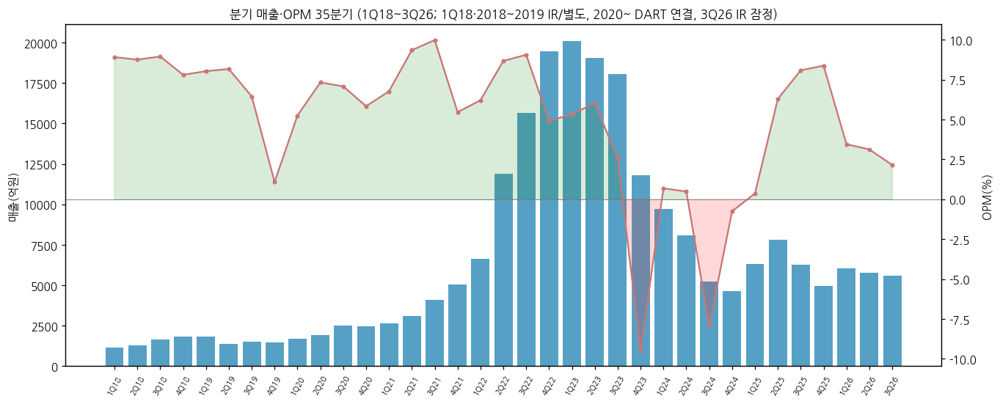

**(2-0) 분기 매출 / 영업이익 / OPM / 매출 YoY (억원)**

| 연도 | 1Q | 2Q | 3Q | 4Q |
|---|---|---|---|---|
| 2018 | 1,134 / 101 / 8.9% | 1,292 / 113 / 8.7% | 1,632 / 146 / 8.9% | 1,834 / 143 / 7.8% |
| 2019 | 1,807 / 145 / 8.0% / +59% | 1,360 / 111 / 8.2% / +5% | 1,521 / 98 / 6.4% / -7% | 1,473 / 16 / 1.1% / -20% |
| 2020 | 1,677 / 88 / 5.2% / -7% | 1,899 / 139 / 7.3% / +40% | 2,502 / 177 / 7.1% / +64% | 2,469 / 144 / 5.8% / +68% |
| 2021 | 2,632 / 178 / 6.8% / +57% | 3,104 / 290 / 9.3% / +63% | 4,081 / 407 / 10.0% / +63% | 5,039 / 275 / 5.5% / +104% |
| 2022 | 6,625 / 411 / 6.2% / +152% | 11,871 / 1,029 / 8.7% / +282% | 15,632 / 1,415 / 9.1% / +283% | 19,448 / 953 / 4.9% / +286% |
| 2023 | 20,110 / 1,073 / 5.3% / +204% | 19,062 / 1,147 / 6.0% / +61% | 18,033 / 459 / 2.5% / +15% | 11,804 / **-1,119 / -9.5%** / -39% |
| 2024 | 9,705 / 67 / 0.7% / -52% | 8,095 / 39 / 0.5% / -58% | 5,219 / **-412 / -7.9%** / -71% | 4,649 / -35 / -0.8% / -61% |
| 2025 | 6,298 / 23 / 0.4% / -35% | 7,797 / 490 / 6.3% / -4% | 6,251 / 505 / 8.1% / +20% | 4,970 / 416 / 8.4% / +7% |
| 2026 | 6,054 / 209 / 3.5% / -4% | 5,767 / 180 / 3.1% / -26% | **5,579 / 120 / 2.2% / -11%** [잠정] | - |

→ (출처: 1Q20~2Q26 = OpenDART 연결 `dart_quarterly_summary`(4Q = 연간−3Q 누적), 2018·2019 = 회사 IR(2019-07·2019-10·2020-02 발표, 별도), 1Q18 = 2018 연간−2~4Q [계산], **3Q26 = 회사 IR 2026-11-05 발표치 [잠정] — 3Q26 분기보고서 미공시(2026-11-14 기준), 공시 후 확정치 교체 예정**)
→ 3Q26 영업이익 YoY **-76.2%**, QoQ -33.3% / 순이익 -18억(세전 -240억) / EBITDA 393억(마진 7.0%) (회사 IR p.4·10)
→ 분기 순이익(연결, 억원): 1Q24 -49 / 2Q24 69 / 3Q24 -495 / 4Q24 -110 / 1Q25 -100 / 2Q25 343 / 3Q25 491 / 4Q25 182 / 1Q26 122 / 2Q26 -5 / 3Q26 -18 [잠정]

**(2-1) 용도별 분기 매출 (회사 IR, 억원)**

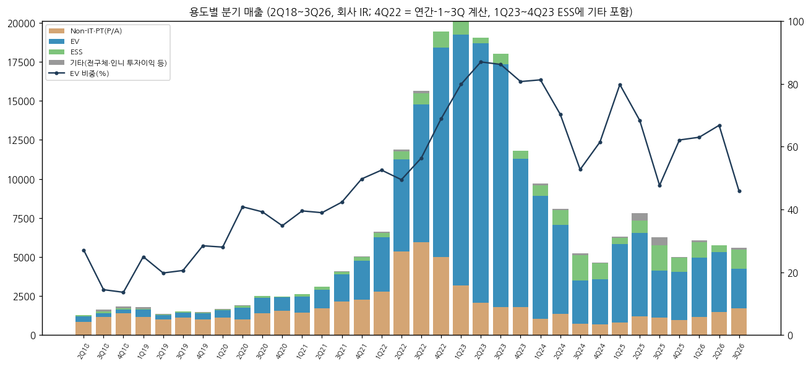

| 분기 | Non-IT/PT/P/A | EV | ESS | 기타 | 합계 | P/A 비중 | EV 비중 | ESS 비중 |
|---|---|---|---|---|---|---|---|---|
| 2Q18 | 836 | 350 | 88 | 18 | 1,292 | 65% | 27% | 7% |
| 3Q18 | 1,174 | 236 | 111 | 111 | 1,632 | 72% | 14% | 7% |
| 4Q18 | 1,382 | 250 | 98 | 104 | 1,834 | 75% | 14% | 5% |
| 1Q19 | 1,177 | 451 | 45 | 134 | 1,807 | 65% | 25% | 2% |
| 2Q19 | 1,006 | 269 | 26 | 59 | 1,360 | 74% | 20% | 2% |
| 3Q19 | 1,123 | 313 | 78 | 7 | 1,521 | 74% | 21% | 5% |
| 4Q19 | 996 | 419 | 18 | 40 | 1,473 | 68% | 28% | 1% |
| 1Q20 | 1,108 | 470 | 70 | 29 | 1,677 | 66% | 28% | 4% |
| 2Q20 | 995 | 776 | 119 | 9 | 1,899 | 52% | 41% | 6% |
| 3Q20 | 1,415 | 982 | 97 | 8 | 2,502 | 57% | 39% | 4% |
| 4Q20 | 1,573 | 860 | 18 | 18 | 2,469 | 64% | 35% | 1% |
| 1Q21 | 1,427 | 1,041 | 153 | 11 | 2,632 | 54% | 40% | 6% |
| 2Q21 | 1,702 | 1,210 | 180 | 12 | 3,104 | 55% | 39% | 6% |
| 3Q21 | 2,170 | 1,728 | 160 | 23 | 4,081 | 53% | 42% | 4% |
| 4Q21 | 2,270 | 2,507 | 229 | 33 | 5,039 | 45% | 50% | 5% |
| 1Q22 | 2,801 | 3,481 | 280 | 63 | 6,625 | 42% | 53% | 4% |
| 2Q22 | 5,358 | 5,875 | 525 | 113 | 11,871 | 45% | 49% | 4% |
| 3Q22 | 5,967 | 8,815 | 699 | 151 | 15,632 | 38% | 56% | 4% |
| 4Q22 | 5,015 | 13,401 | 1,032 | (ESS 포함) | 19,448 | 26% | 69% | 5% |
| 1Q23 | 3,176 | 16,061 | 874 | (ESS 포함) | 20,111 | 16% | 80% | 4% |
| 2Q23 | 2,090 | 16,583 | 389 | (ESS 포함) | 19,062 | 11% | **87%** | 2% |
| 3Q23 | 1,795 | 15,545 | 693 | (ESS 포함) | 18,033 | 10% | 86% | 4% |
| 4Q23 | 1,776 | 9,531 | 497 | (ESS 포함) | 11,804 | 15% | 81% | 4% |
| 1Q24 | 1,029 | 7,889 | 684 | 103 | 9,705 | 11% | 81% | 7% |
| 2Q24 | 1,373 | 5,691 | 936 | 95 | 8,095 | 17% | 70% | 12% |
| 3Q24 | 740 | 2,752 | 1,612 | 115 | 5,219 | 14% | 53% | **31%** |
| 4Q24 | 704 | 2,859 | 1,029 | 57 | 4,649 | 15% | 61% | 22% |
| 1Q25 | 794 | 5,026 | 407 | 71 | 6,298 | 13% | 80% | 6% |
| 2Q25 | 1,200 | 5,332 | 814 | 451 | 7,797 | 15% | 68% | 10% |
| 3Q25 | 1,130 | 2,980 | 1,653 | 488 | 6,251 | 18% | 48% | 26% |
| 4Q25 | 952 | 3,088 | 946 | -16 | 4,970 | 19% | 62% | 19% |
| 1Q26 | 1,143 | 3,815 | 979 | 117 | 6,054 | 19% | 63% | 16% |
| 2Q26 | 1,464 | 3,853 | 453 | -3 | 5,767 | 25% | 67% | 8% |
| **3Q26** | **1,697** | **2,561** | **1,236** | **85** | **5,579** | **30%** | **46%** | **22%** |

→ (출처 — 분기별 원 페이지: 2Q18~4Q19 = 2019-07·2019-10·2020-02 IR(2019.1Q는 2020-04 IR 재분류치), 1Q20~3Q20 = 2020-08·2020-11 IR p.10~11, 4Q20 = 2021-02 IR p.5 차트 판독, 1Q21~4Q21 = 2022-02-11 IR p.7 차트, 1Q22~3Q22 = 2022-11-02 IR p.6 차트, **4Q22 = 2022 연간(4Q22 IR p.9)−1~3Q [계산]**, 1Q23~4Q23 = 2023-11·2024-02·2024-05 IR p.6(「ESS등」에 기타 포함), 1Q24~3Q26 = 2025-04~2026-11 IR p.5(직전 분기 재작성치 우선). 2018~2019 「기타」는 전구체 외부판매(2019 중단))
→ **분류 계보**: 2018~2022 「Non-IT」(전동공구·청소기·E-bike) → 2023~2024 「PT(전동공구)」 → 2025~ 「P/A(Power Application: 전동공구·BBU·UPS·드론·E-bike)」
→ 2025.2Q·3Q 「기타」 451억·488억에는 인니 투자 관련 이익 405억·418억 포함 (회사 IR p.4)
→ **제품별(NCA vs NCM) 분해**: 3Q22 NCA 64.5% / NCM 33.8% / 기타 1.7%, 4Q22E NCA 61.5% / NCM 37.9% (2022-11-02 IR p.6). 이후 분기 시계열은 **[미확보]** (IR 미공시). 1H26 NCA·NCM 매출 비중 94.7% (DART)
→ **전구체**: 2019 외부판매 중단, 이후 계열사(에코프로머티리얼즈·에코프로이노베이션)로부터 매입 — 2025 원재료 매입 1조 9,303억 중 「전구체·리튬 등」 1조 9,068억 (DART)

(2-2) 메탈 가격 추이 (판가 연동 원재료)

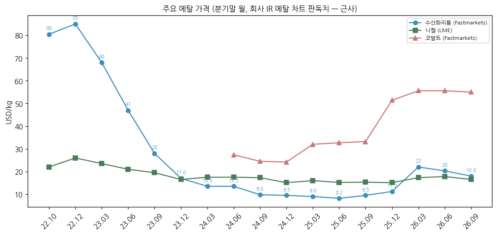

| 시점 | 수산화리튬 ($/kg) | 니켈 LME ($/kg) | 코발트 ($/kg) |
|---|---|---|---|
| 2018.2Q 평균 | - | - | 94 |
| 2019.1Q / 3Q 평균 | - | 12.0(19.06) | 40 / 34 |
| 2022.10 | 80.5 | 22.0 | - |
| **2022.12** | **85.0 (정점권)** | 26.0 | - |
| 2023.03 | 68.0 | 23.5 | - |
| 2023.06 | 47.0 | 21.0 | - |
| 2023.09 | 28.0 | 19.5 | - |
| 2023.12 | 17.0 | 16.5 | - |
| 2024.03 | 13.5 | 17.5 | - |
| 2024.06 | 13.5 | 17.5 | 27.4 |
| 2024.09 | 9.8 | 17.3 | 24.5 |
| 2024.12 | 9.5 | 15.1 | 24.2 |
| 2025.03 | 9.0 | 16.0 | 32.0 |
| 2025.06 | 8.2 | 15.2 | 32.7 |
| 2025.09 | 9.5 | 15.3 | 33.2 |
| 2025.12 | 11.2 | 15.1 | 51.4 |
| 2026.03 | **22.0** | 17.3 | **55.6** |
| 2026.06 | 20.3 | 17.8 | 55.6 |
| **2026.09** | **18.0** | **16.5** | **55.0** |

→ (출처: 회사 IR Appendix 「주요 메탈 가격 동향」(LME·Fastmarkets 한중일) — 2023-11-07 IR p.16(22.10~23.10), 2024-11-01 IR p.14(23.10~24.10), 2025-08-05 IR p.10(24.06~25.06), 2026-04-29 IR p.9(25.01~26.03), 2026-11-05 IR p.9(25.07~26.09 **라벨 표기값**). 2024.09·12 리튬·니켈은 4Q24 IR 본문 「분기말 LH·Ni 가격」. 2018~2019 코발트는 2019-07·10 IR 분기 평균. **차트 판독치는 ±1$/kg 근사**)
→ ⚠️ 2026.03 수산화리튬: 3Q26 IR 라벨 22.0$ vs 1Q26 IR 차트 약 19.7$ / BT 핸드오프 메모의 「26.3 11$/kg」은 IR 차트 오독 가능성 — 본 리포트는 3Q26 IR 라벨값 채택
→ 2026.09 MHP Payable: 니켈 88.0% / 코발트 65.0% (3Q26 IR p.9)
→ 리튬 판가 연동 구조로 「손익효과 제한적」, 코발트는 래깅 수혜 (4Q25 IR p.7). 1Q25 재고평가충당금 환입 307억, 4Q24 129억 환입 (회사 IR)

(3) 12분기 시계열 (rolling)

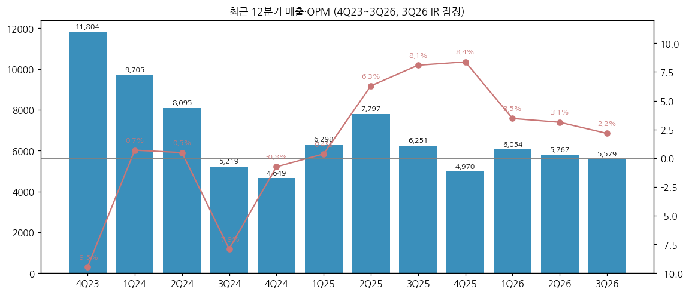

→ 4Q23~3Q26 12분기: 매출 4,649억(4Q24) ~ 11,804억(4Q23), OPM -9.5%(4Q23) ~ 8.4%(4Q25). 2025년 흑자 4분기 중 2Q·3Q는 인니 투자이익, 4Q는 내용연수 변경 일회성이 이익의 대부분 → **본업 OPM은 1Q26 2.9%(Hana증권 추정, BT 리뷰)가 2년 만의 최고**

(4) 사업 개요 (매출 비중 큰 순서)

**(4-1) EV용 하이니켈 양극재 (3Q26 46%)**

→ NCA(Ni 80%↑, 삼성SDI 원통형·각형 — BMW·Audi·현대차그룹·기아 EV2 등), NCM811·NCM 9½½(SK온 파우치 — 포드 E-Transit·VW ID.4 북미), 단결정 하이니켈 (DART·BT 리뷰)

→ 2026.2Q~3Q 북미 EV 보조금 폐지 영향 + 유럽 OEM 차종 변경에 따른 고객 재고소진 → 3Q26 EV 매출 -34% QoQ (회사 IR)

**(4-2) Power Application (3Q26 30%)**

→ 전동공구·무선청소기(고출력 NCA, 창업 이래 주력) + AI 데이터센터 BBU·UPS, 드론, 동남아 E-bike 교체 수요 — 3Q26 1,697억(+16% QoQ, +50% YoY) 역대 최대 (회사 IR)

**(4-3) ESS (3Q26 22%)**

→ 데이터센터·신재생 ESS, 삼원계 ESS — 3Q26 +173% QoQ. 고객사 북미 공장 ESS 라인 전환 효과. 단 ESS 시장은 LFP 중심(2025 글로벌 양극재 출하 LFP 비중 72%, SBS Biz 인용 SNE) → 회사는 LFP 4천톤 파일럿 → 최대 5만톤 증설 계획 (3Q26 컨콜)

(5) 주요 경쟁사

| 구분 | 경쟁사 | 비고 |
|---|---|---|
| 국내 하이니켈 | **엘앤에프**(NCMA·LFP, LGES·테슬라), **포스코퓨처엠**(NCM·음극재, LGES·GM), LG화학(NCMA, LGES 내재화), 코스모신소재 | 3Q26: 포스코퓨처엠 OP 821억 / 엘앤에프 -265억 |
| 중국 삼원계 | Ronbay(容百, 2023 출하 2위 9.95만톤), B&M(화유코발트 계열, 9.5만톤), Easpring·XTC | 2023 삼원계 출하: 에코프로 12만톤 1위 (SNE) |
| 글로벌 | Umicore(벨기에, 유럽 역내 양극재 4만톤), Sumitomo Metal Mining, BASF | 유럽 역내 유효 CAPA: 에코프로비엠 5.4만톤·Umicore 4만톤 (한화증권, BT 리뷰) |
| LFP | Hunan Yuneng, Dynanonic 등 중국 | 2025 글로벌 양극재 출하 LFP 72% |

(6) 주요 매출처

→ DART 본문: 「주요 매출처는 이차전지 Cell 제조업체로 삼성SDI, SK온이 있으며, 주요 매출처에 대한 매출비중은 92.3%」(2025) / 94.7%(1H26)

→ 장기계약: **삼성SDI NCA 43조 8,676억 (2024.01~2028.12, 2023.12.01 계약)** / **SK이노베이션(→SK온) NCM 10조 1,102억 (2024.01~2026.12, 2021.09.08 계약)** (DART 2026 반기 「경영상의 주요계약」) — 계약금액은 체결 당시 메탈가·물량 가정 기준으로, 2024~1H26 상위 2사 실제 매출(합계 약 6.1조, DART 주석 고객1+2) 대비 크게 미달

→ 신규: 글로벌 배터리 셀 업체(중국계)와 최대 **9억달러** 하이니켈 양극재 LOI(2028 공급, 한국·헝가리 생산, 연내 본계약 목표), 글로벌 완성차와 수조원 규모 최종 협의 중 (3Q26 컨콜, zdnet 2026-11-05). 3Q26 IR: 「글로벌 OEM(H사·A사·B사) 공급량 확대」

(7) 생산 CAPA + 임직원

| 구분 | 2017말 | 2018말 | 2019말 | 2020말 | 2021말 | 2022말 | 2023말 | 2024말 | 2025말 |
|---|---|---|---|---|---|---|---|---|---|
| 양극재 CAPA (톤/월) | 약 1,000 | 약 2,000 | 약 5,000 | 약 5,000 | 약 6,400 | 약 15,000 | 약 15,800 | 약 15,800 | **약 20,300** |
| 연산 환산 (만톤) [계산] | 1.2 | 2.4 | 6.0 | 6.0 | 7.7 | 18.0 | 19.0 | 19.0 | **24.4** |

→ (출처: DART 2019·2021·2025 사업보고서 「생산능력」. 2023 사업보고서는 2023말 18,800톤으로 기재 — 2025 보고서에서 15,800톤으로 재기재, 출처 간 불일치. 헝가리 5.4만톤은 2025말 기준 포함 여부 불명확. KB증권은 2025 CAPA 18.8만톤·가동률 36%로 추정(BT 1Q26 리뷰))
→ 생산실적·가동률은 「기술·정보유출 우려」로 DART 미기재
→ 사업장: 오창(본사·CAM1~4), 포항(CAM5·5N, 에코프로이엠 CAM6~8), 헝가리 데브레첸(5.4만톤), 캐나다 베캉쿠르(건설), 유형자산 장부가 1조 86억(본체 별도, 2025말)
→ 임직원(별도): 2025말 **1,192명**(사무 545·운영 647) / 2026.06말 1,001명, 평균근속 5.5년 (DART)

---

## ④ 재무 구조 (9년, OpenDART + DART 요약재무)

(1) 손익계산서

| 연도 | 매출 | 매출총이익 | 판관비 | 영업이익 | 세전이익 | 순이익 | 지배NI | GPM | 판관비율 | OPM | NPM |
|---|---|---|---|---|---|---|---|---|---|---|---|
| 2017 | 2,899 | 447 | 224 | 223 | - | 152 | 152 | 15.4% | 7.7% | 7.7% | 5.2% |
| 2018 | 5,892 | 796 | 293 | 503 | 429 | 369 | 369 | 13.5% | 5.0% | 8.5% | 6.3% |
| 2019 | 6,161 | 731 | 360 | 371 | 283 | 345 | 345 | 11.9% | 5.8% | 6.0% | 5.6% |
| 2020 | 8,547 | 1,056 | 508 | 548 | 476 | 467 | 469 | 12.4% | 5.9% | 6.4% | 5.5% |
| 2021 | 14,856 | 1,901 | 751 | 1,150 | 1,144 | 978 | 1,008 | 12.8% | 5.1% | 7.7% | 6.6% |
| 2022 | 53,576 | 5,162 | 1,355 | 3,807 | 3,225 | 2,727 | 2,323 | 9.6% | 2.5% | 7.1% | 5.1% |
| 2023 | 69,009 | 2,934 | 1,374 | 1,560 | 777 | 547 | -87 | 4.3% | 2.0% | 2.3% | 0.8% |
| 2024 | 27,668 | 948 | 1,290 | -341 | -930 | -585 | -965 | 3.4% | 4.7% | -1.2% | -2.1% |
| 2025 | 25,316 | 2,698 | 1,265 | 1,433 | 817 | 916 | 394 | 10.7% | 5.0% | 5.7% | 3.6% |

→ 단위 억원. 2017 = 2019 사업보고서 요약재무(매출·OP·NI) + 2020-02 IR(매출총이익·판관비), 세전이익 [미확보]
→ 2023 지배NI 적자 vs 연결NI 흑자: 에코프로이엠(비지배 40%) 흑자 vs 본체 적자 구조. 2024 비지배지분 순이익 380억, 2025 224억 (DART 비지배지분 주석)
→ 2025 법인세 -99억(환급성) → 세전 817억 < 순이익 916억

(2) 재무상태표

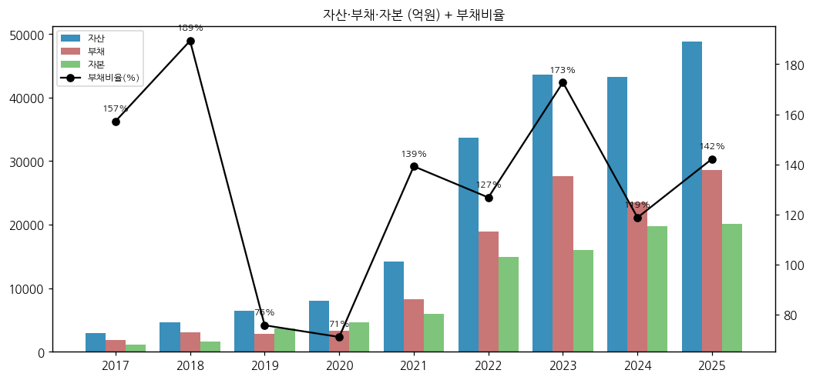

| 연도 | 자산 | 부채 | 자본 | 지배주주지분 | 현금성자산 | 재고자산 | 차입금 | 부채비율 | 유동비율 | 순차입금비율 |
|---|---|---|---|---|---|---|---|---|---|---|
| 2017 | 2,963 | 1,811 | 1,152 | 1,152 | 138 | 630 | - | 157% | 92% | - |
| 2018 | 4,645 | 3,039 | 1,605 | 1,605 | 96 | 1,387 | 1,899 | 189% | 103% | 112% |
| 2019 | 6,504 | 2,801 | 3,702 | 3,702 | 201 | 1,589 | 2,043 | 76% | 178% | 50% |
| 2020 | 7,990 | 3,317 | 4,673 | 4,436 | 592 | 1,568 | 1,932 | 71% | 161% | 29% |
| 2021 | 14,259 | 8,297 | 5,961 | 5,517 | 1,046 | 3,394 | 5,504 | 139% | 121% | 75% |
| 2022 | 33,742 | 18,860 | 14,882 | 13,634 | 3,204 | 8,564 | 9,452 | 127% | 147% | 42% |
| 2023 | 43,618 | 27,624 | 15,994 | 13,715 | 5,127 | 11,088 | 18,205 | 173% | 115% | 82% |
| 2024 | 43,237 | 23,466 | 19,770 | 17,120 | 4,992 | 6,163 | 19,371 | 119% | 106% | 73% |
| 2025 | 48,820 | 28,660 | 20,160 | 17,288 | 5,185 | 6,028 | 24,508 | 142% | 72% | 96% |
| **3Q26** [잠정] | **49,585** | **30,298** | **19,287** | **16,225** | **3,248** | **6,834** | **26,823** | **157%** | **76%** | **122%** |

→ 단위 억원. 차입금 = 단기차입금 + 유동성장기차입금 + 장기차입금 + 사채(전환사채 부채요소 포함). 순차입금비율 = (차입금 − 현금성자산) / 자본총계 — 회사 IR 공시 비율(1Q26 106%·2Q26 116%·3Q26 122%)과 일치
→ 2024 자본 +4,220억: 신종자본증권 3,360억(자본 분류) — 실질 부채성 자본 [주의]
→ 3Q26 자본 -1,678억 QoQ(순손실 18억 대비 큰 감소): 원인 [미확보] — 3Q26 분기보고서 공시 후 확인 필요(기타포괄손익·신종자본증권 이자 등 추정)

**(2-1) 재무건전성 분기 추이 — 핵심 모니터링 지표**

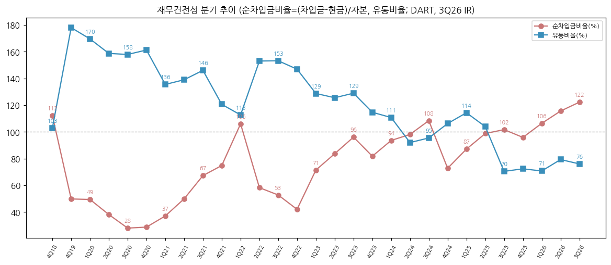

| 분기 | 자산 | 자본 | 현금 | 재고 | 차입금 | 순차입금 | 부채비율 | 유동비율 | 순차입금비율 |
|---|---|---|---|---|---|---|---|---|---|
| 4Q21 | 14,259 | 5,961 | 1,046 | 3,394 | 5,504 | 4,458 | 139% | 121% | 75% |
| 1Q22 | 18,078 | 6,216 | 630 | 5,231 | 7,219 | 6,589 | 191% | 113% | 106% |
| 2Q22 | 31,331 | 13,435 | 1,605 | 8,159 | 9,426 | 7,821 | 133% | 153% | 58% |
| 3Q22 | 33,204 | 14,522 | 2,205 | 10,373 | 9,861 | 7,656 | 129% | 153% | 53% |
| 4Q22 | 33,742 | 14,882 | 3,204 | 8,564 | 9,452 | 6,248 | 127% | 147% | 42% |
| 1Q23 | 41,420 | 15,604 | 2,390 | 12,320 | 13,527 | 11,137 | 165% | 129% | 71% |
| 2Q23 | 42,682 | 16,700 | 2,167 | 13,121 | 16,132 | 13,965 | 156% | 126% | 84% |
| 3Q23 | 48,055 | 17,128 | 5,299 | 11,333 | 21,751 | 16,452 | 181% | 129% | 96% |
| 4Q23 | 43,618 | 15,994 | 5,127 | 11,088 | 18,205 | 13,078 | 173% | 115% | 82% |
| 1Q24 | 42,792 | 16,193 | 4,376 | 9,244 | 19,527 | 15,151 | 164% | 111% | 94% |
| 2Q24 | 43,069 | 16,524 | 4,120 | 7,485 | 20,326 | 16,206 | 161% | 92% | 98% |
| 3Q24 | 41,524 | 15,550 | 4,774 | 6,802 | 21,630 | 16,856 | 167% | 95% | 108% |
| 4Q24 | 43,237 | 19,770 | 4,992 | 6,163 | 19,371 | 14,379 | 119% | 106% | 73% |
| 1Q25 | 46,575 | 19,614 | 5,757 | 5,571 | 22,839 | 17,082 | 137% | 114% | 87% |
| 2Q25 | 47,818 | 19,446 | 4,360 | 6,076 | 23,562 | 19,202 | 146% | 104% | 99% |
| 3Q25 | 46,245 | 19,627 | 3,047 | 5,045 | 23,005 | 19,958 | 136% | **70%** | 102% |
| 4Q25 | 48,820 | 20,160 | 5,185 | 6,028 | 24,508 | 19,323 | 142% | 72% | 96% |
| 1Q26 | 51,568 | 20,849 | 3,417 | 6,767 | 25,595 | 22,178 | 147% | 71% | 106% |
| 2Q26 | 54,314 | 20,965 | 4,671 | 7,919 | 28,901 | 24,230 | 159% | 79% | 116% |
| **3Q26** | **49,585** | **19,287** | **3,248** | **6,834** | **26,823** | **23,575** | **157%** | **76%** | **122% (최고)** |

→ (출처: 1Q20~2Q26 OpenDART 연결 BS, 3Q26 회사 IR p.6·10 [잠정]. 1Q20~3Q21은 chart4b 참조 — 순차입금비율 28~67%, 유동비율 136~170%)
→ **순차입금비율 3Q24 108% → 4Q24 73%(신종자본 3,360억) → 3Q26 122%로 사상 최고** / 유동비율 3Q25부터 70%대 — 단기차입금 의존(3Q26 유동성 차입금 1조 5,412억 / 비유동 1조 1,411억)
→ **유증 효과 [계산, pro forma]**: 8,861억 유입 시 자본 2조 8,148억, 순차입금 1조 4,714억 → 순차입금비율 약 **52%** (단, BNSI 지분투자 7,650억·헝가리 1,211억 집행 후 현금은 다시 감소 — 차입금 상환 목적 자금 없음, IB토마토 2026-09-04)
→ **전환사채 풋옵션**: 2023.07 발행 CB 4,400억(전환가 214,188원 vs 현 주가 90,800원) — 발행 3년 후인 **2026.07.24부터 매 3개월 조기상환청구 가능** (DART 2026 반기) → 차입 상환 압력 요인

(3) 현금흐름표

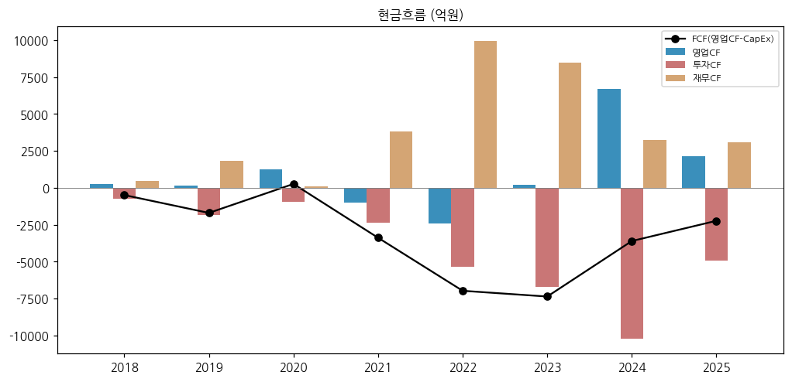

| 연도 | 영업CF | 투자CF | 재무CF | CapEx | FCF | 이자지급 |
|---|---|---|---|---|---|---|
| 2018 | 238 | -730 | 449 | 731 | -493 | 65 |
| 2019 | 128 | -1,823 | 1,801 | 1,830 | -1,702 | 53 |
| 2020 | 1,250 | -944 | 90 | 989 | 261 | 58 |
| 2021 | -1,009 | -2,373 | 3,836 | 2,374 | -3,383 | 58 |
| 2022 | -2,413 | -5,347 | 9,932 | 4,559 | -6,972 | 267 |
| 2023 | 206 | -6,725 | 8,474 | 7,567 | -7,361 | 616 |
| 2024 | 6,701 | -10,218 | 3,231 | 10,305 | -3,604 | 730 |
| 2025 | 2,147 | -4,907 | 3,080 | 4,382 | -2,235 | 784 |
| 1H26 | -1,610 | - | - | - | - | - |

→ 단위 억원. CapEx = 유형자산 취득 + 무형자산 취득, FCF = 영업CF − CapEx (OpenDART)
→ **8년 누적 FCF -2조 5,489억** [계산] — 성장 투자를 전부 외부 조달(차입·증자·CB·신종자본)로 충당. FCF 흑자는 2020년 1회뿐
→ 2021~2022 영업CF 적자: 메탈가 상승기 운전자본(재고·매출채권) 급증. 2024 영업CF +6,701억: 재고 축소(11,088 → 6,163억)로 운전자본 회수
→ 1H26 영업CF -1,610억 (DART 반기, 재고 6,028 → 7,919억 증가)

(4) CapEx

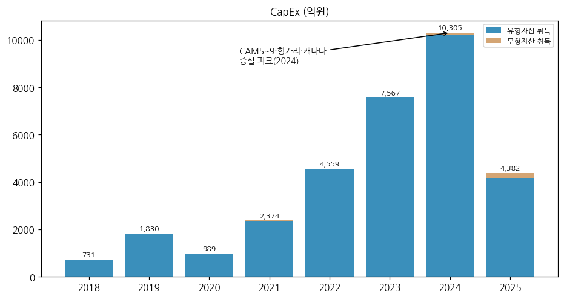

→ 2018~2020 연 0.07~0.18조 → 2022 0.46조 → 2023 0.76조 → **2024 1조 305억(피크)** → 2025 4,382억
→ 사이클 annotation: 2019~2020 포항 CAM5 / 2021~2022 CAM6·CAM7(에코프로이엠) / 2023~2024 CAM8·헝가리·캐나다 동시 증설 / 2025~ 헝가리 완공 후 감속. 1Q26 CapEx 1,120억 (BT 1Q26 리뷰)

(5) 부채구조 + 채무증권 발행 history

| 항목 | 2022 | 2023 | 2024 | 2025 | 2026.06 |
|---|---|---|---|---|---|
| 차입금 합계 (억) | 9,452 | 18,205 | 19,371 | 24,508 | 28,901 |
| 현금성자산 (억) | 3,204 | 5,127 | 4,992 | 5,185 | 4,671 |
| 이자지급 (억, CF) | 267 | 616 | 730 | 784 | - |
| 이자보상배율 (OP/이자지급) [계산] | 14.3배 | 2.5배 | -0.5배 | 1.8배 | - |

| 발행 | 종류 | 금액 | 조건 |
|---|---|---|---|
| 2023.07.24 | 전환사채 (사모) | 4,400억 | 표면 0% / YTM 2.0% / 전환가 214,188원 / 만기 2028.07.24 / 풋 2026.07~ |
| 2024.02 | 공모 회사채 6-1·6-2회 | [금액 미확보] | A (한기평·NICE 본평가) → 2024.12 Negative → 2025.06 A-(한기평) |
| 2024.10.29 | 신종자본증권 (사모) | 2,440억 + 920억 | 6.281% / 6.638%, 30년(2054) — 자본 분류 |
| 2026.05~06 | P-CBO 후순위(조건부자본증권) | 227억 + 473억 + 300억 | 4.26~4.29%, 3년 |
| 2026.06말 회사채 잔액 | 사모 | 1,000억 | 잔여만기 2~3년 |

→ (출처: DART 2026 반기보고서 「채무증권 발행실적」·「신용평가」·전환사채 주석)
→ 신용등급 경로: 회사채 A-/Positive(한신평 2023.05) → A/Stable(2024.02 본평가) → **A/Negative**(한기평 2024.12·NICE 2025.02) → **A-/Stable**(한기평 2025.06) / NICE A/Negative 유지(2025.06)

(6) 배당·자사주

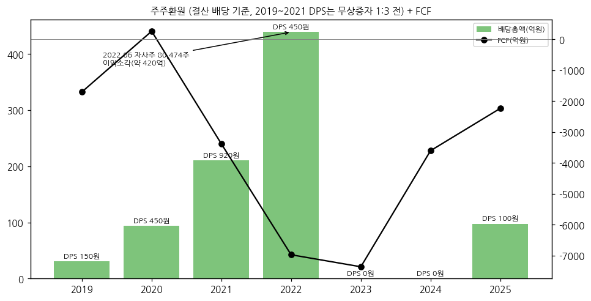

| 결산기 | DPS (원) | 배당총액 (억) | 배당성향 (연결 지배) | 배당수익률 | 자사주 |
|---|---|---|---|---|---|
| 2017~2018 | 무배당 | - | - | - | - |
| 2019 | 150 (무증 전) | 30.7 | 8.9% | 0.30% | 2019.05~11 자사주 신탁 50억(83,934주 취득) |
| 2020 | 450 (무증 전) | 94.3 | 20.1% | 0.28% | - |
| 2021 | 920 (무증 전) | 210.1 | 20.8% | 0.18% | - |
| 2022 | 450 | 439.4 | 16.1% | 0.46% | **2022.06 80,474주 이익소각(약 420억)** |
| 2023 | 0 | - | - | - | - |
| 2024 | 0 | - | - | - | - |
| **2025** | **100** | **97.8** | **24.85%** | **0.05%** | 자기주식 5,843주 보유 (2025말) |

→ (출처: DART 2019·2020·2021·2022·2023·2024 사업보고서 「배당에 관한 사항」, dart_api 2025 FY 배당)
→ 2025 연결 CF 배당금지급 600억은 에코프로이엠 → 비지배주주(삼성SDI) 배당 (DART 비지배지분 주석 「배당 (60,000,000)천원」)
→ 주주환원보다 증자 이력이 압도적: 상장공모(2019) → 유증 6,246억(2022) → CB 4,400억(2023) → 신종자본 3,360억(2024) → **유증 8,861억(2026)**

(7) 재무비율

| 지표 | 2021 | 2022 | 2023 | 2024 | 2025 | 3Q26 |
|---|---|---|---|---|---|---|
| ROE (지배, 평균자본) [계산] | 20.3% | 24.3% | -0.6% | -6.3% | 2.3% | - |
| ROA (연결NI/평균자산) [계산] | 8.8% | 11.4% | 1.4% | -1.3% | 2.0% | - |
| 부채비율 | 139% | 127% | 173% | 119% | 142% | 157% |
| 유동비율 | 121% | 147% | 115% | 106% | 72% | 76% |
| 순차입금비율 | 75% | 42% | 82% | 73% | 96% | **122%** |
| 이자보상배율 (OP/이자지급) | 19.8배 | 14.3배 | 2.5배 | -0.5배 | 1.8배 | - |
| EBITDA (IR, 억) | - | - | 2,487 | 734 | 2,116 | LTM 1,450 |

---

## ⑤ 지배 구조

(1) 그룹·계열 관계

```
이동채 (전 회장) ──(18.84%, 2025말)──▶ ㈜에코프로 (코스닥, 대표 송호준)
                                         │ 40.83% (2026.06말, 유증 전)  + 데이지파트너스 3.75%
                                         ▼
                              ㈜에코프로비엠 (최대주주 등 약 45.2%)
      ┌──────────────┬──────────────────┬──────────────────┬──────────────────┐
  ㈜에코프로이엠     EcoPro BM Hungary   EcoCAM Canada /     PT ECOPRO ESG       EcoPro BM America
  60% (삼성SDI 40%)  100% (5.4만톤)     CAM Canada L.P.    INVESTMENT 51%      100%
  포항 CAM6~8        데브레첸            100% (베캉쿠르)     (인니 니켈 투자)

  형제 계열(㈜에코프로 자회사): 에코프로머티리얼즈(전구체, 유가증권), 에코프로이노베이션(리튬 가공), 에코프로에이치엔(환경, 코스닥), 에코프로씨엔지(리사이클) 등 — 계열 16사(상장 4)
```

→ (출처: DART 2026 반기보고서 최대주주·계열회사 현황·타법인출자 현황. 에코프로 최대출자자 이동채 18.84%는 2025.12.31 기준 기재)
→ 원재료 수직계열: 전구체(에코프로머티리얼즈) → 리튬(에코프로이노베이션) → 양극재(비엠) → 폐배터리 리사이클(에코프로씨엔지) + 인니 니켈 제련(BNSI·QMB 등) — 「계열회사 및 국내외 다수 경로로 원재료 공급」 (DART)
→ 삼성SDI 풋옵션: 에코프로비엠 귀책으로 JV 계약 해지 시 삼성SDI가 보유 에코프로이엠 지분 전부를 공정가치로 매도할 권리(반대로 비엠은 콜옵션) (DART)

(2) 주주 구분

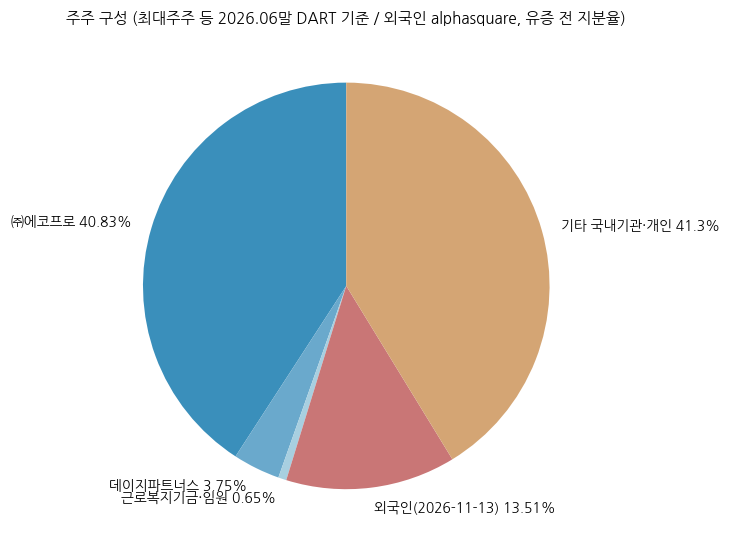

| 주주 | 2024말 | 2025말 | 2026.06말 | 비고 |
|---|---|---|---|---|
| ㈜에코프로 | 45.58% | **40.84%** | 40.83% | 2025 중 4,634,992주 감소 (교환사채 교환 등, 잔여 EB 행사분 320,000주) |
| 데이지파트너스 | 3.99% | 3.99% | 3.75% | 특수관계법인 |
| 에코프로공동근로복지기금 | 0.43% | 0.43% | 0.43% | |
| 임원 (최문호 0.13% 등) | 0.33% | 0.33% | 0.22% | |
| **최대주주 등 합계** | **50.33%** | **45.59%** | **약 45.2%** | |
| 외국인 | - | - | - | **13.51%** (2026-11-13, alphasquare) |
| 기타 국내 기관·개인 | - | - | 약 41% [계산] | 5% 이상 기관주주 기재 없음 |

→ (출처: dart_api 2025 FY 최대주주(기초 49,221,207주 → 기말 44,588,138주), DART 2026 반기보고서. 유상증자(2026.11)에서 ㈜에코프로는 배정물량 120% 초과청약 계획(5,292억, IB토마토) — 증자 후 지분율은 [미확보])

(3) 임원·이사회 (2025말, dart_api 임원 현황)

| 성명 | 직위 | 출생 | 담당 | 주요 경력 |
|---|---|---|---|---|
| **최문호** | 대표이사 사장 (사내) | 1974.04 | 각자대표, 사추위 위원 | 서울대 화공·한양대 에너지공학 박사, 2016.05 설립 시부터 재직 |
| **김장우** | 대표이사 부사장 (사내) | 1963.12 | 각자대표, CFO, 내부거래위원 | 고려대 경제·EMBA, 前 SK이노베이션 재무실장 |
| 배문순 | 사내이사 (전문가, 상무대우) | 1972.11 | 설비기술팀 | 현장 직장 출신 사내이사 (임기 2026.03) |
| 김순주 | 기타비상무이사 | 1972.03 | 보상위원 | ㈜에코프로 재경실장, 前 유안타증권 IB |
| 강기석 | 사외이사 | 1976.01 | 보상위원장 | 서울대 재료공학부 교수, 이차전지 센터장 |
| 조재정 | 사외이사 | 1962.03 | 내부거래위원장·감사위원 | 前 고용노동부 기획조정실장 |
| 이화련 | 사외이사 | 1959.10 | 감사위원장 | 회계사, 대화건설 대표 |
| 이기환 | 사외이사 | 1964.06 | 컴플라이언스위원장 | 인하대 금융투자학과 교수, 前 와이즈에셋 대표 |
| 안완기 | 사외이사 | 1964.03 | 사추위원장 | 前 한국생산성본부 회장, 김앤장 외국변호사 |

→ 미등기 임원 다수가 삼성SDI 출신(생산·영업·품질·헝가리법인장 하주용·캐나다법인장 오상영) — 최대 고객과의 인적 연결 (DART)
→ 2026.03 정기주총에서 이사 일부 임기 만료(배문순·김순주) — 2026 반기 기준 변경 내역은 다음 버전 확인

---

## ⑥ 기타 팩트

(1) R&D 인프라

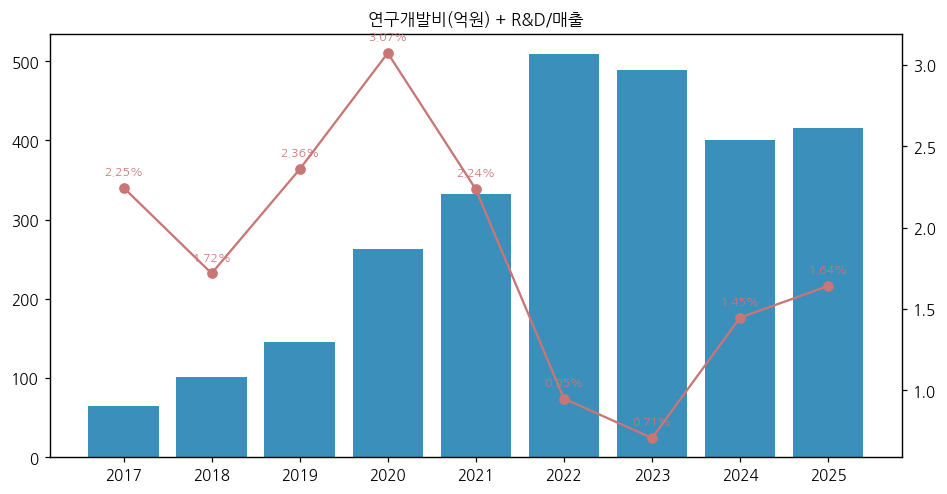

| 연도 | 2017 | 2018 | 2019 | 2020 | 2021 | 2022 | 2023 | 2024 | 2025 | 1H26 |
|---|---|---|---|---|---|---|---|---|---|---|
| 연구개발비용 (억) | 65 | 101 | 145 | 263 | 332 | 509 | 488 | 400 | **416** | 195 |
| R&D/매출 | 2.2% | 1.7% | 2.4% | 3.1% | 2.2% | 0.95% | 0.71% | 1.45% | 1.64% | 1.65% |

→ (출처: DART 2019(2017~2019)·2020·2021·2022·2023·2025 사업보고서·2026 반기 「연구개발비용」, 정부보조금 차감 전 총액)
→ 연구조직: 에코프로비엠 기업부설연구소(오창, 개발1~3담당·연구기획·미래기술) + 에코프로이엠 연구소(포항). 연구인력 136명(2019) → 150명(2020) (DART)

(2) 진행 중 corporate action (10년치)

| 시기 | 내용 | 규모 |
|---|---|---|
| 2016.05 | ㈜에코프로에서 물적분할 신설 | - |
| 2019.03 | 코스닥 상장 공모 | 300만주 |
| 2020.02 | 에코프로이엠 설립 (삼성SDI JV 60:40) | 출자 70억(최초) |
| 2022.06 | 유상증자 + 무상증자 1:3 + 자사주 소각 | 약 6,246억 / 73,351,008주 / 80,474주 |
| 2022.07 | GEM(중국 거린메이) GDR 투자 → 2026 상반기 전량 처분 | 130억 |
| 2023.07 | 전환사채 발행 | 4,400억 |
| 2024.05 | 에코프로글로벌 흡수합병 | - |
| 2024.10 | 신종자본증권 | 3,360억 |
| 2025.04~ | 인니 니켈 투자(PT ECOPRO ESG INVESTMENT 51%) | 288억(최초), 2025 투자이익 823억 |
| 2026.10~11 | **유상증자** (BNSI 니켈 제련소 지분 7,650억 + 헝가리 1,211억, 국내 시설자금 2,850억은 축소로 제외) | **8,861억 / 9,900,990주** |
| 2026 | 헝가리법인 출자 누적 7,563억 (2026.06말 장부가) | - |

(3) R&D·제품 마일스톤

→ 2008 국내 최초 하이니켈 NCA 상용화 / 2016 EV용 NCM811(CSG) 양산(세계 최초 상용화 기재) / 2021 Ni 90%↑ CDS 양산 / 2023.05 CSG·NCA 글로벌 탄소발자국 인증 (DART)
→ 고체전해질(황화물계): 연 40톤 파일럿, **2027 양산** 목표 / LMR: 주요 고객 셀 검증, 수주 시 단기 양산 전환 / 고전압 미드니켈: 1Q28 양산 목표(DS증권) / LFP: 4천톤 파일럿 → 최대 5만톤 증설 계획 / 소듐(층상계·폴리음이온계): 연 1,000톤 라인 양산성 검증 (3Q26 컨콜·BT 1Q26 리뷰)
→ 2024.07 산업부 나트륨이온전지 양극재 과제 참여, 2024.09 현대차·기아 LFP 신공법 협력, 2024.08 GEM 밸류체인 MOU (DART 연혁)

(4) 주요 리스크

→ **재무 레버리지** — 순차입금비율 122%(3Q26, 사상 최고)·유동비율 76%·이자보상배율 1.8배(2025). CB 4,400억 풋 행사 가능 구간 진입(2026.07~). 유증 자금은 투자 목적이라 차입 상환 효과 제한
→ **고객 집중** — 2사가 매출 92~98%, 2024 최대 고객 1사 80%. SK온 NCM 장기계약 2026.12 만기
→ **EV 수요·정책** — 북미 소비자 보조금 폐지(2026), 유럽 OEM 차종 변경 → 3Q26 EV 매출 -14% YoY
→ **메탈가 래깅** — 리튬·니켈 하락기 재고평가손실(4Q23·3Q24 대규모 적자). 2026.03 이후 리튬 22$ → 18$/kg 하락 전환
→ **헝가리 가동 리스크** — 2026.09 현지 안전당국 점검으로 가동 중단(10월말 재개), 4Q26에도 관련 손실 반영 예정 / 2025 헝가리법인 순손실 174억
→ **LFP·중국 경쟁** — 글로벌 양극재 출하 중 LFP 72%(2025), 회사도 「가격 경쟁력은 중국 업체 우위」 인정(3Q26 컨콜)
→ **지배구조·주주 희석** — 반복적 증자(2022·2026), 최대주주 지분 50.3% → 45.6%(2025)
→ **인니 투자** — 인니 QMB 제련소 산사태로 1Q26 ESG 관련 이익 약 20억 감소(한화증권, BT 리뷰). BNSI 시운전 2026말·2027 상반기 순차 가동, 첫해 가동률 50~60%

(5) ESG 등급

→ **KCGS(한국ESG기준원) 2025 통합등급 B+** (스마트투데이 보도, 2025) — 포스코퓨처엠 A, 엘앤에프 B+, ㈜에코프로 C
→ 첫 지속가능경영보고서 「지속가능경영보고서 2022」 2023.08 발간 — 폐기물 재활용률 99.4%, 2050 탄소중립 선언 (메트로신문 2023-08-04)
→ **최신(2024·2025) 지속가능경영보고서 원문은 [미확보]** — 온실가스 배출량·재생에너지 비중 수치는 다음 버전 보완

(6) 인증·라이선스

→ 2023.05 하이니켈 양극재(CSG·NCA) 글로벌 탄소발자국 인증 (DART 연혁)
→ 2019 코스닥 라이징스타, 2022.11 코스닥 글로벌 세그먼트 선정, 2022.12 10억불 수출의 탑 (DART)
→ 특허: DART 「지적재산권 보유현황」 수록(1997~ 출원 다수) — 세부 건수 [미확보]
→ ISO 등 품질·환경 인증 목록은 [미확보]

---

## Version Log

| 버전 | 일자 | 내역 |
|---|---|---|
| v1.0 | 2026-11-14 | 첫 작성. source 6종 전수 점검: ① DART 정기보고서 공시원문 XML 31건(2018.12~2026.06, 2018 사업보고서는 부분 정정본만) ② 첨부(감사보고서·연결감사보고서 XML 2019·2020·2021·2022·2025) ③ 회사 IR 실적발표 PDF 29건(2019.1Q~2026.3Q, irgo; 2021.2Q·3Q 다운로드 실패, 2021.4Q~2023.1Q 이미지 PDF는 핵심 페이지 육안 판독) ④ 지속가능경영보고서 — 원문 미확보, 언론 2차 인용 ⑤ Yahoo v8 247540.KQ(코스닥 확인) ⑥ 시장 보조(alphasquare·stockhub 시세·외국인, DART 신용등급, KCGS 등급, 언론). OpenDART CFS 2020~2Q26 26건, dart_api 2025 FY 6종. 차트 16종(12종 표준 + 2b 용도별·2c 고객·2d 메탈·4b 재무건전성) |

**자료 audit (v1.0)**: DART 원문 ✅ / 첨부 ✅ / OpenDART 재무 ✅ (2020~, 2018·2019 별도는 비교기) / 회사 IR ✅ (29건, 2021.2Q·3Q 누락) / 지속가능경영보고서 ❌ (원문 미확보, 2차 인용) / Yahoo 주가 ✅ / 시장 보조 ✅

**잔여 보완 후보 (v1.1)**
→ **3Q26 분기보고서 공시 후 3Q26 [잠정] → 확정 교체** (지배순이익, 3Q26 자본 -1,678억 감소 원인, 9M CF)
→ 유상증자 후 최대주주(㈜에코프로) 지분율, 외국인 지분율 재확인
→ 2016년 영업이익·순이익(설립 첫해, 2018 사업보고서 원본 또는 증권신고서), 2021.2Q·3Q IR
→ NCA/NCM 제품별 분기 시계열(3Q22 이후), 국가별(헝가리·북미) 매출 — 공개 자료 부재 시 셀사이드 추정치로 대체 여부 BT 판단
→ 최신 지속가능경영보고서(온실가스·재생에너지), 2024.02 공모 회사채 6-1·6-2회 발행 금액
→ CAPA 출처 불일치(2023말 15,800 vs 18,800톤/월) 및 헝가리 포함 여부 확인
