> 종목: 엘앤씨바이오 (290650.KQ / (주)엘앤씨바이오 / L&C BIO Co., Ltd.)
> 섹터: 소비재 대분류 > 뷰티 섹터 > 서브섹터 **미용의료** (핵심 종목 — 파마리서치·클래시스·휴젤과 같은 칸)
> 작성 시각: 2026-11-15 KST (v1.0 — 최초 작성)
> 적용 구조: v4.8 (6개 섹션 + 12종 표준 차트 + chart2b 전 분기 시계열 + chart2c 리투오 분해 + chart13 순이익 브리지). 2018.11 코스닥 상장 소형주라 연간은 OpenDART 제공 범위(연결 2018\~2025, 8년) + 2016\~2017(2018 사업보고서 비교 컬럼, 연결 이전 = 사실상 별도) = 10년, 분기는 1Q19\~3Q26(31분기)
> 데이터: 연결 연간 8년(2018\~2025 OpenDART CFS) + 연결 분기 31개(1Q19\~3Q26, 4Q = 연간 − 3Q 누적) + 제품군별 매출(DART 별도, 2017\~9M26) + 인체조직이식재 분기 매출(별도, 1Q24\~3Q26, 분기보고서 누적 차감) + Yahoo Finance 290650.KQ 주간 수정주가(2018.10\~2026.11)
> 출처: DART 정기보고서 32건 (corp_code 01181515) — 최신 2026.09 분기보고서(rcept_no 20261113000736), 2025 사업보고서(20260324000006) / OpenDART 연결·별도 재무 JSON 각 32건 / 회사 IR(irgo 21건 — 2026.03 기업가치제고계획, 2024.07 CEO Day 등. 분기 실적 IR은 2022·2024 일부만 존재, 리투오 매출 미공개) / 언론: 데일리팜 2026-11-09(3Q26 실적·CB 소각), 이데일리 2026-02-10(리투오 가이던스·상상인증권 추정 인용 기사 포함), IB토마토(유·무상증자 주식수) / 시장데이터: Yahoo Finance(2026-11-13 종가)

# 엘앤씨바이오 기업 개요 (v1.0 — 인체조직 이식재 1위 → ECM 스킨부스터 '리투오' 고성장 전환)
> **Fact verify cutoff**: 2026-11-15. 재무는 **3Q26 분기보고서(2026-11-13 공시)까지 확정치**. 주가·시가총액은 2026-11-13 Yahoo Finance 단일 소스(2차 교차 확인 미완). **리투오 매출은 회사 비공개** — 증권사(상상인증권) 추정치만 사용하고 `[추정]` 표기

---

## ① 기업 분류

(1) Primary / Secondary 분류

**⚠️ Boundary Case — 안정 성장형 의료소재(인체조직) 회사 위에 미용 스킨부스터 고성장 엔진이 올라탄 구조**

**Primary 분류: 고성장 (2025.02 리투오 출시 이후 매출 가속 + OPM 레벨업)**

→ 연결 매출 YoY: 1Q26 **+70.6%** / 2Q26 **+88.4%** / 3Q26 **+70.4%** — 2019 이후 최고 속도. 9M26 누적 매출 1,075억으로 2025 연간(855억)을 이미 넘었다
→ 연결 OPM: 2025년 5.2% → 1Q26 19.8% → 2Q26 22.1% → 3Q26 **25.6%** (별도 OPM은 3Q26 **33.3%**)
→ 성장의 원천은 인체조직이식재(ADM 분말형) 카테고리로 분류되는 **스킨부스터 리투오(Re2O)** — 별도 인체조직이식재 분기 매출 120억(1Q25) → 274억(3Q26)으로 2.3배

**Secondary 노트: 지속성장 (기존 인체조직 이식재 — 메가덤·메가카티 등)**

→ 2016\~2023 매출 CAGR 28%, OPM 11\~31% 범위의 꾸준한 성장 — 국내 피부이식재(ADM) 시장점유율 1위 (회사 2021 사업보고서 '점유율 50%' 서술)
→ 리투오 추정치를 뺀 기존 인체조직 매출은 분기 118억(3Q25) → 130억(2Q26) 수준으로 한 자릿수 후반 성장 `[추정: 별도 인체조직 매출 − 상상인증권 리투오 추정]`

**순이익은 영업과 무관하게 크게 출렁인다 (2023\~2026 일회성 맵)**

| 연도 | 영업이익 | 순이익 | 영업 외 핵심 일회성 (DART 주석) |
|---|---|---|---|
| 2023 | 77 | **485** | 큐렉소 지분 매각 → 지분법투자자산처분이익 **+607억** |
| 2024 | 25 | **1,410** | 중국 JV(L&C Bioscience Technology Kunshan) 잔여지분 인수로 **단계적 취득 → 기존 75.09% 지분 공정가치 재측정 이익 +1,503억** (영업권 1,973억 발생) |
| 2025 | 44 | **-1,382** | ① 제3회 CB 파생상품(전환권·풋옵션) 평가손실 **-1,120억** vs 평가이익 +265억 → 순 **-856억** (주가 급등 영향) ② 중국 법인 **영업권 손상 -725억** ③ 법인세 수익 +217억 |
| 9M26 | 244 | **-205** | CB 파생 평가손실 -434억 + 콜옵션 평가이익 +217억 + 전환이익 +91억 → 순 **-126억**, 법인세비용 243억 (2Q26 210억, 가중평균 연간세율 적용 — 사유 미기재) |

→ 회사 요청 프레임처럼 "2024\~2025 대규모 순손실"이 아니라 **2024는 사상 최대 순이익(재측정 이익), 2025는 사상 최대 순손실** — 두 해 모두 영업과 무관한 회계 이벤트가 순이익을 지배했다
→ 3Q26 말 미전환 CB는 150억(제3회)뿐이며 **2026-11-23 콜옵션 행사 후 전액 소각 예정** → 2027부터 CB 파생손익 노이즈는 사실상 소멸 `[판단: 자회사 CB·EB 90억 잔존]`

**Entity 구조 (2026.09, 연결 종속 4개사)**

→ **(1) (주)엘앤씨바이오** — 성남 본사·GTP(인체조직 가공)·GMP(의료기기) 공장, 안성 제약공장. 인체조직이식재(메가덤·리투오·메가본 등), 의료기기(메가덤플러스·메가카티·메가DBM), 제약, 기능성화장품
→ **(2) L&C Bioscience Technology (Kunshan) = 엘앤씨차이나** — 2020 설립 중국 JV → 2024.12 100% 자회사. 중국 장쑤성 쿤산 공장(2022.12 준공). **2025 매출 0.06억, 순손실 -34억** — 메가덤플러스 중국 NMPA 허가(2025.01), 현지생산 허가심사 신청(2026.03) 단계
→ **(3) (주)글로벌의학연구센터** — 화장품·건기식 인체적용시험 CRO (지분 과반 미만이나 실질지배로 연결). 2025 매출 81억, 순이익 12억
→ **(4) (주)리씨엠바이오(구 엘앤씨이에스)** — 부산·영남권 인체조직 유통 허브. 2025 매출 105억 / **(주)엘앤씨메디케어** — 정형·신경외과 의료기기·의약품 유통. 2025 매출 109억
→ 정리: 엘앤씨에이아이(의료용 방사선장치) 2025 매각, 엘앤씨퓨처랩(IM TYPE 화장품 플랫폼) 2025.06 일부 매각 후 관계기업 전환. 큐렉소(의료로봇) 지분 2022.07 취득 → 2023 전량 매각
→ 영업부문: 단일 보고부문. 제품군별 매출(별도)만 공시, 사업부별 영업이익 없음

(2) Summary Box (연결 8년 2018\~2025 + 9M26)

| 지표 | 8년 평균 (2018\~2025) | 정점 | 저점 | 2025년 | 9M26 |
|---|---|---|---|---|---|
| 매출 (억원) | 510 | **855 (2025)** | 212 (2018) | **855 (+18.6%)** | **1,075 (+76.8% YoY)** |
| 영업이익 (억원) | 74 | 132 (2021) | 25 (2024) | 44 | **244** |
| OPM | 18.2% | 31.0% (2019) | 3.5% (2024) | 5.2% | **22.7%** |
| GPM | 56.6% | 64.0% (2019) | 49.6% (2024) | 53.1% | 61.3% |
| 순이익 (억원) | 123 | 1,410 (2024) | -1,382 (2025) | -1,382 | -205 |

→ 매출 CAGR(2018→2025) **+22.0%**, (2016→2025, 별도 포함 10년) **+24.6%**
→ OPM 사이클: 2019 정점 31.0% → 2022\~2024 하락(중국 JV·제약·R&D·자회사 비용, 판관비율 33% → 46%) → 2025 바닥 통과 → 2026 리투오로 20%대 회복
→ OPM 정점 평균(2019·2021) 29.9% / 저점 평균(2024·2025) 4.4% — 사이클은 경기보다 **회사 투자 국면(2022\~2024)과 신제품(2025\~)이 만든 1회성 U자** `[판단]`

(3) 정량 근거 — 연간 매출·OPM

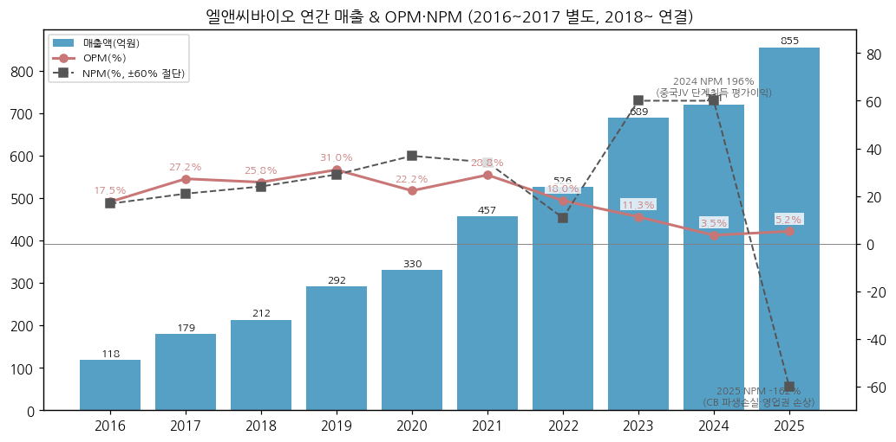

→ 2016\~2021: ADM(메가덤) 국산화 + 적응증 확대(유방재건·이비인후과·정형외과)로 연 13\~51% 성장, OPM 20\~30%
→ 2022\~2024: 매출은 늘었지만 GPM 62% → 50%, 판관비율 33% → 46% — 안성 제약공장(2021\~), 메가카티(2023.10 상용화) 영업, 중국 JV, 자회사(유통·CRO·화장품 플랫폼) 확장 비용 (회사 2024 CEO Day '낮아진 수익성: R&D·중국 투자·제약사업 투자')
→ 2025.02 리투오 출시 → 3Q25부터 흑자 전환 → 2026 OPM 20%대

(4) 산업 분류

| 구분 | 분류 |
|---|---|
| DART 업종 | 212 — 의약품 제조업 (기업개황) |
| KRX | 코스닥 (2018.11.01 상장), 중소기업·벤처기업 해당 |
| 워치리스트 | 소비재 > 뷰티 > 미용의료 **핵심** (파마리서치·클래시스·엘앤씨바이오·휴젤) |
| 실제 사업 | 인체조직 이식재(재건의료) + ECM 스킨부스터(미용의료) + 제약·CRO |

(5) 분류 결정 논리

→ **(1) 매출 큰 사업 기준**: 인체조직이식재 87%(9M26 별도) — 그 안에서 리투오가 성장의 대부분. 2026 회사 목표는 매출 1,500억 중 리투오 500억 (이데일리 2026-02-10)
→ **(2) secular 변수**: 스킨부스터 시장(리쥬란 PN·쥬베룩 PDLLA)이 2023\~2026 고성장 중이고, 리투오는 '인체 유래 ECM' 신규 카테고리. 공급(CAPA)이 매출 속도를 결정 — 월 2.4만개(2026.01) → 8만개(2026 신규 GTP 승인) → 15만개(2026.11\~ 계획)
→ **(3) Boundary 처리**: Primary 고성장 + Secondary 지속성장(기존 인체조직). 순이익은 일회성 왜곡이 커서 분류 근거에서 제외
→ **(4) 글로벌·국내 피어 cross-reference**: 파마리서치(리쥬란 — 스킨부스터 단일 제품 고성장 → 해외 확장으로 멀티플 재평가된 선례), 휴젤(톡신 — 지속성장), 클래시스(EBD 장비+소모품). 엘앤씨바이오는 '파마리서치 2021\~2023 초입' 구간에 비유되는 국면 `[판단]`

(6) 적정 밸류에이션 방법

| 우선순위 | 방법 | 현재 값 (2026-11-13) | 비고 |
|---|---|---|---|
| 1 | **영업이익 기반 PER / EV/EBIT** | 시총 1.23조 / 최근 4분기 영업이익 264억 = **약 47배**, 3Q26 연환산(98억×4=392억) 기준 **약 31배** | 최근 4분기 = 4Q25 20 + 1Q26 60 + 2Q26 86 + 3Q26 98. 순이익은 CB·영업권 이벤트로 의미 없음 |
| 2 | PSR (최근 4분기) | 1.23조 / 1,322억 = **약 9.3배** | 4Q25 247 + 1Q26 303 + 2Q26 388 + 3Q26 384 |
| 3 | PBR | 1.23조 / (3Q26 자본 3,445억 + 10월 유증 1,447억) ≈ **약 2.5배** | 자산의 27%가 중국 영업권(1,239억) — PBR은 보조 지표 |

→ 시가총액 = 20,150원 × 61,107,168주 (10월 유상증자 370만주 + 11월 1:1 무상증자 후, IB토마토) — `[계산]`
→ **파마리서치 비교 1줄**: 같은 스킨부스터 고성장주라도 파마리서치는 PN 원료 수직계열화·해외 매출 비중이 높아 프리미엄, 엘앤씨바이오는 원재료(인체조직) 수입 의존·CAPA 제약·중국 영업권이 할인 요인 `[판단]`
→ 회사 중장기 목표(2026.03 밸류업 공시): OPM 2027년 23% → 2030년 32%, 해외 매출 비중 2027년 15% → 2030년 38%, 2030년 매출 1조·영업이익 3,000억 (데일리팜 2026-11-09)

(7) 분기 재평가 트리거 (= 분류 자체가 바뀔 조건)

→ (1) **고성장 → 지속성장 강등**: 리투오 분기 매출이 CAPA 15만개 가동 후에도 QoQ 정체(3Q26 별도 인체조직 매출 274억으로 2Q26 275억과 flat — 첫 경고 신호인지 4Q26에서 확인)
→ (2) **고성장 강화**: 리투오 해외(일본 휴메딕스 채널·싱가포르·태국·미국 2027\~) 매출이 전사 10%를 넘고 해외 비중 목표(2027 15%) 달성 경로 확인
→ (3) **꿈 요소 추가**: 중국 메가덤플러스 현지생산 허가 → 엘앤씨차이나 매출 발생(현재 사실상 0) — 영업권 1,239억 추가 손상 리스크가 '옵션'으로 전환
→ (4) **반대 방향**: 중국 영업권 추가 손상(2025 할인율 13.9%, 영구성장률 1% 가정) 또는 리투오 경쟁 심화로 ASP 하락

---

## ② 회사 개요

(1) 기본 사항

| 항목 | 내용 |
|---|---|
| 회사명 (한글) | 주식회사 엘앤씨바이오 |
| 회사명 (영문) | L&C BIO Co., Ltd. |
| 종목코드 | 290650 (코스닥, 2018.11.01 상장) |
| 설립 | 2011.08.02 |
| 본사 | 경기도 성남시 중원구 둔촌대로 474 선텍시티 (본사·GTP·GMP), 제약공장: 경기도 안성시, 서울사무소·R&D: 서울 서초구 |
| 홈페이지 | www.lncbio.co.kr |
| 사업 한 줄 정의 | 인체 유래 조직(피부·뼈·연골·신경 등)을 무세포화·가공한 **이식재와 ECM 기반 미용 시술재(리투오)**를 만드는 재생의료 소재 회사 |
| 대표이사 | **이환철** (1976.03생, 창업자·최대주주, 서울대 사범대, 대웅제약 신규사업팀 '02\~'10 → 시지바이오 영업 '10\~'11 → 2012.10\~ 대표) / **이재호** (1975.05생, 각자대표 2025.03\~, 관리총괄, 동양종금증권·유진투자증권 IPO팀·북경룬메이캉 재무이사 → 2022 입사) |
| 발행주식수 | 26,969,704주 (2026.09.30) → 10월 유상증자 +3,700,000주 → 11월 1:1 무상증자 → **61,107,168주** (IB토마토 — 자기주식 232,240주는 무상 미배정 반영) |
| 최대주주 | **이환철 20.39%** (5,499,114주, 2026.09.30) / 특수관계인 포함 21.46% — 2025말 25.69% → 2026 일부 매도·CB 전환 희석. 10월 유상증자에는 배정분의 절반만 청약(IB토마토 2026.08) |
| 5% 이상 주주 | (주)나우아이비 19호 펀드 7.25% (2026.09.10 대량보유보고), (주)브이아이피자산운용 5.36% (2026.06.10) |
| 임직원 | 별도 155명 (2025말, DART) → 그룹 315명(R&D 44명, 2026.03 밸류업 자료) / 별도 206명(데일리팜 '3년새 113명→206명') |
| 시가총액 | **약 1.23조원** (20,150원 × 61.1M주, 2026-11-13 Yahoo Finance) |
| 52주 고가 / 저가 (수정주가) | 60,441원 / 20,100원 — Yahoo Finance meta, 무상증자 수정 기준. 원주가 기준 2026.4\~9월 중 최고 97,100원(6월, DART 3Q26 분기보고서 주가표) |

(2) 연간 손익·자본 추이 (연결)

| 연도 | 매출 (억) | OP (억) | OPM | NI (억) | 자본총계 (억) | 자산총계 (억) | 사이클 마커 |
|---|---|---|---|---|---|---|---|
| 2016 | 118 | 21 | 17.5% | 20 | 100 | 157 | 별도(연결 이전) |
| 2017 | 179 | 49 | 27.2% | 38 | 168 | 205 | ← ADM 국산화 고성장 |
| 2018 | 212 | 55 | 25.8% | 51 | 528 | 574 | ← 2018.11 IPO (자본 3배) |
| 2019 | 292 | 90 | **31.0%** | 85 | 603 | 662 | ← **OPM 정점** |
| 2020 | 330 | 73 | 22.2% | 121 | 613 | 806 | ← 제1회 CB·BW, 중국 JV 설립, 1:2 무상증자 |
| 2021 | 457 | 132 | 28.8% | 156 | 933 | 1,074 | ← 영업이익 정점, GMP 공장 매입 |
| 2022 | 526 | 95 | 18.0% | 57 | 1,078 | 1,997 | ← 제2회 CB 600억, 큐렉소 지분, 제약공장 |
| 2023 | 689 | 77 | 11.3% | 485 | 1,569 | 2,622 | ← 큐렉소 매각 이익 607억 |
| 2024 | 721 | 25 | **3.5%** | **1,410** | 2,947 | 4,756 | ← **OPM 저점** / 중국 JV 100% 편입 재측정 이익 |
| 2025 | 855 | 44 | 5.2% | **-1,382** | 2,085 | 4,566 | ← 리투오 출시 / CB 파생손실·영업권 손상 |
| 9M26 | 1,075 | 244 | 22.7% | -205 | 3,445 | 4,865 | ← 리투오 고성장, CB 450억 전환 |

→ 출처: OpenDART CFS 각 연도 사업보고서(2018\~2025), 2026.09 분기보고서. 2016\~2017은 2018 사업보고서 비교 컬럼(종속회사 설립 2018.04 이전이라 사실상 별도)
→ **시계열 단절**: ① 2018.04 자회사 글로벌의학연구센터 설립 → 연결 시작, ② 2020.10 1:2 무상증자, ③ 2024.12.31 엘앤씨차이나 연결 편입(자산 +2,134억 증가 대부분 영업권), ④ 2025 엘앤씨에이아이 매각·퓨처랩 연결 제외(중단영업), ⑤ 2026.10 유상증자 1,447억 납입(3Q26 자본에 미반영) + 11월 1:1 무상증자

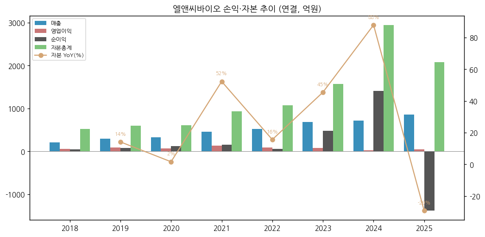

(3) 주가·시가총액 역사

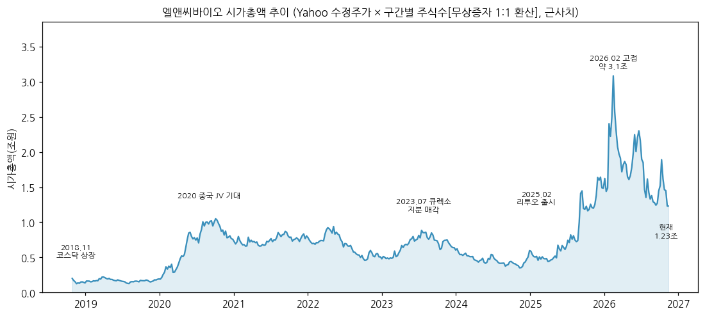

→ (출처: Yahoo Finance 290650.KQ 주간 수정주가 × 구간별 주식수[2025.06까지 22.78M, 2025 하반기 24.62M, 2026.01\~10 26.97M — 모두 1:1 무상증자 환산 ×2, 2026.10.22 이후 61.1M] — 근사치)

→ **2018.11 상장** — 수정주가 기준 3천원대(2018말 2,990원)
→ **2020** 코로나 이후 ADM 수요 + 중국 JV(CICC 등 중국 파트너, 회사 2021 사업보고서) 기대 → 수정주가 연고점 25,079원(장중), 시총 약 1.1조 `[근사]`
→ **2022\~2024 박스·하락**: 수익성 하락(OPM 18% → 3.5%), 2024 연저점 7,253원(수정)
→ **2025** 리투오 출시·품귀 → 연말 30,172원(수정, 연초 대비 +134%) — 이 급등이 제3회 CB(전환가 21,200원, 원주가 기준) 파생상품 평가손실 1,120억의 원인
→ **2026.02 시총 고점 약 3.1조**(수정 52주 고가 60,441원) → 1,447억 유상증자 결의(2026.07.31)·리투오 QoQ 둔화 우려로 하락 → **2026-11-13 20,150원, 시총 1.23조** (고점 대비 약 -60%)

(4) 주요 연혁

| 일자 | 내용 |
|---|---|
| 2011.08 | (주)엘앤씨바이오 설립, 9월 제1공장 준공·조직은행 설립허가 |
| 2014.03\~06 | 화장품 제조판매업·의료기기 제조판매업 허가 |
| 2015.10 | ISO 13485 / GMP 인증 |
| 2018.04 | 자회사 글로벌의학연구센터 설립 (CRO) |
| 2018.11 | 코스닥 상장 |
| 2020.03 | 제1회 CB 100억 + BW 50억 발행 |
| 2020.06 | 중국 JV L&C China(Kunshan) 설립 (CICC 등 파트너) |
| 2020.10 | 1:2 무상증자 |
| 2021.01 | 의료기기 전용 GMP 공장 매입, 자회사 엘앤씨이에스(현 리씨엠바이오) 설립 |
| 2021.08 | 메가덤플러스 중국 하이난성 긴급사용승인 |
| 2022.02 | 엘앤씨에이아이(구 나노포커스레이) 인수 (2025 매각) |
| 2022.06 | 제2회 CB 600억 발행 |
| 2022.07 | 큐렉소 경영참여 지분투자(2대주주) → 2023.07 9.77% 659억 블록딜, 연내 전량 매각 |
| 2022.11 | 무릎 연골 치료재 메가카티 품목허가 → 2023.10 신의료기술평가유예·상용화 |
| 2022.12 | 엘앤씨차이나 중국 공장 준공 |
| 2023.10 | 본사 사옥·통합공장 부지 취득(화성 토지 198억) |
| 2024.05 | 엘앤씨차이나 지분 23.7% 추가 취득(약 86억, 51.4% → 75.1%) |
| 2024.08 | 미국조직은행연합회(AATB) 품질관리 인증 |
| 2024.12 | 엘앤씨차이나 잔여 24.9% 취득(USD 38.25M) → 100% 자회사 |
| 2025.01 | 메가덤플러스 중국 NMPA 허가 |
| **2025.02** | **리투오(Re2O) 출시** |
| 2025.03 | 이재호 각자대표 선임 |
| 2025.04 | 제3회 CB 600억 발행 (전환가 21,200원) |
| 2025 하반기 | 휴메딕스 대상 150억 제3자배정 유상증자(주식스왑 — 리투오 공동판매 협력) |
| 2025.12 | 리투오 파인 출시, 300만불 수출의 탑 |
| 2026.03 | 엘앤씨차이나 메가덤플러스 중국 현지생산 허가심사 신청, 밸류업 계획 공시 |
| 2026.07 | 주주배정 유상증자 370만주 + 1:1 무상증자 결의 → 10.22 1,447억 납입, 11.12 무상신주 상장 |
| 2026 | 신규 GTP 시설 승인으로 리투오 CAPA 월 8만개, 11월\~ 월 15만개 목표, 동탄 글로벌 생산공장 착공 추진 |
| 2026.11.09 | 제3회 CB 잔액 150억 콜옵션 행사 결정 → 11.23 취득 후 즉시 소각 예정 |

---

## ③ 비즈니스 모델

(1) 실적 추이 통합 표 (5년, 별도 제품군 + 연결 전사)

| 구분 (억원) | 2021 | 2022 | 2023 | 2024 | 2025 | 9M26 |
|---|---|---|---|---|---|---|
| **연결 매출** | 457 | 526 | 689 | 721 | 855 | 1,075 |
| 연결 영업이익 (OPM) | 132 (28.8%) | 95 (18.0%) | 77 (11.3%) | 25 (3.5%) | 44 (5.2%) | 244 (22.7%) |
| **별도 매출** | 362 | 417 | 561 | 562 | 694 | 867 |
| 별도 영업이익 (OPM) | - | - | - | 17 (3.0%) | 85 (12.2%) | 257 (29.7%) |
| ├ 인체조직이식재 (메가덤·리투오·메가본 등) | 295 (81.6%) | 343 (82.2%) | 404 (72.0%) | 466 (82.9%) | 556 (80.1%) | **755 (87.1%)** |
| │ ├ 내수 | - | - | - | 439 | 528 | 724 |
| │ └ 수출 | - | - | - | 26 | 28 | 31 |
| ├ 의료기기 (메가덤플러스·메가카티·메가DBM) | 47 (12.9%) | 53 (12.7%) | 97 (17.3%) | 62 (11.0%) | 101 (14.6%) | 83 (9.5%) |
| │ └ 그중 수출 | - | - | - | 16 | 30 | 31 |
| ├ 제약 (메가에스틴정 등) | 9 (2.6%) | 13 (3.1%) | 31 (5.5%) | 35 (6.2%) | 31 (4.5%) | 29 (3.3%) |
| └ 기능성화장품 (BY THE DOCTOR) | 10 (2.8%) | 9 (2.0%) | 31 (5.5%) | 3 (0.5%) | 7 (1.0%) | 3 (0.3%) |
| 별도 수출 비중 | - | - | - | 7.6% | 8.6% | 7.2% |
| 연결 − 별도 (자회사 CRO·유통 등, 내부거래 제거 후) | 95 | 109 | 128 | 159 | 161 | 208 |

→ 출처: DART 사업보고서·분기보고서 'II-2 주요 제품 매출현황'·'II-4 매출실적'(별도), OpenDART CFS/OFS. 별도 영업이익 2021\~2023은 이번 버전 미집계
→ **리투오는 별도 공시 품목이 아니다** — 2026 반기보고서부터 인체조직이식재의 주요상표가 'MegaDerm' → **'MegaDerm, Re2O'**로 바뀌었고, 생산실적은 'MegaFill, Re2O(피부, Powder Type)' 라인에 합산

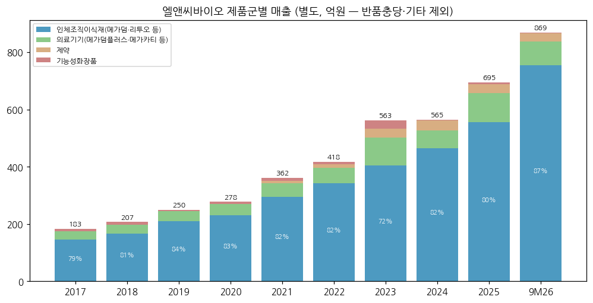

**리투오 vs 기존 인체조직 분해 (분기, 억원)**

| 분기 | 별도 인체조직이식재 (DART) | 리투오 `[추정]` (상상인증권) | 기존 인체조직 (차감) `[추정]` | 기존 YoY | 별도 의료기기 (DART) |
|---|---|---|---|---|---|
| 1Q24 | 109 | - | 109 | - | 12 |
| 2Q24 | 113 | - | 113 | - | 15 |
| 3Q24 | 116 | - | 116 | - | 16 |
| 4Q24 | 128 | - | 128 | - | 19 |
| 1Q25 | 120 | 미확보 (2월 출시) | - | - | 16 |
| 2Q25 | 134 | 미확보 | - | - | 23 |
| 3Q25 | 142 | 24 | 118 | +2% | 24 |
| 4Q25 | 160 | 38 | 122 | -5% | 38 |
| 1Q26 | 205 | 81 | 124 | - | 24 |
| 2Q26 | 275 | 145 | 130 | - | 32 |
| 3Q26 | 274 | **미확보** | - | - | 27 |

→ 인체조직이식재 분기 매출 = 분기·반기보고서 누적치 차감(별도). 리투오 추정치 출처: 상상인증권 보고서(이데일리·검색 인용, 발표일 미확인) — 2026 연간 리투오 696억 전망
→ 회사 언급: 2026 목표 매출 1,500억 중 리투오 500억(해외 100억) (이데일리 2026-02-10). 2025 리투오 누적 매출 3Q 20억 돌파, 4Q 누적 40억 수준 '추정'(같은 기사) — 상상인 추정(3Q25 분기 24억)과 기준이 다를 수 있음
→ **3Q26 해석 `[판단]`**: 별도 인체조직이식재가 2Q26 275억 → 3Q26 274억으로 정체. 기존 인체조직이 분기 130억 내외로 유지됐다면 리투오는 140억대로 2Q26 수준에서 멈춘 셈 — CAPA(월 8만개) 상한에 걸렸을 가능성. 11월 CAPA 15만개 가동 후 4Q26\~1Q27에서 재가속 여부 확인 필요
→ 1Q26 이후 새로 등장한 10% 이상 고객 'A사'(3Q26 누적 209억, 매출의 19.5% — 연결 주석)는 리투오 공동판매 파트너 휴메딕스로 보인다 `[판단: 회사 미공개]`. 회사는 직접영업 비중 40% + 휴메딕스 이원화 전략(이데일리)

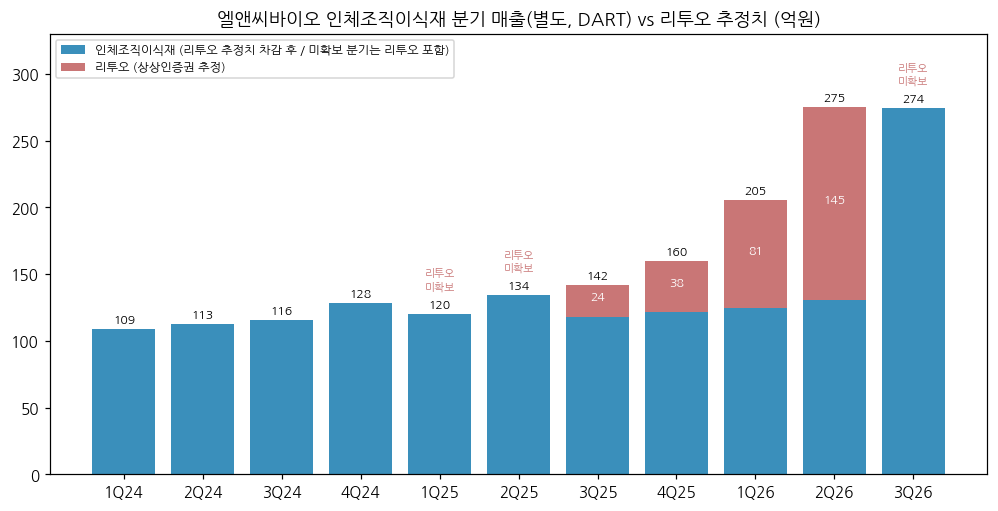

(1-2) 전 분기 시계열 (연결, 1Q19\~3Q26, 억원)

| 분기 | 매출 | YoY | 매출총이익 | GPM | 판관비 | 영업이익 | OPM | 순이익 |
|---|---|---|---|---|---|---|---|---|
| 1Q19 | 62 | - | 41 | 65.6% | 23 | 18 | 28.8% | 16 |
| 2Q19 | 78 | - | 50 | 64.0% | 25 | 24 | 31.4% | 23 |
| 3Q19 | 69 | - | 44 | 64.3% | 24 | 20 | 29.8% | 19 |
| 4Q19 | 83 | - | 52 | 62.6% | 24 | 28 | 33.3% | 26 |
| 1Q20 | 74 | +19.0% | 42 | 57.1% | 26 | 17 | 22.4% | 19 |
| 2Q20 | 79 | +1.0% | 48 | 61.0% | 29 | 20 | 24.8% | 21 |
| 3Q20 | 83 | +21.2% | 50 | 59.7% | 25 | 24 | 29.1% | 21 |
| 4Q20 | 94 | +13.4% | 55 | 58.9% | 43 | 13 | 13.3% | 60 |
| 1Q21 | 96 | +29.3% | 61 | 63.9% | 41 | 20 | 20.7% | 25 |
| 2Q21 | 107 | +35.7% | 65 | 60.5% | 28 | 37 | 34.4% | 25 |
| 3Q21 | 119 | +43.5% | 73 | 61.0% | 41 | 32 | 26.8% | 23 |
| 4Q21 | 135 | +43.7% | 86 | 63.7% | 43 | 43 | 32.0% | 82 |
| 1Q22 | 110 | +14.9% | 65 | 58.8% | 44 | 20 | 18.5% | 16 |
| 2Q22 | 131 | +22.9% | 65 | 49.6% | 43 | 22 | 16.8% | 12 |
| 3Q22 | 128 | +7.1% | 66 | 51.4% | 44 | 22 | 17.0% | 2 |
| 4Q22 | 156 | +16.1% | 74 | 47.5% | 44 | 31 | 19.6% | 27 |
| 1Q23 | 148 | +34.5% | 75 | 50.8% | 54 | 21 | 14.3% | 6 |
| 2Q23 | 165 | +25.5% | 81 | 49.0% | 65 | 16 | 9.8% | 14 |
| 3Q23 | 206 | +60.8% | 118 | 57.3% | 70 | 48 | 23.1% | 494 |
| 4Q23 | 170 | +8.8% | 74 | 43.4% | 81 | -7 | -4.3% | -29 |
| 1Q24 | 166 | +11.9% | 82 | 49.8% | 66 | 17 | 10.0% | 19 |
| 2Q24 | 179 | +8.5% | 92 | 51.6% | 79 | 13 | 7.4% | 11 |
| 3Q24 | 185 | -9.8% | 91 | 49.0% | 89 | 2 | 0.9% | -58 |
| 4Q24 | 191 | +12.1% | 92 | 48.0% | 98 | -6 | -3.3% | 1,438 |
| 1Q25 | 178 | +7.2% | 98 | 55.4% | 103 | -4 | -2.4% | -6 |
| 2Q25 | 206 | +15.0% | 94 | 45.5% | 96 | -2 | -1.2% | -143 |
| 3Q25 | 226 | +21.6% | 132 | 58.4% | 103 | 29 | 12.8% | -513 |
| 4Q25 | 247 | +29.2% | 131 | 53.1% | 111 | 20 | 7.9% | -720 |
| 1Q26 | 303 | +70.6% | 184 | 60.6% | 124 | 60 | 19.8% | 27 |
| 2Q26 | 388 | +88.4% | 236 | 60.9% | 150 | 86 | 22.1% | -281 |
| 3Q26 | 384 | +70.4% | 239 | 62.2% | 141 | 98 | 25.6% | 49 |

→ 출처: OpenDART CFS (1\~3Q = 분기 3개월, 4Q = 연간 − 3Q 누적). 2Q19·2Q21 순이익은 3Q 누적 − 1Q − 3Q로 역산
→ 3Q23 순이익 494억 = 큐렉소 처분이익, 4Q24 1,438억 = 중국 JV 재측정 이익, 3Q25 -513억·4Q25 -720억 = CB 파생손실·영업권 손상, 2Q26 -281억 = CB 파생손실 + 법인세비용 210억
→ 3Q26은 매출 QoQ -1%(388 → 384)이지만 GPM 62.2%·OPM 25.6%로 수익성은 사상 최고권. 판관비 150 → 141억

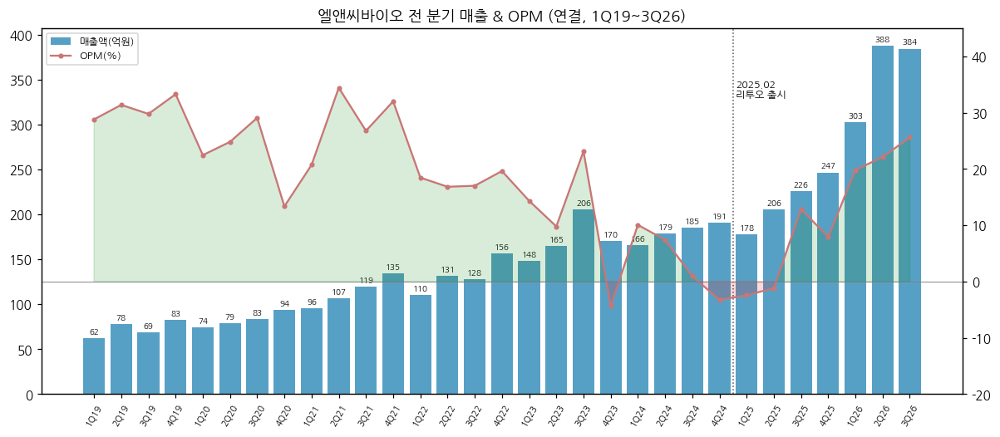

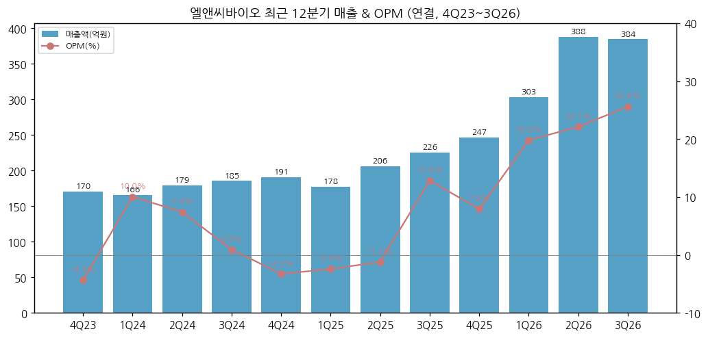

(2) 사업별 개요 (매출 비중 큰 순서, 9M26 별도 기준)

| 사업 | 9M26 매출 | 비중 | 주요 제품 | 규제 분류 |
|---|---|---|---|---|
| 인체조직이식재 | 755억 | 87.1% | MegaDerm(ADM 시트), **Re2O(리투오, ADM 분말 스킨부스터)**, MegaFill, MegaBone, MegaNerve Prime, 연골·건 | 인체조직안전관리법 (조직은행 허가, GTP) |
| 의료기기 | 83억 | 9.5% | MegaDerm Plus(가교 ADM), MegaCarti(무릎 연골), MegaDBM·Bone-Oss | 의료기기 (GMP) |
| 제약 | 29억 | 3.3% | 메가에스틴정 등 (외과 네트워크 활용 전문의약품) | 의약품 |
| 기능성화장품 | 3억 | 0.3% | BY THE DOCTOR | 화장품 |
| 자회사(연결) | 연결 − 별도 ≈ 208억 | - | 글로벌의학연구센터(CRO), 리씨엠바이오·엘앤씨메디케어(유통) | - |

(3) 사업별 디테일

→ **Top-seller / Growth: 리투오(Re2O)** — 인체 피부 유래 무세포 진피(ECM)를 미세 분말화한 스킨부스터. "노화로 소실된 ECM을 직접 보충, 섬유아세포 이동·증식과 신생 콜라겐 합성 유도"(DART 연구개발 실적). 라인업: 리투오(2025.02) → 리투오 파인(2025.12) → 리투오 V(2026 출시 계획) / Re2O Plus(조직수복용생체재료). 국내 병·의원 2,000곳 이상 공급(이데일리). 해외: 2025.3Q 일본·싱가포르 첫 수출, 2026 20개국 진출 목표, 미국은 현지 인체조직 유통 파트너와 2027년부터 공급 확대(데일리팜)
→ **Cash cow: 메가덤(MegaDerm)** — 국내 1호 국산 ADM. 유방재건·화상·이비인후과·갑상선·정형외과로 적응증 확대. 2,000개 이상 거래처(대학·종합·전문병원·클리닉, 2024 CEO Day)
→ **메가카티(MegaCarti)** — 동종 초자연골 기반 무릎 연골 결손 치료재. 2022.11 품목허가 → 2023.10 신의료기술평가유예로 상용화 — 2023 의료기기 매출 97억 피크에 기여 후 2024 62억으로 감소 (유예기간 중 급여 미적용 영향 추정 `[판단]`)
→ **이익 outlier**: 3Q26 별도 OPM 33.3% vs 연결 25.6% — 격차 약 8%p는 엘앤씨차이나(연 -34억) 등 자회사 손실 + 연결조정
→ **원가 구조**: 원재료 대부분 수입(9M26 원재료 매입 139억 중 수입 109억, USD 742만) — 해외 인체조직은행 한 곳과 원재료 수입 독점계약. 피부 원재료 수입 82억(9M26)이 최대 항목 → **환율·도너(기증자) 수급이 GPM 변수**

(4) 주요 경쟁사 (DART 연구개발 실적 '경쟁제품' 기재 기준)

| 제품군 | 엘앤씨바이오 | 경쟁 제품 (회사 기재) |
|---|---|---|
| ADM 시트 (재건) | MegaDerm | 시지바이오 CGDerm, 한스바이오메드 BellaCell HD, 도프 SC DERM, (해외) AlloDerm `[판단]` |
| ADM 주사/필러형 | MegaFill | 시지바이오 CG Reallo Inject, 한스바이오메드 BellaGen, 도프 Scecm L |
| **스킨부스터** | **Re2O(리투오)** | **리쥬란(파마리서치), 쥬베룩(바임)** / Re2O Plus: 리쥬란 힐러, 셀르디엠, 쥬브아셀 |
| 골이식재 (DBM) | MegaDBM S | 시지바이오 본제너, 한스바이오 슈어퓨즈, J&J(Ethicon) DBX |
| 연골 재생 | MegaCarti | 바이오솔루션 카티라이프, 메디포스트 카티스템, 네이처셀 조인트스템 |
| 신경 이식 | MegaNerve | Axogen Avance Nerve Graft |
| 유착방지 | MegaShield | 제네웰 가딕스, 시지바이오 메디클로, 신풍제약 메디커튼 |

→ 국내 동종 인체조직 3강: 엘앤씨바이오·시지바이오·한스바이오메드(모두 비상장 또는 코넥스급) — 상장 피어 비교는 미용의료(파마리서치·휴젤·클래시스)로 하는 것이 현실적 `[판단]`

(5) 주요 매출처

→ 국내: 서울·수도권 대학병원·종합병원·성형외과·화상센터·클리닉 **직접 판매**, 정형·신경외과 전문병원과 지방 종합병원은 **자회사(리씨엠바이오·엘앤씨메디케어)를 통한 간접 판매** (DART II-4)
→ 10% 이상 단일 고객: 2025 연간 '없음'(2025 사업보고서) → **3Q26 누적 'A사' 209억(19.47%)** — 리투오 유통 파트너(휴메딕스 추정 `[판단]`)
→ 해외: 국가별 유통 파트너(일본 — 휴메딕스 계약 조건 개선으로 리투오 50% 내외 마진 가능, 유안타증권 인용 이데일리), 중국 — 엘앤씨차이나 직접

(6) 생산 CAPA + 임직원

| 생산라인 (별도) | 2024 생산능력 | 2025 생산능력 | 9M26 생산능력 | 9M26 생산실적 | 9M26 가동률 |
|---|---|---|---|---|---|
| MegaDerm 시트 (GTP) | 156,000 | 156,000 | 86,400 (연환산 115,200) | 53,553 | 62.0% |
| **MegaFill·Re2O 분말 (GTP)** | 124,800 | 249,600 | **720,000 (연환산 960,000)** | 631,126 | **87.7%** |
| MegaBone 뼈 (GTP) | 374,400 | 374,400 | 280,800 | 98,785 | 35.2% |
| MegaDerm PLUS (GMP) | 104,000 | 104,000 | 78,000 | 41,470 | 53.2% |
| MegaDBM·Bone-Oss (GMP) | 104,000 | 104,000 | 78,000 | 48,447 | 62.1% |

→ 단위 EA, 주야 2교대 24시간 365일 기준(DART II-3). 분말(리투오 포함) 생산실적 92,750(2024) → 217,742(2025) → 631,126(9M26) — **2년 만에 약 7배**
→ 리투오 CAPA(회사·언론): 월 2.4만개 풀가동(2026.01) → 월 8만개(2026 신규 GTP 승인) → 월 15만개(2026.11\~, 2027 본격 가동) → 동탄 글로벌 생산공장 착공 추진(미국·중국 수출 기반)
→ 3Q26 생산설비 장부가 473억(성남 건물·기계 증설 +164억 9M26), 화성 토지 198억(2023 취득 — 사옥·통합공장 부지)
→ 임직원(별도): 155명(2025말 DART: 사무 38·생산 68·영업 21·연구 28) → 206명(2026, 데일리팜). 그룹 315명(2026.03)

---

## ④ 재무 구조 (연결 시계열)

① 손익계산서

| 연도 | 매출 | YoY | 매출총이익 | GPM | 판관비 | 판관비율 | 영업이익 | OPM | 금융손익(순) | 세전이익 | 순이익 | NPM |
|---|---|---|---|---|---|---|---|---|---|---|---|---|
| 2016 | 118 | - | 70 | 59.1% | 49 | 41.6% | 21 | 17.5% | - | - | 20 | 16.8% |
| 2017 | 179 | +51.4% | 111 | 62.2% | 63 | 35.0% | 49 | 27.2% | - | 46 | 38 | 21.0% |
| 2018 | 212 | +18.7% | 134 | 63.0% | 79 | 37.2% | 55 | 25.8% | 2 | 59 | 51 | 24.0% |
| 2019 | 292 | +37.2% | 187 | 64.0% | 96 | 33.0% | 90 | 31.0% | 9 | 99 | 85 | 29.0% |
| 2020 | 330 | +13.1% | 196 | 59.3% | 122 | 37.1% | 73 | 22.2% | 2 | 129 | 121 | 36.8% |
| 2021 | 457 | +38.5% | 285 | 62.3% | 153 | 33.5% | 132 | 28.8% | -2 | 171 | 156 | 34.1% |
| 2022 | 526 | +15.1% | 270 | 51.3% | 175 | 33.3% | 95 | 18.0% | -44 | 46 | 57 | 10.8% |
| 2023 | 689 | +31.0% | 348 | 50.5% | 270 | 39.2% | 77 | 11.3% | -30 | 629 | 485 | 70.5% |
| 2024 | 721 | +4.7% | 357 | 49.6% | 332 | 46.0% | 25 | 3.5% | -126 | 1,378 | 1,410 | 195.5% |
| 2025 | 855 | +18.6% | 454 | 53.1% | 410 | 47.9% | 44 | 5.2% | -907 | -1,600 | -1,382 | -161.7% |
| 9M26 | 1,075 | +76.8% | 659 | 61.3% | 415 | 38.6% | 244 | 22.7% | -204 | 38 | -205 | -19.1% |

→ 2020\~2021 세전이익 > 영업이익: 관계기업(중국 JV 등) 관련 손익 2020 +54억, 2021 +37억 (세부 미집계)
→ 2023 세전 629억: 큐렉소 처분이익 607억 / 2024 세전 1,378억: 엘앤씨차이나 재측정 이익 1,503억 / 2025 세전 -1,600억: 금융원가 1,251억(파생 평가손실 1,120억) + 기타손실 751억(영업권 손상 725억)

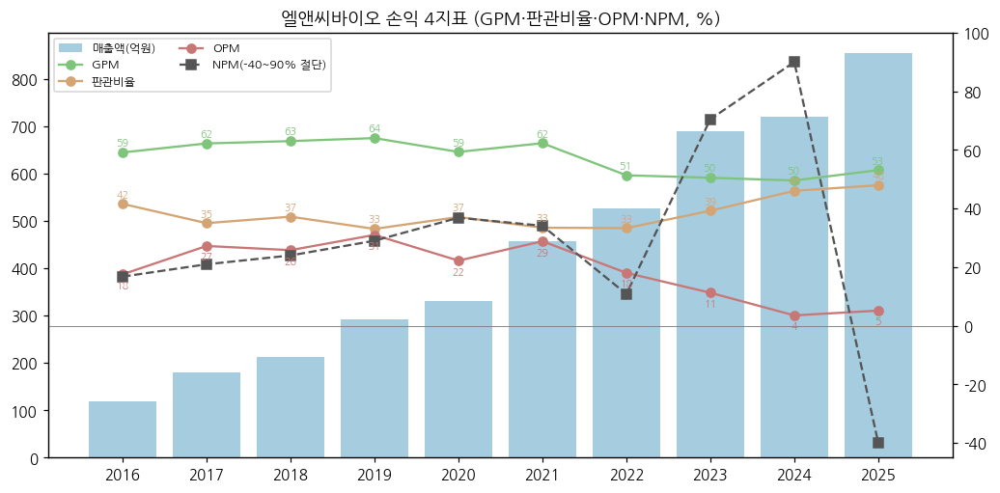

**순이익 브리지 (영업 외 일회성)**

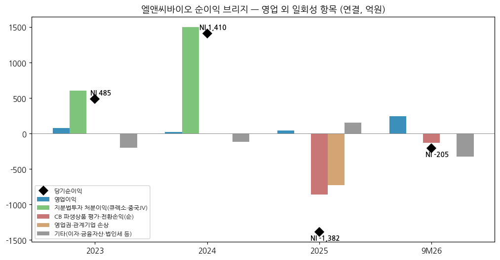

→ 2025 순손실 -1,382억 분해(억원): 영업이익 +44 / CB 파생 순손실 -856 / 영업권·관계기업 손상 -728 / 기타(이자비용 -59·이자수익 +13, 금융자산 평가 -20, 대손 -10, 법인세 수익 +217 등) +157 `[계산: DART 주석 30·31]`
→ CB 파생손실의 성격: 제3회 CB(2025.04, 600억, 전환가 21,200원)의 전환권·조기상환청구권이 '행사가격 조정으로 변동가능 수량을 발행할 의무'로 **파생상품부채**로 분류 → 주가가 오를수록 평가손실(현금 유출 없음). 2025말 파생상품부채 1,420억 → 2026 전환 450억 시 1,263억 자본 대체 → 3Q26 590억(그중 제3회 553억)

② 재무상태표

| 연도말 | 자산 | 유동자산 | 현금 | 재고 | 유형자산 | 무형(영업권 포함) | 부채 | 유동부채 | 전환사채 | 파생상품부채 | 차입금 | 자본 | 지배자본 | 부채비율 | 유동비율 |
|---|---|---|---|---|---|---|---|---|---|---|---|---|---|---|---|
| 2018 | 574 | 499 | 216 | 56 | 49 | 1 | 46 | 31 | - | - | 10 | 528 | - | 8.7% | 1630.8% |
| 2019 | 662 | 461 | 128 | 62 | 73 | 2 | 60 | 34 | - | - | 10 | 603 | 582 | 9.9% | 1355.3% |
| 2020 | 806 | 455 | 223 | 81 | 95 | 2 | 193 | 37 | 86 | - | 10 | 613 | 578 | 31.5% | 1238.2% |
| 2021 | 1,074 | 476 | 174 | 123 | 179 | 11 | 141 | 56 | 46 | - | 9 | 933 | 850 | 15.2% | 845.3% |
| 2022 | 1,997 | 643 | 66 | 342 | 531 | 36 | 919 | 187 | 591 | - | 102 | 1,078 | 980 | 85.2% | 343.1% |
| 2023 | 2,622 | 1,304 | 149 | 463 | 747 | 15 | 1,054 | 1,018 | 638 | - | 88 | 1,569 | 1,469 | 67.2% | 128.0% |
| 2024 | 4,756 | 1,302 | 183 | 468 | 970 | 1,992 | 1,809 | 1,547 | 664 | 7 | 517 | 2,947 | 2,844 | 61.4% | 84.2% |
| 2025 | 4,566 | 1,392 | 309 | 428 | 1,066 | 1,278 | 2,481 | 2,378 | 485 | 1,420 | 225 | 2,085 | 1,982 | 119.0% | 58.5% |
| 3Q26 | 4,865 | 1,845 | 467 | 402 | 1,228 | 1,309 | 1,420 | 1,298 | 195 | 590 | 229 | 3,445 | 3,308 | 41.2% | 142.1% |

→ 무형자산 대부분이 **엘앤씨차이나 영업권**: 1,973억(2024) → 손상 725억 → 1,239억(2025말). 2025 엘앤씨차이나 자산 363억·매출 0.06억·순손실 34억
→ 2025말 부채비율 119%·유동비율 58%는 파생상품부채(1,420억, 비현금)가 만든 숫자. 3Q26 CB 450억 전환으로 부채비율 41%로 정상화, 10월 유증 1,447억은 4Q26 반영
→ 재고 400억대(매출 대비 높음) — 원재료(수입 인체조직) 선확보 구조

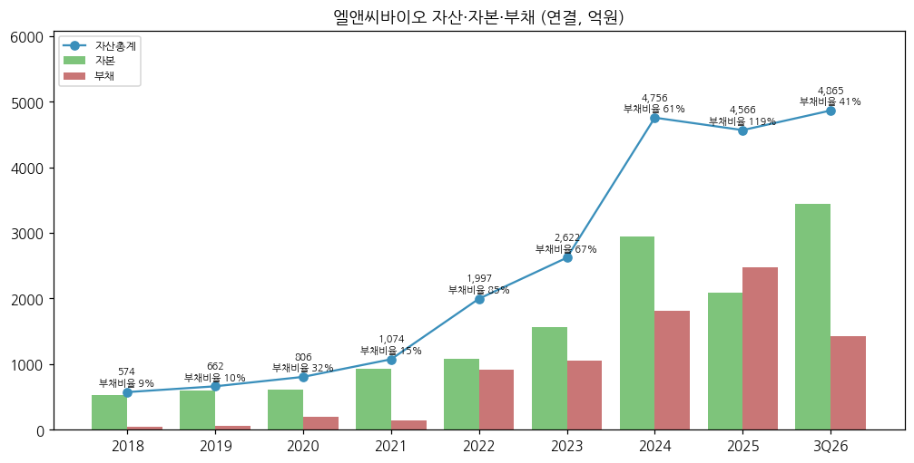

③ 현금흐름표

| 연도 | 영업CF | 투자CF | 재무CF | 유형CapEx | 무형CapEx | FCF | 배당지급 | 자사주취득 | 이자지급 |
|---|---|---|---|---|---|---|---|---|---|
| 2018 | 38 | -168 | 314 | 47 | 0 | -9 | - | - | 0.2 |
| 2019 | 64 | -158 | 5 | 20 | 1 | 44 | - | - | 0.2 |
| 2020 | 74 | 8 | 13 | 30 | 0 | 44 | 7 | 127 | 0.2 |
| 2021 | 109 | -205 | 47 | 103 | 12 | -5 | 11 | 20 | 0.2 |
| 2022 | -61 | -836 | 789 | 375 | 2 | -438 | 11 | - | 1.6 |
| 2023 | -121 | 246 | -42 | 245 | 5 | -371 | 11 | 8 | 5.3 |
| 2024 | -86 | -219 | 338 | 47 | 6 | -139 | 23 | - | 5.0 |
| 2025 | 126 | -329 | 321 | 158 | 12 | -45 | 11 | 100 | 18.6 |
| 9M26 | 277 | -172 | 53 | 231 | 45 | 1 | 12 | - | 12.4 |

→ 2022\~2024 3년 연속 영업CF 적자: 재고 증가(2021 123억 → 2024 468억), 2024 법인세 납부 149억(큐렉소 매각 차익 과세) 등
→ 2025부터 영업CF 흑자 전환, 9M26 277억 — 리투오가 처음으로 '현금이 남는' 구조를 만들었다. 다만 증설 CapEx로 FCF는 아직 0 수준
→ 재무CF: 2022 CB 600억, 2025 CB 630억 발행 − CB 상환 255억 + 유상증자 100억, 2026.10 유상증자 1,447억(4Q26 반영)

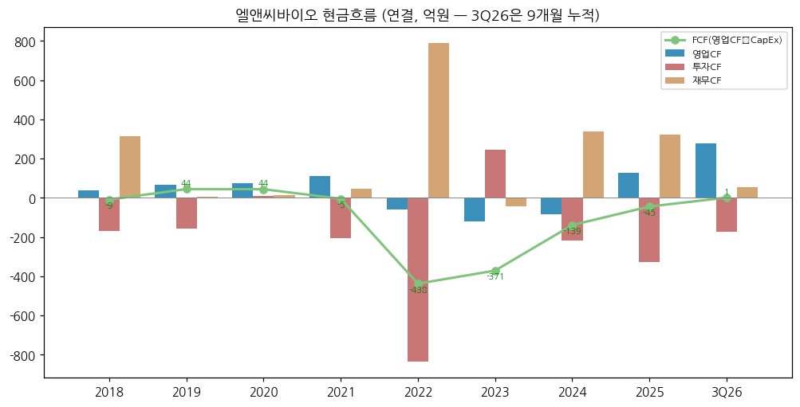

④ CapEx

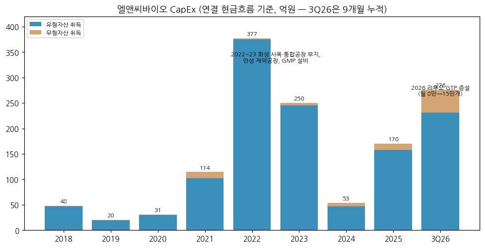

→ 1차 투자 사이클 2021\~2023(누적 약 740억): 의료기기 GMP 공장 매입(2021.01), 안성 제약공장, 화성 사옥·통합공장 토지(2023.10, 198억)
→ 2차 사이클 2025\~(9M26 276억): 리투오 GTP 증설(월 8만 → 15만개), 성남 건물·기계 증설. 2026.10 유상증자 1,447억 용도 = 시설자금(동탄 글로벌 생산기지)·운영자금·채무상환 (DART)

⑤ 부채구조 + 채무증권 발행 history

| 증권 | 발행일 | 규모 | 조건 | 처리 결과 |
|---|---|---|---|---|
| 제1회 CB | 2020.03.16 | 100억 | 표면·만기 0%, 만기 2023.03 | 2021까지 대부분 전환 |
| 제1회 BW | 2020.03.16 | 50억 | 표면·만기 0% | 행사·상환 (세부 미집계) |
| 제2회 CB | 2022.06.29 | 600억 | 만기 2025.06.29 | 2025년 **255억 상환(풋) + 345억 전환** (2025 CF·자본변동표) |
| **제3회 CB** | **2025.04.23** | **600억** | 표면·만기 0%, 전환가 21,200원(무상증자 전), 풋 2027.04\~, 콜(발행사 지정) 2026.04\~ | **2026 3분기 450억 전환(2,122,641주)** → 잔액 150억 **2026.11.09 콜옵션 행사 결정, 11.23 취득 즉시 소각** |
| 글로벌의학연구센터 제2회 CB | 2021.12.27 | 60억 | 자회사 주식 전환(24,009원) | 잔존 60억 |
| 글로벌의학연구센터 제3·4회 EB | 2022.08 / 2025.06 | 소액 | 교환대상 = 엘앤씨바이오 주식 | 전액 교환·상환 |
| 리씨엠바이오 제1회 CB | 2025.08.12 | 30억 | 보장수익률 5% | 잔존 30억 |

→ 3Q26 차입금: 단기 160억 + 장기 69억(유동성 포함 시 장기 152억 수준은 2025말) — 이자지급 연 19억(2025)
→ **CB 소각 의미**: 제3회 CB 미전환분 150억 = 무상증자 전 70.8만주(무상 후 약 141.5만주, 발행주식의 약 2.3%) 오버행 제거 + 파생상품부채(제3회 잔여 553억)·콜옵션 자산(526억) 동시 소멸 → 2027부터 순이익 노이즈 축소 `[계산·판단]`

⑥ 배당·자사주

| 연도 | 주당배당금 | 배당총액 | 자사주 취득 | 비고 |
|---|---|---|---|---|
| 2019 | (2020 지급 7억) | 7억 | - | |
| 2020 | 약 50원 `[추정]` | 11억 | 127억 | 2020 자사주 취득 + 91,996주 이익소각(1:2 무상증자 후 275,988주) |
| 2021\~2022 | 약 50원 `[추정]` | 11억 | 20억(2021) | |
| 2023 | 100원 | 23억 | 8억 | |
| 2024 | 50원 | 11억 | - | |
| 2025 | 50원 | 11억 | **100억** | 자사주 처분 48억(2025), 기말 자기주식 232,240주 |

→ 출처: DART 배당에 관한 사항(2023\~2025 DPS), OpenDART 현금흐름표(지급 기준)
→ 밸류업 계획(2026.03): 배당기산일 전 배당금 결정, **주당 최소 50원 이상** 유지, 이익 확대에 따른 배당 확대, 임직원 PSU 부여. 3Q26 이후 회사는 "자사주 매입·소각, 배당 등 추가 주주환원 검토"(데일리팜 2026-11-09)
→ 주당 50원은 무상증자 전 기준 — 1:1 무상증자 후 같은 총액이면 25원 `[계산]`

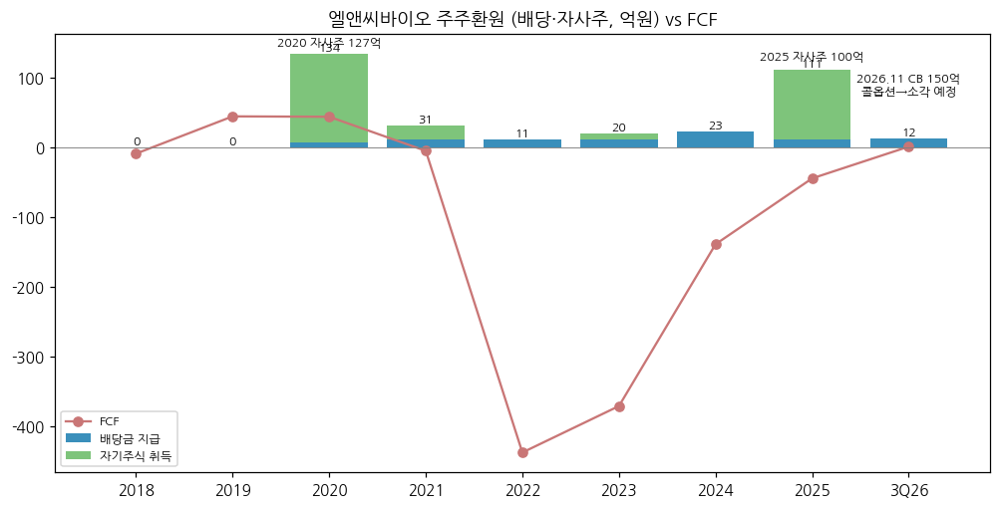

⑦ 재무비율

| 연도 | ROE(지배, 기말) | ROA | 부채비율 | 유동비율 | 이자보상배율(OP/이자지급) |
|---|---|---|---|---|---|
| 2018 | 9.6% | 8.9% | 8.7% | 1630.8% | 313x |
| 2019 | 12.5% | 12.8% | 9.9% | 1355.3% | 552x |
| 2020 | 18.7% | 15.1% | 31.5% | 1238.2% | 485x |
| 2021 | 16.2% | 14.5% | 15.2% | 845.3% | 572x |
| 2022 | 4.6% | 2.8% | 85.2% | 343.1% | 60x |
| 2023 | 32.9% | 18.5% | 67.2% | 128.0% | 15x |
| 2024 | 49.6% | 29.6% | 61.4% | 84.2% | 5x |
| 2025 | -69.7% | -30.3% | 119.0% | 58.5% | 2x |
| 3Q26 | (9M 순손실) | - | 41.2% | 142.1% | 20x (9M OP 244 / 이자 12) |

→ 2023\~2025 ROE는 일회성 순이익이 지배 — 영업 ROE(영업이익×(1−세율 20%)/지배자본) 기준으로는 2024 0.7%, 2025 1.8%, 9M26 연환산 약 7.9% `[계산]`

---

## ⑤ 지배 구조

① 그룹·계열 관계

→ 창업자 이환철 대표 개인 지배 구조 (설립 이후 최대주주 변동 없음). 대기업집단 소속 아님
→ 종속회사 4개(엘앤씨차이나 100%, 엘앤씨메디케어 100%, 리씨엠바이오, 글로벌의학연구센터[과반 미만 실질지배]), 관계기업 비엑스플랜트 19.76%(인허가 컨설팅), 엘앤씨퓨처랩(2025 관계기업 전환)
→ 전략적 파트너: **휴메딕스**(리투오 국내·일본 공동판매, 2025 하반기 150억 제3자배정 주식스왑으로 상호 지분 보유), 중국 측 CICC 등(엘앤씨차이나 초기 투자자 — 2024 우선매수권 행사·잔여지분 인수로 외부 지분 정리)

② 주주 구분

| 주주 | 주식수 | 지분율 | 기준일 |
|---|---|---|---|
| 이환철 (최대주주) | 5,499,114 | 20.39% | 2026.09.30 |
| 특수관계인·계열사 임원·글로벌의학연구센터·사내근로복지기금 | 287,938 | 1.07% | 2026.09.30 |
| (주)나우아이비 19호 펀드 | 1,955,875 | 7.25% | 2026.09.10 대량보유보고 |
| (주)브이아이피자산운용 | 1,446,856 | 5.36% | 2026.06.10 대량보유보고 |
| 자기주식 | 232,240 | 0.86% | 2026.09.30 |
| 소액주주 (46,205명) | 12,985,456 | 48.15% | 2026.09.30 |
| 외국인 | 미확보 | - | - |

→ 위 표는 10월 유상증자(370만주)·11월 1:1 무상증자 이전 기준. 이환철 대표는 유증 배정분의 절반만 청약(IB토마토) → 증자 후 지분율 추가 하락 `[판단: 최종 지분율 미확인]`
→ 나우아이비 19호 펀드는 2026 3분기 CB 전환 시점과 겹쳐 제3회 CB 투자자로 보인다 `[판단]`

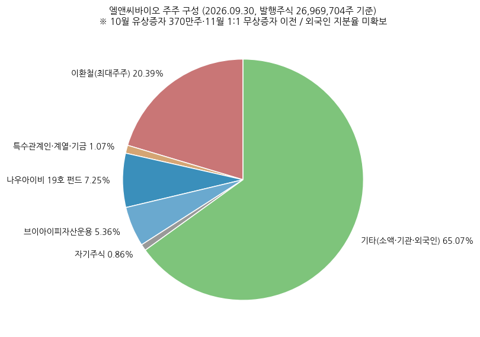

③ 임원·이사회 (2025 사업보고서 + 2026 변동)

| 성명 | 직위 | 담당 | 약력 |
|---|---|---|---|
| **이환철** | 대표이사 (사내이사, 최대주주) | 사업총괄 | 서울대 사범대('03), 대웅제약 신규사업팀('02\~'10), 시지바이오 영업('10\~'11), 2012\~ 대표 / L&C China CEO |
| **이재호** | 각자대표 (사내이사) | 관리총괄 | Boston College·Reading대 기업금융석사, 동양그룹 기업금융('02\~'14), 유진투자증권 IPO팀, WCCT Global CRO(US) 재무이사, 북경룬메이캉 재무이사('17\~'22) |
| 이주희 | 사내이사 (2026.03 신규) | - | 미확보 |
| 김창수 | 부사장 (미등기, CTO) | 연구개발 | POSTECH·서울대·Carnegie Mellon 공학박사, US FDA 연구원, 위스콘신대 교수 |
| 한방희 | 부사장 | 임상학술 | 서울대 약대 석사, 유한양행·부광약품·안트로젠 |
| 조용완 | 사외이사·감사위원 | - | 베인앤컴퍼니, 엘앤피코스메틱 CFO, 리스트바이오 대표 |
| 전태선 | 사외이사·감사위원 (2026.03 재선임) | - | 동양생명 CIO, 유안타증권 S&T 대표 |
| 문용선 | 사외이사 (2026.05 사임) | - | 서울북부지법원장 출신 변호사 |

→ 2026.03 정기주총: 이환철·이재호·전태선 재선임, 이주희 신규 선임

---

## ⑥ 기타 팩트

① R&D 인프라

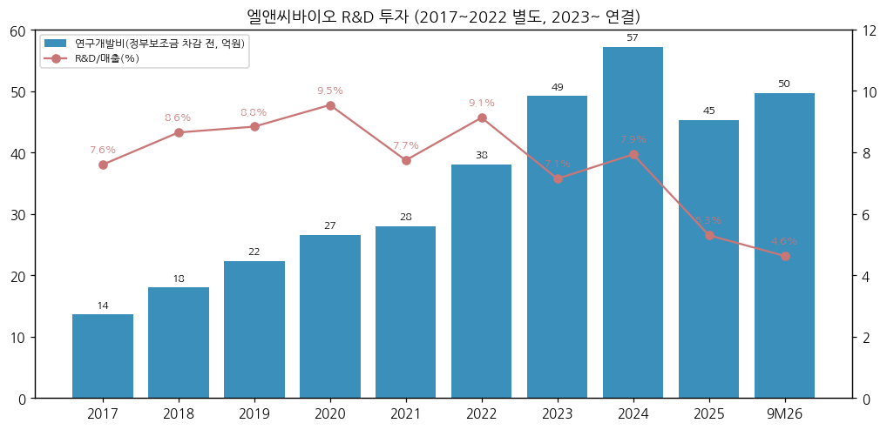

→ 연구개발비(보조금 차감 전): 13.6억(2017) → 57.2억(2024, 연결) → 45.3억(2025) → 49.7억(9M26). 매출 대비 4\~8%. 전액 비용 처리(판관비), 위탁용역비 비중 높음(9M26 33억/50억)
→ 조직: 기업부설연구소 — 임상학술본부(인허가·임상·심평원 급여), 연구개발실, 품질관리부. 별도 연구인력 33명(박사 2·석사 9, 3Q26) / 그룹 R&D 44명(박사 8·석사 20, 2026.03)
→ 2017\~2022 별도 기준, 2023\~ 연결 기준(DART 연구개발비용 표)

② 진행 중 / 최근 10년 corporate action

| 시기 | 내용 | 금액 |
|---|---|---|
| 2018.11 | 코스닥 IPO | - |
| 2020.03 | 제1회 CB 100억 + BW 50억 | 150억 |
| 2020.06 | 중국 JV 설립 (L&C Bioscience Technology Kunshan) | - |
| 2020 | 자사주 취득 127억 + 이익소각 | 127억 |
| 2022.02 | 엘앤씨에이아이 인수 → 2025 매각 | - |
| 2022.06 | 제2회 CB | 600억 |
| 2022.07 / 2023 | 큐렉소 3자배정 유증 참여(2대주주) → 블록딜 659억 등 전량 매각 | 처분이익 607억 |
| 2024.05 / 2024.12 | 엘앤씨차이나 23.7%(86억) + 24.9%(USD 38.25M) 취득 → 100% | 총 이전대가 2,234억(기존 지분 공정가 1,680억 포함) |
| 2025.04 | 제3회 CB | 600억 |
| 2025 하반기 | 휴메딕스 대상 제3자배정 유상증자(주식스왑) | 150억 |
| 2026.07\~11 | 주주배정 유상증자 370만주(발행가 39,100원) + 1:1 무상증자 | **1,447억** |
| 2026.11 | 제3회 CB 잔액 콜옵션 → 소각 | 150억 |
| 진행 | 동탄 글로벌 생산공장 착공 추진, 리투오 CAPA 월 15만개 | - |

③ R&D·인허가 마일스톤

→ 2021.08 메가덤플러스 중국 하이난성 긴급사용승인 / 2025.01 **중국 NMPA 정식 허가** / 2026.03 중국 현지생산 허가 심사 신청
→ 2022.11 메가카티 품목허가 → 2023.10 신의료기술평가유예·상용화
→ 2024.01·2024.11 엘앤씨차이나 중국 인체조직 원재료(피부 / 뼈·연골) 수입 허가
→ 2024.08 미국 AATB 인증 (미국 진출 기반)
→ 2025.02 리투오, 2025.12 리투오 파인, 2026 리투오 V(계획), Re2O Plus, MegaFill Putty·TendonFill·MegaDerm Matrix·포켓형 ADM 등 개발·출시 파이프라인 (DART 연구개발 진행 총괄표)

④ 주요 리스크

→ (1) **리투오 공급·성장 지속성**: 3Q26 인체조직 매출 QoQ 정체. CAPA 15만개 가동 시점·수율, 경쟁(리쥬란·쥬베룩·신규 ECM 부스터) — 단일 제품 의존 심화
→ (2) **원재료 수입 의존**: 원재료의 약 79%가 수입(9M26), 해외 조직은행 1곳과 독점계약 — 공급처 리스크·환율(USD) 노출. 국내는 한국공공조직은행
→ (3) **중국 영업권 1,239억**: 엘앤씨차이나 매출 사실상 0, 연 -34억 손실. 현지생산 허가 지연 시 추가 손상 (2025 민감도: 할인율 +1%p → 손상 +227억)
→ (4) **희석·오버행**: CB 1,230억(2022 600억·2025 630억)·유증 약 1,700억(2025 현금 100억 + 휴메딕스 주식스왑 150억 `[추정]` + 2026 1,447억) 연속 조달로 주식수 2.7배(22.8M → 61.1M, 무상 포함). 최대주주 지분 20%대 → 증자 후 추가 하락
→ (5) **회계 변동성**: 잔존 자회사 CB·EB 파생, 법인세 추정(2Q26 210억) 등 순이익 노이즈
→ (6) **규제**: 인체조직안전관리법·의료기기 규제, 메가카티 등 신의료기술평가·급여 결정
→ (7) 세무: 2024 중부지방국세청 세무조사(2021\~2023 사업연도) → 원천세 수정신고 납부 완료(2025.01)

⑤ ESG

→ 별도 ESG 등급 미확보. 사내근로복지기금(2023.09) 설립, 한국공공조직은행·KODA와 생명나눔 공동캠페인(2025.11)

⑥ 인증·라이선스

→ 조직은행 설립허가(2011, 식약처), ISO 9001/14001(2012), ISO 13485·GMP(2015), 화장품 제조판매업·의료기기 제조판매업(2014), 미국 AATB 인증(2024.08), 우수기업연구소(2021), 코스닥 라이징스타(2021·2023·2024·2025, 2026 명예의전당)

---

## Version Log

| 버전 | 일자 | 내역 |
|---|---|---|
| v1.0 | 2026-11-15 | 최초 작성. OpenDART 연결·별도 재무(2018\~3Q26) + DART 2026.09 분기보고서·2025 사업보고서 정성자료 + Yahoo 주간 주가. 차트 15종(표준 12종 + chart2b 전 분기·chart2c 리투오 분해·chart13 순이익 브리지) |

**잔여 보완 후보**
→ 리투오 분기 매출: 회사 비공개 — 3Q26 증권사 추정치 확보 후 chart2c 갱신 (1Q25·2Q25·3Q26 미확보)
→ 4Q26 반영 시 10월 유상증자 1,447억·CB 150억 소각·무상증자 후 주식수/EPS 재계산, 최대주주 지분율 갱신
→ 외국인 지분율, 52주 고저·시가총액 2차 소스 교차 확인
→ 2015 손익(공모 증권신고서), 2021\~2023 별도 영업이익, 제1회 BW 처리 내역, 2019\~2022 DPS 정확치
→ 엘앤씨차이나 분기 손익(연결 − 별도 차이 분해), 메가카티 매출 시계열
