> 종목: 엘앤에프 (066970.KS / 주식회사 엘앤에프 / L&F CO., LTD., DART corp_code 00398701) — **KRX 유가증권시장** (2003.01.02 코스닥 상장 → **2024.01.29 유가증권시장 이전상장**, DART 2025 사업보고서)
> 섹터: 배터리 (워치리스트 섹터 T2) / 서브섹터: 양극재 (확장 종목)
> 작성 시각: 2026-11-14 KST (**v1.0** — 첫 작성)
> 적용 구조: v4.8 (6개 섹션 + 12종 차트 표준. 단일 사업부(양극활물질 100%)라 chart2는 2·2b·2c 3종으로 대체 구성: 43분기 매출·OPM / 분기 재무건전성 / 고객 집중도)
> 데이터: 12년 연결 연간(2014~2025, OpenDART — 2014는 2015 사업보고서 전기) + 43분기 연결(1Q16~2Q26 OpenDART + 3Q26 잠정) + 분기 재무상태 44분기(4Q15~3Q26) + 20년 Yahoo 시가총액
> 출처: **DART 사업보고서 2025 정정(rcept 20260814000818, 최우선 정성자료)·2024(20250311001260)·2023 정정(20240328001260)·2022 정정(20230828000596)·2021(20220315000434)·2020(20210309000400)·2019(20200326000817)·2018(20190329003209)·2017(20180329001105)·2016 정정(20170525000330)·2015(20160328000415), 반기보고서 2026.06(20260814000995), 분기보고서 2026.03·2025.09 외 정기보고서 43건(공시원문 XML)** / OpenDART 전체재무제표 연결(CFS) 2015~2Q26 / OpenDART 2025 FY 최대주주·임원·직원·배당·자기주식·주식총수 / **회사 IR 실적발표 PDF 12건**(2021.4Q~2023.4Q 9건 irgo 경유 + **1Q26·2Q26·3Q26 3건 회사 IR페이지 landf.irpage.co.kr**) / **회사 보도자료(irgo) 10건**(1Q24~3Q26 실적) / Yahoo Finance v8 066970.KS 월간 20년 / 시장 보조: stockhub(2026-10-23), 딜사이트·전자신문·디지털데일리·헤럴드경제·벤처스퀘어 기사
> **Fact verify cutoff**: 2026-11-14

# 엘앤에프 기업 개요 (v1.0 — 배터리 T2, 하이니켈 NCMA 양극재 단일 사업 + LFP 신규 진출)

> ⚠️ **시계열 단절·해석 주의 5건 — 모든 표·차트 해석 시 주의**
> ① **2013.01 사업 재편** — TFT-LCD BLU(백라이트) 생산 중단 → 2차전지 양극활물질 전업. 2013 이후 매출의 98% 이상이 양극재 (2015 사업보고서 제품 용도별 매출: 양극활물질 99.5%, 전자소재 0.5%). 본 리포트 12년 시계열(2014~)은 재편 이후 구간
> ② **2016.02 ㈜엘앤에프신소재 흡수합병** (합병신주 6,484,223주, 당사 보유분 3,538,231주는 자기주식 전환) — 신소재는 이미 연결 종속회사였으므로 **연결 매출·영업이익은 연속**. 다만 2015 이전 비지배지분(2015말 88억)이 사라져 **지배순이익·지배자본 귀속이 바뀜**
> ③ **2021 대규모 자본 확충** — 주주배정 유상증자 6,500,000주 × 76,400원(약 4,966억, 2021.07) + RCPS 460억·3회 CB 90억·4회 BW 300억(2021.02, 대신-MYW) + 5회 CB 1,000억(2021.11) → 2021 자본 1,976 → 6,352억 (3.2배). 2020.08에도 주주배정 3,300,000주 × 25,050원(약 827억)
> ④ **2023~2026 메자닌·영업외 변동성** — 해외 교환사채(2023.04, 자사주 교환, 교환가 438,100원)·6회 CB(2025.01, 1,000억)·7회 공모 BW(2025.09, 3,000억)의 **파생상품 평가손익이 순이익을 크게 흔든다** (2025 영업외손익 -4,109억 중 파생상품평가손실 -1,279억, BW 행사손실 -1,364억 — 회사 3Q26 IR p.8). → **순이익·NPM 대신 영업이익·OPM으로 사이클 판단**
> ⑤ **잠정 → 확정 차이** — 2024 연간 영업이익 잠정 -5,102억(2025.02 보도자료) → 확정 -5,587억(DART 사업보고서), 4Q24 -1,498 → -1,982억. 본 리포트는 DART 확정치 사용. 3Q26은 분기보고서 미공시(2026-11-14 기준) → **잠정**(2026-11-05 공정공시)
> 부가: DART corp_cls는 'Y'(유가증권). Yahoo는 이전상장 전 이력까지 066970.KS 단일 티커로 제공(066970.KQ는 404)

---

## ① 기업 분류

(1) Primary / Secondary 분류

**Primary 분류: 사이클 (메탈가·EV 수요 사이클 + 재고평가 래깅이 증폭하는 고베타 소재 사이클)**

12년 OPM range **-29.3% ~ +7.3% = 36.6%pt** (cutoff ±10%pt의 3.7배) → 정량 룰상 명확한 사이클

→ 양극재 판가는 리튬·니켈·코발트 가격 연동(래깅) 구조 — 메탈가 하락기에 고가 원재료 재고가 낮은 판가로 팔리며 **역래깅 + 재고평가손실**이 동시 발생 (4Q23 재고평가손실 2,508억, 1Q24 832억 — 회사 IR)

→ 메탈가 반등기에는 반대로 **재고평가 충당금 환입**이 OP를 부풀림 (4Q25 환입 약 779억 — 디지털데일리 2026-02-06 / 1Q26 환입 926억 — 회사 1Q26 IR p.4)

**Secondary 노트: 고성장 (EV·ESS 양극재 secular, 단 고객 집중 리스크 내재)**

→ 매출 CAGR **+21.8%** (2014→2025, 11년) / 정점 구간 기준 **+38.6%** (2014→2023, 9년)

→ 2026 NCM 출하량 YoY +40% 전망, 2027 46파이 비중 NCM 출하의 약 40%, LFP 2027 약 5만톤·2028 6만톤+ 출하 전망 (회사 3Q26 보도자료 2026-11-05)

**Entity 구조 (2025말 연결 종속 3사, DART 2025 사업보고서)**

→ **(1) ㈜엘앤에프 본체** — 2차전지 양극활물질 (매출 비중 100%, 대구 본사·구지 1·2·3공장)

→ **(2) 제이에이치화학공업㈜** — 양극재 관련 소재(전구체) 자회사 (2011 설립, 김천)

→ **(3) 광미래신재료유한공사(무석)** — 중국 반제품 법인, **2023.04 생산 중단**

→ **(4) ㈜엘앤에프플러스** — **LFP 양극재 전담 자회사, 2025.08 설립**, 대구 국가산단 약 100,000㎡ 부지 — 1단계 연 3만톤 2Q26 준공·3Q26 말 양산, 2027 상반기 총 6만톤 (DART 2025 사업보고서 MD&A, 회사 1Q26 보도자료)

→ 공동기업: **LLBS(㈜엘에스엘앤에프배터리솔루션)** — LS그룹과 전구체 합작 (공동기업투자 1,324억, 2025말 DART)

(2) Summary Box (12년 연결 시계열 + 사이클 통계)

| 지표 | 12년 평균 (2014~2025) | 정점 | 저점 | 2025년 | 1~3Q26 |
|---|---|---|---|---|---|
| 매출 (연결, 억원) | 13,228 | **46,441 (2023)** | 2,351 (2015) | **21,549** | 24,990 |
| 영업이익 (연결, 억원) | -470 | **2,663 (2022)** | -5,587 (2024) | **-1,568** | 1,116 |
| 지배순이익 (억원) | -778 | **2,700 (2022)** | -5,335 (2025) | **-5,335** | -461 |
| OPM (연결) | **-1.2%** | **7.3% (2017)** | **-29.3% (2024)** | **-7.3%** | **4.5%** |
| 부채비율 (연말) | - | 363% (2025) | 115% (2017) | **363%** | 372% (3Q26) |
| 매출 10% 이상 고객1 비중 | - | 88% (2025) | 59% (2020) | **88%** | - |

```
[엘앤에프 12년 연결 손익 시계열 (억원, OpenDART 연결)]
연도     매출       OP       OPM     지배NI
2014     2,457       10     0.4%      -14   ← BLU 철수 직후, IT·파워툴용 양극재 (LCO/NCM) 95%
2015     2,351      -20    -0.8%      -35   ← 저점⓪ (전기차용 비중 10%로 상승 시작)
2016     2,497      139     5.6%       57   ← 신소재 합병, NCM 믹스 개선
2017     4,030      294     7.3%      199   ← OPM 12년 최고 — 국지 정점① (원통형 하이니켈 NCA/NCMA 성장)
2018     5,057      270     5.3%      194
2019     3,133      -77    -2.4%      -90   ← 저점① (소형 IT 수요 둔화·고객 재고조정)
2020     3,561       15     0.4%     -152   ← 구지 증설, 유상증자 827억
2021     9,708      443     4.6%   -1,131   ← EV(LGES·테슬라향 NCMA) 본격, 유상증자 4,966억 / NI는 CB·RCPS 파생손실
2022    38,873    2,663     6.9%    2,700   ← 리튬 사이클 정점 (매출 4.0배) — 정점②
2023    46,441   -2,223    -4.8%   -1,943   ← 매출 정점 but 4Q 역래깅·재고평가손실 2,508억으로 적자전환
2024    19,075   -5,587   -29.3%   -3,779   ← 저점② (메탈가 급락 + NCM523 판매손실 + EV 캐즘)
2025    21,549   -1,568    -7.3%   -5,335   ← 3Q 흑자전환(Ni95 단독공급), NI는 파생·BW행사손실
1~3Q26  24,990    1,116     4.5%     -461   ← 1Q 15.9% (환입) → 3Q -3.0% (환율·메탈 급락) [3Q 잠정]

OPM range: -29.3% ~ +7.3% = 36.6%pt (cutoff ±10%pt의 3.7배 → 사이클)
사이클 회수: 2회 (정점 2017·2022 / 저점 2019·2024), 3번째 회복 진행 중
```

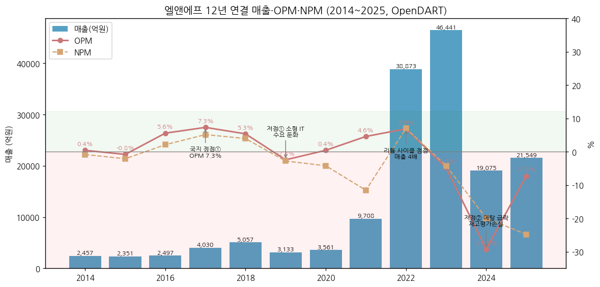

**📊 사이클 통계 (12년 연결)**

| 지표 | 값 |
|---|---|
| 매출 CAGR (11년, 2014→2025) | **+21.8%** |
| 매출 CAGR (9년, 2014→2023 매출 정점) | **+38.6%** |
| OPM 평균 | **-1.2%** (2024 -29.3% 영향, 2014~2022 평균 3.0%) |
| OPM 정점 평균 | **7.1%** (2017 7.3%, 2022 6.9%) |
| OPM 저점 평균 | **-15.9%** (2019 -2.4%, 2024 -29.3%) |
| OPM range | **36.6%pt** |
| 사이클 주기 | 정점→정점 5년 (2017→2022), 저점→저점 5년 (2019→2024) |
| 사이클 회수 (12년) | **2회** (3번째 회복 2H25~ 진행 중, 3Q26 재차 적자) |

**국내외 양극재 피어 마진 비교 (2025 4Q, 디지털데일리 2026-02-06)**

→ **엘앤에프** — 4Q25 매출 6,177억 / OP 824억 (OPM 13.3%, 재고평가 환입 약 779억 포함)

→ **에코프로비엠** — 4Q25 매출 4,992억 / OP 410억 (OPM 8.2%)

→ **포스코퓨처엠** — 4Q25 매출 5,575억 / OP -517억

→ **Umicore** — 분기 마진 비교 데이터 [미확보] (BT 배터리 섹터 메모리: 26E P/B 1.7배, ROE 10.9%)

→ 2023 삼원계 양극재 출하량 순위 (SNE리서치, 디지털데일리 2024-06-17): 1위 에코프로 12만톤 / 2위 Ronbay 9.95만톤 / 3위 B&M 9.5만톤 / **4위 엘앤에프 8.6만톤** / 5위 LG화학 7.4만톤 / 13위 포스코퓨처엠 5.4만톤

(3) 정량적 분류 근거

→ **단일 사업부** — 사업부문 "양극활물질" 매출 비중 100.00% (DART 2025 사업보고서) — 사업부 분산 효과 없음, 사이클이 그대로 전사 실적

→ **수출 비중 99.6%** — 2025 매출 21,549억 중 수출 21,470억 (DART 매출실적), 2013~2025 전 기간 90% 이상 → 원/달러 환율이 매출·재고평가에 직결 (3Q26 환율 하락 손실 약 220억, 회사 3Q26 IR p.4)

→ **극단적 고객 집중** — 매출 10% 이상 외부고객 2곳이 매출의 100% (2025: 고객1 88% + 고객2 12%). 2020 59%/32% → 2025 88%/12%로 1위 고객 집중 심화 (DART 각 연도 사업보고서)

→ **재고 = 사이클 레버** — 재고자산 2022말 12,277억(매출의 32%) → 2024말 5,746억. 4Q23 재고평가손실 2,508억 = 그 분기 영업적자(-2,805억)의 89% (회사 4Q23 IR p.6)

→ **수주잔고 21.9조원** (2025말, 하이니켈 양극재 장기계약 — DART): SK온 13.19조(2024.03, ~2030) + 비공개 9.24조(2024.04, ~2030, 유럽 고객) + 비공개 3.52조(2025.03) / 테슬라 2023.02 계약(당초 3.83조)은 기납품 97억으로 종료

(4) 산업 분류

→ **한국표준산업분류(DART)** — 업종코드 28202 (축전지 제조 관련 — 2차전지 소재)

→ **KRX** — 유가증권시장 (2024.01.29 이전상장)

→ **워치리스트 섹터** — 배터리 T2 / 서브섹터 양극재 (에코프로비엠·포스코퓨처엠과 함께, 확장 종목)

→ **사업 성격** — 하이니켈(Ni 90~95%) NCMA·NCM 양극재 (원통형 2170·46파이 중심) + 미드니켈(NCM523, 유럽 EV·ESS) + **LFP(2026~, 북미 ESS)**

(5) 분류 결정 논리

(1) **가장 매출 큰 사업부 기준** — 양극재 100% → 메탈가·EV 수요에 1:1 노출 → 사이클

(2) **이익 구조 sub-rule** — 영업이익의 부호가 수요보다 **메탈가 방향(래깅)**에 좌우됨: 매출 정점(2023)에 적자전환, 매출 회복기(2Q25) 적자, 메탈 반등기(4Q25~1Q26) OPM 13~16% → 이익 사이클이 매출 사이클보다 진폭이 큼 = 고베타 사이클

(3) **Boundary 처리** — 장기 매출 CAGR 21.8%는 고성장 기준 충족하나, 12년 중 영업적자 5개년·OPM 평균 음수 → 정량 룰(range 36.6pp) 우선 → **Primary 사이클 + Secondary 고성장**. 대안 분류(꿈/턴어라운드)는 LFP 이익 기여 확인 전까지 보류

(4) **국내외 피어 비교** — 에코프로비엠(하이니켈 NCA·NCM, 삼성SDI·SK온), 포스코퓨처엠(NCM + 음극재·기초소재, GM·LGES)과 같은 메탈 래깅 구조. 엘앤에프는 ① 원통형 하이니켈(Ni95) **단독 공급**, ② 1위 고객 88% 집중, ③ 국내 양극재 중 **LFP 양산 선착**(2026.3Q)이 차별점 → 피어 대비 이익 변동성은 더 크고 회복 탄력도 더 큼 (4Q25 OPM 13.3% vs 비엠 8.2%)

(6) 적정 밸류에이션 방법

→ **1차 — P/B (사이클 밴드)**: 적자 연도가 많아 PER 무의미, 자본이 사이클을 그대로 반영. 현재: 시가총액 3.21조 [계산: 2026-11-13 종가 78,900원(Yahoo) × 40,683,260주(2026.06말 DART)] / 자본총계 7,477억(3Q26, 회사 IR) = **P/B 약 4.3배** [계산]. 참고 피어 P/B 2026E (KB증권, BT 배터리 섹터 메모리 — 2026.05 시점): 에코프로비엠 12.0배 / **엘앤에프 14.4배** / 포스코퓨처엠 5.7배 / **Umicore 1.7배** — 한국 양극재 3사는 글로벌 피어 대비 구조적 프리미엄

→ **2차 — Forward PER (2027E~2028E)**: LFP 이익 기여(2027~)와 46파이 믹스가 확인되는 구간에서만 유효. 단 메자닌 파생손익(BW·EB) 때문에 **지배순이익 대신 영업이익 기반 조정 EPS** 사용 필요

→ **3차 — EV/EBITDA**: 순차입금 1.37조(3Q26)로 레버리지 부담이 커서 EV 기반이 P/B 보완에 적합. 단 2025 EBITDA = OP -1,568 + 감가상각 820 + 무형상각 33 = **약 -715억(음수)** [계산] → 현재는 사용 불가, 정상화 EBITDA(OPM 5~7% 가정) 기준으로만 참고

→ **선택 논리**: 삼성전자처럼 PBR 사이클 밴드가 기본이나, 엘앤에프는 자본이 메자닌 행사·자사주 처분으로 수시 변동 → **분기마다 주식수·자본 재확인 필수**

(7) 분기 재평가 트리거 (**분류 변경 조건만** — 실적 추적 변수는 ⑥ 섹션)

→ ① **LFP 매출 비중 20% 이상 + 전사 OPM 4분기 연속 양(+)** → Secondary 고성장 격상 검토 (Primary 사이클은 유지하되 "구조 성장형 사이클"로 재기술)

→ ② **1위 고객 비중 70% 미만으로 하락 (고객 다변화 실현)** → 고객 집중 할인 해소, 피어(에코프로비엠)와 동일 밴드 적용

→ ③ **자본총계 5,000억 미만 재진입 또는 부채비율 500% 초과** (2Q25 수준) → 재무 리스크 분류 추가 (사이클 + 재무 레버리지 리스크)

---

## ② 회사 개요

(1) 기본 사항

| 항목 | 내용 |
|---|---|
| 회사명 (한글) | 주식회사 엘앤에프 |
| 회사명 (영문) | L&F CO., LTD. (브랜드 로고 "LF innoxide") |
| 종목코드 | 066970 (KRX 유가증권시장, 2003.01.02 코스닥 상장 → **2024.01.29 유가증권시장 이전상장**) |
| **설립일** | **2000년 7월 27일** (TFT-LCD BLU 부품 → 2009 무석 양극재 양산 → 2013 BLU 철수, 양극재 전업) |
| 본사 주소 | 대구광역시 달서구 이곡동로 11 (2022.03 본점 이전) |
| **대표이사** | **허제홍** (2025.12.22 복귀, 이사회 의장 겸임 — 2018.03~2021.03 대표 역임). 前 대표 최수안(2021.03~2025.12, 사임) |
| 발행주식수 | **40,683,260주** (2026.06말 DART — 7회 BW 행사로 2025말 40,238,914주에서 증가), 자기주식 약 1,238,611주(3.0%, 회사 IR페이지) |
| 최대주주 | **㈜새로닉스 13.49%** + 특수관계인 = 최대주주 등 **22.08%** (2026.06말 DART) |
| 연결 종속회사 | **3개** (제이에이치화학공업·광미래신재료(무석)·엘앤에프플러스), 공동기업 LLBS |
| **신용등급** | 기업신용 **BB(한국신용평가, 2026.05.14) / BB+(나이스신용평가, 2026.05.07)** — 2024.10 한국평가데이터 BBB- → 2025.04 BB+로 투기등급 하락 (DART 2026 반기보고서) |
| 임직원 (연결 기준 DART) | **1,924명** (2025말, 전지재료 남 1,766 / 여 158, 평균근속 4년4개월) |
| 시가총액 | **약 3.21조원** [계산: 2026-11-13 종가 78,900원(Yahoo v8) × 40,683,260주] — 교차검증: stockhub 3.5조(2026-10-23, 85,500원) |
| 52주 범위 | **63,000 ~ 225,000원** (Yahoo meta, 고점 2026.05 장중·DART 반기 월별 최고가와 일치, 저점 2026.07) |
| ATH | **장중 349,500원 (2023.04)** / 월말 종가 최고 313,500원(2023.03, 시총 약 11.4조) — Yahoo v8 월간 기준, 언론 교차검증 미완 |
| 외국인 지분율 | **15.30%** (stockhub, 2026-10-23) |
| 소액주주 | 258,437명, 보유 66.41% (2026.06말 DART) |

(2) 12년 손익·자본 추이 (연결 — OpenDART 전체재무제표)

| 연도 | 매출 (억) | OP (억) | OPM | 순이익 (억) | 지배NI (억) | 자본총계 (억) | 자산총계 (억) | 비고 |
|---|---|---|---|---|---|---|---|---|
| 2014 | 2,457 | 10 | 0.4% | -21 | -14 | 609 | 1,627 | 2015 사업보고서 전기 (OpenDART) |
| 2015 | 2,351 | -20 | -0.8% | -50 | -35 | 591 | 1,684 | 신소재 합병 전 (비지배지분 88억) |
| 2016 | 2,497 | 139 | 5.6% | 52 | 57 | 874 | 2,027 | 2016.02 엘앤에프신소재 흡수합병 |
| 2017 | 4,030 | 294 | 7.3% | 206 | 199 | 1,233 | 2,655 |  |
| 2018 | 5,057 | 270 | 5.3% | 199 | 194 | 1,430 | 3,310 |  |
| 2019 | 3,133 | -77 | -2.4% | -88 | -90 | 1,318 | 4,162 | 저점① 소형 IT 수요 둔화 |
| 2020 | 3,561 | 15 | 0.4% | -150 | -152 | 1,976 | 4,662 |  |
| 2021 | 9,708 | 443 | 4.6% | -1,123 | -1,131 | 6,352 | 15,322 | 유상증자 4,966억 + CB/BW/RCPS |
| 2022 | 38,873 | 2,663 | 6.9% | 2,710 | 2,700 | 12,853 | 30,239 | 리튬 사이클 정점 |
| 2023 | 46,441 | -2,223 | -4.8% | -1,949 | -1,943 | 11,100 | 33,514 | 4Q 재고평가손실 2,508억 |
| 2024 | 19,075 | -5,587 | -29.3% | -3,807 | -3,779 | 7,233 | 27,998 | 저점② (잠정 OP -5,102 → 확정 -5,587) |
| 2025 | 21,549 | -1,568 | -7.3% | -5,347 | -5,335 | 6,768 | 31,341 | 파생상품평가손실·BW행사손실 영업외 -4,109억 |

→ 11년 매출 CAGR **+21.8%** / 자본총계 CAGR **+24.5%** (2014 609억 → 2025 6,768억) — 자본 증가의 대부분은 **유상증자·메자닌 전환**(2020·2021 유증 약 5,793억, 2025 BW 행사·자사주 처분), 이익잉여금은 2025말 **-758억** (DART)
→ 2025 ROE(지배, 평균자본) **-77.0%** [계산] — 순이익은 파생·BW행사손실 영향이 커 OP와 괴리

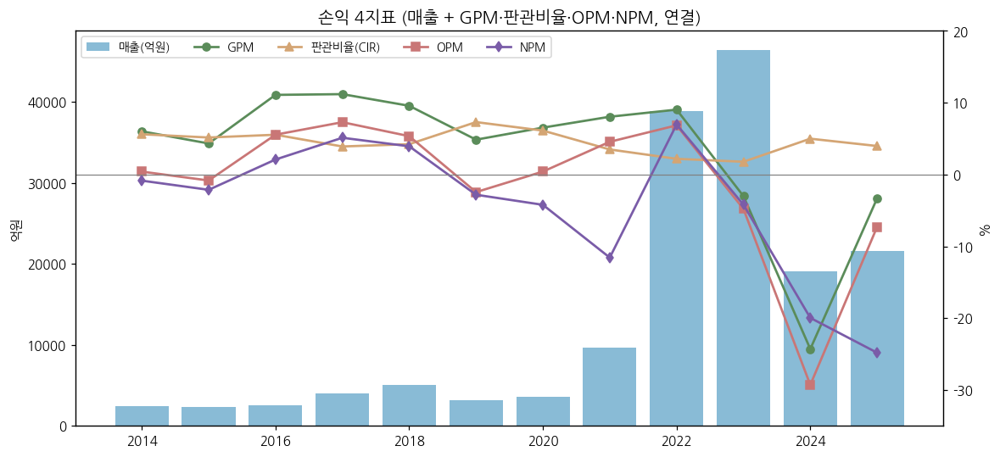

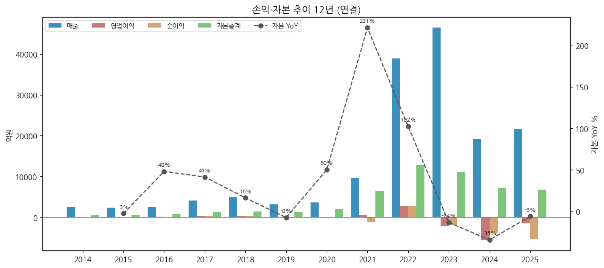

(3) 주가 역사 (20년)

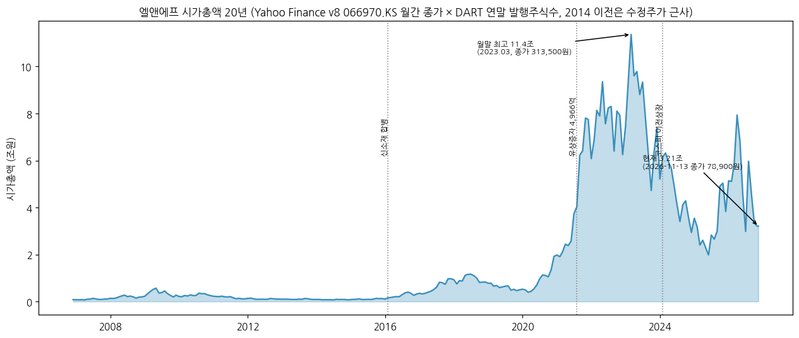

→ (출처: Yahoo Finance v8 066970.KS 월간 2006.11~2026.11 × DART 연말 발행주식수(2013 이전은 2014 무상증자 수정주가 × 1,420만주로 근사). 2016.02 합병·2020/2021 유증·2025 BW 행사 반영, 월 단위 근사 — **[추정 포함]**)

→ **2006~2015 BLU·소형전지 시절** — 시총 1,000~5,000억 박스 (2009 BLU 호황 국지 고점)

→ **2016~2020 원통형 하이니켈 1차 성장** — 신소재 합병 후 테슬라향 원통형 NCA/NCMA 밸류체인 편입, 시총 1조 내외 (2018 고점 후 2019 실적 저점에 조정)

→ **2020~2023.03 2차전지 슈퍼사이클** — 유상증자 2회에도 EV 수요·리튬가 급등으로 월말 시총 최고 **약 11.4조(2023.03, 종가 313,500원)**, 장중 ATH 349,500원(2023.04)

→ **2023.04~2025.06 캐즘·역래깅 하락** — 리튬가 급락 + 4Q23~2Q25 7분기 연속 적자, 2025.06 월말 종가 49,300원(시총 약 1.8조)

→ **2025.07~2026.05 반등** — 3Q25 흑자전환·Ni95 단독공급·LFP 수주, 2026.05 장중 225,000원(52주 고점)

→ **2026.06~11 재하락** — 2026.07 장중 63,000원(52주 저점) → 8월 반등 → 3Q26 영업적자(-265억) 전후 하락, **2026-11-13 종가 78,900원·시총 약 3.21조** (ATH 대비 -77%)

(4) 주요 연혁 (DART 사업보고서 연혁·합병·증자 사항 + 회사 보도자료)

| 시기 | 내용 |
|---|---|
| 2000.07 | ㈜엘앤에프 설립 (TFT-LCD BLU 부품, LG.Philips LCD 납품) |
| 2003.01 | 코스닥 상장 |
| 2009.02 / 05 | 무석광미래신재료 양극재 양산 개시 / ㈜엘앤에프신소재 통해 양극재 납품 |
| 2011.01 | 제이에이치화학공업(전구체) 설립 |
| **2013.01** | **TFT-LCD BLU 생산 중단 → 양극재 전업** |
| 2014.05 | 주주배정 유상증자 2,060,656주 + 무상증자 1,838,841주 |
| **2016.02** | **㈜엘앤에프신소재 흡수합병** (합병신주 6,484,223주), 이봉원·최수안 공동대표 |
| 2016.05 | 제3자배정 유상증자 2,171,552주 (9,210원) |
| 2018.03 | 대표이사 허제홍 |
| 2020.08 | 주주배정 유상증자 3,300,000주 (25,050원) |
| 2020.12 | LG에너지솔루션 양극재 공급계약 1조 4,547억 (2년) |
| 2021.02 | RCPS·3회 CB·4회 BW 발행 (대신-MYW), 대표이사 최수안 |
| 2021.04 | SK이노베이션 EV용 NCM 양극재 공급계약 1조 2,176억 |
| **2021.07** | **주주배정 유상증자 6,500,000주 (76,400원, 약 4,966억)** |
| 2021.11 | 5회 CB 1,000억 (악셀1호) |
| 2022.02 | 3회 CB·4회 BW·RCPS 전량 보통주 전환 |
| 2022.03 | 대구 이곡동 본점 이전 |
| 2023.02 | 테슬라 하이니켈 양극재 공급계약 (당초 3조 8,347억, 2024~2025) — 기납품 97억으로 종료(2025말 DART) |
| 2023.04 | 해외 교환사채 발행 (자기주식 교환, 교환가 438,100원, 만기 2030.04) / 무석 법인 생산 중단 |
| **2024.01.29** | **유가증권시장 이전상장** |
| 2024.03 / 04 | SK온 하이니켈 양극재 13조 1,910억(~2030) / 유럽 고객 9조 2,383억(2025~2030) 장기계약 |
| 2024.09 | 46파이용 Ni95 단결정 양극재 세계 최초 양산 (보도자료) |
| 2024.12 | 해외 EB 만기 전 취득·소각 (최대 1,700억, 권면 잔액 4,908.66억) |
| 2025.01 | 6회 CB 1,000억 (IMM PE 악셀1호) / 5회 CB 장외매수 취득 |
| 2025.03 | 하이니켈 양극재 공급계약 3조 5,184억 (고객·납기 비공개) |
| 2025.07 | SK온과 LFP 양극재 공급 MOU, LFP 신설법인 설립 결정 |
| 2025.08 / 09 | ㈜엘앤에프플러스 설립 / **7회 공모 분리형 BW 3,000억** (행사가 50,002원) |
| 2025.12 | 대표이사 허제홍 복귀, 자기주식 1,000,000주 처분 (1,223억, Hi-Ni·LFP 투자재원) |
| 2026.02 | 자기주식 추가 처분 (약 50만주 — IR페이지 자사주 1,238,611주로 감소) |
| 2026.03 | 정관 변경 (사업목적 추가, 발행예정주식·사채 한도), 단일판매·공급계약 공시 |
| 2026.2Q~3Q | LFP 1단계 3만톤 공장 준공 → 3Q 말 북미 ESS향 LFP 공급 개시 |
| 2026.09~11 | LFP 공급계약 공시 (2026.09.17·2026.11.03 등) — 국내 셀 3사 + 해외 1사, ESS 약 100GWh 물량 (3Q26 보도자료) |

---

## ③ 비즈니스 모델

(1) 실적 추이 통합 표 (단일 사업부 — 3단계 위계: 전사 / 제품군(Hi-Ni·Mid-Ni·LFP) / 지역(수출·내수))

**(1-1) 연간 (억원)**

| 구분 | 2021 | 2022 | 2023 | 2024 | 2025 | 1~3Q26 |
|---|---|---|---|---|---|---|
| 연결 매출 | 9,708 | 38,873 | 46,441 | 19,075 | 21,549 | 24,990 |
| 연결 영업이익 | 443 | 2,663 | -2,223 | -5,587 | -1,568 | 1,116 |
| OPM | 4.6% | 6.9% | -4.8% | -29.3% | -7.3% | 4.5% |
| 수출 매출 | 9,558 | 38,731 | 45,607 | 18,996 | 21,470 | [미공시] |
| 내수 매출 | 150 | 142 | 834 | 78 | 79 | [미공시] |
| 수출 비중 | 98.5% | 99.6% | 98.2% | 99.6% | 99.6% | - |
| 출하량 YoY | - | - | +4.4% (IR) | 감소 (3Q24 저점) | **+34%** (Hi-Ni +75%) | 2026E NCM **+40%** |
| 재고평가손익 (주요 공시분) | - | - | 4Q -2,508 / 3Q -100 | 1Q -832, 4Q 손실 추가 [금액 미확보] | 3Q 환입 [금액 미확보], 4Q 환입 약 +779 | 1Q 환입 +926 / 2Q -140 / 3Q -426 |

→ (출처: 매출·OP = OpenDART 연결 / 수출·내수 = DART 각 사업보고서 매출실적 / 출하량·재고평가 = 회사 IR·보도자료(4Q23 IR p.5~6, 1Q24·4Q24·2Q25·3Q25·4Q25 보도자료, 1Q26·2Q26·3Q26 IR p.4), 4Q25 환입 779억은 디지털데일리 2026-02-06)
→ **제품군별 매출·판매량 톤수·ASP 절대값은 회사가 "가격경쟁력·정보유출 우려"로 미공시** (DART 주요 제품 가격변동추이·생산능력 항목) — 아래 (1-2)는 IR의 비율·증감률만 기재

**(1-2) 제품 믹스·출하·판가 (회사 IR, 분기)**

| 분기 | 출하량 QoQ | Hi-Ni / Mid-Ni 출하 비중 | Hi-Ni 내 Ultra Hi-Ni(Ni95) / NCMA90 | Blended ASP QoQ | 비고 |
|---|---|---|---|---|---|
| 3Q23 | -7% | [미확보] | NCMA90 + NCM523 동반 감소 | 하락 | 재고평가 -100억, 역래깅 |
| 4Q23 | -43% | [미확보] | - | -2% (NCMA -3%, NCM523 -14%) | 재고평가 -2,508억 |
| 1Q24 | 증가 (NCMA90 대폭) | [미확보] | NCMA90 주력 | 하락 | 재고평가 -832억 |
| 2Q24 | +3% | [미확보] | 4680용 Ni95 단결정 양산 준비 | 하락 | 하반기 ASP -8% 전망 |
| 3Q24 | 큰 폭 감소 ("보릿고개") | [미확보] | NCMA90 → NCMA95 전환 대기 | 하락 | 46파이 Ni95 양산 개시 |
| 4Q24 | +11% | [미확보] | - | - | NCM523·원재료 재고평가손실 추가 |
| 2Q25 | **+55%** | [미확보] | Ni95 단독 공급 | 하락 (6월 원재료 최저) | 환율 하락 부담 |
| 3Q25 | **+38.7%** (Hi-Ni +33%, Mid-Ni +76%) | [미확보] | Ni95 | 하락 | 원재료 반등 환입, 구제품 단종 일회성 |
| 4Q25 | 약 +2% (가이던스) | - | 46파이 신규고객 출하 개시 | 상승 | 환입 약 779억 |
| 1Q26 | **+12%** (YoY +124%) | **87 / 13** | **88 / 12** | **+4%** | 환입 926억 |
| 2Q26 | **+8%** (YoY +62%, 분기 최대) | **88 / 12** | **87 / 13** | **+12%** | 재고평가 -140억, LFP 초기비용 -40억 |
| 3Q26 | **-5%** (NCM, YoY +10%) | **90 / 10** | Ultra Hi-Ni 단독 + 46파이 | **+7%** (Hi-Ni +7%, Mid-Ni +6%) | 재고평가 -426억, 환율 손실 약 -220억 |

→ (출처: 각 분기 회사 IR 실적발표 PDF·보도자료. 1Q25 보도자료는 irgo에 미게시 → 1Q25 행 [미확보])

**(1-3) 매출처 집중도 (DART 사업보고서, 매출 10% 이상 외부고객)**

| 연도 | 2013 | 2015 | 2017 | 2019 | 2020 | 2021 | 2022 | 2023 | 2024 | **2025** |
|---|---|---|---|---|---|---|---|---|---|---|
| 고객1 | 70.2% | 78.2% | 63% | 64% | 59% | 75% | 80% | 77% | 85% | **88%** |
| 고객2 | 26.3% | 20.2% | 23% (고객3 12%) | 29% | 32% | 15% | 15% | 15% | 10% | **12%** |

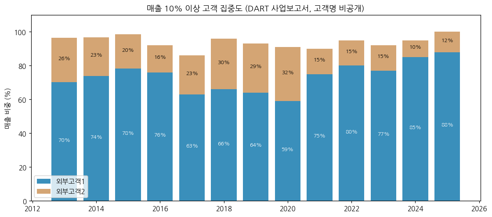

(2) 분기 시계열 (단일 사업부 → 전사 연결 = 양극재 사업)

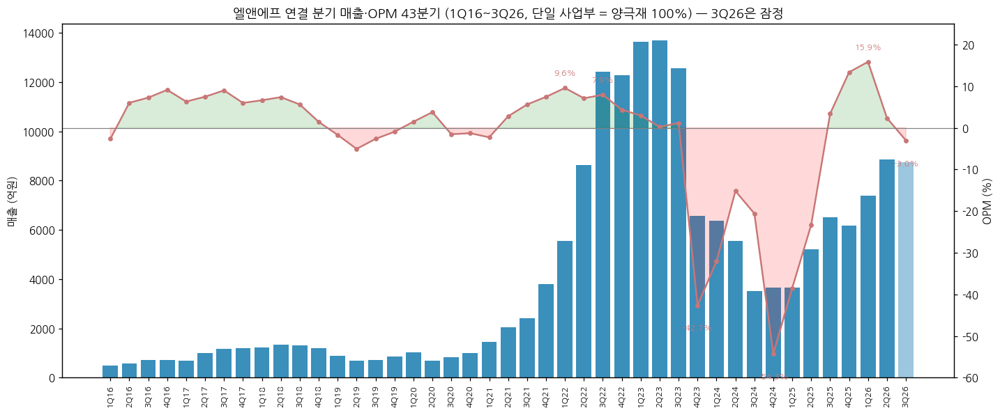

**(2-0) 연결 분기 매출 / 영업이익 / OPM — 43분기 (억원)**

| 연도 | 1Q 매출 / OP / OPM | 2Q | 3Q | 4Q | 연간 OPM |
|---|---|---|---|---|---|
| 2016 | 489 / -13 / -2.7% | 582 / 35 / 6.0% | 703 / 51 / 7.3% | 724 / 66 / 9.1% | 5.6% |
| 2017 | 682 / 43 / 6.3% | 1,003 / 75 / 7.5% | 1,158 / 104 / 9.0% | 1,187 / 71 / 6.0% | 7.3% |
| 2018 | 1,223 / 81 / 6.6% | 1,343 / 99 / 7.4% | 1,300 / 73 / 5.6% | 1,191 / 17 / 1.4% | 5.3% |
| 2019 | 877 / -15 / -1.7% | 692 / -35 / -5.1% | 714 / -19 / -2.7% | 850 / -8 / -0.9% | -2.4% |
| 2020 | 1,020 / 15 / 1.5% | 691 / 26 / 3.8% | 842 / -13 / -1.5% | 1,008 / -13 / -1.3% | 0.4% |
| 2021 | 1,445 / -33 / -2.3% | 2,054 / 57 / 2.8% | 2,407 / 135 / 5.6% | 3,801 / 283 / 7.4% | 4.6% |
| 2022 | 5,536 / 530 / 9.6% | 8,628 / 613 / 7.1% | 12,425 / 987 / 7.9% | 12,284 / 533 / 4.3% | 6.9% |
| 2023 | 13,629 / 404 / 3.0% | 13,682 / 30 / 0.2% | 12,554 / 148 / 1.2% | 6,576 / -2,805 / -42.7% | -4.8% |
| 2024 | 6,357 / -2,038 / -32.1% | 5,548 / -842 / -15.2% | 3,516 / -724 / -20.6% | 3,653 / -1,982 / -54.3% | -29.3% |
| 2025 | 3,648 / -1,403 / -38.5% | 5,201 / -1,212 / -23.3% | 6,523 / 221 / 3.4% | 6,178 / 825 / 13.4% | -7.3% |
| 2026 | 7,396 / 1,173 / 15.9% | 8,850 / 208 / 2.4% | 8,744 / -265 / -3.0% [잠정] | - | 1~3Q 4.5% |

→ (출처: 1Q16~2Q26 OpenDART 분기 연결 IS 3개월값, 4Q = 연간 − 3Q 누적(dart_quarterly_summary). **3Q26 = 2026-11-05 연결 잠정실적 공정공시(매출 8,744 / OP -265 / 순이익 -327 / 지배 -341억)**, 분기보고서 공시 후 확정치로 교체 예정)
→ 잠정 vs 확정 차이 이력: 4Q22 IR 12,249 → DART 12,284 / 4Q24 OP 보도자료 -1,498 → DART -1,982 / 2024 OP -5,102 → -5,587

**(2-1) 분기 재무건전성 — 부채비율·유동비율·순차입금 (연결, 억원)**

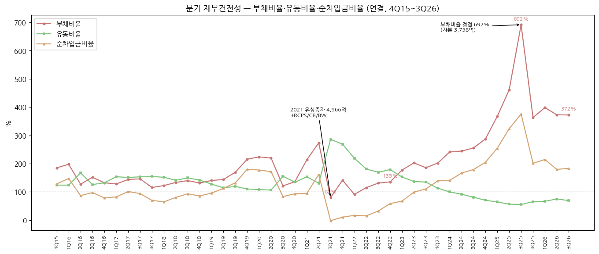

| 분기 | 자산 | 부채 | 자본 | 현금 | 차입금+사채 | 순차입금 | 부채비율 | 유동비율 | 순차입금비율 |
|---|---|---|---|---|---|---|---|---|---|
| 4Q22 | 30,239 | 17,386 | 12,853 | 1,202 | 8,711 | 7,509 | 135% | 179% | 58% |
| 1Q23 | 34,759 | 22,221 | 12,538 | 2,245 | 10,671 | 8,426 | 177% | 152% | 67% |
| 2Q23 | 40,684 | 27,237 | 13,447 | 4,000 | 17,312 | 13,312 | 203% | 136% | 99% |
| 3Q23 | 39,826 | 25,865 | 13,961 | 3,333 | 18,697 | 15,365 | 185% | 135% | 110% |
| 4Q23 | 33,514 | 22,415 | 11,100 | 2,413 | 17,808 | 15,395 | 202% | 113% | 139% |
| 1Q24 | 34,015 | 24,045 | 9,970 | 4,184 | 18,216 | 14,032 | 241% | 100% | 141% |
| 2Q24 | 31,716 | 22,505 | 9,211 | 3,925 | 19,262 | 15,337 | 244% | 92% | 167% |
| 3Q24 | 30,026 | 21,575 | 8,451 | 3,697 | 18,812 | 15,114 | 255% | 81% | 179% |
| 4Q24 | 27,998 | 20,765 | 7,233 | 2,795 | 17,595 | 14,799 | 287% | 70% | 205% |
| 1Q25 | 28,602 | 22,483 | 6,119 | 3,051 | 18,631 | 15,580 | 367% | 64% | 255% |
| 2Q25 | 28,082 | 23,081 | 5,001 | 1,476 | 17,660 | 16,184 | 462% | 56% | 324% |
| 3Q25 | 29,756 | 25,998 | 3,758 | 3,157 | 17,276 | 14,118 | 692% | 55% | 376% |
| 4Q25 | 31,341 | 24,573 | 6,768 | 3,829 | 17,443 | 13,614 | 363% | 65% | 201% |
| 1Q26 | 33,516 | 26,792 | 6,724 | 2,589 | 17,010 | 14,421 | 398% | 66% | 214% |
| 2Q26 | 36,845 | 29,051 | 7,794 | 3,606 | 17,589 | 13,983 | 373% | 75% | 179% |
| 3Q26 | 35,315 | 27,838 | 7,477 | 2,825 | 16,528 | 13,703 | 372% | 69% | 183% |

→ (출처: 4Q15~1Q26 OpenDART 연결 BS, 차입금+사채 = 단기·장기·유동성장기차입금 + 전환·교환·신주인수권부사채 계정 합. **2Q26·3Q26 = 회사 3Q26 IR p.9 요약 재무상태표**(금융기관 차입금 + 채권 장부금액; 2Q26 OpenDART는 단기차입금 계정 누락으로 IR 값 사용). 순차입금비율 = 순차입금/자본총계)
→ **3Q25 자본 3,758억·부채비율 692%가 재무 최저점** → 4Q25 7회 BW 행사(신주 약 400만주)·자사주 처분 1,223억으로 자본 6,768억 회복
→ 회사 정의 차입금 의존도: 3Q25 58.1% → 3Q26 46.8% (회사 3Q26 IR p.9)

**(2-2) 메자닌 잔액 (2026.06말 DART 반기보고서 + 3Q26 IR)**

| 증권 | 발행 | 만기 | 권면 / 잔액 | 행사·교환가 | 상태 |
|---|---|---|---|---|---|
| 해외 교환사채 (자사주 대상) | 2023.04.26 | 2030.04.26 | 잔액 **4,908.66억** (2024.12 일부 취득·소각 후) | 438,100원 | 유동성교환사채 4,040억(2025말 장부) |
| 6회 CB (악셀1호/IMM) | 2025.01.10 | 2030.01.10 | 1,000억 | 103,974원 | 2025 CF상 전환사채 상환 2,010억(5·6회) — 2026.06 미상환 CB 목록에 없음 |
| **7회 공모 분리형 BW** | 2025.09.09 | 2030.09.09 | 3,000억 → 행사 후 미상환 **880억** | 50,002원 | 미행사 신주인수권 1,646,242주 (희석 잔여) |
| 회사채 (사모) | 2026.06.29 | 2029.06.29 | 400억 | - | 이자율 4.96% |

→ 채권 장부금액(EB·CB·BW) 합계: 3Q25 4,043억 → 3Q26 **4,197억** / 주식연계 파생부채 3Q26 2,902억 (회사 3Q26 IR p.9)

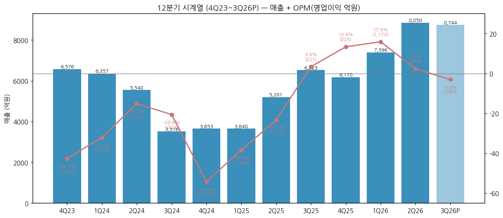

| 분기 | 매출 | 매출 YoY | OP | OPM | 순이익 |
|---|---|---|---|---|---|
| 4Q23 | 6,576 | -46.5% | -2,805 | -42.7% | -2,847 |
| 1Q24 | 6,357 | -53.4% | -2,038 | -32.1% | -1,117 |
| 2Q24 | 5,548 | -59.5% | -842 | -15.2% | -744 |
| 3Q24 | 3,516 | -72.0% | -724 | -20.6% | -770 |
| 4Q24 | 3,653 | -44.4% | -1,982 | -54.3% | -1,177 |
| 1Q25 | 3,648 | -42.6% | -1,403 | -38.5% | -1,112 |
| 2Q25 | 5,201 | -6.3% | -1,212 | -23.3% | -1,126 |
| 3Q25 | 6,523 | +85.5% | 221 | 3.4% | -1,183 |
| 4Q25 | 6,178 | +69.1% | 825 | 13.4% | -1,926 |
| 1Q26 | 7,396 | +102.7% | 1,173 | 15.9% | -653 |
| 2Q26 | 8,850 | +70.2% | 208 | 2.4% | 529 |
| 3Q26 [잠정] | 8,744 | +34.0% | -265 | -3.0% | -327 |

(3) 제품·사업 디테일 (출하 비중 큰 순서)

(3-1) **Ultra Hi-Ni (Ni95 NCMA) — 출하의 약 77~79%** [계산: Hi-Ni 87~90% × Ultra 87~88%, 1Q26~2Q26 IR]
→ 니켈 95% NCMA 세계 최초 개발·양산 (DART 사업의 내용) — 원통형 2170용(테슬라향 셀로 추정) **단독 공급** 지속 (회사 IR)
→ **46파이 원통형** — 2024.09 Ni95 단결정 세계 최초 양산, 2025말 북미 신규 고객 출하 개시(리비안향 셀 — 디지털데일리 보도), 2026 출하의 약 6% → **2027 NCM 출하의 약 40%** 전망 (4Q25·3Q26 보도자료). 로봇·방산·UAM 신규 애플리케이션 (2026.2Q 미국 방산 고객 확보)

(3-2) **NCMA90 등 기존 하이니켈 — 약 10%**
→ Ultra Hi-Ni로 단계적 대체 중 (1Q26 IR "향후 NCMA90 → Ultra Hi-Ni 전량 대체 예정")

(3-3) **Mid-Ni (NCM523 등) — 10~13%**
→ 유럽 EV·ESS향. 2023~2024 **판매 손실 집중 품목** (2023 NCM523 판매손실 연간 약 -1,800억, 4Q23 IR p.6) → 2024 원가 절감으로 손익 개선, 2025 유럽 수요 회복으로 3Q25 출하 +76%

(3-4) **LFP — 2026.3Q 양산 개시 (신규 성장축)**
→ ㈜엘앤에프플러스 대구 공장 1단계 3만톤 → 2027 상반기 6만톤. "Non-FEOC(비중국) 최초 LFP 대량 양산" 포지션, 북미 ESS 타깃 (4Q24·1Q26 보도자료)
→ 수주: 국내 셀 3사 + 해외 1사 중장기 계약, ESS 기준 약 100GWh — 2027 약 5만톤, 2028 6만톤+ (Full Capa), 2028부터 연 3만톤+ 추가 물량 (3Q26 보도자료·IR p.7)
→ 자금: 국민성장펀드 첨단전략산업기금 활용 LFP 투자 (3Q26 IR p.5), 무전구체 LFP 공법 개발 중

(4) 주요 경쟁사

| 제품 | 국내 | 해외 |
|---|---|---|
| 하이니켈 NCA/NCMA (원통형) | 에코프로비엠 (NCA, 삼성SDI), 포스코퓨처엠 | Sumitomo Metal Mining (파나소닉향 NCA), Umicore |
| NCM (파우치·각형) | 에코프로비엠, 포스코퓨처엠, LG화학, 코스모신소재 | Ronbay(容百), B&M(巴莫, 화유코발트), Easpring(当升) |
| LFP | 포스코퓨처엠(2026 하반기 양산 예정) | 후난위넝(湖南裕能), Dynanonic(德方纳米) 등 중국 업체가 시장 장악 |

→ (2023 삼원계 출하 순위는 ① (2) 참조, SNE리서치. LFP 전 세계 점유율 수치는 [미확보])

(5) 주요 매출처

→ DART는 고객명 비공개("외부고객1·2") — 2025 고객1 **88%**, 고객2 **12%**
→ 공시 계약 상대방 (DART 주요계약): **LG에너지솔루션**(2020.12, 1.45조) / **SK이노베이션**(2021.04, 1.22조) / **Tesla**(2023.02, 사실상 미이행 종료) / **SK온**(2024.03, 13.19조, ~2030) / 비공개 유럽 고객(2024.04, 9.24조) / 비공개(2025.03, 3.52조)
→ **고객1 = LG에너지솔루션(테슬라향 원통형 셀) 가능성이 높음 [추정 — DART 비공개, 2020 LGES 계약·원통형 단독공급 맥락 기반]**. 고객2는 SK온 또는 유럽향 [추정]
→ LFP: 국내 셀 3사(LGES·삼성SDI·SK온) 모두와 공급계약 (3Q26 보도자료 "한국 배터리 3社 모두와 LFP 공급계약")

(6) 생산 CAPA + 임직원 추이

→ **생산능력·가동률·출하 톤수: 회사 미공시** (DART 2025 사업보고서 "기술·정보유출 우려로 상세 표기하지 않음")
→ 사업장: 대구 본사·구지 1·2·3공장 (구지2 Phase2 2023.2Q 가동, 구지3 하이니켈 46파이 라인 배정 — IR), 김천(제이에이치화학), 대구 국가산단(엘앤에프플러스 LFP)
→ 유형자산 장부가: 2025말 1조 3,257억 (대구 토지 1,204억·건물 3,564억·기계장치 4,535억 등 — DART 생산설비 현황)
→ 출하량 참고: 2023 삼원계 출하 **8.6만톤** (SNE리서치) — 회사 자체 공시 톤수는 [미공시]

**임직원 (연결, DART 각 사업보고서)**

| 연도 | 2019 | 2020 | 2021 | 2022 | 2023 | 2024 | 2025 |
|---|---|---|---|---|---|---|---|
| 직원 수 | 576 | 651 | 1,021 | [미추출] | 1,782 | 1,643 | **1,924** |

→ 2024 감소 = 다운사이클 인력 조정, 2025 LFP 법인 설립으로 재증가. 2025 1인 평균 급여 약 5,400만원 [계산: 연간급여 총액 1,045억 / 1,924명]

---

## ④ 재무 구조 (12년 연결, OpenDART)

(1) 손익계산서

| 연도 | 매출 | 매출총이익 | 판관비 | 영업이익 | 세전이익 | 순이익 | GPM | 판관비율 | OPM | NPM |
|---|---|---|---|---|---|---|---|---|---|---|
| 2014 | 2,457 | 148 | 138 | 10 | -16 | -21 | 6.0% | 5.6% | 0.4% | -0.9% |
| 2015 | 2,351 | 102 | 121 | -20 | -49 | -50 | 4.3% | 5.2% | -0.8% | -2.1% |
| 2016 | 2,497 | 277 | 138 | 139 | 68 | 52 | 11.1% | 5.5% | 5.6% | 2.1% |
| 2017 | 4,030 | 451 | 157 | 294 | 186 | 206 | 11.2% | 3.9% | 7.3% | 5.1% |
| 2018 | 5,057 | 484 | 214 | 270 | 259 | 199 | 9.6% | 4.2% | 5.3% | 3.9% |
| 2019 | 3,133 | 152 | 229 | -77 | -107 | -88 | 4.9% | 7.3% | -2.4% | -2.8% |
| 2020 | 3,561 | 233 | 218 | 15 | -179 | -150 | 6.5% | 6.1% | 0.4% | -4.2% |
| 2021 | 9,708 | 781 | 339 | 443 | -1,256 | -1,123 | 8.0% | 3.5% | 4.6% | -11.6% |
| 2022 | 38,873 | 3,514 | 851 | 2,663 | 3,405 | 2,710 | 9.0% | 2.2% | 6.9% | 7.0% |
| 2023 | 46,441 | -1,396 | 827 | -2,223 | -2,957 | -1,949 | -3.0% | 1.8% | -4.8% | -4.2% |
| 2024 | 19,075 | -4,635 | 952 | -5,587 | -5,195 | -3,807 | -24.3% | 5.0% | -29.3% | -20.0% |
| 2025 | 21,549 | -712 | 856 | -1,568 | -5,678 | -5,347 | -3.3% | 4.0% | -7.3% | -24.8% |

→ 단위 억원. 판관비 = 매출총이익 − 영업이익 [계산]. 2014는 2015 사업보고서 전기 금액
→ **2023~2025 매출총이익 적자** = 역래깅 + 재고평가손실이 매출원가로 인식되는 구조 (2024 GPM -24.3%)
→ **2021·2025 NPM ≪ OPM**: 2021 금융비용 1,815억(CB·RCPS 파생상품평가손실 1,679억 — DART 2021 주석), 2025 영업외손익 -4,109억(파생평가 -1,279억, BW 행사손실 -1,364억 — 3Q26 IR p.8)

(2) 재무상태표

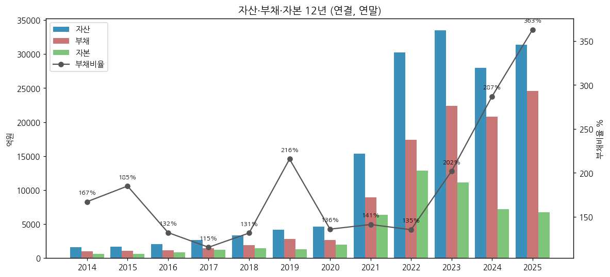

| 연도 | 자산 | 부채 | 자본 | 지배주주지분 | 현금성자산 | 차입금+사채 | 순차입금 | 재고자산 | 부채비율 | 유동비율 |
|---|---|---|---|---|---|---|---|---|---|---|
| 2014 | 1,627 | 1,018 | 609 | 550 | 61 | 652 | 591 | 350 | 167% | 107% |
| 2015 | 1,684 | 1,093 | 591 | 503 | 63 | 819 | 756 | 373 | 185% | 124% |
| 2016 | 2,027 | 1,153 | 874 | 877 | 71 | 757 | 686 | 638 | 132% | 132% |
| 2017 | 2,655 | 1,422 | 1,233 | 1,214 | 223 | 1,082 | 859 | 846 | 115% | 154% |
| 2018 | 3,310 | 1,880 | 1,430 | 1,406 | 114 | 1,333 | 1,219 | 1,213 | 131% | 141% |
| 2019 | 4,162 | 2,844 | 1,318 | 1,294 | 8 | 2,379 | 2,371 | 1,386 | 216% | 110% |
| 2020 | 4,662 | 2,686 | 1,976 | 1,944 | 212 | 2,055 | 1,843 | 1,053 | 136% | 134% |
| 2021 | 15,322 | 8,970 | 6,352 | 6,308 | 2,718 | 3,364 | 646 | 2,615 | 141% | 269% |
| 2022 | 30,239 | 17,386 | 12,853 | 12,797 | 1,202 | 8,711 | 7,509 | 12,277 | 135% | 179% |
| 2023 | 33,514 | 22,415 | 11,100 | 10,972 | 2,413 | 17,808 | 15,395 | 11,634 | 202% | 113% |
| 2024 | 27,998 | 20,765 | 7,233 | 7,136 | 2,795 | 17,595 | 14,799 | 5,746 | 287% | 70% |
| 2025 | 31,341 | 24,573 | 6,768 | 6,731 | 3,829 | 17,443 | 13,614 | 5,949 | 363% | 65% |

→ 단위 억원. 차입금+사채 = 단기·장기차입금 + 유동성장기차입금 + CB·EB·BW 장부금액
→ 2021 유동비율 269% = 유상증자 현금, 2022 재고 1.23조(EV 수요 정점 + 메탈가 고점 매입) → 2023~2024 재고평가손실의 원천
→ **2024~2025 유동비율 70%·65%** — 유동성교환사채(4,040억)·단기차입금(7,810억)이 유동부채에 집중

(3) 현금흐름표

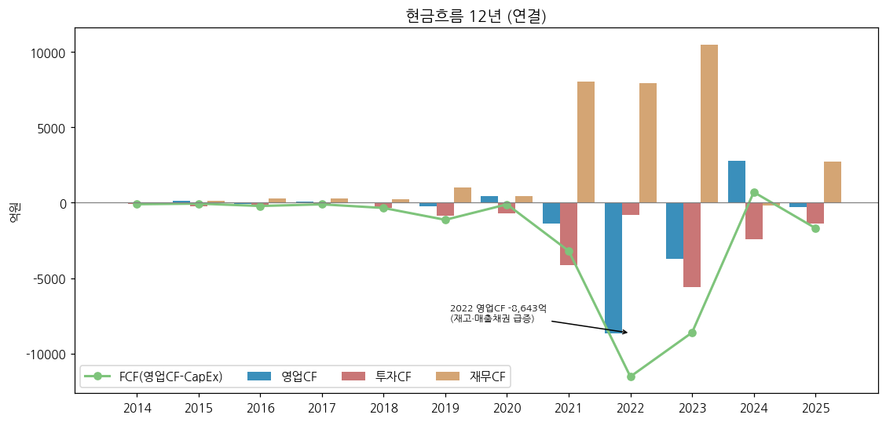

| 연도 | 영업CF | 투자CF | 재무CF | CapEx(유형+무형) | FCF | 감가상각비 | 배당금지급 |
|---|---|---|---|---|---|---|---|
| 2014 | -32 | -62 | 46 | 69 | -100 | 75 | 2 |
| 2015 | 116 | -217 | 104 | 175 | -59 | 76 | 3 |
| 2016 | -89 | -170 | 268 | 126 | -216 | 80 | 3 |
| 2017 | 66 | -177 | 273 | 171 | -105 | 84 | 10 |
| 2018 | -28 | -325 | 248 | 319 | -348 | 91 | 21 |
| 2019 | -253 | -880 | 1,027 | 880 | -1,133 | 100 | 22 |
| 2020 | 453 | -708 | 464 | 560 | -107 | 123 | 11 |
| 2021 | -1,381 | -4,136 | 8,019 | 1,815 | -3,196 | 190 | 12 |
| 2022 | -8,643 | -821 | 7,953 | 2,890 | -11,533 | 297 | 0 |
| 2023 | -3,746 | -5,613 | 10,501 | 4,863 | -8,610 | 442 | 171 |
| 2024 | 2,805 | -2,399 | -202 | 2,101 | 704 | 605 | 0 |
| 2025 | -292 | -1,377 | 2,729 | 1,394 | -1,686 | 820 | 0 |
| 1~3Q26 누적 (IR) | 858 | -1,634 | -88 | 1,605 | -747 | 610 | 0 |

→ 단위 억원. CapEx = 유형자산 취득 + 무형자산 취득, FCF = 영업CF − CapEx [계산]. 1~3Q26은 회사 3Q26 IR p.10(누적)
→ **12년 중 FCF 양(+)은 2024년 1회뿐** (재고 축소로 영업CF +2,805억) — 성장 투자는 전량 외부 조달(유증·메자닌·차입)에 의존
→ 2022 영업CF -8,643억 = 매출 4배 성장에 따른 재고·매출채권 급증 (운전자본 소요가 큰 사업 구조)

(4) CapEx

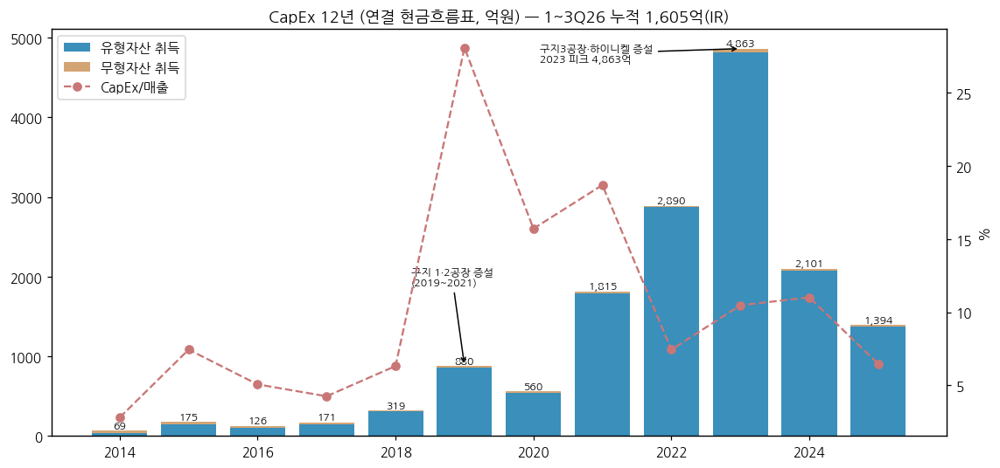

→ 2014~2018 연 100~300억 → 2019 880억(구지 1공장) → 2021 1,815억 → **2023 4,863억(피크, 구지 2·3공장)** → 2024 2,101억 → 2025 1,394억 → **1~3Q26 1,605억(LFP 공장)** (회사 IR)
→ 사이클 annotation: 2019~2021 EV 1차 증설 / 2022~2023 하이니켈 대규모 증설(리튬 사이클 정점과 겹침) / 2026 LFP 신규 투자
→ 2025말 유·무형자산 1조 3,403억 (DART 부문 재무정보)

(5) 부채구조 + 채무증권 발행 history

| 항목 | 2021 | 2022 | 2023 | 2024 | 2025 | 3Q26 |
|---|---|---|---|---|---|---|
| 차입금+사채 (억) | 3,364 | 8,711 | 17,808 | 17,595 | 17,443 | 16,528 |
| 현금성자산 (억) | 2,718 | 1,202 | 2,413 | 2,795 | 3,829 | 2,825 |
| 순차입금 (억) | 646 | 7,509 | 15,395 | 14,799 | 13,614 | **13,703** |
| 금융비용 (억) | 1,815 | 260 | 1,058 | 2,444 | 4,305 | - |
| 이자비용 (억, CF 조정) | - | - | - | 1,064 | 1,168 | - |
| 이자보상배율 (OP/이자비용) | - | - | 음수 | 음수 (-5.3배) | 음수 (-1.3배) | - |

→ (출처: OpenDART 연결. 금융비용에는 파생상품평가손실 포함. 3Q26 = 회사 IR p.9)
→ **신용등급 추이**: 한국기업데이터/한국평가데이터 BBB(2020~2021) → BBB+(2023) → BBB-(2024.04) → **BB+(2025.04)** / 한국신용평가 BB0(2025.05) → **BB(2026.05)** / 나이스 BB+(2025.05·2026.05) — 투기등급 (DART 2026 반기보고서)
→ 채무증권: 해외 EB 4,908.66억(2023.04, 2.5%, J.P.Morgan 주관) / 7회 공모 BW 3,000억(2025.09, 1.0%) / 사모 회사채 400억(2026.06, 4.96%) — DART 채무증권 발행실적

(6) 배당·자사주

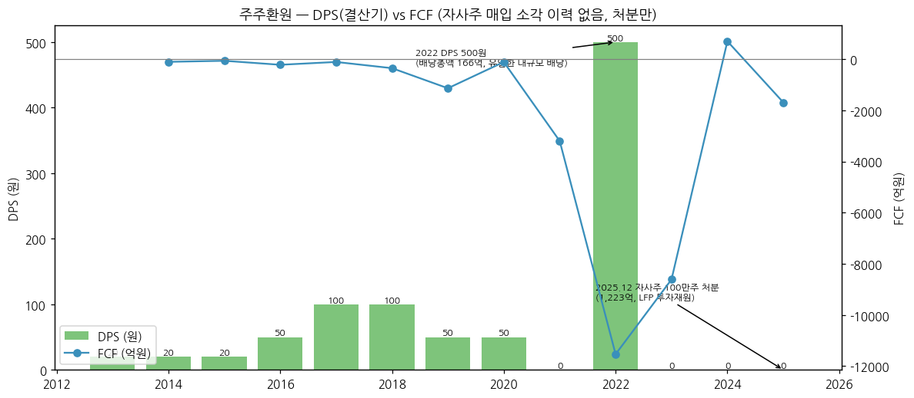

| 결산기 | DPS (원) | 비고 |
|---|---|---|
| 2013~2015 | 20 | - |
| 2016 | 50 | - |
| 2017~2018 | 100 | - |
| 2019~2020 | 50 | - |
| 2021 | 무배당 | - |
| **2022** | **500** | 배당총액 166억, 배당성향 6.16% (회사 IR페이지) |
| 2023~2025 | 무배당 | 적자 |

→ (출처: DART 각 연도 사업보고서 주요배당지표, 2025 dart_api 배당)
→ **자사주 매입·소각 이력 없음** — 자기주식은 2016 합병 시 전환분(3,538,231주)이 원천이며, 해외 EB 교환대상(2023)·**2025.12 100만주 처분(1,223억)**·2026.02 추가 처분으로 투자재원화 → 주주환원보다 **자금조달 수단**으로 활용
→ 7회 BW 미행사분 1,646,242주(발행주식의 약 4%)가 잔여 희석 요인

(7) 재무비율 (연결)

| 지표 | 2021 | 2022 | 2023 | 2024 | 2025 | 3Q26 |
|---|---|---|---|---|---|---|
| ROE (지배, 평균자본) | -27.4% | 28.3% | -16.4% | -41.7% | -77.0% | - |
| ROA (연결 NI/평균자산) | -11.2% | 11.9% | -6.1% | -12.4% | -18.0% | - |
| 부채비율 | 141% | 135% | 202% | 287% | 363% | 372% |
| 유동비율 | 269% | 179% | 113% | 70% | 65% | 69% |
| 순차입금비율 | 10% | 58% | 139% | 205% | 201% | 183% |
| 재고자산/매출 | 27% | 32% | 25% | 30% | 28% | - |

→ [계산] OpenDART 연결 기준. 2017·2018 ROE 19.0%·14.8%가 다운사이클 이전 정상 수준

---

## ⑤ 지배 구조

(1) 그룹·계열 관계

```
허제홍 (새로닉스 21.04%) ──┐
광성전자㈜ (새로닉스 19.64%) ┴─▶ ㈜새로닉스 (1968 설립, 구미, 디바이스·주방TV)
                                      │ 13.49%
                                      ▼
   + Kwang Sung Electronics Inc. 3.13% + 광성전자㈜ 1.44% + 허제홍 1.80% + 허제현 1.40% 등
                                      │ 최대주주 등 합계 22.08% (2026.06말)
                                      ▼
                              ㈜엘앤에프 (066970)
         ┌──────────────────┬──────────────┼──────────────┬────────────────┐
  제이에이치화학공업     광미래신재료(무석)    ㈜엘앤에프플러스     LLBS(LS 합작)      Mitra Chem
  (전구체, 종속)        (중국, 2023.04 생산중단) (LFP, 2025.08)   (공동기업, 전구체)  (북미 LFP, 145억 지분투자)
```

→ (출처: DART 2026 반기보고서 최대주주 현황·최대주주 개요, DART 2025 사업보고서 연결대상·공동기업, Mitra Chem 투자는 irgo 보도자료)

(2) 주주 구분

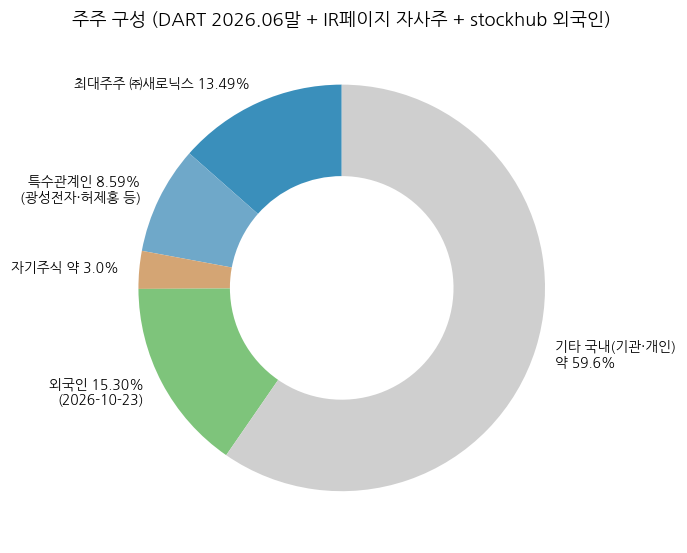

| 주주 | 2025말 | **2026.06말** | 비고 |
|---|---|---|---|
| ㈜새로닉스 | 13.64% | **13.49%** | 최대주주 (5,487,870주, 주식수 변동 없음 — BW 행사로 지분율 희석) |
| Kwang Sung Electronics Inc. | 3.16% | 3.13% | 특수관계법인 |
| 광성전자㈜ | 1.45% | 1.44% | 특수관계법인 |
| 허제홍 (대표이사) | 1.82% | 1.80% | 733,224주 |
| 허제현 (미등기임원) | 1.42% | 1.40% | 570,034주 |
| 기타 특수관계인 | 0.85% | 0.82% | 허자윤 0.51% 등 |
| **최대주주 등 합계** | **22.34%** | **22.08%** | 8,983,810주 |
| 자기주식 | 4.3% (1,738,611주) | 약 3.0% (1,238,611주, IR페이지) | 2025.12·2026.02 처분 |
| 외국인 | - | **15.30%** (2026-10-23, stockhub) | |
| 소액주주 | - | 66.41% (258,437명) | |
| 5% 이상 주주 | 새로닉스 외 없음 | 국민연금 등 5% 이상 기관 미기재 | |

(3) 임원·이사회

| 성명 | 직위 | 출생 | 주요 경력 |
|---|---|---|---|
| **허제홍** | 대표이사·이사회 의장 (사내) | 1976.11 | 연세대 화학공학, 美 USC 대학원, LG디스플레이 연구소 → ㈜새로닉스 대표이사. 2018.03~2021.03 대표, **2025.12.22 대표 복귀**. 보유 733,224주 |
| 최수안 | 부회장 (사내이사) | 1970.05 | KAIST 화학공학 박사, 킴벌리클라크, 헬싱키 경영경제대학원 MBA, 2021.03~2025.12 대표이사 |
| 유승헌 | 사장·CFO (사내이사) | 1965.01 | 한국외대, 조지워싱턴대 MBA, 신한금융지주 CFO·신한자산운용 CFO/CSO (보도자료 표기 "류승헌 CFO") |
| 김점수 | 독립이사·감사위원 | 1970.10 | IIT 화학공학 박사 |
| 김경희 | 독립이사 | - | 회계사 (경북대 회계학, 삼일회계법인 등) |
| 박기선 / 박우균 / 박성민 | 독립이사 | - | 위원회(내부거래·ESG·인사보상·리스크관리) 분담 |

→ 이사회 8인 (사내 3 / 독립 5). 미등기 허제현(前 사내이사, 지분 1.40%) (출처: DART 2026 반기보고서 임원 현황·이사회 활동)

---

## ⑥ 기타 팩트

(1) R&D 인프라

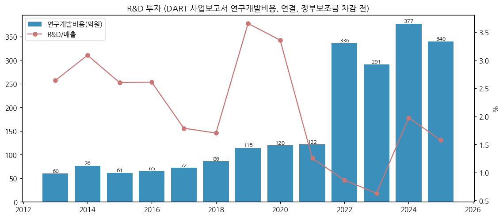

| 연도 | 2013 | 2014 | 2015 | 2016 | 2017 | 2018 | 2019 | 2020 | 2021 | 2022 | 2023 | 2024 | 2025 |
|---|---|---|---|---|---|---|---|---|---|---|---|---|---|
| 연구개발비용 (억) | 60 | 76 | 61 | 65 | 72 | 86 | 115 | 120 | 122 | 336 | 291 | 377 | **340** |
| R&D/매출 | 2.6% | 3.1% | 2.6% | 2.6% | 1.8% | 1.7% | 3.7% | 3.4% | 1.3% | 0.9% | 0.6% | 2.0% | **1.6%** |

→ (출처: DART 각 연도 사업보고서 연구개발비용(연결, 정부보조금 차감 전). 2016은 2016 보고서 65억 vs 2017 보고서 31억으로 불일치 — 당해 보고서 값 사용)
→ 매출 대비 R&D 1~2%대 — 피어 대비 낮은 편이나, Ni95 NCMA·46파이 단결정·LFP(무전구체 공법)·고전압 미드니켈 등 제품화 실적 중심 (DART 연구개발실적)

(2) 진행 중 corporate action (10년치 자본·M&A)

| 시기 | 내용 | 규모 |
|---|---|---|
| 2016.02 | 엘앤에프신소재 흡수합병 | 합병신주 6,484,223주 |
| 2016.05 | 제3자배정 유상증자 | 2,171,552주 × 9,210원 (약 200억) |
| 2020.08 | 주주배정 유상증자 | 3,300,000주 × 25,050원 (약 827억) |
| 2021.02 | RCPS + 3회 CB + 4회 BW (대신-MYW) | 460억 + 90억 + 300억 |
| 2021.07 | 주주배정 유상증자 | 6,500,000주 × 76,400원 (약 4,966억) |
| 2021.11 | 5회 CB | 1,000억 |
| 2023.04 | 해외 교환사채 (자사주) | 권면 잔액 4,908.66억 (2024.12 일부 매입소각 후) |
| 2025.01 | 6회 CB (IMM) | 1,000억 |
| 2025.08 | 엘앤에프플러스(LFP) 설립 | - |
| 2025.09 | 7회 공모 BW | 3,000억 (행사 누적 2,120억, 2026.06) |
| 2025.12 / 2026.02 | 자기주식 처분 | 100만주 1,223억 + 약 50만주 |
| 2025~ | LLBS(LS 합작 전구체), Mitra Chem(북미 LFP) 지분투자 | 공동기업 1,324억(2025말) / 145억 |

(3) R&D·사업 마일스톤 (10년치)

→ 2014.08 고출력 NCM 개발 / 2016~2019 원통형 하이니켈 NCA·NCMA 양산 (테슬라 밸류체인)
→ 2022 NCMA90 주력화, 2023.2Q 구지2공장 Phase2 가동
→ 2024 중반 LFP 배터리 국책과제 주관기관 선정, LFP 파일럿라인 (국내 유일)
→ **2024.09 46파이용 Ni95 단결정 세계 최초 양산** / 2025.1Q 2170용 Ni95 신제품
→ 2026.3Q **LFP 3만톤 양산·북미 ESS 공급 개시** / 2026.10 양극재 탄소발자국 국제표준 검증 (헤럴드경제 2026-10-11)

(4) 주요 리스크

→ **메탈가·환율 래깅 리스크** — 3Q26 원재료 재고평가손실 426억 + 환율 손실 약 220억으로 영업적자 전환 (회사 3Q26 IR p.4) — 분기 OPM이 -3%~+16% 사이에서 출렁임
→ **고객 집중** — 1위 고객 88% (2025). 해당 고객의 원통형 셀 수요·전략 변화(예: 테슬라 2170/4680 전략)가 곧 엘앤에프 출하
→ **재무 레버리지** — 순차입금 1.37조, 부채비율 372%, 유동비율 69% (3Q26), 신용등급 BB~BB+ (투기등급)
→ **메자닌 희석·파생손익** — 7회 BW 미행사 164만주, 해외 EB 4,909억(교환가 438,100원으로 현재 외가격) — 주가 변동 시 대규모 평가손익
→ **LFP 신사업 실행 리스크** — 중국 업체 대비 원가 경쟁력, 초기 가동비용(2Q26 40억), 북미 ESS 정책(FEOC 규정) 의존
→ **EV 캐즘 / 정책** — 미국 IRA 보조금 축소, 유럽 EV 수요 변동 (2025 DART MD&A 거시요인)
→ **소송·우발채무** — 본 버전 미조사 [다음 버전]

(5) ESG 등급

→ **KCGS(한국ESG기준원) 2025: 종합 B+** (전년 대비 1단계 상승) — E: B+ / S: A / G: B (C → B 상승) (벤처스퀘어 2025-11-21)
→ **서스틴베스트 2025 하반기: A등급** (2년 연속, ESG 베스트 컴퍼니 100) — 같은 기사
→ 지속가능경영보고서: 「2025 지속가능경영보고서」(5번째, 2026-06-30 발간, DART 자율공시) — Scope 1·2 2023 대비 약 35% 감축, RE100 2035·넷제로 2050(SBTi 기반), Scope3 첫 산정 (헤럴드경제·헬로티 기사 경유, **보고서 원문 PDF 미확보**)

(6) 인증·라이선스

→ ZWTL(폐기물 매립 제로) **플래티넘** — 양극재 업계 최초(2022), 3년 연속, 국내 전 사업장 인증 (구지3공장 포함)
→ 양극재 탄소발자국 국제표준 검증 (2026.10, EU 배터리 규제 대응)
→ ISO 인증(부패방지 등) 취득 — 세부 목록 [미확보]
→ 중견기업 해당 (DART)

---

## Version Log

| 버전 | 일자 | 내역 |
|---|---|---|
| v1.0 | 2026-11-14 | 첫 작성. OpenDART 연결 재무 43건(2015 FY~2Q26) + dart_quarterly_summary 41분기 + 3Q26 잠정(2026-11-05 공정공시), DART 정기보고서 공시원문 43건(2015~2026.06), dart_api 2025 FY 6종, 회사 IR PDF 12건(2021.4Q~2023.4Q irgo 9건 + 1Q26~3Q26 회사 IR페이지 3건), irgo 보도자료 10건(1Q24~3Q26), Yahoo v8 20년 월간, 시장 보조(stockhub·언론). 차트 14종(12종 표준 + chart2b 재무건전성·chart2c 고객집중도) |

**자료 audit (v1.0)**: ① DART 정기보고서 본문 ✅ (43건, EUC-KR 원문 포함 전수 텍스트화) / ② 첨부 ✅ (사업보고서 첨부 _00760·_00761 감사보고서 9개 연도 — 교차검증용) / ③ 회사 IR 실적발표 PDF ⚠️ 부분 (2021.4Q~2023.4Q + 1Q26~3Q26 = 12건, **1Q24~4Q25 8개 분기 PDF 미확보** → 보도자료 텍스트로 대체) / ④ 지속가능경영보고서 ⚠️ 원문 미확보 (언론 경유 수치) / ⑤ Yahoo 20년 시세 ✅ (066970.KS, KQ 404 — 이전상장 이력 통합) / ⑥ 시장 보조 ✅ (신용등급 DART, 외국인 stockhub, ESG 기사)

**잔여 보완 후보 (v1.1)**
→ 3Q26 분기보고서(11월 중순 공시) 확정치로 3Q26 [잠정] 교체 + 3Q26 지배자본·주식수 반영
→ 1Q24~4Q25 회사 IR PDF 8건 확보 (landf.irpage.co.kr 실적발표 목록은 POST 방식이라 Chrome 경유 필요) → 분기 재고평가손익·출하 증감률 빈칸([미확보]) 채우기
→ 지속가능경영보고서 2025 원문 PDF, 2022 직원 수, 독립이사 최신 명단, 소송·우발채무
→ 고객1·2 실명 관련 업계 자료 교차검증, LFP 시장점유율·피어 Umicore 분기 마진
