# 와이지엔터테인먼트 (YG Entertainment, KOSDAQ 122870) — 기업 개요 (v1.0)

> 마지막 update: 2026-11-15 작성 (2026 반기보고서 + **3Q26 잠정실적(2026-11-09 공시)** 반영, 3Q26 분기보고서는 미공시 → 분기 시계열 3Q26 = `[잠정]`)
> 입력 source: **OpenDART fnlttSinglAcntAll 연결재무제표(2015\~2Q26, 2014는 2015 사업보고서 전기 컬럼, 2026-11-15 조회)** + **DART 정기공시 원문 XML(사업·반기·분기보고서 2022.12\~2026.06, 기재정정 우선)** + OpenDART 기업개황·최대주주·임원·직원·배당·자기주식 JSON(2025 사업보고서) + Yahoo Finance v8 (2011-11 상장\~2026-11-13 월간·일간 시세) + 뉴스·셀사이드 보조
> ⚠️ 회사 IR 실적 PDF: irgo 경유 게시물 0건(실적발표 자료 미게시) → **사업부(매출 유형)별 분기 시계열 없음**. 매출 유형은 사업보고서·반기보고서의 연간/반기 표로 구성
> 갱신 주기: 매분기 (실적 리뷰 모드 호출 시)
> **Fact verify cutoff**: 2026-11-15 (주가 43,950원 = 2026-11-13 종가, Yahoo Finance / 시가총액 약 8,215억원 = 종가 × 보통주 18,691,049주 / 상장 후 최고가 109,800원 = 2025-08 장중(Yahoo 월간 고가, 2025-08-11 장중 102,900원 +10.4% 보도와 교차확인) / 2025-12-30 시가총액 1.29조원 stockanalysis.com)
> 워치리스트: **엔터 섹터 (대분류: 소비재) / 서브섹터 기획사** (watchlist.md 등록 완료, 메인 세션)

---

## 1. 기업 분류

- **Primary 분류: 사이클 (아티스트 활동·투어 사이클)** — 매출·이익이 핵심 IP(BIGBANG → BLACKPINK)의 앨범·월드투어 유무에 따라 2\~3년 주기로 급등락. 2023(투어 정산) OPM 15.3% → 2024 -5.6% → 2025 13.1%
- **Secondary 노트: 꿈 (신인 IP 세대교체)** — 베이비몬스터(2024 데뷔)·트레저·신인 보이그룹(2026-09 데뷔 예정)이 BLACKPINK 의존도를 낮출 수 있는지가 밸류의 옵션. 아직 검증 전 단계

### ① 정량 근거

**📊 Summary Box (12년, 2014\~2025):**

| 지표 | 값 |
|------|-----|
| 매출 CAGR (2014→2025, 11년) | **+12.0%** (2016 자회사 매출 확대 점프 포함) / 2020→2025 **+16.4%** |
| OPM 평균 (12년) | **8.3%** |
| OPM 정점 평균 | **14.5%** (2014 14.0% · 2021 14.2% · 2023 15.3%) |
| OPM 저점 평균 | **-2.4%** (2019 0.8% · 2024 -5.6%) |
| 사이클 주기 | 약 **2\~5년** (peak-to-peak 2014→2021→2023, 핵심 아티스트 컴백·투어 주기) |
| 사이클 회수 (12년) | 정점 3회 / 저점 2회 (2025 13.1%는 정점권 진입, 2026 둔화 중) |

```
[전사 손익 시계열 (12년, 억원, 연결)]
연도   매출    영업이익  순이익    OPM     NPM
2014   1,563      219      183   14.0%   11.7%   ← 정점① BIGBANG·2NE1 활동기
2015   1,931      218      240   11.3%   12.4%   ← BIGBANG MADE 투어
2016   3,218      319      141    9.9%    4.4%   ← YG PLUS 연결 편입(매출 점프)·BLACKPINK 데뷔
2017   3,499      252      119    7.2%    3.4%   ← BIGBANG 입대 공백 시작
2018   2,858       95      159    3.3%    5.6%   
2019   2,645       20     -246    0.8%   -9.3%   ← 저점① 버닝썬 사태·양현석 사임
2020   2,553      107       32    4.2%    1.2%   ← 코로나 공연 0
2021   3,556      506      229   14.2%    6.4%   ← 회복 (로제·리사 솔로, 광고)
2022   3,912      466      468   11.9%   12.0%   ← BLACKPINK BORN PINK 투어 시작
2023   5,692      869      770   15.3%   13.5%   ← 정점② BORN PINK 투어 정산
2024   3,649     -206      200   -5.6%    5.5%   ← 저점② BLACKPINK 공백·신인 투자 (영업적자)
2025   5,454      713      537   13.1%    9.9%   ← BLACKPINK DEADLINE 월드투어 + 베이비몬스터
OPM range: -5.6% \~ 15.3% = 20.9%pt
전형적 사이클 기준(±10%pt) 충족 — 반도체 메모리급 진폭. 원인은 원가가 아닌 '매출 공백'
(고정비성 판관비 1,000억원대 + 신인 제작비가 매출 공백기에 그대로 적자로 노출)
```

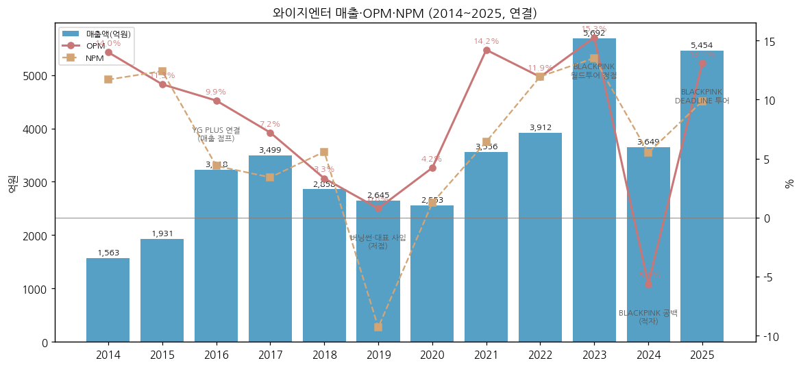

> ⚠️ 데이터 정합성 메모
> → 2014: OpenDART 재무 API 미제공 연도 → 2015 사업보고서 전기(제17기) 컬럼 사용
> → 2018: 중단영업 분리(주당이익 계속 1,025원 / 중단 -50원) — EPS는 합산 975원 표기
> → 2023\~2025 매출 유형표: 2025 사업보고서 기준(중단영업 반영 재분류). 2020\~2022는 2022 사업보고서 기준 — 유형 구분(공연 분리 표기, 방송제작 항목)이 일부 달라 '기타'로 합산
> → 3Q26: 2026-11-09 잠정실적 공시(매출 1,567억·영업이익 135억·순이익 64억). 분기보고서 공시 후 확정치로 교체 예정

### ② 산업 분류

- 산업: **K-POP 기획사 (아티스트 IP 기반 음반·공연·MD·라이선스)** — 소비재 내 콘텐츠·팬덤 산업
- 표준산업분류: 59201 (음악 및 기타 오디오물 출판업) — OpenDART 기업개황
- 워치리스트 섹터: **엔터 (대분류 소비재)** / 서브섹터 **기획사** (하이브·JYP·에스엠·와이지 + 확장 큐브엔터)
- 동일 섹터 cross-ref: 하이브(멀티레이블·위버스 플랫폼), JYP(멀티 IP 분산), 에스엠(IP 포트폴리오 최다), 디어유(팬덤 플랫폼 — 와이지 아티스트 일부 입점)

### ③ 분류 결정 논리

(1) **가장 매출 큰 사업(유형) 기준**: 상·제품(앨범·MD·디지털) 37.0% + 공연 23.2% = 60.2% (2025). 두 항목 모두 '컴백·투어가 있는 해'에만 커지는 이벤트성 매출 → 사이클
(2) **이익 기여 우선 sub-rule**: 유형별 이익은 미공시(단일 보고부문). 다만 2024년 공연 매출이 1,115억→170억(-85%)으로 줄자 영업이익이 869억→-206억으로 1,075억 감소 — 공연·MD가 사실상 이익 전부를 설명. 음악서비스(YG PLUS 유통·VIBE 운영, 매출 16%)는 저마진·안정
(3) **Boundary case 처리**: 'IP 1개 의존 사이클'이라는 점이 메모리 반도체(업황 사이클)와 다름 — 업황이 아니라 특정 그룹의 활동 계획이 사이클을 만든다. BLACKPINK는 2023-12 그룹 활동만 재계약(개인 활동은 각자 소속사) → 그룹 활동 빈도가 낮아질수록 사이클 진폭 확대. 베이비몬스터·트레저 매출이 BLACKPINK 공백기 적자를 메우면 Secondary(꿈) → 지속성장 성격이 섞임
(4) **동종 피어 대비**: JYP(다수 IP 분산 → OPM 20%대 상대 안정), 하이브(BTS 공백기에도 멀티레이블로 매출 유지), 에스엠(IP 수 최다) 대비 와이지는 **IP 집중도 가장 높음** → 4사 중 실적 변동성 최대. 같은 '사이클' 분류라도 진폭은 와이지 > 하이브 > 에스엠 > JYP

### ④ 적정 밸류에이션 방법

- **PER (12개월 Forward, 활동 연도 기준)** 우선 — 셀사이드 관행. 투어가 있는 해의 이익에 멀티플을 적용하고, 공백기 이익은 무시하는 경향 → 주가가 '다음 BLACKPINK 활동 발표'에 선행
- **PBR 보조 (하단 지지선)** — 지배자본 5,206억(2Q26) 대비 시가총액 약 8,215억 = **PBR 약 1.6배**. 순현금성 자산(현금 1,542억 + 단기·장기 금융자산, 2Q26) 비중이 커서 공백기 하단 PBR 약 1.0\~1.2배 (2019·2024 저점) / 정점 PBR 약 3\~4배 (2023-05·2025-08)
- 현재(2026-11) TTM 기준: 매출 6,034억 / 영업이익 662억 / 연결순이익 316억 (4Q25\~3Q26, 3Q26 잠정) → **TTM PER 약 26배(연결순이익 기준)**
- 피어 차별화: JYP는 이익 안정성으로 PER 단독, 와이지는 이익 변동이 커서 **PER(활동 연도) + PBR(공백기 하단) 혼합** — 이유는 ③(2)의 이익 집중도

### ⑤ 분기 재평가 트리거

- BLACKPINK 외 아티스트(베이비몬스터·트레저·신인) 매출이 **BLACKPINK 공백 분기에도 영업흑자를 유지**하는 분기가 2개 연속 나오면 → Primary를 '사이클 → 지속성장 후보'로 재검토
- 수출(해외) 매출 비중이 **60%+로 2년 유지** 시 → 글로벌 투어 IP 기업으로 Secondary 격상 (2025 56.9%, 1H26 53.8%)
- 반대로 BLACKPINK 그룹 활동 종료(재계약 미체결) 확정 시 → 사이클 진폭 축소 대신 '꿈(신인 의존)' 비중 확대로 Primary 재분류 검토

---

## 2. 회사 개요

### ① 기본 사항

| 항목 | 내용 |
|---|---|
| 회사명 | (주)와이지엔터테인먼트 (YG Entertainment Inc.) |
| 설립 / 상장 | 1998-02-24 설립 / 2011-11 KOSDAQ 상장 |
| 대표이사 | 양민석 (단독대표, 1998-03 입사, 임기 \~2028-03) |
| 최대주주 | 양현석 19.33% (특수관계인 합산 22.95%, 2025-12-31) |
| 본사 | 서울특별시 마포구 희우정로1길 7 |
| 결산월 | 12월 / 연결 종속회사 17개 (상장 1: YG PLUS) |
| 직원 | 438명 (본사, 2025-12-31, 정규 374 + 계약 64) — 남 1인 평균 급여 8,200만원 / 여 5,000만원 |
| 사업 한 줄 정의 | **BIGBANG·BLACKPINK를 배출한 K-POP 기획사 — 아티스트 IP로 음반·MD·월드투어·광고·라이선스 매출을 만들고, 자회사 YG PLUS로 음원 유통·MD를 수직계열화** |
| 전속 아티스트 (2025-12-31) | 베이비몬스터, 블랙핑크(그룹), 션, 악뮤, 위너, 은지원, 트레저 |

### ② 최근 12년 손익·자본 추이 (억원, 좌→우 시간순)

| 항목 | 2014 | 2015 | 2016 | 2017 | 2018 | 2019 | 2020 | 2021 | 2022 | 2023 | 2024 | 2025 |
|---|---|---|---|---|---|---|---|---|---|---|---|---|
| 매출액 | 1,563 | 1,931 | 3,218 | 3,499 | 2,858 | 2,645 | 2,553 | 3,556 | 3,912 | 5,692 | 3,649 | 5,454 |
| 매출원가 | 1,027 | 1,268 | 2,268 | 2,492 | 2,008 | 1,841 | 1,745 | 2,436 | 2,632 | 3,832 | 2,655 | 3,588 |
| 매출총이익 | 536 | 663 | 950 | 1,007 | 850 | 804 | 808 | 1,120 | 1,279 | 1,860 | 995 | 1,866 |
| 판관비 | 317 | 445 | 631 | 765 | 754 | 795 | 748 | 831 | 853 | 1,064 | 1,181 | 1,345 |
| 영업이익 | 219 | 218 | 319 | 252 | 95 | 20 | 107 | 506 | 466 | 869 | -206 | 713 |
| 세전이익 | 274 | 332 | 330 | 300 | 264 | -20 | 205 | 394 | 560 | 932 | 288 | 752 |
| 당기순이익(연결) | 183 | 240 | 141 | 119 | 159 | -246 | 32 | 229 | 468 | 770 | 200 | 537 |
| 지배주주 순이익 | 193 | 279 | 187 | 178 | 187 | -215 | 94 | 67 | 337 | 613 | 185 | 369 |
| GPM | 34.3% | 34.3% | 29.5% | 28.8% | 29.7% | 30.4% | 31.7% | 31.5% | 32.7% | 32.7% | 27.3% | 34.2% |
| 판관비율 | 20.3% | 23.0% | 19.6% | 21.9% | 26.4% | 30.1% | 29.3% | 23.4% | 21.8% | 18.7% | 32.4% | 24.7% |
| OPM | 14.0% | 11.3% | 9.9% | 7.2% | 3.3% | 0.8% | 4.2% | 14.2% | 11.9% | 15.3% | -5.6% | 13.1% |
| NPM | 11.7% | 12.4% | 4.4% | 3.4% | 5.6% | -9.3% | 1.2% | 6.4% | 12.0% | 13.5% | 5.5% | 9.9% |
| EPS(원, 지배) | 1,328 | 1,855 | 1,198 | 996 | 975 | -1,193 | 519 | 364 | 1,828 | 3,310 | 999 | 1,990 |

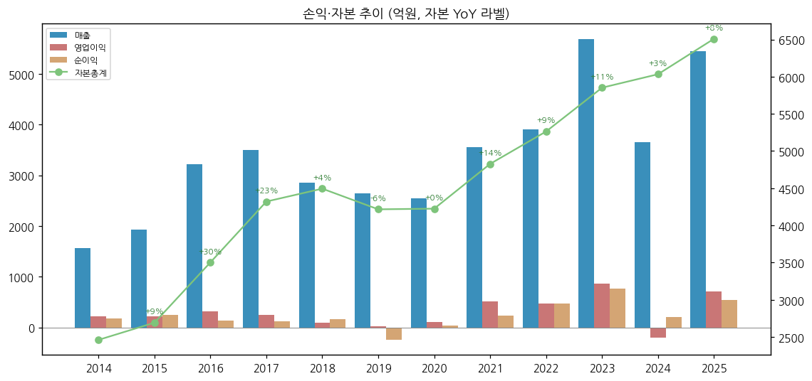

### ③ 회사 주가 역사 ★ narrative 영역

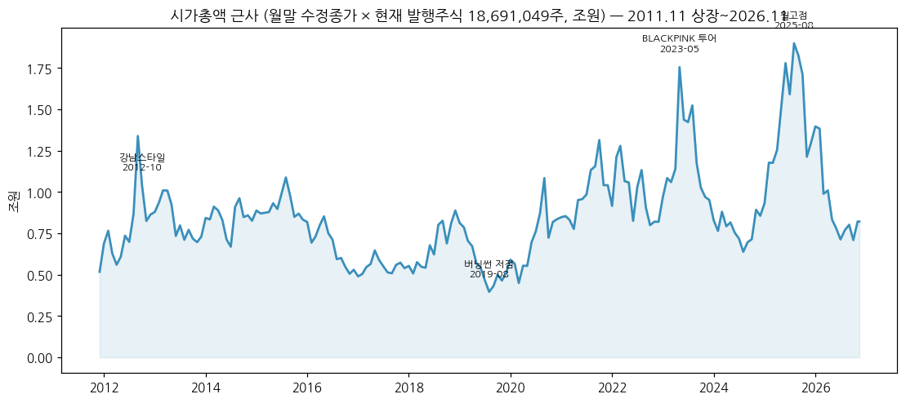

→ 2011-11 KOSDAQ 상장 → **2012-10 1차 고점 (월간 고가 81,685원, 수정주가)** — 싸이 '강남스타일' 글로벌 히트 + BIGBANG 전성기
→ 2013\~2018 박스권 (연간 고가 36,000\~62,000원) — 2016 BLACKPINK 데뷔, 2017\~2019 BIGBANG 멤버 순차 입대로 공백
→ **2019-08 저점 (19,300원)** — 2019년 버닝썬 사태·소속 아티스트 논란, 양현석 총괄프로듀서 사임(2019-06), 2019 순손실 246억
→ 2020-03 코로나 저점 18,950원 → 2021-11 75,800원 (BLACKPINK 멤버 솔로·광고 확대)
→ **2023-05 고점 (97,000원)** — BLACKPINK BORN PINK 월드투어(2022-10\~2023-09) 정산, 2023 영업이익 869억(사상 최대)
→ 2024-09 저점 29,950원 — BLACKPINK 그룹 공백, 신인(베이비몬스터) 투자로 2024 영업적자 -206억
→ **2025-08 상장 후 최고가 (장중 109,800원, Yahoo 월간 고가)** — 2Q25 흑자전환 서프라이즈 + BLACKPINK DEADLINE 월드투어(2025-07\~) 기대. 2025-08-11 장중 102,900원(+10.4%) 보도
→ 2025-12-30 시가총액 1.29조원 [stockanalysis.com] → **2026-11-13 종가 43,950원 / 시가총액 약 8,215억원** (고점 대비 -60%) — BLACKPINK 투어 종료 후 실적 역기저(3Q26 영업이익 -56.6% YoY)

| 시점 | 주가(원) | 시가총액(억원, 근사) | 사건 |
|---|---|---|---|
| 2012-10 (월고가) | 81,685 | - | 강남스타일 |
| 2019-08 (월저가) | 19,300 | 약 3,600 | 버닝썬·사임 |
| 2023-05 (월고가) | 97,000 | 약 18,100 | BORN PINK 투어 |
| 2024-09 (월저가) | 29,950 | 약 5,600 | BLACKPINK 공백 |
| 2025-08 (월고가) | **109,800 (ATH)** | 약 20,500 | DEADLINE 투어 |
| 2026-11-13 (종가) | 43,950 | 약 8,215 | 현재 |

> 시가총액 근사 = 주가 × 현재 발행주식 18,691,049주 (과거 주식수 차이로 2021년 이전은 오차 있음 — 2021말 발행주식 18,444,369주)

### ④ 회사의 주요 연혁

| 연도 | 내용 |
|---|---|
| 1996 | 양현석, 기획사 설립(현기획 → 양군기획 → YG) |
| 1998-02 | (주)와이지엔터테인먼트 법인 설립 |
| 2006 | BIGBANG 데뷔 |
| 2009 | 2NE1 데뷔 |
| 2011-11 | KOSDAQ 상장 |
| 2012 | 싸이 '강남스타일' 글로벌 히트 |
| 2014 | WINNER 데뷔 / LVMH 계열 L Capital Asia 상환전환우선주 투자(우선주 1,359,688주 — 이후 전량 상환) / YG PLUS(옛 휘닉스홀딩스) 인수 |
| 2015 | iKON 데뷔, BIGBANG MADE 월드투어 |
| 2016-08 | BLACKPINK 데뷔 |
| 2017 | 네이버 지분 투자 (현재 8.89%, 2대 주주) |
| 2019 | 버닝썬 사태 → 양현석 총괄프로듀서·양민석 대표 사임(2019-06), 연간 순손실 246억 |
| 2020-08 | TREASURE 데뷔 |
| 2021-02 | 본사 이전 (마포구 희우정로1길 7, 신사옥) |
| 2022-07 | 양민석 공동대표 복귀 / 2022-10 BLACKPINK BORN PINK 월드투어 시작 |
| 2023-12 | BLACKPINK 그룹 활동 재계약 (개인 활동은 각자 별도 소속) |
| 2024-04 | BABYMONSTER 정식 데뷔 |
| 2025-07 | BLACKPINK DEADLINE 월드투어 시작 (\~2026-01) |
| 2026 | 창사 30주년·BIGBANG 데뷔 20주년 — BIGBANG 월드투어(2026-08\~, 19개 도시 33회 예정), 신인 보이그룹 2026-09 데뷔 예정 |

> 연혁 출처: DART 사업보고서 '회사의 연혁'(본점·경영진·자회사), 2014 우선주는 '주식의 총수 현황'(상환 1,359,688주) / 아티스트 데뷔·투어 일정은 공개 보도 기준

---

## 3. 비즈니스 모델

### ① 실적 추이 (매출 유형별 · 수출/내수)

**매출 유형별 연간 매출 (억원, 연결, 사업·반기보고서 '매출 및 수주상황')**

| 유형 | 2020 | 2021 | 2022 | 2023 | 2024 | 2025 | 1H26 | 2025 비중 |
|---|---|---|---|---|---|---|---|---|
| 상·제품(앨범·MD·디지털) | 1,039 | 1,413 | 1,567 | 1,974 | 1,522 | 2,018 | 1,360 | 37.0% |
| 공연 | 19 | 21 | 227 | 1,115 | 170 | 1,264 | 403 | 23.2% |
| 음악서비스(YG PLUS 유통·VIBE) | 411 | 713 | 707 | 889 | 786 | 872 | 436 | 16.0% |
| 광고모델 | 381 | 524 | 673 | 589 | 349 | 282 | 104 | 5.2% |
| 로열티 | 206 | 182 | 147 | 463 | 254 | 450 | 150 | 8.3% |
| 출연료 | 130 | 192 | 179 | 175 | 165 | 130 | 27 | 2.4% |
| 기타(방송제작·수수료 등) | 368 | 512 | 408 | 487 | 403 | 437 | 268 | 8.0% |
| **합계** | 2,553 | 3,556 | 3,909 | 5,692 | 3,649 | 5,454 | 2,749 | 100% |
| 수출(해외) 비중 | - | - | - | 47.3% | 38.9% | 56.9% | 53.8% | - |

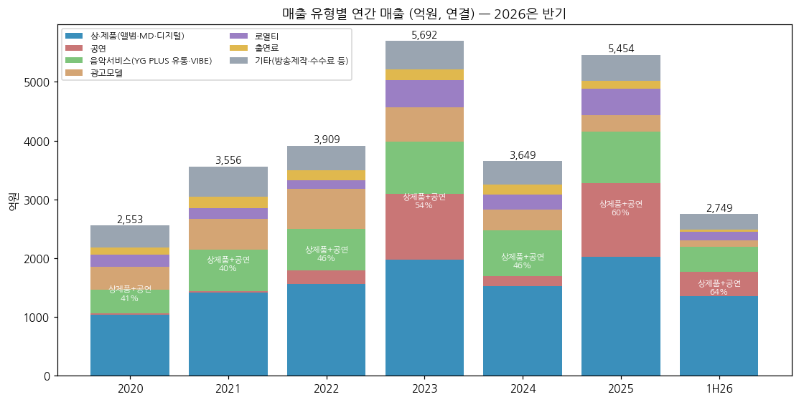

**2025 수출/내수 분해 (억원)**

| 유형 | 수출 | 내수 | 수출 비중 |
|---|---|---|---|
| 상·제품 | 1,086 | 932 | 53.8% |
| 공연 | 995 | 269 | 78.7% |
| 음악서비스 | 181 | 692 | 20.7% |
| 광고모델 | 175 | 107 | 62.0% |
| 로열티 | 437 | 13 | 97.1% |
| 출연료 | 63 | 66 | 49.0% |
| 기타 | 165 | 272 | 37.8% |
| **합계** | **3,103** | **2,351** | **56.9%** |

**전사 분기 시계열 (1Q16\~3Q26, 43분기)** — 사업부(유형)별 분기 공시가 없어 전사 기준

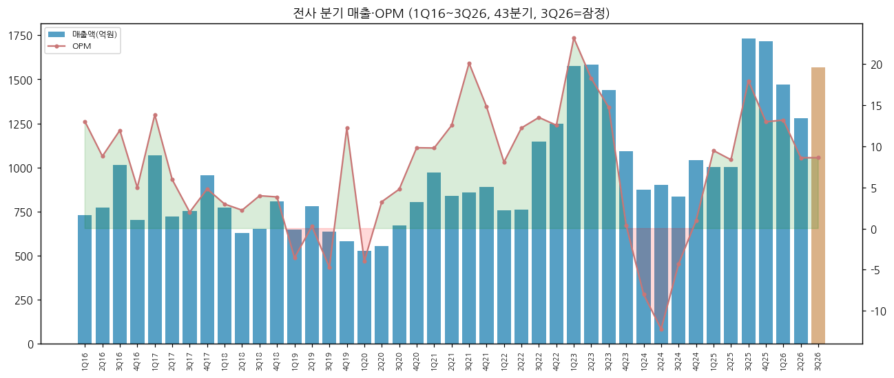

**최근 12분기 (억원, 연결)**

| 분기 | 매출액 | 영업이익 | OPM | 매출 YoY | 영업이익 YoY | 순이익 |
|---|---|---|---|---|---|---|
| 4Q23 | 1,094 | 4 | 0.4% | -12.5% | -97.5% | 37 |
| 1Q24 | 873 | -70 | -8.0% | -44.6% | -119.2% | 4 |
| 2Q24 | 900 | -110 | -12.2% | -43.1% | -138.1% | -3 |
| 3Q24 | 835 | -36 | -4.3% | -42.0% | -117.0% | -9 |
| 4Q24 | 1,041 | 10 | 1.0% | -4.8% | +150.0% | 209 |
| 1Q25 | 1,002 | 95 | 9.5% | +14.8% | 흑전 | 102 |
| 2Q25 | 1,004 | 84 | 8.4% | +11.6% | 흑전 | 112 |
| 3Q25 | 1,731 | 311 | 18.0% | +107.3% | 흑전 | 244 |
| 4Q25 | 1,718 | 223 | 13.0% | +65.0% | +2130.0% | 79 |
| 1Q26 | 1,471 | 194 | 13.2% | +46.8% | +104.2% | 98 |
| 2Q26 | 1,278 | 110 | 8.6% | +27.3% | +31.0% | 75 |
| 3Q26 [잠정] | 1,567 | 135 | 8.6% | -9.5% | -56.6% | 64 |

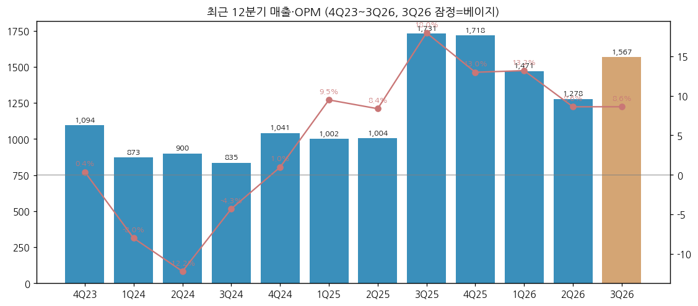

> 📌 **3Q26 핵심 박스 (잠정, 2026-11-09 공시)**
> → 매출 1,567억(-9.4% YoY) / 영업이익 135억(-56.6% YoY) / OPM 8.6% / 순이익 64억(-73.8% YoY)
> → 역기저: 3Q25는 BLACKPINK DEADLINE 월드투어 정산(분기 매출 1,731억·OP 311억) 분기. 3Q26은 BIGBANG 20주년 월드투어(2026-08 시작)·베이비몬스터 2차 월드투어가 이를 일부 대체
> → QoQ로는 매출 +22.6%, 영업이익 +22.7% (2Q26 1,278억 / 110억 대비) — 바닥은 2Q26
> → 다음 확인: 신인 보이그룹(2026-09 데뷔) 초기 비용 vs 4Q 투어 정산, BLACKPINK 차기 그룹 활동 계획

### ② 사업(매출 유형)별 개요 (2025 매출 비중 큰 순서)

| 유형 | 2025 매출(억원) | 비중 | 내용 |
|---|---|---|---|
| 상·제품 | 2,018 | 37.0% | 앨범·DVD, 음원 포함 디지털콘텐츠, 아티스트 MD. YG PLUS가 음반 유통·MD 제조/유통 |
| 공연 | 1,264 | 23.2% | 자체 공연사업그룹 기획·제작. 국내 투어는 티켓 총액, 해외 투어는 현지 프로모터 Guarantee로 인식 |
| 음악서비스 | 872 | 16.0% | YG PLUS의 음원 유통 수수료 + 네이버 음악플랫폼 'VIBE' 운영 대행 매출 |
| 로열티 | 450 | 8.3% | IP 라이선스(97% 해외) — 투어 연동 MD 라이선스 등 |
| 기타 | 437 | 8.0% | 기타 수수료·콘텐츠 |
| 광고모델 | 282 | 5.2% | 아티스트 광고. BLACKPINK 멤버 개인 계약 이탈로 2022 673억 → 2025 282억 |
| 출연료 | 130 | 2.4% | 방송·행사 출연 |

### ③ 사업별 디테일

- **상·제품 (Top-seller)** — 2023 1,974억(BORN PINK 투어 MD) → 2024 1,522억 → 2025 2,018억(사상 최대). 1H26 1,360억으로 반기 기준 역대 최고 페이스 — 베이비몬스터·트레저 신보 + 디지털콘텐츠 수요 (2Q26 매출 +27.2% YoY 보도, 2026-08-07)
- **공연 (Growth/Outlier)** — 이익 변동의 주범. 2021 21억 → 2022 227억 → **2023 1,115억** → 2024 170억 → **2025 1,264억** → 1H26 403억. 해외 비중 79%(2025)
- **음악서비스 (안정)** — 2021 이후 700\~900억 박스권. 내수 79%. 저마진 유통 매출이라 매출 규모 대비 이익 기여 작음
- **광고모델 (구조적 하락)** — 2022 673억 정점 → 2025 282억 → 1H26 105억. 2023-12 BLACKPINK 멤버 개인 활동 분리 이후 개인 광고 매출이 외부 소속사로 이동
- **로열티 (투어 연동)** — 투어 연도에 급증 (2023 463억, 2025 450억), 공백기 절반 수준

### ④ 주요 경쟁사

| 영역 | 국내 | 글로벌 |
|---|---|---|
| 아티스트 IP·음반·공연 | 하이브, JYP, 에스엠, 큐브엔터 | Universal Music(레이블·유통 파트너), Sony Music |
| 팬 플랫폼 | 하이브 위버스, 디어유 버블 | - |
| 투어 프로모션 | - | Live Nation (해외 투어 프로모터 Guarantee 구조) |
| 음원 유통 (YG PLUS) | 카카오엔터, 드림어스컴퍼니 | - |

### ⑤ 주요 매출처

- 사업보고서상 개별 고객 매출 비중 공시 없음 (주요 고객 공시: 10% 이상 단일 고객 미기재)
- 판매경로: 상·제품 = 당사 → YG PLUS 등 유통사 → 도소매·음악플랫폼 → 소비자 / 공연 = 공연사업그룹 → 소비자(해외는 현지 프로모터 경유) / 음악서비스 = YG PLUS → 네이버 VIBE → 소비자
- 추정 구조: 해외 투어 프로모터(투어 연도 최대 매출처) · 음반 유통사 · 네이버(VIBE 운영)

### ⑥ 생산 CAPA + 임직원 추이

- 생산 설비: 자체 녹음·마스터링 'In House System' + 프로듀서 센터 + 글로벌 트레이닝 센터. 음반은 마스터 CD만 제작, CD·북클릿은 외주 → 원재료 리스크 없음
- 유형자산(2025말, 연결): 장부가 1,754억 — 토지 734억·건물 731억(신사옥)·시설장치 187억
- 임직원(본사, 2025-12-31): 438명 (남 150 / 여 288), 평균 근속 남 5.1년·여 3.4년, 연간 급여 총액 354억
- 조직: 2025년 매니지먼트·A&R 분리 조직을 '아티스트 단위 멀티 조직'으로 개편

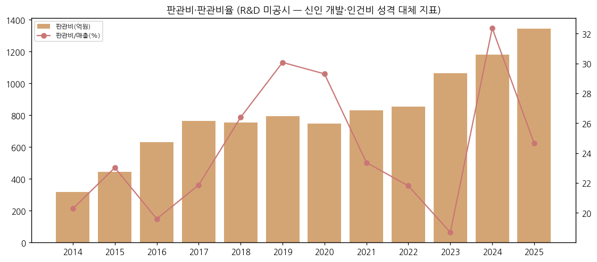

---

## 4. 재무 구조

> 기준: K-IFRS 연결, 억원. 2014 = 2015 사업보고서 전기 컬럼

### ① 손익계산서 (12년, 억원, 좌→우 시간순)

| 항목 | 2014 | 2015 | 2016 | 2017 | 2018 | 2019 | 2020 | 2021 | 2022 | 2023 | 2024 | 2025 |
|---|---|---|---|---|---|---|---|---|---|---|---|---|
| 매출액 | 1,563 | 1,931 | 3,218 | 3,499 | 2,858 | 2,645 | 2,553 | 3,556 | 3,912 | 5,692 | 3,649 | 5,454 |
| 매출원가 | 1,027 | 1,268 | 2,268 | 2,492 | 2,008 | 1,841 | 1,745 | 2,436 | 2,632 | 3,832 | 2,655 | 3,588 |
| 매출총이익 | 536 | 663 | 950 | 1,007 | 850 | 804 | 808 | 1,120 | 1,279 | 1,860 | 995 | 1,866 |
| 판관비 | 317 | 445 | 631 | 765 | 754 | 795 | 748 | 831 | 853 | 1,064 | 1,181 | 1,345 |
| 영업이익 | 219 | 218 | 319 | 252 | 95 | 20 | 107 | 506 | 466 | 869 | -206 | 713 |
| 세전이익 | 274 | 332 | 330 | 300 | 264 | -20 | 205 | 394 | 560 | 932 | 288 | 752 |
| 당기순이익(연결) | 183 | 240 | 141 | 119 | 159 | -246 | 32 | 229 | 468 | 770 | 200 | 537 |
| 지배주주 순이익 | 193 | 279 | 187 | 178 | 187 | -215 | 94 | 67 | 337 | 613 | 185 | 369 |
| GPM | 34.3% | 34.3% | 29.5% | 28.8% | 29.7% | 30.4% | 31.7% | 31.5% | 32.7% | 32.7% | 27.3% | 34.2% |
| 판관비율 | 20.3% | 23.0% | 19.6% | 21.9% | 26.4% | 30.1% | 29.3% | 23.4% | 21.8% | 18.7% | 32.4% | 24.7% |
| OPM | 14.0% | 11.3% | 9.9% | 7.2% | 3.3% | 0.8% | 4.2% | 14.2% | 11.9% | 15.3% | -5.6% | 13.1% |
| NPM | 11.7% | 12.4% | 4.4% | 3.4% | 5.6% | -9.3% | 1.2% | 6.4% | 12.0% | 13.5% | 5.5% | 9.9% |
| EPS(원, 지배) | 1,328 | 1,855 | 1,198 | 996 | 975 | -1,193 | 519 | 364 | 1,828 | 3,310 | 999 | 1,990 |

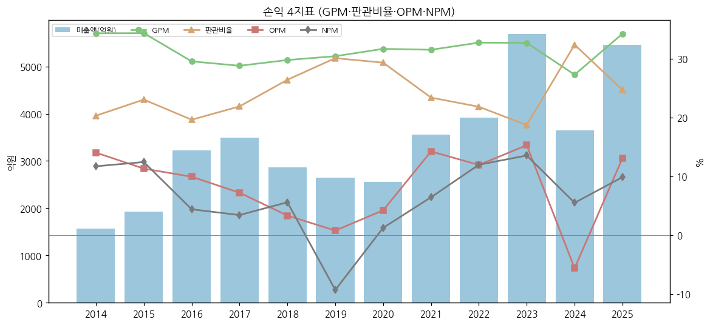

### ② 재무상태표 (12년, 억원)

| 항목 | 2014 | 2015 | 2016 | 2017 | 2018 | 2019 | 2020 | 2021 | 2022 | 2023 | 2024 | 2025 |
|---|---|---|---|---|---|---|---|---|---|---|---|---|
| 자산총계 | 3,405 | 3,754 | 4,868 | 5,836 | 5,943 | 5,163 | 5,428 | 6,215 | 7,129 | 7,422 | 7,343 | 8,388 |
| 유동자산 | 2,521 | 2,459 | 2,764 | 3,072 | 2,321 | 1,513 | 2,393 | 2,399 | 3,110 | 3,412 | 3,029 | 4,462 |
| 현금및현금성자산 | 1,421 | 345 | 624 | 989 | 586 | 478 | 518 | 442 | 802 | 969 | 867 | 1,682 |
| 부채총계 | 943 | 1,061 | 1,365 | 1,515 | 1,449 | 947 | 1,203 | 1,387 | 1,866 | 1,570 | 1,311 | 1,879 |
| 유동부채 | 324 | 422 | 683 | 733 | 625 | 695 | 988 | 1,001 | 1,438 | 1,419 | 1,105 | 1,709 |
| 자본총계 | 2,462 | 2,693 | 3,504 | 4,321 | 4,494 | 4,217 | 4,226 | 4,828 | 5,263 | 5,852 | 6,033 | 6,508 |
| 지배주주 자본 | 1,773 | 2,037 | 2,809 | 3,428 | 3,598 | 3,368 | 3,514 | 3,776 | 4,096 | 4,667 | 4,831 | 5,135 |
| 비지배지분 | 689 | 656 | 695 | 893 | 897 | 849 | 712 | 1,052 | 1,166 | 1,185 | 1,201 | 1,373 |

| 최근 분기 | 자산총계 | 부채총계 | 자본총계 | 지배자본 | 현금성자산 |
|---|---|---|---|---|---|
| 1Q26 | 8,670 | 2,132 | 6,537 | 5,127 | 1,927 |
| 2Q26 | 8,438 | 1,800 | 6,638 | 5,206 | 1,542 |

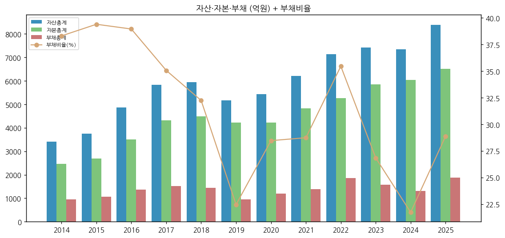

### ③ 현금흐름표 (12년, 억원)

| 항목 | 2014 | 2015 | 2016 | 2017 | 2018 | 2019 | 2020 | 2021 | 2022 | 2023 | 2024 | 2025 |
|---|---|---|---|---|---|---|---|---|---|---|---|---|
| 영업활동CF | 345 | 57 | 324 | 219 | 225 | 596 | 258 | 369 | 551 | 936 | 0 | 909 |
| 투자활동CF | -208 | -1,148 | -678 | -538 | -656 | 122 | -110 | -770 | -179 | -697 | 6 | 31 |
| 재무활동CF | 1,052 | 15 | 633 | 708 | 14 | -834 | -104 | 325 | -13 | -63 | -123 | -119 |
| 유·무형 취득(CapEx) | 198 | 379 | 204 | 357 | 287 | 417 | 332 | 341 | 98 | 570 | 235 | 76 |
| FCF (영업CF-CapEx) | 147 | -321 | 121 | -138 | -62 | 178 | -74 | 28 | 453 | 366 | -234 | 833 |

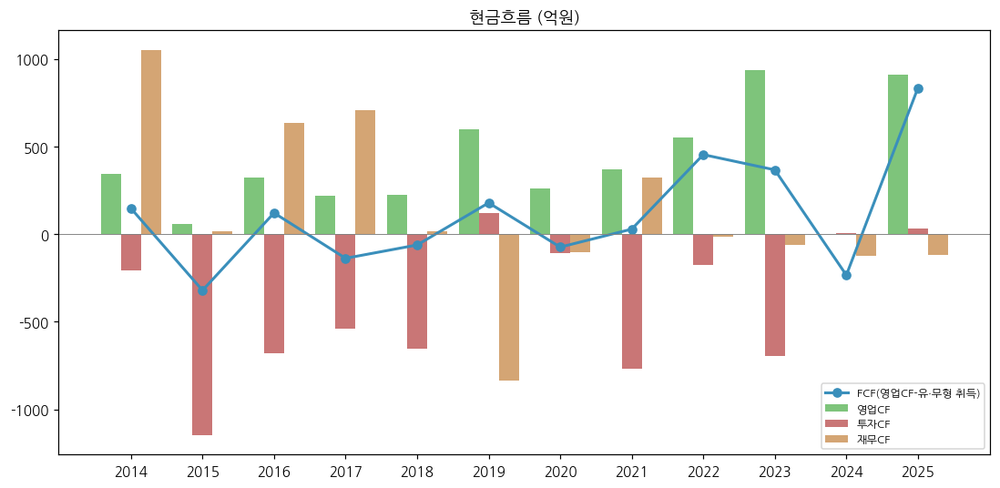

### ④ CapEx 추이 (12년, 억원)

| 항목 | 2014 | 2015 | 2016 | 2017 | 2018 | 2019 | 2020 | 2021 | 2022 | 2023 | 2024 | 2025 |
|---|---|---|---|---|---|---|---|---|---|---|---|---|
| 유형자산 취득 | 169 | 221 | 184 | 303 | 259 | 406 | 321 | 323 | 88 | 116 | 71 | 60 |
| 무형자산 취득 | 30 | 158 | 20 | 55 | 28 | 12 | 11 | 17 | 9 | 454 | 164 | 16 |
| CapEx 합계 | 198 | 379 | 204 | 357 | 287 | 417 | 332 | 341 | 98 | 570 | 235 | 76 |
| CapEx/매출 | 12.7% | 19.6% | 6.3% | 10.2% | 10.0% | 15.8% | 13.0% | 9.6% | 2.5% | 10.0% | 6.4% | 1.4% |

> → 2017\~2021 유형 CapEx 연 260\~410억: 마포 신사옥 건설(2021-02 본점 이전)
> → 2023 무형자산 취득 454억: 전속계약금 등 아티스트 관련 무형자산 (BLACKPINK 그룹 재계약 시점과 겹침 — 재계약금 구체 금액은 미공시)
> → 2025 CapEx 76억(매출 대비 1.4%): 경자산 모델로 회귀

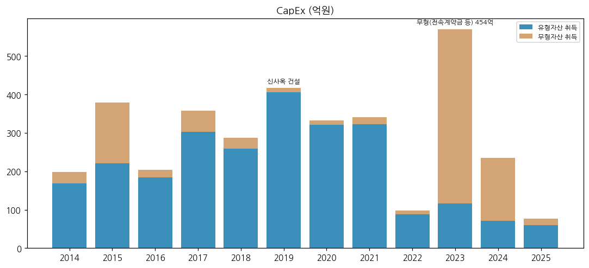

### ⑤ 부채구조 (12년, 억원)

| 항목 | 2014 | 2015 | 2016 | 2017 | 2018 | 2019 | 2020 | 2021 | 2022 | 2023 | 2024 | 2025 |
|---|---|---|---|---|---|---|---|---|---|---|---|---|
| 차입부채 합계(단기+장기) | 605 | 629 | 667 | 770 | 837 | 152 | 201 | 43 | 142 | 83 | 79 | 70 |
| 현금성자산 | 1,421 | 345 | 624 | 989 | 586 | 478 | 518 | 442 | 802 | 969 | 867 | 1,682 |
| 순현금(현금성-차입) | 816 | -284 | -43 | 219 | -252 | 326 | 317 | 399 | 660 | 886 | 788 | 1,613 |
| 부채비율 | 38.3% | 39.4% | 38.9% | 35.1% | 32.2% | 22.5% | 28.5% | 28.7% | 35.5% | 26.8% | 21.7% | 28.9% |

> → 2014\~2018 차입부채 600\~840억: 2014 L Capital Asia 상환전환우선주(부채 분류) 등 → 상환 후 2019부터 100억대 이하
> → 2025말 차입부채 70억(일본 법인 SBJ은행 일반자금대출 7.6억엔 포함) — 사실상 무차입
> → 채무증권(회사채·CP) 발행 이력: 2022\~2025 정기보고서상 미발행
> → 현금성자산 외 단기금융자산 1,183억·장기금융자산 1,136억(2025말) 별도 보유 → 실질 순현금 약 3,900억

### ⑥ 배당·자사주 추이 (12년)

| 항목 | 2014 | 2015 | 2016 | 2017 | 2018 | 2019 | 2020 | 2021 | 2022 | 2023 | 2024 | 2025 |
|---|---|---|---|---|---|---|---|---|---|---|---|---|
| 배당금 지급(CF) | 31 | 41 | 57 | 35 | 29 | 29 | 0 | 0 | 46 | 46 | 60 | 46 |
| 지배순이익 | 193 | 279 | 187 | 178 | 187 | -215 | 94 | 67 | 337 | 613 | 185 | 369 |
| 배당/지배순이익 | 16.2% | 14.7% | 30.7% | 19.9% | 15.6% | N/M | 0.0% | 0.0% | 13.6% | 7.5% | 32.4% | 12.6% |
| FCF | 147 | -321 | 121 | -138 | -62 | 178 | -74 | 28 | 453 | 366 | -234 | 833 |

| 항목 (사업보고서 배당표) | 2023 | 2024 | 2025 |
|---|---|---|---|
| 주당 현금배당(원) | 300 | 250 | 300 |
| 현금배당 총액(억원) | 55.6 | 46.4 | 55.6 |
| 연결 배당성향 | 9.1% | 25.0% | 15.1% |
| 배당수익률 | 0.59% | 0.55% | 0.46% |

- 자기주식 144,171주(0.77%, 2025말) — 신탁 취득분 133,533주 + 기타 10,638주. 2025 중 취득·처분·소각 없음
- 2020·2021 무배당 (2019 순손실 영향)

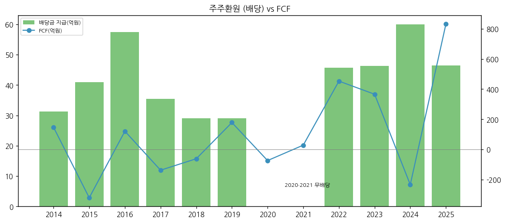

### ⑦ 재무 비율 (12년)

| 항목 | 2014 | 2015 | 2016 | 2017 | 2018 | 2019 | 2020 | 2021 | 2022 | 2023 | 2024 | 2025 |
|---|---|---|---|---|---|---|---|---|---|---|---|---|
| ROE(지배) | 10.9% | 13.7% | 6.7% | 5.2% | 5.2% | -6.4% | 2.7% | 1.8% | 8.2% | 13.1% | 3.8% | 7.2% |
| ROA | 5.4% | 6.4% | 2.9% | 2.0% | 2.7% | -4.8% | 0.6% | 3.7% | 6.6% | 10.4% | 2.7% | 6.4% |
| 부채비율 | 38.3% | 39.4% | 38.9% | 35.1% | 32.2% | 22.5% | 28.5% | 28.7% | 35.5% | 26.8% | 21.7% | 28.9% |
| 유동비율 | 777.8% | 582.5% | 404.8% | 419.4% | 371.3% | 217.8% | 242.2% | 239.7% | 216.3% | 240.4% | 274.2% | 261.1% |
| 매출총이익률 | 34.3% | 34.3% | 29.5% | 28.8% | 29.7% | 30.4% | 31.7% | 31.5% | 32.7% | 32.7% | 27.3% | 34.2% |

---

## 5. 지배 구조

### ① 그룹·계열 관계

```
양현석 (최대주주 19.33%) ─┐
양민석 (대표, 3.47%) 외 ───┴─ (주)와이지엔터테인먼트 (KOSDAQ 122870)
                               ├─ (주)와이지플러스 (KOSDAQ, MD 제조·유통/음원 유통) *지분 50% 미만 실질지배
                               │    ├─ (주)와이지인베스트먼트 → 신기술투자조합 8개 (메타버스·로보틱스·스페이스·바이오 등)
                               │    └─ (주)포레스트팩토리 (도소매, 2023 하이브·JYP 제3자배정 참여)
                               ├─ YG ENTERTAINMENT JAPAN / ASIA / BEIJING / USA
                               │    └─ HASHTAG LLC (미국 콘서트 프로모터)
                               └─ 와이지 메타버스 신기술투자조합
2대 주주: 네이버(주) 8.89% (VIBE 운영 대행 거래 관계)
```

- 연결 종속회사 17개 (2025말: 기초 16 + 신규 8 − 감소 7). 상장 종속회사 1 (YG PLUS)
- 비지배지분 1,373억(2025말) — 대부분 YG PLUS 외부 주주 몫. 연결순이익 537억 중 비지배 168억(31%) → **지배순이익은 연결의 약 69%**

### ② 주주 구분 (2025-12-31 기준, 사업보고서)

| 주주 | 주식수 | 지분율 |
|---|---|---|
| 양현석 (최대주주) | 3,613,128 | 19.33% |
| 양민석 (특수관계인, 대표) | 647,910 | 3.47% |
| 기타 특수관계인 (황보경·김성희·김지현·최성준) | 28,900 | 0.15% |
| **최대주주 등 합계** | **4,289,938** | **22.95%** |
| 네이버(주) | 1,661,130 | 8.89% |
| 국민연금공단 | 965,186 | 5.16% |
| 자기주식 | 144,171 | 0.77% |
| 소액주주 (57,444명) | 9,071,953 | 48.54% |

> 외국인 지분율: 정기보고서 미공시 — 데이터 공백 (KRX 조회 필요)

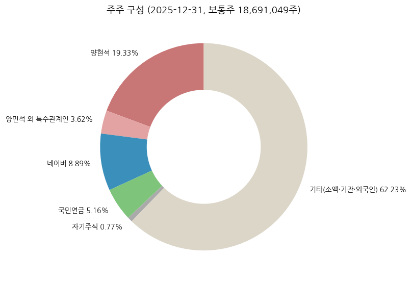

### ③ 임원·이사회 (2025-12-31 기준)

| 성명 | 직위 | 구분 | 주요 경력 | 임기 만료 |
|---|---|---|---|---|
| 양민석 | 사장 (대표이사) | 사내이사 | 1998 입사, YG PLUS 이사회 의장 | 2028-03 |
| 황보경 | 부사장 (CAO) | 사내이사 | 前 공동대표, 前 YG NEXT 대표 | 2027-03 |
| 김성희 | 부사장 (COO) | 사내이사 | YG Japan 대표, 前 삼성물산 글로벌사업개발 본부장 | 2026-03 |
| 김동현 | 이사회 의장 | 사외이사 | 브이알에스 대표, 前 매그나텍 대표 | 2026-03 |
| 박정미 | 사외이사 | 사외이사 | 세무사, 前 국세청 | 2027-04 |
| 전성원 | 사외이사 | 사외이사 | 김·장 변호사, 前 검사 | 2027-03 |
| 이동우 | 사외이사 | 사외이사 | 크릿벤처스, 前 넷마블·코웨이 투자전략 | 2027-03 |
| 오정식 | 상근감사 | 감사 | 前 우리은행 상임감사 | 2026-03 |

- 이사회: 사내 3 / 사외 4, **의장 = 사외이사(김동현)** — 2019 사태 이후 지배구조 개편 흐름
- 양현석은 등기임원이 아닌 최대주주 (총괄프로듀서 직함으로 경영 관여 보도 — 등기임원 아님)

---

## 6. 기타 팩트

### ① R&D 인프라

- 연구개발비 별도 공시 없음 — 사업보고서 '연구개발활동'은 **신인 발굴·트레이닝 시스템** 서술로 대체 (글로벌 트레이닝 센터, 한국·일본·태국·중국·서구권 오디션)
- 지적재산권(2025말): 상표권 국내 등록 507건·해외 등록 798건, 디자인권 국내 5건
- 대체 지표: 판관비 2025 1,345억(매출 대비 24.7%) — 신인 제작·인건비가 포함된 고정비 성격 (chart7)

### ② 진행 중 corporate action — 10년치

| 시기 | 내용 |
|---|---|
| 2014\~ | L Capital Asia 상환전환우선주 1,359,688주 → 전량 상환 |
| 2017 | 네이버 전략적 투자 (현재 8.89%) / YG PLUS-네이버 VIBE 운영 대행 |
| 2021\~2025 | YG인베스트먼트 신기술투자조합 순차 설립 (2021 글로벌컨텐츠·메타버스 → 2025 로보틱스·스페이스2호·글로벌바이오4호) |
| 2023-06 | 포레스트팩토리 제3자배정 유상증자 (하이브·JYP·예인미술 참여) |
| 2025 | YG ENTERTAINMENT BEIJING 지분 100% 직접 취득 (ASIA 법인 경유) |
| 2026-09 | 신인 보이그룹 데뷔 예정 (보도) |

### ③ IP·아티스트 마일스톤 — 10년치

| 시기 | 마일스톤 |
|---|---|
| 2016-08 | BLACKPINK 데뷔 |
| 2020-08 | TREASURE 데뷔 |
| 2022-10\~2023-09 | BLACKPINK BORN PINK 월드투어 → 2023 공연 매출 1,115억 |
| 2023-12 | BLACKPINK 그룹 재계약 (개인 활동 분리) |
| 2024-04 | BABYMONSTER 데뷔 |
| 2025-07\~2026-01 | BLACKPINK DEADLINE 월드투어 → 2025 공연 매출 1,264억 |
| 2026-08\~ | BIGBANG 20주년 월드투어 (19개 도시 33회 예정), BABYMONSTER 2차 월드투어 |

### ④ 주요 리스크

- **IP 집중 리스크**: BLACKPINK 그룹 활동 여부가 연간 이익을 좌우 (2023 → 2024 영업이익 -1,075억 변동). 멤버 개인 활동은 외부 소속사 → 광고·출연 매출 구조적 감소
- **오너 리스크 이력**: 2019 버닝썬 사태·최대주주 관련 수사 → 주가 2019-08 저점. 최대주주 지분 19.33% 유지
- **환율**: 수출 비중 56.9%(2025) — 해외 투어 Guarantee·로열티 외화 수취. 원화 약세 = 실적 우호
- **중국(한한령)**: 중국 공연 재개 지연 — 2025 일부 K-POP 중국 공연 연기 보도. 재개 시 업사이드
- **우발부채**: 서울보증보험 계약이행보증 29.9억(2025말), 관계기업 차입 담보 제공 정기예금 10.6억 등 — 소규모

### ⑤ ESG 등급

- 이사회 내 ESG위원회 설치 (위원장 전성원 사외이사)
- 외부 ESG 등급(KCGS 등): 이번 작성 범위에서 미확인 — 데이터 공백

### ⑥ 인증·라이선스

- 해당 사항 제한적 — 상표권 국내 507·해외 798건(등록), 디자인권 5건이 핵심 무형 권리

---

## Version Log

- **v1.0 (2026-11-15)** — 첫 작성. OpenDART 재무 JSON(2015 FY\~2026 2Q, 2014는 전기 컬럼) + 정기보고서 원문 XML(2022.12\~2026.06) + 기업개황·주주·임원·배당 JSON + Yahoo v8 시세 + 3Q26 잠정실적(2026-11-09). 차트 13종(chart1·1b·2 유형별·2 분기·4·5·6·7·8·9·10·11·12)
- 잔여 보완 후보:
  - 3Q26 분기보고서 공시 후 확정치 교체 + 3Q26 누적 매출 유형표 추가
  - 회사 IR 실적 PDF 미확보 → 매출 유형별 **분기** 시계열 미작성 (IR 게시 시작 또는 분기보고서 누적표 차감으로 2023\~ 분기 분해 가능)
  - 2021 이전 정기보고서 원문 미다운로드(years_back=3) → 2014\~2019 매출 유형표 공백
  - 외국인 지분율·ESG 등급 미확인
