# 이수페타시스 — 기업 개요 (v1.0)

> 마지막 update: 2026-11-25 (3Q26 분기보고서 2026-11-16 + 3Q26 IR 2026-11-17 반영)
> 입력 source: OpenDART fnlttSinglAcntAll (연결·별도, 2015\~3Q26, 88개 JSON) + DART 정기공시 원문 XML 52건 (사업보고서 2013\~2025, 분기·반기 2014.1Q\~2026.3Q) + OpenDART 기업개황·주주·임원·직원·배당 (2016·2019·2022·2025·3Q26) + 회사 IR 4건 (2024 경영실적 2025-02-13, 2Q25 2025-08-19, FY25·26 전망 2026-02-24, 3Q26 2026-11-17) + 네이버 금융 시세 (월봉 2016-12\~, 일봉 500일) + Yahoo Finance 007660.KS (2000\~2016 보조)
> 갱신 주기: 매분기 (실적 리뷰 모드 호출 시)
> 워치리스트: IT 하드웨어 섹터 / 서브섹터: 전자부품·기판
> **Fact verify cutoff**: 2026-11-25 (주가·시총·외국인 지분율·컨센서스 = 네이버 금융 2026-11-24 종가·11-25 조회값, 사상 최고가 = 네이버 일봉 2026-04-22 종가. 점유율 = 회사 IR 인용 RCD 2025-10 / Prismark 2025-11)

---

## 1. 기업 분류

- **Primary 분류: 고성장** (Growth — AI 데이터센터 고다층 MLB, 2024\~3Q26 11개 분기 연속 매출 YoY +16\~57%)
- **Secondary 노트: 사이클 섞임** — 네트워크 장비 투자·고객 재고 사이클(2022 정점 → 2023 영업이익 -47%)과 원자재(동박적층판) 가격 전가 시차가 이익 변동성을 키움. 2020년 이전은 HDI 자회사(이수엑사보드) 적자로 이익이 0 근처였던 '저마진 사이클' 기업

### ① 정량 근거

**📊 Summary Box (12년, 2014\~2025 연결):**

| 지표 | 값 |
|------|-----|
| 매출 CAGR (2014→2025, 11년) | **+7.2%** (5,048억 → 10,880억) · 엑사보드 제외 기준 2020→2025 **+22.6%** (3,932억 재작성치 → 10,880억) |
| OPM 평균 (12년) | **6.0%** (2014\~2020 평균 0.5% / 2021\~2025 평균 13.7%) |
| OPM 정점 평균 | **18.5%** (2022 18.1% · 2025 18.8%) |
| OPM 저점 평균 | **-3.1%** (2017 -1.5% · 2019 -4.7%) · 2021년 이후 저점은 2023 9.2% |
| 사이클 주기 | 약 3년 (2022 정점 → 2025 정점, peak-to-peak) |
| 사이클 회수 (12년) | 정점 2회 / 저점 3회 (2017·2019·2023) |

```
[전사 OPM 시계열 (12년, 연결, 억원)]
연도   매출(억)  영업이익  순이익   OPM    NPM
2014     5,048      103      26    2.0    0.5   ← 중국 후난 가동 초기 적자
2015     5,209      202      65    3.9    1.2
2016     5,542      111       2    2.0    0.0
2017     5,313      -80    -149   -1.5   -2.8   ← 저점① (엑사보드·후난 동반 적자)
2018     5,603       75     -74    1.3   -1.3
2019     5,142     -240    -911   -4.7  -17.7   ← 저점② 순손실 -911억 (엑사보드 손상)
2020     5,142       20    -135    0.4   -2.6   ← 엑사보드 정리 직전
2021     4,696      469     -36   10.0   -0.8   ← 엑사보드 중단영업 재분류 · 유상증자
2022     6,429    1,166   1,025   18.1   15.9   ← 정점① 400G 스위치·서버
2023     6,753      622     477    9.2    7.1   ← 조정 (네트워크 고객 재고조정)
2024     8,369    1,019     740   12.2    8.8   ← AI 가속기(E사) 확대
2025    10,880    2,047   1,605   18.8   14.7   ← 정점② AI 가속기·800G, 유상증자
3Q26누적 11,094    2,392   1,752   21.6   15.8   ← 3Q26 OPM 24.4% 분기 최고

OPM range: -4.7% ~ 24.4%(분기) = 29%pt
구조 단절: 2021.07 이수엑사보드(HDI·스마트폰 PCB) 영업정지 → 중단영업 재분류, 2022.09 청산
         → 2021년 이후 숫자는 '고다층 MLB 순수 기업' 기준
```

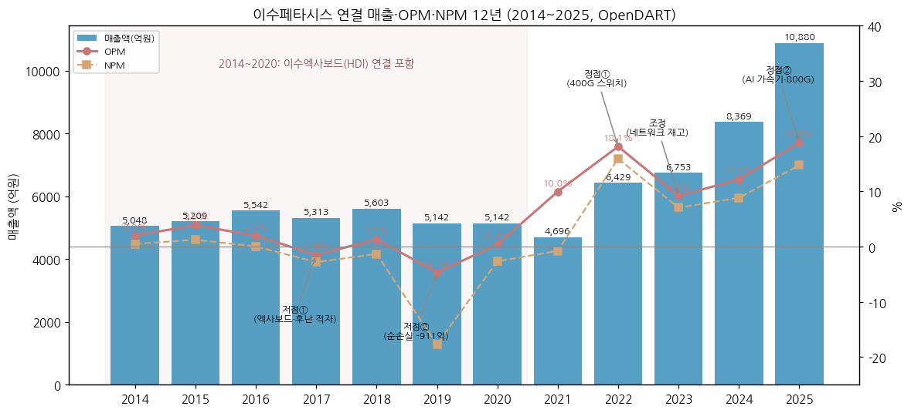

(2013 연결 매출 5,354억 · 영업이익 472억 · OPM 8.8% — 2013 사업보고서 원문. 2012 이전은 이번 버전 범위 밖)

### ② 산업 분류

- 산업: **전자부품 — 인쇄회로기판(PCB), 고다층 MLB** (AI 가속기·데이터센터 스위치·서버·라우터용)
- DART 업종코드: 2622 (인쇄회로기판용 적층판·인쇄회로기판 제조) / 유가증권시장 (2003.10 코스닥에서 이전)
- 워치리스트 섹터: IT 하드웨어 — 서브섹터 전자부품·기판 (삼성전기·LG이노텍·대덕전자·심텍과 같은 칸)
- 글로벌 포지션: 18층 이상 초고다층(VHML) PCB 매출 **세계 1위 (점유율 20%, $436M, 2024)** — 2위 TTM(미국) 18%, 3위 WUS(沪电, 대만계) 15%, 4위 Unimicron 11%, 5위 Gold Circuits 7% [RCD Strategic Advisors 2025-10, 회사 IR 2026-02-24 인용]. 전체 PCB 기준으로는 세계 37위 (점유율 1%, 2025 상반기 $347M) [Prismark 2025-11, 같은 IR]

### ③ 분류 결정 논리

(1) **가장 매출 큰 사업 기준**: 사실상 단일 사업(고다층 PCB 제조·판매). 본사(대구) 매출이 연결의 85% (2025 IR 9,297억 / 10,880억), 중국 후난 21% (내부거래 포함 단순 합). 사업부 분해 대신 **법인 × 고객군(데이터센터/네트워크) × 공법(다중적층/VIPPO)** 3축으로 판단
(2) **성장 vs 사이클 sub-rule**: 2024 1Q\~2026 3Q 11개 분기 연속 매출 YoY 두 자릿수(+16\~57%), 2025 연간 +30%, 1\~3Q26 누적 +40% (11,094억 vs 7,900억). 2023 조정기에도 매출은 +5%를 유지하고 이익만 -47% → 매출 축은 secular, 이익 축은 사이클 성격 → **Primary 고성장 + Secondary 사이클**
(3) **Boundary case**: ① 데이터센터 고객 비중이 2022 39% → 2024 74% → 3Q26 72%로 굳어짐(고성장 근거) ② 최대 고객 1개사(A사) 의존도 41\~43%(연결, 2025·3Q26) — 1개 고객의 모델 전환에 분기 매출이 흔들림(2Q25 E사 AI 가속기 모델 전환으로 해당 매출 -18% QoQ, 회사 IR). 고객 집중이 사이클 성격을 키우는 구조
(4) **피어 대비**: 같은 고다층 MLB의 TTM(미국)·WUS/沪电·Victory Giant(胜宏)·Gold Circuits(金像) 대비 이수페타시스는 단일 국가(대구) 생산 비중이 높고 18층 이상에 특화. 국내 피어 대덕전자·심텍은 패키지기판(메모리·FC-BGA) 비중이 커서 메모리 사이클에 묶이는 반면, 이수페타시스는 AI 가속기·스위치 '보드' 레벨이라 메모리 사이클과 직접 연동되지 않음

### ④ 적정 밸류에이션 방법

- **PER (forward 12M) 우선** — 2021년 이후 흑자 구조 정착, 순이익 = 성장 축의 직접 결과. 네이버 컨센서스 추정 PER 19.8배 (2026-11-24, 추정 EPS 3,710원)
- **PBR 보조** — 2025 유상증자(2,808억)로 자본이 2.3배 커져 PBR이 왜곡됨(현재 5.95배). 하락 국면 하단 확인용으로만 사용 (2023 조정기 하단 참고)
- **EV/EBITDA 참고** — CapEx가 매출의 14%(2025)로 급증해 감가상각 부담이 커지는 구간. 글로벌 피어(TTM·WUS) 비교 시 EV/EBITDA 병행
- **고객·공법 믹스 프리미엄 판단** — 다중적층(MultiLam·HDI) 매출 비중 FY24 3% → FY25 9% → 3Q26 33% (회사 IR). 다중적층은 일반 MLB 대비 판가·마진이 높아(사업보고서 II-7) 믹스 상승 = 멀티플 근거

### ⑤ 분기 재평가 트리거 (분류 변경 조건)

- 연결 매출 YoY가 **2개 분기 연속 +10% 미만** → 고성장 → 사이클 재분류 검토
- 본사 데이터센터 고객 비중이 **60% 미만**으로 하락 (현재 72%) → 성장 동력 약화, 사이클 비중 확대
- 최대 고객(A사) 비중이 **50% 초과** → 단일 고객 리스크로 Secondary 사이클 격상 검토
- 다중적층 매출 비중 **40% 이상 + OPM 20% 이상 4개 분기 유지** → 고성장 단독(Secondary 해제) 검토

---

## 2. 회사 개요

### ① 기본 사항

- **회사명**: (주)이수페타시스 (ISU Petasys Co., Ltd.) — 이수그룹 계열 (최대주주 (주)이수 21.47%)
- **설립**: 1972-02-14 대양상선(주) → 1989-06 PCB 사업 개시 → 1995-11 이수그룹 편입 → 2000-03 (주)페타시스 → 2002-03 (주)이수페타시스
- **본사·공장**: 대구광역시 달성군 논공읍 (1\~4공장 + 기업부설연구소, 5공장 2025-11 착공·2027.3Q 준공 목표)
- **대표이사**: 최창복 (2023-03 취임, (주)이수 경영기획담당임원 출신)
- **사업 한 줄 정의**: AI 가속기 베이스보드·OAM, 데이터센터 스위치(400G/800G/1.6T), 서버·라우터에 들어가는 **18층 이상 초고다층 PCB(MLB)를 주문 생산하는 세계 1위 업체**. 매출의 98%가 수출 (2025 별도 9,297억 중 수출 9,097억)
- **연결 종속회사 (2025말 6개)**: ISU Petasys Hunan(중국 샹탄, PCB 제조, 2013 설립) · ISU Petasys Int'l(중국 판매) · ISU Petasys Asia(홍콩) · ISU Petasys Corp.(미국 CA, 영업, 2024 생산 정리) · ISU-APEX(태국, 2025 신설, 지분 85%) · 그래비티일반사모부동산투자신탁 제24호
- **신용등급**: 기업신용평가 **BBB / 긍정적** (한국기업평가, 2025-11-26) — 2023년까지 BB+(사채)

### ② 최근 12년 손익·자본 추이 (억원, 연결, 좌→우 시간순)

| 연도 | 매출 | YoY | 영업이익 | OPM | 순이익 | 자본총계 | 자본 YoY |
|---|---|---|---|---|---|---|---|
| 2014 | 5,048 | -5.7% | 103 | 2.0% | 26 | 1,986 | -4.2% |
| 2015 | 5,209 | +3.2% | 202 | 3.9% | 65 | 1,981 | -0.3% |
| 2016 | 5,542 | +6.4% | 111 | 2.0% | 2 | 1,981 | -0.0% |
| 2017 | 5,313 | -4.1% | -80 | -1.5% | -149 | 1,731 | -12.6% |
| 2018 | 5,603 | +5.5% | 75 | 1.3% | -74 | 1,777 | +2.6% |
| 2019 | 5,142 | -8.2% | -240 | -4.7% | -911 | 760 | -57.2% |
| 2020 | 5,142 | -0.0% | 20 | 0.4% | -135 | 651 | -14.4% |
| 2021 | 4,696 | -8.7% | 469 | 10.0% | -36 | 1,255 | +92.7% |
| 2022 | 6,429 | +36.9% | 1,166 | 18.1% | 1,025 | 2,223 | +77.2% |
| 2023 | 6,753 | +5.0% | 622 | 9.2% | 477 | 2,668 | +20.0% |
| 2024 | 8,369 | +23.9% | 1,019 | 12.2% | 740 | 3,275 | +22.8% |
| 2025 | 10,880 | +30.0% | 2,047 | 18.8% | 1,605 | 7,562 | +130.9% |

(연결 기준, OpenDART. 2014\~2020은 이수엑사보드 포함 숫자이고, 2021 사업보고서가 2020년을 계속영업 기준 **매출 3,932억 · 영업이익 128억**으로 재작성함. 2014 숫자는 2015 사업보고서 전기 컬럼)

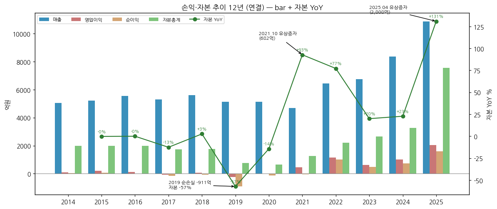

### ③ 회사 주가 역사 ★ narrative 영역

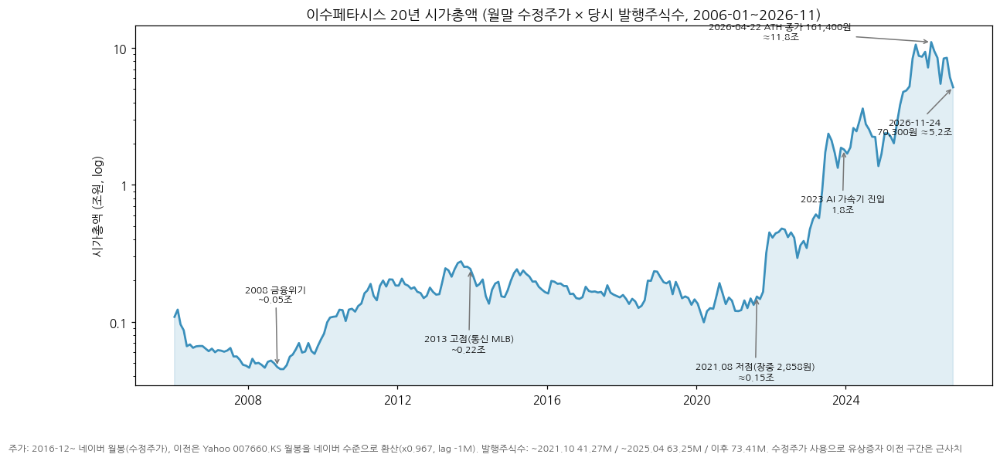

**시가총액 데이터** (네이버 금융 수정주가 기준, 발행주식수 73,409,219주):
- **사상 최고**: **2026-04-22 종가 161,400원 → 시총 약 11.8조원** (장중 52주 최고 165,000원, 네이버) [Source: 네이버 금융 일봉, 2026-11-25 조회]
- **현재**: **2026-11-24 종가 70,300원 → 시총 약 5.16조원** (ATH 대비 -56%). 11-25 장중 73,600원·시총 5.40조원 [네이버 금융]
- 연말 시총 (stockanalysis.com): 2021 0.46조 → 2022 0.36조 → 2023 1.86조 → 2024 1.73조 → 2025 **8.75조** → 2026-10-30 6.17조 [stockanalysis.com, 2026-11-02 조회]
- 20년 저점권: 2008-10 금융위기 시총 약 0.05조원 / 2021-08 장중 2,858원(수정주가)

**① 2006\~2020 — 통신 MLB 중견업체, 15년 박스권 (시총 0.05\~0.3조)**
→ 시스코·주니퍼 등 통신장비용 고다층 기판이 주력. 2011\~2013 통신 투자 사이클에 2013 OPM 8.8%까지 올랐으나,
→ 2014년 중국 후난 공장 가동 초기 적자 + 스마트폰 HDI 자회사 이수엑사보드 적자가 겹치며 2014\~2020 연결 OPM 평균 0.5%
→ 2019 순손실 -911억(엑사보드·중국 손상)으로 자본 1,777억 → 760억(-57%), 부채비율 448%

**② 2021\~2022 — 구조조정 + 400G 스위치·서버 (시총 0.1조 → 0.46조)**
→ 2021-07 이수엑사보드 PCB 사업 정리(영업정지), 2021-10 유상증자 682억 → 본업(고다층 MLB)만 남김
→ 2022 데이터센터 400G 스위치·서버 수요로 OPM 18.1%, 순이익 1,025억 — 12년 만의 최대 이익
→ 다만 주가는 2022년 금리 상승기에 0.36조로 오히려 하락 (연말 기준)

**③ 2023\~2025 — AI 가속기 보드 공급사로 재평가 (시총 0.36조 → 8.75조, 약 24배)**
→ 2023 네트워크 고객 재고조정으로 영업이익 -47%였지만, 데이터센터 E사 AI 가속기 매출 확대(별도 매출 내 E사 비중 2022 19% → 2023 32% → 2024 47%, 회사 IR)로 2023년 한 해 시총 5배
→ 2024-11-08 제이오(CNT 소재) 구주 인수(1,581억) + 유상증자 결의 → 다음 거래일(11-11) 주가 -22.7% → 2025-01 인수 철회, 유상증자는 시설투자 목적으로 진행(2025-04, 2,808억)
→ 2025 하반기 800G 스위치·AI 가속기 동반 증가, 연간 매출 1조 돌파(10,880억)·OPM 18.8% → 2025 연말 시총 8.75조

**④ 2026 — 사상 최고가 후 고변동 (11.8조 → 5.2조)**
→ 2026-04-22 종가 161,400원 사상 최고. 3Q26 분기 OPM 24.4%로 실적은 계속 최고치 경신
→ 2026-06 하순 'TPU 점유율 하락 우려'로 일간 약 -8% (mydailybyte 2026-06-29 주간 리포트)
→ 2026-07-28 -16.8%, 07-29 -10.4% 등 7월 한 달 132,900원 → 59,200원(-55%). 특별한 악재 공시 없이 차익실현·밸류에이션 부담·외국인·기관 동반 매도로 보도됨 [jkn.co.kr 2026-07-28·29]
→ 8월 114,000원 회복 후 10\~11월 재하락, 11-24 70,300원. 네이버 컨센서스 목표주가 평균 140,556원 (2026-11-24)

### ④ 회사의 주요 연혁

| 일자 | 내용 |
|---|---|
| 1972-02 | 대양상선(주) 설립 |
| 1989-06 | PCB 사업 개시 (남양정밀) |
| 1995-11 | 이수그룹 편입 (1996 이수전자) |
| 2000-03 / 08 | (주)페타시스 상호 변경 / 코스닥 상장 |
| 2000-09 | 미국 판매법인 ISU Petasys Corp. 설립 |
| 2002-03 | (주)이수페타시스로 상호 변경 |
| 2003-10 | 한국거래소 유가증권시장 이전 상장 |
| 2004-11 | (주)이수엑사보드 설립 (HDI·스마트폰 PCB) |
| 2008 | 고객사 "Supplier of the Year" 수상 (PCB 업계 최초, 회사 IR) |
| 2011-04 | 이수엑사플렉스(구 삼신써키트) 인수 |
| 2011-12 | 초고다층 PCB 세계일류상품 선정 |
| 2013-11 | 중국 후난 법인(ISU Petasys Hunan, 샹탄) 설립 |
| 2014-10 | 엑사보드가 이수엑사플렉스 흡수합병 |
| 2015-10 | 대구 제3공장 준공 |
| 2019 | 순손실 -911억 (엑사보드·중국 적자·손상) |
| 2021-07 | 이수엑사보드 PCB 사업 정리(영업정지) → 중단영업 |
| 2021-10 | 유상증자 (21,978,021주, 682억) |
| 2022-06 | 제4공장 착공 (다중적층 전용) |
| 2022-09 | 이수엑사보드 청산 |
| 2023-03 | 최창복 대표이사 취임 |
| 2023-05 | 제4공장 준공 |
| 2024-11 | (주)제이오 구주 인수계약(1,581억) + 유상증자 결의 |
| 2025-01 | 제이오 인수 철회 (계약금 158억 반환 소송 진행 중) |
| 2025-04 | 유상증자 완료 (10,162,800주, 2,808억) |
| 2025 | 태국 ISU-APEX 설립 (APEX Circuit 합작, 85%) / 국내복귀기업 선정(보조금 총 400억) / 연 매출 1조 돌파 |
| 2025-11 | 제5공장 착공 (2027.3Q 준공 목표) / 한기평 BBB 긍정적 |
| 2026-04 | 주가 사상 최고 (종가 161,400원) |
| 2026.3Q | 분기 OPM 24.4% (역대 최고), 수주잔고 7,849억 |

---

## 3. 비즈니스 모델

### ① 실적 추이 (연결 → 법인 → 고객군·공법 3단계 위계)

> 이수페타시스는 사업부가 하나(PCB)라 사업부 분해 대신 **법인(본사·중국·미국·옛 엑사보드) → 고객군(데이터센터·네트워크) → 공법(다중적층·VIPPO·일반)** 순으로 쪼갠다. 법인별 숫자는 연결조정 전 금액이라 합이 연결과 다르다.

**(1) 법인별 연간 (억원) — 2014\~2020 DART 종속기업 요약재무, 2020\~2025 회사 IR**

| 연도 | 본사(별도) 매출 | 본사 OP | 본사 OPM | 중국 매출 | 중국 OP | 미국 매출 | 미국 OP | 엑사보드 매출 | 엑사보드 OP | 연결 매출 | 연결 OP |
|---|---|---|---|---|---|---|---|---|---|---|---|
| 2014 | 3,072 | 303 | 9.9% | 426 | - | 273 | - | 1,719 | - | 5,048 | 103 |
| 2015 | 3,153 | 315 | 10.0% | 433 | -189 | 328 | 45 | 1,813 | 58 | 5,209 | 202 |
| 2016 | 3,529 | 282 | 8.0% | 403 | -163 | 261 | 29 | 2,083 | -3 | 5,542 | 111 |
| 2017 | 3,016 | 116 | 3.8% | 452 | -165 | 309 | 34 | 2,079 | -37 | 5,313 | -80 |
| 2018 | 3,331 | 354 | 10.6% | 561 | -232 | 319 | 36 | 1,669 | -104 | 5,603 | 75 |
| 2019 | 3,188 | 190 | 6.0% | 323 | -180 | 312 | 13 | 1,426 | -266 | 5,142 | -240 |
| 2020 | 3,351 | 222 | 6.6% | 509 | -107 | 292 | -36 | 1,210 | -105 | 5,142 | 20 |
| 2021 | 3,635 | 437 | 12.0% | 921 | 24 | 322 | 8 | - | - | 4,696 | 469 |
| 2022 | 4,972 | 964 | 19.4% | 1,427 | 203 | 371 | -6 | - | - | 6,429 | 1,166 |
| 2023 | 5,790 | 502 | 8.7% | 1,219 | 152 | 356 | -38 | - | - | 6,753 | 622 |
| 2024 | 7,187 | 785 | 10.9% | 1,524 | 184 | 283 | 45 | - | - | 8,369 | 1,019 |
| 2025 | 9,297 | 1,521 | 16.4% | 2,279 | 398 | 229 | 139 | - | - | 10,880 | 2,047 |

(본사 = OpenDART 별도 재무제표. 중국 2014\~2015 = ISU Petasys Asia, 2016\~ = Hunan. 2019 중국 숫자는 Hunan 단독 기준 — 같은 해 Asia(홍콩) 법인이 매출 327억·영업손실 -211억을 별도로 기록해 열 구분이 불명확 ⚠️. 2014 종속회사는 영업이익 미공시, 순이익만: 엑사보드 -87억·미국 +33억·중국 -176억. 2024 연결 OP: IR 2025-02 잠정 1,042억 → 확정 1,019억)

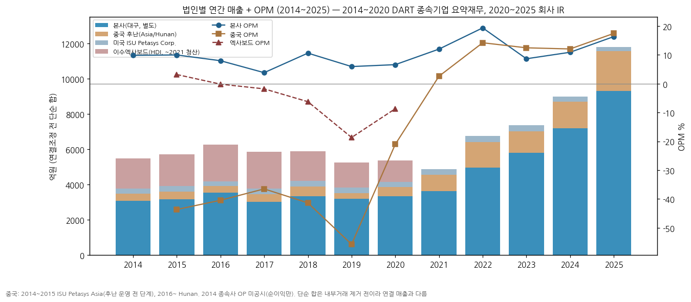

**(2) 법인별 분기 (억원, 회사 IR — 중국은 K-IFRS 감가상각 조정 포함)**

| 분기 | 본사 매출 | 본사 OP | 본사 OPM | 중국 매출 | 중국 OP | 중국 OPM | 미국 매출 | 미국 OP |
|---|---|---|---|---|---|---|---|---|
| 24.2Q | 1,742 | 237 | 13.6% | 372 | 51 | 13.7% | 86 | -10 |
| 25.1Q | 2,096 | 334 | 15.9% | 538 | 113 | 21.0% | 54 | 29 |
| 25.2Q | 2,097 | 318 | 15.2% | 500 | 70 | 14.0% | 53 | 32 |
| 25.3Q | 2,583 | 441 | 17.1% | 585 | 105 | 17.9% | 59 | 38 |
| 25.4Q | 2,521 | 429 | 17.0% | 649 | 110 | 16.9% | - | - |
| 26.1Q | 2,763 | 459 | 16.6% | 788 | 171 | 21.7% | - | - |
| 26.2Q | 3,082 | 549 | 17.8% | 867 | 169 | 19.5% | 75 | 50 |
| 26.3Q | 3,248 | 741 | 22.8% | 867 | 152 | 17.5% | 82 | 54 |

**(3) 본사(별도) 55분기 시계열 — 2013.1Q\~2026.3Q**

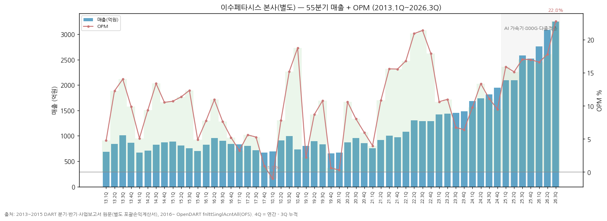

**(4) 종속회사 합산(연결 − 별도) 55분기**

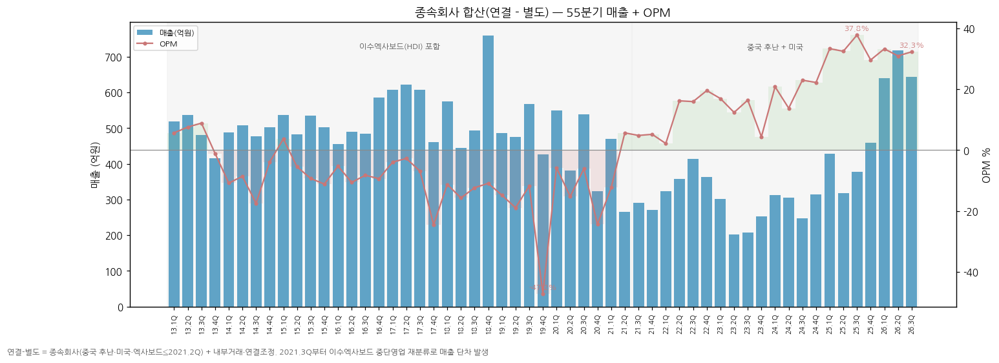

→ 2021.2Q까지는 엑사보드가 포함돼 '연결 − 별도' 매출이 분기 400\~600억, 영업이익이 매 분기 적자. 2021.3Q 중단영업 재분류 이후 중국·미국만 남아 매출 290억 → 3Q26 640억, 영업이익 흑자 전환

<details><summary>55분기 전체 표 (연결 / 별도 / 연결−별도, 억원)</summary>

| 분기 | 연결 매출 | 연결 OP | OPM | 별도 매출 | 별도 OP | 별도 OPM | 종속(연결−별도) 매출 | 종속 OP |
|---|---|---|---|---|---|---|---|---|
| 13.1Q | 1,208 | 62 | 5.2% | 689 | 33 | 4.8% | 519 | 30 |
| 13.2Q | 1,376 | 144 | 10.4% | 839 | 103 | 12.3% | 536 | 40 |
| 13.3Q | 1,490 | 184 | 12.4% | 1,009 | 142 | 14.1% | 481 | 43 |
| 13.4Q | 1,280 | 81 | 6.3% | 866 | 86 | 9.9% | 415 | -5 |
| 14.1Q | 1,157 | -19 | -1.6% | 669 | 34 | 5.1% | 488 | -53 |
| 14.2Q | 1,216 | 23 | 1.9% | 710 | 66 | 9.3% | 507 | -44 |
| 14.3Q | 1,303 | 27 | 2.1% | 826 | 111 | 13.4% | 477 | -84 |
| 14.4Q | 1,371 | 72 | 5.2% | 868 | 92 | 10.5% | 503 | -20 |
| 15.1Q | 1,421 | 114 | 8.0% | 883 | 95 | 10.7% | 538 | 20 |
| 15.2Q | 1,293 | 66 | 5.1% | 811 | 92 | 11.4% | 482 | -26 |
| 15.3Q | 1,291 | 44 | 3.4% | 756 | 93 | 12.4% | 534 | -50 |
| 15.4Q | 1,205 | -22 | -1.8% | 702 | 34 | 4.9% | 503 | -56 |
| 16.1Q | 1,279 | 40 | 3.1% | 824 | 64 | 7.8% | 455 | -24 |
| 16.2Q | 1,449 | 53 | 3.7% | 959 | 105 | 10.9% | 490 | -52 |
| 16.3Q | 1,389 | 29 | 2.1% | 905 | 69 | 7.6% | 484 | -40 |
| 16.4Q | 1,426 | -11 | -0.8% | 841 | 44 | 5.2% | 585 | -55 |
| 17.1Q | 1,438 | 3 | 0.2% | 830 | 27 | 3.3% | 608 | -24 |
| 17.2Q | 1,422 | 28 | 2.0% | 801 | 45 | 5.6% | 621 | -17 |
| 17.3Q | 1,326 | -4 | -0.3% | 718 | 38 | 5.3% | 608 | -42 |
| 17.4Q | 1,128 | -107 | -9.5% | 667 | 6 | 0.9% | 461 | -113 |
| 18.1Q | 1,265 | -72 | -5.7% | 690 | -7 | -1.0% | 575 | -65 |
| 18.2Q | 1,353 | 1 | 0.1% | 908 | 71 | 7.8% | 445 | -70 |
| 18.3Q | 1,492 | 91 | 6.1% | 998 | 152 | 15.2% | 494 | -61 |
| 18.4Q | 1,494 | 55 | 3.7% | 735 | 138 | 18.8% | 759 | -83 |
| 19.1Q | 1,288 | -54 | -4.2% | 802 | 18 | 2.2% | 486 | -72 |
| 19.2Q | 1,372 | -12 | -0.9% | 897 | 78 | 8.7% | 475 | -90 |
| 19.3Q | 1,401 | 23 | 1.6% | 833 | 90 | 10.8% | 568 | -67 |
| 19.4Q | 1,082 | -197 | -18.2% | 656 | 4 | 0.6% | 426 | -201 |
| 20.1Q | 1,222 | -30 | -2.5% | 673 | 2 | 0.3% | 549 | -32 |
| 20.2Q | 1,249 | 34 | 2.7% | 868 | 92 | 10.6% | 381 | -58 |
| 20.3Q | 1,495 | 44 | 2.9% | 957 | 77 | 8.0% | 538 | -33 |
| 20.4Q | 1,176 | -28 | -2.4% | 852 | 51 | 6.0% | 324 | -79 |
| 21.1Q | 1,223 | -28 | -2.3% | 753 | 30 | 4.0% | 470 | -58 |
| 21.2Q | 1,179 | 114 | 9.7% | 914 | 99 | 10.8% | 265 | 15 |
| 21.3Q | 1,290 | 170 | 13.2% | 999 | 156 | 15.6% | 291 | 14 |
| 21.4Q | 1,239 | 165 | 13.3% | 969 | 151 | 15.6% | 270 | 14 |
| 22.1Q | 1,405 | 189 | 13.5% | 1,082 | 182 | 16.8% | 323 | 7 |
| 22.2Q | 1,661 | 331 | 19.9% | 1,303 | 273 | 21.0% | 358 | 58 |
| 22.3Q | 1,707 | 343 | 20.1% | 1,293 | 277 | 21.4% | 414 | 66 |
| 22.4Q | 1,656 | 303 | 18.3% | 1,293 | 232 | 17.9% | 363 | 71 |
| 23.1Q | 1,720 | 202 | 11.7% | 1,419 | 151 | 10.6% | 301 | 51 |
| 23.2Q | 1,638 | 183 | 11.2% | 1,436 | 158 | 11.0% | 202 | 25 |
| 23.3Q | 1,662 | 132 | 7.9% | 1,455 | 98 | 6.7% | 207 | 34 |
| 23.4Q | 1,733 | 106 | 6.1% | 1,481 | 95 | 6.4% | 252 | 11 |
| 24.1Q | 1,996 | 230 | 11.5% | 1,684 | 165 | 9.8% | 312 | 65 |
| 24.2Q | 2,047 | 275 | 13.4% | 1,742 | 233 | 13.4% | 305 | 42 |
| 24.3Q | 2,064 | 259 | 12.5% | 1,816 | 202 | 11.1% | 248 | 57 |
| 24.4Q | 2,261 | 255 | 11.3% | 1,946 | 185 | 9.5% | 315 | 70 |
| 25.1Q | 2,525 | 477 | 18.9% | 2,096 | 334 | 15.9% | 429 | 143 |
| 25.2Q | 2,414 | 421 | 17.4% | 2,097 | 318 | 15.2% | 317 | 103 |
| 25.3Q | 2,961 | 584 | 19.7% | 2,583 | 441 | 17.1% | 378 | 143 |
| 25.4Q | 2,980 | 565 | 19.0% | 2,521 | 429 | 17.0% | 459 | 136 |
| 26.1Q | 3,403 | 672 | 19.7% | 2,763 | 459 | 16.6% | 640 | 213 |
| 26.2Q | 3,799 | 771 | 20.3% | 3,082 | 549 | 17.8% | 717 | 222 |
| 26.3Q | 3,892 | 949 | 24.4% | 3,248 | 741 | 22.8% | 644 | 208 |

</details>

(2013\~2015: DART 분기·반기·사업보고서 원문의 포괄손익계산서 3개월 금액, 4Q = 연간 − 3Q 누적. 2016\~: OpenDART. 2021.1Q·2Q 연결은 엑사보드 포함 최초 공시치, 2021.3Q부터 계속영업 기준이라 단차 있음)

**(5) 최근 12분기 (연결)**

| 분기 | 매출 | QoQ | YoY | 영업이익 | OPM | 순이익 |
|---|---|---|---|---|---|---|
| 23.4Q | 1,733 | +4.3% | +4.6% | 106 | 6.1% | 82 |
| 24.1Q | 1,996 | +15.2% | +16.0% | 230 | 11.5% | 175 |
| 24.2Q | 2,047 | +2.6% | +25.0% | 275 | 13.4% | 220 |
| 24.3Q | 2,064 | +0.8% | +24.2% | 259 | 12.5% | 145 |
| 24.4Q | 2,261 | +9.5% | +30.5% | 255 | 11.3% | 199 |
| 25.1Q | 2,525 | +11.7% | +26.5% | 477 | 18.9% | 383 |
| 25.2Q | 2,414 | -4.4% | +17.9% | 421 | 17.4% | 314 |
| 25.3Q | 2,961 | +22.7% | +43.5% | 584 | 19.7% | 472 |
| 25.4Q | 2,980 | +0.6% | +31.8% | 565 | 19.0% | 436 |
| 26.1Q | 3,403 | +14.2% | +34.8% | 672 | 19.7% | 504 |
| 26.2Q | 3,799 | +11.6% | +57.4% | 771 | 20.3% | 597 |
| 26.3Q | 3,892 | +2.4% | +31.4% | 949 | 24.4% | 650 |

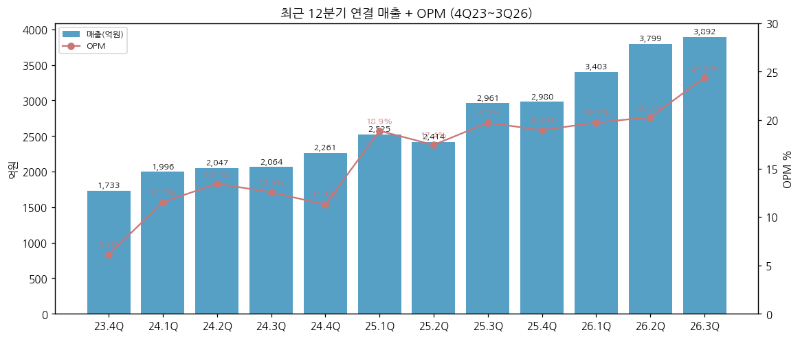

**(6) 고객군 — 데이터센터 vs 네트워크 (본사 별도, 회사 IR)**

| 구분 | 2022 | 2023 | 2024 | 25.3Q | 25.4Q | 26.1Q | 26.2Q | 26.3Q |
|---|---|---|---|---|---|---|---|---|
| 데이터센터 고객 비중 | 39% | 51% | 74% | 64% | 67% | 71% | 71% | 72% |
| 네트워크 고객 비중 | 61% | 49% | 26% | 36% | 33% | 29% | 29% | 28% |

| 주요 고객 (별도 매출 비중, IR 2025-02) | 2022 | 2023 | 2024 |
|---|---|---|---|
| E사 (데이터센터, AI 가속기·AI 스위치) | 19% | 32% | 47% |
| B사 (데이터센터, 가속기 H시리즈) | 1% | 4% | 12% |
| Me사 (데이터센터, 800G 스위치) | 13% | 10% | 9% |
| A사 (네트워크, 400/800G 스위치) | 5% | 6% | 5% |
| C사 (네트워크) | 12% | 10% | 4% |
| N사 (네트워크) | 17% | 8% | 7% |
| J사 (네트워크) | 12% | 13% | 3% |

(⚠️ IR의 고객 알파벳 코드와 DART 사업보고서의 'A사'(연결 매출 41%)는 서로 다른 코드 체계. 회사는 고객명을 공개하지 않음)

| 제품별 비중 (본사, IR 2026-02) | FY23 | FY24 | FY25 |
|---|---|---|---|
| 가속기 | 17% | 41% | 19% |
| 스위치 | 62% | 51% | 70% |
| 기타 | 21% | 8% | 11% |

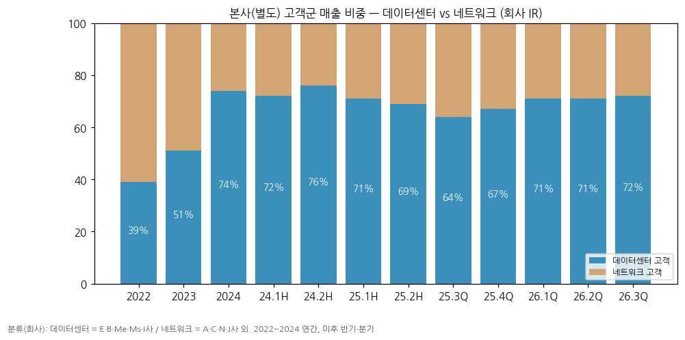

**(7) 수주·공법 믹스 (회사 IR + DART)**

| 항목 | 값 |
|---|---|
| 연간 수주 (본사) | 2023 6.4천억 → 2024 7.3천억 → 2025 1조 → 2026E 1.3조+ (IR 2026-02) |
| 1\~3Q26 누적 수주 (연결, DART) | **1조 3,411억** (209,507㎡) · 납품 8,984억 |
| 수주잔고 (DART, 2026-09-30) | **7,849억** (110,909㎡) — 2025말 3,576억 대비 2.2배 |
| 다중적층 매출 비중 | FY24 3% → FY25 9% → FY26E 31% / 분기 26.1Q 14% → 2Q 24% → 3Q 33% |
| 다중적층 CAPA (월) | 2단계 8K㎡ (26.3Q 양산) → 추가투자 10.5K㎡ (27.1Q) → 3단계 12.5K㎡+α (28.2Q) |
| 월 매출 CAPA (본사) | 850억 (1단계, 25.4Q) → 950억 (2단계, 26.2H) → 1,250억 (3단계·5공장, 27.3Q 준공·28년 이설 완료) |
| 월평균 매출 (본사) | 2024 600억 → 25.1H 700억 → 25.2H 850억 → 26.2Q 1,027억 → 26.3Q 1,083억 |

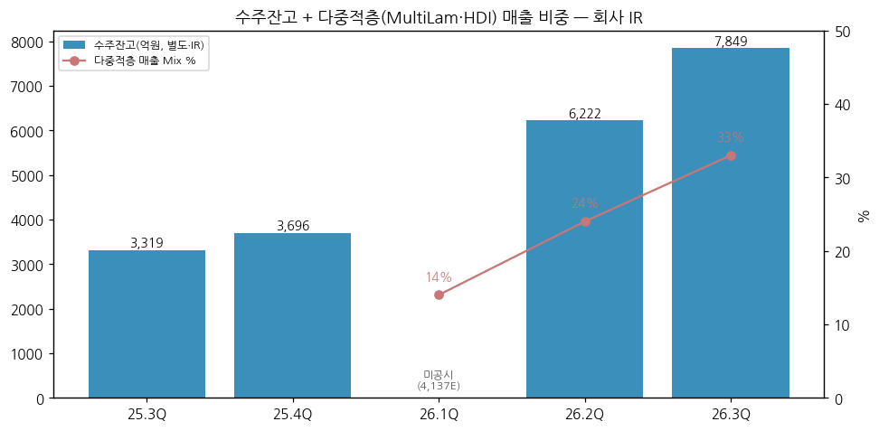

### ② 사업 개요 (매출 비중 큰 순서, 직관적 설명)

**1. 본사 — 초고다층 MLB (연결의 약 85%, 2025 9,297억, OPM 16.4% → 3Q26 22.8%)**
→ 대구 1\~4공장. 18층 이상(최대 50층대) 고다층 기판을 100% 주문 생산. 전방은 구글·메타 등 하이퍼스케일러의 AI 가속기(ASIC) 보드와 데이터센터 스위치(400G·800G, 차기 1.6T), 통신장비 업체의 라우터
→ 공법은 두 갈래: **VIPPO**(비아 위에 패드를 올리는 고다층 일반 공법) / **다중적층**(MultiLam: 여러 번 나눠 적층해 신호 손실을 줄임 — 스위치·라우터 / HDI: 구리로 비아를 채워 신호 경로를 짧게 — 가속기). 다중적층은 공정이 길고 수율 관리가 어려워 판가·마진이 높음
→ 평균판가 2020 218만원/㎡ → 2025 445만원/㎡ (2.0배, 사업보고서). 같은 기간 생산량은 159천㎡ → 214천㎡(1.35배) — **성장의 대부분이 판가(층수·공법 고도화)**

**2. 중국 후난 — 중·고다층 (2025 매출 2,279억, OPM 17.5%)**
→ 2013 설립, 샹탄. 18층 이하 중다층 + VIPPO. 미주 서버 고객(O사·G사) 중심, 2026년 스위치(A사)로 확대. VIPPO 비중 2025 53% → 2026E 65% (IR)
→ 2014\~2020 7년 연속 영업적자(연 -100\~-230억)였다가 2021 흑자 전환, 2025 영업이익 398억

**3. 미국 ISU Petasys Corp. — 영업법인 (2025 매출 229억)**
→ 2000 설립, 북미 고객 영업·마케팅. 2024 생산부문 정리 후 영업 전담

**4. 태국 ISU-APEX — 신설 (2025, 지분 85%)**
→ APEX Circuit(태국)과 합작. 중저층 VIPPO·일반 MLB 생산 거점 예정. 2026 상반기 APEX 자체 투자, 하반기 ISU 추가 투자 검토 (IR 2026-02)

**(과거) 이수엑사보드 — HDI·스마트폰 PCB (2014\~2020 매출 1,200\~2,100억, 2021 정리)**
→ 2016\~2020 5년 연속 영업적자. 연결 이익을 0 근처로 끌어내린 주범. 2021-07 영업정지, 2022-09 청산

### ③ 사업 디테일

**본사 3Q26 (IR 2026-11-17)**
→ 매출 3,248억 (QoQ +5%), 영업이익 741억 (QoQ +35%), OPM 22.8% (QoQ +5%p)
→ 다중적층 Mix 33% (2Q 24%), 원자재 가격 상승분 단계적 판가 반영, USD 기준 매출 QoQ +12.3% (환율 하락에도 CAPA 증가)
→ 4Q 전망: 주력 고객 MultiLam 초도 양산, ASIC 신규 가속기·1.6T 스위치 초도 양산

**고객별 신제품 로드맵 (IR 2026-11-17)**
→ A사: 차세대 MultiLam 스위치·가속기 26.4Q 초도 양산, 2027 MultiLam 전환 본격화 (가속기가 스위치보다 빠름)
→ B사: 기존 ASIC 가속기 핵심 벤더, 차세대 가속기(44L MultiLam) 샘플 → 27.1Q 초도 양산
→ C사: 800G 스위치(54L MultiLam) 26.4Q 초도 양산, ASIC 가속기(36L) 27.1Q
→ D사: MultiLam 스위치 샘플 → 2027 양산 목표 / E사: 1.6T 스위치 2종 양산 수주, 26.4Q 초도
→ 신규: I사 1.6T 스위치(46L)·가속기(38L) 27.1Q, J사 800G(40L) 27.1Q, K사 자체 데이터센터 가속기 베이스보드(26L) 26.4Q

**중국법인 3Q26**
→ 매출 867억 (QoQ 0%), 영업이익 152억 (QoQ -10%, OPM 17.6%) — 주력 고객 판가 전이 지연. 신규 수주 QoQ +17%, Blended ASP QoQ +8%. 4Q E사 VIPPO(30L)·G사 VIPPO(20L) 초도 양산

**원재료 (2025 사업보고서, 본사 매입 3,773억)**
→ Thin Core 47.5% · Prepreg 35.3% (Panasonic, EMC, 두산전자) · 동박 0.5% · 부재료 16.7%
→ Thin Core 수입 단가 $49.62 → $56.16/㎡ (+13%, 2025) — 고부가 원자재 비중 증가. 원가 상승분은 분기 단위 시차를 두고 판가에 반영

### ④ 주요 경쟁사

| 구분 | 경쟁사 | 비고 |
|---|---|---|
| 18층+ 초고다층 (RCD 2024) | TTM Technologies(미국, 18%) · WUS/沪电(15%) · Unimicron(11%) · Gold Circuits/金像(7%) · Shennan(6%) · Avary(4%) · Victory Giant/胜宏(4%) | 이수페타시스 20% 1위 |
| 국내 MLB | 대덕전자(MLB 일부) · 코리아써키트 | 국내 MLB 매출 1위 (회사 IR) |
| 중국법인 영역(중다층) | 중국·대만 다수 중다층 업체 | 가격 경쟁 강도 높음 |

### ⑤ 주요 매출처

> ⚠️ DART는 10% 이상 매출처만 익명(A사·B사…)으로 공시. 고객명은 비공개이며, 아래 시장 추정은 이 문서에 넣지 않는다.

| 연도 | 10% 이상 매출처 | 비중 (연결) |
|---|---|---|
| 2022 | A사 13.0% · B사 11.2% · C사 14.0% | 3개사 38.2% |
| 2023 | A사 33.7% · B사 11.1% | 2개사 44.8% |
| 2024 | A사 40.5% | 1개사 |
| 2025 | A사 41.1% (4,475억) | 1개사 |
| 1\~3Q26 | A사 43.1% (4,779억) | 1개사 |

→ 사업보고서: "A사, M사, G사가 글로벌 시장의 60% 이상을 점유하는 상황에서 G사와 M사를 고객으로 확보" (II-7, 2025). 고객은 대부분 데이터센터·AI·통신장비 기업

### ⑥ 생산 CAPA + 임직원 추이

| 연도 | 대구공장 생산능력(천㎡) | 생산실적(천㎡) | 가동률 | 평균판가(원/㎡) | 임직원(별도, 명) | R&D(억원) | R&D/매출 |
|---|---|---|---|---|---|---|---|
| 2013 | 211 | 210 | 99.5% | - | - | 22 | 0.63% |
| 2014 | 209 | 181 | 86.6% | - | - | 27 | 0.87% |
| 2015 | 206 | 136 | 66.0% | - | - | 28 | 0.90% |
| 2016 | 192 | 131 | 77.9% | - | 853 | 26 | 0.74% |
| 2017 | 190 | 132 | 69.4% | - | - | 29 | 0.97% |
| 2018 | 195 | 152 | 77.7% | - | - | 25 | 0.75% |
| 2019 | - | 127 | 72.5% | - | 903 | 32 | 1.00% |
| 2020 | 164 | 159 | 90.8% | 2,179,362 | 883 | 26 | 0.75% |
| 2021 | 145 | 143 | 82.2% | 2,561,320 | 910 | 34 | 0.94% |
| 2022 | 172 | 169 | 98.7% | 3,014,178 | 967 | 41 | 0.82% |
| 2023 | 191 | 184 | 96.3% | 3,025,648 | 1108 | 53 | 0.91% |
| 2024 | 200 | 188 | 94.1% | 3,723,084 | 1186 | 68 | 0.94% |
| 2025 | 228 | 214 | 93.7% | 4,452,332 | 1368 | 84 | 0.90% |
| 3Q26 | - | - | - | - | 1,553 | - | - |

(CAPA·생산·가동률·판가 = 사업보고서 II-3 대구공장(별도). 2019\~2021 CAPA는 산출 기준 변경으로 2022 보고서 재작성치(2020 164·2021 145) 사용, 2019 원공시 262천㎡는 기준 불일치로 제외. 임직원 = 별도 기준, 2016·2019는 OpenDART 직원현황. R&D = 별도 연구개발비용, 비율은 별도 매출 대비)

→ 평균 연봉(2025, 남성 기준) 약 9,922만원 (OpenDART 직원현황, 2022 남성 8,861만원)

---

## 4. 재무 구조

> 모든 표 연결 기준, 단위 억원 (OpenDART fnlttSinglAcntAll. 2014은 2015 사업보고서 전기 컬럼). 2014\~2020은 엑사보드 포함

### ① 손익계산서 (12년)

| 연도 | 매출 | 매출원가 | 매출총이익 | GPM | 판관비 | CIR | 영업이익 | OPM | 금융원가 | 순이익 | NPM | 지배순이익 |
|---|---|---|---|---|---|---|---|---|---|---|---|---|
| 2014 | 5,048 | 4,524 | 524 | 10.4% | 421 | 8.3% | 103 | 2.0% | 83 | 26 | 0.5% | 96 |
| 2015 | 5,209 | 4,595 | 614 | 11.8% | 413 | 7.9% | 202 | 3.9% | 80 | 65 | 1.2% | 156 |
| 2016 | 5,542 | 4,969 | 573 | 10.3% | 462 | 8.3% | 111 | 2.0% | 75 | 2 | 0.0% | 37 |
| 2017 | 5,313 | 4,929 | 384 | 7.2% | 465 | 8.7% | -80 | -1.5% | 78 | -149 | -2.8% | -140 |
| 2018 | 5,603 | 5,036 | 568 | 10.1% | 493 | 8.8% | 75 | 1.3% | 104 | -74 | -1.3% | -68 |
| 2019 | 5,142 | 4,878 | 265 | 5.1% | 504 | 9.8% | -240 | -4.7% | 110 | -911 | -17.7% | -911 |
| 2020 | 5,142 | 4,673 | 469 | 9.1% | 450 | 8.7% | 20 | 0.4% | 267 | -135 | -2.6% | -135 |
| 2021 | 4,696 | 3,841 | 855 | 18.2% | 386 | 8.2% | 469 | 10.0% | 192 | -36 | -0.8% | -36 |
| 2022 | 6,429 | 4,790 | 1,639 | 25.5% | 473 | 7.4% | 1,166 | 18.1% | 422 | 1,025 | 15.9% | 1,025 |
| 2023 | 6,753 | 5,589 | 1,164 | 17.2% | 543 | 8.0% | 622 | 9.2% | 384 | 477 | 7.1% | 477 |
| 2024 | 8,369 | 6,803 | 1,566 | 18.7% | 547 | 6.5% | 1,019 | 12.2% | 461 | 740 | 8.8% | 740 |
| 2025 | 10,880 | 8,057 | 2,823 | 25.9% | 776 | 7.1% | 2,047 | 18.8% | 472 | 1,605 | 14.7% | 1,605 |

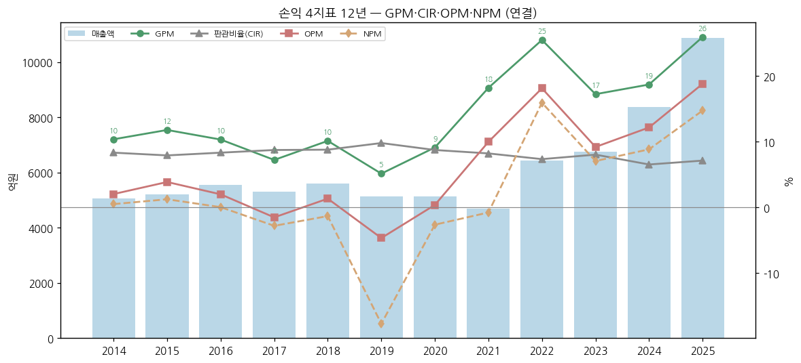

→ GPM 2019 5.2% → 2025 25.9% (+21%p). 판관비율은 9\~10% → 7%로 낮아져 영업 레버리지가 크게 작동
→ 2025 순이익 1,605억 중 비지배지분 미미 (태국 법인 15%)

### ② 재무상태표 (12년)

| 연도 | 자산총계 | 유동자산 | 현금성자산 | 재고자산 | 유형자산 | 부채총계 | 유동부채 | 자본총계 | 자본금 | 이익잉여금 |
|---|---|---|---|---|---|---|---|---|---|---|
| 2014 | 5,216 | 2,677 | 572 | 667 | 2,006 | 3,230 | 2,419 | 1,986 | 413 | 1,347 |
| 2015 | 5,063 | 2,440 | 619 | 609 | 2,053 | 3,082 | 2,340 | 1,981 | 413 | 1,451 |
| 2016 | 5,511 | 3,405 | 604 | 713 | 1,542 | 3,530 | 2,626 | 1,981 | 413 | 1,476 |
| 2017 | 4,833 | 2,713 | 654 | 732 | 1,623 | 3,102 | 2,551 | 1,731 | 413 | 1,307 |
| 2018 | 5,056 | 2,688 | 254 | 876 | 1,869 | 3,279 | 2,683 | 1,777 | 413 | 1,168 |
| 2019 | 4,167 | 2,247 | 270 | 818 | 1,438 | 3,407 | 3,026 | 760 | 413 | 168 |
| 2020 | 3,894 | 2,243 | 232 | 942 | 1,306 | 3,243 | 2,950 | 651 | 413 | 7 |
| 2021 | 4,497 | 3,103 | 444 | 1,113 | 1,113 | 3,242 | 2,982 | 1,255 | 632 | -54 |
| 2022 | 5,460 | 3,739 | 456 | 1,675 | 1,316 | 3,237 | 2,860 | 2,223 | 632 | 765 |
| 2023 | 6,264 | 3,836 | 480 | 1,761 | 1,924 | 3,597 | 2,905 | 2,668 | 632 | 1,144 |
| 2024 | 7,901 | 5,227 | 804 | 1,869 | 2,015 | 4,626 | 3,774 | 3,275 | 632 | 1,723 |
| 2025 | 12,895 | 8,628 | 1,628 | 2,988 | 3,075 | 5,333 | 4,165 | 7,562 | 734 | 3,258 |
| 3Q26말 | 15,039 | 9,892 | - | - | - | 5,957 | 4,425 | 9,082 | 734 | 4,841 |

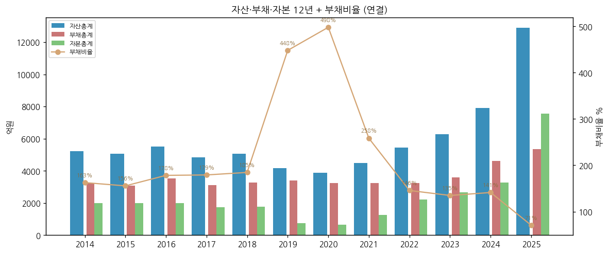

→ 2025 자본 7,562억 = 유상증자 2,808억 + 순이익 1,605억. 재고자산 2,988억 (2024 1,869억, +60%) — 수주잔고 확대에 따른 원자재·재공품 증가

### ③ 현금흐름표 (12년)

| 연도 | 영업CF | 투자CF | 재무CF | 유형자산 취득 | FCF(영업CF−유형취득) | 배당 지급 | 유상증자 유입 |
|---|---|---|---|---|---|---|---|
| 2014 | 285 | -640 | 503 | 767 | -482 | 41 | - |
| 2015 | 488 | -312 | -132 | 291 | 198 | 32 | - |
| 2016 | -1 | -105 | 114 | 190 | -191 | 36 | - |
| 2017 | 67 | 110 | -90 | 391 | -324 | 40 | - |
| 2018 | -266 | -167 | 15 | 258 | -524 | 28 | - |
| 2019 | 155 | -216 | 70 | 221 | -66 | 28 | - |
| 2020 | -222 | 33 | 193 | 114 | -336 | 24 | - |
| 2021 | 40 | -229 | 624 | 160 | -120 | 0 | 682 |
| 2022 | 298 | -123 | -172 | 397 | -99 | 0 | - |
| 2023 | 525 | -614 | 103 | 652 | -127 | 63 | - |
| 2024 | 849 | -630 | 31 | 599 | 250 | 63 | - |
| 2025 | 1,688 | -3,467 | 2,622 | 1,535 | 153 | 95 | 2,808 |
| 1\~3Q26 | - | - | 41 | 1,114 | - | 169 | - |

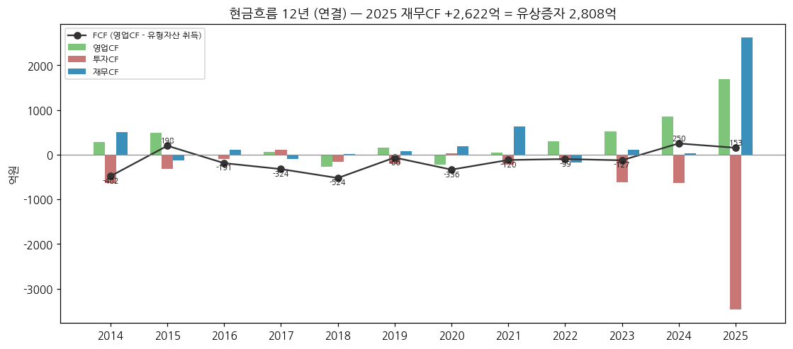

→ 2016\~2021 영업CF가 사실상 0 근처(누적 -227억) — 엑사보드·중국 적자와 운전자본 부담. 2022년 이후 영업CF 흑자 정착
→ 2025 투자CF -3,467억 중 유형자산 1,535억 · 단기금융상품 순취득 1,746억 · 투자부동산 265억 · 지분법투자(부동산 투자신탁) 307억

### ④ CapEx 추이 (12년)

| 연도 | 유형자산 취득 | 무형자산 취득 | 합계 | CapEx/매출 | 주요 투자 |
|---|---|---|---|---|---|
| 2014 | 767 | 24 | 791 | 15.2% | 중국 후난 공장 건설(2013.11 설립) |
| 2015 | 291 | 7 | 297 | 5.6% | 대구 3공장 준공(2015.10) |
| 2016 | 190 | 7 | 197 | 3.4% |  |
| 2017 | 391 | 6 | 397 | 7.4% |  |
| 2018 | 258 | 5 | 263 | 4.6% |  |
| 2019 | 221 | 3 | 224 | 4.3% |  |
| 2020 | 114 | 7 | 122 | 2.2% | 투자 최소화(재무 개선) |
| 2021 | 160 | 1 | 161 | 3.4% |  |
| 2022 | 397 | 2 | 399 | 6.2% | 4공장 착공(2022.06) |
| 2023 | 652 | 4 | 656 | 9.7% | 4공장 준공(2023.05) |
| 2024 | 599 | 23 | 622 | 7.2% | 병목공정 선제 투자(1단계) |
| 2025 | 1,535 | 16 | 1,551 | 14.1% | 다중적층 2단계·5공장(B동) 활용, 5공장 착공(2025.11) |
| 1\~3Q26 | 1,114 | 0 | 1,114 | 10.0% | 다중적층 3단계·5공장 신축 진행 |

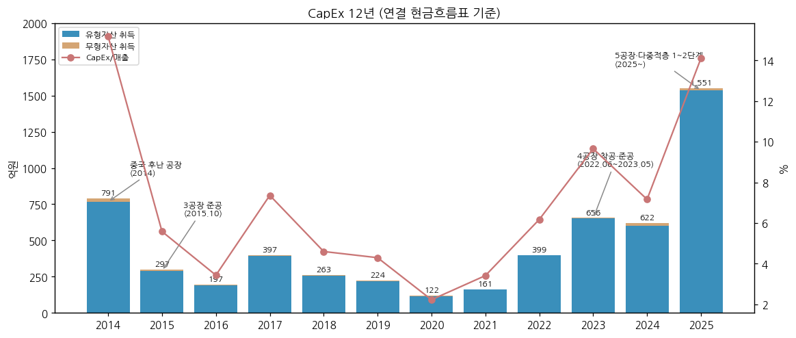

### ⑤ 부채구조 (12년)

| 연도 | 금융부채(차입금·사채·리스 등) | 현금성자산 | 순차입 | 부채비율 | 유동비율 | 영업이익/금융원가 |
|---|---|---|---|---|---|---|
| 2014 | 2,125 | 572 | 1,552 | 163% | 111% | 1.2x |
| 2015 | 2,038 | 619 | 1,419 | 156% | 104% | 2.5x |
| 2016 | 2,285 | 604 | 1,681 | 178% | 130% | 1.5x |
| 2017 | 2,161 | 654 | 1,507 | 179% | 106% | -1.0x |
| 2018 | 2,194 | 254 | 1,939 | 185% | 100% | 0.7x |
| 2019 | 2,350 | 270 | 2,080 | 448% | 74% | -2.2x |
| 2020 | 2,472 | 232 | 2,240 | 498% | 76% | 0.1x |
| 2021 | 2,251 | 444 | 1,808 | 258% | 104% | 2.4x |
| 2022 | 2,086 | 456 | 1,630 | 146% | 131% | 2.8x |
| 2023 | 2,299 | 480 | 1,819 | 135% | 132% | 1.6x |
| 2024 | 2,572 | 804 | 1,768 | 141% | 139% | 2.2x |
| 2025 | 2,450 | 1,628 | 822 | 71% | 207% | 4.3x |

(금융부채 = 재무상태표의 유동·비유동 금융부채 합계 — 차입금·사채·리스부채 등. 계정 명칭이 연도별로 달라 근사치 ⚠️)

→ 신용등급 이력: 무보증사채 BB- 상향검토(2020-06) → BB+ 부정적(2020\~2021) → BB+ 안정적(2022\~2023) → 기업신용 BBB 안정적(2024-09) → **BBB 긍정적(2025-11)** [사업보고서]
→ 국내복귀기업 보조금: 총 400억 약정, 2025 정부보조금 221억 수취 (3Q26 분기보고서 주석)

### ⑥ 배당·자사주 추이 (12년)

| 사업연도 | DPS(원) | 배당총액(억원) | 연결 배당성향 | 자사주 매입 | 비고 |
|---|---|---|---|---|---|
| 2014 | 80 | 32 | 33% | 없음 |  |
| 2015 | 90 | 36 | 23% | 없음 |  |
| 2016 | 100 | 40 | 107% | 없음 |  |
| 2017 | 70 | 28 | - | 없음 | 순손실 |
| 2018 | 70 | 28 | - | 없음 | 순손실 |
| 2019 | 60 | 24 | - | 없음 | 순손실 -911억에도 배당 |
| 2020 | 0 | 0 | - | 없음 | 무배당 |
| 2021 | 0 | 0 | - | 없음 | 무배당 (엑사보드 정리) |
| 2022 | 100 | 63 | 6% | 없음 | 배당 재개 |
| 2023 | 100 | 63 | 13% | 없음 |  |
| 2024 | 150 | 95 | 13% | 없음 |  |
| 2025 | 230 | 169 | 11% | 없음 | 유상증자 후 주식수 7,341만주 기준 |

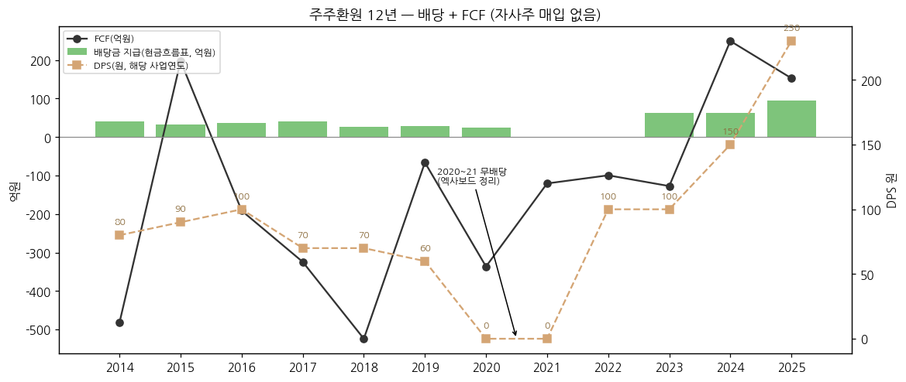

→ 자기주식 매입·소각 이력 없음. 2025 사업보고서에 '현금배당 예측가능성 제공·배당정책 주주통지'를 지배구조 개선 사항으로 기재

### ⑦ 재무 비율 (12년)

| 연도 | ROE | ROA | 부채비율 | 유동비율 | 영업이익/금융원가 | GPM | OPM |
|---|---|---|---|---|---|---|---|
| 2014 | 1.3% | 0.5% | 163% | 111% | 1.2x | 10.4% | 2.0% |
| 2015 | 3.3% | 1.3% | 156% | 104% | 2.5x | 11.8% | 3.9% |
| 2016 | 0.1% | 0.0% | 178% | 130% | 1.5x | 10.3% | 2.0% |
| 2017 | -8.0% | -3.1% | 179% | 106% | -1.0x | 7.2% | -1.5% |
| 2018 | -4.2% | -1.5% | 185% | 100% | 0.7x | 10.1% | 1.3% |
| 2019 | -71.8% | -21.9% | 448% | 74% | -2.2x | 5.1% | -4.7% |
| 2020 | -19.1% | -3.5% | 498% | 76% | 0.1x | 9.1% | 0.4% |
| 2021 | -3.8% | -0.8% | 258% | 104% | 2.4x | 18.2% | 10.0% |
| 2022 | 58.9% | 18.8% | 146% | 131% | 2.8x | 25.5% | 18.1% |
| 2023 | 19.5% | 7.6% | 135% | 132% | 1.6x | 17.2% | 9.2% |
| 2024 | 24.9% | 9.4% | 141% | 139% | 2.2x | 18.7% | 12.2% |
| 2025 | 29.6% | 12.4% | 71% | 207% | 4.3x | 25.9% | 18.8% |

(ROE = 당기순이익 / 기초·기말 평균 자본. 3Q26말 부채비율 66% (IR))

---

## 5. 지배 구조

### ① 그룹·계열 관계

- **이수그룹** 계열 — 지주 성격의 (주)이수가 최대주주. 그룹 상장 계열: 이수스페셜티케미컬(457190), 이수화학(005950) 등
- 동일인 측 특수관계인: 김선정 3.68%, 김상범 0.90% 등 (김상범 이수그룹 회장 일가) — 합계 26.13%
- 2021·2025 두 번의 유상증자에 (주)이수가 참여해 지분율 21.19% → 21.47% 유지

### ② 주주 구분

| 주주 | 주식수 | 지분율 | 기준일 |
|---|---|---|---|
| (주)이수 | 15,758,415 | 21.47% | 2026-09-30 |
| 김선정 외 특수관계인 5인 | 3,424,810 | 4.66% | 2026-09-30 |
| **최대주주 등 합계** | **19,183,225** | **26.13%** | 2026-09-30 |
| 국민연금공단 | 7,524,604 | 10.25% | 2025-12-31 (2025-09-30 11.50%, 2025-06-30 12.87%) |
| 우리사주조합 | 304,521 | 0.41% | 2025-12-31 |
| 외국인 | - | 14.04% | 2026-11-25 (네이버 외국인 소진율) |
| 발행주식총수 | 73,409,219 | 100% | 보통주만, 자기주식 0 |

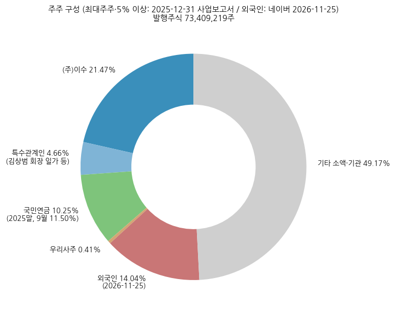

→ 최대주주 지분율 추이: 30.82%(2016) → 31.08%(2019) → 26.61%(2022) → 26.13%(2025) — 유상증자로 특수관계인 지분 희석

### ③ 임원·이사회 (3Q26 분기보고서 기준)

| 성명 | 직위 | 담당 | 주요 경력 |
|---|---|---|---|
| 최창복 | 사장, 사내이사 | 대표이사 | 서강대 MBA. (전) 이수페타시스 기획담당, (주)이수 경영기획담당 |
| 오욱현 | 부사장, 사내이사 | 공장장 | 영남대 공업화학. (전) 생산본부장 |
| 이봉림 | 부사장, 사내이사 | 품질본부장 | 경북대 공업화학 석사. 3Q26 분기보고서 등기임원 명단에 새로 기재 (2025말 명단의 양원호 관리본부장은 제외) |
| 양승한 | 사외이사 | - | U. Michigan 기계공학 박사, 경북대 교수 |
| 김숙 | 감사 | - | 경희대 회계학, (전) 산업은행 연금신탁본부장 |

→ 이사회 4인(사내 3 · 사외 1), 이사회 내 위원회 없음, 의장 = 대표이사 겸직. 서스틴베스트 지배구조(G) 57.03점 (섹터 평균 53.05) — E·S 대비 낮음
→ 대표이사 변동: 서영준(2020\~2023.03 사임) → 최창복(2023.03\~)

---

## 6. 기타 팩트

### ① R&D 인프라

- 기업부설연구소 (대구) — 연구개발그룹 산하 연구개발팀·기술1팀·기술2팀
- 연구개발비 2025 **84억** (별도 매출의 0.90%), 2013 22억 → 12년 3.9배

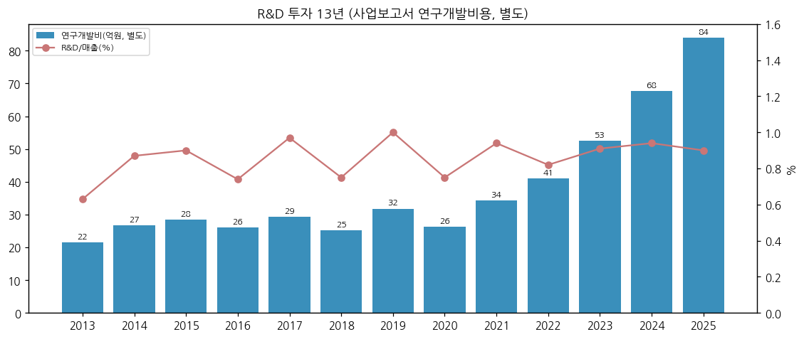

### ② 진행 중 corporate action — 10년치

| 시기 | 내용 | 상태 |
|---|---|---|
| 2014-10 | 이수엑사보드–이수엑사플렉스 합병 | 완료 |
| 2021-07 | 이수엑사보드 PCB 사업 정리 → 2022-09 청산 (베트남 법인 포함) | 완료 |
| 2021-10 | 유상증자 682억 | 완료 |
| 2024-11 | (주)제이오 구주 인수계약 1,581억 | **2025-01 철회** — 계약금 158억 장기미수금, 제이오 측이 2025-03-21 질권소멸통지 청구 소송 제기(소송가액 161억) → 진행 중 |
| 2025-04 | 유상증자 2,808억 (10,162,800주) | 완료 |
| 2025 | 태국 ISU-APEX 설립(85%) · 부동산 투자신탁 2종 수익증권 투자 | 진행 |
| 2025-11 \~ 2027.3Q | 제5공장 신축 (월 매출 CAPA 1,250억 목표) | 진행 |

### ③ 기술 마일스톤 — 10년치

| 시기 | 내용 |
|---|---|
| 2011-12 | 초고다층 PCB 세계일류상품 |
| 2019 | 고객 "TOP Direct component supplier"·"Excellence in Technology" 수상 (IR) |
| 2022\~ | AI 가속기(E사 v4 → v6) 보드 매출 확대 |
| 2023-05 \~ | AI Accelerator용 PCB 개발 과제 (Stacked Via, Multi Lamination, High Aspect Ratio) — 2026-12 종료 예정 |
| 2024 하반기 | 800G 스위치 양산 확대 |
| 2025-01 \~ 2028-12 | 1600G 데이터센터 네트워크용 PCB 개발 (Backdrill stub 최소화, 3D SI 시뮬레이션) |
| 2021-09 \~ 2026-12 | Cavity 구조 PCB, Super Ultra Low Loss 할로겐프리 소재 개발 |
| 2026.3Q | 다중적층 매출 비중 33%, 1.6T 스위치·차세대 ASIC 가속기 26.4Q\~27.1Q 초도 양산 예정 |

### ④ 주요 리스크

- **고객 집중**: 최대 고객 1개사 연결 매출 43.1% (1\~3Q26). 고객 모델 전환기에 분기 매출 감소 사례(2Q25)
- **AI 가속기 경쟁 구도**: 특정 ASIC(TPU 등) 점유율 변화가 주가에 직접 반영 (2026-06 사례)
- **원자재 가격 전가 시차**: Thin Core·Prepreg가 매입의 83%. 중국법인은 3Q26 판가 전이 지연으로 OPM -2%p
- **CapEx·감가상각 증가**: 2025 CapEx 1,535억(매출의 14%), 5공장·다중적층 3단계로 2026\~2028 투자 지속
- **환율**: 수출 98% — 원화 강세 시 원화 매출 감소 (3Q26 '환율 하락에도 CAPA로 매출 증가'로 언급)
- **소송**: 제이오 계약금 158억 반환 관련 소송 (결과 예측 불가, 분기보고서 주석)
- **주가 변동성**: 2026-07 한 달 -55% 등 일간 두 자릿수 등락 반복

### ⑤ ESG 등급

| 평가 | 결과 |
|---|---|
| 서스틴베스트 | 2023 A/BB → 2024 A/A → 2025 A/A → **2026 상반기 AA** (한 단계 상향). 2025 하반기 전체 257위/1,299사, 섹터 7위/64사 |
| 서스틴베스트 세부 (2025) | E 83.84 · S 83.91 · G 57.03 (섹터 평균 35.65 · 43.30 · 53.05) |
| RBA (전자산업연합) | Silver (최초심사 최고점 181.5점, 2025-03) |
| TIME | 'World's Best Companies in Sustainable Growth 2027' 글로벌 332위 (국내 12사 중 8위) |
| 지배구조 핵심지표 준수율 | 20%(2024) → 47%(2025) → 60%(2026E) → 70%(2029 목표) |

### ⑥ 인증·라이선스

- TL9000 (2003, 통신) · AS9100 (2007, 항공우주) · Nadcap (2010) · ITAR (2010, 미국 방산) · TS16949 (2015, 자동차) [회사 IR]
- 고객 수상: "Supplier of the year" (2008·2009), "Excellence In Quality" (2010)

---

## Source Audit

✅ **확보**
→ OpenDART 재무 JSON 88개 (연결·별도, 2015 FY\~3Q26) + 분기 요약 2종 (2016.1Q\~2026.3Q)
→ DART 공시원문 XML 52건: 사업보고서 2013\~2025 (2020·2024는 기재정정본), 분기·반기 2014.1Q\~2026.3Q — 2013\~2015 분기 손익, 종속기업 요약재무, CAPA·판가·원재료·매출처·R&D·수주 추출
→ OpenDART 기업개황·최대주주·임원·직원·배당·자기주식 (2016·2019·2022·2025 사업보고서, 3Q26)
→ 회사 IR 4건 (2025-02-13, 2025-08-19, 2026-02-24, 2026-11-17) — 법인별·고객군·공법·수주·CAPA 계획
→ 주가: 네이버 금융 월봉(2016-12\~)·일봉(500일), Yahoo 월봉(2000\~, 환산 보조)

❌ **누락**
→ 회사 IR 2016\~2024 분기 실적 자료 — irgo 목록 23건 중 실적 자료는 4건뿐(1건 다운로드 실패: 2021-10 유상증자 설명). 법인별 분기 숫자는 2024.2Q·2025.1Q\~2026.3Q만 확보
→ CSR/지속가능경영보고서 — 이번 버전 미수집 (R&D 인력·환경 데이터 보강 후보)
→ 2012년 이전 연간·2013년 이전 분기 — 다운로드 범위(12년) 밖

⚠️ **추정·근사**
→ 시가총액 20년: 수정주가 × 당시 발행주식수 → 유상증자(2021·2025) 이전 구간은 근사
→ 부채구조의 '금융부채': 계정명 변경으로 리스·기타금융부채 포함 근사
→ 2019 중국법인: Hunan 단독 숫자 (Asia 법인과 열 구분 불명확)

🔗 **핵심 source**
→ DART 이수페타시스 (corp_code 00107613) 2025 사업보고서 (접수 20260323000847), 3Q26 분기보고서 (20261116001194)
→ irgo 이수페타시스 IR: https://m.irgo.co.kr/IR-COMP/007660
→ 네이버 금융: https://finance.naver.com/item/main.naver?code=007660
→ stockanalysis: https://stockanalysis.com/quote/krx/007660/market-cap/
→ 국민연금 지분 변동: https://www.digitaltoday.co.kr/aigongsi/3433/isupetasys-national-pension-service-stake-decrease

### Data Quality Confidence: **88%**
→ 연간·분기 손익은 OpenDART와 IR 대조 완료 (별도 2025 9,297억·1,521억 일치, 3Q26 연결 3,892억·949억 일치). 차감 요인: 법인별 분기 시계열이 짧음(IR 미확보), 2014\~2020 엑사보드 포함으로 구조 단절, 2019 중국 열 불명확

---

## Version Log

→ **v1.0 (2026-11-25)**: 최초 작성. 연간 12년(2014\~2025, +2013 참고) + 분기 55Q(2013.1Q\~2026.3Q, 연결·별도·연결−별도) + 법인별 연간 12년 + 15종 차트(chart13 수주잔고·다중적층, chart14 고객군 비중 추가). 3Q26은 분기보고서 확정치
→ 잔여 보완 후보: 2026 사업보고서(2027-03)로 연간 표 갱신, CSR 보고서(R&D 인력·환경), 2016\~2024 IR 분기 자료(법인별 분기 시계열 확장), 2012 이전 연간
