> 종목: 큐브엔터 (182360.KQ / (주)큐브엔터테인먼트 / CUBE ENTERTAINMENT, INC.)
> 섹터: 소비재 > 엔터 — 서브섹터 **기획사 (확장 종목)** (핵심: 하이브·JYP·에스엠·와이지엔터)
> 작성 시각: 2026-11-15 KST (v1.0 — 최초 작성)
> 적용 구조: v4.8 (6개 섹션 + 표준 차트). 코스닥 중소형 기획사라 연간 11년(2015 SPAC 합병 상장\~2025), 분기 1Q16\~3Q26(43분기). 사업부(엔터·유통) 분기 손익은 미공시 → 매출 유형별·지역별(연간) 시계열로 대체
> 데이터: OpenDART 연결재무 JSON 44건(2015 FY\~2026 3Q) / DART 정기보고서 공시원문 15건(2022 사업보고서\~2026 3Q 분기보고서) / OpenDART 기업개황·최대주주·임원·직원·배당·자기주식·주식총수(2025 사업보고서) / Yahoo Finance 182360.KQ 월봉(2013.11\~2026.11, 수정주가) / 뉴스(MTN 2026-07-23, 아시아경제 2025-11-17)
> 출처: DART corp_code 00985686 — 최신 **3Q26 분기보고서(rcept_no 20261113001016, 2026-11-13 제출)**, 2025 사업보고서(20260319001122, 2026-03-19). IR 실적자료: irgo 게시물 5건 중 실적 자료 0건 → **IR 미확보**(회사는 실적 IR deck을 정기 게시하지 않음)

# 큐브엔터 기업 개요 (v1.0 — 아이들 단일 IP 의존 중소형 기획사 + 브이티 지분 12.8% 보유)

> **Fact verify cutoff**: 2026-11-15. 재무는 **3Q26 분기보고서(확정)까지 반영**. 주가·시가총액은 2026-11-13 종가 기준 — Yahoo Finance 6,390원 / stockhub 6,440원(2차 소스, 50원 차이). 브이티 시가총액 3,308억(stockhub, 2026-11-13).

---

## ① 기업 분류

(1) Primary / Secondary 분류

**Primary 분류: 꿈(IP 히트 의존형) → 사이클형 기획사**

→ 매출·이익이 **(여자)아이들 한 팀의 활동 주기**에 거의 그대로 연동. 2022\~2023 'TOMBOY'·'Queencard' 흥행 구간에 연결 OP 69억 → **154억(2023, OPM 10.8%)** 정점, 아이들 단체 활동이 비었던 2025는 OP **−73억**(OPM −8.3%)
→ 2026 3Q는 아이들 월드투어(2026.03 타이베이돔 전석 매진 등 — MTN 2026-07-23)·중국 매출 확대로 분기 OP **+43억(OPM 13.1%)** 흑자 전환. 9M26 누적은 여전히 OP −29억

**Secondary 노트 ① — 연결 범위 왜곡 (가장 중요)**

→ 2H20\~2025 연결 매출에는 종속회사 **VT CUBE JAPAN(화장품 유통)** 매출이 섞여 있음: 화장품 상품 매출 2023 581억, 2024 **1,157억**, 2025 1,132억(2025 사업보고서)
→ 2025.12 VT CUBE JAPAN 지분 전량을 관계사 (주)브이티에 양도 → **2025 사업보고서부터 중단영업으로 재작성**. 계속영업 기준 매출은 2023 841억 / 2024 1,026억 / 2025 872억
→ 따라서 **2024 공시 매출 2,183억은 엔터 사업 규모가 아님**. 엔터 사업의 실제 성장 궤적은 계속영업 숫자로 봐야 함

**Secondary 노트 ② — 사실상 '브이티 지분 홀딩 + 기획사' 구조**

→ 관계기업 (주)브이티 지분 **12.8%**, 장부가 **1,653억**(3Q26) — 연결 자산 2,547억의 65%, 자본 1,637억과 거의 같은 금액
→ 지분법이익 2025 73억, 9M26 34억(3Q26 누적, 관계기업 변동 내역 기준) — 영업적자를 순이익에서 상당 부분 메워 줌 (9M26 영업손실 −29억 vs 순이익 +33억)
→ 브이티 시가 기준 지분가치 ≈ 3,308억 × 12.8% = **약 423억** `[계산: 2026-11-13]` — 장부가의 26%. 큐브엔터 시가총액 994억 중 약 43%가 브이티 지분 시가로 설명됨

(2) Summary Box (11년 2015\~2025, 연결 공시 기준)

| 지표 | 값 |
|---|---|
| 매출 CAGR (2015→2025) | **+14.6%** (224억 → 872억, 계속영업 기준과 동일 기점) |
| OPM 평균 (11년) | **0.2%** (2016 −29.3% 제외 시 3.2%) |
| OPM 정점 평균 | **8.2%** (2018 5.6%, 2023 10.8%) |
| OPM 저점 평균 | **−12.0%** (2016 −29.3%, 2020 1.5%, 2025 −8.3%) |
| 사이클 주기 | 약 5년 (2018 → 2023 정점, peak-to-peak) `[판단: 핵심 걸그룹 흥행 주기]` |
| 사이클 회수 (11년) | 정점 2회 / 저점 3회 |

→ 3Q26 공시 확인: 매출 **326.9억 (YoY +45.2%, 재작성 3Q25 225.2억 대비)**, 영업이익 **42.9억 (흑자 전환, 3Q25 −31.4억)**, 순이익 37.5억. 3Q26은 잠정이 아닌 분기보고서 확정치

(3) 정량 근거 — 연간 매출·OPM

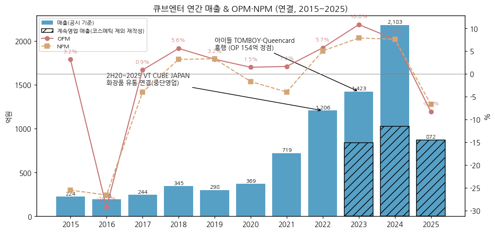

| 연도 | 매출(억원) | 영업이익 | OPM | 순이익 | 비고 |
|---|---|---|---|---|---|
| 2015 | 224 | 7 | 3.2% | −57 | ← 2015.03 SPAC(우리기업인수목적2호) 합병 상장 |
| 2016 | 195 | −57 | −29.3% | −52 | ← **저점** (BTOB 외 라인업 공백·비용) |
| 2017 | 244 | 2 | 0.9% | −10 | |
| 2018 | 345 | 19 | 5.6% | 11 | ← 1차 정점 ((여자)아이들 2018.05 데뷔) |
| 2019 | 298 | 10 | 3.2% | 10 | |
| 2020 | 369 | 5 | 1.5% | −6 | ← 2H20 VT CUBE JAPAN 화장품 유통 연결 시작 |
| 2021 | 719 | 12 | 1.6% | −29 | ← 화장품 상품 매출 397억 포함 |
| 2022 | 1,206 | 69 | 5.7% | 61 | ← TOMBOY·Nxde 흥행 (화장품 605억 포함) |
| 2023 | 1,423 | 154 | 10.8% | 112 | ← **2차 정점** Queencard (계속영업 매출 841억) |
| 2024 | 2,183 | 166 | 7.6% | 166 | ← 공시치. 계속영업 1,026억 / OP 120억 / OPM 11.7% |
| 2025 | 872 | −73 | −8.3% | −59 | ← **저점** 아이들 하반기 단체활동·투어 부재, 재계약 비용, 신인 투자 (계속영업) |
| 9M26 | 694 | −29 | −4.2% | 33 | ← 1H 적자 → 3Q 흑전 (OPM 13.1%) |

(4) 산업 분류

→ DART 업종코드 59201 (음악 및 기타 오디오물 출판업)
→ 워치리스트: 대분류 **소비재** > 섹터 **엔터** > 서브섹터 **기획사(확장)** — 2026-11-15 편입. 섹터 T1 아님 → 표준 깊이

(5) 분류 결정 논리

(1) 가장 매출 큰 사업 기준: 엔터테인먼트가 계속영업 매출의 97%(9M26) → 엔터 기획사
(2) 이익 기여 기준: 엔터 영업이익은 아이들 활동 유무로 ±100억 범위 진폭. 영업외의 브이티 지분법이익(연 30\~70억)이 순이익의 바닥을 받침 → 순이익 기준으로는 **이익 변동성이 영업이익보다 작음**
(3) Boundary case: 사이클 진폭이 "업황"이 아니라 "IP 1개 활동 일정"에서 나옴 → 사이클형이되 예측 변수는 **아이들 앨범·투어 캘린더** + 신인(NOWZ) 수익화 시점. 대형 4사처럼 멀티 IP 포트폴리오로 평활화되지 않음
(4) 피어 대비: 하이브·JYP·에스엠은 다수 IP + 공연 대형화로 OPM 10%대 안팎을 안정적으로 유지하는 반면, 큐브는 2016\~2025 11년 중 OPM 10% 이상이 1년(2023)뿐. 와이지엔터(블랙핑크 의존)와 가장 유사한 단일 IP 구조

(6) 적정 밸류에이션 방법

- **SOTP 1순위** — ① 브이티 지분(시가 × 12.8%, 상장주식이라 매일 확인 가능) + ② 엔터 본업(아이들·NOWZ 이익 기준 PER) − 순차입. 시가총액의 약 40%가 지분가치라 PER 단독은 왜곡
- **PER 보조 — 본업만**: 지분법이익을 뺀 영업이익 기준. 2025처럼 본업 적자 연도에는 사용 불가
- **PBR 하단 참고**: PBR 0.61배(시총 994억 ÷ 3Q26 자본 1,637억). 단 자본의 대부분이 브이티 장부가(1,653억)라 **브이티 시가가 장부가를 크게 밑도는 한 PBR 하단 논리는 약함** (손상 리스크)
- 대형 4사는 PER(멀티 IP 이익 가시성), 큐브는 SOTP — 지분 구조 때문

(7) 분기 재평가 트리거 (분류 변경 조건)

- 아이들 외 아티스트(NOWZ·LIGHTSUM 등) 매출 비중이 의미 있게(예: 연 매출 30%+) 올라와 2개 분기 연속 흑자를 유지하면 → 단일 IP형 → 멀티 IP 기획사로 재분류 검토
- 아이들 재계약 만료·멤버 이탈 등 IP 이탈 이벤트 → '꿈/단일 IP'에서 '지분 홀딩 가치주'로 재분류
- 브이티 지분 처분(또는 브이티의 큐브 지분 처분) → 상호보유 해소, SOTP → PER 단일 밸류로 전환
- 제3자배정 유상증자(100억, 최대주주 강승곤 전액 인수) 납입(예정 2027-02-25) 후 자본·주식수 변화 반영

---

## ② 회사 개요

(1) 기본 사항

| 항목 | 내용 |
|---|---|
| 회사명 | (주)큐브엔터테인먼트 (CUBE ENTERTAINMENT, INC.) |
| 설립 | 2006 (주)엠디포 설립 → (주)플레이큐브 → 2011 큐브엔터테인먼트로 상호 변경. DART 법인 설립일 2013-07-25(SPAC 존속법인) |
| 상장 | 2015-03-30 우리기업인수목적2호와 합병, 코스닥 |
| 대표이사 | 강승곤·정철(공동대표, 둘 다 (주)브이티 공동대표 겸직), 안우형(공동대표, 2026.03 임기만료 기준 2025 사업보고서) |
| 본사 | 서울 성동구 아차산로 83 |
| 임직원 | 170명 (남 59 / 여 111, 2025.12) |
| 사업 한 줄 | 아이돌 육성·매니지먼트·음반/음원·공연·광고·MD 종합 엔터 + 태국 주스 브랜드 팁코(TIPCO) 국내 독점 유통 |
| 주요 아티스트 | **i-dle(아이들)**(전소연·조미연·민니·송우기·예슈화), **NOWZ(나우즈)**(2024 데뷔), **LIGHTSUM(라잇썸)**, 펜타곤 고신원 외 — 3Q26 분기보고서 전속계약 현황 |
| 음반·음원 유통 | (주)카카오엔터테인먼트와 일부 국가 제외 독점 유통계약 — "영업이 동 회사와의 관계에 중요하게 의존" (DART 주석) |

(2) 11년 손익·자본 추이

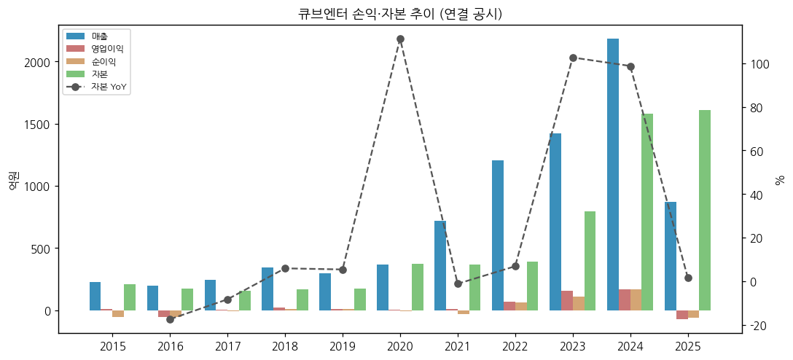

| 연도 | 매출 | 영업이익 | 순이익 | 자본총계 | 자산총계 |
|---|---|---|---|---|---|
| 2015 | 224 | 7 | −57 | 209 | 277 |
| 2016 | 195 | −57 | −52 | 172 | 215 |
| 2017 | 244 | 2 | −10 | 158 | 221 |
| 2018 | 345 | 19 | 11 | 167 | 288 |
| 2019 | 298 | 10 | 10 | 176 | 320 |
| 2020 | 369 | 5 | −6 | 372 | 589 |
| 2021 | 719 | 12 | −29 | 368 | 607 |
| 2022 | 1,206 | 69 | 61 | 393 | 1,059 |
| 2023 | 1,423 | 154 | 112 | 796 | 1,532 |
| 2024 | 2,183 | 166 | 166 | 1,582 | 2,700 |
| 2025 | 872 | −73 | −59 | 1,609 | 2,583 |
| 3Q26 | 694 (9M) | −29 (9M) | 33 (9M) | 1,637 | 2,547 |

→ 2023\~2024 자본 급증(393억 → 1,582억)은 이익이 아니라 **브이티 지분 평가**: 2023 상반기 기타포괄 공정가치 금융자산 평가이익 136억, 2024 기타포괄손익 587억(2025 사업보고서 비교 열) → 2024.07 관계기업 전환(지분법) 후 장부가 1,578억

(3) 주가·시가총액 역사

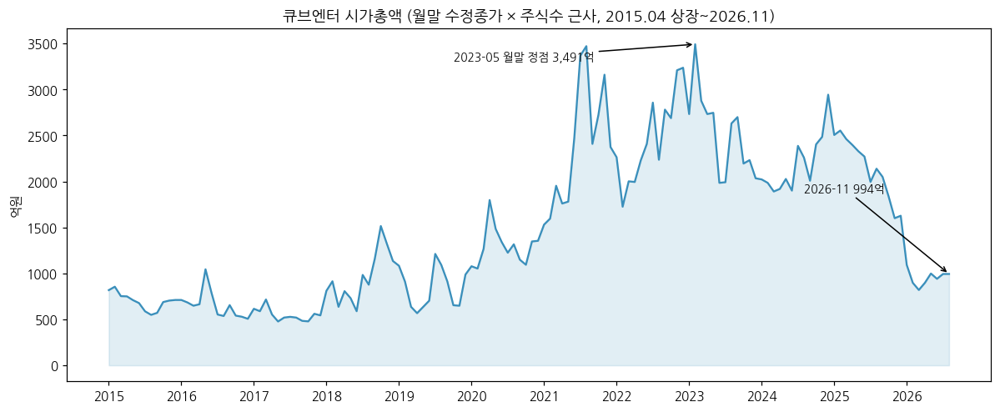

→ 시가총액은 월말 수정종가 × 해당 시점 발행주식수(무상증자 반영 수정) 근사치
→ **월말 기준 정점: 2023-05 약 3,490억** (Queencard 흥행 직후) `[계산: Yahoo 월말 수정종가 25,300원 × 1,380만주]`
→ 수정주가 월중 최고: 2021-10 29,800원 (Yahoo, 수정주가)
→ 2025-10 월고가 15,350원 → **2026-11-13 종가 6,390원**(Yahoo) / 시가총액 **약 994억**(발행 15,549,849주 기준) — 2025 영업적자·아이들 앨범 판매 둔화(9집 초동 62만장, 4연속 밀리언 중단 — MTN 2026-07-23) 반영
→ 52주 범위 4,520\~14,610원(stockhub, 2026-11-13)

(4) 주요 연혁

| 시기 | 내용 |
|---|---|
| 2006 | (주)엠디포 설립 (이후 플레이큐브 → 2011 큐브엔터테인먼트) |
| 2015.03 | 우리기업인수목적2호 합병, 코스닥 상장 |
| 2018.05 | (여자)아이들 데뷔 |
| 2020.03 | 강승곤·정철·안우형 이사회 진입 (브이티 측 경영진) |
| 2020.07 | 일본 법인 CUBE ENTERTAINMENT JAPAN → **VT CUBE JAPAN** 사명 변경·유상증자 4.2억엔, 화장품 유통 시작 |
| 2020.06\~10 | 우리사주조합 제3자배정 유상증자 2회 |
| 2021 | 무상증자로 발행주식 690만 → 1,380만주 (자본금 기준) |
| 2023.01 | (주)아더월드 100% 자회사 편입(2026.03 아이오로라에 전량 매각, 처분이익 29.9억) |
| 2024.07 | 최대주주 (주)브이티(37.6%) → **강승곤 개인(36.8%)**으로 변경, 브이티의 큐브 연결 제외. 큐브 보유 브이티 지분은 관계기업(지분법)으로 전환 |
| 2024.08 / 2025.03 | 제3자배정 유상증자 76.7만주(13,040원) / 43.1만주(14,210원) |
| 2024.12 | 아이들 재계약(전속계약 체결 주요경영사항 공시) — 2024 무형자산 취득 151억 |
| 2025.08 | 제2회 전환사채 114만주 전환(전환가 13,108원) |
| 2025.08\~11 | 자기주식 59.7만주(100억) 매입 → 이익소각 |
| 2025.12 | VT CUBE JAPAN 지분 전량 (주)브이티에 양도 → 화장품 사업 중단영업 처리 |
| 2026.07 | 제3자배정 유상증자 100억 결정(강승곤 전액 인수, 글로벌 확장·제작·신인 개발 연 50억씩 — MTN). 3Q26 분기보고서 기준 납입 예정일 **2027-02-25** (2026-10-30 주요사항보고서) |

---

## ③ 비즈니스 모델

(1) 실적 추이 — 매출 유형별 (연간, 억원)

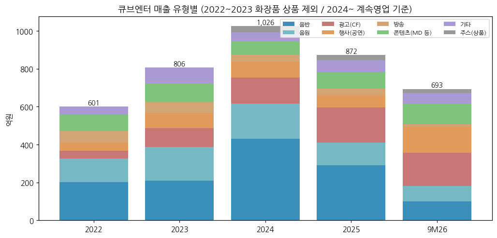

| 유형 | 2022 | 2023 | 2024 | 2025 | 9M26 | 비고 |
|---|---|---|---|---|---|---|
| 음반 | 200 | 209 | **430** | 292 | 99 | 2024 아이들 2집 정규·밀리언 |
| 음원 | 127 | 178 | 185 | 119 | 83 | 해외 비중 70%(9M26) |
| 광고(CF) | 40 | 100 | 139 | 185 | **176** | 해외 CF 166억(9M26) |
| 행사(공연 등) | 42 | 80 | 84 | 64 | **137** | 2026 아이들 월드투어 |
| 방송 | 62 | 60 | 36 | 35 | 13 | |
| 콘텐츠(MD 포함) | 88 | 93 | 71 | 90 | **109** | MD는 콘텐츠 항목으로 공시 |
| 기타 | 42 | 86 | 47 | 60 | 56 | |
| 주스(상품) | – | – | 34 | 28 | 21 | TIPCO 유통 |
| **엔터+유통 합계** | **601** | **807** | **1,026** | **872** | **693** | 2022\~2023은 공시 매출 − 상품매출(화장품·주스) |

→ 2022\~2023은 공시 원문에 화장품·주스가 '상품매출' 한 줄로 묶여 있어 주스 분리 불가 → 엔터 매출만 표기. 2024\~는 2025 사업보고서·3Q26 분기보고서의 계속영업 재작성치
→ **구조 변화**: 음반 비중 2024 42% → 9M26 14%, 대신 광고·공연·MD(경험·브랜드 수익)가 9M26 매출의 61%. 앨범 판매 둔화를 투어·CF로 보전하는 구간

(2) 지역별 매출 비중

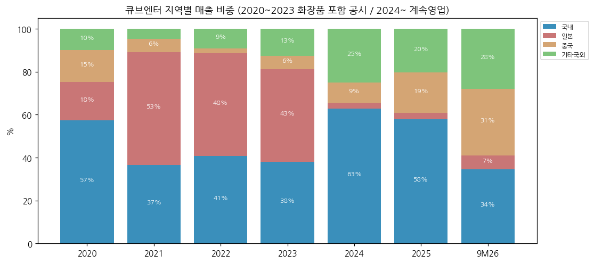

| 지역 (억원) | 2020 | 2021 | 2022 | 2023 | 2024 | 2025 | 9M26 |
|---|---|---|---|---|---|---|---|
| 국내 | 215 | 263 | 491 | 541 | 644 | 504 | 239 |
| 일본 | 67 | 379 | 577 | 615 | 29 | 26 | 46 |
| 중국 | 56 | 43 | 28 | 86 | 95 | 165 | **214** |
| 기타국외 | 38 | 35 | 110 | 180 | 258 | 178 | 195 |

→ 2020\~2023 일본 매출의 대부분은 VT CUBE JAPAN 화장품 유통(공시 기준). 2024\~ 계속영업 기준 일본 엔터 매출은 연 30억 안팎에 불과
→ **중국이 최대 해외 시장**: 9M26 214억으로 이미 2025 연간(165억) 초과, 매출의 31%. 아이들 중국인 멤버(우기)·대만·홍콩 투어 효과 (2025.3Q 중국 매출 +133% — 아시아경제 2025-11-17)

(3) 분기 시계열 (1Q16\~3Q26)

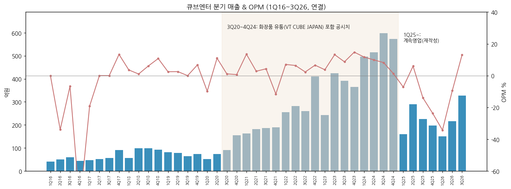

→ 3Q20\~4Q24(음영)는 화장품 유통 포함 공시치, 1Q25\~는 2026 분기보고서 비교 열로 재작성된 계속영업 수치. **2023\~2024 분기 계속영업 수치는 공시되지 않아 연속 비교 불가**
→ OpenDART 분기표의 4Q25 매출 −594억은 연간(재작성)과 3Q 누적(재작성 전)의 기준 불일치에서 생긴 수치 → 본 문서는 재작성 계속영업 197.7억 사용

(4) 12분기 시계열

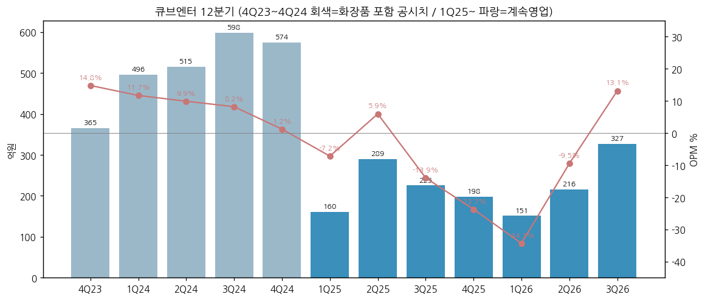

| 분기 | 매출 | 영업이익 | OPM | 기준 |
|---|---|---|---|---|
| 4Q23 | 365 | 54 | 14.9% | 공시(화장품 포함) |
| 1Q24 | 496 | 58 | 11.7% | 공시(화장품 포함) |
| 2Q24 | 515 | 51 | 10.0% | 공시(화장품 포함) |
| 3Q24 | 598 | 49 | 8.3% | 공시(화장품 포함) |
| 4Q24 | 574 | 7 | 1.2% | 공시(화장품 포함) |
| 1Q25 | 160 | −12 | −7.2% | 계속영업 |
| 2Q25 | 289 | 17 | 6.0% | 계속영업 |
| 3Q25 | 225 | −31 | −13.9% | 계속영업 |
| 4Q25 | 198 | −47 | −23.7% | 계속영업 (연간 − 3Q 누적) |
| 1Q26 | 151 | −52 | −34.3% | 계속영업 |
| 2Q26 | 215 | −20 | −9.5% | 계속영업 |
| **3Q26** | **327** | **43** | **13.1%** | 계속영업 — YoY 매출 +45.2%, OP 흑자 전환 |

(5) 사업부별 개요

| 부문 | 9M26 매출 | 비중 | 내용 |
|---|---|---|---|
| 엔터테인먼트 | 672억 | 97.0% | 음반·음원 기획/제작, 매니지먼트, 광고·행사·방송, 콘텐츠·MD |
| 유통 | 21억 | 3.0% | 태국 프리미엄 과채주스 TIPCO 국내 독점 수입·유통 |
| (중단) 코스메틱 | – | – | VT CUBE JAPAN 화장품 유통 — 2025.12 브이티에 양도 |

→ 사업부별 영업이익은 분기보고서에 공시되지 않음

(6) 사업부별 디테일

- **i-dle(아이들)**: 2018 데뷔, 2024.12 재계약. 4연속 밀리언셀러 후 2026.07 미니 9집 'We made' 초동 62만장, 멜론 일간 최고 111위 — 음원 화력 약화. 반면 투어는 2026.03 K팝 걸그룹 최초 타이베이돔 전석 매진, 홍콩 2회 약 8만명 (MTN 2026-07-23)
- **NOWZ(나우즈)**: 2024 데뷔 보이그룹. 2026.08 컴백. 2025 적자 요인 중 하나가 신인 투자비 (2025 사업보고서)
- **LIGHTSUM(라잇썸)** 외: 안정적 이익 기여 아티스트 부재 — "아이들 실적 감소를 상쇄할 IP 없음" (MTN)
- 음반 평균 단가(내수): 2024 11,289원 → 2025 12,662원 → 9M26 13,286원 (DART)

(7) 주요 경쟁사

→ 국내 기획사: 하이브·JYP·에스엠·와이지엔터(대형 4사), 스타쉽(카카오엔터, 비상장), 판타지오·FNC 등 중소형
→ 걸그룹 IP 경쟁: IVE(스타쉽), aespa(SM), NewJeans·LE SSERAFIM(하이브), ITZY·NMIXX(JYP), BABYMONSTER(YG)

(8) 주요 매출처 / 유통

→ 음반·음원: (주)카카오엔터테인먼트(국내외 독점 유통), 텐센트뮤직(중국) 등 전문 유통채널 (DART 판매전략)
→ 2023 상반기 '매출 10% 이상 외부고객 A사(엔터)' 28.9억/3개월 공시, 이후 10% 미만

(9) 생산 CAPA·임직원

→ 제조 설비 없음. 녹음스튜디오·연습시설 5.4억, 음악장비 3.6억(3Q26 별도 장부가)
→ 임직원 170명(2025.12), 1인 평균 급여 남 6,200만원 / 여 4,800만원

---

## ④ 재무 구조 (연결 공시 기준, 억원)

(1) 손익계산서

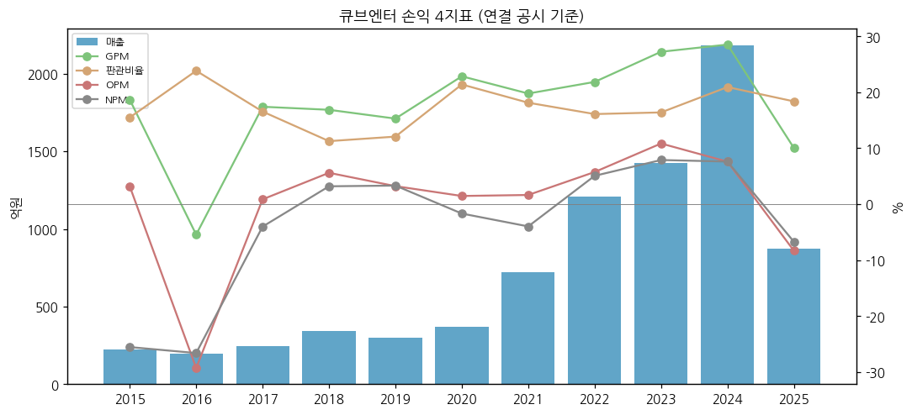

| 연도 | 매출 | 매출원가 | 매출총이익 | GPM | 판관비 | 영업이익 | OPM | 순이익 |
|---|---|---|---|---|---|---|---|---|
| 2015 | 224 | 182 | 42 | 18.7% | 35 | 7 | 3.2% | −57 |
| 2016 | 195 | 205 | −11 | −5.4% | 46 | −57 | −29.3% | −52 |
| 2017 | 244 | 202 | 42 | 17.4% | 40 | 2 | 0.9% | −10 |
| 2018 | 345 | 287 | 58 | 16.9% | 39 | 19 | 5.6% | 11 |
| 2019 | 298 | 253 | 46 | 15.3% | 36 | 10 | 3.2% | 10 |
| 2020 | 369 | 285 | 84 | 22.8% | 79 | 5 | 1.5% | −6 |
| 2021 | 719 | 577 | 142 | 19.8% | 130 | 12 | 1.6% | −29 |
| 2022 | 1,206 | 943 | 264 | 21.8% | 194 | 69 | 5.7% | 61 |
| 2023 | 1,423 | 1,035 | 387 | 27.2% | 233 | 154 | 10.8% | 112 |
| 2024 | 2,183 | 1,560 | 622 | 28.5% | 457 | 166 | 7.6% | 166 |
| 2025 | 872 | 785 | 88 | 10.0% | 160 | −73 | −8.3% | −59 |
| 9M26 | 694 | 628 | 66 | 9.5% | 95 | −29 | −4.2% | 33 |

→ 2025\~ GPM 10%대: 엔터 기획사 특성상 아티스트 정산·제작비가 매출원가에 들어감. 2024의 GPM 28.5%는 화장품 유통 포함 수치라 비교 불가
→ 2025 순이익 내역: 계속영업 −27억 + 중단영업 −32억 (지배 −52억)

(2) 재무상태표

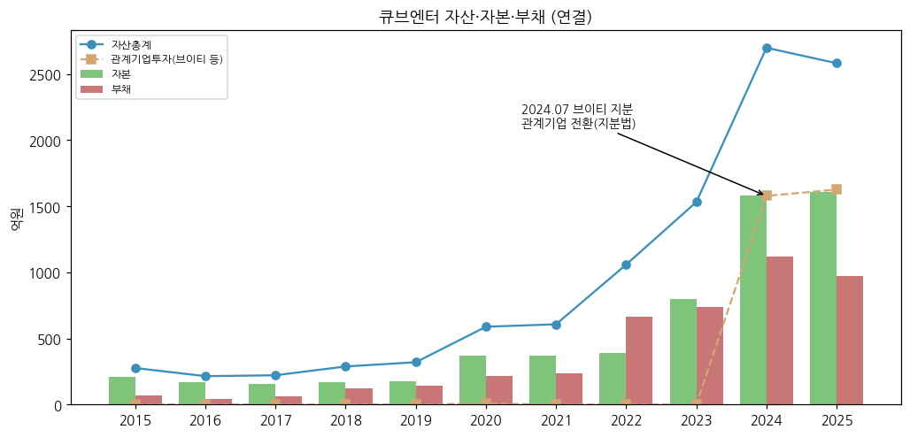

| 연도 | 자산 | 부채 | 자본 | 유동자산 | 유동부채 | 현금성자산 | 관계기업투자 |
|---|---|---|---|---|---|---|---|
| 2019 | 320 | 144 | 176 | 157 | 93 | 71 | – |
| 2020 | 589 | 216 | 372 | 375 | 122 | 181 | 7 |
| 2021 | 607 | 240 | 368 | 320 | 188 | 92 | – |
| 2022 | 1,059 | 666 | 393 | 745 | 641 | 224 | – |
| 2023 | 1,532 | 736 | 796 | 755 | 640 | 179 | – |
| 2024 | 2,700 | 1,117 | 1,582 | 761 | 679 | 199 | 1,578 |
| 2025 | 2,583 | 974 | 1,609 | 734 | 730 | 379 | 1,627 |
| 3Q26 | 2,547 | 910 | 1,637 | 622 | 679 | 102 | 1,653 |

→ 3Q26 유동비율 91.7% (유동자산 622 / 유동부채 679), 부채비율 55.6%
→ **자본 − 브이티 장부가 ≈ −16억** `[계산: 1,637 − 1,653]` — 엔터 본업 순자산은 사실상 0, 상장사 지분이 자본을 지탱

(3) 현금흐름표

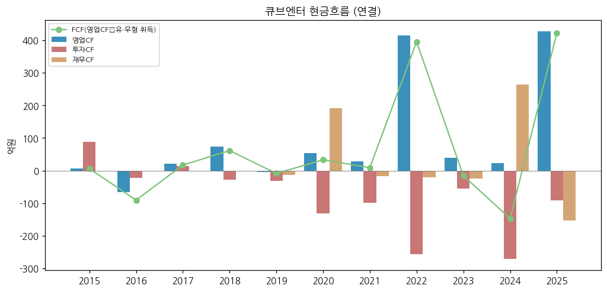

| 연도 | 영업CF | 투자CF | 재무CF | 유·무형 취득 | FCF |
|---|---|---|---|---|---|
| 2018 | 74 | −29 | – | 13 | 61 |
| 2019 | −4 | −32 | −14 | 5 | −9 |
| 2020 | 53 | −131 | 191 | 20 | 33 |
| 2021 | 28 | −99 | −17 | 19 | 9 |
| 2022 | 414 | −257 | −22 | 19 | 395 |
| 2023 | 38 | −55 | −25 | 54 | −16 |
| 2024 | 23 | −271 | 263 | 170 | −147 |
| 2025 | 427 | −92 | −153 | 5 | 422 |
| 9M26 | −169 | −135 | 30 | 5 | −174 |

→ 영업CF 변동이 매우 큼(선수금·정산 타이밍). 2025 영업CF 427억, 9M26 −169억

(4) CapEx

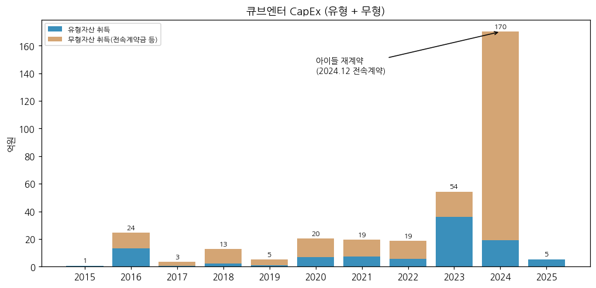

→ 유형 CapEx는 연 1\~36억 수준. **무형자산 취득 = 아티스트 전속계약금** 성격: 2024 151억(아이들 재계약, 2024.12)

(5) 부채구조·자금조달

→ 3Q26 차입은 소액, 미상환 전환사채 일부 존재(제2회 CB 2025.08 대부분 전환). 2026.07 제3자배정 유상증자 100억 결정 — 납입 예정 2027-02-25
→ 자금조달 이력: 우리사주 유증(2020), 제3자배정 유증 2024.08(100억) / 2025.03(61억), CB 전환(2025.08 114만주)

(6) 배당·자사주

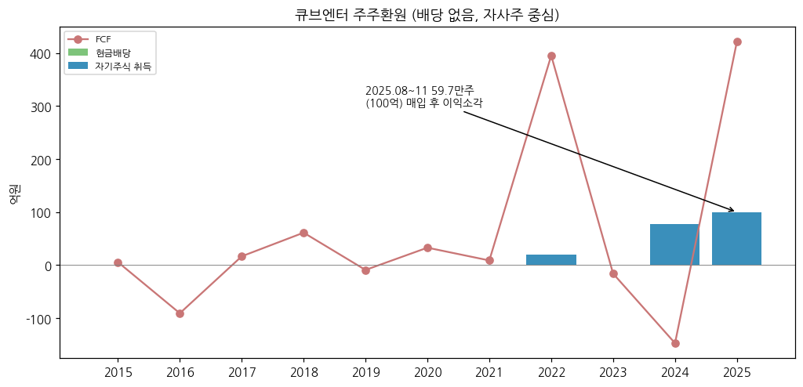

→ DART 배당 공시: 2023\~2025 현금배당 **없음**
→ 자기주식: 2024 78억, 2025 100억(59.7만주) 장내 매입 → 2025 이익소각(자본금은 유지, 발행주식 15,549,849주). 3Q26 말 자기주식 68.3만주(4.4%) 표기는 2025 사업보고서 기준

(7) 재무비율

| 연도 | ROE | ROA | 부채비율 | 유동비율 |
|---|---|---|---|---|
| 2022 | 15.5% | 5.8% | 169% | 116% |
| 2023 | 14.1% | 7.3% | 92% | 118% |
| 2024 | 10.5% | 6.2% | 71% | 112% |
| 2025 | −3.6% | −2.3% | 61% | 100% |
| 9M26 | 2.0%(누적) | 1.3%(누적) | 56% | 92% |

`[계산: 기말 자본·자산 기준 단순 비율]`

---

## ⑤ 지배 구조

(1) 그룹·계열 관계

→ 공정거래법상 대규모기업집단 아님. 실질적으로 **강승곤 회장 — (주)브이티 — (주)큐브엔터** 상호보유 구조
→ 큐브 → 브이티 12.8%(관계기업, 대표이사 이사회 참여로 유의적 영향력) / 브이티 → 큐브 8.93%(상법 369조 3항 상호보유로 **의결권 없음**)
→ 관계기업: (주)브이티 12.8%, (주)브이티바이오 2.2%(전액 손상), (주)네스트리미디어그룹 40%(전액 손상), Anicube Entertainment(애니모카브랜즈 합작 40%, 출자 약정 USD 40만)
→ 종속기업(2026): Beijing Kuxing Culture Media, CUBE ENTERTAINMENT JAPAN

(2) 주주 구분

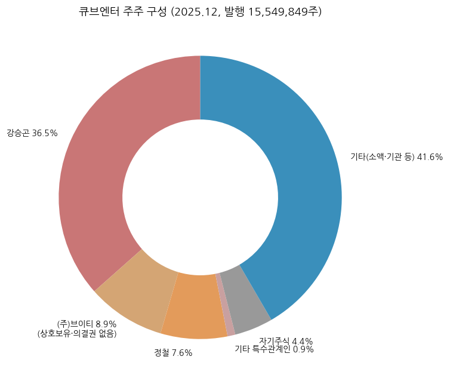

| 주주 | 주식수 | 지분율 (2025.12) | 비고 |
|---|---|---|---|
| 강승곤 | 5,682,609 | 36.54% | 최대주주, 2025 장내매수 32.5만주 |
| (주)브이티 | 1,389,132 | 8.93% | 계열회사, 의결권 없음 |
| 정철 | 1,186,989 | 7.63% | 공동대표 |
| 강동윤·위대훈·전승휘 | 137,254 | 0.89% | 임원 |
| **특수관계인 계** | **8,395,984** | **53.99%** | |
| 자기주식 | 682,659 | 4.39% | |

→ 2024.07 이전 최대주주는 (주)브이티(37.6%) — 지분 구조가 브이티 → 강승곤 개인으로 이동

(3) 임원·이사회 (2025 사업보고서)

| 성명 | 직위 | 주요 경력 |
|---|---|---|
| 강승곤 | 공동대표이사 | (주)브이티 공동대표(2021\~), 큐브 최대주주 |
| 정철 | 공동대표이사 | (주)브이티 공동대표(2018\~) |
| 안우형 | 공동대표이사 | 서태지컴퍼니 대표(2001\~2005), 큐브 대표(2020\~) |
| 강동윤·장보헌 | 사내이사(비상근) | (주)브이티 사내이사 |
| 위대훈·변정민 | 사외이사 | 변호사 / 중부대 K-POP 전공 교수 |
| 전승휘 | 부사장(매니지먼트 총괄) | JYP 팀장, 울림엔터 이사 |

→ 사내이사 5명 중 4명이 브이티 겸직 — 경영 의사결정이 브이티 그룹과 사실상 통합

---

## ⑥ 기타 팩트

(1) R&D

→ 연구개발 조직·비용 공시 없음(엔터 업종) — chart7 생략

(2) Corporate action (10년)

| 시기 | 내용 |
|---|---|
| 2015.03 | SPAC 합병 상장 |
| 2020 | VT CUBE JAPAN 화장품 유통 진출, 우리사주 유증 2회 |
| 2021 | 무상증자 |
| 2023.01 | 아더월드 인수 (2026.03 매각, 처분이익 29.9억) |
| 2024.07 | 브이티 지분 관계기업 전환 / 최대주주 변경 |
| 2024.08·2025.03 | 제3자배정 유상증자 |
| 2025.08\~11 | 자사주 100억 매입·소각 |
| 2025.12 | VT CUBE JAPAN 매각(브이티) → 화장품 사업 철수 |
| 2026.07\~10 | 100억 제3자배정 유증 결정(강승곤), 납입 2027-02 예정 |

(3) IP 마일스톤

→ 2018.05 (여자)아이들 데뷔 → 2022 TOMBOY·Nxde → 2023 Queencard (OP 정점) → 2024.12 재계약 → 2025 그룹명 i-dle 활동, 하반기 공백 → 2026.03 타이베이돔 → 2026.07 미니 9집
→ 2024 NOWZ 데뷔 → 2026.08 컴백

(4) 주요 리스크

- **단일 IP 의존**: 아이들 활동 공백이 곧 적자 (2025 OP −73억)
- **브이티 지분 손상 리스크**: 장부가 1,653억 vs 시가 약 423억 — 지분법 회계라 시가 하락이 즉시 반영되진 않지만 손상검사 대상
- **특수관계 거래**: 화장품 법인을 관계사(브이티)에 양도, 경영진 겸직 — 거래 조건 투명성 점검 필요
- **유동성**: 3Q26 유동비율 92%, 9M26 영업CF −169억, 현금 102억 → 2027.02 유증 100억 납입 의존
- **유통 의존**: 카카오엔터테인먼트 독점 유통계약

(5) ESG·인증 — 공시 확인되지 않음

---

## Version Log

- **v1.0 (2026-11-15)**: 최초 작성. OpenDART 재무 44건 + 공시원문 15건 + 기업정보 6종 + Yahoo 월봉. 3Q26 분기보고서(2026-11-13 제출) 확정치 반영
- 데이터 공백·추정: ① IR 실적 자료 미확보(irgo 실적 게시물 0건) ② 2023\~2024 분기 계속영업(화장품 제외) 수치 미공시 → 분기 시계열 기준 단절 ③ 2023 계속영업 영업이익 미공시 ④ 사업부별 영업이익 미공시 ⑤ 시가총액 시계열은 수정주가 × 주식수 근사 ⑥ 2015 이전 연간(엠디포·플레이큐브 시절) 미수집
- 잔여 보완 후보: 아이들 앨범·투어 일정표, 2026 3Q 단일 분기 유형별 매출(누적 차감), 브이티 지분 손상검사 내용(사업보고서 주석), 유증 2027.02 납입 후 주식수 갱신
