> 종목: 클래시스 (214150.KQ / 주식회사 클래시스 / CLASSYS Inc., DART corp_code 01061327) — **KRX 코스닥** (2017.12.28 케이티비스팩2호 합병 상장, 코스닥 글로벌 세그먼트)
> 섹터: 소비재 > 뷰티 / 서브섹터: 미용의료 (워치리스트 **핵심** 종목 — 파마리서치·휴젤·엘앤씨바이오와 동일 칸)
> 작성 시각: 2026-11-15 KST (**v1.0** — 첫 작성)
> 적용 구조: v4.8 (6개 섹션 + 12종 차트. 단일 부문(미용의료기기)이라 chart2는 2·2b·2c 3종으로 대체: 35분기 장비/소모품 + OPM / 34분기 국내/해외 / 연간 장비·소모품×수출·내수 매트릭스)
> 데이터: 연결 연간 2015\~2025 (11년 — 2015·2016은 2017 사업보고서 전기·전전기, 그 이전은 비상장이라 공시 없음) + 연결 분기 35개(1Q18\~2Q26 OpenDART + **3Q26 잠정**) + Yahoo v8 월간 시가총액(2018.01\~2026.11)
> 출처: **DART 정기보고서 공시원문 XML 39건**(사업보고서 2017\~2025, 반기·분기 2017.03\~2026.06 — 최우선 정성자료는 사업보고서 2025(rcept 20260323001541)·반기보고서 2026.06(20260814004072)) / OpenDART 연결 재무제표(CFS) 2017 FY\~2Q26 / OpenDART 2025 FY 최대주주·임원·직원·배당·자기주식·주식총수 / OpenDART 공시: 3Q26 잠정실적(20261112900535), 2026 매출 가이던스 정정(20260812900270), 불성실공시법인 지정예고(20260724900921), Capital Group 대량보유(20260903000007) / 시장 보조: 비즈니스포스트·메트로신문·EBN(2026-11-12), 메디파나뉴스(2026-11-13, 키움·교보 3Q26 리뷰 인용), 스마트투데이(2025-05 블록딜), 한국경제(2026-07 대표 선임) / irgo 리포트 목록(제목만)
> ⚠ 회사 IR 실적발표 PDF(IR BOOK): **미확보** — kr_ir_download 0건(irgo IR자료실은 2018~2020 게시물만), irgo 리포트 탭 "2026년 3분기 경영실적"은 FnGuide 링크라 PDF 경로 없음, classys.co.kr IR 페이지 fetch 실패
> **Fact verify cutoff**: 2026-11-15

# 클래시스 기업 개요 (v1.0 — 뷰티/미용의료 핵심, HIFU·RF 미용의료기기 + 반복 소모품, 베인캐피탈 PE 지배)

> ⚠️ **시계열 단절·해석 주의 6건 — 모든 표·차트 해석 시 주의**
> ① **상장 경로** — 2007.01 설립(정성재 창업) → 2017.12.28 **케이티비스팩2호와 합병 상장**(스팩이 존속법인, 법인 설립일 2015.01.15). 2017 순이익 -51억은 **합병상장비용 137억(일회성)** 때문 (2017 사업보고서 MD&A). 2015.04~2017.12 Yahoo 시세는 스팩 주가라 시가총액 차트에서 제외
> ② **2022.04 최대주주 변경** — 창업자 정성재 일가(73.9%) → **BCPE Centur Investments, LP(베인캐피탈) 60.84%**. 정성재는 9.9% 잔류. 이후 이사회 다수가 베인 측 기타비상무이사
> ③ **2024.10.01 ㈜이루다 흡수합병** (합병비율 1:0.1405237, 신주 1,506,140주, 이전대가 1,180억, **영업권 596억**·고객관계/기술력 무형자산 679억). 4Q24부터 MNRF(쿼드세이)·레이저(리팟) 매출 합산 → GPM 78.7%(2024) → 77.5%(2025) 희석. 2024 사업보고서의 "구 이루다 품목" 별도 행은 2025 보고서에서 장비/소모품으로 재분류됨 (본 리포트 2024 매트릭스는 재분류 기준)
> ④ **2026.03.05 브라질 MedSystems(JL Health Participações) 77.5% 인수** — 해외 대리점 판매가 **직판(브라질·콜롬비아·아르헨티나)**으로 전환. 1Q26부터 연결, 인수 시 차입금 960억 승계 → 2Q26 단기차입금 1,411억. 직판 전환으로 **매출 인식 단가는 오르지만 재고 소진기 마진 희석·판관비 증가** (2Q26 "기타" 매출 171억 급증은 브라질 법인 매출 분류 차이로 추정 — 미확인)
> ⑤ **2025 이후 품목별 분기 공시 축소** — DART 분기·반기 보고서는 2025.06까지만 장비/소모품×수출/내수 표 제공, 2025.09부터는 국내/해외 총액만. 3Q25·4Q25는 연간 MD&A − 1H25 + 3Q26 YoY 역산, 2026 분기는 **언론·셀사이드 인용치(＊표시)** — 회사 IR PDF 확보 시 교체 필요
> ⑥ **3Q26은 잠정** (2026-11-12 공정공시, 분기보고서 미공시). 순이익 59억(세전 77억)은 영업이익 270억 대비 **영업외 약 -193억** — 내역 미확인 (2Q26 금융원가의 주 항목이 외환차손 88억이었던 점에서 BRL·차입 관련 손실로 추정, 3Q 분기보고서로 확인 필요)

---

## ① 기업 분류

(1) Primary / Secondary 분류

**Primary 분류: 고성장 (성장 감속 국면 진입) — 장비 설치기반(IB) 확대 → 소모품 반복매출 구조의 플랫폼형 의료기기**

→ 매출 CAGR **+36.5%** (2015→2025, 10년) / **+32.3%** (2018→2025, 상장 후 7년). 2020 코로나(-5.8%)를 제외하면 매년 +27% 이상 성장, **20분기+ 연속 YoY 매출 성장**은 3Q26(+0.0%)에서 사실상 멈춤

→ OPM은 2019 이후 **48.6~53.1%의 좁은 밴드** (7년 range 4.5%pt) — 사이클 기업이 아님. 다만 **2026년 OPM 하락(1~3Q26 39.2%, 3Q26 32.5%)**은 상장 이래 처음 밴드를 벗어난 구간

→ 2026 회사 가이던스 4,900억 → 4,450억(2026-08-12 정정, 범위 4,300~4,600억) → 1~3Q 누적 2,757억으로 **4Q 1,543억 필요 → 키움 "달성 몹시 어렵다", 연간 3,672억 추정** (메디파나 2026-11-13)

**Secondary 노트: 지속성장 (소모품 반복매출 비중 42~53%) + 꿈 (중국·미국 신규 진입)**

→ 소모품 매출 비중: 2018 33% → 2020 49% → 2025 46% (연간, DART MD&A). 장비 판매가 설치기반을 키우고, 국내는 장비 구매 시 무상 소모품 교환권 → 유상 전환 구조 (2025 사업보고서)

→ 글로벌 누적 판매대수 **5만대** (2026.10, 회사 3Q26 보도자료 — 비즈니스포스트)

→ 중국: 볼뉴머 **2026.12 허가 예상**, 울트라포머(슈링크) 2027.2Q, 비클라라 2027 하반기 / 미국: 에버레스(볼뉴머)·쿼드세이 판매 중, MPT(슈링크 유니버스) 2027 출시 목표 (메트로신문·메디파나 2026-11)

**Entity 구조 (2026.06 연결 종속회사, DART 반기보고서)**

→ **(1) ㈜클래시스 본체** — 미용의료기기·소모품 제조/판매 (서울 송파 문정동·경기 안양 만안구 생산시설, 본사 강남 테헤란로 208 자가 사옥)

→ **(2) CLASSYS JAPAN** (2024.05 설립, 2026.09 직판 전환 완료) / **(3) Classys Brasil Ltda.** (2025.10 설립) → **JL Health Participações S.A. 77.5%** 및 MedSystems 브라질·아르헨티나·콜롬비아 법인, MB Servicos Digitais, Mosaic Educacao (2026.03 인수) / **(4) Skederm Inc.(미국)·Skederm Shanghai** (화장품, 2015·2017 설립) / **(5) ㈜엔슨** (이루다 합병으로 편입, CB 발행 이력)

(2) Summary Box (연결 시계열 + 성장 통계)

| 지표 | 11년 평균 (2015\~2025) | 정점 | 저점 | 2025년 | 1\~3Q26 |
|---|---|---|---|---|---|
| 매출 (연결, 억원) | 1,168 | **3,368 (2025)** | 150 (2015) | **3,368** | 2,757 (+13.3%) |
| 영업이익 (억원) | 569 | **1,706 (2025)** | 40 (2015) | **1,706** | 1,081 (-9.4%) |
| 순이익 (억원) | 469 | **1,320 (2025)** | -51 (2017) | **1,320** | 646 (-27.7%) |
| OPM | **43.6%** | 53.1% (2020) | 26.5% (2015) | **50.7%** | **39.2%** |
| GPM | 75.7% | 79.7% (2020) | 68.3% (2016) | 77.5% | 73.4% (1H26) |
| ROE | 33.6% (2018\~25) | 48.1% (2019) | 26.3% (2025) | 26.3% | - |
| 소모품 비중 (연간) | - | 49.4% (2020) | 33.0% (2018) | 45.9% | 약 42% (분기 인용치 기준) |
| 해외 매출 비중 | - | 70% (2021) | 51% (2019) | 66.7% | 76% (1H26) |

```
[클래시스 연결 손익 시계열 (억원, OpenDART 연결 / 2015·2016은 2017 사업보고서 3개년 표)]
연도     매출     OP     OPM    NI     주요 이벤트
2015      150     40   26.5%    47   ← 슈링크(Ultraformer III) 국내 출시 초기
2016      272     83   30.3%    71   ← 클루덤(에스테틱샵 브랜드) 출시
2017      349    108   31.0%   -51   ← 스팩합병 상장 (상장비용 137억), 클래시스타워 매입
2018      475    175   36.8%   149   ← SNS發 슈링크 대중화, 60개국 진출
2019      811    417   51.4%   334   ← 국내 소모품 +160%, OPM 50% 레벨 진입
2020      765    406   53.1%   382   ← 코로나 (2Q20 매출 -32%), OPM 정점
2021    1,006    517   51.4%   438   ← 수출 +68%, 슈링크 유니버스(MPT) 10월 허가 → 국내 대기수요
2022    1,418    689   48.6%   754   ← 베인 인수(4월), MPT 국내 출시(내수 장비 +190%), 볼뉴머 허가(8월), 구사옥 매각익
2023    1,801    896   49.8%   742   ← 볼뉴머 국내 확산, 사이저 FDA
2024    2,429  1,224   50.4%   975   ← 볼뉴머 FDA(에버레스), 이루다 합병(10월)
2025    3,368  1,706   50.7% 1,320   ← 볼뉴머 글로벌 히트, 쿼드세이·리팟 합류, 최대 실적
1~3Q26  2,757  1,081   39.2%   646   ← 브라질 직판 연결, 국내 장비·소모품 역성장, 3Q26 OPM 32.5% [잠정]

OPM range (2019~2025): 48.6% ~ 53.1% = 4.5%pt → 비사이클
매출 역성장 연도: 1회 (2020 코로나 -5.8%)
```

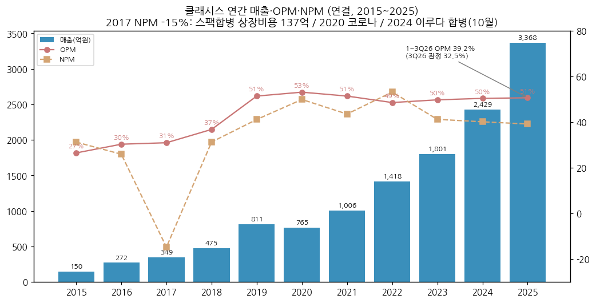

(3) 산업 분류

| 구분 | 분류 |
|---|---|
| DART 업종코드 | 271 (의료용 기기 제조업) |
| 회사 사업 정의 | 미용목적 의료기기 (EBD: Energy-Based Device) — HIFU·모노폴라 RF·MNRF·레이저·IPL |
| 워치리스트 | 대분류 소비재 > 섹터 **뷰티** > 서브섹터 **미용의료** (핵심) — 피어: 파마리서치(리쥬란), 휴젤(톡신), 엘앤씨바이오(스킨부스터) |
| 규제 | 의료기기법(식약처 제조품목허가) + 국가별 인증(FDA 510k, CE MDR, NMPA 등). 국내에서는 의료법상 병·의원만 사용 가능 |
| 글로벌 피어 (참고) | 장비: Candela, Cutera, InMode, Sofwave, Merz(Ultherapy), Solta(Thermage, Bausch), Lutronic(원텍·제이시스메디칼 국내) |

(4) 분류 결정 논리

→ 정량 룰: 2019~2025 OPM 표준편차 1.5%pt, 매출 역성장 1회 → **고성장 + 고수익 안정형**. 사이클 아님

→ 성장 엔진은 "**신규 장비(플랫폼) 출시 → 국내 트렌드 형성 → 해외 인허가 순차 확대 → 설치기반 위에 소모품 반복**". 슈링크(2014~) → 슈링크 유니버스(2021) → 볼뉴머(2022) → 쿼드세이·리팟(2024 이루다) 순으로 3~4년마다 신제품 사이클이 성장률을 리셋해 왔다

→ 2026 감속의 성격: ① 국내 주력(슈링크 유니버스·볼뉴머) **세대교체 공백**(국내 장비 3Q26 -45%, 소모품 -29%), ② 브라질·일본 **직판 전환 비용**, ③ 주요 대리점(태국·호주) 부진 — 회사는 "일시적"으로 설명. 4Q26~2027 중국 허가·국내 업그레이드 장비가 **재가속 트리거**

(5) 적정 밸류에이션 방법

| 우선순위 | 방법 | 근거 |
|---|---|---|
| 1 | **PER (12M Fwd)** | 50% OPM·순현금 기업, 이익 가시성이 핵심. 3Q26 프리뷰 시점 한투 "12MF PER 9.4배"(irgo 리포트 제목) — 상장 후 역사적 저점권 |
| 2 | EV/EBITDA | 브라질 차입(1,411억) 편입으로 순현금 축소 → EV 기준 병행 |
| 3 | PEG / 피어 상대 | 미용의료 피어(파마리서치·휴젤) 및 글로벌 EBD(InMode 등) 대비 |
| 참고 | PBR | 2Q26 자본 5,551억 기준 PBR 약 2.8배 (시총 1.55조, 2026-11-13 종가 23,800원) |

(6) 분기 재평가 트리거

→ **4Q26 매출 성장률 재가속 여부** (3Q26 YoY 0.0% — 성장 프리미엄 소멸 판정 분기)

→ 국내 장비·소모품 YoY 반등 (신제품 포트라, 2027 상반기 볼뉴머 신규 팁·MPT 상위 모델)

→ 브라질 법인 마진 정상화 (인수 전 재고 소진 완료 시점) / 일본 직판 매출

→ **중국 볼뉴머 NMPA 허가(2026.12 예상)·대리점 계약** / 미국 MPT 출시(2027)

→ 베인캐피탈 잔여 지분(46.1%) 매각 방식 — 경영권 매각 vs 추가 블록딜 (오버행)

→ 3Q26 영업외손실 193억 원인 (환·파생·풋옵션) — 분기보고서 확인

---

## ② 회사 개요

(1) 기본 사항

| 항목 | 내용 |
|---|---|
| 회사명 | 주식회사 클래시스 (CLASSYS Inc.) |
| 설립 / 상장 | 2007.01.10 설립 / 2017.12.28 코스닥 상장 (케이티비스팩2호 합병) |
| 본사 | 서울 강남구 테헤란로 208 (2022.02 이전, 자가 사옥 — 2021 교정공제회로부터 1,250억에 매입) |
| 생산 | 서울 송파구 문정동(에이치비즈니스파크 8층, 2018 매입·2021 추가 매입) · 경기 안양시 만안구 (이루다 공장) |
| 대표 | **윤준오 대표집행임원** (2026.07.15 선임, 전 삼성전자 부사장·하만 인수/통합 담당) — 집행임원제 2025.12 도입 |
| 최대주주 | BCPE Centur Investments, LP (베인캐피탈) 46.10% (2026.06) |
| 임직원 | 548명 (2026.06, 남 342·여 206) / 528명 (2025말) |
| 사업 한 줄 정의 | **HIFU(슈링크)·모노폴라 RF(볼뉴머)를 앞세운 글로벌 미용의료기기(EBD) 제조사 — 장비를 플랫폼으로 카트리지·팁 소모품을 반복 판매** |
| 판매 네트워크 | 80여 개국 대리점 + 일본·브라질·콜롬비아·아르헨티나 직판 + 국내 직판·대리점·자사몰(classysmall.com) |

(2) 연간 손익·자본 추이 (억원, 연결)

| 연도 | 매출 | 영업이익 | OPM | 순이익 | 자본총계 | 자본 YoY | 매출 YoY |
|---|---|---|---|---|---|---|---|
| 2015 | 150 | 40 | 26.5% | 47 | 미확보 | - | - |
| 2016 | 272 | 83 | 30.3% | 71 | 미확보 | - | +81.7% |
| 2017 | 349 | 108 | 31.0% | -51 | 351 | - | +28.0% |
| 2018 | 475 | 175 | 36.8% | 149 | 510 | +45.4% | +36.2% |
| 2019 | 811 | 417 | 51.4% | 334 | 879 | +72.3% | +70.9% |
| 2020 | 765 | 406 | 53.1% | 382 | 1,238 | +40.8% | -5.8% |
| 2021 | 1,006 | 517 | 51.4% | 438 | 1,637 | +32.3% | +31.6% |
| 2022 | 1,418 | 689 | 48.6% | 754 | 2,296 | +40.2% | +41.0% |
| 2023 | 1,801 | 896 | 49.8% | 742 | 2,835 | +23.5% | +27.0% |
| 2024 | 2,429 | 1,224 | 50.4% | 975 | 4,526 | +59.6% | +34.9% |
| 2025 | 3,368 | 1,706 | 50.7% | 1,320 | 5,517 | +21.9% | +38.6% |
| 2Q26 (반기말) | 1,927 (1H) | 811 (1H) | 42.1% | 587 (1H) | 5,551 | - | +20.1% (1H) |

→ 2024 자본 +59.6%는 이루다 합병 신주(822억) 효과 포함

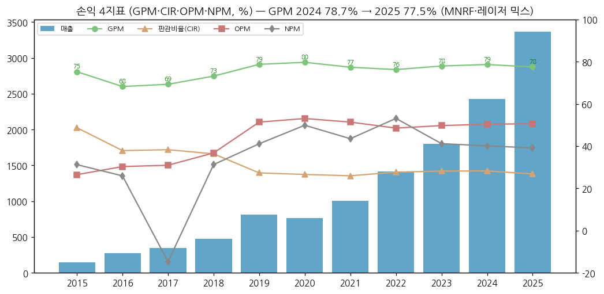

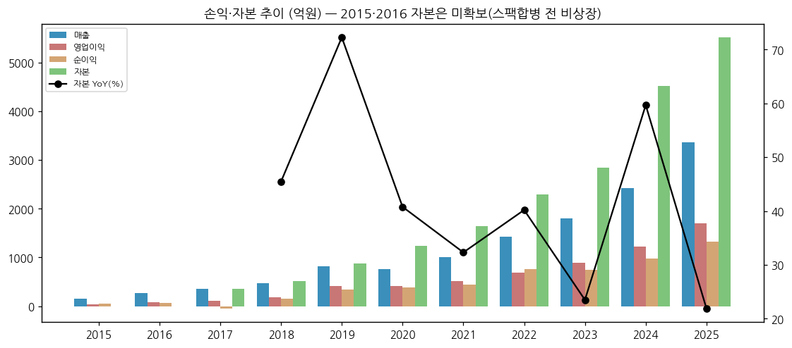

(3) 회사 주가 역사

→ 시가총액은 2017.12 상장 직후 약 0.4조 → 2019 슈링크 대중화로 약 0.8조 → 2022.04 **베인 인수**(60.84%, 인수 단가·총액은 DART 원문 미추출 — 미확인) → 2023~2025 볼뉴머·해외 성장으로 **2025.12 약 4.9조 고점**(종가 74,300원)

→ 2026: 1Q 브라질 연결 첫 분기 컨센 하회(이익 -4.1% YoY) → 2Q 가이던스 하향(4,900→4,450억) → 3Q 영업이익 -28% → **2026-11-13 종가 23,800원, 시총 약 1.55조 (고점 대비 -68%)**

→ 오버행: 베인 2025.05 6.00%(393만주, 주당 55,915원, 2,013억) 블록딜 → 2026.02.25 약 8.2%(540만주) 시간외 매각 → 잔여 46.10% + 주식담보대출(2025.09 하나은행·대신·삼성·미래에셋) 존재

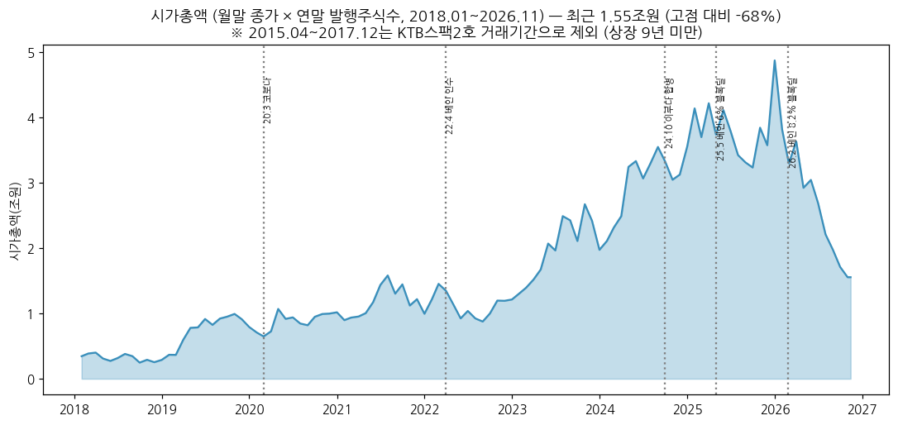

(4) 주요 연혁

| 연도 | 내용 |
|---|---|
| 2007 | 정성재 창업, ㈜클래시스 설립 |
| 2010년대 중반 | 슈링크(Ultraformer III) 출시 — 국내 HIFU 리프팅 대중화 (정확한 출시 연도 DART 미기재, 미확인) |
| 2016 | 해외 에스테틱샵 브랜드 클루덤(Cluederm) 출시, 화장품 스케덤 |
| 2017.12 | 케이티비스팩2호 합병 코스닥 상장 |
| 2018~2019 | 문정동 공장·미사 공장 매입, 60개국 진출, 슈링크 누적 4,500대 |
| 2021.10 | 슈링크 유니버스(Ultraformer MPT) 식약처 허가, 5,000만불 수출의탑 |
| 2022.04 | **최대주주 → BCPE Centur(베인캐피탈)**, 백승한 대표 선임 |
| 2022.08 | 볼뉴머(VOLNEWMER) 식약처 허가 |
| 2023.09 | ㈜이루다 지분 18% 인수 계약(405억, 2024.04 종결) / 2023.11 사이저 FDA |
| 2024.04 | 볼뉴머 FDA 허가 (미국명 Everesse) / 2024.05 CLASSYS JAPAN 설립 |
| 2024.10 | **㈜이루다 흡수합병** (쿼드세이·리팟 편입), 1억불 수출의탑 |
| 2025.05 | 볼뉴머 CE MDR / 베인 6% 블록딜 / 2025.07 쿼드세이 국내 런칭 / 2025.08 MPT CE MDR |
| 2025.10~12 | Classys Brasil 설립, 슈링크홈 리프투글로우 출시, 백승한 대표 사임·집행임원제 도입(최윤석) |
| 2026.03 | **브라질 MedSystems(JL Health) 77.5% 인수 완료** (중남미 직판) |
| 2026.06~07 | 최대주주 주식담보 지연공시 3건 → 불성실공시법인 지정예고(7.24) → **미지정(8.12)** / **윤준오 대표 선임(7.15)** |
| 2026.08~11 | 가이던스 하향(8.12), CCO 배정희·CTO 김택수 영입, 슈퍼벨로체 4800 CE 인증, 글로벌 누적 5만대 |

---

## ③ 비즈니스 모델

(1) 실적 추이 통합 표 — 5년 연간 (억원, DART 사업보고서 MD&A "브랜드별 영업실적")

**3단계 위계: 전사 → 품목(장비/소모품/기타) → 지역(수출/내수)**

| 구분 | 2021 | 2022 | 2023 | 2024 | 2025 | 2025 비중 | 2025 YoY |
|---|---|---|---|---|---|---|---|
| **전사 매출** | **1,006** | **1,418** | **1,801** | **2,429** | **3,368** | 100% | +38.6% |
| ├ 수출 | 702 | 875 | 1,171 | 1,638 | 2,247 | 66.7% | +37.2% |
| └ 내수 | 304 | 543 | 631 | 792 | 1,121 | 33.3% | +41.6% |
| **장비** | **541** | **821** | **951** | **1,243** | **1,740** | 51.7% | +40.0% |
| ├ 장비 수출 | 430 | 517 | 679 | 949 | 1,280 | 38.0% | +34.9% |
| └ 장비 내수 | 112 | 304 | 271 | 294 | 459 | 13.6% | +56.3% |
| **소모품** | **453** | **556** | **810** | **1,129** | **1,546** | 45.9% | +36.9% |
| ├ 소모품 수출 | 267 | 347 | 478 | 670 | 955 | 28.3% | +42.6% |
| └ 소모품 내수 | 186 | 209 | 333 | 460 | 592 | 17.6% | +28.7% |
| **기타**(홈케어·화장품·임대) | 11 | 41 | 40 | 57 | 82 | 2.4% | +43.4% |
| 영업이익 | 517 | 689 | 896 | 1,224 | 1,706 | OPM 50.7% | +39.3% |

→ 장비 = 클래시스 브랜드(슈링크·볼뉴머 등) + 클루덤(에스테틱샵용 울핏·아쿠아퓨어) 합산. 2024는 2025 보고서 재분류(구 이루다 품목을 장비/소모품에 배분), 2021~2023은 이루다 이전

→ 2025 지역 비중(대륙별): **아시아 29% / 유럽·중동 21% / 아메리카 17% / 국내 33%** (2025 사업보고서 MD&A)

→ 2025 판매경로: 국내 직판 21.1%·국내 대리점 11.9%·임대 0.3%·해외 대리점 66.7% → **1H26: 국내 직판 15.2%·국내 대리점 6.6%·해외 직판(일본·브라질) 8.9%·해외 대리점 67.1%·홈케어 2.1%** (2026.06 반기보고서)

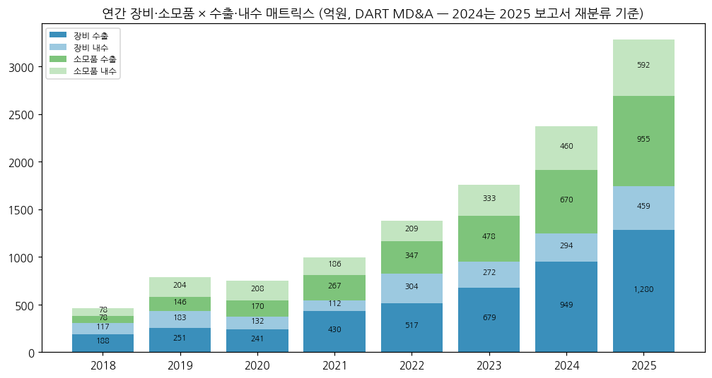

(1-2) 분기 시계열 — 35분기 (1Q18\~3Q26, 억원)

> 출처: 매출·영업이익·순이익 = OpenDART 연결(dart_quarterly_summary, 4Q = 연간 − 3Q 누적) / 장비·소모품·국내·해외 = DART 분기·반기·사업보고서 품목별 누적표 차감(1Q18~2Q25), ＊표시는 3Q25·4Q25 = 2025 연간 MD&A − 1H25 및 3Q26 YoY 역산, 1Q26~3Q26 = 언론·셀사이드 인용(1Q26 장비 421·소모품 409 — 블로그·벤처스퀘어 상반기 소모품 802억과 정합 / 2Q26 비즈니스포스트·메디파나 / 3Q26 키움 리뷰 via 메디파나). **3Q26 장비 474·소모품 345는 국내+해외 합산이며, 다른 인용(장비 423 -1.4%, 소모품 333 -10.6%)과 불일치 — 불확실**
> 국내/해외: 3Q25·4Q25·1Q26·2Q26은 DART 지역별 매출(누적 차감), 3Q26은 분기보고서 미공시로 미확보

| 분기 | 매출 | 영업이익 | OPM | 매출 YoY | OP YoY | 순이익 | 장비 | 소모품 | 기타 | 소모품 비중 | 국내 | 해외 | 해외 비중 |
|---|---|---|---|---|---|---|---|---|---|---|---|---|---|
| 1Q18 | 98 | 26 | 26.5% | - | - | 19 | 65 | 31 | 2 | 31% | 36 | 62 | 63% |
| 2Q18 | 115 | 42 | 36.5% | - | - | 38 | 75 | 36 | 4 | 31% | 39 | 75 | 66% |
| 3Q18 | 116 | 41 | 35.3% | - | - | 28 | 70 | 43 | 3 | 37% | 52 | 64 | 55% |
| 4Q18 | 146 | 65 | 44.5% | - | - | 62 | 95 | 47 | 4 | 32% | 72 | 74 | 51% |
| 1Q19 | 162 | 74 | 45.7% | +65.3% | +184.6% | 59 | 90 | 67 | 5 | 41% | 77 | 85 | 53% |
| 2Q19 | 216 | 96 | 44.4% | +87.8% | +128.6% | 76 | 123 | 83 | 9 | 39% | 110 | 105 | 49% |
| 3Q19 | 211 | 118 | 55.9% | +81.9% | +187.8% | 95 | 102 | 100 | 8 | 48% | 100 | 111 | 52% |
| 4Q19 | 223 | 129 | 57.8% | +52.7% | +98.5% | 103 | 118 | 100 | 5 | 45% | 113 | 110 | 49% |
| 1Q20 | 214 | 134 | 62.6% | +32.1% | +81.1% | 114 | 106 | 105 | 3 | 49% | 88 | 126 | 59% |
| 2Q20 | 146 | 64 | 43.8% | -32.4% | -33.3% | 47 | 65 | 76 | 5 | 52% | 92 | 54 | 37% |
| 3Q20 | 196 | 119 | 60.7% | -7.1% | +0.8% | 88 | 94 | 99 | 4 | 50% | 84 | 111 | 57% |
| 4Q20 | 209 | 89 | 42.6% | -6.3% | -31.0% | 132 | 108 | 98 | 3 | 47% | 81 | 128 | 61% |
| 1Q21 | 213 | 109 | 51.2% | -0.5% | -18.7% | 96 | 110 | 101 | 2 | 47% | 77 | 136 | 64% |
| 2Q21 | 295 | 161 | 54.6% | +102.1% | +151.6% | 120 | 183 | 110 | 2 | 37% | 92 | 203 | 69% |
| 3Q21 | 245 | 133 | 54.3% | +25.0% | +11.8% | 125 | 127 | 115 | 3 | 47% | 69 | 176 | 72% |
| 4Q21 | 253 | 114 | 45.1% | +21.1% | +28.1% | 97 | 122 | 127 | 5 | 50% | 67 | 187 | 74% |
| 1Q22 | 354 | 167 | 47.2% | +66.2% | +53.2% | 128 | 225 | 118 | 11 | 33% | 161 | 193 | 54% |
| 2Q22 | 327 | 153 | 46.8% | +10.8% | -5.0% | 138 | 194 | 120 | 13 | 37% | 132 | 195 | 60% |
| 3Q22 | 333 | 175 | 52.6% | +35.9% | +31.6% | 187 | 170 | 153 | 10 | 46% | 104 | 228 | 69% |
| 4Q22 | 405 | 194 | 47.9% | +60.1% | +70.2% | 300 | 231 | 166 | 8 | 41% | 146 | 259 | 64% |
| 1Q23 | 390 | 199 | 51.0% | +10.2% | +19.2% | 188 | 195 | 187 | 8 | 48% | 149 | 240 | 62% |
| 2Q23 | 459 | 231 | 50.3% | +40.4% | +51.0% | 186 | 235 | 218 | 6 | 47% | 146 | 313 | 68% |
| 3Q23 | 482 | 247 | 51.2% | +44.7% | +41.1% | 212 | 267 | 205 | 10 | 43% | 172 | 310 | 64% |
| 4Q23 | 470 | 219 | 46.6% | +16.0% | +12.9% | 157 | 254 | 201 | 16 | 43% | 163 | 307 | 65% |
| 1Q24 | 504 | 265 | 52.6% | +29.2% | +33.2% | 261 | 222 | 265 | 17 | 53% | 167 | 336 | 67% |
| 2Q24 | 587 | 312 | 53.2% | +27.9% | +35.1% | 266 | 309 | 261 | 17 | 44% | 184 | 403 | 69% |
| 3Q24 | 594 | 290 | 48.8% | +23.2% | +17.4% | 165 | 327 | 260 | 7 | 44% | 192 | 402 | 68% |
| 4Q24 | 744 | 358 | 48.1% | +58.3% | +63.5% | 284 | 385 | 344 | 16 | 46% | 248 | 496 | 67% |
| 1Q25 | 771 | 388 | 50.3% | +53.0% | +46.4% | 297 | 351 | 410 | 10 | 53% | 246 | 525 | 68% |
| 2Q25 | 833 | 430 | 51.6% | +41.9% | +37.8% | 265 | 455 | 352 | 26 | 42% | 299 | 534 | 64% |
| 3Q25 | 830 | 376 | 45.3% | +39.7% | +29.7% | 331 | 430* | 374* | 27 | 45% | 300 | 530 | 64% |
| 4Q25 | 934 | 512 | 54.8% | +25.5% | +43.0% | 427 | 505* | 411* | 19 | 44% | 277 | 658 | 70% |
| 1Q26 | 872 | 372 | 42.7% | +13.1% | -4.1% | 332 | 421* | 409* | 42 | 47% | 236 | 636 | 73% |
| 2Q26 | 1,055 | 439 | 41.6% | +26.7% | +2.1% | 255 | 492* | 392* | 171 | 37% | 224 | 831 | 79% |
| 3Q26 [잠정] | 830 | 270 | 32.5% | +0.0% | -28.2% | 59 | 474* | 345* | 11 | 42% | - | - | - |

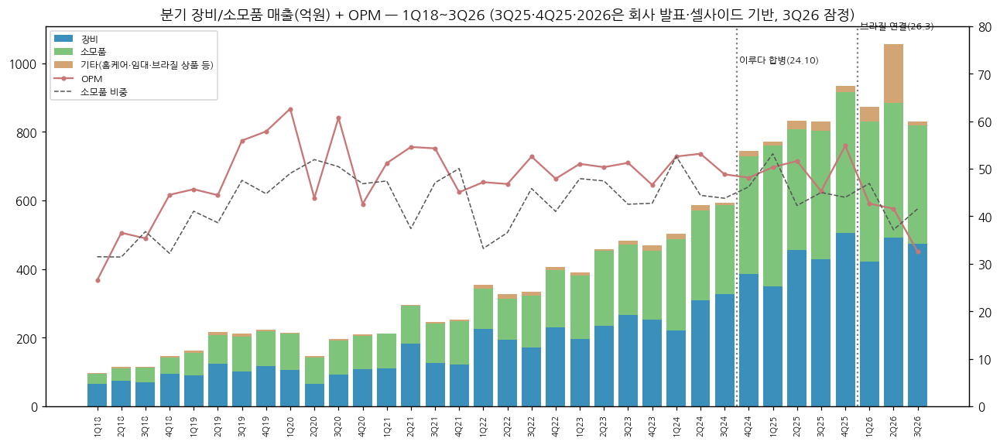

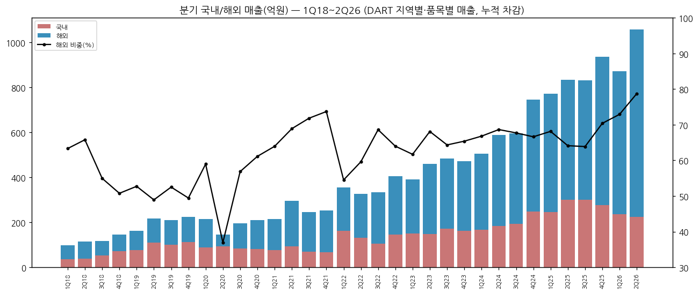

**분기 지역×품목 디테일 (최근, 억원)**

| 분기 | 국내 장비 | 해외 장비 | 국내 소모품 | 해외 소모품 | 브라질 직판 | 일본 직판 | 출처 |
|---|---|---|---|---|---|---|---|
| 1Q25 | 92 | 259 | 149 | 261 | - | - | DART 1Q25 분기보고서 |
| 2Q25 | 126 | 329 | 151 | 201 | - | - | DART 반기−1Q |
| 3Q25 | 116＊ | 313＊ | 158＊ | 216＊ | - | 52＊ | 3Q26 YoY 역산 |
| 2Q26 | 77 (-39.4%) | 416 (+26.5%) | 128 (-15.1%) | 264 (+31.3%) | 214＊ | 46＊ | 비즈니스포스트·메디파나 (＊3Q26 QoQ 역산) |
| 3Q26 | 64 (-45.0%) | 410 (+30.9%) | 112 (-29.1%) | 233 (+8.1%) | 166 (QoQ -22.3%) | 48 (YoY -7.8%) | 키움 3Q26 리뷰 (메디파나 2026-11-13) |

→ **핵심 관찰: 국내가 1Q26부터 3개 분기 연속 YoY 역성장 (국내 매출 2Q25 299억 → 2Q26 224억, 3Q26 국내 장비+소모품 176억 vs 3Q25 274억), 해외가 성장 전부를 담당**. 해외 장비 성장의 상당 부분은 브라질 직판 전환(대리점 출고가 → 최종 판매가)에 따른 회계적 단가 상승 효과 포함

(1-3) 최근 12분기 시계열

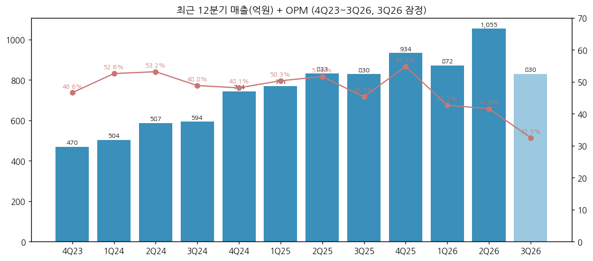

| 분기 | 4Q23 | 1Q24 | 2Q24 | 3Q24 | 4Q24 | 1Q25 | 2Q25 | 3Q25 | 4Q25 | 1Q26 | 2Q26 | 3Q26P |
|---|---|---|---|---|---|---|---|---|---|---|---|---|
| 매출 | 470 | 504 | 587 | 594 | 744 | 771 | 833 | 830 | 934 | 872 | 1,055 | 830 |
| 영업이익 | 219 | 265 | 312 | 290 | 358 | 388 | 430 | 376 | 512 | 372 | 439 | 270 |
| OPM | 46.6% | 52.6% | 53.1% | 48.7% | 48.1% | 50.3% | 51.6% | 45.3% | 54.8% | 42.7% | 41.6% | 32.5% |
| 매출 YoY | +16.2% | +29.3% | +28.0% | +23.1% | +58.3% | +53.1% | +41.8% | +39.7% | +25.6% | +13.0% | +26.7% | +0.0% |

→ 4Q25 OPM 54.8%는 **브라질 대리점 관련 대손충당금 환입** 영향 포함 (DB증권·하나증권 4Q25 리뷰 제목: "대손충당금 계정 재분류", "브라질 환입으로 컨센 상회" — 금액 미확인)

(2) 사업부(품목)별 개요 — 매출 비중 큰 순서 (단일 보고부문: 미용의료기기)

| 품목 | 2025 매출 | 비중 | 수익 구조 | 주요 제품 |
|---|---|---|---|---|
| **장비** | 1,740억 | 51.7% | 1회성 판매 (대당 수천만~1억원대 추정, 판가 영업비밀) — 국내 판매 시 소모품 교환권 패키지 | 슈링크 유니버스(MPT)·슈링크(Ultraformer III), 볼뉴머(Everesse), 쿼드세이, 리팟, 울핏, 알파, 벨로체(IPL), 큐라스 하이브리드, 아쿠아퓨어 |
| **소모품** | 1,546억 | 45.9% | **반복매출** — 카트리지(HIFU)·팁(RF/MNRF)·젤패드. 시술 횟수 × 설치기반에 비례, 고마진(소모품 비중↑ → GPM↑) | MPT 카트리지, 볼뉴머 팁, 쿼드세이 니들팁(외주 생산) |
| **기타** | 82억 | 2.4% | 홈케어 디바이스·화장품(슈링크RX/스케덤), 임대료 | 슈링크홈 리프투글로우(2025.11), 볼리움, 리프팅 밴드 |

**기술 포트폴리오 (2025 사업보고서 "주요 제품")**

| 기술 | 제품 | 출시/허가 | 비고 |
|---|---|---|---|
| 집속초음파 HIFU | 슈링크(Ultraformer III) → **슈링크 유니버스(Ultraformer MPT)**, 울핏(Ulfit) | MPT 2021.10 식약처, 2025.08 CE MDR, 미국 2027 출시 목표 | 국내 HIFU 리프팅 대명사, 글로벌 IB의 핵심 |
| 모노폴라 RF | **볼뉴머(VOLNEWMER / 해외 Everesse)** | 2022.08 식약처, 2024.04 FDA, 2025.05 CE MDR, 중국 2026.12 예상 | Thermage 대체재 포지션, 2024~25 "글로벌 메가 히트" |
| 마이크로니들 RF | **쿼드세이(QUADESSY)** | 이루다 합병 편입, 2025.07 국내 런칭 | 원가율 높음(니들팁 외주) |
| 레이저 | **리팟(reepot)**, 큐라스 하이브리드, 포트라(4파장, 2026 출시) | 이루다 합병 편입 | 혈관·색소 |
| IPL | 벨로체(Veloce), 슈퍼벨로체 4800 | 2026 CE 인증 | |
| 기타 | 아쿠아퓨어 I·II, 리핏, 알파(CLATUU Alpha), 사이저(SCIZER, 2023.11 FDA) | - | 클루덤 브랜드(에스테틱샵) 포함 |
| 차기 | **비클라라** (중국 2027 하반기 허가 목표), MPT 상위 출력 모델·볼뉴머 신규 팁 (2027 상반기) | - | 회사 3Q26 보도자료 |

(3) 품목별 디테일

→ **Top-seller = 슈링크 유니버스(HIFU) + 볼뉴머(RF)**. 2025 해외 장비 +34.9%의 주 요인은 "MPT 설치기반 확대 + 볼뉴머의 글로벌 메가 히트 안착", 국내 장비 +56.3%는 "MPT·볼뉴머 트렌드 + 쿼드세이 신제품 효과" (2025 사업보고서 MD&A)

→ **Growth = 해외 소모품** (2025 +42.6%, CIS·아시아 등 IB 확보 지역 중심). 국내 소모품은 +28.7% (무상 소모품 포함 시 시술 건수 증가율은 더 높다고 회사 설명)

→ **이익 outlier**: ① 이루다 MNRF·레이저 매출 비중 3%(2024) → 18%(2025)로 GPM -1.2%p 희석, ② 2026 브라질 직판 — 인수 전 재고 소진 기간 유통마진 제한·현지 판관비, 일본 직판 전환 선투자, ③ 국내 신제품(쿼드세이·포트라) 확대 지연 + 마케팅 비용(4Q26 약 30억 추가 — 교보)

→ **이루다 합병 영향 요약**: 2023.09 지분 18% 405억 매입 → 2024.10 소규모합병(신주 150.6만주). 이전대가 1,180억, 영업권 596억, 고객관계·기술력 679억(상각 → 2025 무형자산상각비 80억, 2023 3억 대비 급증). 관계기업주식 처분손실 144억(2024). 효과: 제품군 HIFU+RF → **MNRF·레이저까지 "Full EBD 플랫폼"**(KB증권 2026-06 리포트 제목), 안양 공장 편입, 2025 매출 기여 약 600억 내외(18% × 3,368억 — 회사 표현 기반 추정)

(4) 주요 경쟁사 (회사 공시는 "공신력 있는 점유율 자료 없음" — 아래는 업계 일반 구도, 미검증)

| 영역 | 글로벌 | 국내 |
|---|---|---|
| HIFU 리프팅 | Merz Aesthetics(Ultherapy), Sofwave | 제이시스메디칼(리니어지·리니어펌), 하이로닉(더블로), 원텍 |
| 모노폴라 RF | Solta Medical/Bausch(Thermage FLX) | 원텍(올리지오), 제이시스메디칼(덴서티) |
| MNRF | InMode(Morpheus8), Lutronic(Genius) | 비올(실펌X), 제이시스메디칼(포텐자) |
| 레이저·IPL | Candela, Cutera, Lumenis, Lutronic | 원텍, 루트로닉 |
| 피어(워치리스트 미용의료) | - | 파마리서치(리쥬란 — 스킨부스터), 휴젤(톡신), 엘앤씨바이오(스킨부스터) — 시술 보완재 |

(5) 주요 매출처

→ **80여 개국 대리점 + 국내외 병·의원 + 일반 소비자**. 대리점 명칭·비중은 영업비밀로 비공개 (2025 사업보고서)

→ 연결 주석 "주요 고객"(매출 10% 이상): **2024 고객 A 469억(19.3%)** → 2025 해당 없음(0). 2024 고객 A는 **브라질 독점 대리점 MedSystems로 추정** (2026 인수 대상이 "당사의 브라질 독점 대리점 MedSystems"라는 2026-08 공정공시 문구 + 1Q26부터 연결 — 추정, 미확인)

→ 수주: 단기 P/O 기반 주문생산 → 수주잔고 공시 없음

(6) 생산 CAPA + 임직원

| 연도 | 생산능력(대·개) | 생산실적 | 생산실적 금액(억원) | 가동률 | 임직원(명) |
|---|---|---|---|---|---|
| 2018 | - | - | - | - | 196 |
| 2019 | - | - | - | - | 196 |
| 2020 | - | - | - | - | 185 |
| 2021 | - | - | - | - | 273 |
| 2022 | - | - | - | - | 350 |
| 2023 | 116,297 | 128,587 | 397 | 110.6% | 383 |
| 2024 | 154,693 | 174,153 | 496 | 112.6% | 527 |
| 2025 | 663,173 | 614,085 | 717 | 92.6% | 528 |
| 1H26 | - | - | - | - | 548 |

→ 생산 수량은 장비+소모품 개수 합산(2025 급증은 이루다 품목·소모품 카운트 방식 포함), 2018~2022 CAPA 표는 미추출. 생산시설: 송파 문정동, 안양 만안구 (2025말 생산설비 장부가 528억)

→ 연구개발 인력 조직: 제1·제2연구소(RF·Laser), 연구기획팀, 홈뷰티디바이스팀, System Verification팀, 선행개발팀

---

## ④ 재무 구조 (연결, OpenDART — 2015·2016 손익은 2017 사업보고서 전기)

(1) 손익계산서 (억원)

| 연도 | 매출 | 매출총이익 | 판관비 | 영업이익 | 세전이익 | 순이익 | GPM | CIR | OPM | NPM | 매출 YoY |
|---|---|---|---|---|---|---|---|---|---|---|---|
| 2015 | 150 | 113 | 73 | 40 | - | 47 | 75.3% | 48.8% | 26.5% | 31.3% | - |
| 2016 | 272 | 186 | 103 | 83 | - | 71 | 68.3% | 37.9% | 30.3% | 26.0% | +81.7% |
| 2017 | 349 | 242 | 134 | 108 | -31 | -51 | 69.3% | 38.3% | 31.0% | -14.7% | +28.0% |
| 2018 | 475 | 347 | 173 | 175 | 178 | 149 | 73.2% | 36.4% | 36.8% | 31.3% | +36.2% |
| 2019 | 811 | 639 | 222 | 417 | 417 | 334 | 78.8% | 27.4% | 51.4% | 41.2% | +70.9% |
| 2020 | 765 | 610 | 204 | 406 | 393 | 382 | 79.7% | 26.6% | 53.1% | 49.9% | -5.8% |
| 2021 | 1,006 | 779 | 261 | 517 | 556 | 438 | 77.4% | 26.0% | 51.4% | 43.5% | +31.6% |
| 2022 | 1,418 | 1,082 | 393 | 689 | 968 | 754 | 76.3% | 27.7% | 48.6% | 53.2% | +41.0% |
| 2023 | 1,801 | 1,404 | 508 | 896 | 938 | 742 | 78.0% | 28.2% | 49.8% | 41.2% | +27.0% |
| 2024 | 2,429 | 1,911 | 687 | 1,224 | 1,279 | 975 | 78.7% | 28.3% | 50.4% | 40.2% | +34.9% |
| 2025 | 3,368 | 2,611 | 905 | 1,706 | 1,686 | 1,320 | 77.5% | 26.9% | 50.7% | 39.2% | +38.6% |
| 1H26 | 1,927 | 1,415 | 604 | 811 | 814 | 587 | 73.4% | 31.4% | 42.1% | 30.5% | +20.1% |
| 3Q26 [잠정] | 830 | - | - | 270 | 77 | 59 | - | - | 32.5% | 7.1% | +0.0% |

→ 2022 NPM 53.2%: 구사옥(역삼동 720-6) 600억 매각 처분이익 / 2024 순이익: 이루다 관계기업주식 처분손실 144억 반영 / 2015 NPM>OPM: 영업외수익(미확인)

(2) 재무상태표 (억원, 연말)

| 연도 | 자산 | 유동자산 | 현금 | 단기금융상품 | 유형자산 | 무형(영업권 포함) | 부채 | 유동부채 | 차입금(+CB) | 자본 | 부채비율 | 유동비율 | 순현금 |
|---|---|---|---|---|---|---|---|---|---|---|---|---|---|
| 2017 | 632 | 277 | 192 | - | 320 | 1 | 281 | 144 | 74 | 351 | 80% | 192% | 118 |
| 2018 | 757 | 266 | 105 | - | 461 | 2 | 246 | 148 | 58 | 510 | 48% | 179% | 46 |
| 2019 | 1,137 | 576 | 340 | - | 511 | 7 | 257 | 255 | 96 | 879 | 29% | 226% | 244 |
| 2020 | 1,375 | 830 | 644 | - | 501 | 8 | 138 | 134 | 0 | 1,238 | 11% | 617% | 644 |
| 2021 | 2,164 | 731 | 428 | - | 807 | 11 | 526 | 168 | 350 | 1,637 | 32% | 436% | 78 |
| 2022 | 3,314 | 1,478 | 260 | 654 | 1,042 | 15 | 1,019 | 362 | 668 | 2,296 | 44% | 408% | 246 |
| 2023 | 3,754 | 1,857 | 183 | 904 | 1,390 | 28 | 919 | 292 | 644 | 2,835 | 32% | 635% | 443 |
| 2024 | 6,084 | 2,342 | 227 | 1,353 | 1,932 | 1,409 | 1,557 | 1,289 | 903 | 4,526 | 34% | 182% | 677 |
| 2025 | 7,046 | 2,958 | 375 | 1,695 | 1,997 | 1,396 | 1,530 | 802 | 865 | 5,517 | 28% | 369% | 1,205 |
| 1Q26 | 7,998 | 3,627 | 1,021 | 787 | 2,078 | 1,463 | 2,705 | 2,523 | 1,404 | 5,293 | 51% | 144% | 404 |
| 2Q26 | 7,747 | 3,177 | 787 | 565 | 2,060 | 1,626 | 2,196 | 1,989 | 1,467 | 5,551 | 40% | 160% | -115 |

→ 2Q26 무형자산 1,626억 중 **영업권 818억**(이루다 596억 + 브라질 JL Health 199억 + MedSystems CO 9억 + 환산), 고객관계 438억, 기술력 131억 (2026.06 반기보고서 주석). 2Q26 **순차입 전환**은 브라질 인수 차입 승계(약 990억) + FY25 결산배당 652억 지급 영향. 1Q26 부채 급증 일부는 미지급배당(652억) 계상으로 추정

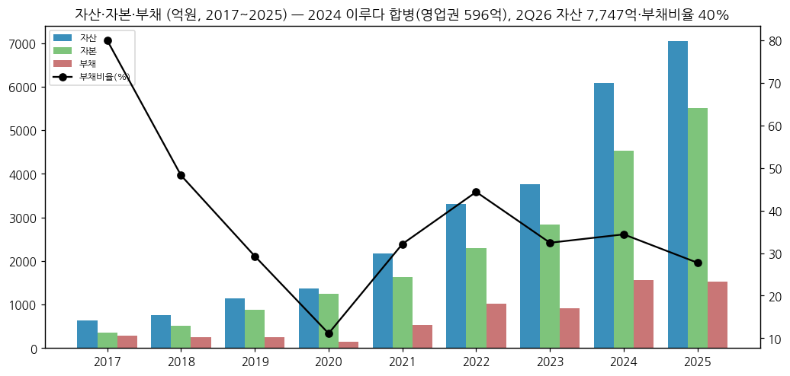

(3) 현금흐름표 (억원)

| 연도 | 영업CF | 투자CF | 재무CF | 유형 CapEx | 무형 CapEx | FCF | 배당지급 | 자사주취득 | 감가상각 | 무형상각 |
|---|---|---|---|---|---|---|---|---|---|---|
| 2016 | 58 | -5 | -0 | 2 | 0 | 56 | 0 | - | 1 | 0 |
| 2017 | 86 | -206 | 194 | 317 | 1 | -232 | 0 | - | 2 | 0 |
| 2018 | 160 | -203 | -44 | 148 | 1 | 11 | 5 | - | 7 | 0 |
| 2019 | 390 | -127 | -25 | 62 | 6 | 322 | 9 | - | 14 | 0 |
| 2020 | 381 | 67 | -122 | 8 | 2 | 371 | 30 | - | 20 | 1 |
| 2021 | 364 | -925 | 307 | 326 | 4 | 33 | 39 | - | 24 | 1 |
| 2022 | 548 | -920 | 211 | 275 | 5 | 268 | 43 | 54 | 32 | 2 |
| 2023 | 646 | -482 | -256 | 45 | 16 | 585 | 75 | 146 | 37 | 3 |
| 2024 | 1,028 | -822 | -167 | 41 | 67 | 920 | 128 | 0 | 48 | 22 |
| 2025 | 1,639 | -1,090 | -395 | 129 | 64 | 1,447 | 168 | 181 | 65 | 80 |
| 1H26 | 155 | 932 | -682 | 33 | 42 | 80 | 652 | 0 | 38 | 41 |

→ 1H26 영업CF 155억(1H25 533억)으로 급감 — 브라질 운전자본(매출채권 487억·재고 230억 인수) 영향 추정. 투자CF +932억은 단기금융상품 회수(배당·차입 상환 재원)

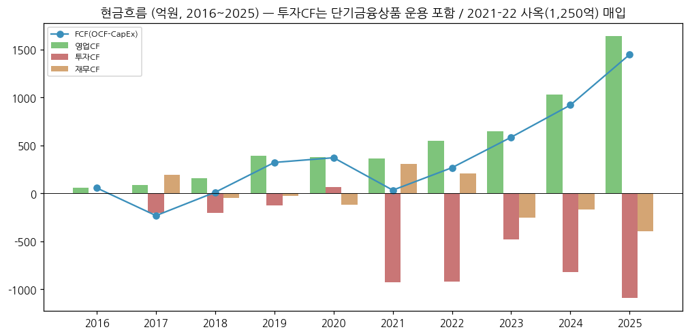

(4) CapEx

→ **경자산(asset-light) 구조**: 생산설비 CapEx는 연 50억 미만. 대형 CapEx는 모두 **사옥·공장 부동산** — 2017 클래시스타워(테헤란로 240) 매입, 2018 문정동 공장, 2018~19 미사 테스타타워(81억), 2021 문정동 추가(140억), **2021~22 테헤란로 208 신사옥 1,250억**(2022.10 구사옥 600억 매각)

→ 2024~2025 무형 CapEx 64~67억은 임상인증비 자산화(2025 44억)

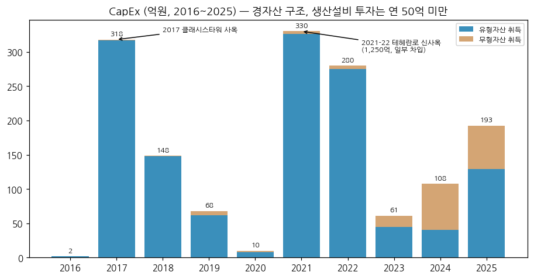

(5) 부채 구조 + 채무증권 발행 history

| 시점 | 차입금 | 구성 | 비고 |
|---|---|---|---|
| 2021~2023 | 350 → 668 → 644억 | 장기차입금 (신사옥 매입 자금) | |
| 2024 | 903억 | 단기 767 + 장기 115 + CB 21 | 이루다 차입금 657억 승계, 엔슨 1회 사모CB(액면 25억, 2022.07 발행, 2026.07 만기) |
| 2025 | 865억 | 단기 213 + 장기 628 + CB 24 | |
| 2Q26 | 1,467억 | 단기 1,411 + 장기 56 | 브라질 JL Health 차입금 960억 승계 (2026.06 반기보고서 주석) / 타인 채무보증 결정(2026.05·06 — 종속회사 대상 추정) |

→ 회사채 공모 발행 이력 없음. 이자보상배율(OP/금융비용) 15~57배

(6) 배당·자사주

| 연도(결산) | DPS(원) | 배당총액(억원) | 배당성향(연결) | 자사주 |
|---|---|---|---|---|
| 2017 | 8 | - | - | - |
| 2018 | 14 | - | - | - |
| 2019 | 46 | - | - | - |
| 2020 | 60 | - | - | - |
| 2021 | 66 | - | - | - |
| 2022 | 116 | - | - | 신탁 취득 54억 |
| 2023 | 200 | 128 | 17.2% | 신탁 취득 146억 → **2024.03 77.7만주 소각** |
| 2024 | 257 | 168 | 17.2% | - |
| 2025 | **1,000** | **652** | **49.4%** | 신탁 취득 181억(35만주) → **2026.02 27만주 소각**, 일부 스톡옵션 교부 |

→ 2025 DPS 1,000원(전년 257원의 3.9배) — 2026.03.13 현금배당결정 공시, 2026.03.31 기업가치제고계획(자율공시) 별도 공시(내용 미추출). 최대주주 베인(당시 54%)이 배당의 과반 수취 → PE 엑시트 국면의 현금회수 성격 해석 여지 (해석, 공시 문구 아님)

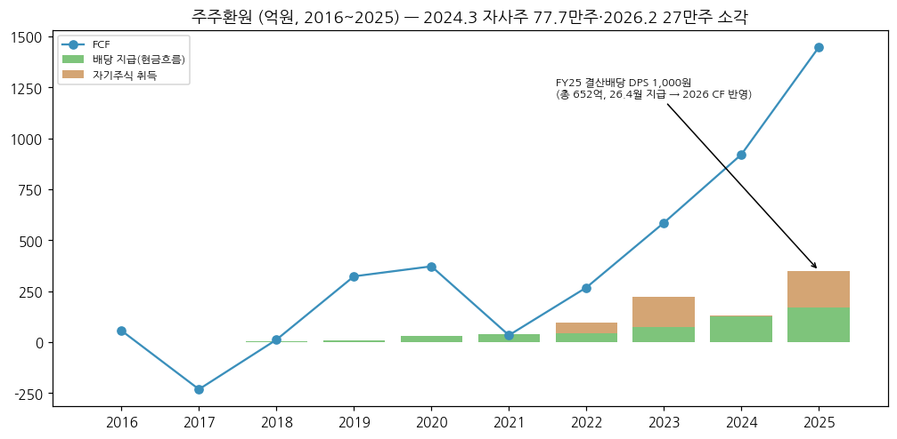

(7) 재무비율

| 연도 | ROE | ROA | 부채비율 | 유동비율 | 이자보상배율 |
|---|---|---|---|---|---|
| 2018 | 34.5% | 21.4% | 48% | 179% | 31x |
| 2019 | 48.1% | 35.3% | 29% | 226% | 57x |
| 2020 | 36.1% | 30.4% | 11% | 617% | 16x |
| 2021 | 30.5% | 24.8% | 32% | 436% | 141x |
| 2022 | 38.3% | 27.5% | 44% | 408% | 15x |
| 2023 | 28.9% | 21.0% | 32% | 635% | 25x |
| 2024 | 26.5% | 19.8% | 34% | 182% | 26x |
| 2025 | 26.3% | 20.1% | 28% | 369% | 16x |

→ ROE·ROA는 평균 자본·자산 기준, 이자보상배율 분모는 금융비용 총액(외환손실 포함). 회사 공시 2025 ROE 23.9%(기말 자본 기준)와 산식 차이

---

## ⑤ 지배 구조

(1) 그룹·계열 관계

→ **최대주주: BCPE Centur Investments, LP** (케이맨, 2022.01.10 설립) → GP: BCPE Centur GP, LLC → GP: **Bain Capital Investors Asia IV, LLC** (베인캐피탈 아시아 4호 펀드). 2025말 BCPE Centur 재무: 자산 1조 9,591억·부채 1조 5억·자본 9,586억 (2026.06 반기보고서) — 부채는 클래시스 주식담보 인수금융

→ **주식담보**: 2025.09.26 하나은행·대신증권·삼성증권·미래에셋증권과 대출계약(기존 차입 상환 재원) + 주식담보·계좌근질권 설정. "최대주주 변경을 수반하는 주식담보제공계약" 3건(사유발생 2023.04.04·2024.04.26·2025.09.30)을 **2026.06.26에야 공시** → 거래소 불성실공시법인 지정예고(2026.07.24) → **2026.08.12 미지정 결정**

→ 베인 관계사 겸직: 기타비상무이사 김동욱·김현승·박완진·이은지가 에코마케팅·안다르·데일리앤코·에코투자파트너스 등 베인 포트폴리오 이사 겸직 (2026 — 베인의 에코마케팅 인수 관련으로 추정)

→ 클래시스 종속회사: CLASSYS JAPAN, Classys Brasil(→ JL Health 77.5%, MedSystems AR·CO 100%), Skederm Inc.·Skederm Shanghai, ㈜엔슨 등 (2026.06 기준 약 11개사)

(2) 주주 구성

| 주주 | 주식수 | 지분율 | 기준일 | 비고 |
|---|---|---|---|---|
| **BCPE Centur Investments, LP (베인캐피탈)** | 30,072,418 | **46.10%** | 2026.06.30 | 2022.04 60.84% 취득 → 2025.05 6.00% 블록딜(주당 55,915원, 2,013억) → 2026.02.25 시간외 540만주 매각 |
| 정성재 (창업자, 전 대표) | 6,433,489 | 9.86% | 2026.06.30 | 2022 매각 후 잔여 |
| Capital Research and Management (Capital Group) | 3,325,549 | 5.10% | 2026.08.28 | 단순투자, 6.16% → 5.10% 장내매도 |
| 자기주식 | 약 1.6만주 | 0.02% | 2026.06 | 270,000주 소각 후 |
| 소액주주 | 21,917,785 | 33.60% | 2026.06.30 | 54,954명 |
| 발행주식총수 | 65,235,659 | 100% | | 의결권 주식 65,235,659 |

→ **외국인·국내기관·개인 분리 지분율: 미확보** (DART 정기보고서 미제공, KRX 데이터 미수집)

→ 2026.07.16·08.07 대량보유 보고(약식) 2건은 내용 미추출

→ 지분 변천: 정성재 일가 85.05%(2021 기초) → 73.92%(2021말, 2021.02 일부 처분) → **2022.04 베인 60.84% + 정성재 9.93% + 이연주 3.00%** → 2024 소각·합병신주로 60.16% → 2025.05 54.16% → 2026.02 46.10%

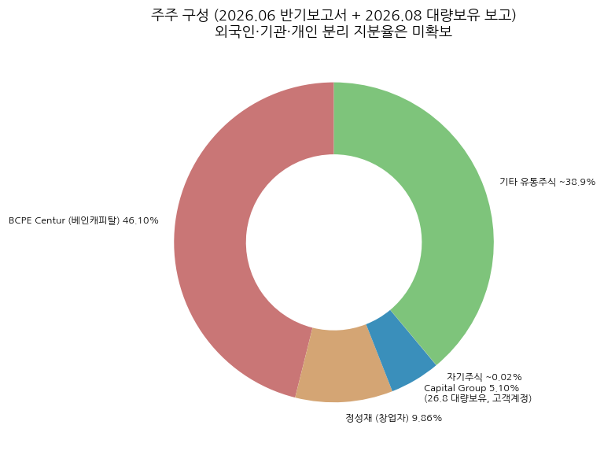

(3) 임원·이사회 (2025 사업보고서 + 2026.06 반기보고서 + 공시)

**집행임원 (2025.12.22 집행임원제 도입 — 대표이사 백승한 임기 전 사임)**

| 성명 | 직위 | 주요 경력 |
|---|---|---|
| **윤준오** | 대표집행임원 (2026.07.15~) | 전 삼성전자 부사장 — 하만 인수·통합 담당 M&A 전문가 (한국경제·스마트투데이 2026-07) |
| 최윤석 | 전무, 경영관리본부장(CFO) (2025.12~2026.07 대표집행임원) | KAIST MBA, 공차코리아·이에스지 CFO, 2022 합류 |
| 박수만 | 전무, 연구개발본부장(CTO, 2025말 기준) | 지멘스헬시니어스 초음파사업부 CTO·부사장 |
| 김래희 | 전무, 마케팅본부장 | UC Berkeley MBA, Candela Medical APAC |
| 윤태수 | 전무, 생산본부장 | 파카하니핀코리아 |
| 배정희 | 부사장, CCO (2026 신설) | 베인앤드컴퍼니 파트너 (언론) |
| 김택수 | CTO (2026 영입) | 세부 경력 미확인 |

**이사회 (2025말 기준 7인)**

| 성명 | 구분 | 비고 |
|---|---|---|
| 김현승 | 기타비상무이사, **이사회 의장** | Bain Capital PE Managing Director |
| 김동욱 | 기타비상무이사 | Bain Capital PE Partner (전 씨티글로벌마켓증권) |
| 박완진 | 기타비상무이사 | Bain Capital PE Managing Director |
| 이은지 | 기타비상무이사 (2025.07~) | Bain Capital PE Principal |
| 박준홍 | 사외이사(선임) | 전 존슨앤존슨 베트남 총괄 |
| 권혁진 | 사외이사, 감사위원장 | 공인회계사(삼일), 정인회계법인 부대표 |
| 신경자 | 사외이사 (2025.03~) | 구글 APAC 마케팅 총괄 |

→ 2026.03.31 정기주총에서 김동욱·김현승·박완진·박준홍·권혁진·신경자 재선임, 2026.04.01 사외이사 선임·중도퇴임 신고 1건(내용 미추출)

→ **지배구조 함의**: 이사회 7인 중 4인이 베인 측 → 경영전략(브라질 M&A, 고배당, 외부 CEO 영입) 결정권은 사실상 최대주주. 베인은 2025년부터 JP모간·씨티 주관 경영권 매각을 추진했으나 희망가(3조원대) 차이로 지분 분할 매각으로 선회했다는 보도 (IB토마토) — 공시로 확인된 사실 아님

---

## ⑥ 기타 팩트

(1) R&D 인프라

| 연도 | 연구개발비(억원) | 매출 대비 | 비고 |
|---|---|---|---|
| 2016 | 27.5 | 10.0% | 정부보조금 차감 전 |
| 2017 | 25.4 | 7.3% | |
| 2018 | 30.3 | 6.4% | |
| 2019 | 34.4 | 4.2% | |
| 2020 | 36.7 | 4.8% | |
| 2021 | 51.3 | 5.1% | |
| 2022 | 49.4 | 3.5% | |
| 2023 | 103.0 | 5.7% | 임상인증비 자산화 9.5억 시작 |
| 2024 | 173.0 | 7.1% | 임상인증비 자산화 44.3억 |
| 2025 | 218.5 | 6.5% | 판관비 174.4억 + 임상인증비 자산화 44.1억 |
| 1H26 | 146.1 | 7.6% | |

→ 조직: 기업부설연구소(제1연구소 — 전자회로·기구·광학·GUI / 제2연구소 — RF·Laser), 연구기획, 홈뷰티디바이스, System Verification, 선행개발

→ 지식재산권(2025말): 등록 1,271건(특허 172·디자인 300·상표 796) / 출원 1,991건 (2025 사업보고서)

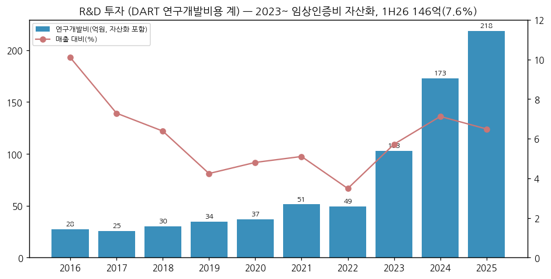

(2) Corporate action (10년)

| 시기 | 내용 | 규모 |
|---|---|---|
| 2017.12 | 케이티비스팩2호 합병 상장 | 합병상장비용 137억 |
| 2017~2019 | 클래시스타워·문정동 공장·미사 공장 매입 | 미사 81억 |
| 2021.03 / 2021.10 | 문정동 H비즈니스파크 8층 매입 / 테헤란로 208 신사옥 매입 | 140억 / 1,250억 |
| 2022.04 | 최대주주 변경 (정성재 → 베인캐피탈 BCPE Centur 60.84%) | - |
| 2022.08~10 | 구사옥(역삼동 720-6) 매각 | 600억 |
| 2022.09~2025.06 | 자기주식 취득 신탁 (연장 반복) | 2022 54억·2023 146억·2025 181억 |
| 2023.09 → 2024.04 | ㈜이루다 지분 18% 인수 | 405억 |
| 2024.03 | 자기주식 777,183주 소각 | - |
| 2024.10 | ㈜이루다 흡수합병 (1:0.1405237) | 신주 150.6만주, 이전대가 1,180억 |
| 2025.05 | 베인 6.00% 시간외 블록딜 | 2,013억 |
| 2025.10 → 2026.03 | Classys Brasil 통해 JL Health Participações(MedSystems) 77.5% 인수 + 아르헨티나·콜롬비아 법인 | 취득가 182.7억(공시) / 이전대가 166억(주석), 차입금 960억 승계, 풋·콜옵션 약정 |
| 2026.02 | 자기주식 270,000주 소각 / 베인 시간외 매각(→46.10%) | - |
| 2026.03 | FY25 DPS 1,000원(총 652억) / 기업가치제고계획 공시 | - |
| 2026.07 | 윤준오 대표집행임원 선임, 주식매수선택권 부여 | - |

(3) R&D·인허가 마일스톤

| 시기 | 마일스톤 |
|---|---|
| 2021.09~10 | 아쿠아퓨어2 허가, 슈링크 주름개선 적응증 추가, **슈링크 유니버스(MPT) 식약처 허가** |
| 2022.08 | **볼뉴머 식약처 허가** |
| 2023.11 | 사이저 FDA |
| 2024.04 | **볼뉴머 FDA (Everesse)** |
| 2024.07 | 울트라그로·울트라인티미 출시 |
| 2025.05 / 2025.08 | 볼뉴머 CE MDR / MPT CE MDR |
| 2025.07 | 쿼드세이 국내 런칭 |
| 2025.11 | 슈링크홈 리프투글로우(홈케어) 출시 |
| 2026 | 포트라(4파장 레이저) 국내 출시, 슈퍼벨로체 4800 CE 인증 |
| 2026.12 (예정) | **볼뉴머 중국 NMPA 허가 예상** |
| 2027 (예정) | 울트라포머 중국(2Q)·비클라라 중국(하반기), MPT 미국 출시, 국내 MPT 상위 출력 신제품·볼뉴머 신규 팁(상반기) |

(4) 주요 리스크

→ **성장 둔화·국내 포화**: 국내 장비 3Q26 -45%, 소모품 -29% YoY — 슈링크/볼뉴머 국내 설치기반 성숙 + 경쟁 국산 HIFU/RF 장비 다수

→ **브라질 직판 리스크**: 인수 차입 960억(BRL 환노출), 재고 소진기 마진 희석, 3Q26 브라질 직판 매출 QoQ -22%. 풋·콜옵션 약정(잔여 22.5% 지분) — 공정가치 변동이 영업외손익 변수. 3Q26 영업외 약 -193억(원인 미확인)

→ **최대주주 PE 엑시트 오버행**: 베인 46.1% + 주식담보대출. 경영권 매각 지연·추가 블록딜 시 수급 부담. 공시 지연(최대주주 주식담보 3건)으로 불성실공시 지정예고 이력(최종 미지정)

→ **가이던스 신뢰도**: 2025 가이던스 3,500억 대비 실적 3,368억(-3.8%), 2026 4,900억 → 4,450억 하향 후에도 달성 어려움(셀사이드)

→ **환율**: 매출 2/3 이상 해외(USD·EUR·CNY·BRL), 2Q26 외환차손 88억

→ **규제**: 국가별 의료기기 인허가 일정(중국 NMPA·미국 FDA), 국내 의료광고 규제

→ **영업권 손상**: 영업권 818억(이루다 596억 + 브라질 JL Health·MedSystems 약 222억, 환산 포함) + 고객관계·기술력 무형자산 569억 (2Q26)

→ 소송·우발채무: 중요 소송 공시 미발견 (미확인 — 사업보고서 "우발부채" 주석 미추출)

(5) ESG 등급

| 기관 | 등급 | 시점 |
|---|---|---|
| MSCI ESG | BBB → **A** | 2023.10 → 2024.08 |
| 한국ESG기준원(KCGS) | 통합 **A+**, 지배구조 우수기업 | 2024.10, 2022·2024.12 |
| 서스틴베스트 | **AA** | 2023.11, 2024.11 |
| 지속가능경영보고서 | 2026.05.26 자율공시 | 내용 미추출 |

(6) 인증·라이선스

→ ISO 14001(환경)·ISO 45001(안전보건) 2024.09 / 의료기기 품질시스템(국가별 GMP·MDSAP 등 — 세부 미추출) / 식약처 제조품목허가, FDA 510(k)(사이저·볼뉴머 등), CE MDR(볼뉴머·MPT·슈퍼벨로체 4800)

→ 수상: 수출의탑 5,000만불(2021)·7,000만불(2023)·1억불(2024), 코스닥 라이징스타(2022~2024), 한국IR대상, 코스닥 글로벌 세그먼트(2022 편입, 2026.06 재지정)

---

## Version Log

**v1.0 (2026-11-15)** — 첫 작성 (v4.8 표준, 6개 섹션 + 14개 차트 PNG)
→ OpenDART 재무 JSON 35건(2017 FY~2Q26) + 정기보고서 공시원문 39건 + 2025 FY 기업정보 6종 + 공시 4건(3Q26 잠정, 가이던스 정정, 불성실공시 예고, 대량보유) + Yahoo 월간 시세
→ 분기 장비/소모품×수출/내수 시계열: 1Q18~2Q25는 DART 품목별 누적표 차감(정확), 3Q25·4Q25는 연간 MD&A·YoY 역산, 2026은 언론·셀사이드 인용
→ 데이터 기준: 확정 2Q26 (반기보고서 2026.08.14) / 잠정 3Q26 (2026.11.12 공정공시)

**잔여 보완 후보 (v1.1)**
→ 3Q26 분기보고서(2026.11 중순 공시) 확정치로 [잠정] 교체 + 영업외손실 193억 내역(외환·파생·풋옵션) 확인 + 3Q26 국내/해외 매출
→ **회사 IR BOOK(분기 실적 PDF) 확보** — classys.co.kr IR 자료실 또는 FnGuide 경유(Chrome 필요) → 1Q26~3Q26 장비/소모품×지역 인용치 교체, 3Q26 장비 474 vs 423 불일치 해소, 4Q25 브라질 대손충당금 환입 금액
→ 외국인 지분율 시계열(KRX), 베인 2022 인수 단가·총액, 2026.02 블록딜 단가, 2026.07·08 대량보유 보고 내용
→ 2018~2022 생산능력·가동률, 우발부채·소송 주석, 기업가치제고계획 내용, 지속가능경영보고서
→ 2015 이전 손익(비상장 시기)은 공시 부재 — 추가 불가
