# 파라다이스 — 기업 개요 (v1.0)

> 마지막 update: 2026-11-25 (v1.0 — 첫 작성. 3Q26 분기보고서(2026-11-13 제출)·IR 3Q26 실적 리뷰(2026-11-16)까지 반영)
> 입력 source: OpenDART fnlttSinglAcntAll (연결 CFS, 2015 사업보고서\~3Q26, 44개 JSON — 2014는 2015 사업보고서 전기 컬럼) + DART 정기공시 원문 XML 60건 (사업보고서 2015\~2025·분기/반기 1Q16\~3Q26, 2015·2020·2024 사업보고서와 1Q21 분기보고서는 기재정정본) + OpenDART 기업개황·최대주주·임원·직원·배당·자기주식·주식총수 (2025 사업보고서) + 파라다이스 IR 자료 17건 (irgo 경유 — 실적 리뷰 1Q19·2Q19·3Q19·1Q25\~3Q26 + NDR·컨퍼런스 자료 2018-06\~2025-09, 2025-09-22 회사소개 64쪽 deck 포함. 4Q19\~4Q24 분기 실적 PDF는 irgo 미게시) + Yahoo Finance (034230.KS 월간 2002-11\~2026-11, 일간 2014-07\~09·2024-11\~2026-11) + 언론 (SBS Biz·파이낸셜뉴스·매일신문·데일리안·딜사이트·디지털데일리·아시아경제·이데일리·녹색경제신문·헤럴드경제·이투데이·뉴스토마토, 2014-03\~2026-11)
> 갱신 주기: 매분기 (실적 리뷰 모드 호출 시)
> 워치리스트: **여행·레저·유통 섹터 / 서브섹터: 면세·카지노·여행** (`earnings/watchlist.md` 102·103행, 2순위 섹터 — 4Q26부터 리뷰, 2026-11-23 추가)
> **Fact verify cutoff**: 2026-11-25 (주가 2026-11-24 종가 **11,020원** [Yahoo Finance 034230.KS 일간, 이투데이 시세 페이지 '전일 종가 11,020원'(2026-11-25) 일치], 발행주식 92,629,382주 [DART 분기보고서(2026.09) 별도 주석 — 자기주식 4,870,168주 포함] → 시가총액 **1.02조원** (10,208억원) [계산]. **사상 최고가: 2014-08-25 종가 40,650원** (장중 최고 41,400원, 2014-08-26) [Yahoo 일간] → 당시 시총 **3.70조원** [계산, 90,942,672주]. 2014-03-05 장중 30,400원이 "사상 최고가"로 보도된 뒤 8월까지 경신 [뉴스토마토 2014-03-05]. 고점 대비 **-72.9%**, YTD **-33.4%** (2025말 16,550원), 1년 **-36.3%** (2025-11-24 17,300원) [Yahoo, 계산]. 52주 장중 최고 21,850원 (2026-02, Yahoo 월간 고가) / 최저 9,060원 [alphasquare 2026-11-24]. 2024-06-24 코스닥 → 유가증권시장 이전상장 [DART 분기보고서(2026.09) 주석 1])

---

## 1. 기업 분류

- **Primary 분류: 사이클 — 외국인 전용 카지노 + 복합리조트 (인바운드 관광·이벤트형 사이클)** — 12년 동안 연간 영업적자 4번(2017·2020·2021, 2018은 24억으로 사실상 0)과 OPM 정점 14.7%(2023)가 공존. 이익 변동은 경기보다 **방한 외국인 VIP 흐름을 끊는 외부 충격**(2015 메르스, 2017 사드 보복, 2020\~2022 코로나)과 **대형 투자 직후의 상각·이자 부담**(2017\~2019 파라다이스시티)에서 나왔다
- **Secondary 노트: 호텔·복합리조트 자산 확장기 (2026\~2028)** — 2026-01 하얏트 리젠시 인천(구 그랜드하얏트 웨스트타워 501실) 2,100억원 인수 [디지털데일리 2025-09-23], 2028-10 장충동 초럭셔리 호텔(J-project, 188실, 공사비 5,750억원) 개장 예정 [IR 2025-09-22]. 카지노 단일 의존에서 "카지노 + 비카지노(호텔·리조트)" 혼합으로 이동 중이지만, 2025 연결 매출의 **카지노 게임 수익 비중은 여전히 78.2%** [계산 — 카지노 부문 + P-City 카지노 매출]

### ① 정량 근거

**📊 Summary Box (12년, 2014\~2025 연결):**

| 지표 | 값 |
|------|-----|
| 매출 CAGR (2014→2025, 11년) | **+4.9%** (6,762억 → 11,499억) — 단, 2014→2022 구간은 -1.7%/년, 2022→2025 구간은 +25.1%/년 [계산] |
| OPM 평균 | **3.5%** (range -19.0\~14.7%, 폭 33.7%p) |
| OPM 정점 평균 | **13.3%** (2014 11.7% · 2023 14.7% · 2025 13.6%) — 중국 VIP 정점(2014), 리오프닝+일본 VIP(2023\~2025) |
| OPM 저점 평균 | **-12.3%** (2017 -4.5% · 2020 -19.0% · 2021 -13.3%; 2018 0.3%는 제외) — 사드 보복+P-City 개장 상각(2017), 코로나(2020·2021) |
| 사이클 주기 | **약 9년 (정점 2014 → 정점 2023)** — 수요 사이클이 아니라 충격·회복 주기. 바닥까지 3년(2014→2017), 바닥 지속 4\~5년(2017\~2022, 코로나 중첩), 회복 1년(2022→2023) |
| 사이클 회수 (12년) | **1.5회** (정점→저점→정점 1회 완결 + 2023→2024 소폭 둔화 후 2025 재가속) |

```
[전사 손익 시계열 (12년, 연결, DART, 억원)]
연도    매출     영업이익   순이익    OPM     NPM   CapEx/매출
2014    6,762      790    1,058    11.7    15.7    11.8%   ← 중국 VIP 드롭 64%(정점) — 2015 사업보고서 전기 컬럼
2015    6,154      583      718     9.5    11.7    48.1%   ← 메르스(5〜7월) 매출 -9.0%
2016    6,949      658      576     9.5     8.3    71.1%   ← P-City 건설 막바지, 올랜도 호텔 인수(3월)
2017    6,680     -300     -399    -4.5    -6.0    53.6%   ← P-City 개장(4-20) + 사드 보복(중국 단체관광 금지) → 적자
2018    7,876       24     -441     0.3    -5.6    34.5%   ← P-City 2차(9월) 개장, 상각·이자 부담 → 순손실
2019    9,794      519       67     5.3     0.7     8.8%   ← P-City 정상화, 매출 9,794억(코로나 전 최대)
2020    4,539     -862   -1,669   -19.0   -36.8     2.0%   ← 코로나 — 카지노 휴장·입국 제한, 영업적자 -862억
2021    4,145     -552     -786   -13.3   -19.0     5.8%   ← 코로나 2년차, 7회 CB 2,000억 발행
2022    5,876      104      158     1.8     2.7     3.0%   ← 하반기 일본 무비자 재개 → 3Q22 흑자전환
2023    9,942    1,458      802    14.7     8.1     6.3%   ← 리오프닝 + 일본 VIP — 매출 2배(+69%)
2024   10,721    1,361    1,107    12.7    10.3     4.7%   ← 토지 재평가잉여금 +1,949억(OCI), 매출 1조 첫 돌파
2025   11,499    1,558    1,448    13.6    12.6     8.8%   ← 매출 1.15조 사상 최대, OPM 13.6%

OPM range: -19.0% (2020) ~ +14.7% (2023) = 33.7%p  (외부 충격 — 메르스·사드·코로나 — 이 이익을 결정하는 "이벤트형 사이클")
```

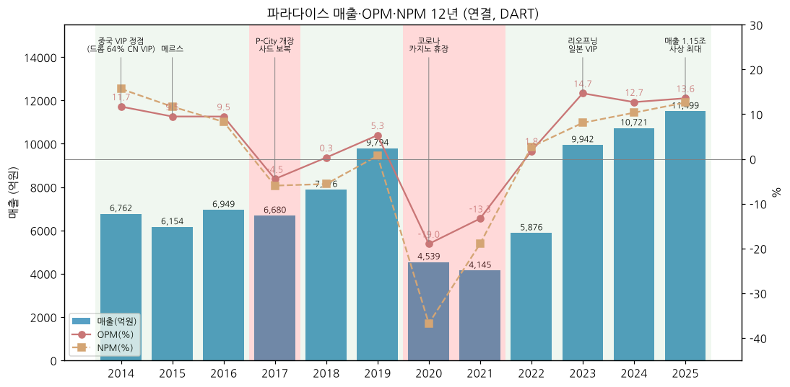

(2014\~2016 매출은 3부문(카지노·호텔·기타) 기준, 2018 사업보고서부터 복합리조트(파라다이스시티) 부문 분리 — 연결 매출 합계는 연속. 2014 지배순이익 964억에는 중단영업이익 포함 가능성이 있어 2015 이후와 엄밀 비교 시 주의(2015 보고서 기본주당이익이 계속영업 571원 + 중단영업 193원으로 분리 표시). CapEx = 연결 CF 유형자산 + 무형자산 + 투자부동산 취득)

### ② 산업 분류

- 산업: **외국인 전용 카지노(관광진흥법 허가) + 5성급 호텔·복합리조트** — 서울(워커힐)·인천(파라다이스시티)·부산·제주 4개 외국인 전용 카지노 영업장 보유 — 국내 단일 사업자 최다 영업장, 카지노 테이블 371대·슬롯머신 867대 (3Q26) [DART 분기보고서(2026.09) II-3]
- DART 업종: 91249 기타 갬블링 및 베팅업 [OpenDART 기업개황]
- 워치리스트 섹터: **여행·레저·유통** / 서브섹터: **면세·카지노·여행** (2순위 섹터)
- 시장 지위: 2025 카지노 4개 영업장 드롭액 **7.15조원** [IR 분기 합산, 계산], 2025 카지노성 매출(카지노 부문 4,194억 + P-City 카지노 4,798억) 약 **8,992억원** [DART 부문정보 + IR 법인별 표, 계산 — SBS Biz 2026-07-21 보도 9,005억과 근접]. 수도권 일본 VIP 드롭액 점유율 **76.7% (2025 YTD)** vs GKL 23.3% [IR 2025-09-22, 한국카지노업관광협회 인용]

### ③ 분류 결정 논리

(1) **가장 매출 큰 사업부 기준** 적용 시: 2025 복합리조트(P-City) 5,975억 = 연결의 **52.0%**, 카지노(워커힐·부산·제주) 4,194억 = **36.5%** [DART 사업보고서(2025.12) 부문정보]. 복합리조트 매출의 **80.3%가 P-City 카지노** (2025 세가사미 카지노 매출 4,798억 = 1Q 1,101 + 2Q 1,283 + 3Q 1,170 + 4Q 1,244억 [IR 법인별 표 합산, 계산]) → **연결 매출의 78.2%가 카지노 게임 수익** [계산] → 카지노 수요(방한 VIP)의 변동성이 그대로 이익 변동성 → **사이클**
(2) **이익 비중 sub-rule**: 2025 부문 영업이익 카지노 353억 + 복합리조트 1,025억 + 호텔 139억 + 기타 28억 [DART 부문정보]. 호텔 부문(부산·올랜도)은 OPM 12%로 안정적이지만 이익 비중 9% → **Primary 변경 사유 아님**
(3) **Boundary case 처리 — "지속성장"으로 볼 여지**: 2023\~2025 3년 연속 매출 증가(+69%·+7.8%·+7.3%)와 일본 VIP 회원수 2021 대비 2.3배 [IR 2025-09-22]는 구조적 성장 신호. 그러나 ① 2026-07 정부의 관광진흥개발기금 부담률 10%→15% 상향 추진(규제 충격) [파이낸셜뉴스 2026-07-16], ② 3Q26 홀드율 12.9% vs 3Q24 10.2%처럼 분기 이익이 홀드율(운)에 크게 좌우 → **사이클 유지, 성장은 Secondary 관찰**
(4) **국내 카지노 3사 + 글로벌 피어 cross-ref**:
→ **GKL(114090)·롯데관광개발(032350)**: 같은 외국인 전용 카지노지만 GKL은 공기업(배당형·호텔 없음), 롯데관광은 제주 드림타워 단일 IR(중국 VIP 의존). 비교 수치는 `GKL_기업개요.md`, `롯데관광개발_기업개요.md` (동시 작성 여부는 main session 확인) 참조
→ 2026-07-15 기금 상향 보도 당일 주가: 롯데관광 -14.6%, 파라다이스 -13.5%, GKL -10.8% [파이낸셜뉴스 2026-07-16]. 7월\~10-19 누적 파라다이스 -27.6%로 3사 중 최대 낙폭 [매일신문 2026-10-20]
→ 글로벌: 마카오 6사·싱가포르(MBS·RWS)·오사카 IR(개장 예정) — 파라다이스는 "일본 VIP 비중 43%"라는 점에서 마카오(중국 매스 중심)와 고객 구성이 다름 [IR 2025-09-22]

### ④ 적정 밸류에이션 방법

- **EV/EBITDA 우선, PER 보조, PBR은 자산가치 하한 확인용**
→ 카지노·호텔은 감가상각비가 커서(2020\~2024 연 781\~1,015억, 매출 대비 7\~22% [IR 2025-09-22]) 영업이익보다 EBITDA가 현금창출력을 더 잘 보여줌
→ 현재 **EV/EBITDA 약 8.1배** [계산: 시총 1.02조 + 순차입금 0.37조(3Q26, 차입금·사채 1.118조 − 현금·단기금융상품·FVPL 0.748조, 리스 제외) + 비지배지분 0.51조 = 1.90조 / LTM EBITDA 2,348억 (IR 4Q25 353 + 1Q26 575 + 2Q26 567 + 3Q26 853억)]
→ **PER 13.1배** [계산: 시총 / LTM 지배순이익 779억 (4Q25 193 + 9M26 586)]. 2025 PER(연말) 16.2배, 2024 11.7배
- **PBR 밴드 (연말 종가 × 발행주식 / 지배자본 [계산])**: 고점 **2.12배 (2014)**·2.04배 (2017) → 저점 **0.54배 (2024)** → 2025말 0.89배 → 현재 **0.58배** (1.02조 / 3Q26 지배자본 1.773조). 2024 지배자본에는 토지 재평가잉여금(2024 OCI +1,949억)이 반영돼 PBR이 구조적으로 낮아짐
- **기금 15% 시나리오 민감도**: KB증권 추정 연간 비용 약 500억원 증가 [파이낸셜뉴스 2026-07-16] → LTM 영업이익 1,532억의 약 33% [계산]. iM증권은 목표 P/E를 20% 낮춤 [같은 기사]
- **배당수익률은 보조 지표**: 2025 DPS 150원 / 11,020원 = **1.4%**, 연결 배당성향 13.9% [DART 사업보고서(2025.12) 배당]

#### ④-1 면세·카지노·여행 공통 비교 박스 (통합 검수 예정)

### ⑤ 분기 재평가 트리거 (분류 변경 조건)

- **관광진흥개발기금 부담률 상향 법안 확정** (현행 매출 100억 초과분 10% → 15% 추진, 5년 단위 면허 갱신제 병행 [데일리안 2026-08-06]) → 확정 시 "규제 리스크" 태그 추가 + 정상 OPM 가정 하향 (KB 추정 연 500억 비용)
- **비카지노(호텔+펀시티+부산호텔) 영업이익 비중이 연결 OP의 30%+** (2025 호텔 부문 OP 139억 = 연결 OP의 8.9% [DART 부문정보, 계산] — P-City 호텔·펀시티 이익은 IR에서 별도 공시하지 않아 미포함) → Secondary를 "복합리조트·호텔 지속성장"으로 격상 검토 (하얏트 리젠시 정상화 + 2028 장충동 호텔 개장 이후)
- **중국 VIP 드롭 비중 30%+ 회복** (2024 약 18%, 1H25 19.2% [IR 2025-09-22]) — 중국 단체관광 무비자(2025-09-29\~2026-06-30 한시 [IR 2025-09-22]) 연장·확대 여부 → 사이클 진폭 확대 국면 태그
- **분기 홀드율 3개 분기 연속 11% 미만** (최근 10개 분기 10.2\~12.9%) → 이익 추정 하향 체크
- **차입금·사채 1.5조+ 또는 부채비율 120%+** (3Q26 1.12조, 85.7%) — 장충동 호텔 시설자금 5,500억 인출 진행(3Q26 823억) [DART 분기보고서(2026.09) 담보 주석] → 투자 사이클 국면 태그

---

## 2. 회사 개요

### ① 기본 사항

- **회사명**: ㈜파라다이스 (PARADISE Co., Ltd.) / KRX 034230 (유가증권시장 — 2002-11-05 코스닥 상장 → 2024-06-24 유가증권시장 이전상장) [DART 분기보고서(2026.09) 주석 1]
- **본사**: 서울특별시 중구 퇴계로 299 (2022-09-13 동호로 268에서 이전) [DART 사업보고서(2025.12) I-2]
- **설립**: 1972-04-27 [OpenDART 기업개황]. 모태는 1968-03 개장한 워커힐 카지노(국내 최초 외국인 전용 카지노 사업장) [IR 2025-09-22 연혁, DART 사업보고서(2019.12) 업계 현황 허가일 '68.3.5]
- **지배구조**: 최대주주 ㈜파라다이스글로벌 37.53% (34,767,536주), 특수관계인 합산 45.16% (2026-09-30) [DART 분기보고서(2026.09) VII]. 파라다이스글로벌의 최대주주는 전필립 회장 ("본인의 최대주주")
- **사업 한 줄 정의**: 서울(워커힐)·인천(파라다이스시티)·부산·제주 4개 외국인 전용 카지노와 파라다이스시티(호텔 3개동 1,270실)·파라다이스호텔부산(532실)·미국 올랜도 Embassy Suites(167실)를 운영하는 **국내 1위 외국인 카지노·복합리조트 그룹**
- **연결 구조**: 지배기업 ㈜파라다이스(워커힐·부산·제주 카지노 + 도고 스파) + 종속기업 ㈜파라다이스세가사미(P-City, 지분 55%, 일본 세가사미와 합작) + ㈜파라다이스호텔부산(74.49%) + Paradise America LLC(100%) + Paradise International(일본, 광고대행) [IR 2025-09-22 지분구조(2025-06말), DART 분기보고서(2026.09) 종속기업 요약]. 연결 대상 5개사 [DART 요약재무정보]
- **규모**: 2025 연결 매출 1조 1,499억원(사상 최대), 영업이익 1,558억원 [DART]. 카지노 드롭액 7.15조원 [IR, 계산], 연간 카지노 VIP 약 17만명(일 게임 연인원)·호텔&리조트 방문객 100만명+ [IR 2025-09-22]
- **대표이사**: 최종환 (1973-02생, 연세대 경영, 前 SK㈜ 재무부문, ㈜파라다이스·세가사미·호텔부산·파라다이스글로벌 대표 겸직) [OpenDART exctvSttus 2025] + 임준신 (2026 각자대표 체제) [OpenDART 기업개황 2026-11]. 언론은 최종환 대표를 전필립 회장의 처남으로 보도 [녹색경제신문 2025-11-10]
- **신용등급**: **A+(안정적)** — 한국기업평가 2026-04 A → A+ 상향, NICE신용평가 A+ 유지 [디지털데일리 2026-04-22, 이데일리 2026-08-31]

### ② 최근 12년 손익·자본 추이 (억원, 연결, DART)

| 연도 | 매출 | YoY | 영업이익 | 순이익 | 지배순이익 | 자본총계 | 자본 YoY |
|---|---|---|---|---|---|---|---|
| 2014 | 6,762 | - | 790 | 1,058 | 964 | 11,782 | - |
| 2015 | 6,154 | -9.0% | 583 | 718 | 652 | 12,865 | +9.2% |
| 2016 | 6,949 | +12.9% | 658 | 576 | 551 | 13,097 | +1.8% |
| 2017 | 6,680 | -3.9% | -300 | -399 | -190 | 12,933 | -1.2% |
| 2018 | 7,876 | +17.9% | 24 | -441 | -210 | 16,261 | +25.7% |
| 2019 | 9,794 | +24.4% | 519 | 67 | 151 | 16,042 | -1.3% |
| 2020 | 4,539 | -53.7% | -862 | -1,669 | -1,181 | 14,336 | -10.6% |
| 2021 | 4,145 | -8.7% | -552 | -786 | -525 | 15,144 | +5.6% |
| 2022 | 5,876 | +41.8% | 104 | 158 | 253 | 16,852 | +11.3% |
| 2023 | 9,942 | +69.2% | 1,458 | 802 | 626 | 17,855 | +6.0% |
| 2024 | 10,721 | +7.8% | 1,361 | 1,107 | 756 | 20,752 | +16.2% |
| 2025 | 11,499 | +7.3% | 1,558 | 1,448 | 944 | 22,127 | +6.6% |

(연결 기준, OpenDART fnlttSinglAcntAll. 2014는 2015 사업보고서 전기 컬럼. 9M26: 매출 9,637억 (+12.6%), 영업이익 1,370억 (-1.9%), 지배순이익 586억 (-22.0%) [DART 분기보고서(2026.09), 계산]. LTM(4Q25\~3Q26) 매출 1조 2,577억 / 영업이익 1,532억 [계산])

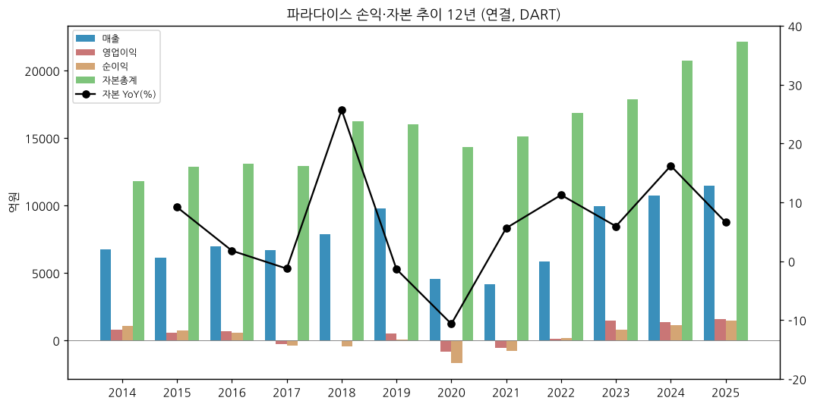

### ③ 회사 주가 역사 ★ narrative 영역

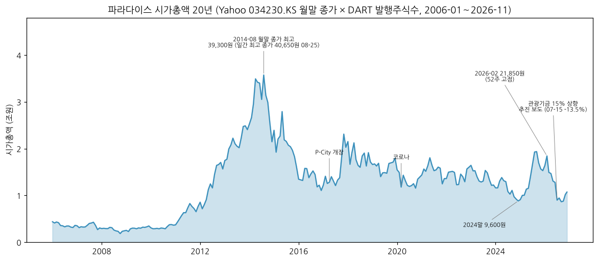

(차트: Yahoo 월말 종가(분할·배당 조정 close, 2006 이후 액면분할 없음) × DART 발행주식수 (\~2022-11 90,942,672주 → 2026-09 92,629,382주, 7회 CB 전환으로 증가). 발행주식은 자기주식 포함)

(1) 2006\~2010: 워커힐 중심 카지노 — 주가 2,000\~5,000원대
→ 2008말 종가 2,660원 [Yahoo] (금융위기)
→ 2012-06 ㈜파라다이스제주 흡수합병(제주 카지노 편입) [DART 사업보고서(2025.12) 연혁]

(2) 2011\~2014-08: 중국 VIP 슈퍼사이클 → 사상 최고가
→ 2011말 8,400원 → 2012말 17,200원 → 2013말 26,450원 [Yahoo]. 2013-07 파라다이스세가사미 인천 카지노 영업 양수 [DART 연혁]
→ 2014 파라다이스 VIP 드롭액의 **64.1%가 중국 VIP** [IR 2025-09-22]. 2014 OPM 11.7%, 순이익 1,058억
→ **2014-08-25 종가 40,650원 (사상 최고가, 시총 3.70조)** [Yahoo 일간, 계산]

(3) 2014-09\~2016: 중국 반부패·메르스 → 고점 대비 -70%
→ 중국 정부 반부패 정책으로 중국 VIP 수요 억제 [IR 2025-09-22] — 2015 매출 -9.0%, 2015-05 메르스로 외국인 카지노 산업 매출·입장객 급감 [DART 사업보고서(2016.12) 업계 현황]
→ 2016말 12,150원 (시총 1.10조) [Yahoo]. 2016-03 미국 올랜도 Embassy Suites 인수 [DART 연혁]

(4) 2017\~2019: 파라다이스시티 개장 + 사드 보복 → 적자 속 리레이팅·디레이팅 반복
→ 2017-04-20 국내 최초 복합리조트 파라다이스시티 1-1차 개장(호텔·카지노), 2018-09-21 1-2차(플라자·클럽·아트파라디소·스파) [DART 연혁]
→ 2017-03 중국 사드 보복(단체관광 금지) — 2017 영업적자 -300억, 호텔 부문(P-City 호텔 포함) 영업손실 -360억 [DART 부문정보]
→ 2017-11 장중 28,000원 [Yahoo 월간 고가], 2019말 19,750원 — 2019 매출 9,794억(코로나 전 최대)

(5) 2020\~2022: 코로나 — 매출 -54%, 3년 연속 무배당
→ 2020 매출 4,539억(-53.7%), 영업손실 -862억 [DART]. 2020-07\~2023-07 아트파라디소 임시 휴장 [IR]
→ 2021 7회 전환사채 2,000억 발행 [DART CF '전환사채의 증가'] — 2022\~2026 순차 전환(누적 2,227,840주 [DART 자본금 변동])
→ 2022 하반기 일본인 무비자 입국 재개 이후 3Q22 영업이익 383억으로 흑자전환 [DART 분기], 2022말 17,600원 [Yahoo]

(6) 2023\~2025: 리오프닝 + 일본 VIP — 사상 최대 실적, 그러나 주가는 2024말 바닥
→ 2023 매출 9,942억(+69.2%), OPM 14.7%(12년 최고). 일본 VIP 드롭액 3년간 +182% [IR 2025-09-22]
→ 2024 매출 1조 721억(첫 1조 돌파)에도 **2024-12 월말 9,600원 (2012 이후 최저권, PBR 0.54배)** [Yahoo, 계산] — 2024-06-24 유가증권시장 이전상장 [DART]
→ 2025-08-06 중국 단체관광 무비자 발표(2025-09-29 시행) → **2025-09 장중 24,000원** [Yahoo 월간 고가, IR 2025-09-22]. 2025 매출 1.15조·OPM 13.6%

(7) 2026: 하얏트 인수 + 기금 상향 쇼크
→ 2026-01 하얏트 리젠시 인천(501실) 인수, 2026-03-09 그랜드 오픈 [DART 연혁]. **2026-02 장중 21,850원 (52주 최고)** [Yahoo]
→ 2026-07-15 정부의 관광진흥개발기금 부담률 10%→15% 상향 검토 보도 → 당일 **-13.5%** [파이낸셜뉴스 2026-07-16]. 7월\~10-19 **-27.6%** [매일신문 2026-10-20]. 2026-09 월말 9,330원
→ 3Q26 영업이익 641억(+62.3%), 드롭액 1.96조 분기 최대권 발표(2026-11-10) 후 반등 → 2026-11-24 11,020원

### ④ 회사의 주요 연혁

| 일자 | 이벤트 | 출처 |
|---|---|---|
| 1968-03 | 워커힐 카지노 개장 (국내 첫 외국인 전용 카지노) | DART 사업보고서(2019.12) 업계현황 · IR 2025-09-22 |
| 1972-04-27 | 법인 설립 | OpenDART 기업개황 |
| 1978-10 | 부산 카지노 허가 (파라다이스글로벌 소유 → 2015 양수) | DART 사업보고서(2019.12) 업계현황 |
| 2002-11-05 | 코스닥 상장 | DART 분기보고서(2026.09) 주석 |
| 2006-01 | 최대주주 상호 변경 ㈜파라다이스 부산 → ㈜파라다이스글로벌 | DART 사업보고서(2025.12) 연혁 |
| 2012-06 | ㈜파라다이스제주 흡수합병 (제주 카지노) | 〃 |
| 2012-07 | ㈜파라다이스세가사미 설립 (세가사미와 합작) | 〃 |
| 2013-07-01 | 세가사미, 인천 카지노 영업 양수 | 〃 |
| 2015-07-01 | 파라다이스글로벌 부산 카지노 영업 양수 | 〃 |
| 2016-03 | 미국 올랜도 Embassy Suites 인수 (Paradise America) | 〃 |
| 2017-04-20 | 파라다이스시티 1-1차 개장 (호텔 711실·카지노) | 〃 |
| 2018-09-21 | 파라다이스시티 1-2차 개장 (아트파라디소 58실·플라자·클럽·스파) | 〃 |
| 2020-07 \~ 2023-07 | 아트파라디소 임시 휴장 (코로나) | IR 3Q26 |
| 2021 | 7회 전환사채 2,000억 발행 | DART 2021 연결 CF |
| 2022-09-13 | 본점 이전 (중구 퇴계로 299) | DART 연혁 |
| 2024-06-24 | 유가증권시장 이전상장 | 〃 |
| 2025-03-12 | J-project(장충동 호텔) 투자·신규차입 승인, DL이앤씨 도급계약(3,545억) | DART 연혁·분기보고서(2026.09) 약정 주석 |
| 2025-06 | 2024 지속가능경영보고서 첫 발간, 자기주식 541,130주 소각 | DART 연혁·이사회 의안 |
| 2025-09-23 | 그랜드하얏트 인천 웨스트타워 인수 계약 (2,100억, 칼호텔네트워크로부터) | 디지털데일리 2025-09-23 |
| 2026-03-09 | 하얏트 리젠시 인천 파라다이스시티 그랜드 오픈 (P-City 1,270실) | DART 연혁 |
| 2026-04 | 한기평 신용등급 A+ 상향 | 디지털데일리 2026-04-22 |
| 2028-10 (예정) | 장충동 초럭셔리 호텔 개장 (188실) | IR 2025-09-22 |

---

## 3. 비즈니스 모델

### ① 실적 추이 (연결 → DART 보고부문 → 영업장·고객군 3단계 위계)

**(1) 연결 + DART 보고부문 연간 (억원, 부문 매출은 부문간 거래 제거 전 총부문수익 기준 — 2017 이전 3부문, 2017부터 4부문 재작성)**

| 연도 | 카지노 매출 | 카지노 OP | 복합리조트 매출 | 복합리조트 OP | 호텔 매출 | 호텔 OP | 기타 매출 | 기타 OP | 기준 |
|---|---|---|---|---|---|---|---|---|---|
| 2015 | 5,282 | 444 | - | - | 790 | 120 | 180 | 20 | 3부문 |
| 2016 | 6,034 | 529 | - | - | 888 | 102 | 199 | 11 | 3부문 |
| 2017 | 3,764 | 237 | 2,003 | -327 | 732 | 4 | 180 | -259 | 4부문 |
| 2018 | 3,873 | 390 | 3,009 | -208 | 814 | 61 | 180 | -235 | 4부문 |
| 2019 | 4,083 | 168 | 4,609 | 199 | 893 | 105 | 210 | 20 | 4부문 |
| 2020 | 2,089 | -149 | 1,775 | -667 | 620 | -8 | 54 | -29 | 4부문 |
| 2021 | 1,629 | -152 | 1,615 | -422 | 856 | 59 | 44 | -42 | 4부문 |
| 2022 | 1,906 | -228 | 2,706 | 86 | 1,136 | 201 | 129 | 25 | 4부문 |
| 2023 | 4,150 | 656 | 4,487 | 563 | 1,143 | 188 | 161 | 43 | 4부문 |
| 2024 | 4,027 | 410 | 5,393 | 747 | 1,123 | 158 | 178 | 37 | 4부문 |
| 2025 | 4,194 | 353 | 5,975 | 1,025 | 1,151 | 139 | 178 | 28 | 4부문 |
| 9M26 | 3,530 | 423 | 5,045 | 739 | 924 | 170 | 139 | 29 | 4부문 |

(출처: DART 사업보고서 연결 주석 '영업부문' 각 연도. 2017은 2018 사업보고서의 전기(4부문 재작성) 수치, 2015\~2016은 3부문(카지노에 인천 카지노, 호텔에 당시 인천 호텔 포함). 부문 합 − 연결 = 부문간 거래·조정(연 0\~±30억). **매핑: 옛 '카지노업'(워커힐·부산·제주·인천) → 2017\~ '카지노'(워커힐·부산·제주) + '복합리조트'(P-City 카지노·호텔·펀시티)**)

**(2) 영업장별 카지노 매출·드롭액 (IR, 십억원)**

| 연도 | 카지노 매출 합 | P-City | 워커힐 | 부산 | 제주 | 드롭액 합 | P-City | 워커힐 | 부산 | 제주 |
|---|---|---|---|---|---|---|---|---|---|---|
| 2019 | 784.1 | 375.6 | 290.2 | 77.9 | 40.4 | 6,453.3 | 2,669.2 | 2,581.2 | 813.2 | 389.8 |
| 2020 | 336.0 | 127.0 | 174.2 | 24.7 | 10.1 | 2,329.6 | 943.8 | 1,077.0 | 212.1 | 96.6 |
| 2021 | 250.0 | 86.7 | 143.9 | 17.4 | 1.9 | 1,710.1 | 500.2 | 1,044.0 | 110.1 | 55.7 |
| 2022 | 349.7 | 157.6 | 158.2 | 29.4 | 4.5 | 2,882.3 | 1,200.7 | 1,453.1 | 191.9 | 36.6 |
| 2023 | 743.0 | 328.0 | 353.4 | 46.9 | 14.7 | 6,173.2 | 2,963.7 | 2,638.5 | 400.4 | 170.7 |
| 2024 | 817.8 | 415.1 | 324.4 | 62.0 | 16.3 | 6,868.4 | 3,472.2 | 2,650.8 | 470.7 | 274.7 |
| 2025 | 899.2 [계산] | 479.8 | 미확보 | 미확보 | 미확보 | 7,149.6 [계산] | 미확보 | 미확보 | 미확보 | 미확보 |

(출처: IR 2025-09-22 회사소개 deck p21 '연간 매출 및 비용 현황', 2025는 IR 분기 실적 리뷰 합산 — 카지노 부문 4,194억 + 세가사미 카지노 4,798억. 3Q25 영업장별 매출이 irgo 자료에 없어 2025 영업장 분해는 미확보)

**(3) 지역별 매출 (사업장 소재지 기준, 9M26, 억원)**: 한국 9,509 (98.7%) / 미국 124 (올랜도 호텔) / 일본 3.7 (광고대행) [DART 분기보고서(2026.09) II-4]. 고객 국적 기준 공시는 없고, IR은 드롭액을 중국 VIP·일본 VIP·기타 VIP·Mass로 구분

**(4) 사업부별 분기 시계열 — DART 부문정보 46개 분기 (2Q15\~3Q26, 억원, 매출 / 영업이익)**

| 분기 | 연결 매출 | 연결 OP | OPM | 카지노 매출 / OP | 복합리조트 매출 / OP | 호텔 매출 / OP | 기타 매출 / OP |
|---|---|---|---|---|---|---|---|
| 2Q15 | - | - | - | 1,227 / 123 | - | 180 / 16 | 34 / -10 |
| 3Q15 | - | - | - | 1,175 / 33 | - | 225 / 56 | 66 / 22 |
| 4Q15 | - | - | - | 1,568 / 80 | - | 211 / 32 | 42 / 8 |
| 1Q16 | 1,570 | 153 | 9.7% | 1,380 / 132 | - | 180 / 15 | 46 / 3 |
| 2Q16 | 1,890 | 328 | 17.4% | 1,667 / 302 | - | 225 / 28 | 42 / -6 |
| 3Q16 | 1,752 | 109 | 6.2% | 1,478 / 47 | - | 253 / 45 | 68 / 15 |
| 4Q16 | 1,736 | 67 | 3.9% | 1,510 / 48 | - | 230 / 13 | 43 / -1 |
| 1Q17 | 1,424 | -77 | -5.4% | 1,246 / -47 | - | 165 / -51 | 52 / 10 |
| 2Q17 | 1,399 | -273 | -19.5% | 1,149 / -203 | - | 233 / -62 | 48 / -7 |
| 3Q17 | 1,961 | 104 | 5.3% | 1,556 / 149 | - | 376 / -64 | 69 / 17 |
| 4Q17 | 1,896 | -54 | -2.8% | 1,562 / 126 | - | 325 / -183 | 45 / -1 |
| 1Q18 | 1,795 | 48 | 2.7% | 926 / 28 | 650 / 9 | 174 / -2 | 44 / 7 |
| 2Q18 | 1,811 | -1 | -0.1% | 935 / 18 | 643 / -23 | 194 / 4 | 39 / -2 |
| 3Q18 | 2,105 | 108 | 5.1% | 971 / 25 | 843 / 18 | 231 / 44 | 60 / 18 |
| 4Q18 | 2,166 | -131 | -6.0% | 1,042 / 320 | 872 / -212 | 215 / 15 | 36 / -258 |
| 1Q19 | 2,017 | -63 | -3.1% | 867 / -27 | 907 / -71 | 196 / 19 | 47 / 11 |
| 2Q19 | 2,339 | 47 | 2.0% | 1,037 / 68 | 1,058 / -50 | 204 / 33 | 40 / -6 |
| 3Q19 | 2,744 | 411 | 15.0% | 1,077 / 105 | 1,352 / 245 | 252 / 45 | 63 / 19 |
| 4Q19 | 2,695 | 124 | 4.6% | 1,102 / 23 | 1,292 / 76 | 241 / 8 | 59 / -4 |
| 1Q20 | 1,847 | 48 | 2.6% | 783 / 51 | 897 / 25 | 143 / -27 | 24 / -4 |
| 2Q20 | 746 | -445 | -59.7% | 356 / -123 | 260 / -282 | 120 / -24 | 10 / -18 |
| 3Q20 | 906 | -311 | -34.3% | 401 / -53 | 292 / -256 | 196 / 7 | 16 / -8 |
| 4Q20 | 1,040 | -154 | -14.8% | 550 / -25 | 325 / -154 | 161 / 36 | 4 / 1 |
| 1Q21 | 966 | -122 | -12.6% | 379 / -32 | 424 / -75 | 155 / -8 | 8 / -11 |
| 2Q21 | 846 | -274 | -32.4% | 306 / -112 | 318 / -161 | 216 / 31 | 7 / -21 |
| 3Q21 | 1,218 | 48 | 3.9% | 450 / 15 | 520 / -2 | 231 / 25 | 16 / -6 |
| 4Q21 | 1,115 | -204 | -18.3% | 495 / -23 | 352 / -184 | 253 / 10 | 14 / -5 |
| 1Q22 | 997 | -255 | -25.6% | 310 / -216 | 457 / -58 | 217 / 20 | 14 / -7 |
| 2Q22 | 1,052 | -206 | -19.6% | 288 / -163 | 452 / -100 | 284 / 49 | 28 / 3 |
| 3Q22 | 1,895 | 383 | 20.2% | 715 / 145 | 789 / 110 | 334 / 99 | 57 / 26 |
| 4Q22 | 1,932 | 182 | 9.4% | 593 / 6 | 1,008 / 134 | 301 / 32 | 30 / 2 |
| 1Q23 | 1,915 | 190 | 9.9% | 710 / 40 | 913 / 98 | 253 / 41 | 40 / 8 |
| 2Q23 | 2,753 | 549 | 19.9% | 1,344 / 324 | 1,094 / 170 | 287 / 47 | 28 / 6 |
| 3Q23 | 2,856 | 571 | 20.0% | 1,158 / 225 | 1,327 / 248 | 309 / 71 | 62 / 26 |
| 4Q23 | 2,418 | 147 | 6.1% | 938 / 68 | 1,154 / 47 | 294 / 29 | 32 / 3 |
| 1Q24 | 2,648 | 484 | 18.3% | 1,023 / 135 | 1,323 / 299 | 263 / 40 | 39 / 8 |
| 2Q24 | 2,733 | 320 | 11.7% | 1,120 / 142 | 1,314 / 142 | 276 / 36 | 23 / -2 |
| 3Q24 | 2,682 | 362 | 13.5% | 844 / -14 | 1,466 / 271 | 297 / 73 | 76 / 29 |
| 4Q24 | 2,658 | 194 | 7.3% | 1,041 / 146 | 1,290 / 35 | 287 / 8 | 40 / 2 |
| 1Q25 | 2,833 | 573 | 20.2% | 1,156 / 210 | 1,392 / 335 | 243 / 17 | 43 / 8 |
| 2Q25 | 2,845 | 429 | 15.1% | 1,008 / 80 | 1,523 / 306 | 276 / 37 | 37 / 2 |
| 3Q25 | 2,882 | 395 | 13.7% | 1,004 / 78 | 1,499 / 222 | 315 / 70 | 64 / 22 |
| 4Q25 | 2,939 | 162 | 5.5% | 1,027 / -16 | 1,561 / 163 | 317 / 15 | 33 / -4 |
| 1Q26 | 2,940 | 373 | 12.7% | 1,161 / 173 | 1,459 / 154 | 274 / 37 | 45 / 5 |
| 2Q26 | 3,181 | 356 | 11.2% | 1,156 / 104 | 1,672 / 202 | 319 / 46 | 34 / 0 |
| 3Q26 | 3,517 | 641 | 18.2% | 1,213 / 146 | 1,914 / 383 | 330 / 86 | 60 / 24 |

(출처: 각 분기·반기·사업보고서 연결 주석 '영업부문'. 1\~3Q = 3개월 금액, 4Q = 연간 − 3Q 누적. 2Q15\~4Q15는 2016 보고서의 전기 3개월 컬럼, 1Q18\~4Q18은 2019 보고서의 전기(4부문 재작성) 컬럼. **1Q15 미확보** (2016 1분기보고서에 전기 3개월 부문표 없음), 2014 이전 분기 미확보. 2Q15\~4Q17은 3부문(카지노에 인천 카지노 포함), 1Q18\~ 4부문. 부문 합 − 연결 영업이익 차이는 '조정'(내부거래). 4Q18 카지노 OP 320억·기타 -258억은 연말 본사비용 배부 재분류 영향 [추정])

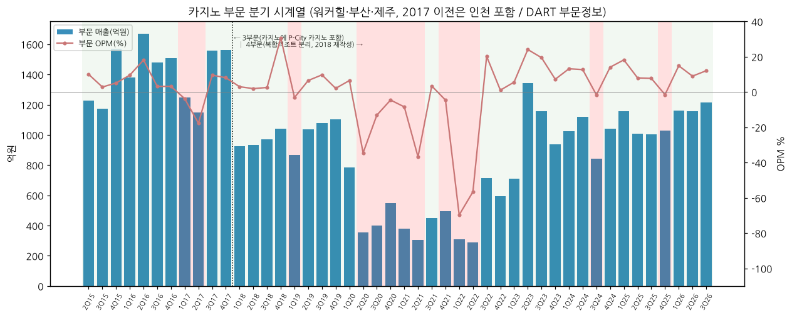
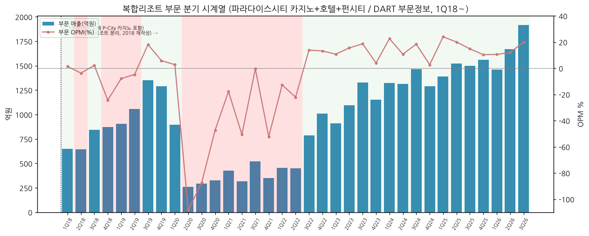
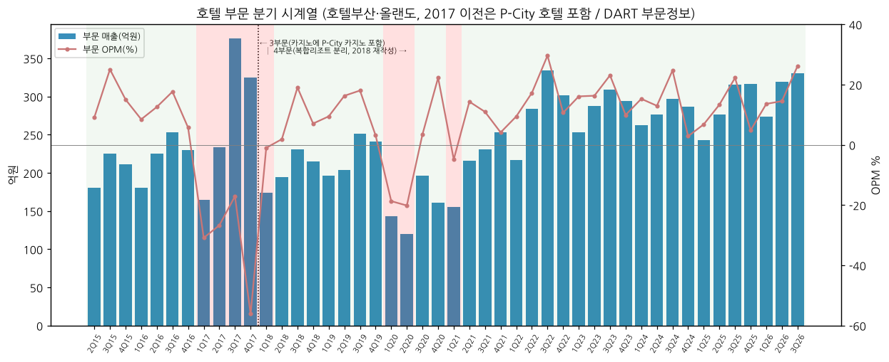
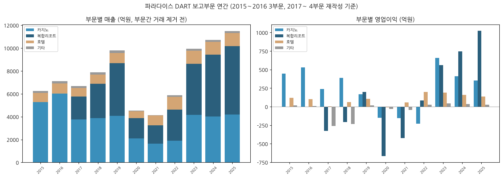

**(5) 최근 12분기 연결 시계열 (억원, OpenDART)**

| 분기 | 매출 | YoY | 영업이익 | OPM |
|---|---|---|---|---|
| 4Q23 | 2,418 | +25.2% | 147 | 6.1% |
| 1Q24 | 2,648 | +38.3% | 484 | 18.3% |
| 2Q24 | 2,733 | -0.7% | 320 | 11.7% |
| 3Q24 | 2,682 | -6.1% | 362 | 13.5% |
| 4Q24 | 2,658 | +9.9% | 194 | 7.3% |
| 1Q25 | 2,833 | +7.0% | 573 | 20.2% |
| 2Q25 | 2,845 | +4.1% | 429 | 15.1% |
| 3Q25 | 2,882 | +7.5% | 395 | 13.7% |
| 4Q25 | 2,939 | +10.6% | 162 | 5.5% |
| 1Q26 | 2,940 | +3.8% | 373 | 12.7% |
| 2Q26 | 3,181 | +11.8% | 356 | 11.2% |
| 3Q26 | 3,517 | +22.0% | 641 | 18.2% |

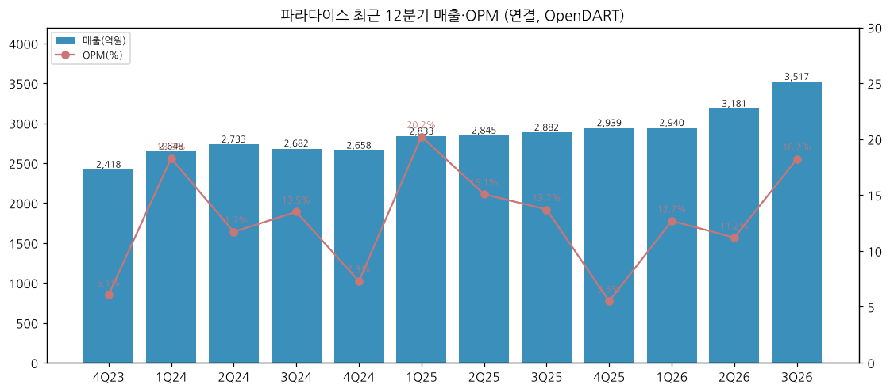

### ② 사업부별 개요 (매출 비중 큰 순서, 2025)

| 부문 | 2025 매출(억원) | 비중 | 2025 OP(억원) | OPM | 구성 | 법인 |
|---|---|---|---|---|---|---|
| 복합리조트 | 5,975 | 52.0% | 1,025 | 17.2% | P-City 카지노(4,798억, 80%) + 호텔(파라다이스시티 711실·아트파라디소 58실, 2026\~ 하얏트 리젠시 501실) + 펀시티(씨메르·원더박스) | ㈜파라다이스세가사미 (55%) |
| 카지노 | 4,194 | 36.5% | 353 | 8.4% | 워커힐(서울)·부산·제주 카지노 | ㈜파라다이스 (별도) |
| 호텔 | 1,151 | 10.0% | 139 | 12.1% | 파라다이스호텔부산(532실) + 올랜도 Embassy Suites(167실) | 호텔부산(74.49%), Paradise America |
| 기타 | 178 | 1.6% | 28 | 15.7% | 도고 스파, 본점 임대, 일본 광고대행 | ㈜파라다이스 외 |

(DART 사업보고서(2025.12) 부문정보. 비율은 연결 매출 대비 [계산])

### ③ 사업부별 디테일

**(1) 카지노 KPI — 드롭액·홀드율 (4개 영업장 합산, IR)**

| 분기 | 드롭액(억원) | YoY | 홀드율 | 비고 |
|---|---|---|---|---|
| 1Q23 | 12,643 | - | 미확보 | 리오프닝 |
| 2Q23 | 15,750 | - | 미확보 | |
| 3Q23 | 16,684 | - | 미확보 | |
| 4Q23 | 16,656 | - | 미확보 | |
| 1Q24 | 17,296 | +36.8% | 11.2% [역산] | |
| 2Q24 | 17,036 | +8.2% | 11.9% [역산] | |
| 3Q24 | 17,732 | +6.3% | 10.2% [역산] | 저홀드 |
| 4Q24 | 16,620 | -0.2% | 11.5% [역산] | |
| 1Q25 | 16,942 | -2.0% | 12.6% | |
| 2Q25 | 18,350 | +7.7% | 11.8% | |
| 3Q25 | 18,079 | +2.0% | 11.3% | P-City 드롭 첫 분기 1조 돌파 |
| 4Q25 | 18,125 | +9.1% | 11.7% | Mass 드롭 +24.6% |
| 1Q26 | 17,559 | +3.6% | 12.2% | 3월 홀드율 일시 하락, 중국 VIP -37%(P-City) |
| 2Q26 | 20,585 | +12.2% | 미공시 | 분기 사상 최대 드롭 [아시아경제 2026-08-07] |
| 3Q26 | 19,572 | +8.3% | 12.9% | 카지노 매출 2,675억 분기 최대, 기타VIP·Mass +17.3% |

(출처: IR 2025-09-22 p22(1Q23\~2Q25 드롭), IR 실적 리뷰 3Q25·4Q25·1Q26·3Q26. 홀드율은 회사 공시(테이블 기준, 칩 구매액 대비 순승률). 2024 홀드율 [역산] = 2025 분기 홀드율 − IR이 밝힌 YoY 변화폭. 2Q26 IR 자료는 irgo 미게시 — 드롭액은 아시아경제 2026-08-07로 확인)

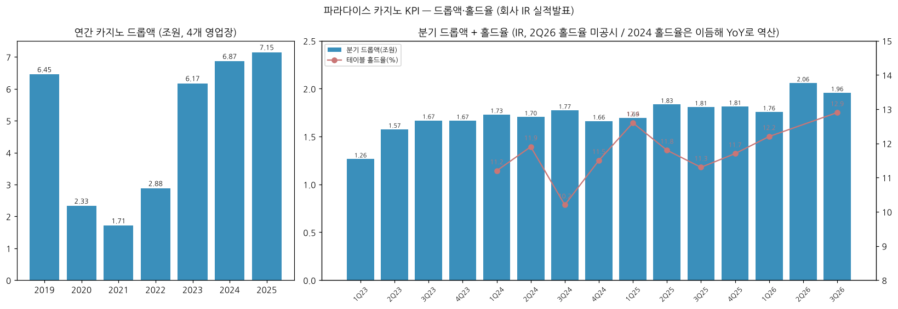

→ **고객 믹스 이동 — 중국 VIP → 일본 VIP → Mass**: 2014 VIP 드롭의 64.1%가 중국 VIP였으나 2024 중국 VIP 비중 약 18%, 1H25 기준 일본 VIP가 전체 드롭의 42.7%·중국 VIP 19.2% [IR 2025-09-22]. 2025\~2026은 Mass 드롭 YoY +17\~35% (4Q25 +24.6%, 1Q26 +16.8%) [IR]
→ **홀드율 = 분기 이익의 스윙 팩터**: 3Q24 10.2% → 3Q26 12.9% (+2.7%p). 3Q26 영업이익 +246억 YoY 중 상당 부분이 홀드율 상승(+1.6%p YoY) 효과 [IR 3Q26]. 회사는 "매스 비중 증가로 홀드율 구조적 개선"을 주장 [IR 3Q19]
→ **일본 VIP**: 파라다이스 일본인 VIP 회원수 2021 대비 2.3배, 수도권 일본 VIP 드롭 M/S 67.1%(2019) → 77.0%(2023) → 76.7%(2025 YTD) [IR 2025-09-22, 한국카지노업관광협회]. 엔화 환율에 민감 — 엔화 강세 시 원화 환산 드롭 증가 [DART 사업보고서(2025.12) II-7]

**(2) 비용 구조 (IR, 십억원)**

| 연도 | 총비용 | 인건비 | 콤프 | 관광기금+개소세 | 수수료 | 감가상각 | 기타 | 영업이익 |
|---|---|---|---|---|---|---|---|---|
| 2019 | 927.6 | 250.7 | 100.0 | 97.6 | 61.0 | 110.7 | 307.5 | 51.9 |
| 2020 | 540.0 | 175.4 | 18.6 | 37.4 | 24.6 | 101.5 | 182.5 | -86.2 |
| 2021 | 469.7 | 155.0 | 5.7 | 27.0 | 27.9 | 98.0 | 156.0 | -55.2 |
| 2022 | 577.2 | 138.0 | 31.5 | 39.8 | 24.2 | 94.8 | 248.9 | 10.4 |
| 2023 | 848.4 | 238.0 | 84.7 | 93.6 | 57.0 | 83.0 | 292.0 | 145.8 |
| 2024 | 936.1 | 262.5 | 98.3 | 105.2 | 57.0 | 78.1 | 335.0 | 136.1 |

(출처: IR 2025-09-22 p21. **관광진흥개발기금**: 카지노 영업장별 매출 100억 초과분 10% (+4.6억) / **개별소비세**: 매출 1,000억 초과분 4% (+10억) + 교육세 30% [DART 분기보고서(2026.09) II-7]. 2025 기금 납부액 888억 [SBS Biz 2026-07-21])
→ 비용의 약 70%(인건비·감가상각·임차료 등)가 고정비 → 드롭·홀드율 변동이 영업 레버리지로 증폭. 3Q26 세가사미 OPM 20.0% (+5.2%p) [IR 3Q26]
→ 2025\~2026 비용 증가 요인: 인센티브·인력확충(4Q25 인건비성 +194억), 광고비(4Q25 +75억), 하얏트 운영비(1Q26 +110억·3Q26 +106억) [IR]

**(3) 호텔 KPI (IR·DART 분기보고서)**

| 호텔 | 객실 | 지표 | 2023 3Q | 2024 3Q | 2025 3Q | 2026 1Q | 2026 2Q | 2026 3Q |
|---|---|---|---|---|---|---|---|---|
| 파라다이스시티 | 711 | Occ / ADR(천원) | 81.5% / 437 | 84.6% / 438 | 85.8% / 478 | 77.7% / 437 | 80.0% / 422 | **85.9% / 496** |
| 아트파라디소 | 58 | Occ / ADR | 16.4% / 466 | 53.2% / 529 | 54.1% / 540 | 41.9% / 502 | 51.3% / 495 | 65.6% / 502 |
| 하얏트 리젠시 인천 | 501 | Occ / ADR | - | - | - | 31.7% / 239 (3월) | 52.4% / 238 | 73.4% / 263 |
| 파라다이스호텔부산 | 532 | Occ / ADR | 81.6% / 369 | 84.6% / 361 | 89.2% / 359 | 75.6% / 303 | 87.4% / 327 | 88.7% / 391 |
| Embassy Suites Orlando | 167 | Occ / ADR(USD) | 76.6% / 176 | 75.3% / 167 | 68.3% / 174 | 90.6% / 209 | 83.4% / 183 | 69.0% / 175 |

(출처: DART 분기보고서(2026.09) II-1, IR 3Q26 p8. ADR은 카지노 콤프 객실료 포함 [IR 2025-09-22])
→ 하얏트 리젠시: 3Q26 영업이익 +6억으로 첫 흑자, 3Q26 매출 113억 [IR 3Q26]. 인수로 P-City 객실 769 → 1,270실 [이데일리 2026-08-31]
→ 호텔부산: 코로나 이후(2022\~2024) 3년 연속 매출 1,000억 초과·OPM 10%대 중반 [IR 2025-09-22]. 3Q26 영업이익 89억(OPM 27.5%) [IR 3Q26]

**(4) 신규 투자 — J-project (장충동 초럭셔리 호텔)**
→ 서울 중구 장충동2가 186-210 외, 대지 13,902㎡, 연면적 69,970㎡ (지하5층\~지상18층), 188실(스위트 30), 공사비 5,750억원 (건축 4,651·집기 411·아트워크 300억 등), 2025-03 착공 → 2028-08 준공 → 2028-10 개장, 2029 영업흑자 전환 목표 [IR 2025-09-22]
→ 자금: 우리은행 시설자금대출 5,500억 (CD91+0.97%, 5년 만기일시) [IR 2025-09-22], 3Q26 인출 823억 [DART 분기보고서(2026.09) 담보 주석]. DL이앤씨 도급 3,545억 중 미발생 3,147억 [같은 주석]
→ 회사 중기 목표: 3년 내 매출 1.5조원·OPM 20% (2027E) [IR 2025-09-22]

### ④ 주요 경쟁사 (사업별)

| 사업 | 국내 경쟁 | 해외 경쟁 | 비고 |
|---|---|---|---|
| 외국인 카지노 (수도권) | GKL 세븐럭(서울 강남·강북, 부산) — 수도권 일본 VIP 드롭 M/S 23.3% vs 파라다이스 76.7% (2025 YTD) | 마카오·싱가포르·필리핀 | 서울 시내 카지노 라이선스 보유 사기업은 파라다이스뿐 [IR 2025-09-22] |
| 복합리조트 (인천 영종) | 인스파이어 IR (2024 개장, 2024 영업손실 1,391억·2025 -422억 [데일리안 2026-08-06]) | 오사카 IR (개장 예정) [다음/뉴스 2026-07] | 인천공항 5분 거리 |
| 제주 | 롯데관광개발 드림타워(중국 VIP 중심), 제주 기타 카지노 | - | 제주 카지노는 별도 법 개정 필요(기금 상향) [파이낸셜뉴스 2026-07-16] |
| 호텔 (부산·서울) | 부산 5성급(웨스틴조선·시그니엘 등), 서울 럭셔리 호텔 | - | 장충동 호텔은 2028 개장 |

### ⑤ 주요 매출처

- 카지노 고객은 다수 개인 — **매출의 10% 이상을 차지하는 단일 고객 없음** [DART 사업보고서 연결 주석 '영업부문' (5)]
- 고객군: VIP(1회 방문 드롭·베팅 일정 수준 이상, VIP 카드·콤프 제공) vs Mass(마일리지·단체관광) [DART 분기보고서(2026.09) II-4]. 목표 시장 = 일본·동남아·중국 [같은 항목]
- 국적별 드롭 비중 (회사 IR): 일본 VIP 42.7% · 중국 VIP 19.2% · 기타 VIP·Mass 나머지 (1H25) [IR 2025-09-22]. 2014 중국 VIP 64.1%
- 판매 경로: 해외 사무소 판촉·여행사 연계·VIP 콤프(항공·숙박·식음) [DART II-4]. 콤프 비용 2024 983억 = 카지노 매출의 약 12% [IR, 계산]

### ⑥ 생산 CAPA + 임직원

**(1) 카지노 영업 설비 (DART 분기보고서(2026.09) II-3, 대)**

| 영업장 | 테이블 2024 | 2025 | 3Q26 | 슬롯 2024 | 2025 | 3Q26 |
|---|---|---|---|---|---|---|
| 워커힐 | 109 | 110 | 104 | 213 | 205 | 164 |
| 인천(P-City) | 178 | 184 | 189 | 476 | 507 | 523 |
| 부산 | 34 | 37 | 42 | 116 | 116 | 116 |
| 제주 | 32 | 32 | 36 | 56 | 56 | 64 |
| 합계 | 353 | 363 | 371 | 861 | 884 | 867 |

(워커힐 영업장 임차 8,359㎡, SK네트웍스, 월 임차료 12.5억(2025, 매년 2% 인상), 계약기간 2021-01\~2025-12 [DART 분기보고서(2026.09) II-6] — 2026 이후 갱신 조건은 3Q26 보고서에 기재되지 않음(미확인))

**(2) 객실**: 파라다이스시티 711 + 아트파라디소 58 + 하얏트 리젠시 501 = 1,270실, 호텔부산 532실, 올랜도 167실 → **합계 1,969실** (2026) [DART, 계산]. 2028 장충동 188실 추가 예정

**(3) 유형자산**: 3Q26 장부가 2.81조 (토지 1.34조·건물 1.16조·건설중 824억) [DART 분기보고서(2026.09) II-3 생산설비]. 토지는 재평가모형 (2024 재평가잉여금 +1,949억 OCI) [DART 2024 연결 포괄손익]

**(4) 임직원 (㈜파라다이스 별도, DART 직원현황)**

| 연도 | 2015 | 2016 | 2017 | 2018 | 2019 | 2020 | 2021 | 2022 | 2023 | 2024 | 2025 |
|---|---|---|---|---|---|---|---|---|---|---|---|
| 직원 수 | 1,586 | 1,503 | 1,437 | 1,432 | 1,487 | 미확보 | 1,333 | 1,154 | 1,328 | 1,396 | 1,497 |
| 1인 평균급여(백만원) | 65.1 | 66.0 | 59.4 | 63.5 | 65.6 | 미확보 | 50.5 | 55.6 | 74.4 | 66.1 | 80.2 |

(별도 = 워커힐·부산·제주 카지노 + 스파. 2025 카지노 1,473명·스파 24명, 평균 근속 10.3년 [OpenDART empSttus 2025]. 2020 사업보고서(기재정정본) 원문 XML에서 직원현황 표 파싱 실패 → 미확보. 연결(세가사미·호텔부산 포함) 인원은 정기보고서 미공시. P-City(PSS) 인력 3Q26 +15.3% YoY [IR 3Q26])

---

## 4. 재무 구조

(12년 연결 시계열, OpenDART fnlttSinglAcntAll. 2014 = 2015 사업보고서 전기 컬럼, 3Q26/9M26 = 분기보고서(2026.09). 단위 억원)

### ① 손익계산서 (12년 연결, 억원)

| 연도 | 매출 | 매출원가 | 매출총이익 | GPM | 판관비 | 영업이익 | OPM | 금융원가 | 세전이익 | 순이익 | 지배순이익 | NPM | EPS(원) |
|---|---|---|---|---|---|---|---|---|---|---|---|---|---|
| 2014 | 6,762 | 5,321 | 1,441 | 21.3% | 650 | 790 | 11.7% | 34 | 1,191 | 1,058 | 964 | 15.7% | 1,176 |
| 2015 | 6,154 | 4,927 | 1,226 | 19.9% | 643 | 583 | 9.5% | 30 | 791 | 718 | 652 | 11.7% | 571 |
| 2016 | 6,949 | 5,564 | 1,384 | 19.9% | 726 | 658 | 9.5% | 35 | 754 | 576 | 551 | 8.3% | 647 |
| 2017 | 6,680 | 5,977 | 703 | 10.5% | 1,003 | -300 | -4.5% | 251 | -335 | -399 | -190 | -6.0% | -222 |
| 2018 | 7,876 | 7,090 | 786 | 10.0% | 762 | 24 | 0.3% | 330 | -429 | -441 | -210 | -5.6% | -247 |
| 2019 | 9,794 | 8,399 | 1,395 | 14.2% | 877 | 519 | 5.3% | 520 | 155 | 67 | 151 | 0.7% | 177 |
| 2020 | 4,539 | 4,770 | -232 | -5.1% | 630 | -862 | -19.0% | 546 | -1,754 | -1,669 | -1,181 | -36.8% | -1,383 |
| 2021 | 4,145 | 4,147 | -2 | -0.0% | 550 | -552 | -13.3% | 645 | -659 | -786 | -525 | -19.0% | -614 |
| 2022 | 5,876 | 5,161 | 716 | 12.2% | 612 | 104 | 1.8% | 669 | 301 | 158 | 253 | 2.7% | 296 |
| 2023 | 9,942 | 7,602 | 2,340 | 23.5% | 882 | 1,458 | 14.7% | 706 | 915 | 802 | 626 | 8.1% | 725 |
| 2024 | 10,721 | 8,340 | 2,381 | 22.2% | 1,020 | 1,361 | 12.7% | 729 | 1,008 | 1,107 | 756 | 10.3% | 875 |
| 2025 | 11,499 | 8,821 | 2,678 | 23.3% | 1,119 | 1,558 | 13.6% | 630 | 1,353 | 1,448 | 944 | 12.6% | 1,087 |

(판관비 = 판매비 + 관리비 (2017은 '판매비와관리비' 단일 계정). EPS = 기본주당이익(2014·2015는 계속영업 기준). CIR = (매출원가 + 판관비) / 매출)

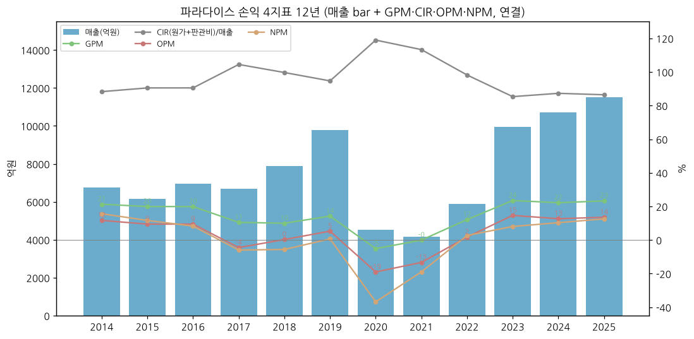

→ **GPM 21\~24%가 정상 구간** (2014 21.3%, 2023 23.5%, 2025 23.3%). 카지노 매출원가에 인건비·콤프·관광기금·개별소비세가 포함돼 GPM 자체가 낮음
→ **금융원가 34억(2014) → 630억(2025)**: P-City 프로젝트 차입(2015\~)과 2021 CB 발행으로 이자부담 구조화. 2025 이자 지급 500억 [CF]
→ 2024 지배순이익 756억 대비 총포괄이익 2,982억 — 토지 재평가잉여금 1,949억(세후) OCI 반영 [DART 2024 포괄손익]
→ 3Q26 분기: 매출 3,517억(+22.0%), 영업이익 641억(+62.3%), OPM 18.2%, 지배순이익 278억 [IR 3Q26 / DART]

### ② 재무상태표 (12년 연결, 억원)

| 연도 | 자산총계 | 유동자산 | 현금성(현금+단기금융+FVPL) | 유형자산 | 부채총계 | 차입금·사채 | 순차입금 | 자본총계 | 지배자본 | 비지배 | 부채비율 |
|---|---|---|---|---|---|---|---|---|---|---|---|
| 2014 | 16,019 | 7,051 | 6,375 | 5,501 | 4,237 | 676 | -5,699 | 11,782 | 10,104 | 1,678 | 36.0% |
| 2015 | 19,939 | 6,981 | 6,250 | 8,309 | 7,074 | 4,313 | -1,938 | 12,865 | 10,227 | 2,638 | 55.0% |
| 2016 | 23,080 | 4,920 | 4,448 | 13,370 | 9,984 | 6,960 | 2,512 | 13,097 | 10,441 | 2,656 | 76.2% |
| 2017 | 24,353 | 3,447 | 2,862 | 16,242 | 11,420 | 8,654 | 5,792 | 12,933 | 9,942 | 2,991 | 88.3% |
| 2018 | 31,508 | 3,275 | 2,669 | 22,626 | 15,247 | 9,852 | 7,182 | 16,261 | 12,722 | 3,539 | 93.8% |
| 2019 | 34,704 | 4,986 | 4,370 | 21,970 | 18,662 | 11,180 | 6,810 | 16,042 | 12,663 | 3,379 | 116.3% |
| 2020 | 33,135 | 5,209 | 4,897 | 21,297 | 18,800 | 13,101 | 8,204 | 14,336 | 11,444 | 2,892 | 131.1% |
| 2021 | 34,718 | 6,982 | 6,701 | 21,526 | 19,574 | 14,021 | 7,320 | 15,144 | 12,316 | 2,828 | 129.2% |
| 2022 | 35,115 | 6,945 | 6,313 | 22,605 | 18,264 | 12,059 | 5,746 | 16,852 | 13,623 | 3,228 | 108.4% |
| 2023 | 36,183 | 8,628 | 8,020 | 22,364 | 18,328 | 11,186 | 3,166 | 17,855 | 14,055 | 3,799 | 102.7% |
| 2024 | 39,338 | 8,640 | 8,094 | 25,099 | 18,586 | 10,473 | 2,380 | 20,752 | 16,357 | 4,395 | 89.6% |
| 2025 | 40,804 | 8,850 | 8,257 | 25,424 | 18,677 | 10,093 | 1,836 | 22,127 | 17,239 | 4,888 | 84.4% |
| **3Q26** | 42,354 | 8,055 | 7,485 | 28,059 | 19,545 | 11,183 | 3,698 | 22,809 | 17,734 | 5,076 | 85.7% |

(차입금·사채 = 단기차입금 + 유동성장기부채 + 유동성전환사채 + 사채 + 전환사채 + 장기차입금, 리스부채 제외 (2025 리스부채 1,938억). 현금성 = 현금및현금성자산 + 단기금융상품 + 당기손익-공정가치금융자산(유동). 순차입금은 이 기준 [계산] — 한기평은 2025말 순차입금 3,773억으로 산정(정의 차이) [디지털데일리 2026-04-22])

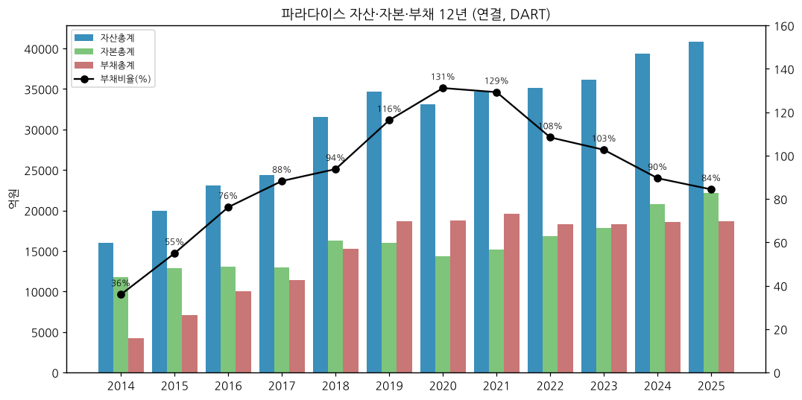

→ 2014 순현금 5,699억 → 2019 순차입금 6,810억: P-City(총사업비 1.5조원 규모 [추정 — 2015\~2018 CapEx 누계 1.42조 + 무형]) 투자를 차입으로 조달
→ 2022 유동부채 1.17조(유동비율 59%): 장기차입금 만기 도래분 유동성 대체 → 2023 리파이낸싱으로 정상화
→ 3Q26 부채비율 85.7%, 순차입금 3,698억 (2025말 1,836억 대비 +1,862억 — 하얏트 인수·J-project) [계산]

### ③ 현금흐름표 (12년 연결, 억원)

| 연도 | 영업CF | 투자CF | 재무CF | 유형 취득 | 무형·투자부동산 취득 | CapEx 계 | FCF | 배당 지급 | 이자 지급 | 리스 상환 |
|---|---|---|---|---|---|---|---|---|---|---|
| 2014 | 1,353 | -2,966 | 2,473 | 772 | 23 | 795 | 557 | 351 | 28 | - |
| 2015 | -7 | -3,981 | 3,986 | 2,956 | 7 | 2,963 | -2,969 | 428 | 21 | - |
| 2016 | 1,122 | -4,991 | 2,302 | 4,898 | 44 | 4,942 | -3,820 | 319 | 16 | - |
| 2017 | 40 | -2,075 | 1,936 | 3,573 | 5 | 3,578 | -3,538 | 256 | 245 | - |
| 2018 | 1,064 | -2,237 | 1,513 | 2,710 | 4 | 2,714 | -1,650 | 85 | 285 | - |
| 2019 | 1,568 | -2,225 | 796 | 849 | 13 | 862 | 706 | 85 | 480 | 193 |
| 2020 | -1,558 | -987 | 1,750 | 87 | 3 | 90 | -1,648 | 85 | 486 | 187 |
| 2021 | -351 | -737 | 746 | 144 | 97 | 241 | -592 | - | 493 | 199 |
| 2022 | 638 | 5,091 | -1,950 | 171 | 7 | 178 | 460 | - | 509 | 235 |
| 2023 | 2,876 | -261 | -609 | 621 | 3 | 624 | 2,252 | - | 554 | 298 |
| 2024 | 1,959 | -1,861 | -1,227 | 498 | 5 | 502 | 1,457 | 86 | 623 | 261 |
| 2025 | 2,239 | -3,970 | -631 | 888 | 120 | 1,008 | 1,231 | 130 | 500 | 279 |
| **9M26** | 1,443 | -2,514 | 848 | 3,078 | 16 | 3,094 | -1,651 | 131 | 303 | 159 |

(FCF = 영업CF − (유형 + 무형 + 투자부동산 취득). 리스 상환 미차감. 9M26은 분기보고서 누적)

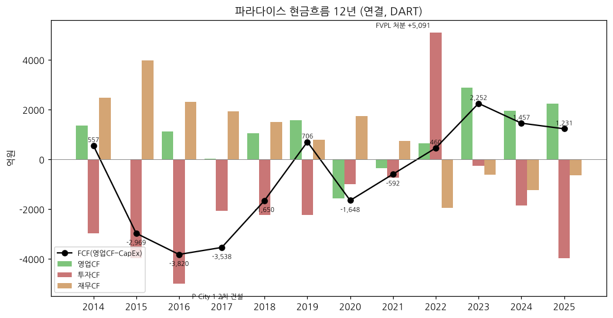

→ 2015\~2018 누적 FCF **-1.20조** — P-City 투자기. 2020\~2021 코로나로 영업CF 적자(-1,558·-351억)
→ 2023\~2025 누적 FCF **+4,940억** [계산] → 순차입금 5,746억(2022) → 1,836억(2025) 감축
→ 2022 투자CF +5,091억: 당기손익-공정가치금융자산(MMF 등) 처분 — 단기 유동성 운용 (실물 매각 아님)

### ④ CapEx 추이 (12년, 억원)

| 연도 | CapEx(억원) | CapEx/매출 | 감가상각비(부문 합, 억원) | 주요 투자 |
|---|---|---|---|---|
| 2014 | 795 | 11.8% | - | P-City 착공(2014-11) |
| 2015 | 2,963 | 48.1% | - | P-City 1차 건설 |
| 2016 | 4,942 | 71.1% | - | P-City 1차 + 올랜도 호텔 인수 |
| 2017 | 3,578 | 53.6% | 601 | P-City 1차 개장·2차 공사 |
| 2018 | 2,714 | 34.5% | - | P-City 2차(아트파라디소·플라자·클럽·스파) |
| 2019 | 862 | 8.8% | 1,107 | 유지보수 |
| 2020 | 90 | 2.0% | 1,015 | 투자 최소화(코로나) |
| 2021 | 241 | 5.8% | 980 | 투자 최소화 |
| 2022 | 178 | 3.0% | 948 | 유지보수 |
| 2023 | 624 | 6.3% | 830 | 아트파라디소 재개장 등 |
| 2024 | 502 | 4.7% | 781 | 유지보수 |
| 2025 | 1,008 | 8.8% | - | 장충동 J-project 착공(2025-03), 투자부동산 99억 |
| **9M26** | 3,094 | 32.1% | 625 | 하얏트 리젠시(웨스트타워) 인수 2,100억 + J-project 건설 |

(감가상각비: 2017·2019 = DART 부문정보 합계, 2020\~2024 = IR 2025-09-22 p23, 9M26 = DART 부문정보 누적. 2014\~2016·2018·2025 미확보)

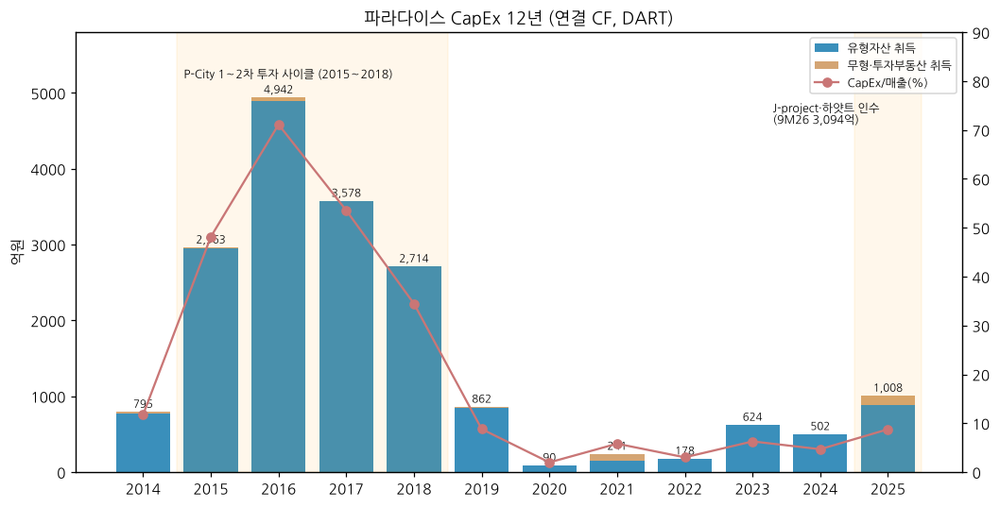

→ **2차 투자 사이클 진입**: 9M26 CapEx 3,094억 (하얏트 2,100억 + J-project) = 2017(3,578억) 이후 최대. 2026\~2028 J-project 잔여 공사비 약 3,147억(도급 미발생분) + 집기·아트워크 [DART 분기보고서(2026.09), IR]

### ⑤ 부채구조 + 채무증권 발행 history

**(1) 3Q26 차입 구성 (억원, DART 분기보고서(2026.09))**

| 항목 | 금액 |
|---|---|
| 단기차입금 | 1,111 |
| 유동성장기부채 | 1,946 |
| 사채 (공모) | 998 |
| 장기차입금 | 7,128 |
| 유동성전환사채 | 0 (2025말 70억 → 3Q26 잔액 0, 2026-02 223,823주 전환) |
| **합계** | **11,183** |
| 리스부채 (유동+비유동) | 1,937 |

- 금융기관 약정 총 1.40조 / 실행 9,295억 — 우리은행 시설자금 7,500억 약정(실행 2,824억, J-project 5,500억 포함), KB국민 2,000억, 하나·신한 등 [DART 분기보고서(2026.09) 약정 주석]
- 2026-07-29 코람코 어반호텔 리츠 수익증권 450억 관련 **풋옵션 부여** (연 5.7% 복리, 30개월·신용등급 하락 시 행사) — 우발부채 [같은 주석]

**(2) 채무증권 발행 이력**

| 시기 | 종류 | 규모 | 비고 | 출처 |
|---|---|---|---|---|
| 2017 | 공모 회사채 | 약 1,000억 | 2017말 사채 998억 | DART 2017 BS |
| 2020 | 회사채 추가 | 사채 2,316억(2020말) | 코로나 유동성 | DART 2020 BS |
| 2021 | 7회 전환사채 | 2,000억 | 전환 누적 2,227,840주 (2022\~2026-02) | DART 2021 CF·자본금 변동 |
| 2023\~2025 | 공모 회사채 | 사채 638억(2023)·730억(2024)·997억(2025) | 2025-09 이사회 회사채 발행 승인 | DART BS·이사회 의안 |
| 2026-10 (계획) | 공모 회사채 2·3년물 | 600억 (최대 1,000억) | A+ 상향 후 첫 공모채 | 이데일리 2026-08-31 |

- 이자보상배율(OP/금융원가): 2014 23.5x → 2019 1.0x → 2023 2.1x → 2025 2.5x [계산]. 회사 IR 기준 2023 2.1x·2024 1.9x [IR 2025-09-22]
- 신용등급 A+(한기평·NICE, 안정적) [디지털데일리 2026-04-22]

### ⑥ 배당·자사주 추이 (12년)

| 사업연도 | DPS(원) | 배당 지급(CF, 다음해 지급분 아님·당해 CF) | 연결 배당성향(DART) | 자사주 | 비고 |
|---|---|---|---|---|---|
| 2014 | 600 | 351 | - | - | 중국 VIP 호황기 최고 DPS |
| 2015 | 375 | 428 | - | 취득 87억 | 메르스 |
| 2016 | 300 | 319 | - | - |  |
| 2017 | 100 | 256 | 적자 | - | P-City 개장 적자에도 배당 유지 |
| 2018 | 100 | 85 | 적자 | - | 순손실에도 100원 |
| 2019 | 100 | 85 | - | - |  |
| 2020 | 0 | 85 | 적자 | - | 무배당(코로나) |
| 2021 | 0 | - | 적자 | - | 무배당 |
| 2022 | 0 | - | - | - | 무배당 |
| 2023 | 100 | - | 13.8% | - | 배당 재개 |
| 2024 | 150 | 86 | 17.1% | - |  |
| 2025 | 150 | 130 | 13.9% | 소각 54.1만주 | 자기주식 541,130주 소각(2025-06 이사회) |

(DPS = 사업연도 귀속 결산배당 (DART 사업보고서 배당에 관한 사항 — 2014\~2016은 2016 보고서, 2017\~2019는 2019 보고서, 2023\~2025는 2025 보고서). CF 배당 지급은 전년도 결산배당이 당해 지급된 금액. 2025 현금배당총액 131억, 현금배당수익률 0.9% (DART 산식) [OpenDART alotMatter 2025])

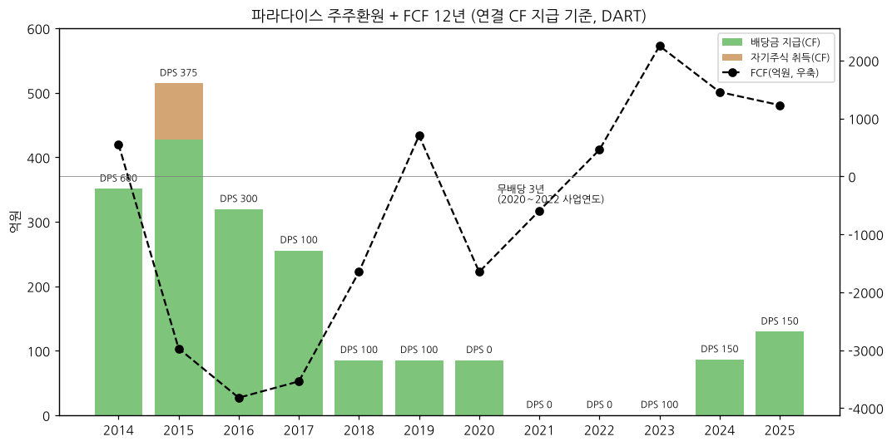

- 자기주식: 4,870,168주 (발행주식의 5.26%, 2026-09) — 신탁계약 취득분 5,411,298주 중 541,130주를 2025 소각 [OpenDART tesstkAcqsDspsSttus 2025, DART 분기보고서(2026.09)]. 2015 CF 자기주식 취득 87억
- 밸류업: IR 2025-09-22 deck에 'Value-up 플랜(주주환원 확대·지배구조 고도화)' 섹션이 있으나 본문이 이미지라 수치 미확보

### ⑦ 재무 비율 + 밸류에이션 밴드 (12년)

| 연도 | ROE(지배) | ROA | 부채비율 | 유동비율 | 이자보상배율(OP/금융원가) | 연말 종가(원) | 시가총액(억원) | PBR | PER(지배) |
|---|---|---|---|---|---|---|---|---|---|
| 2014 | 9.5% | 6.6% | 36.0% | 210.6% | 23.5x | 23,600 | 21,462 | 2.12 | 22.3 |
| 2015 | 6.4% | 4.0% | 55.0% | 291.4% | 19.5x | 17,650 | 16,051 | 1.57 | 24.6 |
| 2016 | 5.3% | 2.7% | 76.2% | 169.7% | 18.7x | 12,150 | 11,050 | 1.06 | 20.0 |
| 2017 | -1.9% | -1.7% | 88.3% | 136.4% | -1.2x | 22,300 | 20,280 | 2.04 | 적자 |
| 2018 | -1.9% | -1.6% | 93.8% | 77.7% | 0.1x | 18,850 | 17,143 | 1.35 | 적자 |
| 2019 | 1.2% | 0.2% | 116.3% | 78.8% | 1.0x | 19,750 | 17,961 | 1.42 | 118.9 |
| 2020 | -9.8% | -4.9% | 131.1% | 144.0% | -1.6x | 15,300 | 13,914 | 1.22 | 적자 |
| 2021 | -4.4% | -2.3% | 129.2% | 144.5% | -0.9x | 14,950 | 13,596 | 1.10 | 적자 |
| 2022 | 2.0% | 0.5% | 108.4% | 59.2% | 0.2x | 17,600 | 16,018 | 1.18 | 63.2 |
| 2023 | 4.5% | 2.2% | 102.7% | 124.9% | 2.1x | 13,320 | 12,222 | 0.87 | 19.5 |
| 2024 | 5.0% | 2.9% | 89.6% | 129.3% | 1.9x | 9,600 | 8,810 | 0.54 | 11.7 |
| 2025 | 5.6% | 3.6% | 84.4% | 117.2% | 2.5x | 16,550 | 15,293 | 0.89 | 16.2 |

(ROE = 지배순이익 / 평균 지배자본, ROA = 순이익 / 평균 자산. 시가총액 = 연말 Yahoo 종가 × DART 발행주식수(자기주식 포함). PBR = 시총 / 연말 지배자본, PER = 시총 / 지배순이익 [모두 계산])

- **현재 (2026-11-24 종가 11,020원)**: 시총 1.02조 / PBR **0.58배** (3Q26 지배자본 1.773조) / PER **13.1배** (LTM 지배순이익 779억) / EV/EBITDA **8.1배** (LTM EBITDA 2,348억, IR) / 배당수익률 1.4% [계산]
- PBR 12년 range 0.54\~2.12배, 평균 1.28배 [계산]. 현재는 2024말(0.54배)에 이은 2번째 저점권

---

## 5. 지배 구조

### ① 그룹·계열 관계

```
[파라다이스그룹 지배구조 (2025-06말 IR + 2026-09 DART)]

 전필립 회장 (파라다이스글로벌 최대주주)
        │
 ㈜파라다이스글로벌 (비상장 지주격)
        │ 37.53%  (+ 계원학원 4.02% · 복지재단 1.00% · 일가 2.59% → 특수관계인 45.16%)
        ▼
 ㈜파라다이스 (034230, KOSPI) ── 워커힐·부산·제주 카지노, 도고 스파, 본점 임대
        ├─ 55%    ㈜파라다이스세가사미  ── 파라다이스시티(카지노·호텔 1,270실·펀시티), 하얏트 리젠시 인천
        │           (나머지 지분 = 일본 세가사미 그룹, 합작)
        ├─ 74.49% ㈜파라다이스호텔부산  ── 532실 + 부산 카지노 영업장 임대
        ├─ 100%   Paradise America LLC ── Embassy Suites Orlando Downtown
        └─ 99.38% Paradise International (일본 동경, 광고대행)   ※ 100%·99.38%의 법인 매칭은 IR 도식 판독
```

(출처: IR 2025-09-22 p38 지분구조(2025-06말), DART 분기보고서(2026.09) VII·주석 1. 파라다이스글로벌 산하에는 파라다이스투어·비노파라다이스·파라다이스H&R·플래닝·E&A 등 비상장 계열이 있음 [IR 같은 쪽]. 세가사미 측 지분율은 IR 도식상 45%로 추정 [추정])

- **비지배지분 5,076억 (3Q26)** — 대부분 세가사미 몫 P-City 지분 → 연결 순이익 중 비지배 귀속 2025 504억(34.8%) [DART 2025 포괄손익, 계산]. 지배순이익 기준 지표(PER·ROE)는 이 누수를 반영
- 관계사 거래: 최대주주 파라다이스글로벌에 브랜드 사용료 등 1H25 약 18.3억 지급 vs 상표 관련 수익 약 0.3억 수취 [녹색경제신문 2025-11-10]

### ② 주주 구분

| 주주 | 주식수 | 지분율 | 비고 |
|---|---|---|---|
| ㈜파라다이스글로벌 | 34,767,536 | 37.53% | 최대주주 |
| 학교법인 계원학원 | 3,720,000 | 4.02% | 계열 비영리법인 |
| 파라다이스복지재단 | 927,002 | 1.00% | 계열 비영리법인 |
| 전지혜 | 1,725,264 | 1.86% | 특수관계인 |
| 전필립 | 415,580 | 0.45% | 최대주주의 최대주주 (회장) |
| 전원미 | 260,000 | 0.28% | 특수관계인 (2026 장내매수 533주) |
| 계열 임원 2인 | 16,000 | 0.02% | |
| **특수관계인 계** | **41,831,382** | **45.16%** | |
| 자기주식 | 4,870,168 | 5.26% | |
| 외국인 | 약 6.1백만 [계산] | **6.60%** | alphasquare 2026-11-24 (기준일 미표시) |
| 기타 (국내 기관·개인) | - | 약 43.0% [계산] | |
| 발행주식총수 | 92,629,382 | 100% | 2026-09-30 |

(출처: DART 분기보고서(2026.09) VII 최대주주 현황, 별도 주석 1 주주현황. 5% 이상 주주는 파라다이스글로벌 외 공시 없음(분기보고서 기준). 외국인 지분은 2025-11 '10%대 초반'에서 하락 [톱스타뉴스 2025-11-20])

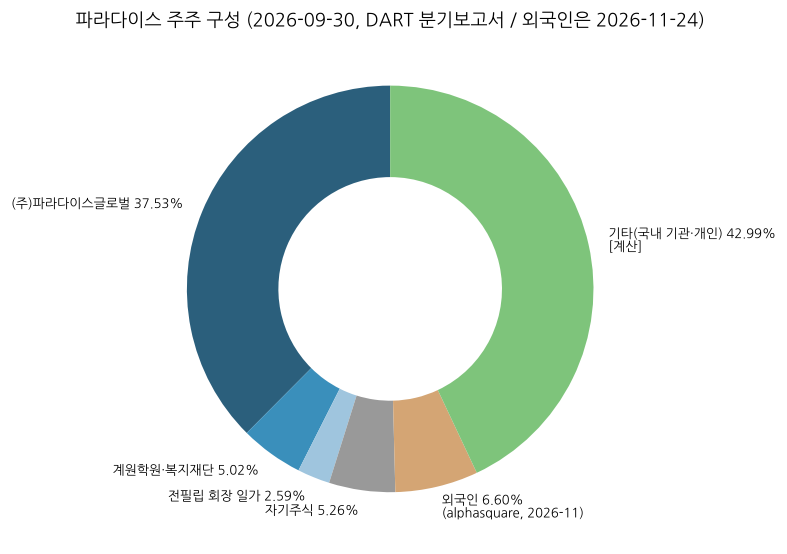

### ③ 임원·이사회

| 성명 | 직위 | 생년 | 주요 경력 | 임기 |
|---|---|---|---|---|
| 최종환 | 대표이사 (CEO, 사내이사) | 1973-02 | 연세대 경영, Stanford 최고경영자과정, SK㈜ 재무부문, 파라다이스 그룹총괄 → 세가사미·호텔부산·파라다이스글로벌 대표 겸직 | 2026-03-22 만료(2025 사업보고서 기준) |
| 임준신 | 대표이사 (각자대표) | - | 2026 선임 — 상세 경력 미확보 (2026 반기·분기보고서 임원현황 미기재) | - |
| 박종훈 | 전무, 사내이사 (COO) | 1963-07 | 명지대 화공, 한양대 관광·호텔경영 석사 | 2027-03 |
| 박현철 | 사외이사 (감사위원장) | 1960-04 | 금감원 조사기획국장, DS투자증권 이사회의장, 법무법인 세종 고문 | 2027-03 |
| 주보림 | 사외이사 (감사위원) | 1970-03 | 이화여대 디자인대학원장, 前 CELINE·LV Korea | 2026-03 만료 |
| 고정현 | 사외이사 (감사위원) | 1964-01 | 우리은행 IT그룹 부행장 | 2027-03 |

(출처: OpenDART exctvSttus 2025 사업보고서, 기업개황(대표 최종환·임준신 각자대표). 이사회 5인 중 사외이사 3인, 2024-03 감사위원회 도입 [DART 사업보고서(2025.12) 연혁·이사회]. 전필립 회장은 2024-03-21 사내이사 사임 [같은 연혁])

- 2025 이사회 8회 — 주요 안건: J-project 투자·차입 승인(2025-03), 자기주식 소각(2025-06), 하얏트 인수 진행 보고(2025-08), 회사채 발행 승인(2025-09), 최고경영자 후보 관리 방안(2025-12) [DART 사업보고서(2025.12) VI]

---

## 6. 기타 팩트

### ① R&D 인프라

- **연구개발비: 공시 없음 (R&D/매출 0.0%)** — 사업보고서 '주요계약 및 연구개발활동' 항목에 카지노 영업장 임대차 계약만 기재, 연구개발 조직·비용 미기재 [DART 사업보고서(2015.12\~2025.12)]. 카지노·호텔 서비스업 특성상 R&D 대신 **인적자본(딜러·VIP 마케팅)과 시설 투자**가 경쟁력의 원천
- 대체 지표: 별도 직원 1,497명, 1인 평균급여 8,025만원 (2025) [OpenDART empSttus], F&B R&D 센터 'Paradise Culinary Lab' (미쉐린 3스타 강민구 셰프 자문, 프릳츠 협업) [IR 2025-09-22]
- 고객 DB 107만명, 카지노 업력 50년+ [IR 2025-09-22]

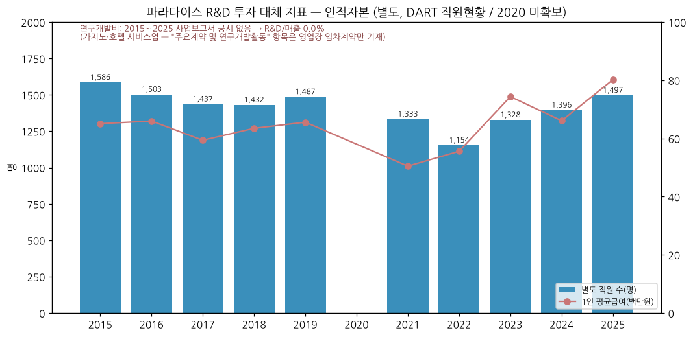

### ② 진행 중 corporate action — 10년치 주요 이벤트

| 일자 | 이벤트 | 규모 | 출처 |
|---|---|---|---|
| 2016-03 | 미국 올랜도 Embassy Suites 인수 | 167실 | DART 연혁 |
| 2017-04 / 2018-09 | 파라다이스시티 1-1차·1-2차 개장 | 2015\~2018 CapEx 1.42조 | DART 연혁·CF |
| 2021 | 7회 전환사채 발행 | 2,000억 | DART CF |
| 2024-06-24 | 코스닥 → 유가증권시장 이전상장 | - | DART |
| 2025-03 | J-project(장충동 호텔) 착공, 시설자금 5,500억 차입 약정 | 공사비 5,750억 | IR 2025-09-22 |
| 2025-06 | 자기주식 541,130주 소각 | 이익소각 | OpenDART |
| 2025-09-23 → 2026-01 | 그랜드하얏트 인천 웨스트타워 인수 → 하얏트 리젠시 인천 파라다이스시티 (2026-03-09 그랜드 오픈) | 2,100억, 501실 | 디지털데일리 2025-09-23, DART 연혁 |
| 2026-07-29 | 코람코 어반호텔 리츠 관련 풋옵션 합의 (450억) | 연 5.7% | DART 분기보고서(2026.09) |
| 2026-09말 | 관계기업 투자 222억 신규 (지분법) | 222억 | DART 3Q26 BS |
| 2026-10 (계획) | 공모 회사채 600억\~1,000억 | - | 이데일리 2026-08-31 |

### ③ 사업·시설 마일스톤 — 10년치

- 2017-04 국내 최초 복합리조트 파라다이스시티 개장 (호텔 711실) / 2018-09 아트파라디소(58실)·씨메르·원더박스(펀시티)
- 2020-07 \~ 2023-07 아트파라디소 휴장 → 2025-10 미쉐린 가이드 1키 선정 [DART 분기보고서(2026.09) II-1]
- 2025 카지노 영업조직 통합 (CEO 직속 컨트롤타워, 4지점 교차 우대) → 1H25 콤프&마케팅비/카지노 매출 16.7% → 16.0% [IR 2025-09-22]
- 2025-09-29 중국 단체관광 무비자 (한시, 2026-06-30까지) [IR 2025-09-22] — 이후 연장 여부 미확인
- 2026-03 하얏트 리젠시 오픈 → P-City 1,270실, 3Q26 Occ 73.4% [IR 3Q26]
- 2028-10 장충동 초럭셔리 호텔 개장 예정, 워커힐 유휴공간 High-roller 전용 영업장 전환 계획 [IR 2025-09-22]

### ④ 주요 리스크

(1) 규제 — **관광진흥개발기금 상향 (최대 리스크)**
→ 문체부, 외국인 카지노 기금 부담률 상한 10% → 15% (고매출 구간 신설) + 5년 단위 면허 갱신 + 영업권 양도 사전심사 추진 [데일리안 2026-08-06]. 2026-10-20 기준 "확정 아님" [매일신문 2026-10-20]
→ 영향: KB증권 연 약 500억 비용 증가 추정 [파이낸셜뉴스 2026-07-16], SBS Biz는 기금 888억 → 1,350억+ (약 460억↑) 추정 [SBS Biz 2026-07-21]. 업계 영업이익 최대 28% 감소 우려 [디지털데일리 2026-07-21]
→ 출국납부금 7,000원 → 2만원 인상안이 대체 재원으로 거론 [매일신문 2026-10-20]
(2) 수요·지정학
→ 일본 VIP 의존(드롭 43%) — 엔화 약세 시 원화 환산 드롭 감소 [DART 사업보고서(2025.12) II-7]
→ 중국: 한중 관계·무비자 정책 변화, 1Q26 P-City 중국 VIP 드롭 -37% [IR 1Q26]
→ 감염병(메르스 2015·코로나 2020\~2022) — 12년 중 영업적자 3개년의 원인
(3) 경쟁
→ 인천 영종 인스파이어 IR(2024\~), 일본 오사카 IR 개장 예정 [다음/뉴스 2026-07]
(4) 운영 변동성
→ 홀드율 분기 편차 10.2\~12.9% (2024\~2026) — 같은 드롭에서도 영업이익 수백억 차이
→ 워커힐 영업장은 SK네트웍스 소유 건물 임차 (월 12.5억, 최소사용약정 포함) — 임대차 갱신 조건 리스크 [DART II-6·우발채무]
(5) 재무
→ 2026\~2028 J-project 투자로 차입 증가, 하얏트 리츠 풋옵션(450억) [DART 분기보고서(2026.09)]
→ 소송: 피고 계류 소송 해고무효확인 1건 (2.9억) — 중요성 낮음 [DART 분기보고서(2026.09) XI]
(6) 지배구조
→ KCGS 2024 통합 D(2023 C) — 이사회 독립성·내부통제 지적 [녹색경제신문 2025-11-10] → 2025 평가 B+로 3단계 상향 [헤럴드경제 2026-06-29]

### ⑤ ESG 등급

- **한국ESG기준원(KCGS) 통합: 2023 C → 2024 D → 2025 B+** [녹색경제신문 2025-11-10, 헤럴드경제 2026-06-29]. E·S·G 개별 등급은 미확보
- 지속가능경영보고서: 2024 보고서 2025-06 첫 발간, **2025 보고서 2026-06-29 발간** (GRI 2021·SASB, 그룹 전체로 ESG 데이터 공개 확대) [헤럴드경제 2026-06-29]. **원문 PDF 미수집** — 회사 사이트(paradise.co.kr) robots.txt 응답 실패로 자동 수집 불가 (source 체크리스트 4번 ❌)
- MSCI ESG 등급: 미확보

### ⑥ 인증·라이선스

- **카지노업 허가 (관광진흥법 제28조, 문화체육관광부 '카지노업영업준칙')** — 외국인 전용, 4개 영업장(워커힐 1968-03 허가, 부산 1978-10 허가) [DART 분기보고서(2026.09) II-7, DART 사업보고서(2019.12) 업계현황]. 정부가 5년 단위 갱신제 도입 추진 중 [데일리안 2026-08-06]
- 관광진흥개발기금·개별소비세(+교육세) 납부 의무 [DART II-7]
- 자금세탁방지(AML/CFT) 업무규정·독립적 감사 (2025 이사회 승인) [DART 사업보고서(2025.12) VI]
- 아트파라디소 미쉐린 가이드 1키 (2025-10) [DART 분기보고서(2026.09)]
- 신용등급 A+ (한기평·NICE, 2026)

---

## Version Log

- **v1.0 (2026-11-25)**: 첫 작성 — Phase 1 source 전수 점검 (OpenDART 연결 재무 JSON 44개 FY2015\~3Q26, 정기공시 XML 60건, 기업개황·주주·임원·직원·배당·자기주식·주식총수, IR 자료 17건(실적 리뷰 9건 + NDR·컨퍼런스 8건), Yahoo 월간·일간 시세, 언론 14개 매체) + v4.8 6개 섹션 + 차트 16종 (12종 표준 + chart2 사업별 4종(카지노·복합리조트·호텔·DART 부문 연간) + chart13 드롭액·홀드율). 3Q26 분기보고서(2026-11-13)·IR(2026-11-16) 반영
- **데이터 관례**: ① 사업 구분 = DART 보고부문(2Q15\~4Q17 3부문 / 1Q18\~ 4부문 재작성 기준) + IR 영업장별(P-City·워커힐·부산·제주) 병기 ② 드롭액·홀드율 = 회사 IR 공시치(4개 영업장 합산, 테이블 기준) ③ 주가 = Yahoo `close`, 시총 = close × DART 발행주식수(자기주식 포함) ④ 순차입금 = 차입금·사채 − (현금 + 단기금융상품 + 유동 FVPL), 리스 제외 ⑤ CapEx = 유형 + 무형 + 투자부동산 취득 ⑥ FCF = 영업CF − CapEx
- 잔여 보완 후보: ① 4Q19\~4Q24 분기 IR PDF (irgo 미게시 — 회사 IR 사이트 수동 다운로드 필요) → 영업장별 분기 매출·드롭 2019\~2024 ② 1Q15·2014 이전 분기 부문 데이터 ③ 2Q26 홀드율 ④ 지속가능경영보고서 PDF·MSCI ESG ⑤ 관광진흥개발기금 15% 법안 진행 ⑥ 워커힐 영업장 임대차 2026 이후 갱신 조건 ⑦ 세가사미 지분율(45%) DART 확인 ⑧ 임준신 대표 경력 ⑨ 외국인 지분율 연도별 추이 ⑩ 밸류업 계획 수치(IR 이미지 페이지)
