# 팬오션 — 기업 개요 (v1.0)

> 마지막 update: 2026-11-25 (v1.0 — 첫 작성. 3Q26 분기보고서(2026-11-11 제출) 부문정보·주주현황까지 반영 — 3Q26은 확정치, [잠정] 없음)
> 입력 source: OpenDART fnlttSinglAcntAll (연결 CFS, 2015 사업보고서\~3Q26, 44개 JSON — 2014는 2015 사업보고서 전기 컬럼) + DART 정기공시 원문 XML 52건 (사업보고서 2013\~2025 + 감사보고서 첨부 00760·00761, 분기·반기 1Q14\~3Q26, 기재정정본 우선) + OpenDART 기업개황·최대주주·임원·직원·배당·자기주식·주식총수 (2025 사업보고서) + 팬오션 IR 실적발표 PDF 68건 (2018-04\~2026-11, irgo 경유 — 14건 다운로드 실패, 2017년 이전 IR 미수집) + Yahoo Finance (028670.KS 월간·일간 2007-09-21\~2026-11-25, split 이벤트) + 언론 (딜사이트·KED Global·Cyprus Shipping News·Heavy Lift PFI·Wikipedia, 2015\~2026)
> 갱신 주기: 매분기 (실적 리뷰 모드 호출 시)
> 워치리스트: **운송 섹터 / 서브섹터: 해운 (HMM·팬오션)** (`earnings/watchlist.md` 94행) — 2순위 섹터, 4Q26부터 리뷰
> **Fact verify cutoff**: 2026-11-25 (주가 2026-11-24 종가 **4,800원** [Yahoo Finance 028670.KS 일간], 발행주식총수 534,569,512주 (자기주식 0주) [DART 사업보고서(2025.12)·OpenDART stockTotqySttus] → 시가총액 **2.57조원** [계산]. **하림 인수(2015-07 신주 발행) 이후 현 주식수 체제 최고 종가 8,770원 (2021-07-01)**, 장중 최고 8,920원 (2021-06-29) → 당시 시총 4.69조원 [계산]. 고점 대비 **-45.3%**. 2026년 고점 7,240원 (2026-10-14) 대비 -33.7%. YTD **+24.7%** (2025말 3,850원), 1년 **+31.0%** (2025-11-24 3,665원). 상장(2007-09-21) 후 시총 최고는 **2007-10-26 9.91조원** [계산 — 수정주가 601,875원 = 당시 실제 종가 4,815원(액면 100원) × 2,058,578,460주]. 수정주가 기준 사상 최고 종가는 2007-10-26 (Yahoo 수정 601,875원) — 액면·감자 조정으로 현재 주가와 직접 비교 불가)

---

## 1. 기업 분류

- **Primary 분류: 사이클 — 드라이벌크 해운 (BDI 연동)** (부정기 벌크선이 매출·자산의 최대 축. 운임은 선복 공급(신조·폐선)과 원자재 물동량의 수급으로 결정되는 완전경쟁 시장 [DART 사업보고서(2025.12) II-7 산업분석])
- **Secondary 노트: 장기계약(CVC·LNG/VLCC 장기대선) 기반 "하방 방어형 사이클" + 곡물 트레이딩(저마진 매출 확대)** — 2026-09말 진행 중 장기계약 60척 (벌크 CVC 40척·탱커 CVC 8척·LNG 장기대선 12척) [IR 3Q26 p9]. 2025 영업이익의 56%가 비벌크(LNG·탱커·컨테이너)에서 발생 [DART 사업보고서(2025.12) 부문정보, 계산]

### ① 정량 근거

**📊 Summary Box (12년, 2014\~2025 연결):**

| 지표 | 값 |
|------|-----|
| 매출 CAGR (2014→2025, 11년) | **+11.5%** (1.65조 → 5.43조) — 곡물사업(2016 개시, 2025 매출 1.23조) 편입 효과 포함. 해운업(곡물·기타 제외) 매출 기준 2014 1.67조 → 2025 4.26조 [DART 주요 제품 현황] |
| OPM 평균 | **10.0%** (2014 회생 직후 저원가 구간 제외 2016\~2025 평균 9.4%) |
| OPM 정점 평균 | **12.4% (2021·2022)** — BDI 연평균 2,943·1,934, 영업이익 5,729억·7,896억 (12년 최대) |
| OPM 저점 평균 | **8.5% (2016·2018·2023)** — 2016 BDI 673 (12년 최저), 영업이익 1,679억 (12년 최저) |
| 사이클 주기 | **약 5\~7년 (저점→저점: 2016 → 2023)** — BDI 저점 2016 (673) → 정점 2021 (2,943) → 저점 2023 (1,378) → 반등 2026 (1\~10월 2,606) [IR 3Q26 p14] |
| 사이클 회수 (12년) | **1.5회** — 완결 사이클 1회 (2016 저점 → 2021·22 정점 → 2023 저점) + 2024\~26 상승 국면 진행 중 |

> ⚠️ **OPM이 이익 사이클을 과소 표시**: 곡물사업 매출(2025 전사 매출의 22.7%, OPM ≈ 0%)과 장기계약 이익이 전사 OPM을 7\~13% 박스에 묶는다. 사이클 판단은 **영업이익 절대액**(1,679억 → 7,896억, 4.7배 진폭)과 **벌크 부문 OPM**(분기 6\~17%)으로 보는 것이 정확 (chart2_벌크·chart13)

```
[전사 시계열 (12년, 연결, DART, 억원)]
연도   매출     영업이익   순이익    OPM    NPM   BDI평균  EBITDA
2014    16,456    2,160    7,861    13.1   47.8        -   3,734   ← 회생절차 중. 순이익 7,861억 = 회생채권 출자전환·채무면제이익 (영업외). 고가 용선 해지로 원가 정상화
2015    18,193    2,294      455    12.6    2.5        -   3,921   ← 2015-06 하림 인수 (1.08조), 2015-07-30 회생절차 종결 [Heavy Lift PFI]
2016    18,740    1,679      971     9.0    5.2      673   3,369   ← 사이클 저점: BDI 673 (역사적 저점권), 영업이익 12년 최저 1,679억
2017    23,362    1,950    1,413     8.3    6.0    1,145   3,630   ← BDI 1,145 회복, 곡물사업 매출 3,023억 (2016 개시)
2018    26,684    2,039    1,486     7.6    5.6    1,353   3,725   ← 벌크 OP 1,916억 / IMO 2020 황함유량 규제 대비
2019    24,679    2,100    1,477     8.5    6.0    1,353   3,942   ← 4Q19 스크러버·저유황유 대응, BDI 1,353
2020    24,972    2,252      907     9.0    3.6    1,066   4,344   ← COVID-19, 1Q20 BDI 592 → 하반기 회복. 첫 배당 50원 (2011 이후)
2021    46,161    5,729    5,493    12.4   11.9    2,943   7,997   ← 사이클 정점 ①: BDI 2,943 (2010년 이후 최고), 벌크 OP 5,154억
2022    64,203    7,896    6,771    12.3   10.5    1,934  10,633   ← 사이클 정점 ②: 영업이익 7,896억 (사상 최대), 컨테이너 1,378억·탱커 1,067억
2023    43,610    3,859    2,450     8.8    5.6    1,378   6,690   ← 사이클 저점: BDI 1,378, 영업이익 -51.1%. 12월 HMM 인수 우선협상대상자 (2024-02 무산)
2024    51,612    4,712    2,681     9.1    5.2    1,755   7,783   ← 수에즈·파나마 통항 제한 → BDI 1,755. LNG선 7척 장기대선 개시. 4Q24 순손실 -329억
2025    54,329    4,919    3,014     9.1    5.5    1,681   8,756   ← BDI 1,681 하락에도 LNG 12척 장기대선 → LNG OP 1,489억. 비벌크 OP > 벌크 OP 첫 역전

영업이익 range: 1,679억(2016) ~ 7,896억(2022) = 4.7배 진폭 / OPM range: 7.6%(2018) ~ 13.1%(2014)
9M26: 매출 55,199억 (+39.5% YoY), 영업이익 5,320억 (+47.2%), 순이익 4,164억 (+64.8%) — BDI 1~10월 평균 2,606 + VLCC 10척(SK해운) 편입 + 곡물 분기 최대
```

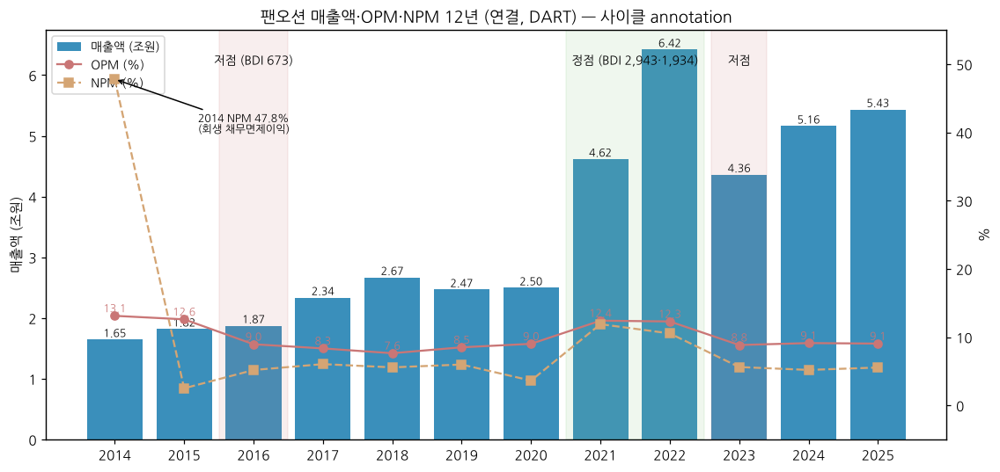

(2014 수치는 2015 사업보고서의 전기 컬럼. BDI = 팬오션 IR 실적발표 "BDI 평균" (Baltic Exchange 원자료 인용), 2014·2015 IR 미수집으로 공란. EBITDA: 2016\~2025 = IR 공시 EBITDA, 2014·2015 = 영업이익 + DART 유형자산 감가상각비 (157,405·162,721백만원 [DART 사업보고서(2015.12) 주석]) [계산]. 9M26 = DART 분기보고서(2026.09) 누적, YoY는 9M25 대비 [계산])

**통화 기준 (중요)**: 팬오션의 **기능통화는 미국 달러(USD)**, 재무제표 **표시통화는 원화(KRW)** — 손익은 기간 평균환율, 자산·부채는 기말 마감환율, 자본은 역사적 환율로 환산하며 환산차이는 기타포괄손익 [DART 사업보고서(2025.12) II-7 라. 환율변동 영향]. → 원화 매출·이익은 운임 + 원/달러 환율의 합성치. 원화 자본은 기말 환율 변동에 따라 크게 움직인다 (2Q26말 63,216억 → 3Q26말 57,872억(-8.5%) vs USD 기준 41.01억 → 42.60억 달러(+3.9%) [IR 3Q26 p17·p18]). 이 문서의 모든 수치는 별도 표기 없으면 **원화 표시 금액**

| USD 기준 (IR, 백만 USD) | 2020 | 2021 | 2022 | 2023 | 2024 | 2025 | 1Q26 | 2Q26 | 3Q26 |
|---|---|---|---|---|---|---|---|---|---|
| 매출 | 2,115 | 4,035 | 4,973 | 3,339 | 3,786 | 3,821 | 1,032 | 1,278 | 1,466 |
| 영업이익 | 191 | 501 | 612 | 295 | 346 | 346 | 96 | 129 | 138 |
| 순이익 | 77 | 480 | 524 | 188 | 197 | 212 | 65 | 92 | 128 |
| EBITDA | 368 | 699 | 823 | 512 | 571 | 616 | 166 | 202 | 214 |
| 내재 평균환율 (원/USD) [계산] | 1,181 | 1,144 | 1,291 | 1,306 | 1,363 | 1,422 | 1,462 | 1,497 | 1,431 |

(IR 3Q26 p18 "Financial Result (USD)". 내재 평균환율 = 원화 매출 / USD 매출 [계산]. → 2025 원화 영업이익 +4.4%는 USD 기준 0.0% (346 → 346) — 원화 약세가 원화 실적을 부풀린 효과)

### ② 산업 분류

- 산업: **해상운송 — 부정기선(Tramper) 드라이벌크 중심 + 탱커(VLCC·MR)·LNG선·근해 컨테이너 + 곡물 유통**
- DART 업종: 50112 (외항 화물 운송업) [OpenDART company.json] / KRX 운수창고업
- 워치리스트 섹터: **운송** / 서브섹터: **해운** (HMM·팬오션)
- 시장 지위: 국내 최대 드라이벌크 선사. "50년이 넘는 Dry Bulk선 사업 경험 … Dry Bulk선 부문에 있어서는 세계 최고의 경쟁력" [회사 서술, DART 분기보고서(2026.09) II-7] — 글로벌 점유율 수치는 미공시
- 운영선대 (2026-09말): **273척 / 26,833천 DWT** — 사선 128척 (장기계약 투입 60척), 1년 이상 용선 145척. 드라이벌크 220척 (DWT 85.8%), 비벌크 53척. 사선 평균 선령 9.9년 [IR 3Q26 p12]

### ③ 분류 결정 논리

(1) **가장 매출 큰 사업부 기준** 적용 시: 벌크 부문 = 2025 부문매출 3.20조, 부문 합계(내부거래 제거 전 5.55조)의 57.7% [DART 사업보고서(2025.12) II-2 사업부문별 요약 재무현황]. 운임 = 시황(BDI) 연동 → **사이클**
(2) **이익 비중 sub-rule**: 벌크 영업이익 비중은 2021 90% → 2022 69% → 2023 63% → 2024 58% → **2025 44%** 로 하락, 비벌크(LNG·탱커·컨테이너)가 2025 56% [DART 부문정보 계산]. 3Q26 단독은 벌크 51% (BDI 3,041) [DART 분기보고서(2026.09), 계산] → **시황이 좋을 때는 벌크가 이익을 끌고, 나쁠 때는 장기계약 비벌크가 바닥을 받치는 구조**. 벌크가 여전히 이익 변동(Δ)의 대부분을 설명하므로 Primary는 사이클 유지
(3) **Boundary case 처리**:
→ **LNG선**: 사선 12척 전량 장기대선 (Qatar Energy 5척 잔여 12.4년, Shell 6척, GALP 1척) [IR 3Q26 p9]. 2025 매출 3,182억·OP 1,489억 (OPM 46.8%) — **확정 계약 기반 인프라형 현금흐름**, 시황 무관 → Secondary(하방 방어)
→ **탱커 (VLCC·MR·케미컬)**: 2026-02-11 SK해운 원유수송사업(VLCC 10척 + SK에너지·SK인천석유화학 장기원유수송계약) 3.73억 달러 인수, 영업권 4,704만 달러 [DART 분기보고서(2026.09) 사업결합 주석]. 언론 보도 거래가 9,737억원 [Cyprus Shipping News 2026-02-16]. CVC 계약분은 안정, MR·스팟 VLCC는 시황 연동 → 사이클 성격 혼재
→ **컨테이너**: 한-중·한-일·동남아 근해(Intra-Asia) 10척 [DART·IR] — 2022 OP 1,378억 → 2023 91억 (공급망 사이클). 비중 작아 분류 영향 미미
→ **곡물사업**: 2025 매출 1.23조 (전사의 22.7%) 이나 OP -22억 — **매출만 키우는 저마진 트레이딩** (하림그룹 사료 원료 시너지). OPM·매출 CAGR 해석 시 분리 필요
→ 결론: **Primary 사이클(드라이벌크) + Secondary(장기계약 하방 방어 + 곡물 트레이딩)**
(4) **글로벌 피어 대비 (드라이벌크)**:
→ **Star Bulk (SBLK, 미국 상장)·Genco (GNK, 미국)·Pacific Basin (2343.HK)·COSCO Shipping Bulk (비상장, 중국원양해운 그룹)·Golden Ocean (2025 CMB.Tech 합병 — 미검증 ⚠️)**: 순수 드라이벌크 + 스팟·단기 용선 비중이 높아 BDI 베타가 팬오션보다 큼. 이번 버전은 피어 밸류에이션 수치 비교 미수행
→ **팬오션 차별점**: ① 대규모 **용선(145척) + 사선(128척) 혼합 운영** — 용선 선대로 시황에 따라 선복을 늘리고 줄이는 "operator" 모델 ② **장기 CVC (Vale 16척 잔여 13.0년, Suzano 10척, 발전자회사 8척, POSCO 3척, 현대제철 3척)** [IR 3Q26 p9] ③ LNG·VLCC 장기대선으로 비벌크 이익 비중 50%+ ④ 곡물 트레이딩 → 순수 벌크 피어보다 이익 변동성이 낮고 매출 변동성은 곡물가에도 노출
→ **국내 피어 HMM**: 컨테이너 정기선 (SCFI 연동) — 같은 해운이지만 운임 지표·사이클 시점이 다름 (2021\~22 컨테이너 슈퍼사이클 vs 벌크는 2021 단기 정점). 상세는 `HMM_기업개요.md`

### ④ 적정 밸류에이션 방법

- **1순위: PBR (선대 자산가치 대비) — 사이클 위치별 밴드** — 해운은 자산(선박)이 이익을 만드는 장치산업이고 이익이 사이클로 크게 흔들려 PER은 정점에서 낮고 저점에서 높게 왜곡됨
→ 연말 PBR (지배자본 기준, 연말 종가 × 발행주식총수 [계산]): 고점 **1.18배 (2017)** · 0.96배 (2020) / 저점 **0.31배 (2024)** · 0.36배 (2025) · 0.42배 (2023). 2015\~2025 평균 0.74배
→ 현재 **0.44배** (2026-11-24 시총 2.57조 / 3Q26 지배자본 5.79조 [DART 분기보고서(2026.09)])
→ 원화 PBR은 환율 영향을 받음: 원화 약세기에는 장부 자본(기말 환율 환산)이 커져 PBR이 낮아 보임. USD 기준 자본 42.60억 달러 (3Q26) [IR 3Q26 p18] — 글로벌 피어와 비교 시 USD 기준 권장
→ ROE: 정점 17.2% (2021)·16.7% (2022), 비정점 연도 2.4\~6.1% [계산] — PBR 0.3\~0.5배는 ROE 5% 내외의 "정상 이익" 가정과 부합
- **2순위: EV/EBITDA (LTM)** — 현재 **6.0배** (EV 6.49조 = 시총 2.57조 + 순차입금 3.92조 (3Q26 차입금 등 4.65조 − 현금 0.73조, 리스부채 0.53조 제외) / LTM EBITDA 1.08조 [IR 4Q25\~3Q26 합산]). 2015\~2025 연말 4.0\~10.6배 (정점 2022 4.0배, 저점기 2016\~2017 10배+) [계산]
- **3순위: PER (정상화 이익 기준)** — LTM 순이익 4,651억 기준 PER **5.5배** [계산]. 2021\~2022 정점 4.5\~5.3배, 저점기 2016 21.8배 — 사이클 반대 방향으로 움직이므로 단독 사용 금지
- **배당수익률**: 2025 사업연도 DPS 150원 / 4,800원 = **3.1%** [계산]. 배당 가이드라인(2024\~2026) = 별도 당기순이익(일회성 제외)의 15\~25% [IR 3Q26 p11] — 이익 연동형이라 유틸리티형 배당 프레임은 부적합
- **피어 차별화**: HMM(컨테이너, 순현금·대규모 주주환원 이슈)과 달리 팬오션은 **순차입 3.9조 + 신조 투자 사이클(잔여 투자 4.99억 달러, 2025말 [DART]) + 장기계약 이익 하방** — "자산가치 할인(PBR 0.4배) vs 하방 방어 이익"의 조합. 최대주주 하림지주의 지분 담보(발행주식의 39.46%) [DART 분기보고서(2026.09)]도 지배구조 디스카운트 요인으로 거론될 수 있음 (해석)

#### ④-1 밸류에이션 정의 (해운 피어 통일 기준 — HMM 문서와 동일 정의)

| 지표 (2026-11-24 종가, 3Q26말 기준) | 팬오션 | 정의 |
|---|---|---|
| 시가총액 (조원) | 2.57 | 종가 4,800원 × 발행주식총수 534,569,512주 (자기주식 0) |
| LTM 매출 (조원, 4Q25\~3Q26) | 7.00 | DART 분기 매출 합산 (4Q25 = 연간 − 3Q 누적) |
| LTM 영업이익 (조원) / OPM | 0.66 / 9.5% | DART 분기 합산 |
| LTM EBITDA (조원) / 매출 대비 | 1.08 / 15.5% | IR 분기 EBITDA 합산 (2,311+2,433+3,022+3,062억) |
| 순차입금 (조원) | 3.92 | DART 3Q26 "차입금 등"(유동+비유동, 사채 포함) − 현금및현금성자산. 리스부채·단기금융상품 제외 |
| 비지배지분 (조원) | 0.00 | DART 3Q26 연결 BS |
| EV (조원) | 6.49 | 시총 + 순차입금 + 비지배지분 |
| **EV/EBITDA (LTM)** | **6.0배** | |
| **PBR** | **0.44배** | 시총 / 3Q26 지배기업 소유주지분 (원화 표시) |
| PER (LTM) | 5.5배 | 시총 / LTM 연결 당기순이익 (4,651억, 비지배 0) |
| **배당수익률** | **3.1%** | 2025 사업연도 DPS 150원 / 종가 |

### ⑤ 분기 재평가 트리거 (분류 변경 조건)

- **비벌크(LNG·탱커·컨테이너) 영업이익이 4개 분기 연속 전사 OP의 60%+ 이고 BDI 2,000+ 구간에서도 유지** 시 → Secondary(장기계약 인프라)를 Primary 공동 축으로 격상, "사이클 + 계약형 현금흐름 하이브리드" 재분류 (2025 연간 56%, 3Q26 49%)
- **BDI 분기평균 3,000+ 2개 분기 연속 + 벌크 OPM 15%+** 시 → 사이클 정점 진입 판정 (2021 3Q·4Q 선례: BDI 3,732·3,498, 벌크 OPM 16.9%·16.6%) — PBR 상단(1.0배 내외) 밴드 적용 검토 (3Q26 BDI 3,041, 벌크 OPM 9.8%)
- **곡물사업 매출이 전사의 35%+ 로 확대되고 OP 흑자 정착 실패** 시 → 매출 지표(CAGR·YoY)를 해운업 기준으로 전환 (9M26 곡물 매출 비중 31.4% — 연결 매출 대비)
- **하림그룹 지배구조 변동 (지분 담보 실행, 계열 재편, HMM 등 대형 M&A 재추진)** 시 → 밸류에이션 디스카운트 요인 재평가
- **USD/KRW 급변 (분기 ±10%)** 시 → 원화 실적·자본 해석을 USD 기준 병기로 전환

---

## 2. 회사 개요

### ① 기본 사항

- **회사명**: 팬오션 주식회사 (Pan Ocean Co., Ltd.) / KRX 028670 (유가증권시장 2007-09-21 상장). 싱가포르증권거래소 2005-07-14 상장 → 2022-03-21 자진 상장폐지 [DART 사업보고서(2025.12) I-1]
- **본사**: 서울특별시 종로구 종로5길 7, Tower8 (2016-10-17 이전) [DART 사업보고서(2025.12) I-2]
- **설립**: 1966-05 범양전용선주식회사 [DART 사업보고서(2025.12) I-1]. 이후 범양상선 → STX그룹 편입 후 STX팬오션 → 2013-06-07 회생절차 신청 [Wikipedia(Bloomberg 인용)] → STX 상호 삭제(팬오션) → **2015-06 하림그룹 편입** [DART] → 2015-07-30 회생절차 종결 [Heavy Lift PFI]
- **지배구조**: **㈜하림지주 54.72% (특수관계인 포함 54.91%)**, 국민연금 8.95% (2026-09-30) [DART 분기보고서(2026.09) VII, IR 3Q26 p11]. 기업집단 하림 (동일인 김홍국 회장), 계열사 70개 (상장 5) [DART 사업보고서(2025.12)]
- **사업 한 줄 정의**: 사선·용선 273척을 운용하는 국내 최대 부정기 벌크선사로, Vale·POSCO·발전 5사 등 장기화물운송계약(CVC)과 LNG·VLCC 장기대선을 결합하고, 하림그룹 곡물 유통까지 하는 해운·곡물 회사
- **물동량 (분기)**: 3Q26 2,571만톤 (3Q25 2,644만톤) [IR 3Q26 p5]. 곡물 판매 2025 약 343만톤 [DART 사업보고서(2025.12)]
- **대표이사**: **김홍국 (회장, 하림그룹 회장·하림지주 대표) · 안중호 (사장, 2020\~, 이사회 의장)** 각자대표 [DART 분기보고서(2026.09) VIII]
- **신용등급**: 회사채·기업신용 **A(안정적)** (한국기업평가·한국신용평가, 2025-04 정기평가) [DART 사업보고서(2025.12) I-1]

### ② 최근 12년 손익·자본 추이 (억원, 연결, DART)

| 연도 | 매출 | YoY | 영업이익 | 순이익 | 자본총계 | 자본 YoY |
|---|---|---|---|---|---|---|
| 2014 | 16,456 | - | 2,160 | 7,861 | 14,226 | - |
| 2015 | 18,193 | +10.6% | 2,294 | 455 | 24,314 | +70.9% |
| 2016 | 18,740 | +3.0% | 1,679 | 971 | 25,659 | +5.5% |
| 2017 | 23,362 | +24.7% | 1,950 | 1,413 | 24,098 | -6.1% |
| 2018 | 26,684 | +14.2% | 2,039 | 1,486 | 26,604 | +10.4% |
| 2019 | 24,679 | -7.5% | 2,100 | 1,477 | 28,995 | +9.0% |
| 2020 | 24,972 | +1.2% | 2,252 | 907 | 28,067 | -3.2% |
| 2021 | 46,161 | +84.9% | 5,729 | 5,493 | 35,968 | +28.2% |
| 2022 | 64,203 | +39.1% | 7,896 | 6,771 | 44,926 | +24.9% |
| 2023 | 43,610 | -32.1% | 3,859 | 2,450 | 47,134 | +4.9% |
| 2024 | 51,612 | +18.3% | 4,712 | 2,681 | 56,534 | +19.9% |
| 2025 | 54,329 | +5.3% | 4,919 | 3,014 | 57,235 | +1.2% |

(연결 기준, OpenDART fnlttSinglAcntAll. 2015 자본 +70.9% = 하림 컨소시엄 대상 신주 발행 (발행주식 214.5M → 524.4M주 [DART 사업보고서(2015.12)]). 9M26: 매출 55,199억 (+39.5%), 영업이익 5,320억 (+47.2%), 순이익 4,164억 (+64.8%) [DART 분기보고서(2026.09), 계산]. 3Q26말 자본 57,872억은 원화 강세 환산효과로 2Q26말 대비 -8.5%)

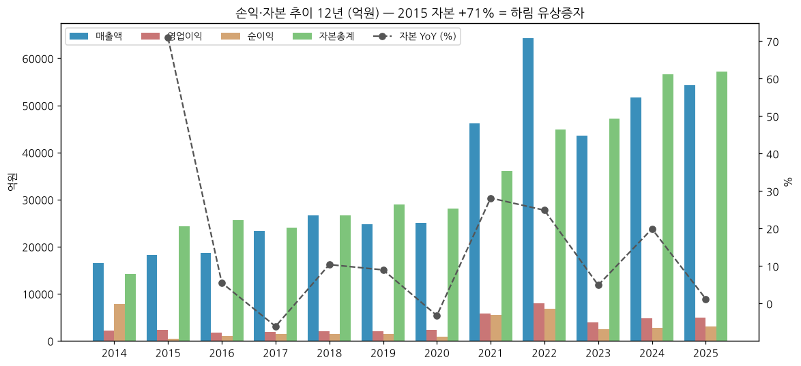

### ③ 회사 주가 역사 ★ narrative 영역

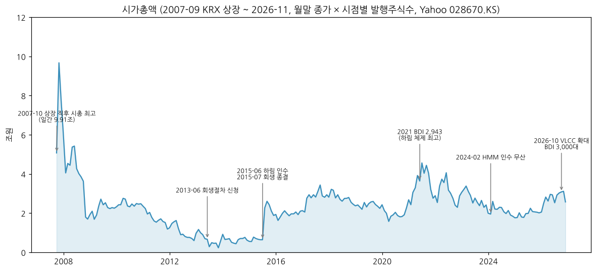

(시총 = Yahoo 월말 종가를 split 이벤트(2008-12 1:10, 2013-12 1:10, 2015-07 1:1.25 권리락 조정 [Yahoo events])로 역산한 실제 종가 × 시점별 발행주식수 [DART 자본금 변동사항: 2007\~08 2,058.6M주(액면 100원) → 2008-12 액면병합 후 205.9M주 → 2013-11\~12 감자·출자전환·10:1 병합 후 120.9M주 → 2014 출자전환 후 214.5M주 → 2015 하림 신주 후 524.4M주 → 2016\~ 534.4\~534.6M주]. 2014년 분기 중 출자전환 시점은 4·7·10월 1일 기준 반영. 2013-11-28 일반주주 2:1 병합은 Yahoo split에 미반영 — 2013-11\~12 구간(감자·출자전환 진행 중)은 차트에서 제외 ⚠️. Yahoo 데이터는 KRX 상장일(2007-09-21)부터 — SGX 시절(2005\~2007) 미포함)

(1) 2005\~2008: STX팬오션 — 벌크 슈퍼사이클
→ 2005-07 SGX 상장, 2007-09-21 KRX 상장 (공모가 1,720원, 액면 100원) [DART 자본금 변동사항]
→ **2007-10-26 종가 4,815원(당시 실제가) → 시총 9.91조 — 상장 후 최고** [Yahoo 수정 601,875원, 계산]. 2007말 6.16조
→ 2008 금융위기로 BDI 급락 → 2008말 1.94조 [계산]

(2) 2009\~2013: 고가 용선 부담 → 회생절차
→ 2009\~2010 시총 2.3조 내외 회복 후 2011 1.25조, 2012 0.97조 [계산]
→ **2013-06-07 회생절차 신청** (STX그룹 유동성 위기) [Wikipedia(Bloomberg 인용)]. 2013 연결 영업손실 -2,288억 [DART 사업보고서(2013.12) 부문표]
→ 2013-11-22 회생계획 인가 → 대주주(㈜STX·STX조선해양 등) 10:1·일반주주 2:1 감자, 회생채권 출자전환 1,116.9M주, 이후 10:1 병합 [DART 사업보고서(2013.12)]. 2013-06말 시총 0.29조 (회생 신청 직후), 2013-10말 0.23조 [계산]. 2013-11\~12 감자·출자전환 진행 구간은 주식수 변동이 커 차트에서 제외 ⚠️

(3) 2014\~2015: 회생 → 하림 인수
→ 2014 매출 1.65조·영업이익 2,160억(OPM 13.1%) — 고가 용선 계약 해지로 원가 정상화. 순이익 7,861억은 회생 관련 영업외이익 [DART]
→ **2015-06 하림그룹 편입 (인수가 1.08조원)**, 2015-07-30 회생절차 종결 [Heavy Lift PFI, DART]. 2015말 시총 1.94조 [계산]

(4) 2016\~2020: 박스권 (월말 시총 1.6\~3.4조)
→ 2016 BDI 673 사이클 저점 → 2017말 2.82조 [계산]
→ **2020-03-19 종가 2,085원 — 하림 체제 최저** (시총 1.11조) [Yahoo 일간, 계산]. 2020 사업연도 첫 배당 DPS 50원

(5) 2021\~2022: 벌크 정점
→ BDI 2021 연평균 2,943 [IR] → **2021-07-01 종가 8,770원 (시총 4.69조, 하림 체제 최고)** / 장중 8,920원 (2021-06-29) [Yahoo 일간]
→ 2022 영업이익 7,896억 사상 최대에도 BDI 하반기 급락으로 2022말 5,730원 (3.06조) [Yahoo, 계산]

(6) 2023\~2025: HMM 인수전·저PBR
→ 2023-12 하림·JKL파트너스 컨소시엄 HMM 지분 57.9% 인수 우선협상대상자 (6.4조원 제시) → **2024-02-07 협상 결렬** (매도자 경영 관여·영구채 전환 이견) [KED Global 2024-02-07]. 결렬 당일 팬오션 +21.1% (3,580 → 4,335원) [Yahoo 일간]
→ 2024말 3,300원 (시총 1.76조, 연말 PBR 0.31배 — 12년 최저) [Yahoo, 계산]
→ 2025 LNG선 12척 장기대선 완성 → 비벌크 OP > 벌크 OP. 2025말 3,850원

(7) 2026: BDI 반등 + VLCC 확대
→ 2026-02-11 SK해운 VLCC 10척·장기원유수송계약 인수 계약 (3.73억 달러) [DART 분기보고서(2026.09)]
→ BDI 분기평균 1,955 (1Q) → 2,751 (2Q) → 3,041 (3Q) [IR 3Q26]. 2026-03-03 +17.4% / 03-04 -16.9% (원인 미확인 ⚠️)
→ **2026-10-14 종가 7,240원 (시총 3.87조) — 2026년 고점** [Yahoo 일간, 계산] — 10월 호르무즈 통항 선박 피격 등 탱커 시황 급등기 [IR 3Q26 p15]
→ 3Q26 실적(2026-11-02 IR) 이후 하락 — 2026-11-06 -10.0% (5,390 → 4,850원), **2026-11-24 4,800원 (시총 2.57조, 고점 대비 -33.7%)** [Yahoo 일간] — 하락 원인 미확인 ⚠️

### ④ 회사의 주요 연혁

```
1966-05   범양전용선주식회사 설립 (해상화물운송)                                  [DART]
1973      한국-일본 컨테이너 항로 개시                                            [DART II]
2004~05   STX그룹 편입, STX팬오션으로 상호 변경                                  [일반 공개정보 — 미검증 ⚠️]
2005-07   싱가포르증권거래소(SGX) 상장                                           [DART]
2005말    한국가스공사(KOGAS) LNG 수송사업자 선정 → 2009 LNG 수송 개시           [DART]
2007-09   한국거래소 유가증권시장 상장 (2007-09-21)                              [DART]
2010-10   Suzano 우드펄프 25년 장기운송계약 / 2017 추가 15년+                    [DART]
2013-06   회생절차 신청 (06-07) → 2013-11-22 회생계획 인가, 감자·출자전환        [Wikipedia·DART]
2014      상호에서 STX 삭제 → 팬오션                                             [Wikipedia]
2015-06   하림그룹 편입 (인수가 1.08조원) / 2015-07-30 회생절차 종결             [DART·Heavy Lift PFI]
2016      곡물사업 개시 (해외 매입 → 국내 판매)                                  [DART 사업보고서(2019.12)]
2016-03   Vale 철광석 장기운송계약 (2017-11, 2019-01 추가)                        [DART]
2016-10   본사 종로 Tower8 이전                                                  [DART]
2020-09   미국 곡물터미널 EGT, LLC 지분 36.25% 인수 (Pan Ocean America)         [DART]
2020-12   Shell 2척·GALP 1척 LNG선 장기대선 → 2021 Shell LNG 벙커링 2척·LNG 2척   [DART]
2022-03   SGX 자진 상장폐지 (03-21), 싱가포르 곡물사업(POTL) 출범                [DART]
2022-06~09 Korea Green LNG LNG선 5척 장기대선 (IR 3Q26엔 계약상대방 QATAR ENERGY 5척 — 동일 계약 여부 미검증 ⚠️) [DART·IR]
2023-12   HMM 인수 우선협상대상자 (하림·JKL) → 2024-02-07 협상 결렬              [KED Global]
2026-02   SK해운 VLCC 10척 + SK에너지 등 장기원유수송계약 인수 (3.73억 달러)     [DART]
2026-09   운영선대 273척 / 26,833천 DWT, 도입 예정 20척 (탱커 14·벌크 6)          [IR 3Q26]
```

---

## 3. 비즈니스 모델

### ① 실적 추이 (연결 → DART 보고부문 → 비벌크 세부 3단계 위계)

**부문 정의 변경 이력 (구 부문 → 이 문서의 표준 부문 매핑):**

| 기간 | DART 보고부문 (사업의 내용 "사업부문별 요약 재무현황") | 표준 부문 매핑 |
|---|---|---|
| 2013 | 벌크 · 비벌크 · 금융업 · 기타 · 미배분 | 금융업(흥국상호저축은행, 2014 연결 제외)·기타·미배분 → **기타** |
| 2014\~2017 (분기 포함) | 벌크 · 비벌크 · 기타(/미배분) (2014 중단사업제거 포함) | 곡물사업(2016 개시)은 **기타에 포함** |
| 2018 분기 | 벌크 · 비벌크 · 기타/미배분 | 곡물은 기타에 포함. **2018 연간(사업보고서)부터 곡물사업 분리** → 4Q18 역산 시 곡물 +3,158억·기타 -2,466억 왜곡 (4Q18은 곡물+기타 합산으로 해석) |
| 2019\~2025 | 벌크 · 비벌크 · 곡물사업 · 기타/미배분 | 그대로. 비벌크 세부(컨테이너·탱커·LNG)는 매출은 "주요 제품 등의 현황", 영업이익은 사업보고서 "영업부문별 성과"(연간)로 보강 |
| 1Q26\~ | 벌크 · 탱커 · 컨테이너 · LNG · 곡물사업 · 기타/미배분 | 비벌크 = 탱커+컨테이너+LNG 합산으로 연속성 유지 |

(DART 각 분기·반기·사업보고서 II. 사업의 내용 "사업부문별 요약 재무현황" — 누적 금액이므로 2Q = 반기 − 1Q, 3Q = 3분기 누적 − 반기, 4Q = 연간 − 3분기 누적 [계산]. 부문 매출은 내부거래 제거 전. **51개 분기(1Q14\~3Q26) 전 분기에서 부문 합계(내부거래 제거 포함) = 연결 매출·영업이익 일치 확인** (1Q16\~3Q26은 dart_quarterly_summary와 대조). IR의 부문 실적은 "연결조정금액 벌크선 전액 반영" 기준이라 벌크 수치가 DART보다 작음 [IR 3Q26 p6])

**연간 5년 통합 표 (DART, 억원):**

| 항목 | 2021 | 2022 | 2023 | 2024 | 2025 | 9M26 |
|---|---|---|---|---|---|---|
| **연결 매출** | **46,161** | **64,203** | **43,610** | **51,612** | **54,329** | **55,199** |
| └ 벌크 | 35,692 | 48,238 | 31,143 | 33,301 | 31,996 | 27,829 |
| └ 비벌크 | 5,871 | 9,870 | 7,914 | 8,513 | 10,579 | 10,374 |
| &nbsp;&nbsp;&nbsp;&nbsp;└ 컨테이너 | 3,533 | 5,094 | 3,658 | 4,001 | 4,418 | 3,585 |
| &nbsp;&nbsp;&nbsp;&nbsp;└ 탱커 (VLCC·MR·케미컬) | 1,402 | 3,059 | 3,427 | 3,478 | 2,979 | 3,653 |
| &nbsp;&nbsp;&nbsp;&nbsp;└ LNG | 936 | 1,718 | 829 | 1,026 | 3,182 | 3,136 |
| └ 곡물사업 | 4,982 | 7,020 | 5,273 | 10,534 | 12,310 | 17,335 |
| └ 기타/미배분 | 2,349 | 2,670 | 2,598 | 1,462 | 577 | 341 |
| └ 내부거래 제거 | -2,733 | -3,596 | -3,318 | -2,197 | -1,133 | -680 |
| **연결 영업이익** | **5,729** | **7,896** | **3,859** | **4,712** | **4,919** | **5,320** |
| └ 벌크 | 5,154 | 5,424 | 2,435 | 2,738 | 2,167 | 2,397 |
| └ 비벌크 | 639 | 2,501 | 1,441 | 2,044 | 2,747 | 2,882 |
| &nbsp;&nbsp;&nbsp;&nbsp;└ 컨테이너 | 702 | 1,378 | 91 | 420 | 481 | 410 |
| &nbsp;&nbsp;&nbsp;&nbsp;└ 탱커 | -96 | 1,067 | 1,115 | 1,249 | 777 | 1,066 |
| &nbsp;&nbsp;&nbsp;&nbsp;└ LNG | 33 | 56 | 235 | 375 | 1,489 | 1,405 |
| └ 곡물사업 | -69 | -18 | 2 | -62 | -22 | 11 |
| └ 기타·조정 | 6 | -10 | -20 | -8 | 27 | 30 |
| **매출 YoY (%)** | +84.9 | +39.1 | -32.1 | +18.3 | +5.3 | +39.5 |
| **영업이익 YoY (%)** | +154.4 | +37.8 | -51.1 | +22.1 | +4.4 | +47.2 |
| **OPM 전사 (%)** | 12.4 | 12.3 | 8.8 | 9.1 | 9.1 | 9.6 |
| &nbsp;&nbsp;&nbsp;&nbsp;└ 벌크 OPM | 14.4 | 11.2 | 7.8 | 8.2 | 6.8 | 8.6 |
| &nbsp;&nbsp;&nbsp;&nbsp;└ 비벌크 OPM | 10.9 | 25.3 | 18.2 | 24.0 | 26.0 | 27.8 |
| &nbsp;&nbsp;&nbsp;&nbsp;└ LNG OPM | 3.5 | 3.3 | 28.3 | 36.5 | 46.8 | 44.8 |
| **EBITDA (IR)** | 7,997 | 10,633 | 6,690 | 7,783 | 8,756 | 8,517 |
| BDI 평균 (IR) | 2,943 | 1,934 | 1,378 | 1,755 | 1,681 | 2,606 (1\~10월) |

(벌크·비벌크·곡물·기타 = DART 사업부문별 요약 재무현황. 컨테이너·탱커·LNG 매출 = DART "주요 제품 등의 현황", 영업이익 = 사업보고서 "영업부문별 성과" 서술(2022 LNG 56억·2021 탱커 -96억·LNG 33억은 비벌크 합계 − 서술 수치 역산 = IR p19 차트 라벨과 일치) [계산]. 9M26 세부는 DART 3Q26 부문표 직접 공시)

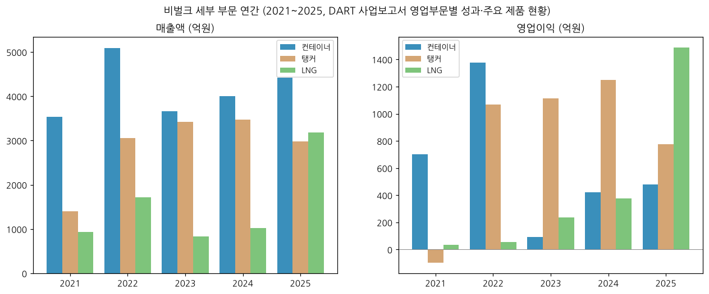

**지역별 매출 (선적항 기준, DART, 억원)**: 2025 아시아 35,231 (64.8%) · 남미 6,825 · 오세아니아 5,780 · 북미 4,942 · 아프리카 1,001 · 유럽 550 / 9M26 아시아 36,959 (67%) · 남미 6,797 · 오세아니아 4,738 · 북미 4,478 [DART 분기보고서(2026.09) II-2 나]

**사업부별 분기 시계열 (억원, 1Q14\~3Q26 51개 분기, DART 부문 요약재무):**

> 60+분기 표준 대비 51분기 — 2013 이전 분기 부문표는 회생 전 STX팬오션 체제(금융업 포함)로 정의가 달라 미수록. 1Q14\~4Q15 연결 합계는 부문표 합계(OpenDART 재무 API 미제공 구간)

| 분기 | 연결 매출 | 연결 OP | OPM | 매출 YoY | 벌크 매출 | 벌크 OP | 벌크 OPM | 비벌크 매출 | 비벌크 OP | 곡물 매출 | 곡물 OP | 기타·조정 OP | BDI |
|---|---|---|---|---|---|---|---|---|---|---|---|---|---|
| 1Q14 | 4,138 | 498 | 12.0% | - | 3,301 | 407 | 12.3% | 652 | 67 | (기타 포함) | (기타 포함) | 24 | - |
| 2Q14 | 3,880 | 654 | 16.9% | - | 3,286 | 564 | 17.2% | 739 | 72 | (기타 포함) | (기타 포함) | 18 | - |
| 3Q14 | 3,874 | 424 | 10.9% | - | 3,360 | 371 | 11.0% | 706 | 46 | (기타 포함) | (기타 포함) | 7 | - |
| 4Q14 | 4,564 | 583 | 12.8% | - | 3,923 | 464 | 11.8% | 749 | 69 | (기타 포함) | (기타 포함) | 50 | - |
| 1Q15 | 3,997 | 614 | 15.4% | -3.4% | 3,387 | 475 | 14.0% | 822 | 118 | (기타 포함) | (기타 포함) | 21 | - |
| 2Q15 | 4,158 | 512 | 12.3% | +7.1% | 3,642 | 428 | 11.8% | 904 | 116 | (기타 포함) | (기타 포함) | -32 | - |
| 3Q15 | 4,917 | 611 | 12.4% | +26.9% | 4,235 | 426 | 10.1% | 962 | 178 | (기타 포함) | (기타 포함) | 6 | - |
| 4Q15 | 5,121 | 557 | 10.9% | +12.2% | 4,508 | 480 | 10.7% | 588 | 114 | (기타 포함) | (기타 포함) | -38 | - |
| 1Q16 | 4,525 | 398 | 8.8% | +13.2% | 3,780 | 234 | 6.2% | 984 | 146 | (기타 포함) | (기타 포함) | 18 | 358 |
| 2Q16 | 4,430 | 412 | 9.3% | +6.5% | 3,021 | 279 | 9.2% | 892 | 125 | (기타 포함) | (기타 포함) | 8 | 612 |
| 3Q16 | 4,658 | 368 | 7.9% | -5.3% | 3,254 | 334 | 10.3% | 889 | 64 | (기타 포함) | (기타 포함) | -30 | 736 |
| 4Q16 | 5,126 | 501 | 9.8% | +0.1% | 3,801 | 387 | 10.2% | 781 | 58 | (기타 포함) | (기타 포함) | 57 | 994 |
| 1Q17 | 5,229 | 409 | 7.8% | +15.6% | 4,057 | 341 | 8.4% | 843 | 64 | (기타 포함) | (기타 포함) | 4 | 945 |
| 2Q17 | 6,325 | 488 | 7.7% | +42.8% | 4,387 | 410 | 9.3% | 883 | 79 | (기타 포함) | (기타 포함) | -1 | 1,006 |
| 3Q17 | 5,838 | 522 | 8.9% | +25.3% | 4,468 | 472 | 10.6% | 866 | 41 | (기타 포함) | (기타 포함) | 9 | 1,137 |
| 4Q17 | 5,970 | 531 | 8.9% | +16.5% | 4,514 | 594 | 13.2% | 895 | 47 | (기타 포함) | (기타 포함) | -110 | 1,509 |
| 1Q18 | 5,655 | 440 | 7.8% | +8.1% | 4,352 | 376 | 8.6% | 866 | 57 | (기타 포함) | (기타 포함) | 6 | 1,175 |
| 2Q18 | 6,788 | 501 | 7.4% | +7.3% | 5,123 | 453 | 8.8% | 942 | 53 | (기타 포함) | (기타 포함) | -5 | 1,260 |
| 3Q18 | 7,715 | 575 | 7.5% | +32.1% | 5,564 | 570 | 10.2% | 976 | 6 | (기타 포함) | (기타 포함) | -1 | 1,607 |
| 4Q18 | 6,525 | 524 | 8.0% | +9.3% | 5,254 | 517 | 9.8% | 1,053 | 10 | (기타 포함) | (기타 포함) | -3 | 1,363 |
| 1Q19 | 5,348 | 450 | 8.4% | -5.4% | 4,154 | 407 | 9.8% | 958 | 47 | 337 | -7 | 2 | 798 |
| 2Q19 | 6,323 | 505 | 8.0% | -6.9% | 4,295 | 462 | 10.8% | 999 | 49 | 1,207 | -8 | 2 | 995 |
| 3Q19 | 6,822 | 634 | 9.3% | -11.6% | 5,071 | 583 | 11.5% | 838 | 50 | 961 | -1 | 2 | 2,030 |
| 4Q19 | 6,187 | 511 | 8.3% | -5.2% | 4,838 | 472 | 9.8% | 976 | 36 | 450 | -13 | 16 | 1,562 |
| 1Q20 | 5,588 | 378 | 6.8% | +4.5% | 4,325 | 309 | 7.2% | 983 | 65 | 324 | -5 | 9 | 592 |
| 2Q20 | 6,834 | 643 | 9.4% | +8.1% | 4,141 | 443 | 10.7% | 1,122 | 186 | 1,694 | 4 | 10 | 783 |
| 3Q20 | 6,344 | 629 | 9.9% | -7.0% | 4,382 | 571 | 13.0% | 938 | 53 | 1,240 | 4 | 2 | 1,522 |
| 4Q20 | 6,205 | 602 | 9.7% | +0.3% | 4,733 | 537 | 11.3% | 997 | 72 | 509 | 7 | -13 | 1,361 |
| 1Q21 | 6,799 | 489 | 7.2% | +21.7% | 4,918 | 358 | 7.3% | 1,138 | 136 | 797 | -13 | 8 | 1,739 |
| 2Q21 | 11,299 | 1,120 | 9.9% | +65.3% | 8,073 | 1,012 | 12.5% | 1,341 | 138 | 2,032 | -37 | 8 | 2,793 |
| 3Q21 | 13,282 | 1,913 | 14.4% | +109.4% | 10,622 | 1,782 | 16.8% | 1,542 | 134 | 1,212 | -14 | 11 | 3,732 |
| 4Q21 | 14,780 | 2,207 | 14.9% | +138.2% | 12,079 | 2,002 | 16.6% | 1,851 | 231 | 942 | -6 | -21 | 3,498 |
| 1Q22 | 14,409 | 1,691 | 11.7% | +111.9% | 10,552 | 1,242 | 11.8% | 2,762 | 426 | 1,263 | 26 | -3 | 2,041 |
| 2Q22 | 17,222 | 2,388 | 13.9% | +52.4% | 12,984 | 1,787 | 13.8% | 2,366 | 616 | 2,109 | -26 | 12 | 2,530 |
| 3Q22 | 18,365 | 2,244 | 12.2% | +38.3% | 14,325 | 1,467 | 10.2% | 2,395 | 767 | 1,997 | -6 | 16 | 1,655 |
| 4Q22 | 14,207 | 1,572 | 11.1% | -3.9% | 10,377 | 927 | 8.9% | 2,348 | 692 | 1,651 | -12 | -34 | 1,523 |
| 1Q23 | 9,964 | 1,126 | 11.3% | -30.8% | 7,611 | 661 | 8.7% | 2,022 | 486 | 490 | -12 | -8 | 1,011 |
| 2Q23 | 12,247 | 1,250 | 10.2% | -28.9% | 8,570 | 773 | 9.0% | 2,015 | 442 | 1,818 | 31 | 5 | 1,313 |
| 3Q23 | 11,116 | 795 | 7.1% | -39.5% | 7,654 | 554 | 7.2% | 1,900 | 246 | 1,743 | -7 | 2 | 1,194 |
| 4Q23 | 10,282 | 687 | 6.7% | -27.6% | 7,308 | 448 | 6.1% | 1,977 | 267 | 1,222 | -9 | -19 | 2,033 |
| 1Q24 | 9,755 | 982 | 10.1% | -2.1% | 6,862 | 539 | 7.9% | 1,978 | 451 | 996 | -8 | -1 | 1,824 |
| 2Q24 | 12,334 | 1,352 | 11.0% | +0.7% | 8,704 | 858 | 9.9% | 2,052 | 520 | 1,809 | -31 | 4 | 1,848 |
| 3Q24 | 12,768 | 1,281 | 10.0% | +14.9% | 8,267 | 729 | 8.8% | 2,145 | 549 | 2,527 | 0 | 3 | 1,871 |
| 4Q24 | 16,755 | 1,098 | 6.6% | +63.0% | 9,467 | 612 | 6.5% | 2,337 | 523 | 5,201 | -24 | -14 | 1,465 |
| 1Q25 | 13,934 | 1,133 | 8.1% | +42.8% | 7,948 | 479 | 6.0% | 2,588 | 672 | 3,601 | -28 | 10 | 1,118 |
| 2Q25 | 12,936 | 1,230 | 9.5% | +4.9% | 8,025 | 529 | 6.6% | 2,558 | 689 | 2,516 | -1 | 13 | 1,467 |
| 3Q25 | 12,695 | 1,252 | 9.9% | -0.6% | 7,784 | 551 | 7.1% | 2,663 | 684 | 2,323 | 4 | 13 | 1,978 |
| 4Q25 | 14,763 | 1,304 | 8.8% | -11.9% | 8,238 | 608 | 7.4% | 2,770 | 703 | 3,870 | 2 | -9 | 2,159 |
| 1Q26 | 15,089 | 1,409 | 9.3% | +8.3% | 7,801 | 547 | 7.0% | 2,892 | 843 | 4,492 | 13 | 7 | 1,955 |
| 2Q26 | 19,137 | 1,937 | 10.1% | +47.9% | 9,816 | 846 | 8.6% | 3,344 | 1,079 | 6,060 | 2 | 11 | 2,751 |
| 3Q26 | 20,973 | 1,974 | 9.4% | +65.2% | 10,212 | 1,005 | 9.8% | 4,138 | 960 | 6,783 | -3 | 12 | 3,041 |

(4Q14·4Q15 등 4Q = 연간 − 3Q 누적. 2014 1Q 부문 연결합계 413,754백만원 → 2015 1Q 보고서에서 흥국상호저축은행 연결 제외로 412,543백만원 재작성 — 이 표는 최초 공시치. 1Q16 보고서 부문표의 내부거래 제거액 (88,016)·(456)은 3Q15 누적과 동일 수치 — DART 원문 표기 그대로 사용 ⚠️. BDI = IR 실적발표 분기평균, 2014\~2015 IR 미수집)

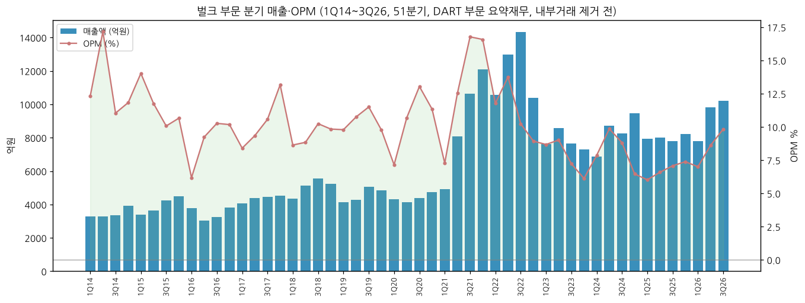
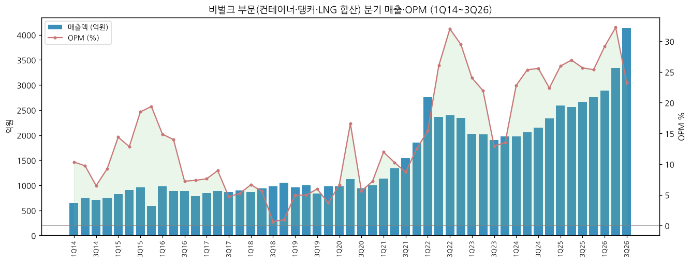
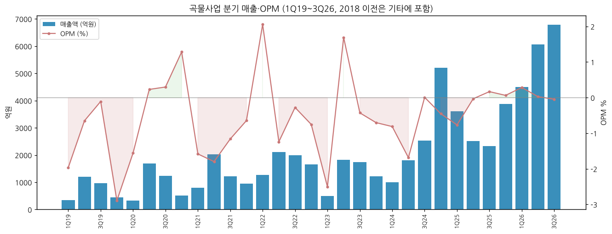

**3Q26 핵심 박스 (2026-11-02 IR 실적발표, 분기보고서 2026-11-11 [DART]):**

| 항목 | 3Q26 | YoY | 9M26 | YoY |
|---|---|---|---|---|
| 연결 매출 | 20,973억 (USD 1,466M) | +65.2% | 55,199억 | +39.5% |
| 연결 영업이익 | 1,974억 (USD 138M) | +57.7% | 5,320억 | +47.2% |
| 연결 OPM | 9.4% | -0.5%p | 9.6% | +0.5%p |
| 연결 순이익 | 1,845억 | +218.7% | 4,164억 | +64.8% |
| EBITDA (IR) | 3,062억 | +39.9% | 8,517억 | +32.2% |
| 벌크 매출 / OP (DART) | 10,212억 / 1,005억 | +31.2% / +82.3% | - | - |
| 탱커 / 컨테이너 / LNG OP | 348 / 175 / 436억 | - | 1,066 / 410 / 1,405억 | - |
| 곡물 매출 / OP | 6,783억 / -3억 | +191.9% | 17,335억 | - |
| BDI 분기평균 | 3,041 | +53.7% | - | - |
| 물동량 | 2,571만톤 | -2.8% | - | - |

(DART 분기보고서(2026.09), IR 3Q26 p5·p17·p18. EBITDA 3Q25 2,189억·9M25 6,444억 [IR] 대비 [계산])

→ 회사 설명: "곡물 판매량 증대 및 벌크선 시황 강세, VLCC 중고선 본격 인도로 매출액 전년 동기 대비 165% 수준" / "해운사업 전 부문 수익성 개선으로 영업이익 전년 동기 대비 158% 수준" [IR 3Q26 p5]
→ 시황: 3Q 태평양 주도 전 선형 운임 상승 (태풍 배선 차질·석탄 수요), 대서양 기니 보크사이트 장거리 물동량. 2026 선복 순증 +3.8% 예상 (2025 +2.9%) — 4Q26\~1Q27 계절적 비수기로 "상승폭 크지 않을 것" [IR 3Q26 p14]
→ 탱커: 10월 호르무즈 통항 선박 다수 피격, 10\~11월 중동 수출 위축 우려. VLCC 신조 공급 2027년부터 본격화 (68척) [IR 3Q26 p15]
→ 곡물: 3Q26 6,783억 — 분기 최대 매출 (남미산 옥수수·중국향 대두, 한국·베트남 판매 확대) [IR 3Q26 p21]

**12분기 시계열 (연결, 매출 + OPM):**

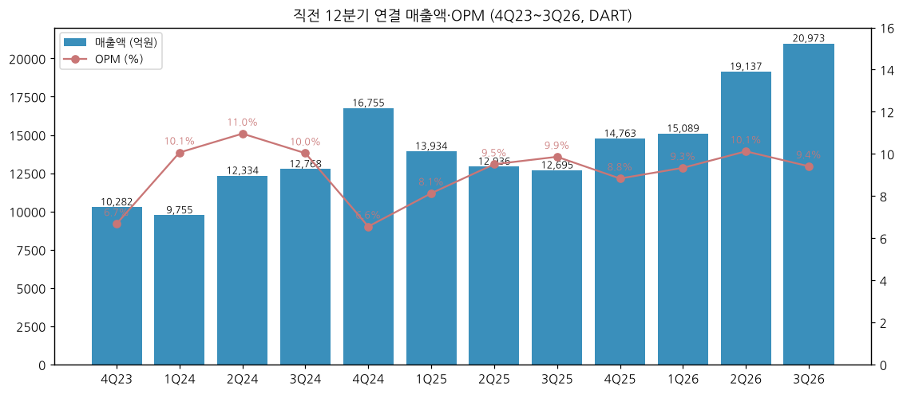

**BDI vs 실적 (chart13):**

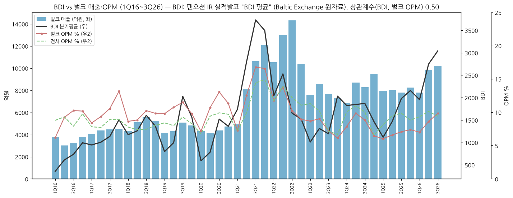

(BDI 출처: 팬오션 IR 실적발표 각 4Q 자료 "요약 손익계산서" 표의 "BDI 평균" (2016\~2026 분기), 원자료 Baltic Exchange. 1Q16\~3Q26 43개 분기 BDI와 벌크 OPM 상관계수 0.50, 전사 OPM과 0.61 [계산]. 2022\~2023은 BDI 하락 대비 벌크 OPM 하락이 완만 — 장기 CVC 비중 확대 효과로 해석 가능)

### ② 사업부별 개요 (매출 비중 큰 순서)

| 부문 | 2025 매출 (억원) | 부문 합계 비중 | 2025 OP (억원) | OP 비중 | 사업 모델 |
|---|---|---|---|---|---|
| 벌크 | 31,996 | 57.7% | 2,167 | 44% | 부정기선(Handy\~Ultramax)·대형선(Panamax·Capesize)·전용선(CVC). 사선+용선 220척. 철광석·석탄·곡물·우드펄프 |
| 곡물사업 | 12,310 | 22.2% | -22 | -0% | 해외(남미·미국) 곡물 매입 → 한국·중국·동남아 판매. 2025 약 343만톤. 미국 EGT 곡물터미널 지분 36.25% |
| 컨테이너 | 4,418 | 8.0% | 481 | 10% | 한-중·한-일·동남아 근해 정기선 10척 |
| LNG | 3,182 | 5.7% | 1,489 | 30% | 174K CBM LNGC·LNG 벙커링선 12척 사선 전량 장기대선 (Qatar Energy·Shell·GALP) |
| 탱커 | 2,979 | 5.4% | 777 | 16% | VLCC (2026 SK해운 인수로 확대)·MR·케미컬. SK에너지·S-OIL CVC, Trafigura 대선 |
| 기타 | 577 | 1.0% | - | - | 선박관리(포스에스엠)·임대 |

(DART 사업보고서(2025.12) II-2·영업부문별 성과. 비중 = 내부거래 제거 전 부문 합계 대비. 9M26 기준으로는 벌크 49.8% · 곡물 31.0% · 탱커 6.5% · 컨테이너 6.4% · LNG 5.6% · 기타 0.6% (매출, 내부거래 제거 전 합계 5.59조 대비 [계산]))

### ③ 사업부별 디테일

(1) 벌크 — 사선·용선 혼합 operator + 장기 CVC
→ 드라이벌크 220척: 사선 82척 (장기계약 투입 40척) + 1년 이상 용선 138척. Cape(100K+) 50척, Panamax 42척, Handymax 84척, Handy 44척 [IR 3Q26 p12]
→ 진행 중 벌크 CVC 40척 (IR의 CVC 48척 = 벌크 40 + 탱커 8): Vale 16척 (잔여 13.0년, 400K VLOC 8척 포함), Suzano 10척 (9.8년), 발전자회사 8척 (5.0년), POSCO 3척 (5.3년), 현대제철 3척 (5.8년) [IR 3Q26 p9]
→ 개시 예정: Vale 3척·POSCO 1척 (2026-10\~2032) [IR 3Q26 p9]
→ 운항가능일수 (생산능력): 벌크 80,397일 (2025) / 83,335일 (2024) / 84,451일 (2023) [DART 사업보고서(2025.12) II-3]
→ 운임: 해운업 운임 3Q26 USD 28.40/RT, 전년 동기 대비 약 +25% [DART 분기보고서(2026.09) II-1]

(2) LNG — 2023\~2025 신조 인도로 "계약형 이익" 구축
→ 사선 12척 (+용선 1척): Qatar Energy 5척 (174K, Firm 12\~15년), Shell 4척 (Firm 7년)·LNG 벙커링선 2척, GALP 1척 [IR 3Q26 p9]
→ 매출 829억 (2023) → 1,026억 (2024) → 3,182억 (2025), OP 235억 → 375억 → 1,489억 [DART 영업부문별 성과]
→ 2005 KOGAS LNG 수송사업자 선정, 2009 수송 개시 [DART]

(3) 탱커 — VLCC 확대
→ 2026-02 SK해운 VLCC 10척 + 장기원유수송계약 인수 (3.73억 달러, 영업권 4,704만 달러 → 탱커 부문 배분) [DART 분기보고서(2026.09) 사업결합 주석]. 2026-09말 VLCC 9척 운영 + 중고 3척 중 2척 10월 인도 [IR 3Q26 p8·p12]
→ 신조: VLCC 300K 2척 (2027), 319K 3척 (2029), 320K 4척 (2029\~2030, SK에너지·SK인천석유화학 CVC 20년), MR 2척 (2027) [IR 3Q26 p8]
→ MR 12척·케미컬 5척 사선. 2023\~2024 탱커 OP 1,115억·1,249억 (사업 개시 후 최대 경신) → 2025 777억 (제품유 시황 하락) [DART]

(4) 곡물사업 — 하림그룹 시너지, 매출 확대·이익 미미
→ 2015-06 하림 편입 후 전담조직 설립, 식용·사료용 곡물을 한국·중국에 판매 [DART 사업보고서(2025.12)]
→ 매출 3,023억 (2017) → 5,273억 (2023) → 1.05조 (2024) → 1.23조 (2025) → 9M26 1.73조. 영업이익 2020 9억 (사업 개시 5년 만 흑자) 외 대부분 ±수십억 [DART]
→ 2022-03 싱가폴 곡물사업(Pan Ocean Trading & Logistics) 출범, 2020-09 미국 곡물터미널 EGT 36.25% [DART]

(5) 컨테이너 — 근해 정기선
→ 1973 한-일 항로 개시, 현재 한-중·한-일·동남아 집중 [DART]. 사선 8척 + 용선 2척 [IR 3Q26]
→ 2022 OP 1,378억 (공급망 차질 고운임) → 2023 91억 → 2025 481억 (수에즈 통항 불능 영향) [DART]

### ④ 주요 경쟁사 (사업부별)

| 부문 | 국내 | 글로벌 | 비고 |
|---|---|---|---|
| 드라이벌크 | 대한해운 (SM그룹), 에이치라인해운, 폴라리스쉬핑 (전용선) | Star Bulk, Genco, Pacific Basin, COSCO Shipping Bulk, Oldendorff (비상장), Golden Ocean (2025 CMB.Tech 합병 — 미검증 ⚠️) | 완전경쟁 — 점유율 공시 없음 [DART II-7] |
| 탱커 (VLCC) | SK해운, 현대글로비스·HMM (VLCC) | Frontline, DHT, CMB.Tech(구 Euronav — 미검증 ⚠️) | 2026 SK해운 VLCC 10척 인수로 국내 VLCC 운영 확대 |
| LNG | SK해운, 현대LNG해운, 에이치라인해운, 대한해운 | Nakilat, MOL, NYK, Knutsen | KOGAS 국적선사 구도 |
| 근해 컨테이너 | 고려해운, 장금상선, 흥아라인, SITC 등 | - | Intra-Asia |
| 곡물 | 국내 사료·제분 수입상 | Cargill, ADM, Bunge, COFCO | 팬오션은 하림 계열 수요 기반 |

(경쟁사 목록은 일반 공개정보 기준 — DART는 경쟁사 명칭 미공시. 국내 피어 HMM은 `HMM_기업개요.md` 참조)

### ⑤ 주요 매출처

> DART 공시 주요 매출처: **Vale, ㈜포스코, 현대글로비스㈜, Suzano, 한국남동발전㈜** 등 (순서는 DART 원문 기재 순서, 매출 비중 미공시) [DART 분기보고서(2026.09) II-1]. 장기계약 상대: 발전 5사(남동·남부·동서·중부·서부), 현대제철, SK에너지·SK인천석유화학, S-OIL, Shell, Qatar Energy, GALP, Trafigura [DART·IR 3Q26 p9]

| 장기계약 (2026-09말) | 척수 | 잔여 기간 | 비고 |
|---|---|---|---|
| Vale (철광석) | 16 | 13.0년 | 400K 8·325K 6·208K 2척 |
| Suzano (우드펄프) | 10 | 9.8년 | 62K 5·57K 5척 |
| 발전자회사 (석탄) | 8 | 5.0년 | 175K 2·150K 4·83K 2척 |
| POSCO | 3 | 5.3년 |  |
| 현대제철 | 3 | 5.8년 |  |
| 에쓰오일 (VLCC) | 1 | 3.3년 |  |
| SK에너지·SK인천석유화학 (VLCC) | 7 | 2.3년 | +3척 2026-05\~2030 (2척 인도), +4척 신조 2029\~2049 |
| Qatar Energy (LNGC) | 5 | 12.4년 | Firm 12\~15Y |
| Shell (LNGC·벙커링) | 6 | 1.7\~5.0년 |  |
| GALP (LNGC) | 1 | 1.3년 |  |
| Trafigura (VLCC 대선) | 1 (개시 예정) | 2026-12\~2029-12 |  |

(IR 3Q26 p9 "진행 중 장기 계약 현황" 60척 + 개시 예정 12척, 2026-10-22까지 공시 반영)

### ⑥ 생산 CAPA (선대) + 임직원

| 선형 (2026-09말) | 사선 (장기계약) | 용선 1년+ (장기) | 합계 |
|---|---|---|---|
| Handy (10\~40K) | 7 | 37 (9) | 44 |
| Handymax (40\~70K) | 25 (10) | 59 (8) | 84 |
| Panamax (70\~100K) | 12 (2) | 30 (1) | 42 |
| Cape (100K\~) | 38 (28) | 12 | 50 |
| **Dry Bulk 소계** | **82 (40)** | **138 (18)** | **220** |
| VLCC | 9 (8) | 0 | 9 |
| MR Tanker | 12 | 1 (1) | 13 |
| Chemical Tanker | 5 | 1 (1) | 6 |
| Container | 8 | 2 (1) | 10 |
| Heavy Lift | 0 | 2 | 2 |
| LNG | 12 (12) | 1 (1) | 13 |
| **Non-dry Bulk 소계** | **46 (20)** | **7 (4)** | **53** |
| **합계** | **128 (60)** | **145 (22)** | **273** |

(IR 3Q26 p12. 총 26,833천 DWT — 벌크선 85.8% (Cape 43.8%·Handymax 16.6%·Panamax 15.0%·Handy 10.4%), 탱커 9.2%, LNG 4.2%, 컨테이너 0.6%. 사선 평균 선령 9.9년. 연말 사선 척수 109 (2021) → 110 (2022) → 110 (2023) → 114 (2024) → 116 (2025) → 128 (3Q26) [IR 3Q26 p12 차트 라벨 — 용선 연도별 척수는 텍스트 추출 순서 불확실로 미기재 ⚠️])

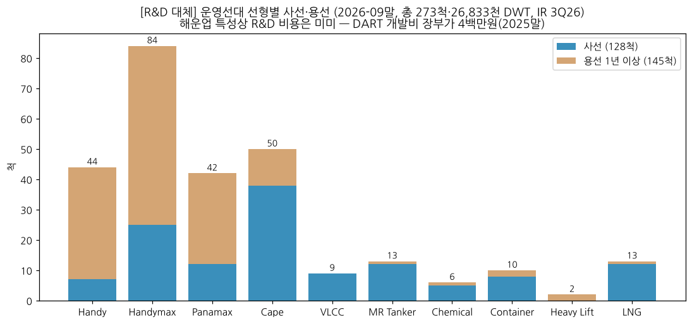

- **도입 예정 20척** (2026-09말): 벌크 6척 (Ultramax 64K 2척 2027\~28, Newcastlemax 210K 4척 2029\~30), 탱커 14척 (MR 2, VLCC 신조 9, VLCC 중고 3 — 2척 2026-10 인도) [IR 3Q26 p8]
- **선박투자 (2025말)**: 총투자 7.85억 달러, 기투자 2.86억, 향후 4.99억 달러 (벌크·탱커, 4년) [DART 사업보고서(2025.12) II-3 마]
- **임직원 (2025말, 별도)**: 1,326명 — 육상 406명 (남 298·여 108, 평균 근속 15.1·13.3년) + 해상 920명 (남 891·여 29, 평균 근속 7.2·2.7년). 1인 평균 급여: 육상 남 1.09억·여 0.87억, 해상 남 1.18억 [OpenDART empSttus 2025]

---

## 4. 재무 구조

> **재무제표 수치: OpenDART fnlttSinglAcntAll (연결 CFS), 2026-11-25 조회.** 2014 = 2015 사업보고서 전기 컬럼. 4Q = 연간 − 3Q 누적 [dart_quarterly_summary]. 원화 표시 (기능통화 USD) — BS는 기말환율 환산이라 연도 간 비교 시 환율 효과 포함. 단위 억원

### ① 손익계산서 (12년 연결, 억원)

| 연도 | 매출액 | 매출원가 | 매출총이익 | GPM | 판관비 | 판관비율 | 영업이익 | OPM | 세전이익 | 순이익 | NPM | EPS(원) | EBITDA | EBITDA 마진 |
|---|---|---|---|---|---|---|---|---|---|---|---|---|---|---|
| 2014 | 16,456 | 13,813 | 2,643 | 16.1% | 483 | 2.9% | 2,160 | 13.1% | 7,901 | 7,861 | 47.8% | - | 3,734 | 22.7% |
| 2015 | 18,193 | 15,317 | 2,876 | 15.8% | 582 | 3.2% | 2,294 | 12.6% | 478 | 455 | 2.5% | - | 3,921 | 21.6% |
| 2016 | 18,740 | 16,504 | 2,236 | 11.9% | 557 | 3.0% | 1,679 | 9.0% | 991 | 971 | 5.2% | - | 3,369 | 18.0% |
| 2017 | 23,362 | 20,721 | 2,642 | 11.3% | 691 | 3.0% | 1,950 | 8.3% | 1,432 | 1,413 | 6.0% | 268 | 3,630 | 15.5% |
| 2018 | 26,684 | 23,903 | 2,781 | 10.4% | 741 | 2.8% | 2,039 | 7.6% | 1,490 | 1,486 | 5.6% | 285 | 3,725 | 14.0% |
| 2019 | 24,679 | 21,801 | 2,878 | 11.7% | 778 | 3.2% | 2,100 | 8.5% | 1,483 | 1,477 | 6.0% | 284 | 3,942 | 16.0% |
| 2020 | 24,972 | 21,932 | 3,039 | 12.2% | 787 | 3.2% | 2,252 | 9.0% | 920 | 907 | 3.6% | 173 | 4,344 | 17.4% |
| 2021 | 46,161 | 39,504 | 6,657 | 14.4% | 928 | 2.0% | 5,729 | 12.4% | 5,504 | 5,493 | 11.9% | 1,028 | 7,997 | 17.3% |
| 2022 | 64,203 | 55,204 | 8,999 | 14.0% | 1,103 | 1.7% | 7,896 | 12.3% | 6,880 | 6,771 | 10.5% | 1,267 | 10,633 | 16.6% |
| 2023 | 43,610 | 38,612 | 4,998 | 11.5% | 1,140 | 2.6% | 3,859 | 8.8% | 2,485 | 2,450 | 5.6% | 458 | 6,690 | 15.3% |
| 2024 | 51,612 | 45,785 | 5,827 | 11.3% | 1,116 | 2.2% | 4,712 | 9.1% | 2,821 | 2,681 | 5.2% | 502 | 7,783 | 15.1% |
| 2025 | 54,329 | 48,196 | 6,133 | 11.3% | 1,213 | 2.2% | 4,919 | 9.1% | 3,182 | 3,014 | 5.5% | 564 | 8,756 | 16.1% |

(EPS = DART 기본주당이익, 2014\~2016은 OpenDART 미제공. 2014 세전 7,901억 = 회생 관련 영업외이익. 판관비율이 2% 내외로 매우 낮은 대신 매출원가(용선료·연료비·항비·선박 감가상각)가 85\~90%: **원가는 시황과 함께 움직이는 용선료가 큰 비중**. 2024\~2025 금융원가 2,523억·2,591억 (2021 600억) — 신조 선박금융 차입 확대 [DART])

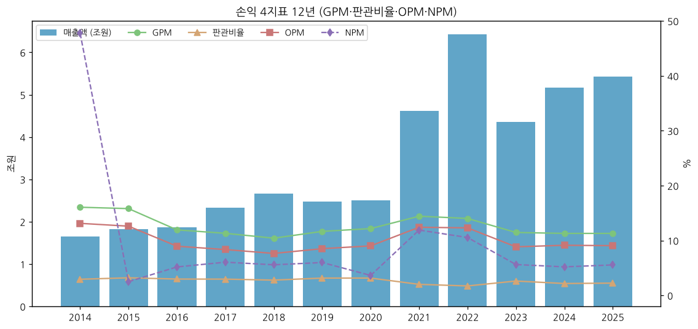

### ② 재무상태표 (12년 연결, 억원)

| 연도 | 자산총계 | 유동자산 | 유형자산(선박 등) | 부채총계 | 유동부채 | 자본총계 | 지배지분 | 부채비율 | 유동비율 | 현금성자산 | 차입금 등 | 리스부채 |
|---|---|---|---|---|---|---|---|---|---|---|---|---|
| 2014 | 45,579 | 9,717 | 35,212 | 31,353 | 7,894 | 14,226 | 14,213 | 220.4% | 123.1% | 4,007 | 17,668 | - |
| 2015 | 43,143 | 6,262 | 36,404 | 18,828 | 4,990 | 24,314 | 24,062 | 77.4% | 125.5% | 2,782 | 15,199 | - |
| 2016 | 43,306 | 5,733 | 36,780 | 17,648 | 5,239 | 25,659 | 25,407 | 68.8% | 109.4% | 2,451 | 15,203 | - |
| 2017 | 38,944 | 6,132 | 32,236 | 14,846 | 5,454 | 24,098 | 23,890 | 61.6% | 112.4% | 2,076 | 12,221 | - |
| 2018 | 41,195 | 6,922 | 33,628 | 14,591 | 6,705 | 26,604 | 26,438 | 54.8% | 103.2% | 2,087 | 11,270 | - |
| 2019 | 44,542 | 6,795 | 37,370 | 15,546 | 7,091 | 28,995 | 28,864 | 53.6% | 95.8% | 2,553 | 12,216 | 395 |
| 2020 | 46,593 | 6,625 | 38,730 | 18,527 | 6,043 | 28,067 | 28,067 | 66.0% | 109.6% | 2,376 | 14,311 | 470 |
| 2021 | 64,888 | 13,587 | 49,633 | 28,919 | 11,494 | 35,968 | 35,968 | 80.4% | 118.2% | 5,216 | 19,426 | 2,996 |
| 2022 | 75,489 | 18,342 | 54,441 | 30,563 | 12,268 | 44,926 | 44,926 | 68.0% | 149.5% | 7,446 | 19,437 | 3,926 |
| 2023 | 78,539 | 17,573 | 58,406 | 31,406 | 12,940 | 47,134 | 47,134 | 66.6% | 135.8% | 9,528 | 21,987 | 2,381 |
| 2024 | 102,715 | 20,218 | 78,622 | 46,181 | 12,769 | 56,534 | 56,534 | 81.7% | 158.3% | 8,658 | 35,834 | 2,752 |
| 2025 | 108,537 | 18,541 | 86,527 | 51,302 | 13,662 | 57,235 | 57,235 | 89.6% | 135.7% | 8,397 | 42,193 | 2,670 |

(3Q26: 자산 116,317 / 부채 58,445 / 자본 57,872 / 차입금 등 46,542 / 리스부채 5,298 / 현금 7,318억, 부채비율 101% [DART 분기보고서(2026.09)]. USD 기준 자산 85.63억·부채 43.03억·차입금 34.26억 달러 [IR 3Q26 p18]. 차입금 등 = DART "차입금 등"(차입금+사채) 유동·비유동 합계. 2019부터 IFRS16 리스부채 별도 표시 — 2018 이전 금융리스는 차입금 등에 포함 가능 ⚠️. 비지배지분 0)

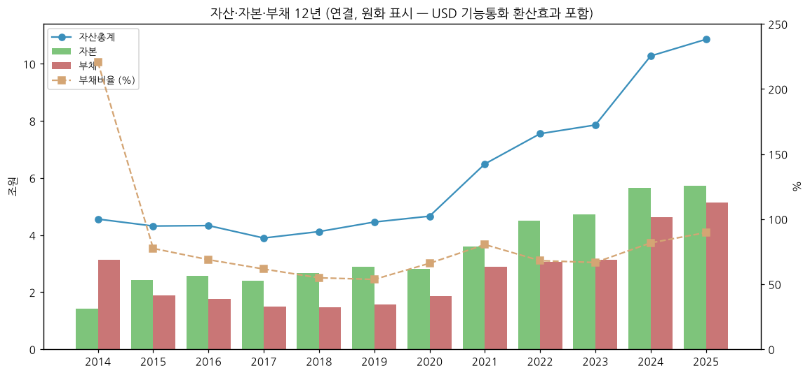

### ③ 현금흐름표 (12년 연결, 억원)

| 연도 | 영업CF | 투자CF | 재무CF | CapEx (유형+선박선급금+무형) | FCF | 배당지급 | 리스부채 상환 | 이자지급 |
|---|---|---|---|---|---|---|---|---|
| 2014 | 3,874 | 2,989 | -5,034 | 424 | 3,449 | 22 | 0 | 775 |
| 2015 | 3,053 | -392 | -4,171 | 557 | 2,496 | 0 | 0 | 649 |
| 2016 | 2,510 | -924 | -1,979 | 1,017 | 1,492 | 0 | 0 | 481 |
| 2017 | 2,616 | -1,172 | -1,550 | 1,080 | 1,536 | 0 | 0 | 513 |
| 2018 | 2,681 | -1,266 | -1,491 | 1,656 | 1,024 | 0 | 4 | 587 |
| 2019 | 4,048 | -2,130 | -1,520 | 2,174 | 1,874 | 0 | 177 | 654 |
| 2020 | 4,705 | -3,369 | -1,390 | 2,905 | 1,799 | 0 | 185 | 465 |
| 2021 | 7,677 | -3,512 | -1,580 | 3,341 | 4,336 | 267 | 1,336 | 460 |
| 2022 | 14,108 | -5,774 | -6,427 | 3,458 | 10,649 | 535 | 3,885 | 753 |
| 2023 | 7,508 | -844 | -4,701 | 4,605 | 2,903 | 802 | 2,377 | 1,446 |
| 2024 | 6,762 | -6,604 | -2,067 | 6,395 | 367 | 454 | 1,811 | 1,999 |
| 2025 | 7,027 | -2,632 | -4,505 | 4,927 | 2,100 | 641 | 1,371 | 2,528 |

(FCF = 영업CF − CapEx [계산]. CapEx = 유형자산의 취득 + 선박도입선급금의 지출 + 무형자산의 취득 (CF 계정명 기준). 리스(용선 사용권자산) 취득·SK해운 사업결합(2026) 대가는 미포함. 9M26: 영업CF 6,908 / 투자CF -7,918 / 재무CF 613억 [DART 분기보고서(2026.09)])

→ 12년 누적 FCF 3.40조, 누적 배당지급 2,721억 [계산] — 자사주 매입 이력 없음 (OpenDART 자기주식 현황 공란)
→ 2022 영업CF 1.41조 (사상 최대) → 2024 FCF 367억 (LNG·벌크 신조 대금 6,395억) — **정점 현금을 신조로 재투자하는 패턴**

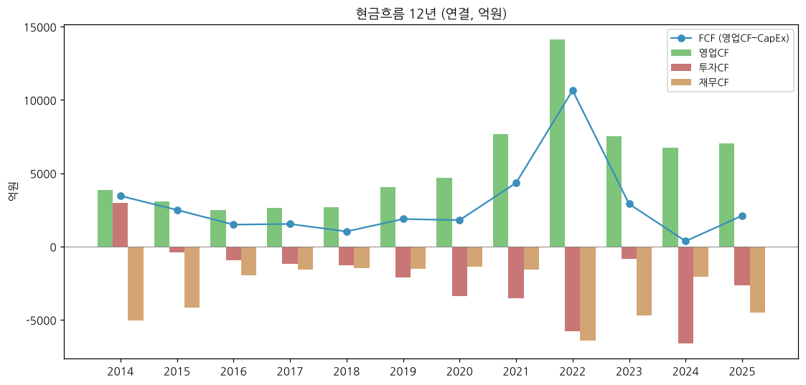

### ④ CapEx 추이 (12년, 억원)

| 연도 | 유형자산 취득 | 선박도입선급금 | 무형 | 총 CapEx | CapEx/매출 | EBITDA−영업이익 (≈상각비) | CapEx/상각비 |
|---|---|---|---|---|---|---|---|
| 2014 | 417 | 0 | 7 | 424 | 2.6% | 1,574 | 0.27x |
| 2015 | 547 | 0 | 10 | 557 | 3.1% | 1,627 | 0.34x |
| 2016 | 994 | 0 | 23 | 1,017 | 5.4% | 1,690 | 0.60x |
| 2017 | 1,065 | 0 | 15 | 1,080 | 4.6% | 1,680 | 0.64x |
| 2018 | 1,654 | 0 | 2 | 1,656 | 6.2% | 1,686 | 0.98x |
| 2019 | 2,170 | 0 | 4 | 2,174 | 8.8% | 1,842 | 1.18x |
| 2020 | 2,895 | 0 | 10 | 2,905 | 11.6% | 2,092 | 1.39x |
| 2021 | 3,336 | 0 | 4 | 3,341 | 7.2% | 2,268 | 1.47x |
| 2022 | 3,447 | 0 | 12 | 3,458 | 5.4% | 2,737 | 1.26x |
| 2023 | 3,134 | 1,439 | 32 | 4,605 | 10.6% | 2,831 | 1.63x |
| 2024 | 3,850 | 2,531 | 14 | 6,395 | 12.4% | 3,071 | 2.08x |
| 2025 | 2,216 | 2,705 | 6 | 4,927 | 9.1% | 3,837 | 1.28x |

- **CapEx/상각비 0.3\~2.1x**: 2014\~2018은 회생 후 투자 억제 (0.3\~1.0x), 2019\~2025 LNG선 12척·벌크·탱커 신조로 1.2\~2.1x (2024 2.08x 정점) [계산]. 상각비는 IR EBITDA − 영업이익으로 근사 (리스 사용권자산 상각 포함)
- 2026: SK해운 VLCC 10척 인수 3.73억 달러 (사업결합) + 신조 20척 — 9M26 유형자산 취득 3,133억·선급금 652억 [DART 분기보고서(2026.09)]. 3Q26 부문별 유형자산 취득(누적) 9,702억 (탱커 6,455억) [DART 부문정보]

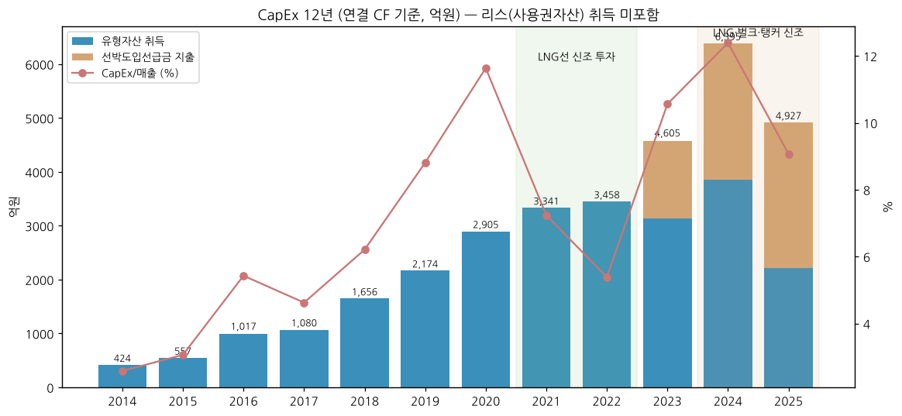

### ⑤ 부채구조 + 채무증권

| 연도 | 차입금 등 | YoY | 현금성자산 | 순차입금 | 순차입금/EBITDA | 이자지급 | EBITDA/이자지급 |
|---|---|---|---|---|---|---|---|
| 2014 | 17,668 | - | 4,007 | 13,661 | 3.66x | 775 | 4.8x |
| 2015 | 15,199 | -14.0% | 2,782 | 12,417 | 3.17x | 649 | 6.0x |
| 2016 | 15,203 | +0.0% | 2,451 | 12,752 | 3.79x | 481 | 7.0x |
| 2017 | 12,221 | -19.6% | 2,076 | 10,145 | 2.79x | 513 | 7.1x |
| 2018 | 11,270 | -7.8% | 2,087 | 9,183 | 2.47x | 587 | 6.3x |
| 2019 | 12,216 | +8.4% | 2,553 | 9,663 | 2.45x | 654 | 6.0x |
| 2020 | 14,311 | +17.2% | 2,376 | 11,936 | 2.75x | 465 | 9.3x |
| 2021 | 19,426 | +35.7% | 5,216 | 14,210 | 1.78x | 460 | 17.4x |
| 2022 | 19,437 | +0.1% | 7,446 | 11,990 | 1.13x | 753 | 14.1x |
| 2023 | 21,987 | +13.1% | 9,528 | 12,459 | 1.86x | 1,446 | 4.6x |
| 2024 | 35,834 | +63.0% | 8,658 | 27,175 | 3.49x | 1,999 | 3.9x |
| 2025 | 42,193 | +17.7% | 8,397 | 33,796 | 3.86x | 2,528 | 3.5x |

- **3Q26**: 차입금 등 46,542억, 순차입금 39,223억, LTM EBITDA 대비 3.62x [계산]. 부채비율 101% [IR 3Q26 p17]
- 2014 차입금 1.77조는 회생채권 포함 → 2017 1.22조로 축소, 2024 이후 선박금융으로 재확대 (2.20조 → 3.58조 → 4.22조 → 4.65조)
- **신용등급**: 회사채·기업신용 A(안정적) (한기평·한신평, 2022\~2025 유지) [DART 사업보고서(2025.12)]. 무보증 공모사채 약정: 별도 부채비율 1,500% 이하 유지 등 [DART 분기보고서(2026.09) 주석]
- 금리: 2024 이후 이자지급 2,000\~2,500억/년 — 순차입 증가 + 금리 상승 (이자 커버리지 2022 14.1x → 2025 3.5x) [계산]

### ⑥ 배당·자사주 추이 (12년)

| 사업연도 | DPS (원) | 현금배당총액 (억원) | 연결 순이익 (억원) | 연결 배당성향 | 수정 배당성향 (IR) | 현금배당수익률 (DART) | 비고 |
|---|---|---|---|---|---|---|---|
| 2014 | 0 | 0 | 7,861 | - | - | - | 무배당 (회생·결손 보전기) |
| 2015 | 0 | 0 | 455 | - | - | - | 무배당 (회생·결손 보전기) |
| 2016 | 0 | 0 | 971 | - | - | - | 무배당 (회생·결손 보전기) |
| 2017 | 0 | 0 | 1,413 | - | - | - | 무배당 (회생·결손 보전기) |
| 2018 | 0 | 0 | 1,486 | - | - | - | 무배당 (회생·결손 보전기) |
| 2019 | 0 | 0 | 1,477 | - | - | - | 무배당 (회생·결손 보전기) |
| 2020 | 50 | 267 | 907 | 29.5%* | - | 1.0%* | 첫 배당 (하림 체제) |
| 2021 | 100 | 535 | 5,493 | 9.7%* | - | 1.8%* |  |
| 2022 | 150 | 802 | 6,771 | 11.8% | 10.9% | 2.5% |  |
| 2023 | 85 | 454 | 2,450 | 18.5% | 15.3% | 2.2% |  |
| 2024 | 120 | 641 | 2,681 | 23.9% | 20.8% | 3.6% | 배당가이드라인 2024\~26 도입 |
| 2025 | 150 | 802 | 3,014 | 26.6% | 23.8% | 3.8% |  |

(2022\~2025 = IR 3Q26 p11·OpenDART alotMatter. * 2020·2021 배당성향·수익률 = 현금배당총액/연결 순이익, DPS/연말 종가 [계산]. 2014\~2019 무배당 — Yahoo 배당 이벤트 2012\~2019 없음 [Yahoo events]. 자기주식 0주, 자사주 매입·소각 이력 없음 [OpenDART tesstkAcqsDspsSttus 2025])

- **배당 정책**: 배당가이드라인(2024\~2026) = 별도 당기순이익(일회성 비경상손익 제외)의 **15\~25%**, 3년 주기 재검토. 이행률 2022 73% → 2023 102% → 2024 104% → 2025 119% (가이드라인 중간값 대비) [IR 3Q26 p11]
- 현재가 4,800원 기준 2025 DPS 150원 배당수익률 3.1% [계산]. 2027부터 새 가이드라인 발표 예정 (3년 주기) [IR 3Q26 p11 — 시점은 해석]

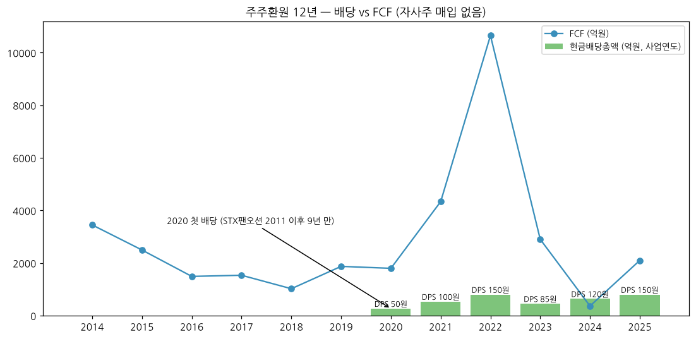

### ⑦ 재무 비율 (12년)

| 연도 | ROE(지배) | ROA | 부채비율 | 유동비율 | 순차입금/EBITDA | 연말 종가(원) | 연말 시총(조) | 연말 PBR | 연말 PER | 연말 EV/EBITDA | 배당수익률 (연말가) |
|---|---|---|---|---|---|---|---|---|---|---|---|
| 2014 | - | - | 220.4% | 123.1% | 3.66x | 2,605 | 0.56 | 0.39 | 0.7 (영업외이익) | 5.2 | 0.0% |
| 2015 | 2.4% | 1.0% | 77.4% | 125.5% | 3.17x | 3,690 | 1.94 | 0.80 | 42.5 | 8.1 | 0.0% |
| 2016 | 4.0% | 2.2% | 68.8% | 109.4% | 3.79x | 3,985 | 2.13 | 0.84 | 21.8 | 10.1 | 0.0% |
| 2017 | 5.8% | 3.4% | 61.6% | 112.4% | 2.79x | 5,270 | 2.82 | 1.18 | 19.7 | 10.6 | 0.0% |
| 2018 | 6.1% | 3.7% | 54.8% | 103.2% | 2.47x | 4,445 | 2.38 | 0.90 | 15.6 | 8.8 | 0.0% |
| 2019 | 5.5% | 3.4% | 53.6% | 95.8% | 2.45x | 4,545 | 2.43 | 0.84 | 16.0 | 8.6 | 0.0% |
| 2020 | 3.3% | 2.0% | 66.0% | 109.6% | 2.75x | 5,020 | 2.68 | 0.96 | 29.0 | 8.9 | 1.0% |
| 2021 | 17.2% | 9.9% | 80.4% | 118.2% | 1.78x | 5,410 | 2.89 | 0.80 | 5.3 | 5.4 | 1.8% |
| 2022 | 16.7% | 9.6% | 68.0% | 149.5% | 1.13x | 5,730 | 3.06 | 0.68 | 4.5 | 4.0 | 2.6% |
| 2023 | 5.3% | 3.2% | 66.6% | 135.8% | 1.86x | 3,735 | 2.00 | 0.42 | 8.1 | 4.8 | 2.3% |
| 2024 | 5.2% | 3.0% | 81.7% | 158.3% | 3.49x | 3,300 | 1.76 | 0.31 | 6.6 | 5.8 | 3.6% |
| 2025 | 5.3% | 2.9% | 89.6% | 135.7% | 3.86x | 3,850 | 2.06 | 0.36 | 6.8 | 6.2 | 3.9% |
| **현재 (2026-11-24, LTM)** | - | - | 101% | - | 3.62x | 4,800 | 2.57 | **0.44** | **5.5** | **6.0** | **3.1%** |

**주요 비율 의미:**
- **ROE**: 지배순이익 / 평균 지배지분 [계산]. 정점 2021 17.2%·2022 16.7%, 그 외 2.4\~6.1% — 사이클 평균 ROE 7% 내외 [계산]
- **연말 PBR**: 연말 시총 / 지배지분. 2017 1.18배 (12년 최고) → 2024 0.31배 (최저). 장부 자본 증가(2021 이후 이익 누적·원화 약세 환산) 대비 주가 정체로 PBR 하향
- **EV/EBITDA**: (시총 + 차입금 등 − 현금) / EBITDA. 리스부채 미반영 → 실제 EV는 리스부채만큼 큼 (3Q26 0.53조)
- 2014 PER 0.7배는 회생 영업외이익으로 왜곡 — 비교 제외

---

## 5. 지배 구조

### ① 그룹·계열 관계

```
김홍국 회장 (동일인) ── 21.10% ──> ㈜하림지주 (KOSDAQ, 2025 연결 매출 13.21조·영업이익 0.89조)
                                        │ 54.72% (특수관계인 포함 54.91%, 2026-09-30)
                                        │ ※ 보유주식 중 210,918,681주 (발행주식의 39.46%) 국민은행·한국증권금융 등 담보 제공
                                        ▼
                              팬오션 (028670, 별도 = 해운·곡물 본체)
       ┌──────────────┬──────────────────┬───────────────────┬────────────────────┐
  해외법인 (해운·곡물)  Pan Ocean Trading &   Pan Ocean (America)     ㈜포스에스엠            관계기업
  중국·일본·미국·브라질   Logistics (싱가폴 곡물)  └ EGT, LLC 36.25%        (선박관리, 기타 부문)    (지분법 2,016억, 2025말)
  Pan Logix 등                                  (미국 곡물터미널)

하림그룹 주요 계열: 제일사료·하림·선진·팜스코·엔에스쇼핑 (식품·사료·홈쇼핑) / 기업집단 하림 70개사 (상장 5)
```

(DART 분기보고서(2026.09) VII 최대주주·특정거래, DART 사업보고서(2025.12) I·IX, IR 3Q26 p11. 연결 종속회사 10개 (2025말, 전부 비상장) [DART]. 관계기업 장부가 2,016억 = 2025말 연결 BS [OpenDART])

- **교차 참조**: 해운 서브섹터 피어 `HMM_기업개요.md` (컨테이너 정기선). 하림은 2023-12 HMM 인수 우선협상대상자였으나 2024-02-07 결렬 [KED Global] — 두 문서의 corporate action 연결 고리
- 하림그룹 곡물 수요(사료 원료)와 팬오션 곡물사업·벌크 운송의 수직계열 시너지가 인수 논리 [DART 사업보고서(2025.12) I "2015년 6월 하림그룹으로 편입된 이후 곡물사업 전담 조직 설립"]

### ② 주주 구분

| 주주 | 주식수 | 지분율 | 기준 |
|---|---|---|---|
| ㈜하림지주 | 292,533,115 | 54.72% | 2026-09-30 |
| 특수관계인 (㈜에코캐피탈 830,000주 + 임원·친인척 10인) | 975,219 | 0.18% | 2026-09-30 |
| **최대주주 등 계** | **293,508,334** | **54.91%** | 2026-09-30 |
| 국민연금공단 | 47,839,895 | 8.95% | 2026-09말 (IR 3Q26) / 47,188,626주 8.8% (2026-06-30, DART 반기) |
| 우리사주조합 | 96,221 | 0.02% | 2026-06-30 |
| 소액주주 | 182,092,823 | 34.06% | 2026-06-30, 189,603명 (전체 주주의 99.98%) |
| 자기주식 | 0 | 0% | - |
| 발행주식총수 | 534,569,512 | 100% | 보통주만, 액면 1,000원 |

(DART 분기보고서(2026.09) VII-1, DART 반기보고서(2026.06) VII-4 주식 소유현황, IR 3Q26 p11. 외국인 지분율은 DART 미공시·KRX 미조회 → **미확보** ⚠️ (차트에서는 "기타"에 포함))

**하림지주 보유주식 담보 현황 (2026-11-11 공시서류 제출일 기준, DART 분기보고서(2026.09) VII-2 사):**

| 담보권자 | 주식수 | 발행주식 대비 | 계약기간 |
|---|---|---|---|
| 한국증권금융 | 65,955,000 | 12.34% | 2026-05-30 \~ 2027-05-30 |
| 국민은행 (3건) | 70,700,000 | 13.22% | 2026-06\~09 \~ 2027-03\~09 |
| 우리에이치알제이차 외 | 18,263,681 | 3.42% | 2026-04-28 \~ 2027-04-28 |
| 농협은행 | 19,000,000 | 3.55% | 2026-06-22 \~ 2027-06-22 |
| 우리은행 | 15,000,000 | 2.81% | 2026-06-23 \~ 2027-06-23 |
| 케이비하림제일차 | 14,000,000 | 2.62% | 2024-02-19 \~ 2027-02-19 |
| 산업은행 | 8,000,000 | 1.50% | 2026-08-13 \~ 2027-08-13 |
| **합계** | **210,918,681** | **39.46%** | 하림지주 보유분의 72.1% |

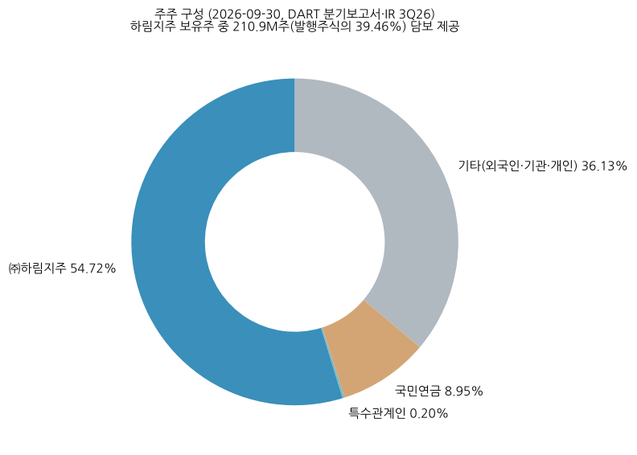

### ③ 임원·이사회

- **대표이사 회장: 김홍국** (1957-06생) — 하림그룹 회장(2001\~), 하림지주 대표이사(2018\~), 팬오션 대표이사 회장(2015-07-18\~), 임기 2028-03 [OpenDART exctvSttus 2025, DART 분기보고서(2026.09)]
- **대표이사 사장: 안중호** (1962-01생) — 1989 입사, 영업부문장(2019) → 대표이사 사장(2020\~), 이사회 의장, 한국선주상호보험조합 대표이사(2025\~). 2025말 기준 임기 2026-03 → 3Q26 보고서에도 대표이사 재직 (재선임 추정 ⚠️) [OpenDART exctvSttus 2025, DART 분기보고서(2026.09)]
- **사내이사: 천세기** (사장, 윤리경영실장, 하림지주 경영지원실장 겸) [DART 분기보고서(2026.09)]
- **이사회 (2025말)**: 사내이사 3인 (김홍국·안중호·천세기) + 사외이사 4인 (정학수·구자은·김영모·박승오) = 7인. 위원회: 감사·보수·사외이사후보추천·ESG·내부거래위원회 [DART 사업보고서(2025.12) VI]
- 사외이사 약력: 정학수 (前 농림부 차관급·한국농어촌희망재단 이사장), 구자은 (세무학 박사·수원대 교수), 김영모 (前 산업은행 부행장·산은캐피탈 대표), 박승오 (前 하나캐피탈 대표) [OpenDART exctvSttus 2025 — 정학수 前 직책은 "동아시아농업협회 회장" 등 원문 기재, 차관급 표현은 미검증 ⚠️]
- 오너 2세 관련: 김준영 상무보 (1992-06생, 금융지원실장 2025-02\~, NS홈쇼핑 사내이사) [OpenDART exctvSttus 2025] — 김홍국 회장과의 관계는 DART "계열회사 임원"으로만 기재 (가족관계 미기재)

---

## 6. 기타 팩트

### ① R&D 인프라

- **해운업 특성상 R&D 비용은 사실상 없음**: DART 연구개발비용 표는 IT 개발비 무형자산 장부가만 공시 — 기초 12백만원 → 기말 4백만원 (2025), 상각 7백만원 [DART 사업보고서(2025.12) II-6 나]. 담당조직: 정보시스템실 (2014-04 설치), 2007 통합정보시스템 SAIMS 구축 [동]
- **R&D 대체 지표 — 친환경·선대 기술**: 2021 해사기술실·해사환경팀 신설 (온실가스 규제 대응), 2022 안전경영실 [DART 사업보고서(2021.12)]. 노후선 교체·신조 대체 건조 (LNG·VLCC·벌크) [DART 분기보고서(2026.09)]. ISO14001 환경경영 (2010\~) [DART 사업보고서(2025.12)]
- 표준 chart7(R&D 투자)은 의미 있는 수치가 없어 **운영선대 구성 차트로 대체** (3장 ⑥)

### ② 진행 중 corporate action — 10년치 주요 이벤트

| 시점 | 이벤트 | 출처 |
|---|---|---|
| 2015-06 | 하림그룹 편입 (인수가 1.08조원, 신주 발행 → 발행주식 524.4M주) | Heavy Lift PFI, DART |
| 2015-07-30 | 회생절차 종결 | Heavy Lift PFI |
| 2016 | 곡물사업 개시 | DART 사업보고서(2019.12) |
| 2016-03 / 2017-11 / 2019-01 | Vale 철광석 장기운송계약 | DART |
| 2017-02 | Suzano 우드펄프 장기운송계약 (최소 15년) | DART |
| 2020-09 | 미국 곡물터미널 EGT, LLC 36.25% 인수 | DART |
| 2020-12 \~ 2022-09 | LNG선 장기대선 계약 (Shell·GALP·Korea Green LNG, 총 12척) | DART |
| 2022-03-21 | SGX 자진 상장폐지 | DART |
| 2022-03 | 싱가폴 곡물사업 양수도·출범 | DART |
| 2023-12 | 하림·JKL 컨소시엄 HMM 57.9% 인수 우선협상대상자 (6.4조) | KED Global |
| 2024-02-07 | HMM 인수 협상 결렬 | KED Global |
| 2024\~2026 | 배당가이드라인 (별도 순이익 15\~25%) | IR 3Q26 |
| 2026-02-11 | SK해운 원유수송사업 (VLCC 10척 + 장기계약) 인수 3.73억 달러 | DART 분기보고서(2026.09) |
| 2026 (진행 중) | 신조 20척 도입 예정 (2026-10\~2030-06) | IR 3Q26 |

### ③ 사업 마일스톤 — 10년치

- 2016 곡물사업 개시 → 2020 첫 영업흑자 (9억) → 2024 판매량 311만톤 → 2025 343만톤 (사상 최대) [DART]
- 2020 첫 배당 재개 (DPS 50원)
- 2023\~2025 LNG선 사선 3척 → 7척 → 12척 장기대선 투입 [DART 영업부문별 성과]
- 2022 영업이익 7,896억 (사상 최대), 탱커 OP 2022\~2024 3년 연속 최대 경신 [DART]
- 2026 VLCC 선대 9척 운영 (9월말) + 신조 9척 발주 — 탱커를 LNG에 이은 2번째 계약형 사업으로 육성 [IR 3Q26]

### ④ 주요 리스크

(1) 드라이벌크 시황 (BDI)
→ 2026 선복 순증 +3.8% 예상 (2025 +2.9%), 신조 인도 +24% YoY, 폐선 -30% [IR 3Q26 p14] — 공급 증가가 운임 상단을 제한할 수 있음. 1Q 계절적 비수기
(2) 용선 선대 레버리지
→ 용선 145척 — 고가 장기 용선은 시황 급락 시 손실 확대 (2013 회생의 직접 원인이 고가 용선 계약) [일반 공개정보·Wikipedia]. 현재 1년 이상 장기 용선 22척 [IR 3Q26]
(3) 재무 레버리지·금리
→ 차입금 등 4.65조 (3Q26), 부채비율 101%, 이자지급 2,528억 (2025) — 신조 20척·VLCC 인수로 추가 차입 가능성. 이자 커버리지 3.5x (2025) [계산]
(4) 환율
→ USD 기능통화·KRW 표시: 원화 강세 시 원화 실적·자본이 감소 표시 (3Q26 원화 자본 -8.5% QoQ vs USD +3.9%). 원화 차입금·예금의 외화환산손익 발생 (2025 +22억, 2024 -114억) [DART 사업보고서(2025.12)]
(5) 지정학·규제
→ 호르무즈 통항 선박 피격 (2026-10), 수에즈·파나마 운하 통항 제한, 미·중 관세 [IR 3Q26]. IMO 탄소 규제 → 친환경 선박 교체 CapEx
(6) 지배구조
→ 최대주주 하림지주의 지분 담보 39.46% (반대매매·담보 재설정 리스크), 계열 간 내부거래 (곡물·사료) [DART 분기보고서(2026.09)]
(7) 소송·우발
→ 화물·선체 손상 등 피고 소송가액 13,349천 USD (2025말) [DART 사업보고서(2025.12) 주석] — 규모 제한적
(8) 곡물 가격·파생
→ 곡물파생상품·운임선도거래(FFA) 사용 [DART 사업보고서(2025.12) II-5] — 곡물가·운임 급변 시 평가손익

### ⑤ ESG 등급

- **KCGS (한국ESG기준원) 등급: 미확보** — 이번 버전 웹 검색으로 팬오션 개별 등급 확인 실패 ⚠️
- **MSCI 등급: 미확보**
- 지속가능경영보고서: 2025년 국문판 회사 홈페이지 게시 확인 (panocean.com) — **다운로드 실패 (기기 디스크 공간 오류)**로 등급·온실가스 수치 미추출 ⚠️
- 이사회 내 ESG위원회 운영, 2025 ESG 중대성 주제 이사회 보고 [DART 사업보고서(2025.12) VI]
- 환경: ISO14001 (2010\~), CEO 책임 하 기후변화 대응 [DART 사업보고서(2025.12)]

### ⑥ 인증·라이선스

- 사업 근거: 해운법상 외항 화물운송사업 (국적 외항선사) [DART 업종코드 50112]
- ISO14001 환경경영시스템 (2010\~) [DART]
- KOGAS LNG 수송사업자 (2005 선정) [DART]
- 신용등급: 회사채·Issuer Rating A(안정적) (한국기업평가·한국신용평가) [DART 사업보고서(2025.12)]
- 거래소: KRX 유가증권시장 (2007-09-21\~). SGX는 2022-03-21 상장폐지

---

## 부록. Source 6종 전수 점검 (Phase 1, 2026-11-25)

| # | Source | 확보 | 누락 | 영향 |
|---|---|---|---|---|
| 1 | DART 공시원문 XML (본문) | 사업·반기·분기보고서 52건 (사업보고서 2013.12\~2025.12, 분기·반기 1Q14\~3Q26, 기재정정·첨부정정본 포함) | 2014.12·2015.12·2017.12 사업보고서는 기재정정본만 | 없음 — 부문표 51분기 전부 추출 |
| 2 | DART 첨부 (감사보고서 00760·00761) | 사업보고서 첨부 10세트 (2013·2016·2018\~2025) | 2014·2015·2017 첨부 미분리 | 주석(감가상각비·사업결합)은 본문 XML로 대체 |
| 3 | OpenDART API (재무 JSON·기업정보) | fnlttSinglAcntAll 연결 44개 (2015 FY\~3Q26), 기업개황·최대주주·임원·직원·배당·자기주식·주식총수 (2025) | 2015 1Q\~3Q 등 4건 no data, 2014 이전 미제공 | 2014는 2015 전기 컬럼, 1Q14\~4Q15 분기는 부문표 합계 사용 |
| 4 | IR PDF (irgo) | 68건 (2018-04\~2026-11, 실적발표·Q&A·해외 NDR) 전부 텍스트화 | 14건 다운로드 실패 (2021 2Q·3Q 중복 게시물 등), 2017년 이전 IR 없음 | BDI·EBITDA 1Q16\~ (2014·2015 BDI 공란, EBITDA는 DART 감가상각비로 계산) |
| 5 | 지속가능경영보고서 | 2025 국문판 URL 확인 | **다운로드 실패** (기기 저장공간 오류) | ESG 등급·온실가스 미기재 |
| 6 | 시장 데이터 (Yahoo·KRX·FnGuide·뉴스) | Yahoo 028670.KS 월간·일간 (2007-09-21\~2026-11-25) + split/배당 이벤트. 뉴스: KED Global·Heavy Lift PFI·Cyprus Shipping News·Wikipedia | KRX 외국인 지분율, FnGuide 컨센서스, KCGS 등급 미조회 | 외국인 지분 미기재, 컨센서스 비교 없음 (기업개요 범위 밖) |

---

## Version Log

- **v1.0 (2026-11-25)**: 첫 작성 — Phase 1 source 6종 전수 점검 (위 부록). OpenDART 연결 재무 44개 + 공시원문 XML 52건(부문 요약재무 51분기 파싱, 전 분기 연결 합계 일치 검증) + IR PDF 68건(BDI·EBITDA·USD 실적·선대·장기계약) + Yahoo 시세(split 역산 시총). 차트 16종 (chart1·1b·2_벌크·2_비벌크·2_곡물·3_비벌크세부·4·5·6·7(R&D 대체: 운영선대)·8·9·10·11·12·13_BDI)
- **HMM 기업개요와의 정합성**: 해운 서브섹터 공통 밸류에이션 정의 = ④-1 표 (시총 = 2026-11-24 종가 × 발행주식총수, PBR = 시총/3Q26 지배지분, PER = 시총/LTM 연결 순이익, EV = 시총 + (차입금·사채 − 현금, 리스 제외) + 비지배지분, EBITDA = IR LTM 4개 분기 합산, 배당수익률 = 직전 사업연도 DPS/종가)
- 잔여 보완 후보: ① 60+분기 표준 미충족 (51분기 — 2013 이전 STX팬오션 부문표 정의 통일 필요) ② 비벌크 세부(컨테이너·탱커·LNG) 분기 영업이익 2014\~2025 (DART는 2026부터 분기 공시) ③ 지속가능경영보고서 다운로드·KCGS/MSCI 등급 ④ 외국인 지분율 추이 (KRX) ⑤ 연도별 용선 척수 (IR 차트 텍스트 추출 순서 불확실) ⑥ 글로벌 드라이벌크 피어 (Star Bulk·Genco·Pacific Basin) 밸류에이션 수치 비교 ⑦ 2026-03-03\~04·2026-11 주가 급등락 원인 ⑧ 안중호 대표 2026-03 재선임 공시 확인 ⑨ STX 편입 연도(2004\~05)·Golden Ocean–CMB.Tech 합병 등 미검증 표기 항목
