> 종목: 포스코퓨처엠 (003670.KS / ㈜포스코퓨처엠 / POSCO FUTURE M CO., LTD., DART corp_code 00155276) — 옛 포스코켐텍(2010~2019.03)·포스코케미칼(2019.03~2023.03)
> 섹터: 배터리 (워치리스트 섹터 T2) / 서브섹터: 양극재
> 작성 시각: 2026-11-14 KST (**v1.0** — 첫 작성, source 6종 일괄 점검 후 완성본)
> 적용 구조: v4.8 (6개 섹션 + 12종 차트 표준, chart2는 2·2b·2c·2d·2e 5종 분할)
> 데이터: 12년 연결 연간(2014~2025, OpenDART·DART) + **51분기 연결(1Q14~3Q26)** + **사업부 분기 51분기**(구 부문 1Q14~4Q18 20분기 + 에너지소재/기초소재 1Q19~3Q26 31분기) + **양극재/음극재 분기 27분기(1Q20~3Q26, 회사 IR)** + 연간 사업부 2019~2025 + 20년 Yahoo 시가총액
> 출처: **DART 분기보고서 2026.09(rcept 20261113000351, 3Q26 확정치)**·반기보고서 2026.06 정정(20260902000346)·분기 2026.03(20260515001405) / **사업보고서 2025(20260312000826, 최우선 정성자료)**·2024(20250314000603)·2023 정정(20240326000383)·2022 정정(20230317000751)·2021(20220311001089)·2020 정정(20210512000747)·2019(20200330002873)·2018(20190329004409)·2017 정정(20180727000096)·2016(20170331003706)·2015(20160330004396)·2014(20150331002855) 및 2014~2025 분기·반기보고서 원문 52건 / OpenDART 전체재무제표 연결(CFS)·별도(OFS) 2015~3Q26 / OpenDART 2025 FY 최대주주·임원·직원·배당·자기주식·주식총수 / **회사 IR 실적발표 PDF 22건(2021.1Q~2026.3Q, irgo 경유 source `ir/`, 2021.2Q·3Q 발표분 2건 수신 실패)** + 기업가치제고계획(2024.12, 2026-04-02 게시)·유상증자 설명회(2025-05) / BT `earnings-review/2026-Q1_포스코퓨처엠_리뷰.md` / Yahoo Finance v8 003670.KS 월간 20년 / stockhub(2026-11-13 19:59)·비즈워치(2026-11-02)·디지털데일리(2024-06-17, SNE리서치 인용)·경향신문(2023-07-25)
> **Fact verify cutoff**: 2026-11-14

# 포스코퓨처엠 기업 개요 (v1.0 — 배터리 T2·양극재, 기초소재(내화물·라임화성) 안정 사업 + 에너지소재(양극재·음극재) 사이클 사업의 혼합형)

> ⚠️ **시계열 단절 5회 + 부문 재편 3회 — 모든 표·차트 해석 시 주의**
> ① **2015** 액면분할 5,000원 → 500원 (발행주식 5,907,000 → 59,070,000주). 2014 DPS 1,750원은 분할 전 기준 (환산 175원)
> ② **2019.04.01 포스코ESM 흡수합병** (합병비율 1 : 0.2131444, 신주 1,918,220주, 소규모합병) → **양극재 사업 편입**. 동일지배 합병이나 **2018 이전 재작성 없음**(2019 반기보고서의 전반기 수치 = 당시 보고치) → 2019 연결은 양극재 4~12월분만 포함. 같은 시기 사명 포스코켐텍 → **포스코케미칼(2019.03)**, KOSDAQ → **유가증권시장 이전상장(2019.05)**
> ③ **부문 구분 변경**: ~2019 「내화물제조정비 / 라임케미칼(생석회·화성품·음극재·양극재)」 2부문 → 2020 「내화물 / 라임화성 / 에너지소재」 3부문(2019 소급 재작성) → 2022~ 「기초소재사업부(내화물+라임화성) / 에너지소재사업부」. **2018 이전 음극재 매출은 라임케미칼 안에 섞여 분리 불가 [미확보]**
> ④ **2022.04.01 절강포화(ZHEJIANG POSCO-HUAYOU ESM, 양극재) 연결 편입** (지분 45%, 실질지배) / 2022.07 얼티엄캠(GM 합작, 85%) 설립 — 연결 종속(손익 아직 없음)
> ⑤ **유상증자 2회**: 2021.02 신주 16,475,000주(약 1.27조, IR) / 2025.07~08 신주 11,483,000주(자본 반영 1조 1,025억, IR) → 자본 급증 구간은 이익 누적이 아니라 증자 효과. 2024.12 신종자본증권 6,000억(자본 반영 5,994억)
> ⑥ **2016·2017 분기**: DART 영업부문 주석 합계와 연결 손익계산서 분기치가 일부 불일치(예: 3Q16 부문 합계 2,735억 vs IS 2,818억, 4Q17 3,326억 vs 3,100억 — 사업보고서 재분류 영향). 연결 분기 표는 OpenDART 손익계산서, 구 부문 표는 부문 주석 원값 사용
> ⑦ **2024 4Q 대규모 손상** 3,959억(中 전구체 합작법인 926억 + 양·음극재 노후설비 등 3,033억, 회사 4Q24 IR) → 2024 순이익 -2,313억은 영업외 일회성 주도

---

## ① 기업 분류

(1) Primary / Secondary 분류

**⚠️ Boundary Case — 연간 OPM 정량 룰은 경계선(range 8.7%pt < cutoff 10%pt), 매출·분기 OPM은 명백한 사이클**

12년 연간 OPM range 0.0%(2024)~8.7%(2017) = **+8.7%pt** → 정량 룰(±10%pt)만 보면 사이클 미달. 그러나 이는 양극재가 **메탈가 pass-through 저마진 사업**이라 OPM 진폭이 눌려 보이는 착시다. 매출은 2023 4.76조 → 2025 2.94조(**-38%**), 분기 OPM은 -9.3%(4Q25)~9.8%(3Q26) **19.1%pt**, 에너지소재 분기 OPM은 -27.9%~11.3% **39.2%pt** 진폭.

**Primary 분류: 사이클 (EV 수요 + 리튬·니켈·코발트 메탈가 사이클)**

→ 매출 비중 53.7%(9M26 DART)가 에너지소재 — 판가가 메탈가에 연동(래깅)되어 메탈가 하락기에는 「투입-판매 시차 손실 + 재고평가손」이 동시 발생 (2023 4Q 재고평가충당금 742억, 2024·2025 4Q 연속 적자)

→ 양극재 매출 2023 3.14조 → 2025 1.45조(**-54%**, 회사 IR) — EV 캐즘 + 美 EV 보조금 종료 + GM 얼티엄셀즈 가동조정 직격

**Secondary 노트: 안정형 캐시카우(기초소재) + 성장 옵션(LFP·탈중국 음극재)**

→ **기초소재**(내화물·라임·화성): 매출 2022~2025 1.36~1.40조 박스권(2020 저점 1.03조), 연간 OPM 1.1~7.3%(2019~2025) — 포스코 제철소 captive 수요(9M26 기초소재 주요고객 D회사(포스코) 6,753억, DART). 에너지소재 적자기에 전사 이익의 바닥을 받침 (2025 기초소재 OP 697억 vs 에너지소재 -369억)

→ **성장 옵션**: LFP 양극재(포항 105천톤 전환 예정), 천연흑연 탈중국 장기계약(0.7조 2025.10 + 1조 2026.03), 회사 목표 2027 매출 8.3조·ROIC 3.7%(기업가치제고계획 2024.12)

**Entity 구조 (2026.09말, DART 3Q26 분기보고서 — 연결 종속 9개, 관계·공동기업 9개)**

→ **(1) 에너지소재사업부** — 양극재(광양·포항, NCM/NCMA/NCA 하이니켈 + LFP 전환), 음극재(세종 천연흑연·포항 인조흑연), 광양 전구체(45천톤, 2025.06 준공)

→ **(2) 기초소재사업부** — 내화물(포항, 노재정비·플랜트), 라임화성(포항·광양 생석회, 화성공장 위탁운영·화성품 판매)

→ **(3) 주요 종속** — 절강포화(中 양극재 45%), 얼티엄캠 LP(加 양극재, 85%, 건설중·매출 0), 퓨처그라프(새만금 구형흑연 100%), FUTUREM VIETNAM(인조흑연 100%, 2026 설립), PT.KRAKATAU POSCO FUTUREM(인니 생석회 80%)

→ **(4) 지분법** — 포스코엠씨머티리얼즈(60%, 공동기업, 침상코크스), 씨앤피신소재(20%, LFP JV), 절강화포(中 전구체 32%, 손상)

(2) Summary Box (12년 연결 시계열 + 사이클 통계)

| 지표 | 12년 평균 (2014~2025) | 정점 | 저점 | 2025년 |
|---|---|---|---|---|
| 매출 (연결, 억원) | 21,692 | **47,599 (2023)** | 11,177 (2016) | **29,387** |
| 영업이익 (연결, 억원) | 795 | **1,659 (2022)** | 7 (2024) | **328** |
| 지배순이익 (억원) | 515 | **1,342 (2021)** | -2,123 (2024, 손상 3,959억) | **323** |
| OPM (연결, %) | 4.9% | **8.7% (2017)** | 0.0% (2024) | **1.1%** |

```
[포스코퓨처엠 12년 연결 손익 시계열 (억원, DART 연결)]
연도     매출       OP       OPM     지배NI
2014    13,711     950     6.9%      726   ← 포스코켐텍 (내화물·라임케미칼, 음극재 소규모)
2015    12,212     560     4.6%      346   ← 저점① 유가 급락 → 화성품(콜타르·조경유) 부진, 라임케미칼 2Q15 OP -191억
2016    11,177     853     7.6%      437   ← 매출 12년 최저 (화성품 판가 바닥)
2017    11,972   1,040     8.7%    1,036   ← OPM 12년 최고 — 정점① (화성품 회복 + 피엠씨텍 지분법)
2018    13,836   1,063     7.7%    1,322   ← 지배NI 정점권, 포스코ESM 합병 결의(12월)
2019    14,838     899     6.1%    1,010   ← ESM 합병(4.1) → 양극재 편입, 광양 양극재 1공장 준공
2020    15,662     603     3.8%      296   ← 저점② 코로나 + 양극재 초기가동 적자 (에너지소재 OPM 0.7%)
2021    19,895   1,217     6.1%    1,342   ← 유상증자 1.27조, 양극재 판가·판매 동반 상승 — 정점②
2022    33,019   1,659     5.0%    1,183   ← 영업이익 12년 최고, 메탈가 정점 (3Q22 에너지소재 OPM 10.9%)
2023    47,599     359     0.8%      287   ← 매출 정점(Ultium向 N86), 메탈가 급락 → 재고평가손 742억
2024    36,999       7     0.0%   -2,123   ← 저점③ EV 캐즘 + 손상 3,959억 → 순손실
2025    29,387     328     1.1%      323   ← 매출 -21%, 에너지소재 -369억 vs 기초소재 +697억, 유상증자 1.1조

OPM range: 0.0% ~ 8.7% = +8.7%pt (cutoff ±10%pt 미달 — pass-through 저마진 구조 착시)
매출 진폭: 정점 2023 → 2025 -38% / 분기 OPM range 19.1%pt (4Q25 -9.3% ~ 3Q26 9.8%)
사이클 회수: 2회 완결 (2015 저점 → 2017 정점 → 2020 저점 → 2021~22 정점 → 2024 저점) + 3번째 회복 진행 중(2026)
```

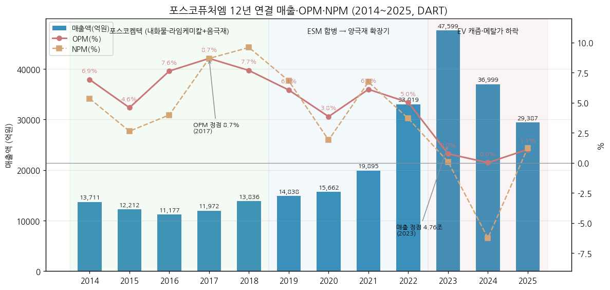

**📊 사이클 통계 (12년 연결)**

| 지표 | 값 |
|---|---|
| 매출 CAGR (11년, 2014→2025) | **+7.2%** (ESM 합병·유상증자 투자 포함) |
| 매출 CAGR (5년, 2018→2023, 양극재 확장기) | **+28.0%** |
| OPM 평균 (12년) | **4.9%** |
| OPM 정점 평균 | **7.4%** (2017 8.7%, 2021 6.1%) |
| OPM 저점 평균 | **2.8%** (2015 4.6%, 2020 3.8%, 2024 0.0%) |
| OPM range | **+8.7%pt** (분기 기준 19.1%pt) |
| 사이클 주기 | 저점→저점 5년(2015→2020)·4년(2020→2024) / 저점→정점 2년 |
| 사이클 회수 (12년) | **2회 완결 + 1회 진행 중** |

**국내외 양극재 피어 비교 (출처·시점 병기)**

→ **포스코퓨처엠 에너지소재** — OPM **11.3%** (3Q26, 고객사 미이행 보상금 포함 — 금액 비공개, 비즈워치 2026-11-02) / 2025 연간 **-2.3%** (회사 4Q25 IR)

→ **에코프로비엠** — 1Q26 OPM +3.5% (BT 1Q26 리뷰, NCA 중심) / 4Q25 매출 4,992억·OP 410억 (디지털데일리 2026-02-06)

→ **엘앤에프** — 4Q25 매출 6,177억·OP 824억 (NCMA95 테슬라向, 디지털데일리 2026-02-06), 1Q26 OPM -1.2% (BT 1Q26 리뷰)

→ **Umicore** — 시총 €5.05B, P/E 2026E 12.7x (MarketScreener, 조회 2026-11-14, 기준일 미표기)

→ **삼원계 양극재 출하 순위 (SNE리서치, 2023)** — 에코프로 1위 12만톤 / 엘앤에프 4위 8.6만톤 / **포스코퓨처엠 13위 5.4만톤** (디지털데일리 2024-06-17) — 글로벌 점유율(%)은 원문 미기재 [미확보]

(3) 정량적 분류 근거

→ **매출 구성의 급변** — 에너지소재 비중 2019 14.8% → 2023 **70.6%** → 2025 53.6% → 9M26 53.7% (IR·DART). 에너지소재가 늘 때 전사 사이클 진폭이 커지는 구조

→ **이익 구성은 기초소재가 바닥 역할** — 2023~2025 3년 누적 OP: 에너지소재 **-855억** vs 기초소재 **+1,549억** (회사 IR). 9M26은 에너지소재 532억 / 기초소재 733억으로 반전 시작

→ **판가 = 메탈가 연동** — 탄산리튬 2022 말 $82/kg → 2025.6 $8/kg → 2026.3 $21/kg (FastMarkets, 회사 IR 원재료 동향). 매출·이익이 메탈가 방향에 1~2분기 래깅

→ **고객 집중** — 에너지소재 주요 매출처 Ultium Cells·LG에너지솔루션·삼성SDI·SK온 (DART). 9M26 10% 이상 고객: 에너지소재 A사 2,225억·C사 2,685억, 기초소재 D사(포스코 계열) 6,753억 (DART 3Q26 영업부문 주석)

→ **투자 선행형 재무** — 2019~2025 CapEx 누계 6.72조 vs 영업CF 누계 0.34조 → FCF 7년 연속 마이너스, 부채비율 25%(2018) → 103%(2025) (OpenDART)

(4) 산업 분류

→ **한국표준산업분류(DART 기업개황)** — 업종코드 282 (일차전지 및 축전지 제조업)

→ **KRX 업종** — 유가증권시장 (2019.05 KOSDAQ에서 이전상장)

→ **워치리스트 섹터** — 배터리 T2 / 서브섹터 양극재

→ **사업 성격** — 이차전지 소재(양극재·음극재·전구체) + 철강 연관 소재(내화물·생석회·화성품)

(5) 분류 결정 논리 (4단계)

(1) **사업 이원 구조 확인** — 기초소재(포스코 captive, 매출 1.0~1.4조, 연간 OPM 1.1~7.3%)는 「안정형」, 에너지소재(메탈가·EV 수요 연동, 분기 OPM -28%~+11%)는 「사이클형」. 성격이 정반대인 두 사업이 한 회사에 묶임

(2) **가장 매출 큰 사업부 기준** — 2021 이후 에너지소재가 매출 1위(2025 53.6%, 9M26 53.7%) → 전사 손익 방향은 에너지소재가 결정 → **Primary = 사이클**

(3) **이익 sub-rule 점검** — 최근 3년(2023~2025) 이익의 주인은 기초소재(누적 +1,549억)지만, 이는 에너지소재 사이클 저점의 결과이지 구조 변화가 아님. 정점기(2022)에는 에너지소재가 OP의 91%(1,506/1,659억) → 기초소재는 **Secondary(안정 바닥)** 로 처리

(4) **Boundary 처리 + 피어 교차검증** — 연간 OPM range(8.7pp)는 cutoff 미달이나 매출 진폭(-38%)·분기 OPM range(19.1pp)·지배NI 부호 전환(2024)을 근거로 사이클 확정. 에코프로비엠·엘앤에프도 2023~2025 동일한 메탈가 하락 사이클을 공유 → 업종 공통 사이클. **최종: Primary 사이클 + Secondary 안정형 기초소재 바닥 + 성장 옵션(LFP·음극재 탈중국)**. 대안 분류: Primary 꿈(2027 매출 8.3조 목표 기반) — 단, 목표 대비 2025 실적(2.94조)이 크게 미달해 채택하지 않음

(6) 적정 밸류에이션 방법 — 밸류에이션 다이얼

| 지표 | 현재값 (2026-11-13 종가 173,200원 기준) | 선택 순위 | 선택 논리 |
|---|---|---|---|
| **P/B** | **3.87배** (시총 15.41조 / 3Q26 지배자본 3.98조) · 신종자본증권 5,994억 차감 시 4.56배 [계산] | **1차** | 이익이 사이클 저점이라 PER 무의미 → 자본 기준 밴드가 유일하게 연속성 있는 잣대. 연말 PBR 12년 밴드 **1.2배(2016) ~ 11.8배(2023)**, 최근 3년 3.7~4.1배 [계산: Yahoo 12월 종가 × 발행주식수 / 지배자본] |
| **EV/EBITDA** | 약 **68배** [계산: EV 19.3조 = 시총 15.41조 + 순차입금 3.46조 + 비지배지분 0.46조 / TTM EBITDA 2,838억(4Q25 14억 + 1Q26 668 + 2Q26 796 + 3Q26 1,360, 회사 IR)] | 2차 | 감가상각이 큰 장치산업 + 투자 회수 전 구간 → 정상화 EBITDA(정점 2022 2,572억) 기준 보조 지표 |
| **P/E** | TTM **488배** (stockhub, 2026-11-13) | 3차 (2027E~) | 지배순이익이 TTM 수백억 수준 → 의미 있는 비교는 LFP·얼티엄캠 가동 후 2027~28E 이익 기준 |

→ **피어 P/B** — 에코프로비엠 **6.47배**(stockhub, 2026-10-27 표기), 엘앤에프 **6.11배**(stockhub, 2026-10-23 표기) → 포스코퓨처엠은 국내 양극재 피어 대비 **약 40% 할인** (기초소재 저성장 사업 혼재 + 고객 GM 의존). 셀사이드 일부는 Peer P/B 대비 프리미엄 논리 사용(삼성증권, BT 1Q26 리뷰)

→ **Umicore** — P/E 2026E 12.7x (MarketScreener) — 유럽 피어는 이익 정상화 단계라 PER 비교 가능, 국내 3사는 불가

→ **셀사이드 목표가** — 1Q26 리뷰 시점 9개사 평균 TP 293,800원(BT 리뷰), 3Q26 후 유안타 TP 226,000원(Buy, stockhub 2026-11) — 업데이트 컨센서스는 [미확보]

(7) 분기 재평가 트리거 (**분류 변경 조건만** — 실적 추적 변수는 섹터 메모리 `tracking_variables.md`)

→ ① **에너지소재 OPM 4분기 연속 5% 이상 + 매출 비중 60% 회복** → Secondary 「성장 옵션」을 Primary 「고성장(2019~2022형)」으로 격상 검토

→ ② **에너지소재 매출 비중 40% 미만으로 2분기 연속 하락**(양극재 고객 이탈·사업 축소) → Primary를 **안정형(기초소재)** 으로 전환, 에너지소재는 옵션으로 강등

→ ③ **기초소재 분할·매각 또는 포스코홀딩스 이차전지소재 사업 재편(합병·분할)** → 분류 전면 재작성 (순수 배터리소재 사이클주)

---

## ② 회사 개요

(1) 기본 사항

| 항목 | 내용 |
|---|---|
| 회사명 (한글) | ㈜포스코퓨처엠 |
| 회사명 (영문) | POSCO FUTURE M CO., LTD. |
| 종목코드 | 003670 (KRX 유가증권시장, 2019.05 KOSDAQ에서 이전상장) |
| **설립일** | **1971년 5월 13일** (포항축로 설립, DART 기업개황) — 1963 삼화화성과 1994.12 합병해 포철로재 → 2001 포스렉 → 2010.03 포스코켐텍 → 2019.03 포스코케미칼 → **2023.03 포스코퓨처엠** |
| 본사 주소 | 경상북도 포항시 남구 신항로 110 (청림동) |
| **대표이사** | **엄기천** 사장 (1966.01, 성균관대 기계설계학, 前 포스코퓨처엠 에너지소재사업부장, 2025.03 선임·2026.03 사내이사 재선임) — DART |
| 사업 한 줄 정의 | 포스코그룹의 이차전지소재 계열사 — 국내 유일 양극재·음극재 동시 생산 + 제철소 연관 내화물·생석회·화성품 |
| 발행주식수 | **88,946,220주** (자기주식 35주) — 2025말·2026.09말 동일 (DART) |
| 주요주주 | 포스코홀딩스 **58.18%** + 특수관계인 합계 60.6% (2026.09말) / 국민연금 **5.34%** · 우리사주조합 2.60% (2025말, DART) |
| 연결 종속회사 | **9개** (절강포화·얼티엄캠 GP/LP·포스코퓨처머티리얼즈캐나다·퓨처그라프·FUTUREM VIETNAM·PT.KRAKATAU POSCO FUTUREM·ZPR·Yingkou PFM) — 2026.09말 DART |
| **신용등급** | 무보증사채 **AA-** (한국기업평가·한국신용평가·NICE신용평가, 2025.12 본평가 / 2026.11.12 발행 회사채 동일) |
| 임직원 (별도) | **2,979명** (2025말: 정규 2,743 + 기간제 236, dart_api 직원현황) / 1인 평균급여 8,800만원(남) |
| 시가총액 | **15조 4,055억원** [계산: Yahoo 종가 173,200원(2026-11-13) × 88,946,220주] / stockhub 15.5조(174,600원, 2026-11-13 19:59 표기) |
| 52주 범위 | **114,700 ~ 299,500원** (Yahoo meta·stockhub 일치, 고점 2026.04 장중) |
| 사상 최고가 | **694,000원** (2023.07 장중, Yahoo v8 월봉 고가 — 2025 유상증자 등 수정주가 반영 여부 미확인, 원주가와 차이 가능) / 당시 시총 46조 3,230억원(경향신문 2023-07-25, 코스피 9위) |
| 외국인 지분율 | **8.86%** (stockhub, 2026-11-13) |

(2) 12년 손익·자본 추이 (연결 — OpenDART 전체재무제표, 억원)

| 연도 | 매출 (억) | 매출원가 | 매출총이익 | GPM | 영업이익 | OPM | 순이익 | 지배순이익 | NPM | 자본총계 | 지배자본 | 자산총계 |
|---|---|---|---|---|---|---|---|---|---|---|---|---|
| 2014 | 13,711 | 12,184 | 1,527 | 11.1% | 950 | 6.9% | 733 | 726 | 5.3% | 5,148 | 5,050 | 7,216 |
| 2015 | 12,212 | 11,089 | 1,123 | 9.2% | 560 | 4.6% | 322 | 346 | 2.6% | 5,382 | 5,302 | 7,175 |
| 2016 | 11,177 | 9,769 | 1,408 | 12.6% | 853 | 7.6% | 445 | 437 | 4.0% | 5,694 | 5,626 | 7,239 |
| 2017 | 11,972 | 10,416 | 1,556 | 13.0% | 1,040 | 8.7% | 1,040 | 1,036 | 8.7% | 6,522 | 6,445 | 8,358 |
| 2018 | 13,836 | 12,176 | 1,660 | 12.0% | 1,063 | 7.7% | 1,328 | 1,322 | 9.6% | 7,581 | 7,496 | 9,476 |
| 2019 | 14,838 | 13,172 | 1,665 | 11.2% | 899 | 6.1% | 1,012 | 1,010 | 6.8% | 10,063 | 9,975 | 17,301 |
| 2020 | 15,662 | 14,218 | 1,444 | 9.2% | 603 | 3.8% | 297 | 296 | 1.9% | 10,236 | 10,007 | 20,881 |
| 2021 | 19,895 | 17,514 | 2,381 | 12.0% | 1,217 | 6.1% | 1,338 | 1,342 | 6.7% | 24,384 | 23,893 | 39,225 |
| 2022 | 33,019 | 29,672 | 3,348 | 10.1% | 1,659 | 5.0% | 1,219 | 1,183 | 3.7% | 26,506 | 24,710 | 46,375 |
| 2023 | 47,599 | 45,026 | 2,572 | 5.4% | 359 | 0.8% | 44 | 287 | 0.1% | 26,115 | 23,502 | 63,346 |
| 2024 | 36,999 | 34,640 | 2,359 | 6.4% | 7 | 0.0% | -2,313 | -2,123 | -6.3% | 33,205 | 29,703 | 79,325 |
| 2025 | 29,387 | 26,825 | 2,562 | 8.7% | 328 | 1.1% | 365 | 323 | 1.2% | 45,121 | 40,676 | 91,439 |

→ (출처: 2015~2025 = OpenDART fnlttSinglAcntAll 사업보고서 연결, 2014 = 2015 사업보고서 전기 컬럼. 2014~2016 지배순이익·지배자본은 OpenDART 계정명 불일치로 동 JSON 원값(account_nm 「지배기업의 소유주에 귀속될 당기순이익」) 수기 보강)
→ 11년 매출 CAGR **+7.2%** / 지배자본 CAGR **+21.8%** (2014→2025, 5,050 → 40,676억) — 자본 증가분 3.56조 중 **유상증자 약 2.37조(2021 1.27조 + 2025 1.10조) + 신종자본증권 0.6조** [계산]
→ 2025 ROE(지배, 평균자본) **0.9%** / 2024 **-8.0%** [계산]
→ **3Q26 누적(9M26)**: 매출 22,717억(YoY -4.6%) / 영업이익 1,265억(YoY +49.4%) / OPM 5.6% / 지배순이익 682억 (DART 3Q26 분기보고서)

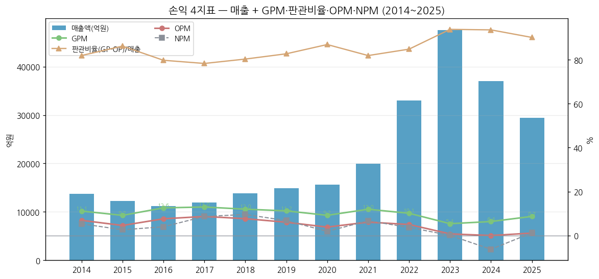

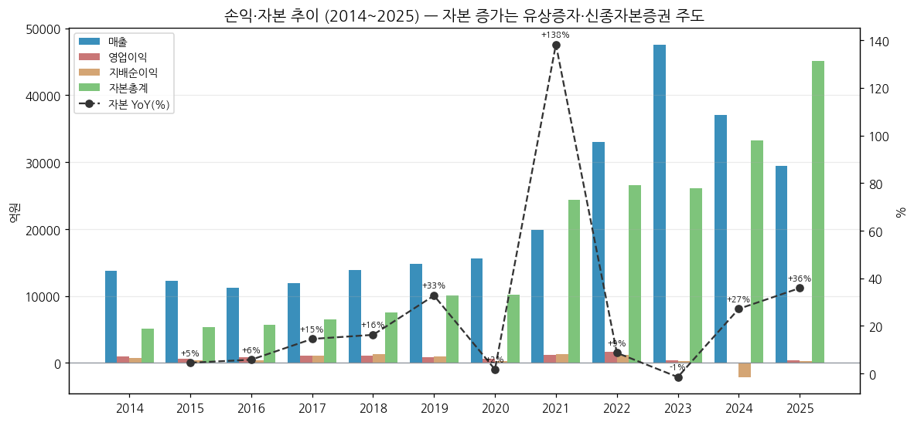

(3) 주가 역사 (20년)

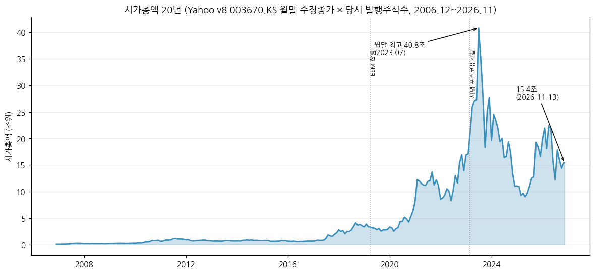

→ (출처: Yahoo Finance v8 003670.KS 월간 2006.12~2026.11 × DART 발행주식수 이력(~2019.03 59,070,000 / ~2021.01 60,988,220 / ~2025.07 77,463,220 / 이후 88,946,220주). Yahoo 종가는 액면분할·유상증자 수정주가 → **과거 시총은 실제 당시 시총과 차이 가능, 추정**)

→ **2006~2016 포스코켐텍 시절** — 시총 0.1~1조 박스권 (내화물·생석회·화성품 철강 연관 소재사, PBR 1.2~1.6배)

→ **2017~2018 음극재·양극재 기대 1차 재평가** — 2016말 0.68조 → 2018말 3.59조(PBR 4.8배). ESM 합병 결의(2018.12)

→ **2020~2021 EV 1차 랠리** — 유상증자(2021.02)와 함께 2021말 11.15조(PBR 4.7배)

→ **2023 이차전지 광풍** — 2023.07 월말 40.8조(Yahoo 수정종가 기준), 장중 ATH 694,000원. 2023말 27.8조(PBR 11.8배, 12년 최고)

→ **2024~2025 캐즘 조정** — 2024말 11.0조(PBR 3.7배), 2025.06 저점 이후 회복 → 2025말 16.6조

→ **2026** — 4월 52주 고가 299,500원 후 6월 114,700원까지 급락, 3Q26 서프라이즈(OP 821억, 컨센 179억 대비 +359%, stockhub 2026-11) 이후 173,200원·시총 15.4조 (2026-11-13)

(4) 주요 연혁 (DART 사업보고서 2025 회사의 연혁·생산설비 변동)

| 시기 | 내용 |
|---|---|
| 1963 / 1971.05 | 삼화화성 설립 (염기성 내화물) / 포항축로 설립 (노재정비) |
| 1994.12 | 두 회사 합병 → **포철로재** (내화물 제조~시공 일관체제) |
| 2001.04 / 2008 | 포스렉 상호 변경 / 제철소 석회소성설비 운영 시작 |
| 2010.03 / 2010.08 | **포스코켐텍** 상호 변경 / **LS엠트론 음극재 사업 인수 → 이차전지 소재 진출** |
| 2011 / 2013 | 세종 음극재 공장 준공 (600톤) / 1차 증설 (1,200톤) |
| 2015 | 액면분할 (5,000 → 500원) |
| **2019.03~05** | **포스코케미칼 상호 변경 → 포스코ESM 흡수합병(4.1, 양극재 진출) → 유가증권시장 이전상장(5월)** |
| 2019.10 / 11 | 광양 양극재 1공장(1단계) 준공 / 세종 음극재 2공장(2-1단계) 준공 |
| 2020.07 | 피앤오케미칼(OCI 합작, 과산화수소) 설립 |
| **2021.02** | **유상증자 신주 16,475천주 상장 (약 1.27조)** |
| 2021.12 | 포항 인조흑연 음극재 1공장(1-1단계) 준공 |
| 2022.03 / 06 | 광양 양극재 2공장 3단계 / 4단계 준공 |
| 2022.04 / 07 | 절강포화(中 양극재) 연결 편입 / **GM 합작 얼티엄캠(캐나다 퀘벡) 설립** |
| 2022.07~2023.04 | GM(NCM)·삼성SDI(NCA, 40.0조)·LG에너지솔루션(30.3조) 장기공급계약 |
| **2023.03** | **포스코퓨처엠 상호 변경** |
| 2024.01 / 10 | 포항 양극재 1공장 1단계 / 2공장 2-1단계 준공 |
| 2024.12 | 피앤오케미칼 지분 매각, 신종자본증권 6,000억 발행, 저수익자산 손상 3,959억 |
| 2025.05 / 06 | 퓨처그라프(새만금 구형흑연) 설립 / 광양 전구체 공장(45천톤) 준공 |
| **2025.07~08** | **주주배정 유상증자 신주 11,483천주 상장 (자본 반영 1조 1,025억)** |
| 2025.10 / 2026.03 | 글로벌 자동차사 천연흑연 음극재 장기공급 0.7조 / 1조 (회사 3Q26 IR) |
| 2025.12~ | 삼원계 설비 개조 LFP 양극재 투자 추진, 씨앤피신소재(LFP JV, 20%) 출자 |
| 2026 | FUTUREM VIETNAM(인조흑연) 설립, 美 팔란티어 AI 플랫폼 도입 계약 (회사 3Q26 IR) |

---

## ③ 비즈니스 모델

(1) 실적 추이 통합 표 (5년 연간 — 3단계 위계: 사업부 / 제품 / 지역)

**(1-1) 회사 IR 사업부 기준 (억원)**

| 사업부 | 2021 | 2022 | 2023 | 2024 | 2025 | 9M26 |
|---|---|---|---|---|---|---|
| 연결 매출 | 19,895 | 33,019 | 47,599 | 36,999 | 29,387 | 22,717 |
| **에너지소재 매출** | 8,518 | 19,383 | **33,618** | 23,398 | 15,741 | 12,211 |
| ㄴ 양극재 | 6,781 | 17,220 | **31,401** | 21,856 | 14,456 | 11,506 |
| ㄴ 음극재 | 1,737 | 2,163 | 2,217 | 1,542 | 1,285 | 705 |
| **기초소재 매출** | 11,378 | 13,636 | 13,981 | 13,601 | 13,646 | 10,507 |
| 에너지소재 비중 | 42.8% | 58.7% | **70.6%** | 63.2% | 53.6% | 53.8% |
| 연결 영업이익 | 1,217 | 1,659 | 359 | 7 | 328 | 1,265 |
| 에너지소재 OP / OPM | 388 / 4.6% | **1,506 / 7.8%** | -117 / -0.3% | -369 / -1.6% | -369 / -2.3% | 532 / 4.4% |
| 기초소재 OP / OPM | 828 / 7.3% | 153 / 1.1% | 476 / 3.4% | 376 / 2.8% | 697 / 5.1% | 733 / 7.0% |
| 연결 OPM | 6.1% | 5.0% | 0.8% | 0.0% | 1.1% | 5.6% |

→ (출처: 2021 = 회사 2Q23 IR(2023-07-24) p.10 「사업부별 매출 및 영업이익」, 2022~2025·9M26 = 회사 3Q26 IR(2026-11-02 발표, irgo 게시 2026-11-03) p.10 「사업부별 연결 실적」. 2022 기초소재 OP는 2Q23 IR 153억 vs 4Q24 IR 152억(분기 합) 소폭 재작성)
→ 2023 에너지소재 적자(-117억) — 재고평가충당금 742억 포함 (회사 4Q23 IR, 재고평가손 제외 시 흑자)
→ 9M26 에너지소재 532억 중 3Q26 518억에는 **고객사 미이행 보상금**이 포함 (회사 3Q26 IR p.5, 금액 비공개 [미확보])

**(1-2) DART 영업부문 3부문 기준 (연결, 억원 / OP)**

| 부문 | 2019 | 2020 | 2021 | 2022 | 2023 | 2024 | 2025 | 9M26 |
|---|---|---|---|---|---|---|---|---|
| 내화물 | 5,033 / 306 | 4,528 / 274 | 4,625 / 200 | 5,517 / 73 | 5,415 / 138 | 5,074 / 173 | 5,053 / 175 | 3,291 / -9 |
| 라임화성 | 7,615 / 444 | 5,801 / 292 | 6,753 / 629 | 8,120 / 79 | 8,566 / 338 | 8,527 / 203 | 8,593 / 522 | 7,215 / 742 |
| 에너지소재 | 2,190 / 149 | 5,333 / 37 | 8,518 / 388 | 19,383 / 1,506 | 33,618 / -117 | 23,399 / -369 | 15,741 / -369 | 12,211 / 533 |
| 합계 | 14,838 / 899 | 15,662 / 603 | 19,895 / 1,217 | 33,019 / 1,659 | 47,599 / 359 | 36,999 / 7 | 29,387 / 328 | 22,717 / 1,265 |

→ (출처: 2019 = 2020 사업보고서 전기(3부문 재작성), 2020~2025 = 각 사업보고서·2022 이후 사업보고서 당기, 9M26 = 3Q26 분기보고서 영업부문 주석. 연결조정 후 부문 합계 = 연결 손익)
→ DART 3Q26 사업의 내용 「주요 제품 매출」: 내화물 14.5% / 라임화성 31.8% / 에너지소재 53.7% (9M26), 2025 17.2% / 29.2% / 53.6%, 2024 13.7% / 23.1% / 63.2%
→ 판가 (DART, 원/톤): 내화물 1,000,776(2024) → 972,514(2025) → 927,718(9M26) / 생석회 141,789 → 157,992 → 162,926. **에너지소재 판가는 「정보유출 우려」로 미기재 → 양극재 ASP·판매량 공식 공시 없음 [미확보]**

**(1-3) 지역별 매출 (9M26, DART 3Q26 영업부문 주석, 억원)**

| 지역 | 내화물 | 라임화성 | 에너지소재 | 합계 | 비중 |
|---|---|---|---|---|---|
| 한국 | 3,192 | 6,941 | 1,624 | 11,757 | 51.8% |
| 미국 | - | - | 4,800 | 4,800 | 21.1% |
| 중국 | 3 | - | 2,376 | 2,379 | 10.5% |
| 동남아 | 91 | 274 | 1,855 | 2,220 | 9.8% |
| 유럽 | - | - | 1,139 | 1,139 | 5.0% |
| 기타 | 5 | - | 417 | 422 | 1.9% |
| **합계** | 3,291 | 7,215 | 12,211 | **22,717** | 100% |

→ 에너지소재의 **87%가 해외** — 미국向(얼티엄셀즈 등) 4,800억이 최대. DART 2025 사업보고서 주석: 미국向 양·음극재 판매가 전체 매출의 약 36% → 美 자동차부품 232조 관세 25% 영향 가능 (재무 영향 추정 불가로 기재)

(2) 사업부별 분기 시계열

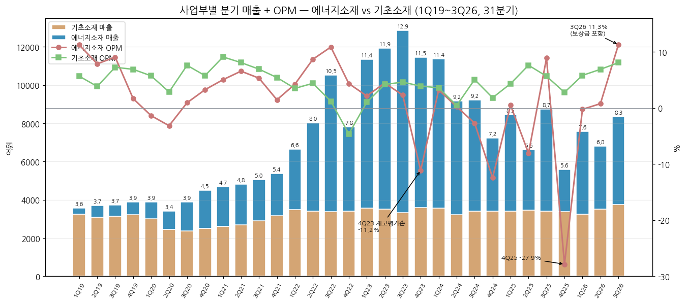

**(2-0) 사업부별 분기 매출·영업이익 — 1Q19~3Q26 31분기 (억원)**

| 분기 | 연결 매출 | 에너지소재 매출 | ㄴ양극재 | ㄴ음극재 | 기초소재 매출 | 에너지소재 OP | 에너지 OPM | 기초소재 OP | 기초 OPM | 연결 OP | 연결 OPM |
|---|---|---|---|---|---|---|---|---|---|---|---|
| 1Q19 | 3,553 | 320 | - | - | 3,233 | 36 | 11.2% | 183 | 5.7% | 219 | 6.2% |
| 2Q19 | 3,698 | 623 | - | - | 3,075 | 49 | 7.9% | 118 | 3.8% | 167 | 4.5% |
| 3Q19 | 3,716 | 585 | - | - | 3,131 | 53 | 9.1% | 227 | 7.3% | 280 | 7.5% |
| 4Q19 | 3,870 | 661 | - | - | 3,209 | 11 | 1.7% | 221 | 6.9% | 232 | 6.0% |
| 1Q20 | 3,875 | 870 | 460 | 410 | 3,005 | -12 | -1.4% | 172 | 5.7% | 160 | 4.1% |
| 2Q20 | 3,402 | 946 | 538 | 408 | 2,456 | -30 | -3.2% | 70 | 2.9% | 40 | 1.2% |
| 3Q20 | 3,887 | 1,518 | 1,053 | 465 | 2,369 | 14 | 0.9% | 180 | 7.6% | 194 | 5.0% |
| 4Q20 | 4,499 | 1,999 | 1,463 | 536 | 2,500 | 65 | 3.3% | 144 | 5.8% | 209 | 4.6% |
| 1Q21 | 4,672 | 2,066 | 1,547 | 519 | 2,606 | 104 | 5.0% | 237 | 9.1% | 341 | 7.3% |
| 2Q21 | 4,800 | 2,105 | 1,677 | 428 | 2,695 | 138 | 6.6% | 218 | 8.1% | 356 | 7.4% |
| 3Q21 | 5,050 | 2,145 | 1,718 | 427 | 2,905 | 114 | 5.3% | 201 | 6.9% | 315 | 6.2% |
| 4Q21 | 5,374 | 2,202 | 1,839 | 363 | 3,172 | 32 | 1.5% | 172 | 5.4% | 204 | 3.8% |
| 1Q22 | 6,646 | 3,171 | 2,722 | 449 | 3,475 | 134 | 4.2% | 121 | 3.5% | 255 | 3.8% |
| 2Q22 | 8,032 | 4,642 | 4,177 | 465 | 3,390 | 403 | 8.7% | 149 | 4.4% | 552 | 6.9% |
| 3Q22 | 10,533 | 7,166 | 6,482 | 684 | 3,367 | 778 | 10.9% | 40 | 1.2% | 818 | 7.8% |
| 4Q22 | 7,808 | 4,404 | 3,839 | 565 | 3,404 | 191 | 4.3% | -158 | -4.6% | 33 | 0.4% |
| 1Q23 | 11,352 | 7,799 | 7,122 | 677 | 3,553 | 167 | 2.1% | 36 | 1.0% | 203 | 1.8% |
| 2Q23 | 11,930 | 8,425 | 7,863 | 562 | 3,505 | 374 | 4.4% | 147 | 4.2% | 521 | 4.4% |
| 3Q23 | 12,858 | 9,531 | 9,015 | 516 | 3,327 | 218 | 2.3% | 153 | 4.6% | 371 | 2.9% |
| 4Q23 | 11,458 | 7,862 | 7,401 | 462 | 3,596 | -877 | -11.2% | 140 | 3.9% | -737 | -6.4% |
| 1Q24 | 11,384 | 7,817 | 7,324 | 493 | 3,567 | 251 | 3.2% | 128 | 3.6% | 379 | 3.3% |
| 2Q24 | 9,155 | 5,933 | 5,430 | 503 | 3,222 | 13 | 0.2% | 14 | 0.4% | 27 | 0.3% |
| 3Q24 | 9,228 | 5,830 | 5,584 | 246 | 3,398 | -158 | -2.7% | 172 | 5.1% | 14 | 0.2% |
| 4Q24 | 7,232 | 3,818 | 3,518 | 300 | 3,414 | -475 | -12.4% | 62 | 1.8% | -413 | -5.7% |
| 1Q25 | 8,454 | 5,056 | 4,665 | 391 | 3,398 | 24 | 0.5% | 147 | 4.3% | 171 | 2.0% |
| 2Q25 | 6,609 | 3,155 | 2,732 | 423 | 3,454 | -255 | -8.1% | 263 | 7.6% | 8 | 0.1% |
| 3Q25 | 8,748 | 5,334 | 5,080 | 254 | 3,414 | 474 | 8.9% | 193 | 5.7% | 667 | 7.6% |
| 4Q25 | 5,576 | 2,196 | 1,979 | 217 | 3,380 | -612 | -27.9% | 94 | 2.8% | -518 | -9.3% |
| 1Q26 | 7,575 | 4,336 | 4,187 | 149 | 3,239 | -11 | -0.3% | 188 | 5.8% | 177 | 2.3% |
| 2Q26 | 6,795 | 3,279 | 2,996 | 283 | 3,516 | 25 | 0.8% | 242 | 6.9% | 267 | 3.9% |
| **3Q26** | 8,348 | 4,596 | 4,323 | 273 | 3,752 | **518** | 11.3% | 303 | 8.1% | 821 | 9.8% |

→ (출처: 1Q20~3Q26 = 회사 IR 「사업부별 매출 및 영업이익」 — 1Q20~2Q23은 2Q23 IR(2023-07-24) p.10, 2022~2024 분기는 4Q24 IR(2025-02-03), 1Q24~3Q26은 3Q26 IR(2026-11-02) p.10 최신치 우선. 1Q19~4Q19 = DART 2020 1Q·반기·3Q·사업보고서의 전기 3부문 재작성치(기초소재 = 내화물 + 라임화성), 4Q = 연간 − 3Q 누적. 양극재/음극재 분리는 2020년부터만 공시 — 2019 연간 양극재 984억·음극재 1,206억(회사 4Q21 IR))
→ **재작성 이력**: 2Q23 양극재 7,683억(2Q23 IR 원문) → 7,863억(4Q24 IR 이후, 에너지소재 합계 8,425와 정합하는 값). 4Q22 에너지소재 OP 186억(4Q22 IR) → 191억, 기초소재 -153 → -158억. 2Q23 에너지소재 OP 375 → 374억
→ 3Q26은 **DART 3Q26 분기보고서(2026-11-13)와 IR 발표치 일치** (매출 8,348억·OP 821억, 에너지소재 OP 518억 vs DART 부문 518억) — 잠정 아님

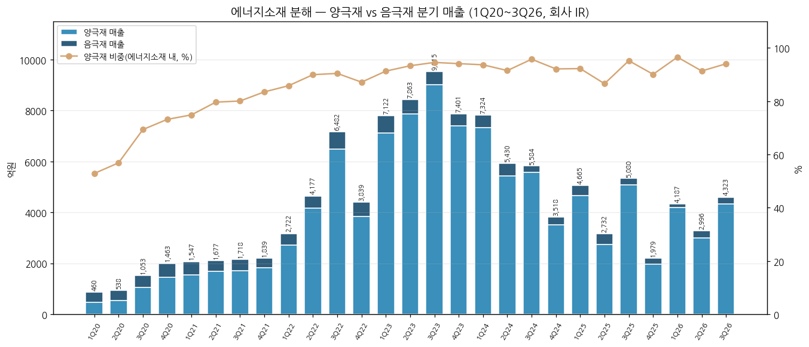

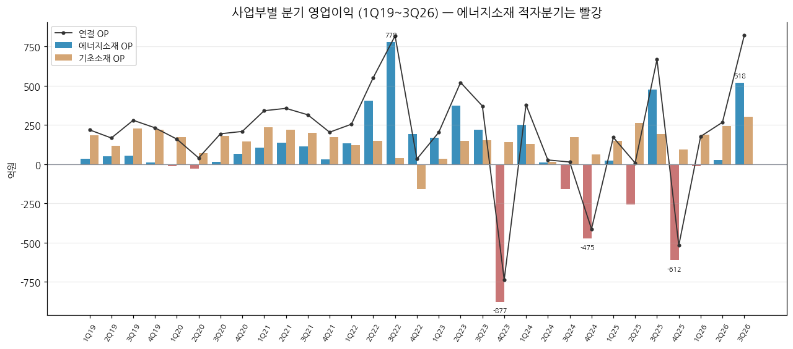

**(2-0a) ESM 합병 전 구 부문 분기 실적 — 1Q14~4Q18 20분기 (DART 영업부문 주석, 억원)**

| 분기 | 내화물제조정비 매출 | OP | OPM | 라임케미칼 매출 (음극재 포함) | OP | OPM | 부문 합계 매출 | 부문 합계 OP |
|---|---|---|---|---|---|---|---|---|
| 1Q14 | 1,255 | 146 | 11.6% | 2,118 | 92 | 4.3% | 3,373 | 238 |
| 2Q14 | 1,198 | 140 | 11.7% | 2,214 | 100 | 4.5% | 3,412 | 240 |
| 3Q14 | 1,158 | 149 | 12.9% | 2,254 | 113 | 5.0% | 3,412 | 262 |
| 4Q14 | 1,111 | 130 | 11.7% | 2,403 | 79 | 3.3% | 3,514 | 209 |
| 1Q15 | 1,287 | 198 | 15.4% | 1,976 | -40 | -2.0% | 3,263 | 158 |
| 2Q15 | 1,137 | 156 | 13.7% | 1,894 | -191 | -10.1% | 3,031 | -35 |
| 3Q15 | 1,051 | 114 | 10.8% | 1,937 | 136 | 7.0% | 2,988 | 250 |
| 4Q15 | 1,054 | 112 | 10.6% | 1,876 | 76 | 4.1% | 2,930 | 188 |
| 1Q16 | 1,047 | 136 | 13.0% | 1,734 | -13 | -0.7% | 2,781 | 123 |
| 2Q16 | 999 | 113 | 11.3% | 1,713 | 74 | 4.3% | 2,712 | 187 |
| 3Q16 | 979 | 80 | 8.2% | 1,756 | 146 | 8.3% | 2,735 | 226 |
| 4Q16 | 1,060 | 147 | 13.9% | 1,737 | 154 | 8.9% | 2,797 | 301 |
| 1Q17 | 1,099 | 113 | 10.3% | 1,760 | 192 | 10.9% | 2,859 | 305 |
| 2Q17 | 1,134 | 150 | 13.2% | 1,807 | 120 | 6.6% | 2,941 | 270 |
| 3Q17 | 1,168 | 123 | 10.5% | 1,816 | 131 | 7.2% | 2,984 | 254 |
| 4Q17 | 1,186 | 105 | 8.9% | 2,140 | 121 | 5.7% | 3,326 | 226 |
| 1Q18 | 1,413 | 128 | 9.1% | 1,956 | 103 | 5.3% | 3,369 | 231 |
| 2Q18 | 1,237 | 91 | 7.4% | 2,109 | 118 | 5.6% | 3,346 | 209 |
| 3Q18 | 1,263 | 128 | 10.1% | 2,198 | 203 | 9.2% | 3,461 | 331 |
| 4Q18 | 1,310 | 101 | 7.7% | 2,349 | 191 | 8.1% | 3,659 | 292 |

→ (출처: 각 분기·반기·사업보고서 연결 영업부문 주석 「외부고객으로부터의 수익」·「보고부문영업이익」. 1Q17·1Q18은 반기 누적 − 2Q 3개월, 4Q는 연간 − 3Q 누적으로 계산. 2015는 당시 보고치(2016 사업보고서는 2015 라임케미칼을 7,683 → 7,223억으로 재분류))
→ 라임케미칼 안에 **음극재(세종)** 매출 포함 — 분리 공시 없음 [미확보]. 2Q15 라임케미칼 -191억은 유가 급락에 따른 화성품 재고·판가 손실 영향(당시 보고서 부문 수치 기준, 원인 상세는 [미확보])

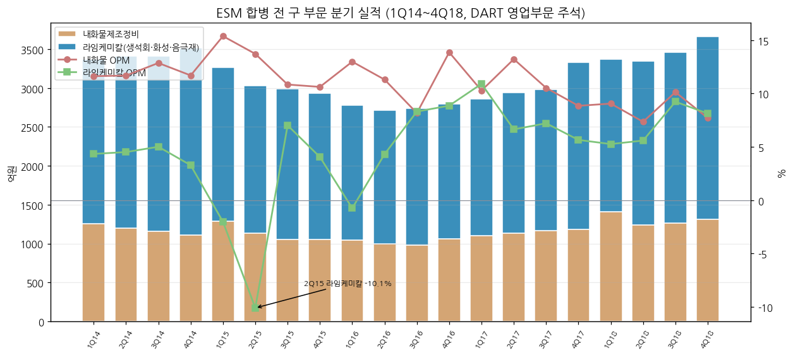

**(2-0b) 연결 분기 51분기 (1Q14~3Q26, 억원)**

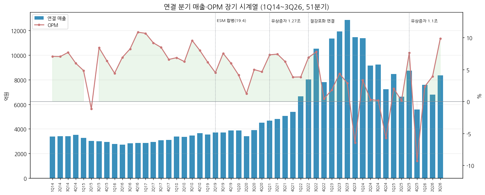

| 분기 | 매출 (억) | 영업이익 | OPM | 매출 YoY | OP YoY | 순이익 |
|---|---|---|---|---|---|---|
| 1Q14 | 3,373 | 238 | 7.1% | - | - | - |
| 2Q14 | 3,412 | 240 | 7.0% | - | - | - |
| 3Q14 | 3,412 | 262 | 7.7% | - | - | - |
| 4Q14 | 3,514 | 210 | 6.0% | - | - | - |
| 1Q15 | 3,263 | 158 | 4.8% | -3.3% | -33.6% | - |
| 2Q15 | 3,031 | -35 | -1.2% | -11.2% | 적전 | - |
| 3Q15 | 2,988 | 251 | 8.4% | -12.4% | -4.2% | - |
| 4Q15 | 2,929 | 187 | 6.4% | -16.6% | -11.0% | - |
| 1Q16 | 2,780 | 123 | 4.4% | -14.8% | -22.2% | 30 |
| 2Q16 | 2,712 | 187 | 6.9% | -10.5% | 흑전 | 12 |
| 3Q16 | 2,818 | 232 | 8.2% | -5.7% | -7.6% | 183 |
| 4Q16 | 2,867 | 311 | 10.8% | -2.1% | 66.3% | 221 |
| 1Q17 | 2,859 | 305 | 10.7% | 2.8% | 148.0% | 230 |
| 2Q17 | 2,941 | 270 | 9.2% | 8.4% | 44.4% | 176 |
| 3Q17 | 3,072 | 260 | 8.5% | 9.0% | 12.1% | 303 |
| 4Q17 | 3,100 | 204 | 6.6% | 8.1% | -34.4% | 330 |
| 1Q18 | 3,369 | 231 | 6.9% | 17.8% | -24.3% | 315 |
| 2Q18 | 3,346 | 209 | 6.2% | 13.8% | -22.6% | 321 |
| 3Q18 | 3,462 | 331 | 9.6% | 12.7% | 27.3% | 372 |
| 4Q18 | 3,659 | 292 | 8.0% | 18.0% | 43.1% | 320 |
| 1Q19 | 3,553 | 219 | 6.2% | 5.5% | -5.2% | 329 |
| 2Q19 | 3,698 | 167 | 4.5% | 10.5% | -20.1% | 234 |
| 3Q19 | 3,717 | 280 | 7.5% | 7.4% | -15.4% | 300 |
| 4Q19 | 3,869 | 232 | 6.0% | 5.7% | -20.5% | 149 |
| 1Q20 | 3,875 | 160 | 4.1% | 9.1% | -26.9% | 142 |
| 2Q20 | 3,402 | 41 | 1.2% | -8.0% | -75.4% | -72 |
| 3Q20 | 3,887 | 194 | 5.0% | 4.6% | -30.7% | 69 |
| 4Q20 | 4,499 | 209 | 4.6% | 16.3% | -9.9% | 158 |
| 1Q21 | 4,672 | 341 | 7.3% | 20.6% | 113.1% | 398 |
| 2Q21 | 4,800 | 356 | 7.4% | 41.1% | 768.3% | 339 |
| 3Q21 | 5,050 | 315 | 6.2% | 29.9% | 62.4% | 409 |
| 4Q21 | 5,373 | 205 | 3.8% | 19.4% | -1.9% | 192 |
| 1Q22 | 6,646 | 255 | 3.8% | 42.3% | -25.2% | 360 |
| 2Q22 | 8,032 | 552 | 6.9% | 67.3% | 55.1% | 464 |
| 3Q22 | 10,533 | 818 | 7.8% | 108.6% | 159.7% | 656 |
| 4Q22 | 7,808 | 33 | 0.4% | 45.3% | -83.9% | -261 |
| 1Q23 | 11,352 | 203 | 1.8% | 70.8% | -20.4% | 402 |
| 2Q23 | 11,930 | 521 | 4.4% | 48.5% | -5.6% | 431 |
| 3Q23 | 12,858 | 371 | 2.9% | 22.1% | -54.6% | 232 |
| 4Q23 | 11,458 | -737 | -6.4% | 46.7% | 적전 | -1,021 |
| 1Q24 | 11,384 | 379 | 3.3% | 0.3% | 86.7% | 570 |
| 2Q24 | 9,155 | 27 | 0.3% | -23.3% | -94.8% | -112 |
| 3Q24 | 9,228 | 14 | 0.2% | -28.2% | -96.2% | -12 |
| 4Q24 | 7,232 | -413 | -5.7% | -36.9% | 적지 | -2,759 |
| 1Q25 | 8,454 | 172 | 2.0% | -25.7% | -54.6% | 489 |
| 2Q25 | 6,609 | 8 | 0.1% | -27.8% | -70.4% | -355 |
| 3Q25 | 8,748 | 667 | 7.6% | -5.2% | 4664.3% | 464 |
| 4Q25 | 5,576 | -518 | -9.3% | -22.9% | 적지 | -233 |
| 1Q26 | 7,575 | 177 | 2.3% | -10.4% | 2.9% | 63 |
| 2Q26 | 6,795 | 267 | 3.9% | 2.8% | 3237.5% | 247 |
| **3Q26** | **8,348** | **821** | 9.8% | -4.6% | 23.1% | 464 |

→ (출처: 1Q16~3Q26 = OpenDART fnlttSinglAcntAll 연결 (dart_quarterly_summary, 4Q = 연간 − 3Q 누적), 1Q14~4Q15 = DART 영업부문 주석 합계(부문 합계 = 연결 매출·영업이익 일치 확인), 2014·2015 분기 순이익은 미추출)

**(2-1) 최근 12분기 (chart10)**

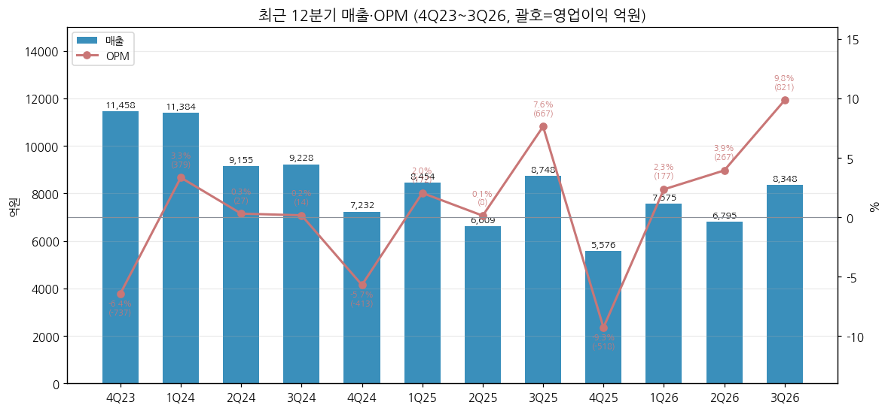

→ 3Q26: 매출 **8,348억(YoY -4.6%, QoQ +22.9%)** / 영업이익 **821억(YoY +23.1%, QoQ +207%)** / OPM **9.8%** / 순이익 464억 / EBITDA 1,360억 (DART 3Q26 분기보고서 = 회사 IR)
→ 3Q26 컨센서스 영업이익 179억 대비 큰 폭 상회 (stockhub 2026-11, 유안타 인용) — 고객사 미이행 보상금·중국向 재고 판매 이익 등 일회성 포함 (stockhub 기사 요지)

(3) 사업부별 개요 (매출 비중 큰 순서, 9M26 DART)

**① 에너지소재사업부 (53.7%)**
→ **양극재** (9M26 11,506억) — 하이니켈 NCM(N65·N86)·NCMA, 삼성SDI向 NCA, 단결정, 신규 전동공구·BBU·보조배터리向 공급(1Q26 1,000억+, BT 리뷰). 원재료 전구체 등 매입 3,777억(9M26 원재료 매입의 67%, DART). **LFP**: 포항 삼원계 라인 개조로 LFP 105천톤 전환 예정 + 씨앤피신소재(LFP) off-take 2027.4Q~ (3Q26 IR)
→ **음극재** (9M26 705억) — 천연흑연(세종 74천톤)·인조흑연(포항 13천톤)·실리콘 개발. 中 저가공세로 판가·판매 동반 부진 (4Q25 IR), 3Q26 재고평가손 인식. 탈중국 공급망(새만금 구형흑연 37천톤 건설중, 베트남 인조흑연) + 글로벌 자동차사 장기계약 1.7조
→ **전구체** — 광양 45천톤 (2025.06 준공, 그룹 원료 활용 수직계열화)

**② 기초소재사업부 (46.3%)**
→ **라임화성** (31.8%) — 포스코 포항·광양 생석회 공급(국내 제철용 생석회는 당사와 현대제철이 사실상 유일, DART), 화성공장 위탁운영 + 콜타르·조경유 등 화성품 판매(유가 연동). 9M26 OP 742억으로 전사 최대 이익원
→ **내화물** (14.5%) — 내화물 제조·노재정비·플랜트 공사. 포스코 전로 수리 대수·외부 석유화학 플랜트 수주에 연동

(4) 사업부별 디테일 (top-seller / growth / 이익 outlier)

→ **Top-seller** — 양극재 (2023 정점 3.14조, 전사 매출의 66%)
→ **Growth** — 양극재 2020 3,514억 → 2023 31,401억 (3년 **8.9배**), 이후 2025 14,456억(-54%)으로 급반락 — 성장과 역성장을 모두 이 한 제품이 결정
→ **이익 outlier (+)** — 3Q22 에너지소재 OPM 10.9% (메탈가 상승기 재고효과), 3Q26 11.3% (보상금 포함)
→ **이익 outlier (-)** — 4Q23 -11.2%(재고평가손), 4Q24 -12.4%(불용재고평가손 298억), **4Q25 -27.9%(-612억, 판매·생산 감소 고정비 + 평가손)** — 메탈가 하락기 4분기마다 재고·평가 손실이 집중되는 패턴
→ **기초소재 outlier** — 3Q22 40억(냉천 범람에 따른 포항 생석회 판매 감소·마그네시아 대수리, 3Q22 IR), 4Q22 -158억(원인 상세 [미확보]), 2Q24 14억 / 9M26 OPM 7.0%(라임 판가 상승·고마진 제품 전환, 4Q25·3Q26 IR)

(5) 주요 경쟁사 (사업부별)

| 사업 | 국내 | 해외 |
|---|---|---|
| 하이니켈 삼원계 양극재 | 에코프로비엠, 엘앤에프, LG화학(첨단소재), 삼성SDI 계열 | Umicore(벨기에), Ronbay(론바이), B&M(화유코발트 자회사), BASF Toda — SNE리서치 2023 순위 기준 |
| LFP 양극재 | 엘앤에프(LFP 진출) | 중국 Hunan Yuneng·Dynanonic 등 (LFP는 중국 장악, 디지털데일리 2024-06) |
| 음극재 | 대주전자재료(실리콘), SK온 등 자체 | BTR, Shanshan, Putailai 등 중국 업체 (中 저가공세, 회사 IR) |
| 내화물 | 조선내화, 한국내화 | - |
| 생석회·화성품 | 현대제철(자체 생석회·화성) | - |

→ (해외 양극재 업체 순위는 디지털데일리 2024-06-17 SNE리서치 인용 — 개별 피어 매출·점유율 수치는 [미확보])

(6) 주요 매출처

→ **DART 공시** — 에너지소재: Ultium Cells, LG에너지솔루션, 삼성SDI, SK온 등 (9M26 연결 매출의 53.7%) / 내화물: ㈜포스코 등 / 라임화성: ㈜포스코, ㈜OCI, PT.Krakatau POSCO 등 — DART는 고객명을 열거만 하고 금액 순위는 익명(A~D사)
→ **10% 이상 고객 (9M26, 익명)**: 에너지소재 A사 2,225억 · C사 2,685억 / 기초소재 D사 6,753억 (전분기 2Q26 누적: 에너지 A사 4,510억·B사 5,426억)
→ **추정 순서 [추정]**: 기초소재 D사 = 포스코(제철소 생석회 공급계약 2025년 4,084억, DART), 에너지소재 A·B·C = 삼성SDI(NCA)·LG에너지솔루션·GM/Ultium Cells — 개별 매칭은 공시상 확인 불가

**주요 장기공급계약 (DART 2025 사업보고서 「공시내용 진행 및 변경사항」, 백만원)**

| 신고일 | 계약 | 상대 | 계약기간 | 계약금액 | 누적 공급 (2025말) |
|---|---|---|---|---|---|
| 2022-07-28 | EV용 하이니켈 NCM 양극재 | General Motors | 2023~2025 | 2,811,151 (2025.12.31 정정) | 2,811,151 |
| 2022-08-25 | ESS용 양극재 | (비공개) | 2022.08~2026.08 | 1,051,702 | 106,652 (2025.08 **해지**) |
| 2022-12-05 | EV용 인조흑연 음극재 | Ultium Cells | 2023~2028 | 939,347 | 249 |
| 2023-01-30 | EV용 하이니켈 NCA 양극재 | 삼성SDI | 2023~2032 | **40,026,151** | 750,867 |
| 2023-04-26 | EV용 양극재 | LG에너지솔루션 | 2023~2029 | **30,259,519** | 2,734,667 |
| 2024-09-11 | EV용 하이니켈 양극재 | 이차전지 제조사 | - | 1,845,370 | - |
| 2025-10-14 | 이차전지용 천연흑연 음극재 | (글로벌 자동차사) | 2027.10~2031.09 | 671,038 | - |
| 2024-12-30 | 생석회·석회석·백운석 | 포스코 포항·광양 | 2025 | 408,408 | 442,975 |

→ 삼성SDI 40.0조·LGES 30.3조 계약의 누적 이행률은 각각 **1.9%·9.0%** [계산] — 장기계약 금액은 메탈가·물량 가정치이며 이행률이 극히 낮음. GM 계약은 정정공시로 2.81조(이행 완료 기준)로 확정
→ 2026.03 글로벌 자동차사 천연흑연 1조원 추가 장기계약 (회사 3Q26 IR — DART 단일판매공시 원문은 [미확보])

(7) 생산 CAPA + 임직원 추이

**에너지소재 CAPA (회사 3Q26 IR p.7, 2026.11 기준, 천톤/년)**

| 거점 | 품목 | 가동 | 건설중·전환 | 비고 |
|---|---|---|---|---|
| 광양 | 양극재 1·2공장 | 90 | 3공장 55 | 하이니켈 NCM/NCMA |
| 포항 | 양극재 1공장 | 60 | 2공장 45 | **LFP 전환 진행 → 105 예정** |
| 광양 | 전구체 | 45 | - | 2025.06 준공 |
| 캐나다 | 얼티엄캠 양극재 (GM JV 85%) | - | 33 | 잔여 출자약정 USD 484백만(2025말, DART) |
| 중국 | 절강포화 양극재 / 절강화포 전구체 | 25 / 30 | - | 화유코발트 합작 |
| 세종 | 천연흑연 음극재 | 74 | - | |
| 포항 | 인조흑연 음극재 | 13 | - | |
| 새만금 | 구형흑연 (퓨처그라프) | - | 37 | Non-PFE 공급망 |
| 베트남 | 인조흑연 | - | 비공개 | 2026 법인 설립 |

→ 양극재 가동 CAPA 합계 175천톤(국내 150 + 중국 25) / 건설중 133천톤 [계산]. BT 1Q26 리뷰 정리(증권사 인용)는 2026 양극재 32.0만톤으로 다른 기준 — 회사 기준표 우선
→ 기초소재 생산능력 (DART): 내화물 116,560톤/년(포항), 생석회 포항 1,095,000 + 광양 1,095,000톤/년. 9M26 생산 생석회 1,775,629톤

**임직원 (별도, DART 사업보고서 직원현황, 명)**

| 2015 | 2016 | 2017 | 2021 | 2022 | 2023 | 2024 | 2025 |
|---|---|---|---|---|---|---|---|
| 1,324 | 1,265 | 1,283 | 2,019 | 2,335 | 2,805 | 3,045 | 2,979 |

→ 2023은 기업가치제고계획(2024.12) 기재치. 2014·2018~2020 직원 합계는 원문 표 구조 차이로 미추출 [미확보]
→ 양극재 확장기(2017→2024) 인원 2.4배, 2025 첫 감소(-66명)

---

## ④ 재무 구조 (12년 시계열)

(1) 손익계산서

| 연도 | GPM | 판관비율 (GP-OP)/매출 | OPM | NPM | EBITDA (억, 회사 IR) |
|---|---|---|---|---|---|
| 2014 | 11.1% | 4.2% | 6.9% | 5.3% | - |
| 2015 | 9.2% | 4.6% | 4.6% | 2.6% | - |
| 2016 | 12.6% | 5.0% | 7.6% | 4.0% | - |
| 2017 | 13.0% | 4.3% | 8.7% | 8.7% | - |
| 2018 | 12.0% | 4.3% | 7.7% | 9.6% | - |
| 2019 | 11.2% | 5.1% | 6.1% | 6.8% | 1,338 |
| 2020 | 9.2% | 5.4% | 3.8% | 1.9% | 1,252 |
| 2021 | 12.0% | 5.9% | 6.1% | 6.7% | 2,036 |
| 2022 | 10.1% | 5.1% | 5.0% | 3.7% | 2,572 |
| 2023 | 5.4% | 4.6% | 0.8% | 0.1% | 1,740 |
| 2024 | 6.4% | 6.4% | 0.0% | -6.3% | 1,848 |
| 2025 | 8.7% | 7.6% | 1.1% | 1.2% | 2,363 |

→ (출처: OpenDART 연결 IS [계산]. 판관비율은 매출총이익 − 영업이익 = 판관비 등 근사 — OpenDART 판관비 계정이 연도별로 미태깅. EBITDA = 회사 IR(2021-04, 2022-01, 2024-01, 2026-01 실적발표))
→ GPM이 2017 13.0% → 2023 5.4%로 반토막 — 저마진 양극재 비중 확대(믹스 효과) + 메탈가 하락기 재고손실. 2017~2018 NPM > OPM은 피엠씨텍 등 지분법이익(2018 709억, OpenDART) 효과


(2) 재무상태표 (연결, 억원)

| 연도 | 자산총계 | 유동자산 | 현금성자산 | 재고자산 | 유형자산 | 부채총계 | 유동부채 | 자본총계 | 부채비율 | 유동비율 |
|---|---|---|---|---|---|---|---|---|---|---|
| 2014 | 7,216 | 3,898 | 582 | 668 | 1,360 | 2,068 | 1,539 | 5,148 | 40.2% | 253.3% |
| 2015 | 7,175 | 3,874 | 1,612 | 714 | 1,449 | 1,793 | 1,329 | 5,382 | 33.3% | 291.5% |
| 2016 | 7,239 | 4,207 | 1,178 | 562 | 1,367 | 1,545 | 1,209 | 5,694 | 27.1% | 347.9% |
| 2017 | 8,358 | 4,683 | 1,041 | 986 | 1,827 | 1,837 | 1,589 | 6,522 | 28.2% | 294.7% |
| 2018 | 9,476 | 4,399 | 1,205 | 1,089 | 2,635 | 1,895 | 1,527 | 7,581 | 25.0% | 288.1% |
| 2019 | 17,301 | 6,496 | 2,101 | 1,884 | 7,553 | 7,238 | 2,507 | 10,063 | 71.9% | 259.2% |
| 2020 | 20,881 | 8,106 | 1,217 | 1,866 | 9,319 | 10,644 | 2,206 | 10,236 | 104.0% | 367.4% |
| 2021 | 39,225 | 20,842 | 723 | 4,406 | 14,589 | 14,841 | 6,346 | 24,384 | 60.9% | 328.4% |
| 2022 | 46,375 | 20,375 | 2,814 | 8,701 | 20,980 | 19,868 | 9,658 | 26,506 | 75.0% | 211.0% |
| 2023 | 63,346 | 24,119 | 3,896 | 9,167 | 33,595 | 37,231 | 13,964 | 26,115 | 142.6% | 172.7% |
| 2024 | 79,325 | 21,127 | 6,442 | 7,682 | 51,595 | 46,120 | 15,701 | 33,205 | 138.9% | 134.6% |
| 2025 | 91,439 | 21,701 | 3,198 | 8,411 | 62,525 | 46,318 | 16,583 | 45,121 | 102.7% | 130.9% |

→ **3Q26말**: 자산 90,818 / 부채 46,399 / 자본 44,418(지배 39,828) / 유형자산 64,146 / 현금및현금성자산 5,398 / 재고자산 6,447억 — 부채비율 **104%** (DART 3Q26 분기보고서, 회사 IR)
→ 유형자산 2018 2,635억 → 2025 62,525억 (**23.7배**) — 자산 증가의 대부분이 양극재·음극재·전구체·얼티엄캠 설비

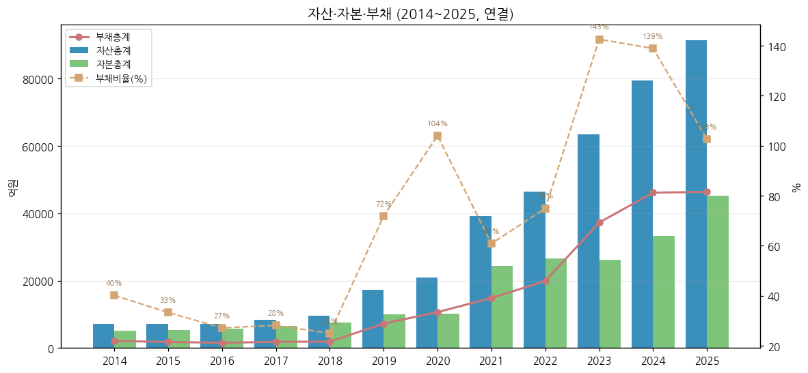

(3) 현금흐름표 (연결, 억원)

| 연도 | 영업CF | 투자CF | 재무CF | 유형자산 취득 | 무형자산 취득 | CapEx 합계 | CapEx/매출 | FCF (영업CF-CapEx) |
|---|---|---|---|---|---|---|---|---|
| 2014 | 502 | -902 | 123 | 459 | 10 | 469 | 3.4% | 33 |
| 2015 | 616 | 586 | -173 | 286 | 6 | 292 | 2.4% | 324 |
| 2016 | 851 | -1,063 | -223 | 233 | 2 | 235 | 2.1% | 616 |
| 2017 | 555 | -462 | -230 | 594 | 13 | 607 | 5.1% | -52 |
| 2018 | 846 | -387 | -294 | 1,009 | 38 | 1,047 | 7.6% | -201 |
| 2019 | 628 | -2,914 | 3,182 | 3,087 | 28 | 3,115 | 21.0% | -2,487 |
| 2020 | 383 | -2,543 | 3,020 | 2,426 | 29 | 2,455 | 15.7% | -2,073 |
| 2021 | 1,030 | -16,750 | 15,219 | 5,519 | 103 | 5,622 | 28.3% | -4,592 |
| 2022 | -610 | -546 | 3,363 | 6,591 | 68 | 6,659 | 20.2% | -7,269 |
| 2023 | -4,448 | -10,314 | 15,916 | 13,523 | 137 | 13,660 | 28.7% | -18,109 |
| 2024 | 6,709 | -18,104 | 13,754 | 20,416 | 165 | 20,581 | 55.6% | -13,872 |
| 2025 | -336 | -17,268 | 14,303 | 14,989 | 104 | 15,093 | 51.4% | -15,429 |

→ (출처: OpenDART 연결 CF. FCF = 영업CF − (유형+무형자산 취득) [계산])
→ **FCF 7년 연속 마이너스 (2019~2025 누계 -6.38조)** — 2021·2025 유상증자(합계 약 2.37조)와 회사채·신종자본증권으로 충당
→ 2023 영업CF -4,448억: 매출 급증기 운전자본(재고·매출채권) 확대. 2024 +6,709억: 매출 감소로 운전자본 회수
→ **9M26**: 영업CF +3,340억 / 투자CF -2,726억 / CapEx 6,010억(유형 5,947 + 무형 63) → FCF -2,670억 [계산, DART 3Q26 누적]

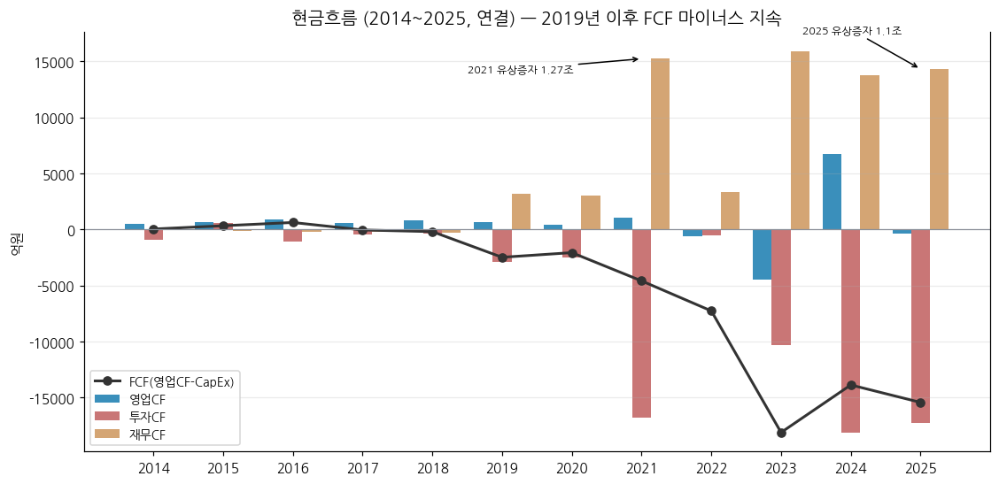

(4) CapEx

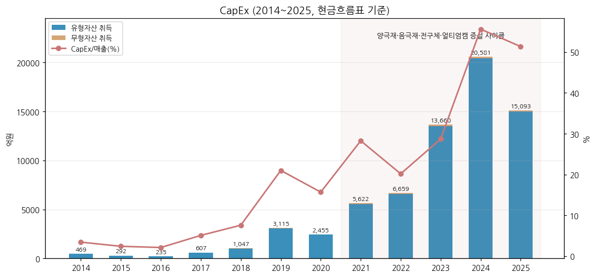

→ **2014~2018 유지보수형** — 연 235~1,047억, 매출 대비 2~8%
→ **2019~2022 1차 증설** — 광양 양극재 1~4단계(9만톤), 세종 음극재 2공장, 포항 인조흑연 → 연 2,455~6,659억
→ **2023~2025 대규모 증설 정점** — 포항 양극재 1·2공장, 광양 전구체, 캐나다 얼티엄캠, 절강포화 2공장 → 2024 **2조 581억(매출의 56%)** 정점, 2025 1.51조
→ **2026 이후** — 9M26 6,010억으로 둔화. BT 1Q26 리뷰 인용 증권사(KB·BNK) 2026 CapEx 추정 7,000~9,000억. 얼티엄캠 잔여 출자약정 USD 484백만(2025말, 2026년까지 캐피탈콜, DART)

(5) 부채구조 + 채무증권 발행 history

| 시점 | 총차입금 (억) | 순차입금 (억) | 순차입금비율 | 출처 |
|---|---|---|---|---|
| 2019말 | 4,160 | - | 20.5% | 회사 1Q21 IR |
| 2020말 | 7,366 | 6,100 | 60.1% | 회사 1Q21 IR |
| 2021말 | 10,146 | -3,366 | -13.8% | 회사 4Q23 IR |
| 2022말 | 13,913 | 5,850 | 22.1% | 회사 4Q23 IR |
| 2023말 | 28,979 | 22,675 | 86.8% | 회사 4Q23 IR |
| 2024말 | 35,639 | 28,483 | 85.8% | 회사 4Q25 IR |
| 2025말 | 38,670 | 31,323 | 69.4% | 회사 4Q25 IR |
| **3Q26말** | **40,284** | **34,553** | **78%** | 회사 3Q26 IR |

**주요 채무증권 (DART 2023~3Q26 보고서 「채무증권 발행실적」)**

| 발행일 | 종류 | 금액 (억) | 금리 | 만기 | 등급 |
|---|---|---|---|---|---|
| 2023.02 | ESG 회사채 | 4,000 | - | - | AA- (회사 1Q23 IR) |
| 2024.07.24 | 공모 녹색채권 / 공모 회사채 | 4,800 / 1,200 | 3.484% / 3.593% | 2026.09 / 2028.09 | AA- |
| 2024.08.28 | 사모 녹색채권 | 798 | 6.420% | 2027.08 | - |
| **2024.12.18** | **신종자본증권 (사모)** | **6,000** | 4.638% | 2054.12 (30년) | 한신평 자본인정 약 50% |
| 2026.01.15 | 공모 회사채 / 녹색채권 | 3,900 / 600 | 3.574% / 3.884% | 2029.01 / 2031.01 | AA- |
| 2026.11.12 | 공모 회사채 2·3년물 | 500 / 1,500 | 4.247% / 4.381% | 2028.11 / 2029.11 | AA- |

→ **3Q26말 회사채 미상환 1조 4,500억** (1년 이하 5,800 / 1~2년 3,000 / 2~3년 5,100 / 4~5년 600억) + 신종자본증권 6,000억 (DART 3Q26). 2023년 회사채 회차별 상세는 [미확보]
→ 차입금 대비 영업이익 부담: 2025 이자지급 583억 vs 영업이익 328억 → **이자보상배율 0.6배** [계산]

(6) 배당·자사주

| 사업연도 | DPS (원) | 현금배당총액 (억) | 배당성향(연결) | 발행주식수 | 비고 |
|---|---|---|---|---|---|
| 2014 | 1,750 | 103 | 14.1% | 59,070,000 | 액면 5,000원 기준 (액면분할 환산 175원) |
| 2015 | 200 | 118 | 34.2% | 59,070,000 | 2015 액면분할 5,000→500원 |
| 2016 | 300 | 177 | 40.6% | 59,070,000 |  |
| 2017 | 350 | 207 | 19.9% | 59,070,000 |  |
| 2018 | 400 | 236 | 17.8% | 59,070,000 |  |
| 2019 | 400 | 244 | 24.1% | 60,988,220 | ESM 합병 신주 1,918,220주 |
| 2020 | 300 | 183 | 61.9% | 60,988,220 |  |
| 2021 | 300 | 232 | 17.3% | 77,463,220 | 유상증자 16,475,000주 (2021.02) |
| 2022 | 300 | 232 | 19.6% | 77,463,220 |  |
| 2023 | 250 | 194 | 67.4% | 77,463,220 |  |
| 2024 | 0 | 0 | - | 77,463,220 | 연결 순손실 → 무배당 |
| 2025 | 250 | 222 | 60.9% | 88,946,220 | 유상증자 11,483,000주 (2025.08) |

→ (출처: 각 사업보고서 「배당에 관한 사항」, OpenDART alotMatter 2025)
→ **자사주 매입·소각 이력 없음** — 자기주식은 RSU(양도제한조건부주식) 지급·환수용 소량 (2025말 35주, DART)
→ 배당 정책: 「전년 수준 배당금 유지」(기업가치제고계획 2024.12) → 실제 FY2024 무배당, FY2025 250원 재개

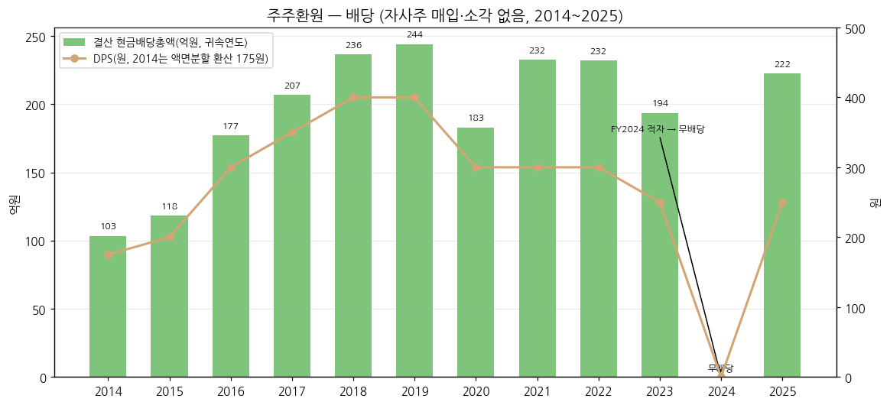

(7) 재무비율

| 연도 | ROE(지배, 평균자본) | ROA(평균자산) | 부채비율 | 유동비율 | 이자보상배율 (OP/이자지급) | 금융비용 (억) |
|---|---|---|---|---|---|---|
| 2014 | - | - | 40.2% | 253.3% | 38.8배 | 47 |
| 2015 | 6.7% | 4.5% | 33.3% | 291.5% | 23.9배 | 60 |
| 2016 | 8.0% | 6.2% | 27.1% | 347.9% | 43.6배 | 41 |
| 2017 | 17.2% | 13.3% | 28.2% | 294.7% | - | 55 |
| 2018 | 19.0% | 14.9% | 25.0% | 288.1% | - | 36 |
| 2019 | 11.6% | 7.6% | 71.9% | 259.2% | 28.5배 | 67 |
| 2020 | 3.0% | 1.6% | 104.0% | 367.4% | 4.7배 | 450 |
| 2021 | 7.9% | 4.5% | 60.9% | 328.4% | 14.4배 | 342 |
| 2022 | 4.9% | 2.8% | 75.0% | 211.0% | 21.3배 | 1,754 |
| 2023 | 1.2% | 0.1% | 142.6% | 172.7% | 0.4배 | 1,758 |
| 2024 | -8.0% | -3.2% | 138.9% | 134.6% | 0.0배 | 2,348 |
| 2025 | 0.9% | 0.4% | 102.7% | 130.9% | 0.6배 | 1,581 |

→ (출처: OpenDART 연결 [계산]. 2017·2018 이자지급 계정 미태깅 → 이자보상배율 공란. 이자보상배율은 영업이익 / 현금흐름표 이자지급)
→ ROE 정점 2018 **19.0%** → 2024 -8.0% → 2025 0.9%. 회사 목표 ROIC 2027 3.7% (2023 1.3%, 기업가치제고계획)

---

## ⑤ 지배 구조

(1) 그룹·계열 관계

→ **포스코홀딩스(지주) → 포스코퓨처엠 58.18%** — 포스코그룹 「이차전지소재」 축의 핵심 상장 계열사
→ 그룹 원료 연계: 리튬(포스코홀딩스 계열 수산화리튬)·니켈(그룹 니켈 정제) 활용 전구체·양극재 수직계열화 추진 (회사 IR 2021~2022, 기업가치제고계획)
→ 포스코(철강) 제철소가 기초소재의 최대 고객 — 생석회 연간 공급계약(2025년 4,084억, DART), 화성공장 위탁운영
→ 공동기업 포스코엠씨머티리얼즈(60%, 미쓰비시케미칼 합작, 침상코크스·인조흑연 원료) / 관계기업 씨앤피신소재(20%, LFP — 중국 CNGR 합작, BT 리뷰)

(2) 주주 구분

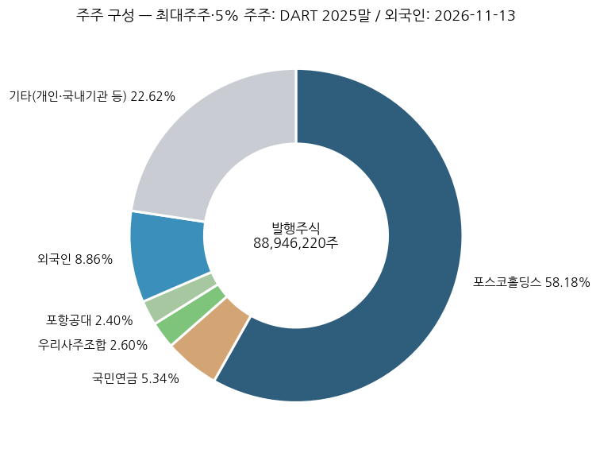

| 주주 | 주식수 | 지분율 | 기준 |
|---|---|---|---|
| 포스코홀딩스㈜ | 51,747,787 | **58.18%** | 2025말·2026.09말 동일 (DART) |
| 국민연금공단 | 4,753,503 | 5.34% | 2025말 (DART 5% 이상 주주) |
| 우리사주조합 | 2,308,729 | 2.60% | 2025말 (DART) |
| (학)포항공과대학교 | 2,134,587 | 2.40% | 2026.09말 (특수관계인, DART) |
| 외국인 합계 | - | **8.86%** | 2026-11-13 (stockhub) |
| 소액주주 | 29,551,260 | 33.24% (374,519명) | 2025말 (DART) |

→ 최대주주 등 합계 60.6% (2026.09말) — 유통주식 비중이 낮아(약 40%) 지수·수급 이벤트에 주가 변동성 확대
→ 외국인 비중은 이차전지 대형주 중 낮은 편 — 피어 비교 수치는 [미확보]

(3) 임원·이사회 (2025말 DART 임원현황 + 2026.03 주총)

| 성명 | 구분 | 직책 | 주요 경력 |
|---|---|---|---|
| **엄기천** | 사내이사 | **대표이사 사장** | 1966.01, 성균관대 기계설계학, 前 포스코퓨처엠 에너지소재사업부장 (2025.03 대표 선임) |
| 정대형 | 사내이사 | 전무 | 1968.04, 연세대 경영학, 기획지원본부장 (2024.04~) |
| 김성진 | 사내이사 | - | 2026.03 정기주총 신규 선임 (DART 3Q26, 경력 상세 [미확보]) |
| 천성래 | 기타비상무이사 | - | 포스코홀딩스 사업시너지본부장 (2025.03~) |
| 권오철 | 사외이사 | 사외이사후보추천위원장 | 前 미코파워 사외이사, 서울대 무역학 |
| 윤태화 | 사외이사 | 감사위원장 | 가천대 경영학부 교수, 연세대 경영학 박사 |
| 이복실 | 사외이사 | 감사위원 | 롯데카드 사외이사, USC 교육학 박사 |
| 허경욱 | 사외이사 | 감사위원 | 법무법인 태평양 고문, Stanford MBA (2025.03~) |

→ 대표이사 변천: 민경준(~2023.03) → 김준형(2023.03~2024.03) → 유병옥(2024.03~2025.03) → **엄기천(2025.03~)** — 최근 3년간 매년 교체 (DART 경영진 변동)

---

## ⑥ 기타 팩트

(1) R&D 인프라

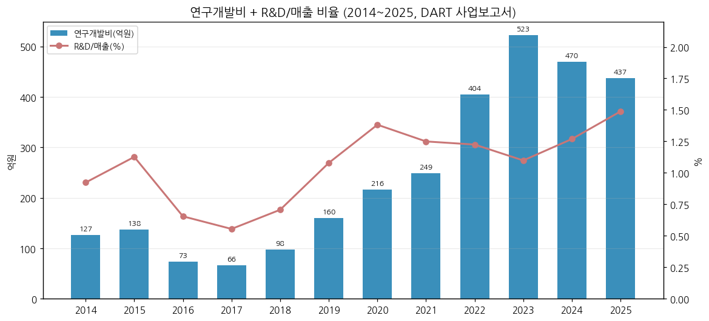

| 연도 | 2014 | 2015 | 2016 | 2017 | 2018 | 2019 | 2020 | 2021 | 2022 | 2023 | 2024 | 2025 |
|---|---|---|---|---|---|---|---|---|---|---|---|---|
| 연구개발비 (억) | 127 | 138 | 73 | 66 | 98 | 160 | 217 | 249 | 404 | **523** | 469 | 437 |
| R&D/매출 [계산] | 0.9% | 1.1% | 0.7% | 0.6% | 0.7% | 1.1% | 1.4% | 1.2% | 1.2% | 1.1% | 1.3% | 1.5% |

→ (출처: 각 사업보고서 「연구개발활동」 연구개발비용 합계. 비율은 연결 매출 대비 [계산] — DART 자체 기재 비율(2025 1.6% 등)은 별도 매출 기준으로 추정되어 소폭 차이. 2016 급감은 2015 이전 「위탁용역비·기타」 포함 범위 차이로 추정)
→ 조직: 기술연구소 — 연구기획·기초소재연구·양극재개발1·2·실리콘음극재개발·흑연음극재개발 그룹 (DART 2025)
→ R&D/매출 1%대 — 소재 피어 대비 낮은 수준(피어 수치 [미확보]), 2023 정점 후 감소

(2) 진행 중 corporate action (10년치)

| 시기 | 내용 | 상태 |
|---|---|---|
| 2019.04 | 포스코ESM 흡수합병 (양극재 진출) | 완료 |
| 2020.07 → 2024.12 | 피앤오케미칼(OCI 합작, 과산화수소) 설립 → 지분 매각 | 완료 (2023 유형자산 손상 465억) |
| 2021.02 | 유상증자 약 1.27조 | 완료 |
| 2022.04 | 절강포화 연결 편입 | 완료 |
| 2022.07~ | 얼티엄캠(GM JV 85%, 캐나다 퀘벡 33천톤) | **건설중, 잔여 출자 USD 484백만** |
| 2024.12 | 신종자본증권 6,000억 / 中 전구체 JV(절강화포) 손상 926억 | 완료 |
| 2025.05~ | 퓨처그라프(새만금 구형흑연 37천톤) | 건설중 |
| 2025.07~08 | 주주배정 유상증자 11,483천주 | 완료 |
| 2025.12~ | LFP 전환 투자 + 씨앤피신소재(LFP) 20% 출자(9M26 추가 111억) | 진행 중, off-take 2027.4Q~ |
| 2026 | 베트남 인조흑연 법인 설립 / 내몽고 시누어 지분 전량 처분(3Q26) | 진행 중 |

(3) R&D·기술 마일스톤 (10년치)

→ 2019~2020 광양 양극재 1공장 준공, NCM 하이니켈 양산 / 2021 NCMA 양극재 양산 준비 (1Q21 IR)
→ 2021.12 포항 인조흑연 음극재 국산화(1-1단계 준공)
→ 2023 단결정 포함 N86 하이니켈 북미向 판매 개시, NCA 하이니켈 판매 시작 (4Q23 IR) / 2023.09 ISO 37301 획득(배터리소재 업계 최초)
→ 2024~2025 IRA/CRMA 적격 흑연 확보 — 선광·구형화·고순도화 공정 내재화 (4Q23 IR)
→ 2026 연속식 흑연화로 상용화(전력 -80%, 가공비 -40%), 無전구체 LFP 공법, 전고체용 양극재 양산 준비(일본 자동차사 단독 개발업체 선정), SIB용 양·음극재 동시 개발, 美 팔란티어 AI 플랫폼 도입 (회사 3Q26 IR p.8, BT 1Q26 리뷰)

(4) 주요 리스크

→ **고객 집중·GM 의존** — GM 얼티엄셀즈 가동 조정으로 1Q26 N86 출하 사실상 0 (BT 리뷰), GM 계약은 2.81조로 정정·종료(2025). 얼티엄캠 출자 의무 지속
→ **메탈가** — 리튬 등 판가 연동 구조로 하락기 재고평가손 반복 (4Q23 742억, 4Q24 298억, 3Q26 음극재 재고평가손)
→ **美 정책** — 자동차부품 232조 관세 25%(미국向 매출 약 36%, DART 2025 주석), 美 EV 보조금 종료(4Q25 IR), FEOC/Non-PFE 요건
→ **중국 음극재 저가공세** — 2025 음극재 판가·판매량 동반 하락 (4Q25 IR)
→ **재무 레버리지** — 순차입금 3.46조, 부채비율 104%, 이자보상배율 1배 미만(2023~2025), FCF 7년 연속 적자 → 추가 증자·자산매각 가능성
→ **장기계약 실효성** — 삼성SDI 40조·LGES 30조 계약 이행률 1.9%·9.0%(2025말), ESS 양극재 계약 해지(2025.08)
→ **소송** — DART: 진행 중 소송 결과가 재무에 중요한 영향 없을 것으로 판단 (2025 사업보고서)

(5) ESG 등급

→ 한국ESG기준원(KCGS) **A** (2023, 전년 B+ 대비 +1등급, 국내 상장사 상위 24%) / S&P Global CSA **69점**, **DJSI Asia Pacific 최초 편입**(2023) / Sustainalytics **Medium Risk** (2023, 전년 High Risk) — 회사 4Q23 IR p.8
→ 기업가치제고계획(2024.12) p.3 표기: 지속가능 69/100, BBB, 종합 A, Climate Change B (평가기관 매칭 판독 불완전 — 원문 표 확인 필요)
→ **지속가능경영보고서**: 2025 보고서는 포스코홀딩스 그룹 통합 발간(www.posco-inc.com, 한국경제 2026-06-26) — PDF 원문 미수집 [미확보], 2022 기업시민보고서(KIND 게시)만 존재 확인
→ 2025~2026 최신 KCGS·MSCI 등급 [미확보]

(6) 인증·라이선스

→ ISO 37301(규범준수경영, 2023.09), 책임광물 공급망 인증(4Q23 IR) / 녹색채권 발행 적격(2024·2026)
→ Non-PFE(비우려외국기관) 흑연 공급망 — 글로벌 자동차사 장기계약 근거 (3Q26 IR)
→ 세부 제품 인증(IATF 16949 등) 목록은 [미확보]

---

## Version Log

| 버전 | 일자 | 내역 |
|---|---|---|
| v1.0 | 2026-11-14 | 첫 작성 (source 6종 일괄 점검). DART 정기보고서 원문 52건(2014.03~2026.09, 본문+감사보고서 첨부 00760/00761) + OpenDART CFS·OFS 각 44건 + dart_api 2025 FY 6종 + 회사 IR PDF 30건(실적발표 22 + NDR·기업가치제고계획·유상증자 설명회 등 8, 2021.2Q·3Q 실적 2건 수신 실패) + Yahoo 20년 월간 + 시장 보조(stockhub·언론·SNE리서치 인용). 3Q26은 DART 분기보고서(2026-11-13) 확정치. 차트 16종(12종 표준 + chart2 확장 2b·2c·2d·2e) |

**자료 audit (v1.0)**: ① DART 정기보고서 본문 ✅ (52건) / ② 첨부(감사보고서 연결·별도) ✅ (사업보고서 9개 연도) / ③ 회사 IR 실적발표 PDF ✅ (2021.1Q~2026.3Q, 2021.2Q·3Q 2건 누락 — 해당 분기 수치는 이후 IR appendix로 전량 보강, 2020 이전 IR은 irgo 미게시) / ④ 지속가능경영보고서 ⚠️ (그룹 통합 발간 확인, PDF 미수집 — ESG는 IR 기재치로 대체) / ⑤ Yahoo v8 월간 20년 ✅ / ⑥ 시장 보조 ✅ (신용등급 DART, 외국인·시총 stockhub, 점유율 SNE리서치 2023 인용)

**잔여 보완 후보 (v1.1)**
→ 양극재 판매량·ASP — 회사 공식 공시 없음. 증권사 추정치(예: 1Q26 12,178톤, 한화투자) 시계열 구축 여부 BT 판단 필요
→ 3Q26 고객사 미이행 보상금 금액 (회사 컨콜·증권사 리포트 확인)
→ 2018 이전 음극재 매출 분리, 2014·2018~2020 임직원 수, 2014·2015 분기 순이익
→ 지속가능경영보고서 PDF(포스코홀딩스 통합본) 수집 → ESG 최신 등급·온실가스
→ 피어(에코프로비엠·엘앤에프) PBR·외국인 비중을 동일 시점(2026-11-13)으로 재검증 — 본 v1.0 피어 PBR은 stockhub 10월 말 표기치
→ 사상 최고가 원주가(비수정) 확인 — Yahoo 694,000원은 수정주가 가능성

