# 하이브 (352820) — 기업 개요 (v1.0)

> 마지막 update: 2026-11-15 (3Q26 잠정실적(2026-11-03 IR)까지 반영 — **3Q26 분기보고서 미공시**, 3Q26 숫자는 회사 IR 잠정치 `[잠정]`)
> 입력 source: **OpenDART fnlttSinglAcntAll 연결재무제표(2018\~2Q26, 2026-11-15 조회)** + **DART 정기공시 원문 XML 23건(사업·반기·분기보고서 2020.12\~2026.06, 기재정정 우선)** + **회사 IR 실적발표 PDF 22건(4Q20\~3Q26, irgo 경유)** + OpenDART 기업개황·주주·임원·직원·배당·자기주식 JSON(2025 사업보고서) + Yahoo Finance v8 월간 주가(2020-10 상장\~2026-11-13) + 언론(서울신문·뉴시스·데일리안·MTN·Korea Times)
> 상장 전(빅히트) 2016\~2017 수치는 언론 보도 기준(별도, 2016은 증감률 역산치) — DART 연결 시계열은 2018부터
> 갱신 주기: 매분기 (실적 리뷰 모드 호출 시)
> **Fact verify cutoff**: 2026-11-15 (주가 155,700원 = Yahoo 2026-11-13 종가 / 시총 = 종가 × 3Q26말 자본금 기준 발행주식 약 4,311만주 계산치 / 2026-02-13 장중 고점 405,500원 = 서울신문 2026-04-21 / 지분율 = DART 2025 사업보고서)

---

## 1. 기업 분류

- **Primary 분류: 고성장 (IP·팬덤 플랫폼형 엔터) — 단, 이익은 "아티스트 활동 사이클"에 강하게 연동**
- **Secondary 노트: 사이클(활동 주기형) — BTS 군백기(2022.06\~2025.06) 동안 매출은 늘었지만 OPM 26.5%(2018) → 1.9%(2025)로 급락, BTS 완전체 투어 재개(2026.04\~) 후 2Q26 OPM 11.8% / 3Q26 12.4% 회복**

### ① 정량 근거

**📊 Summary Box (8년, 2018\~2025 연결):**

| 지표 | 값 |
|------|-----|
| 매출 CAGR (7년, 2018→2025) | **+36.4%** (3,014억 → 2조 6,499억) |
| OPM 평균 | **14.2%** |
| OPM 정점 평균 | **22.4%** (2018 26.5%·2020 18.3% — BTS 단독 고마진기) |
| OPM 저점 평균 | **5.0%** (2024 8.2%·2025 1.9% — BTS 군백기 + 신인·미국 투자) |
| 사이클 주기 | 약 **4\~5년** (BTS 완전체 활동기 ↔ 공백기. 2018-21 활동 → 2022-25 공백 → 2026\~ 재개) |
| 사이클 회수 (8년) | 이익률 정점 1회(2018) / 저점 1회(2025) — 업황 사이클이 아니라 **핵심 IP 활동 사이클** |

```
[전사 손익 시계열 (억원, 연결 — 2016-17은 빅히트 별도·언론)]
연도   매출      영업이익  순이익    OPM     NPM
2016     353*     103*      90*    29.2%   25.5%   ← *2017 증감률 역산치 (텐아시아)
2017     924      325      246    35.2%   26.6%   ← BTS 'DNA' 빌보드 핫100 진입, 글로벌 브레이크아웃
2018   3,014      799     -705    26.5%  -23.4%   ← OPM 정점(연결 기준) / 순손실은 영업외 손실
2019   5,872      987      724    16.8%   12.3%   ← 쏘스뮤직 인수, TXT 데뷔, 스타디움 투어
2020   7,963    1,455      871    18.3%   10.9%   ← IPO(10/15), 공연 매출 34억(코로나), 플레디스 인수
2021  12,559    1,902    1,408    15.1%   11.2%   ← 이타카홀딩스 인수(미국), 위버스·V LIVE 통합
2022  17,762    2,369      480    13.3%    2.7%   ← 오프라인 투어 재개 / BTS 단체활동 중단 발표(6월)
2023  21,781    2,956    1,834    13.6%    8.4%   ← 영업이익 정점 (세븐틴·뉴진스·TXT 등 멀티 IP)
2024  22,556    1,840      -34     8.2%   -0.2%   ← 어도어 분쟁, 신인·미국 투자로 이익 하락
2025  26,499      493   -2,544     1.9%   -9.6%   ← BTS 전역(6월) 직전 공백 최저점 + 4Q 영업외비용 3,081억
1Q26   6,983   -1,966   -1,567   -28.1%           ← 방시혁 주식증여 성과급 2,550억 비용(조정 OP 585억, 8.4%)
2Q26  14,500    1,709    1,098    11.8%           ← BTS 'ARIRANG' 월드투어 개시 — 분기 매출 첫 1조 돌파
3Q26  15,257    1,885      113    12.4%           ← [잠정] 사상 최대 분기, 공연 7,268억

OPM range(2018-2025): 1.9% ~ 26.5% = 24.6%pt → 변동폭 큼 (사이클 cutoff ±10%pt 초과)
매출 YoY: 2018-2025 전 기간 플러스 → 매출은 성장주, 이익률은 IP 활동 사이클
```

(출처: OpenDART fnlttSinglAcntAll 연결 2018-2025(2020 사업보고서 전전기 컬럼 = 2018), 2026 분기 = OpenDART 1Q·2Q + 회사 IR 3Q26 잠정. 2017: 텐아시아 2018-03-22 "매출 924억·영업이익 325억·순이익 246억")

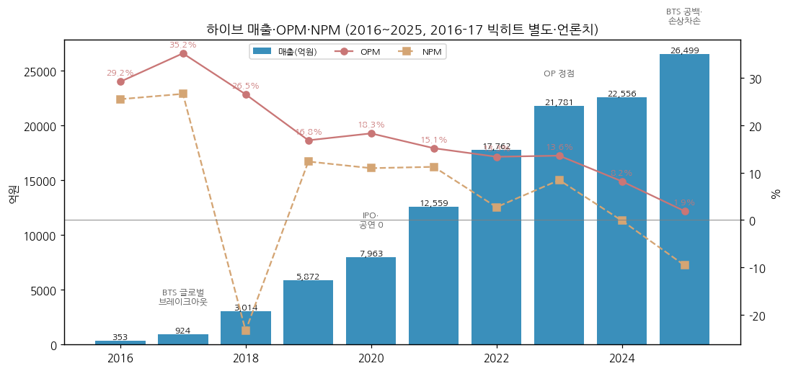

### ② 산업 분류

- 산업: **엔터테인먼트 — 멀티 레이블 기획사 + 팬덤 플랫폼(위버스)** (음반/음원·공연·광고·MD/라이선싱·콘텐츠·팬클럽)
- DART 업종코드 592 (오디오물 출판 및 원판 녹음업) / KOSPI 상장(2020-10-15)
- 워치리스트 섹터: **엔터 — 서브섹터: 기획사** (핵심 4사: 하이브·JYP·에스엠·와이지엔터, 확장 큐브엔터)

### ③ 분류 결정 논리

(1) **가장 매출 큰 사업부 기준**: 2025 음반/음원 29.2% + 공연 28.8% + MD/라이선싱 21.5% (DART 사업보고서) — 모두 **아티스트 활동량(컴백·투어)에 직접 비례**하는 매출 → 매출 규모는 레이블·아티스트 수 증가로 구조 성장(2018→2025 CAGR 36%)
(2) **이익 변동 요인 sub-rule**: OPM을 결정하는 것은 "어떤 아티스트가 활동하느냐" — BTS 활동기(2018·2020·2Q26\~)는 고마진, 공백기(2024-25)는 신인 투자·미국 레이블 비용이 마진을 잠식 → 업황 사이클이 아닌 **IP 활동 사이클** → Secondary "사이클(활동형)"
(3) **Boundary case 처리**: BTS 비중이 낮아지고(멀티 레이블·KATSEYE 등 글로벌 IP 성과) 비-BTS OPM이 두 자릿수로 안정되면 Primary "고성장" 단독, 반대로 BTS 활동 종료 후 OPM이 다시 한 자릿수 초반으로 회귀하면 "사이클" 격상
(4) **피어 cross-reference**: JYP(멀티 IP + 고마진 운영, OPM 20%대 경험)·에스엠(카카오 편입 후 수익성 재편)·와이지(블랙핑크 단일 IP 의존 — 하이브보다 사이클 진폭 큼) 대비, 하이브는 **매출 규모 1위 + 플랫폼(위버스) 보유 + 미국·일본·남미 현지 레이블**로 가장 다각화됐지만, 동시에 미국 사업·M&A 상각으로 이익률은 피어 중 가장 변동이 큼. (같은 폴더 `JYP_기업개요.md`, `에스엠_기업개요.md`, `와이지엔터_기업개요.md` 병행 작성 중)

### ④ 적정 밸류에이션 방법

- **PER (1순위, 활동기 정상화 EPS 기준)** — 이익 변동이 아티스트 활동 주기에 따르므로 공백기 EPS(2024 225원, 2025 -5,690원)는 무의미 → **BTS 투어 반영 12M fwd 정상화 EPS × 업종 PER** 방식이 셀사이드 표준
- **PBR 보조 (하방 체크)** — 3Q26말 지배주주지분 약 3조 2,235억(IR 자본총계 3조 5,245억 − 비지배 3,010억) vs 시총 약 6.7조 → **PBR 약 2.1배** (2026-11-13 종가 기준, 계산치). 무형자산(영업권 등) 2025말 1조 9,867억 → 유형 순자산 대비는 더 높음
- **EV/EBITDA 참고** — M&A 상각비 비중이 커서(분기 상각비 약 170억) PER보다 EV/EBITDA가 영업력 비교에 유리
- 피어 차별화: JYP·에스엠은 PER 단일 방식이 통용되나, 하이브는 **위버스(플랫폼)·미국 레이블 가치**를 SOTP로 분리 평가하는 리포트가 다수 — 플랫폼 수익화(ARPPU·DM 유료화)가 확인될 때만 멀티플 프리미엄 정당화

### ⑤ 분기 재평가 트리거

- BTS 투어 종료 후 **비(非)BTS 분기 OPM이 2개 분기 연속 10%+** 유지 시 → Secondary "사이클(활동형)" 해제, Primary "고성장" 단독 검토
- 반대로 BTS 활동 종료 분기에 **OPM이 5% 미만으로 재하락** 시 → "IP 활동 사이클" Primary 격상 (2024-25 패턴 재현)
- 위버스 매출(팬클럽 등 + 플랫폼 MD)이 전사 매출 **15%+** 도달 시 → 플랫폼 가치 SOTP 상시 반영(분류 Secondary에 "플랫폼" 추가)
- 방시혁 의장 형사 사건 **기소·유죄** 등 지배구조 변화(최대주주 지분 변동) 시 → 지배구조 리스크 할인 재설정

---

## 2. 회사 개요

### ① 기본 사항

| 항목 | 내용 |
|------|------|
| 회사명 | (주)하이브 / HYBE Co., Ltd. (2021-03-31 '빅히트엔터테인먼트'에서 상호 변경) |
| 설립 | 2005-02-04 ((주)더빅히트엔터테인먼트) |
| 상장 | 2020-10-15 유가증권시장 (공모가 135,000원) |
| 대표이사 | 이재상 (CEO, 2024 취임) / 이사회 의장 방시혁 |
| 본사 | 서울 용산구 한강대로 42 (용산트레이드센터) |
| 사업 한 줄 정의 | **멀티 레이블(한국·일본·미국·남미)로 아티스트 IP를 만들고, 음반·공연·MD·콘텐츠·팬 플랫폼(위버스)까지 수직 계열화해 수익화하는 엔터 그룹** |
| 사업 영역(회사 정의) | 음악(Music) / 플랫폼(Platform) / 테크기반 미래성장(Tech-Driven Future Growth) |
| 연결 종속회사 | 85사 (2025말, 주요 종속 12사) |
| 신용등급 | A+ (안정적) — 한국기업평가 2025-09-10 / 한국신용평가 2025-09-11 |
| 직원(별도) | 893명 (2025말, 평균근속 3년, 1인 평균급여 9,300만원) |

**주요 레이블·아티스트 (DART 2025 사업보고서 전속계약 기준)**: 빅히트뮤직(방탄소년단·투모로우바이투게더·코르티스) / 플레디스(세븐틴·투어스) / KOZ(지코·보이넥스트도어) / 쏘스뮤직(르세라핌) / 어도어(뉴진스) / 빌리프랩(엔하이픈·아일릿) / YX LABELS(&TEAM, 일본) / HYBE America(KATSEYE 등) / HYBE Latin America

### ② 최근 8년 손익·자본 추이 (억원, 연결)

| 연도 | 매출 | 영업이익 | 순이익 | 지배순이익 | 자본총계 | 자본 YoY | 비고 |
|------|------|---------|--------|----------|---------|---------|------|
| 2018 | 3,014 | 799 | -705 | -705 | 873 | — | 연결 OPM 정점 26.5% |
| 2019 | 5,872 | 987 | 724 | 738 | 1,735 | +99% | 쏘스뮤직 인수 |
| 2020 | 7,963 | 1,455 | 871 | 857 | 11,989 | +591% | **IPO 공모 약 9,626억** |
| 2021 | 12,559 | 1,902 | 1,408 | 1,368 | 28,866 | +141% | 이타카 인수(신주 발행 포함) |
| 2022 | 17,762 | 2,369 | 480 | 523 | 29,287 | +1% | 투어 재개 |
| 2023 | 21,781 | 2,956 | 1,834 | 1,873 | 31,099 | +6% | 영업이익 정점 |
| 2024 | 22,556 | 1,840 | -34 | 94 | 35,138 | +13% | 전환사채 4,000억 발행 |
| 2025 | 26,499 | 493 | -2,544 | -2,373 | 35,515 | +1% | 순손실 최대 |

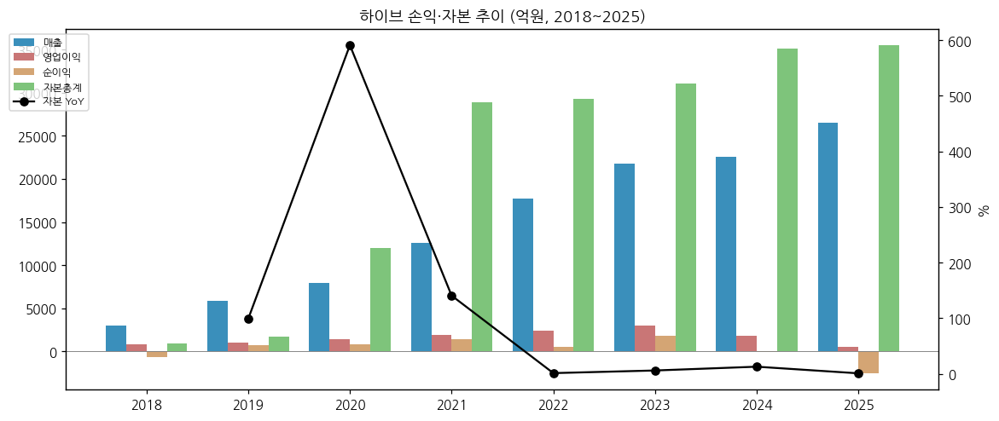

### ③ 회사 주가 역사 ★ 유일한 narrative 영역

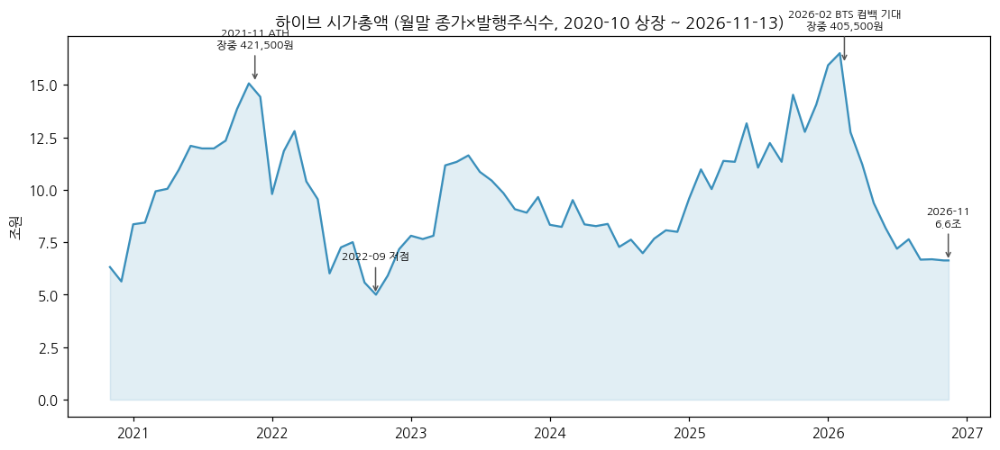

**→ 시총 milestone (Yahoo Finance 월간 종가 × 발행주식수, 계산치)**
- 2020-10-15 상장: 공모가 135,000원 → 상장 첫 달 종가 기준 시총 약 6.3조
- **2021-11 ATH: 장중 421,500원** (시총 약 17.4조 = 421,500 × 4,135만주, 계산치) — BTS 'Butter' 빌보드·LA 대면공연, 이타카 인수 시너지 기대
- 2022-06 BTS 단체활동 중단 발표 → 2022-09 저점권(장중 107,000원, 시총 약 4.4조)
- 2023-03 SM 인수전(카카오와 경쟁) 후 철수, 보유 SM 지분 카카오에 매각 → 2023 반등
- 2024 민희진·어도어 분쟁 + 실적 둔화로 17\~20만원대 횡보
- 2025-06 BTS 전원 전역 → 완전체 컴백 기대로 랠리
- **2026-02-13 장중 405,500원** (전고점 근접, 시총 약 17.5조) — BTS 정규 5집 'ARIRANG' 컴백(2026-03-20 발매, 3/21 광화문 라이브) 직전 [서울신문 2026-04-21]
- 2026-03\~04 "재료 소멸" + 방시혁 의장 구속영장 신청 보도 + 1Q26 실적 우려 → 두 달 만에 약 40% 하락 [서울신문]
- 2026-10 장중 136,500원(52주 최저) → **2026-11-13 종가 155,700원, 시총 약 6.7조** — 3Q26 사상 최대 실적(매출 1.53조, OP 1,885억)에도 주가는 고점 대비 -62%

> 해석 노트: 주가는 "BTS 활동 기대"를 선반영하고 실제 투어 실적이 찍히는 구간에서 오히려 하락하는 패턴을 2021-22, 2026 두 번 반복. 실적 정점(분기 매출 1.5조)과 주가 저점권이 겹친 2026-11은 시장이 **투어 이후(2027)** 이익 공백과 지배구조 리스크를 할인하는 국면으로 해석된다(주관적 해석 최소화 — 팩트는 위 수치).

### ④ 주요 연혁

| 시기 | 내용 |
|------|------|
| 2005-02 | (주)더빅히트엔터테인먼트 설립 (방시혁) |
| 2013-06 | 방탄소년단 데뷔 |
| 2017-05 | BTS 빌보드 뮤직 어워드 '톱 소셜 아티스트' — 글로벌 브레이크아웃 |
| 2019-03 | 투모로우바이투게더 데뷔 / 2019-07 쏘스뮤직 인수 |
| 2019-06 | 위버스(Weverse) 출시 |
| 2020-05 | 플레디스엔터테인먼트 인수 (세븐틴) |
| 2020-10 | 유가증권시장 상장 |
| 2021-03 | 상호 '하이브'로 변경, 용산 사옥 이전 |
| 2021-04 | 이타카홀딩스(Scooter Braun, 미국) 인수 — 약 US$10.5억 |
| 2021-05 | 네이버 V LIVE 사업 양수 → 위버스컴퍼니 출범 |
| 2022-06 | BTS 단체활동 잠정 중단·멤버 순차 입대 발표 |
| 2022-07 | 뉴진스(어도어) 데뷔 |
| 2023-02\~03 | SM 지분 인수 추진 → 카카오와 경쟁 끝 철수, 보유 지분 카카오에 매각 |
| 2023-06 | QC Media Holdings(미국 힙합 레이블) 인수 |
| 2024-04 | 어도어 경영권 분쟁(민희진) 시작 |
| 2024-06 | KATSEYE(HYBE x Geffen) 데뷔 |
| 2025-06 | BTS 전원 전역 |
| 2026-03 | BTS 정규 5집 'ARIRANG' 발매·광화문 컴백 라이브 |
| 2026-04 | BTS 'ARIRANG' 월드투어 개시 (북미 4\~9월: 12개 도시 31회 — IR 3Q26) |
| 2026-09 | 경찰, 방시혁 의장 불구속 송치 (2026-09-03, 자본시장법상 사기적 부정거래 혐의) |

(출처: DART 사업보고서 회사의 연혁·종속회사 변동, 회사 IR, 언론. 2013-2019 사건 일부는 일반 공개 정보 기준)

---

## 3. 비즈니스 모델

### ① 실적 추이 (사업부별·지역별)

**연간 사업부별 매출 (억원, 연결 — 2018-19: 4Q20 IR / 2020-22: DART 2022 사업보고서 / 2023-25: DART 2025 사업보고서)**

| 구분 | 2018 | 2019 | 2020 | 2021 | 2022 | 2023 | 2024 | 2025 | 2025 비중 |
|------|------|------|------|------|------|------|------|------|---------|
| **직접참여형** | | | | | | | | | |
| 음반/음원 | 1,054 | 1,083 | 3,206 | 3,769 | 5,520 | 9,705 | 8,610 | 7,730 | 29.2% |
| 공연 | 877 | 1,911 | 34 | 453 | 2,582 | 3,591 | 4,509 | 7,639 | 28.8% |
| 광고·출연료(·매니지먼트) | 143 | 201 | 468 | 1,007 | 1,618 | 1,419 | 1,345 | 1,472 | 5.6% |
| **간접참여형** | | | | | | | | | |
| MD·라이선싱 | 514 | 1,699 | 2,590 | 3,170 | 3,956 | 3,256 | 4,202 | 5,706 | 21.5% |
| 콘텐츠 | 335 | 780 | 1,335 | 3,704 | 3,415 | 2,899 | 2,873 | 2,588 | 9.8% |
| 팬클럽 등 | 90 | 198 | 329 | 456 | 671 | 912 | 1,018 | 1,364 | 5.1% |
| **합계** | **3,014** | **5,872** | **7,963** | **12,559** | **17,762** | **21,781** | **22,556** | **26,499** | 100% |
| 영업이익 | 799 | 987 | 1,455 | 1,902 | 2,369 | 2,956 | 1,840 | 493 | |

> ⚠ 사업부 분류 주의: 2023년까지 '광고·출연료'에 매니지먼트 매출 포함(DART 주석). 2022 콘텐츠 감소는 온라인 콘서트 회계처리 변경(콘텐츠→공연) 영향. 2018-19는 IR(4Q20) 기준이라 DART 연결 합계와 반올림 차이 가능.
> ⚠ **사업부별 영업이익 미공시** — 회사는 매출만 품목별 공시 → chart2는 사업부 매출 stacked + 전사 OPM line.

**분기 사업부별 매출 (억원, 회사 IR — 3Q26 잠정)**

| 분기 | 매출 | 음반/음원 | 공연 | 광고·출연료 | MD·라이선싱 | 콘텐츠 | 팬클럽 등 | 영업이익 | OPM |
|------|------|---------|------|-----------|-----------|-------|---------|--------|-----|
| 1Q24 | 3,609 | 1,451 | 440 | 278 | 607 | 613 | 219 | 144 | 4.0% |
| 2Q24 | 6,405 | 2,496 | 1,440 | 303 | 1,091 | 838 | 237 | 509 | 7.9% |
| 3Q24 | 5,278 | 2,145 | 740 | 345 | 991 | 798 | 260 | 542 | 10.3% |
| 4Q24 | 7,264 | 2,518 | 1,889 | 419 | 1,512 | 625 | 302 | 646 | 8.9% |
| 1Q25 | 5,006 | 1,365 | 1,552 | 308 | 1,064 | 412 | 305 | 216 | 4.3% |
| 2Q25 | 7,056 | 2,286 | 1,887 | 306 | 1,529 | 702 | 346 | 659 | 9.3% |
| 3Q25 | 7,272 | 1,898 | 2,450 | 426 | 1,683 | 468 | 346 | -422 | -5.8% |
| 4Q25 | 7,164 | 2,180 | 1,751 | 431 | 1,429 | 1,006 | 367 | 40 | 0.6% |
| 1Q26 | 6,983 | 2,715 | 887 | 434 | 1,374 | 1,059 | 513 | -1,966 | -28.1% |
| 2Q26 | 14,500 | 3,268 | 6,477 | 654 | 3,106 | 416 | 579 | 1,709 | 11.8% |
| 3Q26* | 15,257 | 2,828 | 7,268 | 656 | 3,346 | 567 | 591 | 1,885 | 12.4% |

(*3Q26 잠정. 출처: 각 분기 IR — 1Q24·4Q24는 1Q25 IR 비교컬럼, 2Q24는 2Q25 IR, 3Q24는 3Q25 IR, 4Q25는 1Q26 IR 비교컬럼. 1Q26 영업이익은 주식증여 비용 2,550억 포함 — 조정 OP 585억)

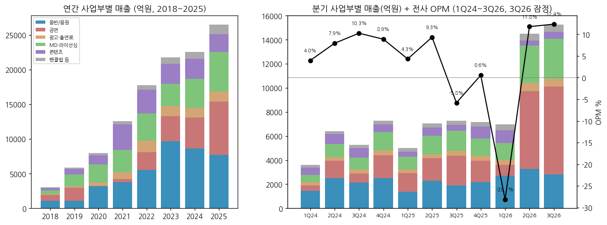

> ⚠ 시계열 길이 한계: 분기 사업부 표는 11개 분기(1Q24\~3Q26)만 구성. 2021-2023 IR PDF는 표가 이미지·레이아웃 깨짐으로 자동 추출 불가 → v1.1에서 분기보고서 XML '매출실적'으로 2021-2023 분기 보강 예정. 전사 분기 매출·OP는 아래 12분기 및 OpenDART 1Q21\~ 전체 보유.

**지역별 매출 (억원, DART 2025 사업보고서 — 고객과의 계약 수익 기준)**

| 지역 | 2023 | 2024 | 2025 | 2025 비중 |
|------|------|------|------|---------|
| 국내 | 7,883 | 7,591 | 7,228 | 27.3% |
| 아시아 | 7,460 | 8,365 | 10,764 | 40.6% |
| 북미 | 5,480 | 5,323 | 6,329 | 23.9% |
| 기타국가 | 927 | 1,253 | 2,073 | 7.8% |
| (전대 임대료, 북미) | 31 | 24 | 104 | 0.4% |
| **합계** | 21,781 | 22,556 | 26,499 | 100% |

→ **해외 비중 72.7%(2025)** — 2023 63.8% → 2024 66.3% → 2025 72.7%로 확대. 일본(아시아)·북미 투어·남미/인도 신규 법인 효과.

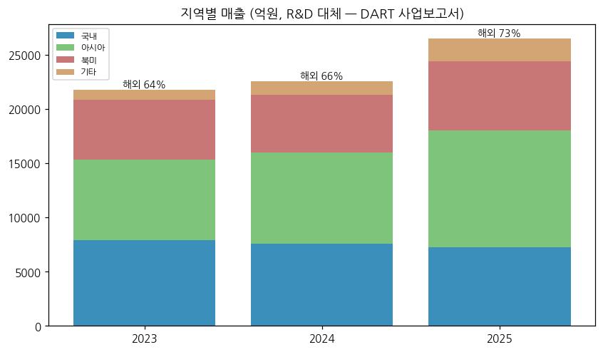

**12분기 전사 시계열 (억원, 연결)**

| 분기 | 4Q23 | 1Q24 | 2Q24 | 3Q24 | 4Q24 | 1Q25 | 2Q25 | 3Q25 | 4Q25 | 1Q26 | 2Q26 | 3Q26* |
|------|------|------|------|------|------|------|------|------|------|------|------|------|
| 매출 | 6,086 | 3,609 | 6,405 | 5,278 | 7,264 | 5,006 | 7,056 | 7,272 | 7,164 | 6,983 | 14,500 | 15,257 |
| 영업이익 | 891 | 144 | 509 | 542 | 646 | 216 | 659 | -422 | 40 | -1,966 | 1,709 | 1,885 |
| OPM | 14.6% | 4.0% | 7.9% | 10.3% | 8.9% | 4.3% | 9.3% | -5.8% | 0.6% | -28.1% | 11.8% | 12.4% |
| 순이익 | -567 | 111 | 101 | 14 | -261 | 544 | 155 | -520 | -2,722 | -1,567 | 1,098 | 113 |

(출처: OpenDART 분기 3개월 금액 / 4Q = 연간 − 3Q 누적 / *3Q26 회사 IR 잠정)

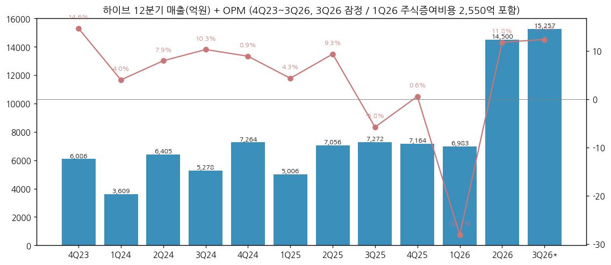

**📌 3Q26 핵심 박스 [잠정, 2026-11-03 IR]**
- 매출 **1조 5,257억 (+109.8% YoY, +5.2% QoQ)** — 사상 최대. 9개월 누적 3.67조 → 연간 4조 근접 [Korea Times 2026-11-03]
- 영업이익 **1,885억 (OPM 12.4%)**, 컨센서스 1,660억 대비 +13.6% [Korea Times]
- 공연 7,268억 (+196.7% YoY) — BTS 'ARIRANG' 북미 투어(4\~9월, 31회) / MD·라이선싱 3,346억 (+98.7%) — 투어 현장 MD 200만개 판매
- 음반/음원 2,828억 (-13.4% QoQ) — 앨범 발매 공백 / 순이익 113억 — 영업외비용 1,428억으로 순이익 급감
- KATSEYE 3rd EP 'WILD' 빌보드200 1위(2026-08-29 주차), 유럽·북미 31회 아레나 투어

### ② 사업부별 개요 (매출 비중 큰 순서, 2025 DART)

| 사업부 | 2025 매출 | 비중 | 수익 구조 |
|--------|---------|------|----------|
| 음반/음원 | 7,730억 | 29.2% | 실물 음반(팬덤 소유재) + 스트리밍 음원. 유통: YG플러스 등 → 오픈마켓·위버스샵 |
| 공연 | 7,639억 | 28.8% | 월드투어·팬미팅. 하이브쓰리식스티 본부가 기획·제작. 라이브 뷰잉·온라인 공연 병행 |
| MD·라이선싱 | 5,706억 | 21.5% | 공식 MD(IPX 본부), 팝업, IP 라이선싱(LINE 등 고정수수료·로열티) |
| 콘텐츠 | 2,588억 | 9.8% | 공연 실황·다큐·예능·영화. 외부 플랫폼(구글·네이버) + 위버스 + 로열티(디즈니+) |
| 광고·출연료 | 1,472억 | 5.6% | 아티스트 광고·방송 출연 |
| 팬클럽 등 | 1,364억 | 5.1% | 위버스 멤버십·팬클럽, 디지털 멤버십 |

**직접참여형(음반·공연·광고) 63.6% vs 간접참여형(MD·콘텐츠·팬클럽) 36.4%** (2025) — 간접참여형 비중은 2020 52.9% → 2023 32.4%까지 낮아졌다가 2025 36.4%로 반등.

### ③ 사업부별 디테일

- **공연 = 이익 레버리지의 핵심**: 2Q26 공연 6,477억(전분기 887억의 7.3배) → OPM이 -28.1%에서 11.8%로 반전. 스타디움 투어는 회당 매출이 크고 고정비(제작) 회수 후 마진 급등.
- **MD·라이선싱 = 투어 동반 성장**: 3Q26 북미 투어 MD — 12개 도시·45 판매일·100만 명 방문·200만 개 판매, 위버스 픽업·RFID 결제로 구매 경험 고도화 (IR 3Q26)
- **음반 = 구조적 둔화 신호**: 연간 음반/음원 9,705억(2023 정점) → 8,610억(2024) → 7,730억(2025). 2022 써클차트 Top100 앨범 판매량 중 하이브 아티스트 점유율 32.6% (DART 2022 사업보고서) — 국내 실물 앨범 시장 피크아웃과 동행
- **이익 outlier**: 3Q25 영업손실 -422억(BTS 공백 + 신인 데뷔 비용 + 미국 법인 구조조정), 4Q25 영업외비용 3,081억(손상 등)으로 순손실 -2,722억, 1Q26 주식증여 성과급 2,550억(1회성)

### ④ 주요 경쟁사 (사업부별)

| 영역 | 경쟁사 |
|------|--------|
| K-POP 기획(국내) | 에스엠(카카오 계열), JYP Ent., 와이지엔터, 큐브엔터, 카카오엔터(스타쉽 등, 비상장) |
| 글로벌 레코드·퍼블리싱 | Universal Music Group(하이브 아티스트 글로벌 유통 파트너), Sony Music, Warner Music |
| 공연 | Live Nation(Ticketmaster), AEG — 해외 투어 프로모션 협업·경쟁 |
| 팬 플랫폼 | 디어유 '버블'(SM 계열), 텐센트뮤직(중국 SVIP·버블 입점), 각 기획사 자체 앱 |
| 일본 | 일본 현지 기획사(Johnny's 후신 STARTO 등), &TEAM 경쟁 |

### ⑤ 주요 매출처

- **B2C 중심 — 단일 대형 매출처 공시 없음** (DART 사업보고서에 주요 매출처 명단 미기재). 판매 경로: 음반은 유통사(YG플러스 등) → 오픈마켓·위버스, 공연은 직판, 콘텐츠는 구글·네이버·디즈니+ 등 플랫폼 경유
- 위버스(종속 ㈜위버스컴퍼니)가 음반·MD·멤버십의 자사 판매 채널 역할 — 네이버가 위버스컴퍼니에 지분 투자(우선매수권·매도청구권 약정, DART 주석)

### ⑥ 생산 CAPA + 임직원

- 제조 CAPA 개념 없음 — "CAPA" = **활동 아티스트 수·공연 회차**. 2025 사업보고서 기준 전속 아티스트: BTS·TXT·코르티스·세븐틴·투어스·지코·보이넥스트도어·르세라핌·뉴진스·엔하이픈·아일릿·&TEAM 외 미국(KATSEYE 등)·남미 레이블
- 임직원(별도): 893명(남 283·여 610), 평균근속 3년, 연간 급여총액 797억 (2025말 DART). 연결 인건비는 분기 1,000\~1,600억 수준(IR 3Q26: 1,577억)
- 연결 종속회사 85사(2025말) — 2025 중 인도·중국·남미(Truvatos 등) 법인 11곳 신규 설립

---

## 4. 재무 구조

> **재무제표 수치: OpenDART fnlttSinglAcntAll (연결, CFS), 2026-11-15 조회.** 각 연도 값은 해당 연도를 포함하는 가장 최근 사업보고서(차기 보고서 전기 컬럼 우선) 기준. 단위 억원(반올림). 상장 전 2017 이전은 연결 공시 없음 → 8년(2018\~2025)

### ① 손익계산서 (억원, 연결)

| 연도 | 매출 | 매출원가 | 매출총이익 | 판관비 | 영업이익 | 세전이익 | 순이익 | GPM | OPM | NPM |
|------|------|--------|----------|------|--------|--------|------|-----|-----|-----|
| 2018 | 3,014 | 1,900 | 1,114 | 315 | 799 | -484 | -705 | 37.0% | 26.5% | -23.4% |
| 2019 | 5,872 | 3,857 | 2,015 | 1,028 | 987 | 985 | 724 | 34.3% | 16.8% | 12.3% |
| 2020 | 7,963 | 4,215 | 3,747 | 2,292 | 1,455 | 1,262 | 871 | 47.1% | 18.3% | 10.9% |
| 2021 | 12,559 | 6,329 | 6,230 | 4,328 | 1,902 | 2,105 | 1,408 | 49.6% | 15.1% | 11.2% |
| 2022 | 17,762 | 9,335 | 8,426 | 6,057 | 2,369 | 965 | 480 | 47.4% | 13.3% | 2.7% |
| 2023 | 21,781 | 11,691 | 10,090 | 7,134 | 2,956 | 2,501 | 1,834 | 46.3% | 13.6% | 8.4% |
| 2024 | 22,556 | 12,958 | 9,598 | 7,758 | 1,840 | 194 | -34 | 42.6% | 8.2% | -0.2% |
| 2025 | 26,499 | 17,140 | 9,359 | 8,865 | 493 | -1,774 | -2,544 | 35.3% | 1.9% | -9.6% |

→ GPM 49.6%(2021) → 35.3%(2025): 공연·MD(원가율 높은 직접 비용) 비중 확대 + 콘텐츠·팬클럽(고마진) 비중 축소. 판관비율은 10.5%(2018) → 33.5%(2025)로 확대 — M&A 상각·인건비·미국 법인 비용.

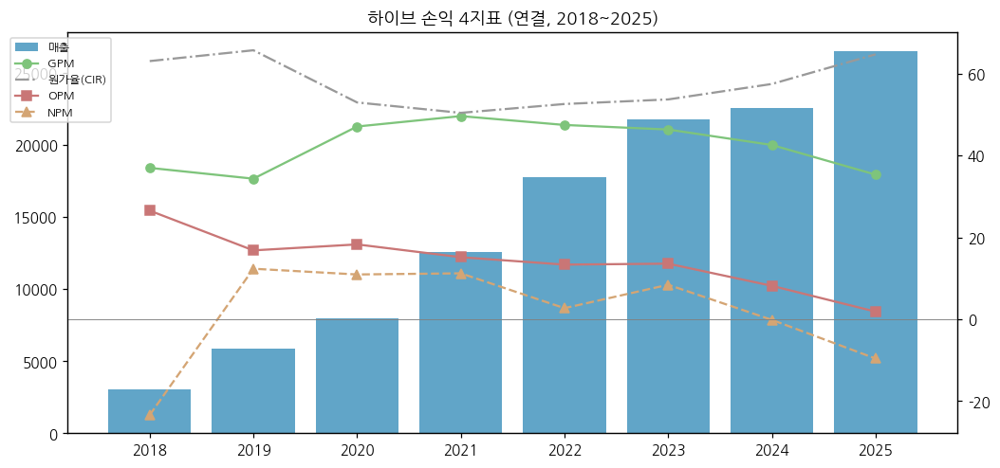

### ② 재무상태표 (억원, 연결)

| 연도 | 자산총계 | 유동자산 | 현금성 | 기타유동금융자산 | 무형자산 | 부채총계 | 유동부채 | 자본총계 | 지배지분 | 부채비율 |
|------|--------|--------|------|---------------|--------|--------|--------|--------|--------|--------|
| 2018 | 2,055 | 1,717 | 581 | 125 | — | 1,183 | 1,055 | 873 | 873 | 135.5% |
| 2019 | 3,630 | 2,947 | 1,608 | 58 | — | 1,895 | 1,746 | 1,735 | 1,742 | 109.2% |
| 2020 | 19,244 | 13,893 | 3,802 | 7,224 | — | 7,255 | 2,962 | 11,989 | 11,953 | 60.5% |
| 2021 | 47,289 | 20,031 | 6,777 | 3,396 | 13,300 | 18,423 | 5,866 | 28,866 | 28,119 | 63.8% |
| 2022 | 48,704 | 21,158 | 5,316 | 12,061 | 14,702 | 19,418 | 8,495 | 29,287 | 27,705 | 66.3% |
| 2023 | 53,457 | 18,888 | 3,579 | 11,048 | 21,653 | 22,358 | 17,722 | 31,099 | 29,194 | 71.9% |
| 2024 | 54,792 | 17,877 | 4,120 | 8,528 | 22,443 | 19,654 | 8,309 | 35,138 | 32,147 | 55.9% |
| 2025 | 54,855 | 23,640 | 5,349 | 12,556 | 19,867 | 19,340 | 7,344 | 35,515 | 32,570 | 54.5% |
| 3Q26* | 57,482 | 26,332 | — | — | — | 22,238 | 13,804 | 35,245 | 32,235 | 63.1% |

(*3Q26 IR 잠정 요약재무상태표. 무형자산 2018-2020은 표준계정 미분리로 공란)

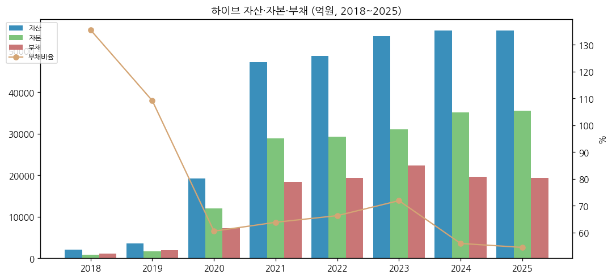

### ③ 현금흐름표 (억원, 연결)

| 연도 | 영업CF | 투자CF | 재무CF | CapEx | FCF(OCF−CapEx) | 비고 |
|------|------|------|------|------|--------------|------|
| 2018 | 747 | -451 | -14 | 138 | 609 | |
| 2019 | 917 | 122 | -14 | 65 | 852 | |
| 2020 | 1,167 | -10,224 | 11,334 | 522 | 645 | IPO 공모자금 유입 → 금융자산 운용 |
| 2021 | 1,773 | -21,102 | 22,263 | 946 | 827 | 이타카 인수(투자CF) / 신주·차입(재무CF) |
| 2022 | 3,471 | -2,853 | -1,882 | 390 | 3,082 | 영업CF 정점 |
| 2023 | 3,106 | -4,708 | -111 | 923 | 2,183 | QC Media 인수 |
| 2024 | 1,516 | -104 | -1,180 | 676 | 840 | CB 4,000억 발행·CB 3,998억 상환 |
| 2025 | 1,075 | -1,690 | 1,874 | 611 | 464 | 차입금 1,975억 증가 |

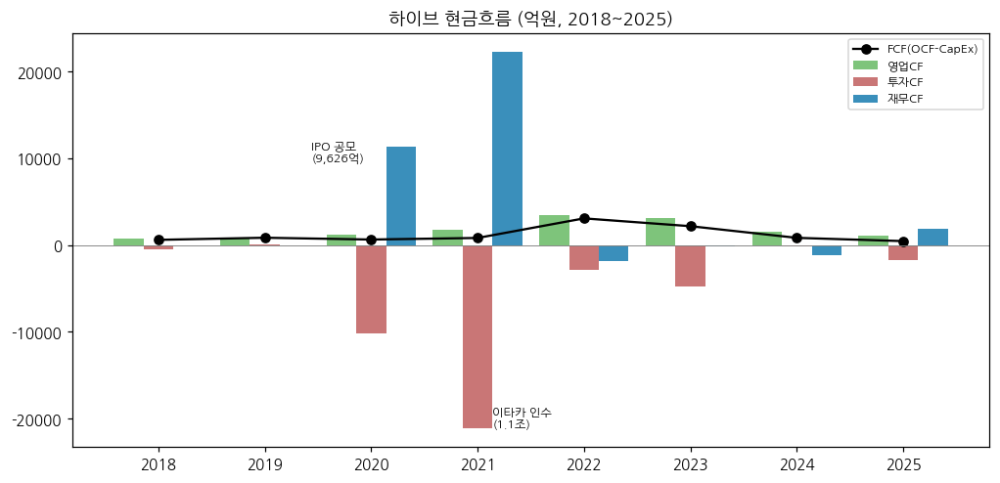

### ④ CapEx 추이

| 연도 | 유형자산 취득 | 무형자산 취득 | 합계 | 매출 대비 |
|------|-----------|-----------|------|---------|
| 2018 | 66 | 72 | 138 | 4.6% |
| 2019 | 48 | 16 | 65 | 1.1% |
| 2020 | 395 | 127 | 522 | 6.6% |
| 2021 | 540 | 406 | 946 | 7.5% |
| 2022 | 171 | 219 | 390 | 2.2% |
| 2023 | 227 | 696 | 923 | 4.2% |
| 2024 | 329 | 348 | 676 | 3.0% |
| 2025 | 314 | 297 | 611 | 2.3% |

→ 자산 경량(asset-light) 구조 — CapEx는 매출의 2\~7%. 실질 "투자"는 **M&A(종속기업 취득)**: 2021 이타카(약 US$10.5억), 2023 QC Media 등 → 무형자산 0 → 2조원대로 급증.

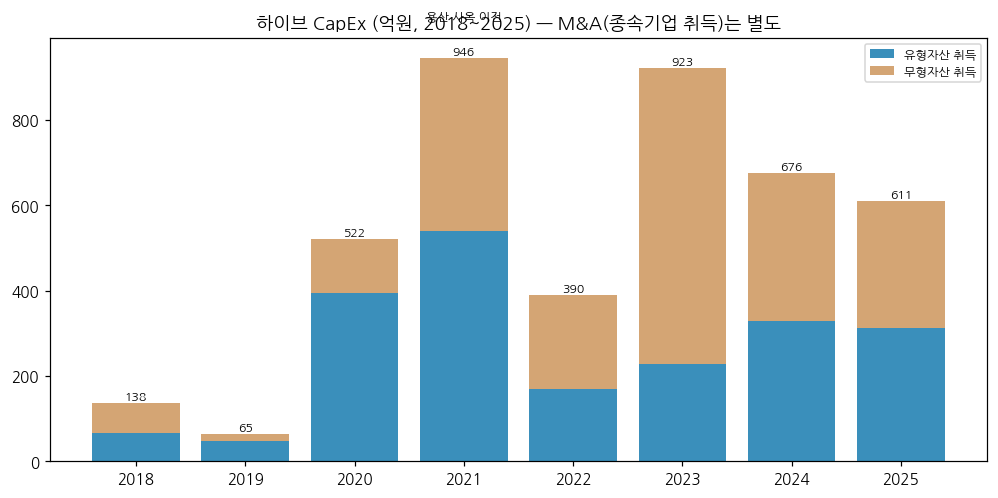

### ⑤ 부채구조

| 연도말 | 장기차입금 | 유동성장기부채 | 단기차입금 | 전환사채(비유동) | 전환사채(유동) | 차입·사채 합계 |
|------|---------|------------|---------|-------------|-----------|-----------|
| 2021 | — | 148 | 1,500 | — | — | 1,648 |
| 2022 | 3,652 | 2,317 | — | 3,452 | — | 9,421 |
| 2023 | 1,000 | 3,666 | 1,000 | — | 3,587 | 9,253 |
| 2024 | 3,860 | 1,000 | — | 3,561 | 2 | 8,422 |
| 2025 | 6,819 | — | — | 1,776 | — | 8,595 |

- 2024 전환사채 4,000억 발행(기존 CB 3,998억 상환 차환). 2025말 장기차입금 6,819억으로 증가.
- 순현금: 2025말 현금 5,349억 + 기타유동금융자산 1조 2,556억 − 차입·사채 8,595억 ≈ **+9,310억 순현금** (계산치)
- 신용등급 A+ (안정적) 유지 (2025-09, 한기평·한신평)

### ⑥ 배당·자사주 추이

| 사업연도 | DPS | 현금배당총액 | 배당성향(연결) | 비고 |
|--------|-----|----------|------------|------|
| FY2020\~FY2022 | — | — | — | 무배당 |
| FY2023 | 700원 | 292억 | 15.6% | 상장 후 첫 배당 (2024 지급) |
| FY2024 | 200원 | 83억 | 88.5% | |
| FY2025 | 500원 | 215억 | n/m(순손실) | 적자에도 배당 증액 |

- 자사주: 2024 261억 취득(현금흐름표), 2025말 보유 113,337주 (임직원 RSU 지급으로 20,267주 처분)
- 현금흐름표 기준 배당 지급: 2024 292억 / 2025 83억

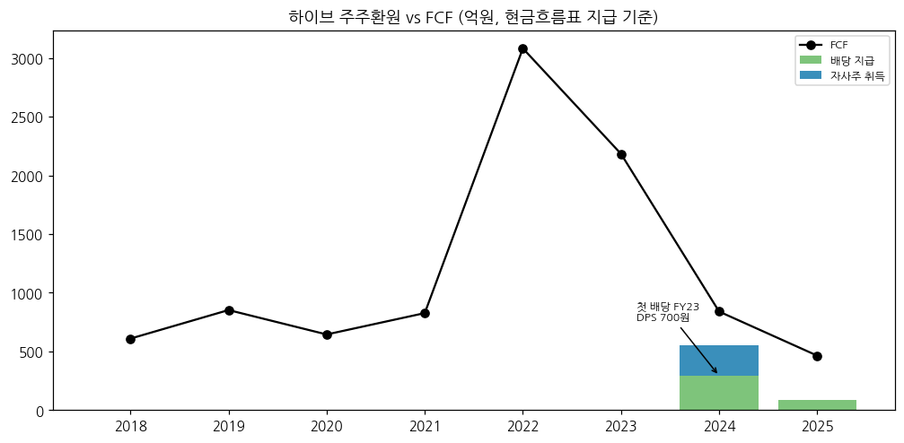

### ⑦ 재무 비율

| 연도 | ROE(지배) | ROA | 부채비율 | 유동비율 | 영업이익/이자지급 |
|------|---------|-----|--------|--------|--------------|
| 2018 | -80.8% | -34.3% | 135.5% | 162.8% | n/m |
| 2019 | 56.5% | 25.5% | 109.2% | 168.8% | n/m |
| 2020 | 12.5% | 7.6% | 60.5% | 469.0% | 44.8배 |
| 2021 | 6.8% | 4.2% | 63.8% | 341.5% | 9.5배 |
| 2022 | 1.9% | 1.0% | 66.3% | 249.1% | 10.8배 |
| 2023 | 6.6% | 3.6% | 71.9% | 106.6% | 10.4배 |
| 2024 | 0.3% | -0.1% | 55.9% | 215.1% | 5.5배 |
| 2025 | -7.3% | -4.6% | 54.5% | 321.9% | 1.5배 |

(ROE·ROA = 기초·기말 평균 기준. 2018 ROE는 기초값 부재로 기말 기준. 이자보상 = 영업이익 / 현금흐름표 이자지급)

---

## 5. 지배 구조

### ① 그룹·계열 관계

- **방시혁 의장 개인 최대주주 → (주)하이브 → 종속회사 85사** (지주회사 아님, 공정위 대기업집단 지정)
- 주요 종속: 빅히트뮤직·플레디스·쏘스뮤직·어도어·빌리프랩·KOZ(국내 레이블) / 위버스컴퍼니(플랫폼, 네이버 지분 투자) / HYBE America·이타카홀딩스(미국) / HYBE JAPAN·YX LABELS(일본) / HYBE Latin America / 수퍼톤(AI 음성)
- 타법인출자 40사, 기말 장부가 2조 5,523억 (2025말 DART)

### ② 주주 구분 (2025-12-31, DART 사업보고서)

| 주주 | 주식수 | 지분율 |
|------|------|------|
| 방시혁 (최대주주) | 13,151,394 | 30.86% |
| 넷마블 | 3,930,813 | 9.23% |
| 국민연금 | 3,678,212 | 8.63% |
| 두나무 | 2,302,570 | 5.40% |
| Scott Braun 외 특수관계인 | 약 378,000 | 0.89% |
| 자기주식 | 113,337 | 0.27% |
| 소액주주 (183,627명) | 20,244,649 | 47.53% |
| **발행주식총수** | **42,609,196** | 100% |

> ⚠ 2026 변동: 1Q26 방시혁 의장이 임직원 성과급 재원으로 보유 주식을 증여(회계상 비용 2,550억, 뉴시스 2026-04-29) → 의장 지분율 하락. 3Q26말 자본금 215.5억(액면 500원) = 약 4,311만주로 전환사채 전환 등 주식수 증가. 최신 지분율은 3Q26 분기보고서 공시 후 갱신 필요.
> 외국인 지분율은 DART에 별도 항목이 없어 chart5에 "기타"로 합산 (KRX 외국인 보유율 미확보).

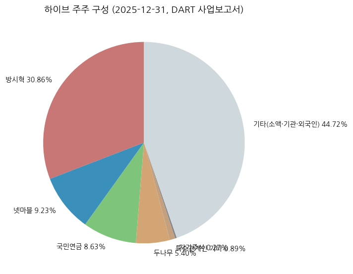

### ③ 임원·이사회 (2025말 DART)

| 성명 | 직위 | 주요 경력 |
|------|------|---------|
| 방시혁 | 이사회 의장 (사내이사) | 하이브 창업자, 전 JYP 공동창업 |
| 이재상 | 대표이사 CEO (사내이사) | 전 하이브 CSO, 구글, 현대자동차, 모니터그룹 |
| Scott Braun | 사내이사(비상근) | Scooter Braun Projects 설립, 하이브 Senior Advisor |
| 김병규 | 기타비상무이사 | 넷마블 대표이사 |
| 박영호·이미경·이상승·백승주·조원경 | 사외이사 | 투자업계·환경재단·서울대 경제학부·전 기재부·판사 출신 |
| 이경준 | CFO (미등기) | 전 MCM, 김앤장·삼일 회계사 |
| 김태호 | COO (미등기) | 전 풀러스 대표, 다음·NHN |

---

## 6. 기타 팩트

### ① R&D 인프라

- DART 사업보고서상 별도 연구개발비 항목 미미 — 엔터 업종 특성상 R&D 대신 **신인 개발·M&A**가 투자 축. chart7은 R&D 대신 **지역별 매출**로 대체
- 테크 영역: 수퍼톤(AI 음성 합성, 종속), 위버스(플랫폼 개발), 테크기반 미래성장 사업부문

### ② 진행 중 corporate action / 주요 M&A (10년치)

| 시기 | 내용 |
|------|------|
| 2019-07 | 쏘스뮤직 인수 (현재 비지배 20% 풋옵션 약정) |
| 2020-05 | 플레디스엔터테인먼트 인수 |
| 2020-10 | IPO (공모 약 9,626억) |
| 2021-04 | 이타카홀딩스(미국) 100% 인수 — 약 US$10.5억 |
| 2021-05 | 네이버 V LIVE 양수 → 위버스컴퍼니 출범(네이버 지분 투자) |
| 2021-07 | KOZ엔터테인먼트 인수 |
| 2023-02\~03 | SM 지분 인수 추진 후 철수 — 보유 SM 지분 카카오 공개매수에 매각 |
| 2023-06 | QC Media Holdings 인수 (미국) |
| 2023 | HYBE Latin America 설립 (현지 비지배 3.59% 풋옵션) |
| 2024 | 전환사채 4,000억 발행 |
| 2025 | 인도·중국·남미 법인 11곳 신규 설립, 바이너리코리아 흡수합병 |
| 2026-Q1 | 방시혁 의장 주식 증여(임직원 성과급 재원) |

### ③ 마일스톤 (아티스트 성과 10년치)

- 2017-2021 BTS: 빌보드 핫100 1위 다수('Dynamite' 2020, 'Butter' 2021), 그래미 후보(2021·2022)
- 2018-2022 하이브 아티스트 합산 써클차트 Top100 앨범 점유율 26.7%(2018) → 36.8%(2020) → 32.6%(2022) (DART)
- 2023 세븐틴 연간 앨범 판매 국내 1위권, 뉴진스 글로벌 히트
- 2026-03 BTS 'ARIRANG' 발매 + 2026-04\~ 월드투어, KATSEYE 'WILD' 빌보드200 1위(2026-08)

### ④ 주요 리스크

| 리스크 | 내용 (팩트) |
|------|-----------|
| **최대주주 형사 리스크** | 경찰, 2026-09-03 방시혁 의장을 자본시장법상 사기적 부정거래 혐의로 불구속 송치 — 상장 전 기존 투자자에게 상장 계획이 없다고 속여 지분 매각을 유도했다는 혐의, 부당이득 약 2,631억 추산, 기소 전 추징보전 인용 [데일리안]. 구속영장은 검찰 반려로 2차례 무산 [MTN 2026-09-01]. 의장은 혐의 부인 |
| BTS 의존도 | 2Q26-3Q26 공연 매출 급증은 BTS 투어 효과 — 투어 종료 후(2027) 이익 공백 위험. 2024-25 공백기 OPM 1.9\~8.2% |
| 어도어(뉴진스) 분쟁 | 민희진 전 대표 주식매매대금 청구 1심(2026-02-12) 하이브 패소 → 항소, 강제집행 정지 위해 공탁금 292.5억 납부(2026-02-25) (DART 2025 사업보고서 주석) |
| 미국 사업 수익성 | 4Q25 영업외비용 3,081억(손상 등), 미국 레이블 구조조정 반복 |
| 음반 시장 둔화 | 음반/음원 연간 매출 2023 정점 대비 2025 -20% |
| 풋옵션·우발채무 | 쏘스뮤직 비지배 20%, HYBE Latin America 3.59%, 위버스컴퍼니(네이버) 매도청구권 약정 |

### ⑤ ESG 등급

- 지속가능경영위원회 운영(위원장 이미경 사외이사). 외부 ESG 등급(KCGS 등)은 이번 버전에서 미확보 → v1.1 보강

### ⑥ 인증·라이선스

- 해당 사항 적음 (엔터 업종). 중견기업 해당(DART), 벤처·중소기업 미해당

---

## 📎 Source Audit (v1.0)

✅ 확보
- OpenDART 연결 재무 JSON 23건 (2020 FY \~ 2026 2Q; 2018-2019는 2020 사업보고서 전기·전전기 컬럼)
- DART 공시원문 XML 23건 (2020.12 \~ 2026.06 사업·반기·분기)
- 회사 IR 실적발표 PDF 22건 (4Q20 \~ 3Q26; 1Q21 PDF는 텍스트 추출 불가)
- 기업개황·최대주주·임원·직원·배당·자기주식 (2025 사업보고서)
- Yahoo Finance v8 월간 주가 (2020-10 \~ 2026-11-13)

❌ 누락 / ⚠ 한계
- 3Q26 분기보고서 미공시 → 3Q26은 IR 잠정치, 공시 후 교체
- 2021-2023 분기 사업부별 매출: IR PDF 레이아웃 깨짐 → 미구성 (v1.1 분기보고서 XML로 보강)
- 2016-2017(상장 전) 연결 재무 없음 → 언론 보도치(2016은 역산치)
- 외국인 지분율, ESG 등급, CSR 보고서 미확보

🔗 핵심 source
- DART 하이브 2025 사업보고서 (rcept 20260320000802)
- 회사 IR 3Q26 실적발표 (2026-11-03) — hybecorp.com
- [Korea Times 2026-11-03 3Q26 실적](https://www.koreatimes.co.kr/business/companies/20261103/hybe-posts-record-quarterly-results-as-bts-tour-lifts-revenue)
- [서울신문 2026-04-21 주가 급락](https://m.seoul.co.kr/news/2026/04/21/20260421500141) / [데일리안 방시혁 송치](https://www.dailian.co.kr/news/view/1686055/) / [뉴시스 1Q26 주식증여 비용](https://mobile.newsis.com/view/NISX20260429_0003611918)

---

## Version Log

- **v1.0 (2026-11-15)**: 첫 작성. OpenDART 2018\~2Q26 연결 재무 + DART XML 23건 + IR PDF 22건 + Yahoo 주가. 3Q26 IR 잠정 반영. 차트 12종(chart7은 R&D 대신 지역별 매출).
- 잔여 보완 후보 (v1.1): ① 3Q26 분기보고서 공시 후 확정치 교체 ② 2021-2023 분기 사업부별 매출 보강(분기보고서 XML) ③ 3Q26 기준 주주 지분율 갱신(방시혁 증여 후) ④ 외국인 지분율·ESG 등급 ⑤ 위버스 MAU·ARPPU 시계열
