# 한국콜마 기업 개요 (v1.0 — 뷰티 ODM 핵심, 화장품 ODM + HK이노엔(제약) 연결 복합체)

> **한 줄 정의**: 국내 1위권 화장품 ODM(선케어·스킨케어 강자)인 **별도 화장품 사업**을 핵심으로, 해외 생산법인(중국 무석·미국·캐나다), 용기 자회사 **연우(100%)**, 그리고 지분 43.01%의 상장 제약사 **HK이노엔(케이캡)**을 연결하는 "화장품 ODM + 제약" 복합 사업회사. 연결 매출의 약 31~45%가 HK이노엔이므로 **화장품과 제약을 반드시 분리해서 봐야** 하는 종목.

**핵심 숫자 (2026-11-15 기준)**

| 항목 | 값 |
|---|---|
| 주가 / 시가총액 | 102,900원 / 약 2.43조원 (2026-11-13 종가 × 23,605,077주) |
| 52주 고점 | 월말 종가 기준 160,100원(2026.08, 시총 약 3.78조) — Yahoo 월봉 |
| FY2025 연결 매출 / OP / OPM | 27,224 / 2,396 / 8.8% |
| 3Q26P 연결 매출 / OP / OPM | 8,282 (+21.3% YoY) / 819 (+40.5%) / 9.9% |
| 3Q26P 별도(국내 화장품) 매출 / OP / OPM | 4,337 (+34.7%) / 629 (+42.0%) / 14.5% — 분기 사상 최대 매출 |
| 1~3Q26 누적 연결 매출 / OP | 24,175 (+17.0%) / 2,711 (+41.4%), OPM 11.2% |
| 최대주주 | 콜마홀딩스 26.31% (윤상현 부회장 → 콜마홀딩스 31.75%) |
| 5% 이상 주주 | 국민연금 12.80%, TOA Inc.(일본) 11.77% |

---

## ① 기업 분류

### Summary Box (2014~2025, 12년 연결)

| 지표 | 값 | 비고 |
|---|---|---|
| 매출 CAGR (2014→2025) | **+17.5%** | M&A 포함(2018 HK이노엔, 2022 연우). 별도 화장품 CAGR(2021→2025, 제약 분리 후) **+17.2%** |
| OPM 12년 평균 | **8.0%** | 연결 기준 (HK이노엔 포함) |
| OPM 정점 | **11.3% (2015)** | 1차 K-뷰티(중국 따이공·면세) 피크, 별도 단일 사업 시기 |
| OPM 저점 | **3.9% (2022)** | 중국 봉쇄·해외법인 손실·연우 편입·HK이노엔 일회성 비용 |
| 사이클 주기 | 약 7년 (2015 정점 → 2022 저점) | 이후 2023~26 2차 K-뷰티(수출·인디브랜드) 상승 국면 |
| 사이클 회수 | 1회 완결 + 2차 진행 중 | 2차 사이클 별도 OPM 신고점 16.4%(2Q26) |

### 12년 손익 표 (연결, 사이클 annotation)

| 연도 | 매출 | 영업이익 | OPM | 순이익 | 지배순이익 | EPS(원) | 사이클 마커 |
|---|---|---|---|---|---|---|---|
| 2014 | 4,613 | 468 | 10.2% | 328 | 328 | 1,641 | ← 세종 기초 신공장 완공(10월), 1차 K-뷰티 상승 |
| 2015 | 5,358 | 607 | **11.3%** | 455 | 455 | 2,155 | ← **1차 정점** (중국 따이공·면세, 시총 2.2조) |
| 2016 | 6,675 | 734 | 11.0% | 532 | 531 | 2,516 | ← 이익 정점, 하반기 사드 우려 |
| 2017 | 8,216 | 670 | 8.2% | 486 | 473 | 2,240 | ← 사드 보복, 마진 하락 시작 |
| 2018 | 13,579 | 900 | 6.6% | 368 | 423 | 1,954 | ← **CJ헬스케어(→HK이노엔) 인수(4월, 1.3조)** — 연결 구조 전환 |
| 2019 | 15,407 | 1,178 | 7.6% | 336 | 291 | 1,284 | ← 2019.8 회장 막말 사태·불매, 별도 3Q19 OPM 3.2% |
| 2020 | 13,221 | 1,217 | 9.2% | 1,606 | 1,603 | 7,005 | ← 별도 제약사업부 매각(3,011억, 12월) — 순이익은 처분이익 포함 일회성 |
| 2021 | 15,863 | 843 | 5.3% | 435 | 358 | 1,565 | ← HK이노엔 코스닥 상장(8월), 중국·북미 부진 |
| 2022 | 18,657 | 733 | **3.9%** | -41 | -220 | -961 | ← **저점** (상하이 봉쇄, 해외법인 손상 587억, 연우 인수 2,814억) |
| 2023 | 21,557 | 1,361 | 6.3% | 251 | 52 | 227 | ← 2차 K-뷰티 시작 (인디브랜드·선케어), 4Q 손상 반영 |
| 2024 | 24,521 | 1,939 | 7.9% | 1,253 | 901 | 3,830 | ← 선케어 수출 폭증, 별도 OPM 11.5% |
| 2025 | 27,224 | 2,396 | 8.8% | 1,682 | 1,251 | 5,299 | ← 사상 최대, 별도 OPM 12.5% / 미국법인 적자 확대 |
| 1~3Q26 | 24,175 | 2,711 | 11.2% | 1,823 | — | — | ← 별도 1Q~3Q 연속 분기 최대, OPM 14.5~16.4% |

> 2019 이전 연결 매출에는 舊 한국콜마 별도 제약사업부(2020.12 제뉴원사이언스에 매각)가 포함. 2020년 사업보고서는 이를 중단영업으로 재분류(2019 재작성 매출 ≈1.4조). 표는 각 연도 사업보고서 원 공시치. 1~3Q26 순이익은 연결 당기순이익(600+706+517) 합산.

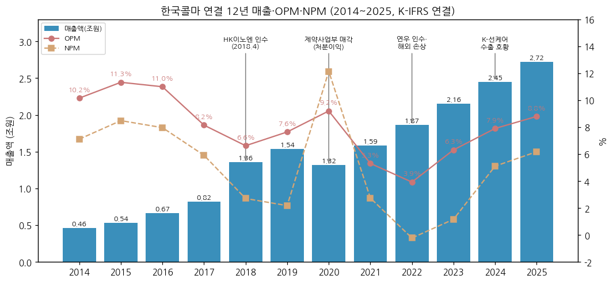

### ② 산업 분류

- DART 업종코드 20423 (화장품 제조업). 지주회사 체제: 콜마홀딩스(지주) → **한국콜마(중간지주 겸 사업회사, 2023.5 중간지주사 전환)** → HK이노엔·연우·해외법인
- 워치리스트: 대분류 **소비재** > 섹터 **뷰티** > 서브섹터 **ODM** (코스맥스·한국콜마·코스메카코리아) 핵심 종목
- 사업보고서 부문 매출비중(FY2025, 연결조정 전): 화장품 54.2% / 전문의약품 36.2% / 패키징 9.2% / H&B 2.7%

### ③ 분류 결정 논리

**Primary: 지속성장 (K-뷰티 수출 플랫폼형 ODM)** / **Secondary: 소비재 사이클(브랜드 수요·중국) + 제약 방어형 지속성장(HK이노엔)**

1. **매출 큰 사업부 기준** — 연결 매출 1위는 별도 화장품(2025 1.19조, 이익 기여 ~62%). HK이노엔은 매출 3분의 1이지만 지분 43%라 지배주주 이익 기여는 더 작다. 분류는 화장품 ODM이 결정.
2. **Secular 변수 sub-rule** — ODM은 브랜드사의 수요를 받아 생산하는 B2B. 2015~17 1차 K-뷰티(중국 의존)는 사드로 꺾였지만, 2023~ 2차 K-뷰티는 미국·유럽·중동·일본으로 수출국이 다변화하고 인디브랜드(스케일업)·글로벌 MNC 고객으로 확장 중이라 구조적 성장 성격이 강하다. 선케어 국내 점유율 70%+(회사 추정)라는 카테고리 해자가 있다.
3. **Boundary case** — ODM은 고객 브랜드의 흥망에 따라 Top 고객이 자주 바뀌고(애터미·카버코리아 → 구다이글로벌·달바·스케일업 선케어), 중국·북미 법인은 아직 적자. 그래서 Primary 지속성장 + Secondary 사이클로 둔다. HK이노엔(케이캡)은 별도로 제약 지속성장.
4. **글로벌 피어 cross-reference** — 코스맥스(색조·중국 비중 높음, 순수 ODM), Intercos(이탈리아, 색조 ODM). 한국콜마는 기초·선케어 중심 + 제약 자회사 보유라 순수 ODM보다 변동성이 낮지만 지주사형 할인이 붙는다.

### ④ 적정 밸류에이션 방법

- **SOTP가 1순위**: ① 화장품(별도+해외법인+연우) = **Forward PER** (국내 ODM 피어 코스맥스와 비교) + ② HK이노엔 지분가치 = **상장 시총 × 43.01% × 지주 할인(통상 30~50%)** − ③ 순차입금 일부.
- PBR은 보조 지표: 연결 자본의 45%가 비지배지분(HK이노엔 외부주주)이고, 무형자산 1.24조(HK이노엔 인수 영업권·무형)가 커서 PBR 해석이 왜곡된다.
- 삼성전자 비교: 삼성전자는 메모리 사이클 때문에 PBR 우선이지만, 한국콜마는 이익 변동이 상대적으로 작은 소비재 ODM이라 PER(SOTP) 우선.

### ⑤ 분기 재평가 트리거 (분류 자체가 바뀔 조건)

| 트리거 | 방향 | 조건 |
|---|---|---|
| HK이노엔 지분 매각·분리 | 순수 ODM으로 재분류 | 지분 처분 또는 인적분할 → 지주 할인 해소, 피어가 코스맥스로 단일화 |
| 별도 OPM 15%+ 4개 분기 연속 | 지속성장 강화 | 비수기(4Q)에도 12%+ 유지 시 사이클 성격 약화 확인 |
| 해외법인(미국 2공장) 흑자 정착 | 글로벌 ODM 격상 | 미국·중국·캐나다 합산 연간 흑자 전환 시 "국내 단일 공장" 디스카운트 해소 |
| 수출 브랜드 수요 급랭 | Primary 사이클로 하향 | 별도 매출 YoY 2개 분기 연속 마이너스 (2019, 2022 선례) |

---

## ② 회사 개요

### ① 기본 사항

| 항목 | 내용 |
|---|---|
| 회사명 | 한국콜마 주식회사 (KOLMAR KOREA CO.,LTD.) |
| 설립 / 상장 | 2012.10.02 舊 한국콜마(現 콜마홀딩스)에서 인적분할 설립 / 2012.10.19 유가증권시장 상장 |
| 창업 | 윤동한 회장 1990년 한국콜마 창업(일본 콜마와 합작), 국내 최초 화장품 ODM 방식 정착 |
| 본점 | 세종특별자치시 전의면 덕고개길 12-11 (연구·영업 본거지: 서울 서초구 종합기술원) |
| 대표이사 | 최현규 사장 (등기: 윤상현 부회장, 한상근 이사회 의장, 허현행 부사장) |
| 주요 사업 | 화장품 ODM(기초·선케어·색조), 화장품 용기(연우), 전문의약품·H&B(HK이노엔) |
| 신용등급 | 회사채 A(안정적), CP A2 (한국기업평가·NICE, 2025.12) |
| 고객 수 | 약 900개 이상 (애터미·구다이글로벌·씨제이올리브영·달바글로벌·카버코리아 등) |
| 임직원(별도) | 1,515명 (2026.6), 연구인력 약 1/3 |

### ② 12년 손익·자본 추이 (연결)

| 연도 | 매출 | 영업이익 | 지배순이익 | 자본총계 | 지배주주지분 | 지배지분 YoY |
|---|---|---|---|---|---|---|
| 2014 | 4,613 | 468 | 328 | 1,798 | 1,798 | — |
| 2015 | 5,358 | 607 | 455 | 2,207 | 2,207 | +23% |
| 2016 | 6,675 | 734 | 531 | 2,877 | 2,699 | +22% |
| 2017 | 8,216 | 670 | 473 | 3,326 | 3,051 | +13% |
| 2018 | 13,579 | 900 | 423 | 8,098 | 4,384 | +44% (신주 발행 + HK이노엔 인수로 비지배지분 3,715 신규) |
| 2019 | 15,407 | 1,178 | 291 | 8,479 | 4,714 | +8% |
| 2020 | 13,221 | 1,217 | 1,603 | 9,992 | 6,237 | +32% |
| 2021 | 15,863 | 843 | 358 | 13,596 | 6,836 | +10% (HK이노엔 IPO로 비지배 확대) |
| 2022 | 18,657 | 733 | -220 | 14,695 | 6,641 | -3% |
| 2023 | 21,557 | 1,361 | 52 | 14,186 | 6,486 | -2% |
| 2024 | 24,521 | 1,939 | 901 | 15,057 | 7,926 | +22% (연우 주식교환 신주 723,897주) |
| 2025 | 27,224 | 2,396 | 1,251 | 16,673 | 9,104 | +15% |
| 3Q26P | — | — | — | 18,217 | 미확보 | — |

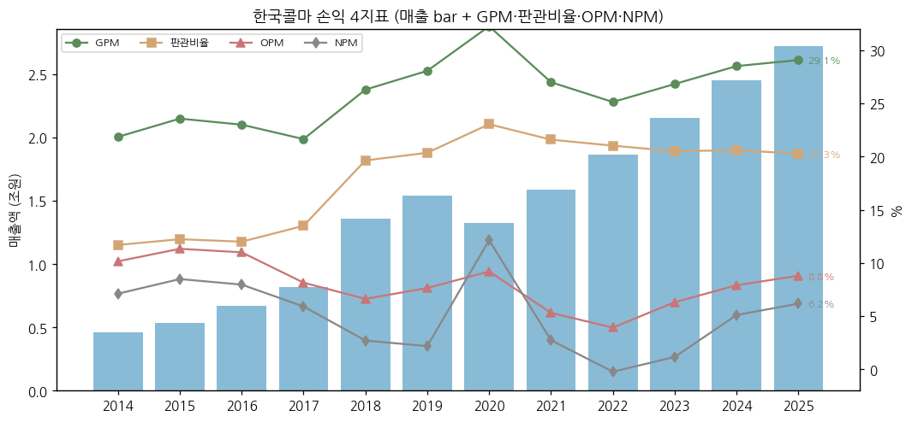

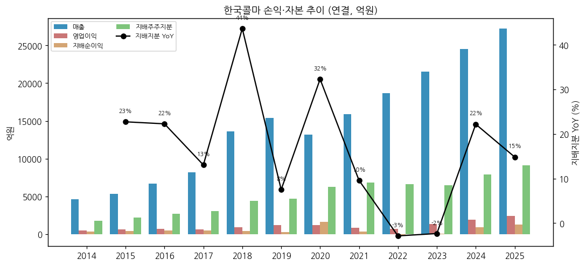

### ③ 주가 역사

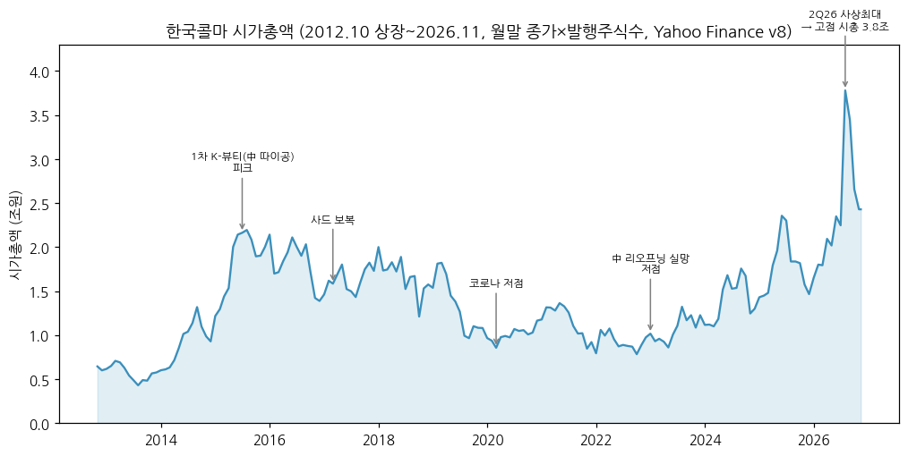

| 국면 | 기간 | 시총 흐름 | 배경 |
|---|---|---|---|
| 상장 초기 | 2012.10~2013 | 0.6조 → 0.45조 | 분할 상장 후 횡보 |
| 1차 K-뷰티 랠리 | 2014~2015.7 | 0.5조 → **2.2조** | 중국 따이공·면세 수요, 기초 ODM 가동률 급등 |
| 사드·조정 | 2016.7~2017 | 2.1조 → 1.5조 | 사드 보복, 중국 수요 둔화 |
| HK이노엔 인수·정체 | 2018~2019 | 1.5~2.0조 → 1.0조 | 1.3조 차입 인수, 2019.8 회장 발언 논란·불매 |
| 장기 저평가 | 2020~2023 | 0.8~1.4조 | 코로나·중국 봉쇄·해외법인 손상, 2023.1 리오프닝 실망 |
| 2차 K-뷰티 | 2024~2025.6 | 1.0조 → 2.4조 | 선케어 수출·인디브랜드, 미국 수출 급증 |
| 지배구조 분쟁 | 2025.6~2025.11 | 2.4조 → 1.5조 | 윤동한 회장의 주식반환 소송, 콜마비앤에이치 경영권 분쟁 |
| 사상 최대 실적 | 2026.1~2026.8 | 1.6조 → **3.78조(월말 고점)** | 1Q·2Q26 별도 분기 최대, 분쟁 종결(2026.5 소송 취하) |
| 조정 | 2026.9~11 | 3.78조 → 2.43조 | 고점 대비 -36% (3Q26 해외법인 적자 지속) |

> 시총 = Yahoo v8 월말 종가 × 연말 발행주식수(2017 이전 2,110만주 → 2018 2,235만 → 2019 2,288만 → 2024.2 이후 2,361만주) 근사. Yahoo 월봉은 DART 월별 주가표와 일부 월에서 차이가 있어 고점 수치는 교차검증 필요.

### ④ 주요 연혁

| 연도 | 내용 |
|---|---|
| 1990 | 舊 한국콜마 창업 (일본 콜마와 기술제휴·합작), 국내 최초 화장품 ODM 방식 도입 |
| 2000년대 | 중국 북경콜마 설립 (설립 연도 공시 원문 미확인) |
| 2012.10 | 인적분할로 한국콜마(사업회사)·한국콜마홀딩스(지주) 체제 |
| 2013 | 국내 업체 최초 선제품 미국 FDA 인증 (OTC 선케어) |
| 2014.10 | 세종 화장품 기초 신공장 완공 — 국내 최대 CAPA |
| 2016~2018 | 미국 PTP(현 HK Kolmar USA)·캐나다 CSR(현 HK Kolmar Canada) 인수, 중국 무석콜마 설립 (각 연도는 공시 원문 미확인, 2022.5 법인명 변경은 확인) |
| 2018.04 | **CJ헬스케어 인수**(씨케이엠 SPC 경유, 약 1.3조) → 2020.2 HK이노엔으로 사명 변경 |
| 2020.12 | 별도 제약사업부(의약외품 치약 제외)를 제뉴원사이언스에 3,011억원에 양도 — 화장품 전업화 |
| 2021.08 | HK이노엔 코스닥 상장 (지분율 43.01%로 희석, 실질지배력 연결) |
| 2022.07 | **연우 인수**(55.0%, 2,814억) — 화장품 용기 수직계열화 |
| 2023.01 | 세종2공장 인수(357.8억), 미국 펜실베이니아 2공장 건설 착수 |
| 2023.05 | 중간지주사 전환 |
| 2024.02 | 연우 포괄적 주식교환 완료(1:0.2915837) → 100% 자회사, 연우 상장폐지(2024.3) |
| 2024.12 | 종합기술원 등 연구시설 투자 1,149억 완료 |
| 2025.03 | 콜마유엑스 인수(콜마홀딩스로부터 72.7억) |
| 2025.06 | 미국 2공장 가동 개시 (준공식 6월) |
| 2026.02 | 콜마스크 인수(97.9%, 203.7억, 콜마비앤에이치로부터), 공모채 600억 발행 |
| 2026.05 | 윤동한 회장 주식반환 소송 취하 — 오너 일가 경영권 분쟁 종결, 윤상현 단일 체제 |

---

## ③ 비즈니스 모델

### ① 실적 추이 통합 표

**[1단계] 사업부별 (IR 기준, 연결조정 전, 억원)**

| 사업부 | 2023 매출 | 2024 매출 | 2025 매출 | 1~3Q26 매출 | 2023 OP | 2024 OP | 2025 OP | 1~3Q26 OP | 2025 OPM |
|---|---|---|---|---|---|---|---|---|---|
| 한국콜마 별도 (국내 화장품 ODM) | 8,565 | 10,597 | 11,928 | 12,071 | 797 | 1,223 | 1,495 | 1,849 | 12.5% |
| 중국 (무석, 2024~ 북경 정리) | 1,582 | 1,537 | 1,563 | 1,356 | 127 | 80 | 59 | 45 | 3.8% |
| 미국 (HK Kolmar USA) | 374 | 579 | 549 | 492 | -95 | -60 | -134 | -90 | 적자 |
| 캐나다 (HK Kolmar Canada) | 459 | 395 | 359 | 257 | -19 | -87 | -54 | -42 | 적자 |
| 연우 (용기, 100%) | 2,364 | 2,755 | 2,509 | 2,370 | 4 | 14 | 3 | 97 | 0.1% |
| HK이노엔 (제약·H&B, 43.01%) | 8,289 | 8,971 | 10,632 | 7,863 | 650 | 882 | 1,109 | 892 | 10.4% |
| **연결** | **21,557** | **24,521** | **27,224** | **24,175** | **1,361** | **1,939** | **2,396** | **2,711** | **8.8%** |

> 2024·2025 사업부 값은 분기 IR 합산(4Q24·1Q25는 4Q25·1Q26 IR의 전년 컬럼). 연결과 사업부 합의 차이는 연결조정·기타 법인(엠오디머티어리얼즈, 콜마유엑스 등).

**[2단계] 제품별 (사업보고서 '주요 제품 등의 현황', 연결, 억원)**

| 부문 | 2021 | 2022 | 2023 | 2024 | 2025 | 2025 비중 |
|---|---|---|---|---|---|---|
| 화장품 — 기초(스킨케어·선케어 포함) | 6,272 | 7,025 | 8,528 | 10,014 | 11,060 | 40.6% |
| 화장품 — 색조 | 2,091 | 2,342 | 2,843 | 3,338 | 3,687 | 13.5% |
| 패키징(연우) | — | 1,059 | 2,364 | 2,755 | 2,509 | 9.2% |
| 전문의약품(HK이노엔 ETC) | 7,040 | 7,521 | 7,349 | 8,047 | 9,854 | 36.2% |
| H&B(컨디션·헛개수) | 637 | 884 | 900 | 868 | 732 | 2.7% |
| 연결조정·기타 | -177 | -173 | -428 | -501 | -616 | -2.3% |
| 합계 | 15,863 | 18,657 | 21,557 | 24,521 | 27,224 | 100% |

별도 화장품 카테고리 믹스(IR): 3Q26 선케어 32% / 스킨케어 48% / 메이크업 15% (2Q26 35/49/12, 4Q25 17/62/16). 상위 Top10 고객 비중 57%(3Q26).

**[3단계] 지역별 — 한국콜마 별도 수출·내수 (사업보고서, 억원)**

| 구분 | 2023 | 2024 | 2025 |
|---|---|---|---|
| 별도 내수(국내 브랜드사 납품) | 8,248 | 10,063 | 11,022 |
| 별도 직수출 | 319 | 533 | 906 |
| 별도 합계 | 8,568 | 10,597 | 11,928 |

> 별도 매출은 회계상 대부분 "내수"지만 실제 수요는 고객 브랜드사의 수출(미국·일본·유럽·중동)이 견인하는 **간접수출** 구조. 직수출은 글로벌 MNC·해외 브랜드향으로 2년간 2.8배.

### ① 사업부별 장기 분기 시계열

**(a) 한국콜마 별도 43분기 (1Q16~3Q26P)** — 1Q16~1Q20은 舊 별도 제약사업부 포함, 2Q20부터 화장품 전업(중단영업 분리)

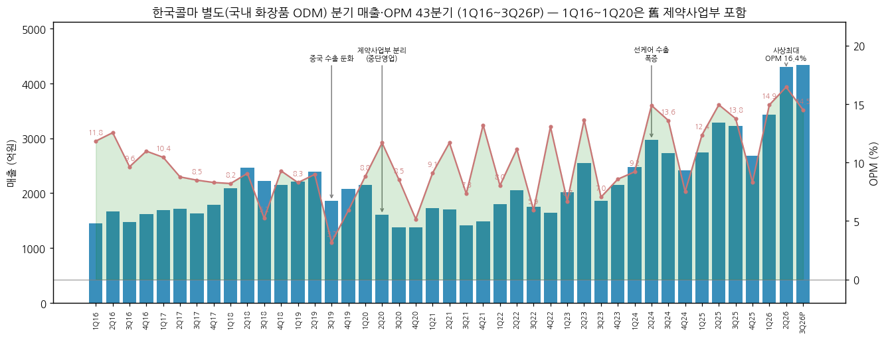

**(b) 연결 + 별도 분기 시계열 전체 (OpenDART, 억원)**

| 분기 | 연결 매출 | 연결 OP | 연결 OPM | 매출 YoY | OP YoY | 연결 순이익 | 별도 매출 | 별도 OP | 별도 OPM |
|---|---|---|---|---|---|---|---|---|---|
| 1Q16 | 1,486 | 175 | 11.8% |  |  |  | 1,445 | 171 | 11.8% |
| 2Q16 | 1,730 | 215 | 12.5% |  |  |  | 1,665 | 209 | 12.6% |
| 3Q16 | 1,602 | 155 | 9.7% |  |  |  | 1,473 | 142 | 9.7% |
| 4Q16 | 1,856 | 189 | 10.2% |  |  |  | 1,613 | 177 | 11.0% |
| 1Q17 | 2,014 | 206 | 10.2% | +35.5% | +18.0% |  | 1,695 | 177 | 10.5% |
| 2Q17 | 2,071 | 170 | 8.2% | +19.7% | -21.3% |  | 1,711 | 150 | 8.8% |
| 3Q17 | 1,942 | 154 | 7.9% | +21.2% | -0.8% | 126 | 1,625 | 138 | 8.5% |
| 4Q17 | 2,189 | 140 | 6.4% | +17.9% | -25.9% | 72 | 1,785 | 148 | 8.3% |
| 1Q18 | 2,425 | 180 | 7.4% | +20.4% | -12.8% | 133 | 2,084 | 171 | 8.2% |
| 2Q18 | 3,601 | 246 | 6.8% | +73.9% | +44.8% | 119 | 2,459 | 223 | 9.1% |
| 3Q18 | 3,754 | 78 | 2.1% | +93.3% | -49.5% | -95 | 2,220 | 116 | 5.2% |
| 4Q18 | 3,799 | 396 | 10.4% | +73.5% | +183.3% | 210 | 2,154 | 200 | 9.3% |
| 1Q19 | 3,806 | 317 | 8.3% | +56.9% | +76.4% | 150 | 2,209 | 183 | 8.3% |
| 2Q19 | 4,098 | 380 | 9.3% | +13.8% | +54.8% | 138 | 2,395 | 215 | 9.0% |
| 3Q19 | 3,609 | 202 | 5.6% | -3.8% | +160.0% | 48 | 1,859 | 59 | 3.2% |
| 4Q19 | 3,894 | 278 | 7.2% | +2.5% | -29.8% | 0 | 2,083 | 123 | 5.9% |
| 1Q20 | 3,753 | 299 | 8.0% | -1.4% | -5.7% | 139 | 2,155 | 190 | 8.8% |
| 2Q20 | 3,221 | 272 | 8.5% | -21.4% | -28.4% | 64 | 1,609 | 188 | 11.7% |
| 3Q20 | 3,176 | 189 | 6.0% | -12.0% | -6.6% | 160 | 1,382 | 118 | 8.5% |
| 4Q20 | 3,489 | 520 | 14.9% | -10.4% | +86.6% | 1243 | 1,375 | 71 | 5.1% |
| 1Q21 | 3,953 | 242 | 6.1% | +5.3% | -18.9% | 151 | 1,724 | 157 | 9.1% |
| 2Q21 | 4,128 | 213 | 5.2% | +28.1% | -21.7% | 122 | 1,702 | 199 | 11.7% |
| 3Q21 | 3,760 | 128 | 3.4% | +18.4% | -32.4% | 69 | 1,418 | 104 | 7.3% |
| 4Q21 | 4,023 | 259 | 6.4% | +15.3% | -50.1% | 94 | 1,484 | 196 | 13.2% |
| 1Q22 | 4,104 | 129 | 3.1% | +3.8% | -46.8% | 142 | 1,794 | 144 | 8.0% |
| 2Q22 | 5,027 | 336 | 6.7% | +21.8% | +57.8% | 225 | 2,058 | 229 | 11.1% |
| 3Q22 | 4,735 | 181 | 3.8% | +25.9% | +41.6% | 65 | 1,755 | 104 | 5.9% |
| 4Q22 | 4,791 | 86 | 1.8% | +19.1% | -66.7% | -473 | 1,639 | 214 | 13.1% |
| 1Q23 | 4,877 | 121 | 2.5% | +18.8% | -6.6% | 65 | 2,018 | 135 | 6.7% |
| 2Q23 | 5,997 | 557 | 9.3% | +19.3% | +65.5% | 426 | 2,544 | 347 | 13.6% |
| 3Q23 | 5,164 | 310 | 6.0% | +9.1% | +71.5% | 198 | 1,861 | 131 | 7.0% |
| 4Q23 | 5,519 | 374 | 6.8% | +15.2% | +332.8% | -437 | 2,145 | 184 | 8.6% |
| 1Q24 | 5,748 | 324 | 5.6% | +17.9% | +168.9% | 121 | 2,478 | 228 | 9.2% |
| 2Q24 | 6,603 | 717 | 10.9% | +10.1% | +28.9% | 452 | 2,970 | 442 | 14.9% |
| 3Q24 | 6,265 | 545 | 8.7% | +21.3% | +75.7% | 236 | 2,736 | 372 | 13.6% |
| 4Q24 | 5,905 | 351 | 6.0% | +7.0% | -6.0% | 444 | 2,412 | 181 | 7.5% |
| 1Q25 | 6,531 | 599 | 9.2% | +13.6% | +84.8% | 232 | 2,743 | 339 | 12.4% |
| 2Q25 | 7,308 | 735 | 10.1% | +10.7% | +2.4% | 418 | 3,281 | 490 | 14.9% |
| 3Q25 | 6,830 | 583 | 8.5% | +9.0% | +7.0% | 424 | 3,220 | 443 | 13.8% |
| 4Q25 | 6,555 | 478 | 7.3% | +11.0% | +36.2% | 609 | 2,683 | 223 | 8.3% |
| 1Q26 | 7,280 | 789 | 10.8% | +11.5% | +31.6% | 600 | 3,430 | 512 | 14.9% |
| 2Q26 | 8,613 | 1,103 | 12.8% | +17.8% | +50.2% | 706 | 4,304 | 708 | 16.4% |
| **3Q26P** | **8,282** | **819** | **9.9%** | **+21.3%** | **+40.5%** | **517** | **4,337** | **629** | **14.5%** |

> 1Q16~2Q17 연결 순이익은 OpenDART 분기 JSON에 미제공(공란). 3Q26P = 2026-11-06 IR 잠정치(분기보고서 확정 시 교체).

**(c) 사업부별 15분기 (1Q23~3Q26P, 한국콜마 IR, 억원)**

| 분기 | 1Q23 | 2Q23 | 3Q23 | 4Q23 | 1Q24 | 2Q24 | 3Q24 | 4Q24 | 1Q25 | 2Q25 | 3Q25 | 4Q25 | 1Q26 | 2Q26 | 3Q26P |
|---|---|---|---|---|---|---|---|---|---|---|---|---|---|---|---|
| 별도 매출 | 2,018 | 2,544 | 1,861 | 2,145 | 2,478 | 2,970 | 2,736 | 2,412 | 2,743 | 3,281 | 3,220 | 2,683 | 3,430 | 4,304 | 4,337 |
| 중국 매출 | 330 | 564 | 361 | 326 | 346 | 527 | 366 | 298 | 416 | 499 | 318 | 329 | 473 | 579 | 304 |
| 미국 매출 | 65 | 83 | 113 | 114 | 70 | 134 | 175 | 200 | 217 | 184 | 81 | 67 | 134 | 178 | 180 |
| 캐나다 매출 | 120 | 143 | 105 | 91 | 90 | 126 | 92 | 86 | 87 | 100 | 92 | 80 | 84 | 92 | 81 |
| 연우 매출 | 505 | 632 | 612 | 616 | 672 | 740 | 728 | 615 | 637 | 707 | 618 | 547 | 624 | 911 | 835 |
| HK이노엔 매출 | 1,849 | 2,044 | 2,156 | 2,241 | 2,126 | 2,193 | 2,295 | 2,358 | 2,474 | 2,631 | 2,608 | 2,919 | 2,587 | 2,672 | 2,604 |
| 별도 영업이익 | 135 | 347 | 131 | 184 | 228 | 442 | 372 | 181 | 339 | 490 | 443 | 223 | 512 | 708 | 629 |
| 중국 영업이익 | 6 | 92 | 17 | 12 | 18 | 67 | 10 | -15 | 31 | 61 | -16 | -16 | 32 | 57 | -44 |
| 미국 영업이익 | -39 | -25 | -17 | -16 | -25 | -13 | -34 | 12 | 15 | -2 | -64 | -83 | -37 | -14 | -38 |
| 캐나다 영업이익 | -3 | 7 | -10 | -13 | -21 | -9 | -18 | -39 | -13 | 3 | -13 | -31 | -17 | -9 | -16 |
| 연우 영업이익 | -25 | 12 | 16 | 0 | 0 | 12 | 12 | -10 | -10 | 8 | -2 | 8 | -3 | 70 | 30 |
| HK이노엔 영업이익 | 56 | 153 | 224 | 216 | 173 | 243 | 222 | 244 | 254 | 195 | 259 | 401 | 332 | 300 | 260 |
| 별도 OPM | 6.7% | 13.6% | 7.0% | 8.6% | 9.2% | 14.9% | 13.6% | 7.5% | 12.4% | 14.9% | 13.8% | 8.3% | 14.9% | 16.4% | 14.5% |
| HK이노엔 OPM | 3.0% | 7.5% | 10.4% | 9.6% | 8.1% | 11.1% | 9.7% | 10.3% | 10.3% | 7.4% | 9.9% | 13.7% | 12.8% | 11.2% | 10.0% |
| **연결−HK이노엔 매출** (화장품 연결 proxy) | 3,028 | 3,953 | 3,008 | 3,278 | 3,622 | 4,410 | 3,970 | 3,547 | 4,057 | 4,677 | 4,222 | 3,636 | 4,693 | 5,941 | 5,678 |
| **연결−HK이노엔 영업이익** | 65 | 404 | 86 | 158 | 151 | 474 | 323 | 107 | 345 | 540 | 324 | 77 | 457 | 803 | 559 |
| 연결−HK이노엔 OPM | 2.1% | 10.2% | 2.9% | 4.8% | 4.2% | 10.7% | 8.1% | 3.0% | 8.5% | 11.5% | 7.7% | 2.1% | 9.7% | 13.5% | 9.8% |

> 1Q23~4Q23 중국은 무석 기준(1Q24 IR). 3Q23 IR의 "중국"(북경 포함)과 다름. 1Q23 캐나다 OP는 1H23(4)−2Q23(7)로 역산. "연결−HK이노엔"은 연결조정이 섞인 화장품 연결 proxy.

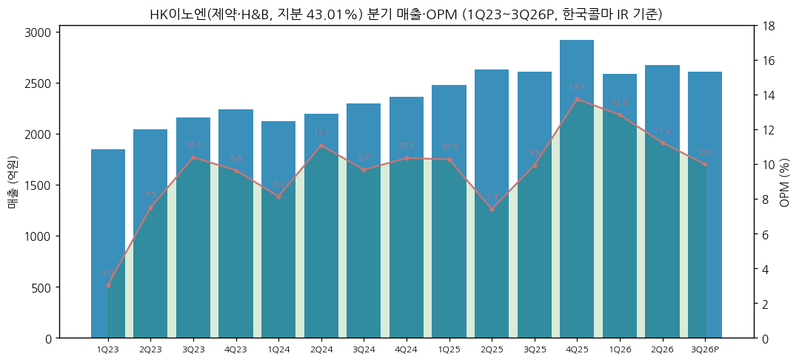

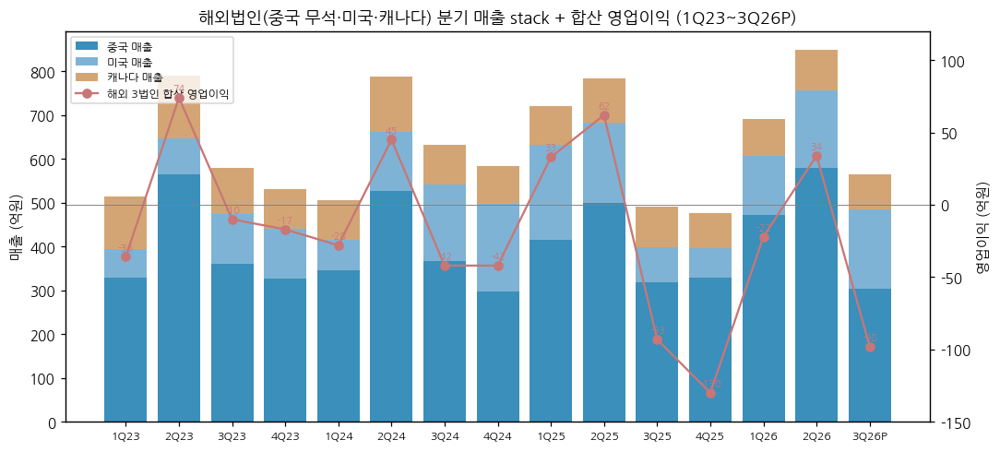

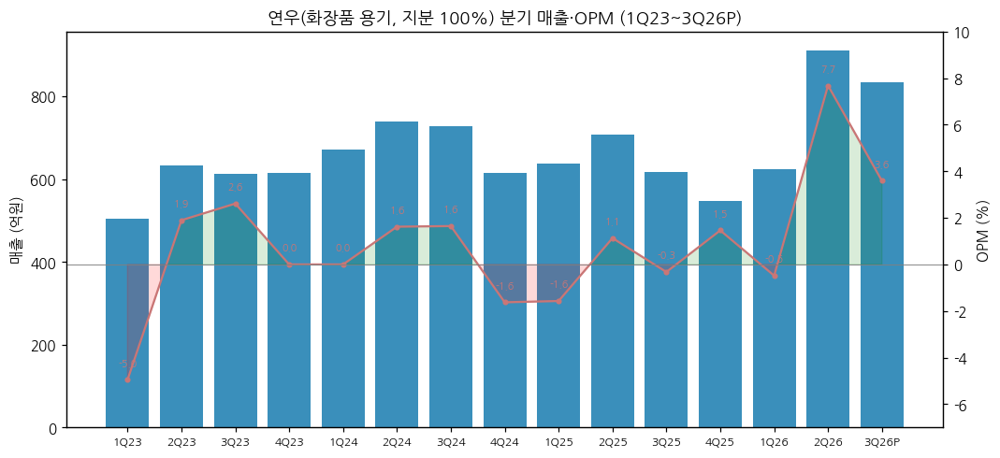

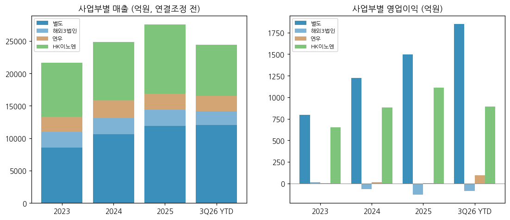

### ① 12분기 시계열 (연결)

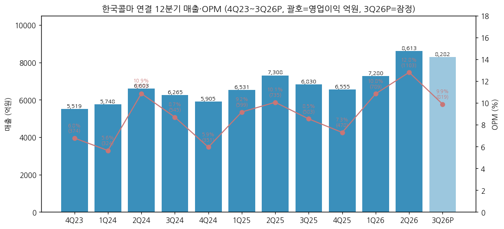

직전 2개 분기 YoY: 2Q26 매출 +17.8% / OP +50.2%, 3Q26P 매출 +21.3% / OP +40.5% — 매출 가속, 이익 증가율은 높은 수준에서 소폭 둔화. 화장품(연결−HK이노엔) OP는 3Q26P 559억(+73% YoY).

### ② 사업부별 개요 (매출 비중 큰 순)

| 사업부 | 2025 매출 비중(연결조정 전) | 무엇을 하나 | 이익 기여 |
|---|---|---|---|
| 한국콜마 별도 | 약 43% | 국내 세종·부천 공장에서 기초·선케어·색조 ODM. 화장품 매출 95% 이상이 ODM(자체 처방 보유) | 연결 OP의 62%(2025), 3Q26 77% |
| HK이노엔 | 약 38% | 전문의약품(케이캡·순환기·당뇨·수액·백신 코프로모션) + H&B(컨디션·헛개수) | 46%, 단 지배주주 귀속은 43% |
| 연우 | 약 9% | 화장품 펌프·튜브·견본 용기 (국내 유일 펌프+튜브 동시) | 0~3%, 2Q26부터 흑자 확대 |
| 해외 3법인 | 약 9% | 중국 무석(색조·선), 미국(펜실베이니아 1·2공장, 색조·OTC), 캐나다(스킨케어) | 합산 적자 (-129억, 2025) |

### ③ 사업부별 디테일

- **별도 (top-seller)**: 2024년부터 선케어가 성수기(2Q~3Q) 매출의 30~35%. 국내 선케어 ODM 점유율 70%+(2023) → 75%+(2024F, 회사 추정). 2025 하반기부터 스킨케어(릴리프크림 등 스케일업 인디브랜드)와 **글로벌 MNC 럭셔리 스킨케어 플래그십 ODM**(1Q26 매출 개시)이 추가 성장축. 분기 매출 레벨이 2,000억대(2023) → 4,300억대(2Q~3Q26)로 2배.
- **이익 outlier (별도)**: 4Q는 선케어 비수기 + 성과급·연말 비용으로 OPM이 7~9%로 떨어지는 계절성이 반복(4Q23 8.6%, 4Q24 7.5%, 4Q25 8.3%). 회사는 4Q26 매출 증가율이 연중 가장 강할 것으로 가이드.
- **HK이노엔**: 케이캡(P-CAB 위식도역류) 국내 처방 분기 650억대(3Q26, +16.5%), 중국 로열티 급증, 2026.1Q부터 약가환급수수료를 매출차감으로 회계변경(매출 성장 둔화처럼 보임). 미국은 Braintree 파트너로 허가 심사 중. GLP-1 비만 신약(IN-B00009) 국내 임상 3상.
- **미국**: 1공장 최대 고객(색조 브랜드) 주문 급감으로 2025 하반기 적자 확대. 2공장(2025.6 가동, 생산능력 2.33억개)은 가동률 12%(2025). 2026년 글로벌 MNC 색조 브랜드가 상위 고객으로 편입되며 매출 회복(3Q26 +122%), 적자 축소 중.
- **중국 무석**: 색조 비중 높고 로컬 브랜드 의존, 선케어 성수기(2Q)에만 흑자. 3Q26 영업적자 44억.
- **연우**: 국내 대형 2사(아모레·LG생건) 비중이 17%(2024) → 9~11%(2026)로 줄고 스케일업 선케어 브랜드 용기로 고객 교체. 2Q26 OP 70억으로 턴어라운드.

### ④ 주요 경쟁사

| 사업부 | 국내 경쟁사 | 해외 경쟁사 |
|---|---|---|
| 화장품 ODM | 코스맥스(1위권, 색조·중국 강점), 코스메카코리아, 씨앤씨인터내셔널(색조), 잉글우드랩, 콜마비앤에이치(건기식·화장품, 그룹 계열) | Intercos(伊), 코스맥스 중국·미국, 중국 로컬 ODM |
| 화장품 용기 | 펌텍코리아, 삼화플라스틱 등 | Aptar, Silgan 등 |
| 전문의약품(P-CAB) | 대웅제약(펙수클루), 온코닉테라퓨틱스(자큐보) | Phathom(보노프라잔, 미국) |
| H&B(숙취해소) | 삼양사(큐어), 동아제약(모닝케어), 그래미(여명808) | — |

### ⑤ 주요 매출처

- **별도 상위 5개사 비중 32.8%(2025)**: 애터미, 구다이글로벌, 씨제이올리브영, 달바글로벌, 카버코리아 (사업보고서 기재 순서. DART는 개별 금액 비공개 → 순위는 추정 불가, 기재 순서만 참고)
- 이전 연도 기재: 2018 애터미·카버코리아·제이엠아이앤씨·더페이스샵·이니스프리 → 2021 애터미·카버코리아·지피클럽·동국제약·고운세상 → 2025 구다이글로벌·달바글로벌 신규 진입. 고객 교체가 빠른 ODM 특성 확인.
- IR(3Q25): "국내 최대 선케어 브랜드가 최대 고객사로 부상", 유럽 스타일 스킨케어 브랜드, 스킨케어 전문 글로벌 MNC의 유럽향 메이크업 매출 본격화. Top10 고객 비중 57%(3Q26).
- 연우: PKG Group(북미 Sales partner), 아모레퍼시픽, LG생활건강 3사 35.9%.

### ⑥ 생산 CAPA + 임직원 추이

| 사업소 | 2023 CAPA | 2024 CAPA | 2025 CAPA | 2025 생산 | 2025 가동률 |
|---|---|---|---|---|---|
| 한국콜마 별도(세종·부천) | 3.73억개 | 5.58억개 | **6.32억개** | 4.86억개 | 76.8% |
| 중국 무석 | 2.16억개 | 2.16억개 | 2.16억개 | 0.99억개 | 46.0% |
| 중국 북경 | 0.74억개 | 0.19억개 | 0 (정리) | — | — |
| 미국 | 0.68억개 | 0.68억개 | **2.33억개**(2공장) | 0.28억개 | 12.0% |
| 캐나다 | 1.02억개 | 1.02억개 | 1.00억개 | 0.23억개 | 22.6% |
| 연우 펌프/튜브/견본 | 5.93/1.37/2.08억개 | 동일 | 동일 | 2.42/0.80/0.59억개 | 40.7/58.0/28.2% |
| HK이노엔 오송 완제 | 7억정 | 7억정 | 7억정 | 9.14억정 | 130.5% |

금액 기준 생산능력(회사 기재): 국내 1.55조원(기초 1.35조, 색조 0.2조) + 해외 약 1조원(무석 5,500억, 미국 3,350억, 캐나다 1,150억).

| 임직원(별도) | 2015 | 2016 | 2017 | 2018 | 2019 | 2020 | 2021 | 2022 | 2023 | 2024 | 2025 | 2026.6 |
|---|---|---|---|---|---|---|---|---|---|---|---|---|
| 인원 | 788 | 945 | 1,010 | 1,093 | 1,217 | 832 | 987 | 미확보 | 1,110 | 1,304 | 1,542 | 1,515 |

> 2018~2019는 별도 제약사업부 인원 포함, 2020 매각으로 감소. 2025 1인 평균급여 남 8,200만원 / 여 6,500만원.

---

## ④ 재무 구조 (12년 연결, OpenDART)

### ① 손익계산서

| 연도 | 매출 | 매출총이익률 | 판관비율 | 영업이익 | OPM | 순이익 | NPM |
|---|---|---|---|---|---|---|---|
| 2014 | 4,613 | 21.8% | 11.7% | 468 | 10.2% | 328 | 7.1% |
| 2015 | 5,358 | 23.6% | 12.2% | 607 | 11.3% | 455 | 8.5% |
| 2016 | 6,675 | 23.0% | 12.0% | 734 | 11.0% | 532 | 8.0% |
| 2017 | 8,216 | 21.6% | 13.5% | 670 | 8.2% | 486 | 5.9% |
| 2018 | 13,579 | 26.3% | 19.6% | 900 | 6.6% | 368 | 2.7% |
| 2019 | 15,407 | 28.1% | 20.4% | 1,178 | 7.6% | 336 | 2.2% |
| 2020 | 13,221 | 32.2% | 23.0% | 1,217 | 9.2% | 1,606 | 12.1% |
| 2021 | 15,863 | 27.0% | 21.6% | 843 | 5.3% | 435 | 2.7% |
| 2022 | 18,657 | 25.1% | 21.0% | 733 | 3.9% | -41 | -0.2% |
| 2023 | 21,557 | 26.8% | 20.5% | 1,361 | 6.3% | 251 | 1.2% |
| 2024 | 24,521 | 28.5% | 20.6% | 1,939 | 7.9% | 1,253 | 5.1% |
| 2025 | 27,224 | 29.1% | 20.3% | 2,396 | 8.8% | 1,682 | 6.2% |

> 2018부터 GPM·판관비율이 동시에 점프 = HK이노엔(제약은 고GPM·고판관비) 연결 효과. 별도 화장품만 보면 GPM 19.6%·판관비율 7.1%(2025 별도)로 저GPM·저판관비 제조업 구조. 3Q26 별도 GPM 20.0%, 판관비율 5.5%.

### ② 재무상태표

| 연도 | 자산 | 부채 | 자본 | 지배지분 | 총차입금(사채 포함) | 현금 | 부채비율 | 유동비율 |
|---|---|---|---|---|---|---|---|---|
| 2014 | 3,364 | 1,566 | 1,798 | 1,798 | 미확보 | 212 | 87% | 145% |
| 2015 | 3,443 | 1,236 | 2,207 | 2,207 | 290 | 162 | 56% | 162% |
| 2016 | 4,929 | 2,052 | 2,877 | 2,699 | 631 | 269 | 71% | 135% |
| 2017 | 6,685 | 3,359 | 3,326 | 3,051 | 787 | 143 | 101% | 173% |
| 2018 | 21,864 | 13,766 | 8,098 | 4,384 | 11,070 | 765 | 170% | 107% |
| 2019 | 24,003 | 15,524 | 8,479 | 4,714 | 11,485 | 1,186 | 183% | 91% |
| 2020 | 24,896 | 14,904 | 9,992 | 6,237 | 10,687 | 3,772 | 149% | 113% |
| 2021 | 26,060 | 12,465 | 13,596 | 6,836 | 8,531 | 1,912 | 92% | 99% |
| 2022 | 29,333 | 14,638 | 14,695 | 6,641 | 10,124 | 2,201 | 100% | 94% |
| 2023 | 30,094 | 15,908 | 14,186 | 6,486 | 10,369 | 1,708 | 112% | 70% |
| 2024 | 31,267 | 16,210 | 15,057 | 7,926 | 10,958 | 1,419 | 108% | 71% |
| 2025 | 34,578 | 17,904 | 16,673 | 9,104 | 11,794 | 2,253 | 107% | 74% |
| 3Q26P | 37,921 | 19,704 | 18,217 | — | 미확보 | — | 108% | 88% |

> 2025 순차입금비율 51.9%(회사 공시: 차입금·사채 11,794 − 현금·단기금융 3,137). 무형자산 1.24조(영업권 포함, 대부분 HK이노엔 인수 PPA). 유동비율 70%대는 단기차입금(7,441) 비중이 높은 탓.

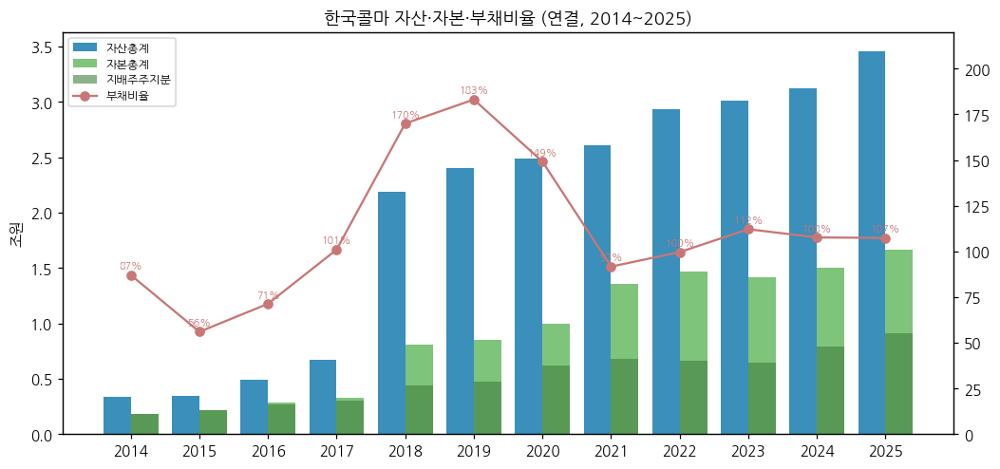

### ③ 현금흐름표

| 연도 | 영업CF | 투자CF | 재무CF | 유형 CapEx | 무형 CapEx | FCF |
|---|---|---|---|---|---|---|
| 2014 | 344 | -147 | -136 | 미확보 | 미확보 | — |
| 2015 | 494 | -86 | -459 | 334 | 62 | 98 |
| 2016 | 382 | -213 | 106 | 448 | 9 | -75 |
| 2017 | 54 | -1,562 | 1,351 | 686 | 86 | -719 |
| 2018 | 628 | -12,932 | 12,937 | 792 | 49 | -214 |
| 2019 | 1,648 | -1,507 | 277 | 737 | 17 | 895 |
| 2020 | 1,215 | 2,457 | -1,095 | 1,192 | 39 | -16 |
| 2021 | -31 | -2,830 | 976 | 401 | 112 | -545 |
| 2022 | 908 | -1,452 | 820 | 378 | 187 | 343 |
| 2023 | 1,122 | -1,557 | -84 | 1,068 | 179 | -125 |
| 2024 | 2,154 | -2,052 | -432 | 2,472 | 133 | -451 |
| 2025 | 2,914 | -2,477 | 402 | 1,640 | 158 | **1,117** |

> FCF = 영업CF − 유형·무형자산 취득. 2018 투자CF −1.29조 = HK이노엔 인수. 2020 투자CF +2,457 = 제약사업부 양도대금 유입. 2025 FCF가 처음으로 1,000억을 넘음.

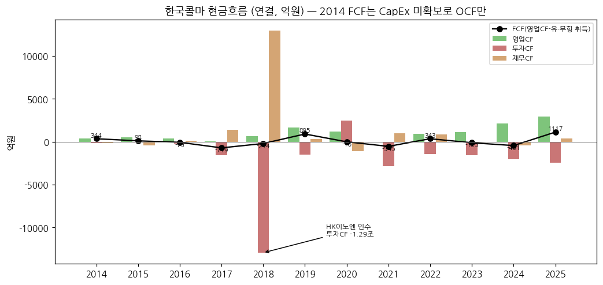

### ④ CapEx

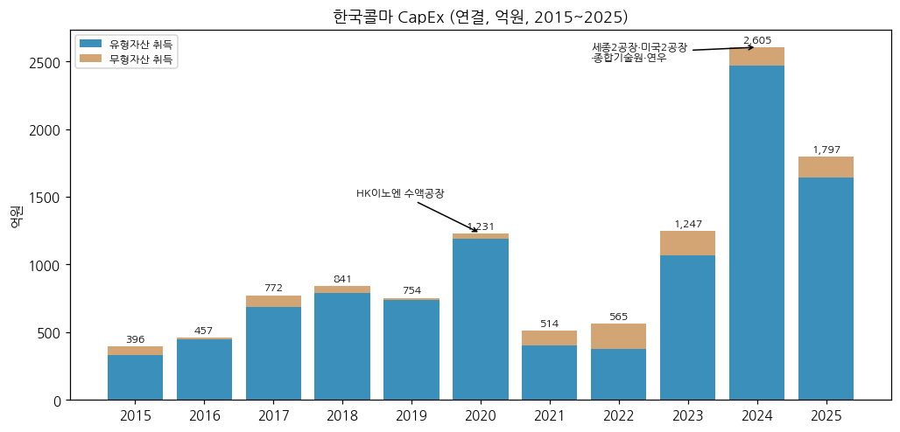

- 2024 유형 CapEx 2,472억(사상 최대): 세종1공장 증설·세종2공장 수선, 미국 2공장, 종합기술원(연구시설 1,149억, 2021.10~2024.12), 남동공단 토지(248억).
- 2025 1,640억, 2026은 "1H27 수요 대비 CAPA 추가 확보" 및 연우 튜브 라인 증설이 IR 가이드(금액 미확보).
- 감가상각비(유형) 2025 660억, 2024 547억.

### ⑤ 부채구조 + 채무증권 발행

- 2025말 차입금·사채 11,794억: 단기차입금 7,441 / 유동성사채 1,049 / 비유동사채 2,446 / 장기차입금 858.
- 한국콜마 공모채 미상환 잔액 2,000억(2025말, 1년 이하 540 / 1~2년 960 / 2~3년 500). 2026.2 제7-1·7-2회 공모채 600억(각 300억) 추가 발행.
- 이자 지급 436억(2025), 이자보상배율(OP/이자지급) 5.5배 (2019 2.6배 → 개선).
- 통화스왑 부채 18억(2025).

### ⑥ 배당·자사주

| 항목 | 2023 | 2024 | 2025 |
|---|---|---|---|
| 주당 배당금(원) | 600 | 720 | 864 |
| 배당총액(억원) | 137 | 170 | 204 |
| 연결 배당성향 | 264.4% | 18.9% | 16.3% |
| 시가배당률 | 1.13% | 1.26% | 1.20% |
| 자기주식 | 없음 | 연우 교환 단주 7,537주 처분 | 없음 |

- 2025.3 정관 개정으로 분기배당 근거 도입. 자사주 매입·소각 이력은 없음(2015~2025).
- 2022 이전 DPS는 정기보고서 배당 표 미추출 → 미확보 (연결 CF 배당 지급액은 chart9 참조, 비지배주주 배당 포함).

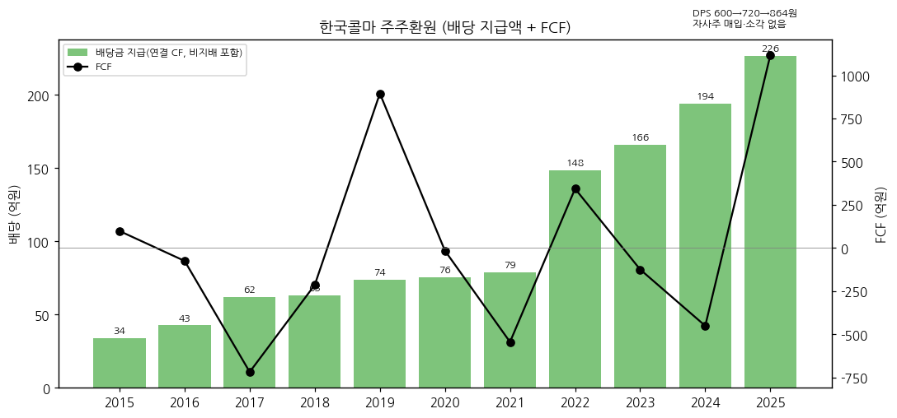

### ⑦ 재무비율

| 연도 | ROE(지배) | ROA | 부채비율 | 유동비율 | 이자보상배율 |
|---|---|---|---|---|---|
| 2015 | 22.7% | 13.4% | 56% | 162% | 40.1x |
| 2016 | 21.6% | 12.7% | 71% | 135% | 81.3x |
| 2017 | 16.4% | 8.4% | 101% | 173% | 15.5x |
| 2018 | 11.4% | 2.6% | 170% | 107% | 3.5x |
| 2019 | 6.4% | 1.5% | 183% | 91% | 2.6x |
| 2020 | 29.3% | 6.6% | 149% | 113% | 3.1x |
| 2021 | 5.5% | 1.7% | 92% | 99% | 2.8x |
| 2022 | -3.3% | -0.1% | 100% | 94% | 2.3x |
| 2023 | 0.8% | 0.8% | 112% | 70% | 3.0x |
| 2024 | 12.5% | 4.1% | 108% | 71% | 4.1x |
| 2025 | 14.7% | 5.1% | 107% | 74% | 5.5x |

> ROE = 지배순이익 / 평균 지배지분. ROA = 연결 순이익 / 평균 자산. 이자보상배율 = 영업이익 / 이자 지급(CF). 2020 ROE는 제약사업부 처분이익 효과.

---

## ⑤ 지배 구조

### ① 그룹·계열 관계

```
윤상현 부회장 (콜마홀딩스 31.75%, 공정위 동일인)
  └─ 콜마홀딩스㈜ (지주, 024720)
        ├─ 한국콜마㈜ 26.31% (중간지주 겸 사업회사, 161890)
        │     ├─ HK이노엔 43.01% (코스닥 195940, 실질지배력으로 연결)
        │     ├─ 연우 100% (2024.2 완전자회사) ─ YONWOO CHINA, HK케미스토리
        │     ├─ Kolmar Cosmetics (Wuxi) / (Beijing)
        │     ├─ HK Kolmar Laboratories (미국 지주) ─ HK Kolmar USA
        │     ├─ HK Kolmar Canada, Seokoh Canada
        │     ├─ 엠오디머티어리얼즈(원료), 콜마유엑스(2025.3), 콜마스크(2026.2)
        └─ 콜마비앤에이치 44.63% (건기식·화장품, 별도 상장)
```

- 연결대상 종속회사 13개(상장 1, 비상장 12, 2025말).
- **2025~2026 오너 일가 분쟁**: 콜마홀딩스(윤상현)가 콜마비앤에이치 실적 부진을 이유로 이사회 개편을 요구 → 윤동한 회장이 윤상현 부회장에게 '부담부 증여' 위반을 근거로 주식반환 소송 제기(2025) → 2026.4 윤여원 콜마비앤에이치 대표 사임 → **2026.5 소송 취하로 종결**. 윤상현 부회장은 2026.3 콜마비앤에이치 대표·사내이사직 사임.

### ② 주주 구분 (2026.06.30)

| 구분 | 주식수 | 지분율 |
|---|---|---|
| 콜마홀딩스㈜ (최대주주) | 6,209,889 | 26.31% |
| 윤동한·윤상현·윤동희 + 임원 | 57,122 | 0.24% |
| 최대주주 등 합계 | 6,267,011 | 26.55% |
| 국민연금공단 | 3,020,619 | 12.80% |
| TOA Inc. (일본, 창업 합작 파트너 계열로 추정) | 2,777,808 | 11.77% |
| 소액주주 (61,577명) | 8,595,671 | 36.41% |
| 발행주식총수 | 23,605,077 | 100% (자기주식 0) |

> 외국인 지분율(KRX 기준)은 미확보 — 소액주주·기관 구분 외 별도 공시 없음. TOA Inc.의 성격은 공시상 명시 없음(불확실).

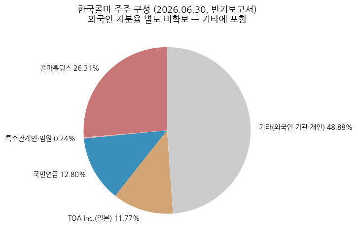

### ③ 임원·이사회 (2026.06.30)

| 이름 | 직위 | 역할 | 약력 |
|---|---|---|---|
| 윤상현 | 부회장, 사내이사 | 총괄, 콜마홀딩스 대표이사, HK이노엔 기타비상무이사 | 1974년생, 서울대·스탠퍼드 MS&E, 베인앤컴퍼니 이사 |
| 최현규 | 사장, 사내이사 | **대표이사**, ESG위원 | 1960년생, 명지대, 대웅제약 출신, 그룹 재직 33년 |
| 한상근 | 부사장, 사내이사 | 이사회 의장, 기술연구원 부원장 | 충북대 박사, 스킨케어연구소 출신 |
| 허현행 | 부사장, 사내이사 | 글로벌성장혁신부문장(2026), 前 경영기획본부장 | 일리노이대 석사, 콜마홀딩스 상무 |
| Thomas Shin | 독립이사 | 보상위원장 | 베인앤컴퍼니 코리아 Advisory Partner |
| 김현정 | 독립이사 | ESG위원장 | 한국IBM 컨설팅 대표 |
| 김지현 | 독립이사 | 독립이사후보추천위원장 | 연세대 경영대 교수 |
| 김상환 | 상근감사 | — | DB자산운용 CIO 출신 |
| 윤동한 | 회장(미등기, 비상근) | 자문 | 창업주, 콜마홀딩스 회장 |

- 이사회 내 위원회: 독립이사후보추천·ESG·보상·내부거래위원회. 2026.3 정관 개정으로 독립이사 1/3 이상, 전자주총 근거(2027 시행).

---

## ⑥ 기타 팩트

### ① R&D 인프라

| 연도 | 2014 | 2015 | 2016 | 2017 | 2018 | 2019 | 2020 | 2021 | 2022 | 2023 | 2024 | 2025 |
|---|---|---|---|---|---|---|---|---|---|---|---|---|
| 연구개발비(억원) | 172 | 218 | 297 | 397 | 848 | 1,111 | 1,653 | 1,041 | 1,210 | 1,233 | 1,369 | 1,543 |
| /연결매출 | 3.7% | 4.1% | 4.4% | 4.8% | 6.2% | 7.2% | 12.5% | 6.6% | 6.5% | 5.7% | 5.6% | 5.7% |

> 정부보조금 차감 후 비용처리 연구개발비(연결). 2018~ HK이노엔 신약 R&D 포함, 2020 급증은 HK이노엔 임상비용(사업보고서 비율 12.39%). 화장품 단독 R&D는 별도 미공시(회사는 "매출의 5% 이상 R&D 투자" 기재). 연구조직: 스킨케어·메이크업·유브이테크이노베이션(선케어 전담, 2022.10 업계 최초)·퍼스널케어연구소, 융합기술·피부천연물연구소, Chroma Kolmar Studio, 글로벌메이크업연구소 등.

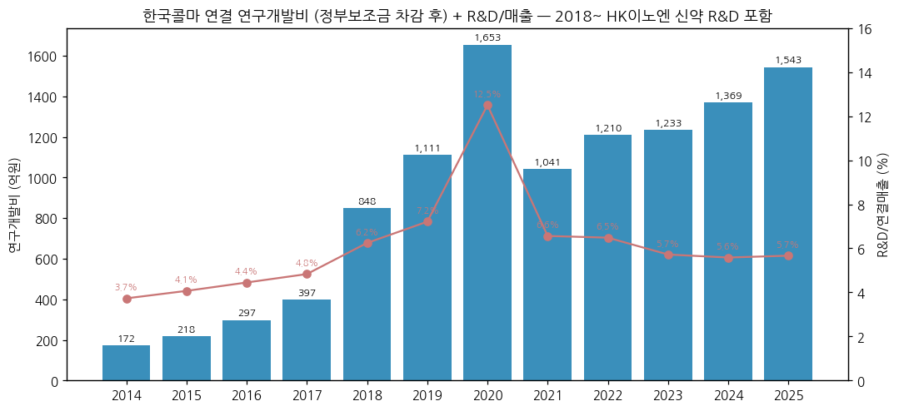

### ② 진행 중 corporate action (10년치)

| 시기 | 내용 | 금액 |
|---|---|---|
| 2018.04 | CJ헬스케어 인수 (씨케이엠 SPC, 2020.4 흡수합병) | 약 1.3조 |
| 2020.12 | 별도 제약사업부 양도 → 제뉴원사이언스 | 3,011억 |
| 2021.04 | HK이노엔 제3자배정 유상증자 참여 | 500억 |
| 2021.08 | HK이노엔 코스닥 상장 | — |
| 2022.07 | 연우 55% 인수 | 2,814억 |
| 2023.01 | 세종2공장(오스템) 인수 | 358억 |
| 2023.12 | 부천2공장(콜마홀딩스로부터) 매수 | 105억 |
| 2024.02 | 연우 주식교환(신주 723,897주) + 반대주주 매수청구분 시간외 매입 437억 → 100% | — |
| 2024.04 | 남동공단 토지 매수 | 248억 |
| 2025.03 | 콜마유엑스 100% 인수 (콜마홀딩스로부터) | 73억 |
| 2026.02 | 콜마스크 97.9% 인수 (콜마비앤에이치로부터) | 204억 |

### ③ R&D 마일스톤 (10년치)

- 2013 국내 최초 선케어 미국 FDA OTC 인증 → 2024.4 업계 최초 선크림 녹색기술제품 인증 → 2025.1 세계 최초 유기·무기 자외선차단 성분 결합 선크림 안정화 기술
- 2020.1 국가공인시험기관(KOLAS) 인정, 2020.6 '고효능 노화방지 기초화장품' IR52 장영실상, 2022.5 미백·주름 인체적용시험 국가공인시험기관
- 2022.10 유브이테크이노베이션 연구소 신설, 2023.4 친환경 종이스틱 용기, 2024.7 컬러 아뜰리에
- HK이노엔: 케이캡 국내 출시(2019.3) → 중국 출시(2022.4, Luoxin) → 중남미·동남아·인도(2025.9) 출시, 미국 허가 심사 중(Braintree), GLP-1 비만 신약 국내 임상 3상

### ④ 주요 리스크

| 리스크 | 내용 |
|---|---|
| 고객 집중·교체 | Top10 57%, Top5 32.8%. 인디브랜드 흥망·M&A(IPO)에 따라 주문 급변 (미국 1위 고객 주문 급감 사례) |
| 계절성 | 선케어 비수기(4Q) OPM 7~9%로 하락 반복 |
| 해외법인 적자 | 미국·캐나다·중국 합산 영업적자 -129억(2025), 3Q26 -98억. 과거 해외법인 손상(2022 587억, 2023 별도 383억·연결 592억) |
| 지배구조 | 오너 분쟁은 2026.5 종결됐으나 HK이노엔 연결에 따른 지주 할인, 계열사 간 거래(콜마홀딩스·콜마비앤에이치로부터 자산·지분 매입) |
| 재무 | 단기차입 비중 높아 유동비율 70%대, 순차입금 비율 52% |
| 제약(HK이노엔) | 약가 인하(2024.7 실거래가 인하), 케이캡 특허·경쟁(펙수클루·자큐보), 2025 RTD 음료 리콜 |
| 관세·지정학 | 미국 관세(온쇼어 수요는 기회), 중동 전쟁·이란 리스크 언급(1H26 영향 중립) |
| 환율 | 원재료·용기 수입 및 해외법인 환산. 통화스왑 일부 |

### ⑤ ESG 등급

- KCGS(한국ESG기준원) 통합 A (2023, 2024). 2025 등급 미확보.
- 2024.11 TIME '세계 최고 지속가능 성장기업 2025' 선정, 2023 한국ESG경영대상 중견기업 대상, UNGC 가입(2021).

### ⑥ 인증·라이선스

- 식약처 CGMP, ISO 22716(국내 최초), ISO 17025(KOLAS, 세종공장 2020), ISO 37001·37301(부패방지·규범준수, 화장품 업계 최초 2022)
- 미국 FDA OTC 등록(선케어), 연우 ISO 9000/14000/15378
- HK이노엔: KGMP, 혁신형 제약기업

---

## 데이터 출처·미확보 항목

| 항목 | 상태 |
|---|---|
| 3Q26 분기보고서 확정치 | 미반영 — 2026-11-06 IR 잠정치 사용 [잠정]. 분기보고서 공시 후 교체 |
| 3Q26 지배주주지분·차입금 | 미확보 (IR에 자본총계만) |
| 2014 CapEx·차입금 | 2015 FY JSON 전기 컬럼에 미제공 → 미확보 |
| 사업부별 분기 시계열 2022 이전 | IR PDF 2023.3 이전 양식 불연속 → 별도(OFS) 43분기로 대체, HK이노엔 등 사업부 분기는 1Q23부터 |
| HK이노엔 OpenDART 분기 재무 | API 호출 시 다수 연도 no data → 한국콜마 IR 수치 사용 |
| 외국인 지분율 | 미확보 |
| 2022 이전 DPS, 2022 임직원 수 | 미확보 |
| ESG 2025 등급 | 미확보 |
| 시가총액 고점 | Yahoo 월봉 기준, DART 월별 주가표와 일부 불일치 가능 |

---

## Version Log

| 버전 | 일자 | 내용 |
|---|---|---|
| v1.0 | 2026-11-15 | 최초 작성 (v4.8 표준 6개 섹션 + 16종 차트). OpenDART CFS·OFS 2015~2Q26, 사업보고서 XML 2015~2025, IR PDF 40건(2021.5~2026.11), 3Q26 잠정 반영. 화장품(별도·해외·연우)과 HK이노엔 분리 |

**잔여 보완 후보 (v1.1)**
- 3Q26 분기보고서 확정치로 3Q26P 교체 + 3Q26 BS(지배지분·차입금)
- 2018~2022 사업부별 분기(HK이노엔·해외법인) — 분기보고서 영업부문 주석에서 추출
- 외국인 지분율 시계열(KRX), 2022 이전 DPS, HK이노엔 시총 기반 SOTP 산식
- 4Q26 실적(2027.2) 반영 시 FY2026 연간 합산 갱신
