> 종목: 한국항공우주 (047810.KS / 한국항공우주산업(주) / Korea Aerospace Industries, Ltd. — KAI)
> 섹터: 방산 (워치리스트 섹터 T2 — 주도 후보)
> 작성 시각: 2026-11-03 KST (v1.0 신규 작성) / 2026-11-04 KST (v1.1 — 회사 IR 실적발표 PDF 반영) / 2026-11-14 KST (**v1.2** — 3Q26 회사 IR 반영)
> 적용 구조: v4.8 (6개 섹션 + 12종 차트 표준 + chart3 매출처 구성 보조 차트)
> 데이터: 13년 연결 연간(2013~2025) + 43분기 연결 전사(1Q16~3Q26) + 22분기 사업부문(1Q21~2Q26) + 2부문 연간(2014~2019) + 매출처·수주잔고 13년(별도) + **IR 3분류 매출·신규수주 23분기(1Q21~3Q26)·수주잔고 16개 분기말·연간 가이던스 6년(2021~2026, 2026은 9M 진척률)** + Yahoo 월간 주가(2011.07~2026.11)
> 출처: OpenDART 연결재무제표 API(corp_code 00309503, 2015~2Q26, `financials/*_CFS.json`), DART 원문 사업·반기·분기보고서 51건(2014~2026.08) — 핵심: 2025 사업보고서 rcept_no 20260318001461, 2026 반기보고서 20260814003309, 2023 기재정정 20240326000812, 2019 사업보고서 20200330003749, 2016 기재정정 20170814002470, 2017 기재정정 20180814001733, 2018.1Q 20180515002234 / 회사 IR 실적발표 PDF 30건(irgo 경유, 2019.2Q~2026.2Q; 중복 제외 실질 19건 — `company-overview-source/00309503_한국항공우주/ir/`) / 3Q26: 회사 '26년 3분기 잠정실적 발표 IR(2026.11.03, 6p, K-IFRS 연결·감사 전 — p3 요약·p4 수주·p5 매출·p6 재무현황) + 같은 날 연결재무제표기준영업(잠정)실적 공정공시(신아일보·파이낸셜뉴스 보도) / 주가: Yahoo Finance v8 047810.KS / 지배구조: 2026 반기보고서 + 한국경제(2026.08.10)·시대(2026.07.08)·뉴시스(2026.05.26)
> **Fact verify cutoff**: 2026-11-14 (IR 자료 = 2026.11.03 3Q26 잠정실적 발표까지 / 3Q26 분기보고서(부문 OP·지배순이익) 미반영 / 시가총액·52주 고저·ATH = Yahoo 047810.KS 2026-11-03 15:30 KST 기준 + stockhub 2026-10-23 교차 확인)

# 한국항공우주 기업 개요 (v1.2 — 방산 T2, 수주·프로젝트 사이클형 + 수출 체계종합 성장 Boundary)

## ① 기업 분류

(1) Primary / Secondary 분류

**⚠️ Boundary Case — 프로젝트(수주) 사이클 vs 지속성장(수출·KF-21 양산)**

13년 OPM range -10.1%~12.5% = **22.6%pt (cutoff ±10pp의 2.3배)** → 정량 룰상 사이클. 단 KAI의 사이클은 경기 사이클이 아니라 **대형 프로그램(수출 완제기·국내 양산·개발사업)의 계약/인도 타이밍과 진행률 회계 추정 변경**이 만드는 "lumpy" 사이클이다. 2017 저점은 업황이 아니라 회계처리 정정·수리온 관련 손실 반영 이벤트성.

**Primary 분류: 사이클 (수주·프로젝트 사이클형)**

→ 13년 OPM 정점 2회(2015 12.5%, 2019 8.9%) / 저점 2회(2017 -10.1%, 2021 2.3%) — 정점·저점 간격 약 4년

→ 매출 연도별 변동 ±25%대 (2016→2017 -29.7%, 2022→2023 +37.0%) — 완제기 수출 인도 유무가 좌우

**Secondary 노트: 지속성장 후보 (수주잔고 27조 + KF-21 양산 진입)**

→ 수주잔고(별도) 2021말 18.7조 → 2025말 **27.3조** (매출 대비 약 7.5년치) — 2026 반기말 25.8조

→ KF-21 최초 양산계약(2024.06) + 잔여 양산계약(2025.06), FA-50 폴란드·말레이시아·필리핀 등 수출 다변화 → 매출 바닥이 3.6조대로 상향 (2023~2025 3년 연속 3.6조 이상)

**Entity 구조 (DART 영업부문 4개 + 연결 종속 7사)**

→ **(1) 고정익부문** — FY25 매출 15,354억 (연결 부문매출 41%) — T-50/TA-50/FA-50 계열, KF-21, KT-1

→ **(2) 회전익부문** — FY25 7,636억 (20%) — KUH 수리온 계열, LAH 미르온, 상륙공격·소해헬기

→ **(3) 기체부문** — FY25 10,293억 (27%) — Boeing·Airbus 등 민항기 기체구조물 (OP 1,338억으로 **이익 1위 부문**)

→ **(4) 기타** — FY25 4,615억 (12%) — 위성·UAV·시뮬레이터·PBL·MRO(한국항공서비스) 등

→ **종속회사 7사 (FY25말)** — 상장 1(제노코, 2025.07 편입) + 비상장 6(한국항공서비스, 에스앤케이항공, 에비오시스테크놀러지스, 한국표면처리(2025.4Q 편입), Korea Aerospace F.W., KAI EUROPE(2025.06 설립))

(2) Summary Box (13년 연결 시계열 + 사이클 통계)

| 지표 | 13년 평균 (2013~2025) | 정점 | 저점 | 2025년 |
|---|---|---|---|---|
| 매출 (연결, 억원) | 28,916 | **38,193 (2023)** | 19,833 (2013) | **36,964** |
| OP (연결, 억원) | 1,746 | **3,797 (2015)** | -2,089 (2017) | **2,692** |
| NI (지배, 억원) | 1,172 | **2,648 (2016)** | -2,352 (2017) | **1,859** |
| OPM (연결, %) | 5.5% (2017 제외 6.8%) | **12.5% (2015)** | -10.1% (2017) | **7.3%** |

```
[한국항공우주 13년 연결 손익 시계열 (억원)]
연도   매출     OP      OPM     NI(지배)
2013  19,833     707    3.6%      362   ← 저점권 (2017.08 정정 후; 원공시 매출 20,163·OP 1,246)
2014  23,286   1,893    8.1%    1,324   ← T-50 수출·수리온 양산 확대
2015  30,397   3,797   12.5%    2,592   ← OPM 정점① (완제기 수출 매출 8,995억 피크)
2016  29,463   3,201   10.9%    2,648   ← 고원 (2017.08 재작성 후 수치)
2017  20,722  -2,089  -10.1%   -2,352   ← 저점① (검찰수사·회계정정·수리온 손실, 무배당)
2018  27,860   1,464    5.3%      572   ← 회복 (IFRS 15 적용, 감사인 삼일→한영)
2019  31,102   2,756    8.9%    1,704   ← 정점②
2020  28,251   1,395    4.9%      746   ← 코로나: 기체부품 매출 급감
2021  25,623     583    2.3%      639   ← 저점② (민수 바닥 + KF-21 개발 부담)
2022  27,869   1,416    5.1%    1,185   ← 폴란드 FA-50 실행계약(2022.09), 선수금으로 OCF +1.49조
2023  38,193   2,475    6.5%    2,240   ← 매출 사상 최대 (폴란드 FA-50GF 인도)
2024  36,337   2,407    6.6%    1,721   ← 완제기 수출 공백, 국내 방산 매출 최대
2025  36,964   2,692    7.3%    1,859   ← 완제기 수출 재증가 (FA-50PL·말레이시아)
1H26  22,606   1,156    5.1%      779   ← 상반기 매출 YoY +48% / 3Q26 10,643·OP 794(7.5%)·순이익 190, 9M26 33,248·OP 1,950(5.9%)·순이익 974 (2026.3Q IR p3)

OPM range: -10.1% ~ 12.5% = 22.6%pt (cutoff ±10%pt의 2.3배 → 사이클 분류)
사이클 회수: 2회 (2013→2015 정점→2017 저점 / 2019 정점→2021 저점), 3번째 상승 국면 진행 중
```

**📊 사이클 통계 (13년 연결)**

| 지표 | 값 |
|---|---|
| 매출 CAGR (12년, 2013→2025) | **+5.3%** |
| 매출 CAGR (3년, 2022→2025) | **+9.9%** |
| OPM 평균 (13년) | **5.5%** (2017 이벤트 제외 6.8%) |
| OPM 정점 평균 | **10.7%** (2015 12.5%, 2019 8.9%) |
| OPM 저점 평균 | **-3.9%** (2017 -10.1%, 2021 2.3%) |
| OPM range | **22.6%pt** |
| 사이클 주기 | **약 4년** (정점 2015→2019, 저점 2017→2021) |
| 사이클 회수 (13년) | **2회** + 3번째 진행 중 (2022~) |

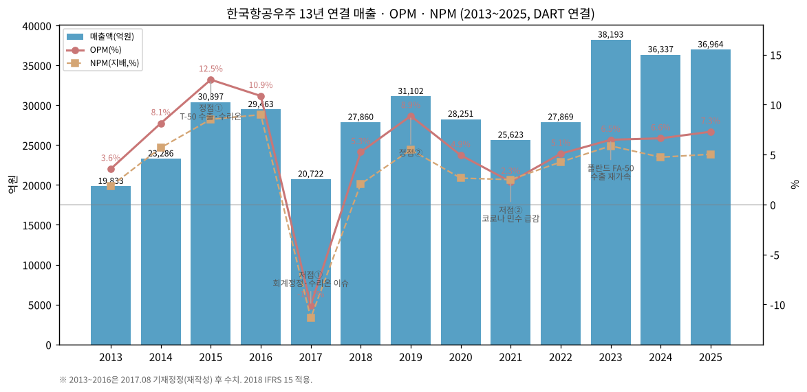

(3) 정량적 분류 근거

→ **국내 유일 군용 완제기 체계종합업체** — 고정익(T-50/FA-50/KF-21)·회전익(수리온/미르온) 모두 국산 개발·양산 (2025 사업보고서 II.1)

→ **수출 비중 확대** — IR 3분류(연결) 기준 완제기수출+기체구조물 비중 2021년 28.0% → 2025년 51.8% → 1H26 52.1% (회사 IR 실적발표 자료, 2022.02·2026.02·2026.07). DART 매출처 표(별도)로도 2025년 52% (내수 48%)로 동일 방향

→ **진행기준 비중 큼** — FY25 연결 매출 중 '공사계약에 따른 진행매출'(기간에 걸쳐 인식) 1조 7,397억 = 47% (주석 37) → 총계약원가 추정 변경이 분기 이익을 크게 흔듦 (4Q 이익 변동성의 원인)

→ **분기 OPM 변동** — 1Q16~3Q26 43분기 OPM -19.5%(4Q17) ~ 14.5%(2Q19)

(4) 산업 분류

→ **한국표준산업분류** — 항공기용 엔진 및 부품 제조업 / 유인 항공기·항공우주선 제조업 (DART 기업개황 기준, 세부코드 확인 필요)

→ **KRX 업종** — 유가증권시장 상장(2011.06.30), 업종 분류명은 확인 필요

→ **워치리스트 섹터** — 방산 T2 (주도 후보)

(5) 분류 결정 논리

(1) **가장 매출 큰 사업부 기준** — 고정익 41% (OP 951억, 35%) > 기체 27% (OP 1,338억, 50%) > 회전익 20% (OP -3억) → 매출 driver는 고정익(완제기 수출·KF-21), 이익 driver는 기체부품

(2) **이익 비중 sub-rule** — 기체부문이 FY25 부문 OP의 50%를 차지 (민항기 생산 회복 사이클에 연동) → 순수 방산이 아닌 **방산 + 민항 기체구조물 혼합**. 기체부문 OPM 13.0%(FY25) vs 고정익 6.2%·회전익 0.0%

(3) **Boundary case 처리** — 13년 OPM range 22.6pp로 Primary 사이클. 단 (i) 저점①은 회계·사법 이벤트, (ii) 2023~2025 매출 3.6조 이상 고원 + 수주잔고 27조 → Secondary 지속성장 후보 표기. 대안 분류(Primary 지속성장)는 아래 재평가 트리거 ①로 판정

(4) **국내외 피어 비교** — 국내 방산 피어(한화에어로스페이스·현대로템·LIG넥스원)는 지상·유도무기 수출로 2023~2025 OPM이 크게 확장한 반면 KAI는 6~7%대에 머묾(피어 수치는 각 사 개요 참조, 본 문서 미검증). 글로벌로는 Lockheed Martin(전투기 체계)·Saab(Gripen)·Leonardo(헬기·훈련기 M-346)·Embraer(방산+민항) 혼합형, 기체구조물은 Spirit AeroSystems·일본 중공업 3사가 비교군 → **"체계종합 + 기체부품" 혼합형으로 Leonardo/Embraer와 구조가 가장 유사**

(6) 적정 밸류에이션 방법

→ **1차 — Forward PER (수주잔고 인도 스케줄 기반)**: 프로젝트형 이익은 연도별 인도 대수에 연동 → 12MF EPS × 글로벌 방산 체계업체 PER. 현재 trailing PER 약 53배(2026.11.03 시총 9.48조 / 최근 4개 분기 지배순이익 1,773억, 3Q25~2Q26) — 이익 대비 프리미엄이 커 KF-21 양산·수출 옵션이 가격에 반영된 상태

→ **2차 — P/B 밴드**: 2Q26 지배자본 1조 8,999억 기준 PBR 약 5.0배 (stockhub 표기 6.55배는 산식 차이, 확인 필요). 과거 2020.03 저점 PBR 약 1.8배(시총 약 2.1조 / 지배자본 약 1.2조) → 밴드 상단권

→ **3차 — EV/수주잔고**: 시총 9.48조 + 순차입금 약 2.1조(FY25) ≈ EV 11.6조 / 수주잔고 27.3조 = 0.42배 — 수주 질(마진) 차이로 보조지표로만 사용

→ **DCF 미사용 근거** — 2023~2025 영업CF 3년 연속 대규모 적자(-7,004/-7,282/-9,033억, 수출 선투입·계약자산 증가) → FCF가 인도 시점에 몰려 단년 DCF 왜곡 큼

(7) 분기 재평가 트리거 (**분류 변경 조건**)

→ ① **연 매출 4.5조 이상 + OPM 8% 이상 2년 연속** (KF-21 양산 인도 본격화) → Primary 지속성장 격상 + Secondary 프로젝트 사이클 잔여

→ ② **수주잔고 3개 분기 연속 감소 + 완제기 수출 신규수주 공백 1년 이상** → Pure 프로젝트 사이클 확정 (2020~2021형 저점 재진입 위험)

→ ③ **지배구조 변경(정부 지분 매각·민영화 결정, 한화 경영권 확보 등)** → 방산 체계종합 그룹 편입 시 재분류 (밸류에이션 기준을 그룹 피어 multiple로 전환)

---

## ② 회사 개요

(1) 기본 사항

| 항목 | 내용 |
|---|---|
| 회사명 (한글) | 한국항공우주산업 주식회사 |
| 회사명 (영문) | KOREA AEROSPACE INDUSTRIES, LTD. (KAI) |
| 종목코드 | 047810 (유가증권시장, 2011.06.30 상장) |
| **설립일** | **1999년 10월 1일** (항공기 부품·완제품 제조·판매 목적 설립; 1999.10.01 현물출자 5,784만주 — 2013 사업보고서 자본금 변동표) |
| 본사 | 경남 사천시 사남면 공단1로 78 (사업장: 사천 본사·종포·산청·고성, 사무소: 서울·대전) |
| 홈페이지 | https://www.koreaaero.com/ |
| **대표이사** | **김종출** (사장, 1962.01, 숭실대 경영학 박사, 전 방위사업청 무인사업부장; 2026.03.18 임시주총 선임, 임기 2029.03.18) — 2026 반기보고서 |
| 발행주식수 | **97,475,107주** (상장 이후 변동 없음, 자기주식 0) — 2026.03 전환사채 5,000억(전환가 185,165원, 2,700,294주) 잠재 희석 |
| 종속회사 수 (FY25말) | **7사** (FY24말 4사 → 제노코·한국표면처리·KAI EUROPE 편입) |
| **최대주주** | **한국수출입은행 26.41%** (25,745,964주, 수은의 최대주주 = 대한민국 정부 76.79%) |
| **2대 주주** | **한화그룹 15.89%** (한화에어로스페이스 9.90%·한화시스템 4.98%·한화에어로스페이스USA 1.01%, 2026.08.10 공시 — 한국경제) |
| 외국인 지분율 | 23.76% (2026.10.23, stockhub) |
| 신용등급 | **AA- (회사채) / A1 (CP)** — 한국신용평가·NICE, 2025.12.30 정기평정 (2025 사업보고서) |
| 시가총액 | **9.48조원** (2026.11.03 종가 97,300원 × 97,475,107주, Yahoo) / 52주 최고 215,500원·최저 95,000원 (Yahoo meta) |

(2) 13년 손익·자본 추이 (연결, 억원 — OpenDART 연결 재무제표, 각 연도 사업보고서 당기값)

| 연도 | 매출 | 영업이익 | OPM | 지배순이익 | EPS(원) | 자본총계 | 자산총계 | 부채비율 |
|---|---|---|---|---|---|---|---|---|
| 2013 | 19,833 | 707 | 3.6% | 362 | 372 | 9,042 | 19,515 | 116% |
| 2014 | 23,286 | 1,893 | 8.1% | 1,324 | 1,358 | 10,007 | 21,090 | 111% |
| 2015 | 30,397 | 3,797 | 12.5% | 2,592 | 2,659 | 12,144 | 28,082 | 131% |
| 2016 | 29,463 | 3,201 | 10.9% | 2,648 | 2,717 | 14,456 | 29,808 | 106% |
| 2017 | 20,722 | -2,089 | -10.1% | -2,352 | -2,413 | 11,404 | 31,662 | 178% |
| 2018 | 27,860 | 1,464 | 5.3% | 572 | 587 | 10,529 | 37,559 | 257% |
| 2019 | 31,102 | 2,756 | 8.9% | 1,704 | 1,748 | 11,832 | 43,671 | 269% |
| 2020 | 28,251 | 1,395 | 4.9% | 746 | 766 | 12,343 | 51,591 | 318% |
| 2021 | 25,623 | 583 | 2.3% | 639 | 656 | 12,974 | 58,552 | 351% |
| 2022 | 27,869 | 1,416 | 5.1% | 1,185 | 1,215 | 14,532 | 77,724 | 435% |
| 2023 | 38,193 | 2,475 | 6.5% | 2,240 | 2,298 | 16,199 | 71,396 | 341% |
| 2024 | 36,337 | 2,407 | 6.6% | 1,721 | 1,765 | 17,272 | 80,255 | 365% |
| 2025 | 36,964 | 2,692 | 7.3% | 1,859 | 1,907 | 18,973 | 103,703 | 447% |

→ 2013~2016: 2017.08 기재정정(방산협력업체 외주계약 원가인식방법·총계약원가 추정 수정) 반영 후 수치. 원공시 대비 2013 매출 -330억·OP -539억 (2015 사업보고서 기재정정 요약재무 비교)
→ 2017: 2018 IFRS 15 적용으로 2018 보고서상 2017 비교수치(자산 31,934억)는 당기값(31,662억)과 상이
→ 2025 ROE(지배) 10.2% / 부채비율 447% — 수출 선수금(계약부채 2.14조)·사채 발행 확대로 부채비율 급등

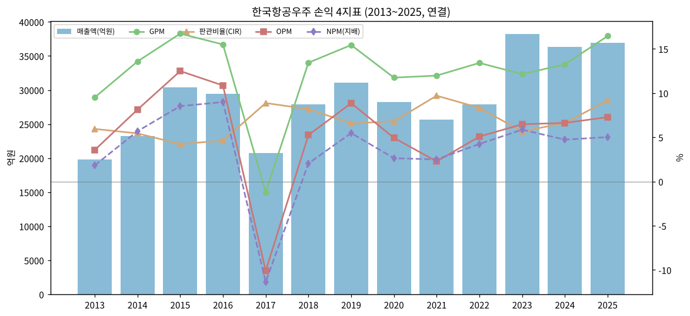

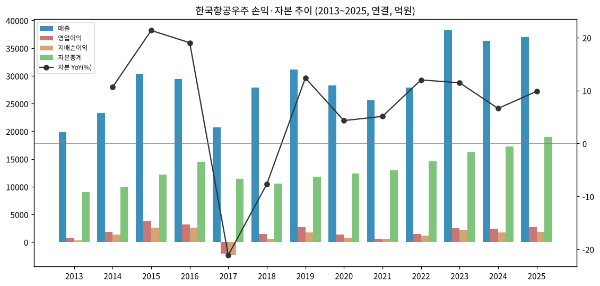

(3) 주가 역사 (2011.06 상장 ~ 2026.11)

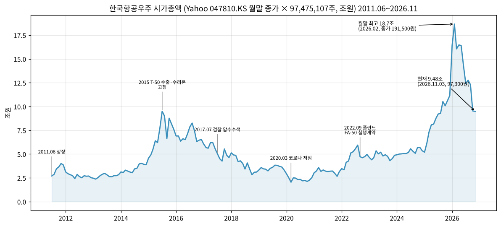

| 국면 | 기간 | 시가총액 (월말 종가 기준) | 주요 배경 |
|---|---|---|---|
| 상장 초기 | 2011.07~2014 | 2.4~4.6조 | 공모 후 박스권, T-50 인니(2011)·이라크(2013)·필리핀 FA-50(2014) 수출 |
| 1차 랠리 | 2015 | 최고 약 9.5조 (2015.07 월말 종가 97,500원) | 완제기 수출 + 수리온 양산 → OPM 12.5% 정점 |
| 디레이팅 | 2016~2020.03 | 9.5조 → 약 2.1조 (2020.03) | 2015 감사원 수리온 지적, 2017.07 검찰 압수수색·분식 의혹, 회계정정, 코로나 민수 급감 |
| 재평가 | 2022~2025 | 2.1조 → 2025말 약 11.2조 | 2022.09 폴란드 FA-50 실행계약, 말레이시아 FA-50(2023.02), KF-21 양산계약(2024.06) |
| 2차 랠리·ATH | 2026.01~2026.03 | **월말 최고 18.7조 (2026.02 종가 191,500원)**, 장중 최고 215,500원 (Yahoo 52주 최고) | 방산 섹터 리레이팅 + 한화그룹 지분 매입(2026.05 경영참여 선언) |
| 조정 | 2026.04~현재 | **9.48조 (2026.11.03, 97,300원)** — ATH 장중 대비 -55% | 2Q26 OP 484억(-43% YoY) 부진 후 하락, 3Q26 매출 10,643·OP 794억 발표(11.03, 회사 IR) |

※ 2026 반기보고서 기재 월별 종가 최고: 1월 168,900 / 2월 191,500 / 3월 202,000 / 4월 199,900 / 5월 180,000 / 6월 163,000원 — 종가 기준 ATH는 2026.03 202,000원(시총 약 19.7조)
※ 주가 급락·급등 원인 서술은 공시·보도로 확인된 이벤트에 한정, 인과는 추정

(4) 주요 연혁

| 연도 | 주요 사건 (출처: 각 연도 사업보고서 연혁) |
|---|---|
| 1999.10 | 한국항공우주산업(주) 설립 (현물출자) — 업계 통설: 삼성항공·대우중공업·현대우주항공 항공부문 통합 (본 문서 원문 미확인) |
| 2006.08~12 | 무상감자·출자전환·유상증자 (재무구조 개편) |
| 2010.12 | KUH 수리온 초도양산 계약 |
| 2011.05 | T-50 인도네시아 수출 계약 / FA-50 초도비행 |
| **2011.06.30** | **유가증권시장 상장** |
| 2013.12 | T-50 고등훈련기 이라크 수출 계약 |
| 2014.03 | FA-50 필리핀 수출 계약 |
| 2015 | 감사원, 수리온 개발비 관련 부당이익 240억원 지적 (Korea JoongAng Daily 2017.07.14 보도 인용) / 2015.12 KF-X(KF-21) 체계개발 착수 |
| **2017.07~10** | **검찰 압수수색(2017.07.14)·하성용 전 대표 기소(2017.10, 분식회계 약 5,000억 혐의 등)** |
| **2017.08** | **2014~2016 사업보고서 기재정정(재무제표 재작성)** — 외주계약 원가인식방법·총계약원가 추정 수정 |
| 2018.05 | 2017.1Q 재작성 (매출 7,118→5,873억, OP 977→109억) — 2018.1Q 분기보고서 주석 |
| 2018 | IFRS 15 적용, 외부감사인 삼일→한영 교체, 한국항공서비스(KAEMS) 설립(MRO) |
| 2019.12 | 에스앤케이항공 종속회사 편입 |
| 2020.07 | 사업부제 전환 (고정익·회전익·기체·미래사업 등) |
| 2021.04 | KF-21 시제기 출고 |
| 2022.07 | KF-21 최초비행 |
| **2022.09** | **폴란드 FA-50 공급 실행계약** |
| 2022.12 | LAH 최초양산 계약 |
| 2023.02 | 말레이시아 FA-50 수출 계약 |
| 2024.06 | **KF-21 최초 양산 계약** / 수리온 양산 최종호기 납품 |
| 2024.07 | 하성용 전 대표 항소심 — 징역 2년·집유 3년, 분식회계(5,000억) 혐의는 무죄 (아시아경제 2024.07.08) |
| 2024.12 | 미르온(LAH-1) 양산 1호기 납품, KUH 이라크 수출 계약 |
| 2025.06~07 | KF-21 잔여 양산 계약, 유럽법인 설립, 필리핀 FA-50 추가 계약, 제노코 인수(37.95%) |
| 2025.07 | 강구영 대표 사임 → 차재병 대표 직무 (2025.07.02) |
| 2026.01~03 | 공모사채 5,000억(1월), 사모 CB 5,000억(3월), 김종출 대표 선임(3.18) |
| **2026.05~08** | **한화그룹 지분 5.09%→15.89%, 보유목적 '경영참여'** |

---

## ③ 비즈니스 모델

(1) 사업부 구성 — 공시 체계와 과거 명칭 매핑 (중요)

KAI는 같은 매출을 **3가지 다른 축**으로 공시한다. 시계열을 이을 때 반드시 구분해야 한다.

| 축 | 구분 | 사용처 | 기간 |
|---|---|---|---|
| **A. 영업부문 (연결 주석)** | 정부방산 및 완제기수출 / 기체부품(+기타) | 부문 매출·**매출총이익** | 2013~2019 (2부문, 군수/민수에 해당) |
| | 고정익 / 회전익 / 기체 / 미래사업 / 수출혁신센터 등 | 부문 매출·매출총이익 | 2020~2021 (2020.07 사업부제 전환) |
| | **고정익 / 회전익 / 기체 / 기타** | 부문 매출·**영업이익** | 2022~현재 (2021 비교수치 재분류 제공) |
| **B. 매출처 (별도)** | 내수(방사청 등) / 완제기 수출국 / Boeing / Airbus / 기타 민수 | 사업보고서 '주요 매출처' | 2013~현재 |
| **C. 수주잔고 (별도)** | 방산(국내방산) / 완제기(수출) / 기체부품 / 위성사업 등 | 사업보고서 '수주상황' | 2013~현재 |

→ **IR 3분류(국내사업 / 완제기 수출 / 기체부품→2025.2Q부터 '기체구조물') ≈ B축** — 국내사업 = 방사청 등 내수, 완제기 수출 = 완제기 수출국, 기체부품 = Boeing+Airbus+기타 민수 수출. v1.1부터 **IR 원본 수치(연결)를 (2-1)·(4-1)에 별도 표기** — B축(별도 매출처)과는 기준(연결/별도)·분류가 달라 연 수백억~수천억 차이
→ **과거 '군수/민수' ≈ A축 2013~2019의 '정부방산 및 완제기수출' / '기체부품'** — 2020 이후 고정익+회전익+기타 ≈ 옛 정부방산 및 완제기수출, 기체부문 ≈ 옛 기체부품 (단 2019 재분류 비교치에서 옛 '기체부품 등' 13,733억 → 새 '기체부문' 10,415억 + 수출혁신센터 등으로 일부 이동 — 2020 사업보고서 주석)

**FY25 연결 영업부문 (2025 사업보고서 주석 36, 억원)**

| 부문 | 매출 | 비중 | 영업이익 | OPM | 주요 제품 |
|---|---|---|---|---|---|
| 고정익 | 15,354 | 41% | 951 | 6.2% | T-50/TA-50/FA-50, KF-21, KT-1 |
| 회전익 | 7,636 | 20% | -3 | 0.0% | KUH 수리온, LAH 미르온, MAH·MCH 개발 |
| 기체 | 10,293 | 27% | 1,338 | 13.0% | Boeing·Airbus·IAI 기체구조물 |
| 기타 | 4,615 | 12% | 398 | 8.6% | 위성(425사업·차세대중형위성), UAV, 시뮬레이터, PBL, MRO |
| 연결조정 | -934 | — | 8 | — | |
| **합계** | **36,964** | 100% | **2,692** | 7.3% | |

**부문 연간 시계열 (억원)**

| 연도 | 고정익 | 회전익 | 기체 | 기타 | 비고 |
|---|---|---|---|---|---|
| 2021 | 9,268 / OP 289 | 7,633 / 203 | 5,274 / -9 | 3,862 / 101 | 4부문 OP (2021 사업보고서) |
| 2022 | 7,960 / 349 | 9,471 / 364 | 8,025 / 749 | 2,909 / -42 | 분기 합산 (2023 기재정정 비교치와 ±1억) |
| 2023 | 19,424 / 1,996 | 7,100 / -64 | 8,735 / 800 | 3,502 / -250 | 폴란드 FA-50GF 인도 |
| 2024 | 16,880 / 1,347 | 7,071 / -429 | 9,497 / 1,174 | 3,656 / 305 | 회전익 적자 (수리온 양산 종료) |
| 2025 | 15,354 / 951 | 7,636 / -3 | 10,293 / 1,338 | 4,615 / 398 | |
| 1H26 | 10,850 / 10 | 4,157 / 125 | 5,273 / 924 | 2,816 / 102 | 고정익 OPM 0.1% (KF-21 양산 초기·FA-50PL 원가) |

**옛 2부문 연간 (매출 / 매출총이익, 억원 — 각 사업보고서 주석)**

| 연도 | 정부방산 및 완제기수출 | 기체부품 | 합계 매출 |
|---|---|---|---|
| 2014 | 15,610 / GP 2,152 | 7,676 / GP 988 | 23,286 |
| 2015 | 20,685 / 3,101 | 9,713 / 1,953 | 30,397 |
| 2016 | 18,276 / 2,271 | 11,187 / 2,267 | 29,463 |
| 2017 | 9,722 / **-2,473** | 11,001 / 2,201 | 20,722 |
| 2018 | 17,054 / 1,866 | 10,807 / 1,844 | 27,860 |
| 2019 | 17,519 / 2,833 | 13,733 / 1,963 | 31,102 |
| 2020 (5부문) | 고정익 8,056·회전익 9,245·미래사업 1,833·수출혁신센터 등 3,043 | 기체 6,436 | 28,251 |

→ 2017 적자는 전량 방산 쪽(GP -2,473억) — 기체부품은 GP 2,201억 흑자 유지

(2) 매출처별 매출 (DART 매출처 기준 IR 3분류 근사, 별도, 억원 — 각 사업보고서 '주요 매출처'. IR 원본 수치는 (2-1))

| 연도 | 국내사업 (방사청 등 내수) | 완제기 수출 | 기체부품 등 (수출 합) | ㄴBoeing | ㄴAirbus | ㄴ기타(IAI·KHI·Vought·Embraer 등) | 합계(별도) |
|---|---|---|---|---|---|---|---|
| 2014 | 12,341 (53%) | 3,269 (14%) | 7,676 (33%) | 2,665 | 1,728 | 3,283 | 23,286 |
| 2015 | 11,690 (38%) | 8,995 (30%) | 9,713 (32%) | 3,034 | 3,632 | 3,047 | 30,398 |
| 2016 | 11,326 (38%) | 6,950 (24%) | 11,187 (38%) | 3,465 | 4,530 | 3,192 | 29,463 |
| 2017 | 8,161 (39%) | 1,712 (8%) | 10,849 (52%) | 3,104 | 4,499 | 3,246 | 20,722 |
| 2018 | 10,041 (36%) | 6,797 (24%) | 11,023 (40%) | 2,619 | 1,193 | 7,211 | 27,861 |
| 2019 | 14,282 (46%) | 6,489 (21%) | 10,316 (33%) | 2,677 | 967 | 6,672 | 31,087 |
| 2020 | 19,025 (68%) | 3,106 (11%) | 5,989 (21%) | 3,161 | 2,523 | 305 | 28,120 |
| 2021 | 18,428 (72%) | 2,176 (9%) | 4,879 (19%) | 2,135 | 2,384 | 360 | 25,483 |
| 2022 | 19,157 (69%) | 1,271 (5%) | 7,293 (26%) | 2,670 | 3,752 | 871 | 27,721 |
| 2023 | 19,653 (52%) | 10,470 (28%) | 7,860 (21%) | 3,231 | 3,806 | 823 | 37,983 |
| 2024 | 21,363 (59%) | 6,403 (18%) | 8,217 (23%) | 3,169 | 4,218 | 830 | 35,983 |
| 2025 | 17,553 (48%) | 9,254 (26%) | 9,445 (26%) | 3,383 | 5,074 | 988 | 36,252 |
| 1H26 | 10,721 (48%) | 6,682 (30%) | 4,819 (22%) | 2,015 | 2,457 | 347 | 22,222 |

→ 2018~2019 '기타'(KHI·Vought 등) 급증과 Airbus 급감은 매출처 분류 변경 영향 (Airbus 계열 하청 경유분 재분류 추정) — 시계열 비교 시 기체부품 합계로 볼 것
→ 2026 1H 완제기 수출 30% — 폴란드 FA-50PL·말레이시아 FA-50M 진행 매출

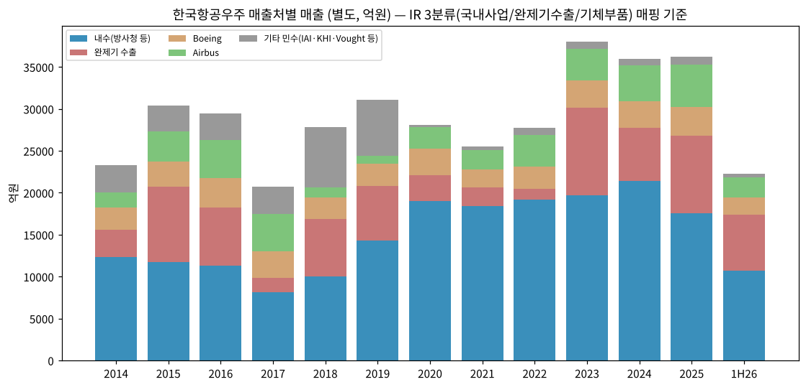

(2-1) IR 3분류 매출 — 회사 IR 원본 (연결, 억원)

| 연도 | 국내사업 | 완제기수출 | 기체구조물(기체부품) | 연결조정 | **합계** | 수출 비중(완제기+기체) | 출처 |
|---|---|---|---|---|---|---|---|
| 2020 | 18,932 (67%) | 3,106 (11%) | 6,082 (22%) | 131 | **28,251** | 32.5% | 2021.4Q IR p3 |
| 2021 | 18,316 (71%) | 2,176 (8%) | 4,991 (19%) | 140 | **25,623** | 28.0% | 2021.4Q IR p3 |
| 2022 | 18,965 (68%) | 1,271 (5%) | 7,484 (27%) | 149 | **27,869** | 31.4% | 2022.4Q IR p4 |
| 2023 | 19,453 (51%) | 10,470 (27%) | 8,061 (21%) | 209 | **38,193** | 48.5% | 2023.4Q IR p4 |
| 2024 | 21,068 (58%) | 6,404 (18%) | 8,511 (23%) | 354 | **36,337** | 41.0% | 2024.4Q IR p4 |
| 2025 | 17,116 (46%) | 9,254 (25%) | 9,882 (27%) | 712 | **36,964** | 51.8% | 2025.4Q IR p3 |
| 1H26 | 10,444 (46%) | 6,714 (30%) | 5,064 (22%) | 383 | **22,605** | 52.1% | 2026.2Q IR p3 (누계) |
| 9M26 | 15,381 (46%) | 9,627 (29%) | 7,692 (23%) | 548 | **33,248** | 52.1% | 2026.3Q IR p3 (누계) |

→ 2023 합계 38,193억은 IR 표·DART 연결과 일치. 단 2023.4Q IR 요약 문구의 '매출 3조 7,984억'은 별도 기준으로 추정 (표 합계와 209억 차 = 연결조정) ⚠️
→ 2021 영업이익: IR(잠정) 578억 vs DART 확정 582억 (4억 차)
→ DART 매출처(별도, (2)표) 대비 차이 — 2025 국내 17,553 vs IR 17,116 / 기체 9,445 vs IR 9,882 / 완제기 9,254 동일. 2024 국내 21,363 vs 21,068 / 기체 8,217 vs 8,511. 기체는 IR이 일관되게 크고 국내가 작음 → 기체 매출 중 국내 고객분(예: 국내 업체 경유 민항 부품)을 IR은 기체로, DART 매출처 표는 내수로 잡는 차이로 추정 ⚠️

**연간 가이던스 vs 실적 (회사 IR, 연결, 억원)**

| 연도 | 매출 가이던스 (국내 / 완제기 / 기체) | 매출 실적 | 달성률 | 수주 가이던스 (국내 / 완제기 / 기체) | 수주 실적 | 달성률 | 출처 |
|---|---|---|---|---|---|---|---|
| 2021 | 28,261 (19,553 / 4,011 / 4,697) | 25,623 | 90.7% | 28,769 (9,858 / 11,792 / 7,119) | 28,353 | 98.6% | 2021.4Q IR p3 |
| 2022 | 29,476 (19,919 / 3,318 / 6,239) | 27,869 | 94.5% | 41,890 (22,632 / 13,160 / 6,098) | **87,444** | 208.7% | 2022.1Q·4Q IR |
| 2023 | 38,253 (17,869 / 12,354 / 8,030) | 38,193 | 99.8% | 44,769 (24,643 / 11,669 / 8,457) | 46,365 | 103.6% | 2023.3Q·4Q IR |
| 2024 | 37,684 (19,012 / 9,637 / 9,035) | 36,337 | 96.4% | 59,147 (17,704 / 30,368 / 11,075) | 49,022 | 82.9% | 2024.1Q·4Q IR |
| 2025 | 40,870 (17,197 / 13,787 / 9,886) | 36,964 | 90.4% | 84,590 (35,748 / 35,621 / 13,221) | 63,946 | 75.6% | 2024.4Q·2025.4Q IR |
| **2026** | **57,306** (32,895 / 13,964 / 10,447) | 9M 33,248 | 58.0% (9M) | **104,383** (24,406 / 65,440 / 14,537) | 9M 22,100 | 21.2% (9M) | 2025.4Q·2026.1Q·2Q·3Q IR |

→ **매출 가이던스 5년 연속 미달**(90~100%) — 2025는 '국내 완제기 납품일정 지연 및 일부 진행 기준 수출사업의 매출인식 시점 조정'으로 목표 하회 (2025.4Q IR p3)
→ **2026 가이던스 = 매출 +55% / 수주 +63%** — '전년대비 완제기 납품 4배 이상 증가로 퀀텀점프 궤도 진입', 수주 Key focus는 KF-21 첫 수출·KUH/KT-1 수출 확대 (2025.4Q IR). FY26말 수주잔고 목표 31.7조(317,357억). 1H 수주 진척 6.0%로 '국내/완제기수출 주요 목표 수주는 하반기 체결 기대' (2026.2Q IR p3)
→ **9M26 진척률 (2026.3Q IR p3)** — 매출 33,248 / 57,306 = **58.0%** (국내 15,381 / 32,895 = 46.8%, 완제기 9,627 / 13,964 = 68.9%, 기체 7,692 / 10,447 = 73.6%), 수주 22,100 / 104,383 = **21.2%**. 4Q에 매출 24,058억(분기 사상 최대 15,100의 1.6배)이 필요 → 6년 연속 매출 가이던스 미달 가능성 높음. IR 문구: '4분기 국내·수출 주요 사업 수주 달성 추진', '미르온 4분기 납품 정상화 예정' (2026.3Q IR p3·4·5). 9M 수주 22,100은 1H 6,295 + 3Q 15,806 = 22,101과 1억 반올림 차
→ 2026 매출 가이던스 부문값은 2026.02 자료 차트(32,910 / 13,905 / 10,491)와 2026.05·07 자료 표(32,895 / 13,964 / 10,447)가 소폭 다름 — 합계 57,306 동일, 표 기준 사용
→ 2024 가이던스: 2024.02 자료 표지 문구는 '수주 4조 4,769억·매출 3조 8,253억'(=2023 목표치 재기재로 보임)이나 본문 표는 수주 59,147·매출 37,684 → 표 기준 사용 ⚠️. 2025 가이던스 기준 '24년 실적은 별도(35,984)로 표기됨

**수주잔고 (별도, 억원, 연말 — 각 사업보고서)**

| 연말 | 방산(국내) | 완제기(수출) | 기체부품 | 위성 등 | **합계** |
|---|---|---|---|---|---|
| 2013 | 31,510 | 13,555 | 65,795 | 587 | 111,447 |
| 2015 | 92,233 | 14,829 | 75,157 | 884 | 183,104 |
| 2017 | 98,369 | 9,163 | 69,340 | 1,088 | 177,960 |
| 2019 | 81,520 | 5,130 | 73,304 | 5,455 | 165,410 |
| 2021 | 82,045 | 9,800 | 89,609 | 5,107 | 186,561 |
| 2022 | 77,854 | 50,033 | 112,678 | 5,396 | 245,961 |
| 2023 | 81,023 | 53,294 | 73,794 | 9,648 | 217,759 |
| 2024 | 83,618 | 52,919 | 102,948 | 7,509 | 246,994 |
| **2025** | **109,868** | **55,232** | **100,500** | **7,837** | **273,437** |
| 2Q26 | 102,355 | 50,257 | 98,076 | 6,814 | 257,502 |

→ 2025 국내방산 +2.6조 증가 = KF-21 양산(잔여) 계약 등 / 완제기 5.5조 = 폴란드·말레이시아·필리핀·이라크 KUH 등
→ 잔고/매출 = 27.3조 / 3.63조(별도) = **약 7.5년치**
→ IR 3분류 수주잔고(국내사업 = DART 방산+위성 등)는 2Q26 109,170 / 50,256 / 98,076 = 257,502억으로 DART 반기보고서와 일치 (2026.2Q IR p4). 3Q26 IR 수주잔고 262,855억(국내 105,381 / 완제기 61,930 / 기체 95,544, 2026.3Q IR p3·4) — 별도 기준 3Q26 부문값(방산·위성 분리)은 분기보고서 미확보로 위 표에 미반영. 분기말 IR 시계열은 (4-1) 참조

(3) 분기 시계열 — 연결 전사 (억원, 1Q16~3Q26)

| 분기 | 매출 | 영업이익 | OPM | 지배순이익 | 매출 YoY |
|---|---|---|---|---|---|
| 1Q16 ⚠️ | 7,106 | 812 | 11.4% | 753 |  |
| 2Q16 ⚠️ | 6,998 | 922 | 13.2% | 667 |  |
| 3Q16 (정정후) | 8,061 | 914 | 11.3% | 440 |  |
| 4Q16 (정정후) | 7,298 | 553 | 7.6% | 788 |  |
| 1Q17 (정정후) | 5,873 | 109 | 1.9% | -280 | -17.4% |
| 2Q17 | 5,451 | -382 | -7.0% | -152 | -22.1% |
| 3Q17 | 4,772 | -913 | -19.1% | -813 | -40.8% |
| 4Q17 | 4,626 | -902 | -19.5% | -1,107 | -36.6% |
| 1Q18 | 6,412 | 410 | 6.4% | 317 | +9.2% |
| 2Q18 | 8,391 | 333 | 4.0% | 273 | +53.9% |
| 3Q18 | 4,391 | -4 | -0.1% | -510 | -8.0% |
| 4Q18 | 8,667 | 725 | 8.4% | 492 | +87.4% |
| 1Q19 | 6,309 | 334 | 5.3% | 431 | -1.6% |
| 2Q19 | 8,053 | 1,166 | 14.5% | 933 | -4.0% |
| 3Q19 | 5,677 | 478 | 8.4% | 372 | +29.3% |
| 4Q19 | 11,062 | 777 | 7.0% | -32 | +27.6% |
| 1Q20 | 8,277 | 661 | 8.0% | 800 | +31.2% |
| 2Q20 | 7,211 | 612 | 8.5% | 423 | -10.5% |
| 3Q20 | 5,146 | 230 | 4.5% | 133 | -9.4% |
| 4Q20 | 7,617 | -108 | -1.4% | -609 | -31.1% |
| 1Q21 | 6,117 | 84 | 1.4% | 130 | -26.1% |
| 2Q21 | 7,085 | 600 | 8.5% | 543 | -1.7% |
| 3Q21 | 4,451 | 28 | 0.6% | 79 | -13.5% |
| 4Q21 | 7,969 | -130 | -1.6% | -113 | +4.6% |
| 1Q22 | 6,407 | 392 | 6.1% | 375 | +4.7% |
| 2Q22 | 6,685 | 344 | 5.1% | 507 | -5.6% |
| 3Q22 | 6,089 | 305 | 5.0% | 526 | +36.8% |
| 4Q22 | 8,688 | 375 | 4.3% | -224 | +9.0% |
| 1Q23 | 5,687 | 194 | 3.4% | 306 | -11.2% |
| 2Q23 | 7,335 | 84 | 1.1% | 107 | +9.7% |
| 3Q23 | 10,071 | 654 | 6.5% | 532 | +65.4% |
| 4Q23 | 15,100 | 1,543 | 10.2% | 1,295 | +73.8% |
| 1Q24 | 7,399 | 480 | 6.5% | 366 | +30.1% |
| 2Q24 | 8,918 | 743 | 8.3% | 553 | +21.6% |
| 3Q24 | 9,072 | 763 | 8.4% | 683 | -9.9% |
| 4Q24 | 10,948 | 421 | 3.8% | 118 | -27.5% |
| 1Q25 | 6,993 | 468 | 6.7% | 301 | -5.5% |
| 2Q25 | 8,283 | 852 | 10.3% | 564 | -7.1% |
| 3Q25 | 7,021 | 602 | 8.6% | 388 | -22.6% |
| 4Q25 | 14,667 | 770 | 5.2% | 606 | +34.0% |
| 1Q26 | 10,927 | 671 | 6.1% | 420 | +56.3% |
| 2Q26 | 11,679 | 484 | 4.1% | 359 | +41.0% |
| 3Q26 | 10,643 | 794 | 7.5% | 190* | +51.6% |

→ ⚠️ 1Q16은 정정 전 원공시, 2Q16은 정정 후 1H16(14,104억) − 원공시 1Q16로 산출한 추정치. 3Q16·4Q16·1Q17은 2017.09·2018.03 분기보고서의 재작성 수치 반영. 2018 IFRS 15 적용으로 2017 이전과 엄밀 비교 불가
→ 3Q26: 회사 3Q26 잠정실적 IR (2026.11.03, K-IFRS 연결, 감사 전) p3·6 — 매출 10,643억(+51.6% YoY), OP 794억(+31.9%), OPM 7.46%(-1.1%p), 매출총이익 1,693억(GPM 15.9%, -1.8%p), 판관비 899억(+40.3%), **당기순이익 190억(-51.1% YoY)**. *190은 연결 당기순이익(지배·비지배 합계) — 지배순이익은 3Q26 분기보고서 확인 필요. 9M26 매출 33,248·OP 1,950(5.9%)·순이익 974. 3Q26말 부채비율 456.2%, 차입금 30,522억, 현금성자산 994억, 순차입금 29,528억 (p6). 잠정공시 당일 정정공시 존재했으나 IR·증권사 10곳 수치 일치 (2026-Q3 실적 리뷰 대조)
→ 4분기 집중 패턴: 4Q19 11,062 / 4Q23 15,100 / 4Q25 14,667억 — 인도·진행률 정산 시점

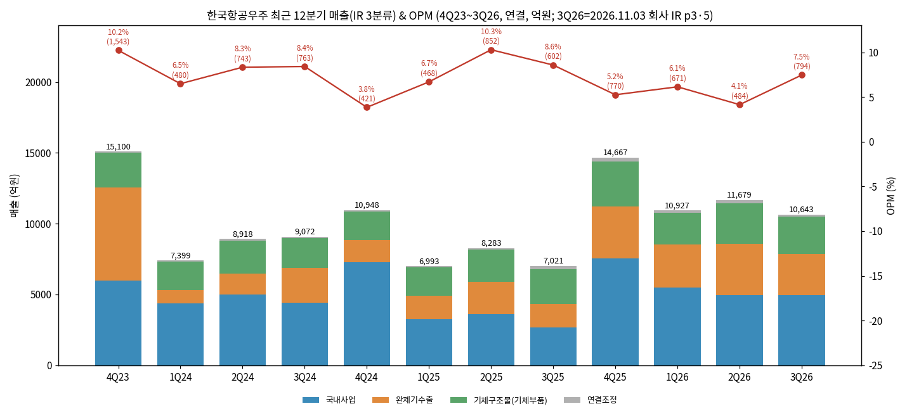

(4) 분기 시계열 — 사업부문 (억원, 매출 / OP (OPM), 1Q21~2Q26 — 연결 주석 누계값 차감)

| 분기 | 고정익 매출/OP (OPM) | 회전익 | 기체 | 기타 | 연결 합계 |
|---|---|---|---|---|---|
| 1Q21 | 2,232 / 47 (2.1%) | 1,525 / 25 (1.6%) | 1,058 / -15 (-1.4%) | 1,386 / 21 (1.5%) | 6,117 / 84 |
| 2Q21 | 2,313 / 187 (8.1%) | 2,784 / 298 (10.7%) | 1,193 / 79 (6.6%) | 902 / 30 (3.3%) | 7,085 / 600 |
| 3Q21 | 2,082 / 36 (1.7%) | 422 / -64 (-15.2%) | 1,554 / 72 (4.6%) | 513 / 1 (0.2%) | 4,451 / 28 |
| 4Q21 | 2,641 / 18 (0.7%) | 2,902 / -55 (-1.9%) | 1,470 / -145 (-9.9%) | 1,061 / 48 (4.5%) | 7,969 / -130 |
| 1Q22 | 1,955 / 114 (5.8%) | 1,895 / 104 (5.5%) | 1,812 / 150 (8.3%) | 838 / 26 (3.1%) | 6,407 / 392 |
| 2Q22 | 1,971 / 41 (2.1%) | 2,579 / 194 (7.5%) | 1,780 / 234 (13.1%) | 477 / -112 (-23.5%) | 6,685 / 344 |
| 3Q22 | 2,068 / 123 (5.9%) | 1,576 / 48 (3.0%) | 1,770 / 148 (8.4%) | 817 / -13 (-1.6%) | 6,089 / 305 |
| 4Q22 | 1,966 / 71 (3.6%) | 3,422 / 18 (0.5%) | 2,663 / 217 (8.1%) | 776 / 57 (7.3%) | 8,688 / 375 |
| 1Q23 | 2,088 / 23 (1.1%) | 1,258 / 74 (5.9%) | 1,818 / 115 (6.3%) | 642 / -11 (-1.7%) | 5,687 / 194 |
| 2Q23 | 2,260 / 56 (2.5%) | 2,209 / 20 (0.9%) | 1,959 / 64 (3.3%) | 1,041 / -54 (-5.2%) | 7,335 / 84 |
| 3Q23 | 5,431 / 351 (6.5%) | 1,532 / 76 (5.0%) | 2,031 / 221 (10.9%) | 1,224 / 6 (0.5%) | 10,071 / 654 |
| 4Q23 | 9,645 / 1,565 (16.2%) | 2,101 / -235 (-11.2%) | 2,927 / 400 (13.7%) | 596 / -191 (-32.0%) | 15,100 / 1,543 |
| 1Q24 | 3,345 / 145 (4.3%) | 1,188 / 28 (2.4%) | 2,129 / 244 (11.5%) | 900 / 68 (7.6%) | 7,399 / 480 |
| 2Q24 | 4,167 / 205 (4.9%) | 1,438 / -6 (-0.4%) | 2,400 / 291 (12.1%) | 1,079 / 248 (23.0%) | 8,918 / 743 |
| 3Q24 | 4,644 / 595 (12.8%) | 1,513 / -69 (-4.6%) | 2,209 / 345 (15.6%) | 868 / -94 (-10.8%) | 9,072 / 763 |
| 4Q24 | 4,725 / 403 (8.5%) | 2,932 / -382 (-13.0%) | 2,760 / 295 (10.7%) | 810 / 83 (10.2%) | 10,948 / 421 |
| 1Q25 | 3,224 / 163 (5.1%) | 934 / -39 (-4.2%) | 2,090 / 324 (15.5%) | 938 / 30 (3.2%) | 6,993 / 468 |
| 2Q25 | 3,869 / 431 (11.1%) | 1,277 / 57 (4.5%) | 2,375 / 283 (11.9%) | 994 / 87 (8.8%) | 8,283 / 852 |
| 3Q25 | 2,973 / 238 (8.0%) | 565 / 7 (1.2%) | 2,551 / 247 (9.7%) | 1,194 / 113 (9.5%) | 7,021 / 602 |
| 4Q25 | 5,289 / 119 (2.2%) | 4,859 / -28 (-0.6%) | 3,278 / 484 (14.8%) | 1,489 / 169 (11.3%) | 14,667 / 770 |
| 1Q26 | 4,813 / 98 (2.0%) | 2,753 / 88 (3.2%) | 2,310 / 402 (17.4%) | 1,291 / 64 (5.0%) | 10,927 / 671 |
| 2Q26 | 6,037 / -88 (-1.5%) | 1,404 / 37 (2.6%) | 2,963 / 522 (17.6%) | 1,525 / 37 (2.4%) | 11,679 / 484 |

→ 2020 이전 분기 부문 데이터는 2부문·매출총이익 기준이라 본 표와 비연속 — 사업부별 60분기 표준 대신 22분기 + 옛 2부문 연간으로 대체 (사유: 공시 부문 체계 2회 변경)

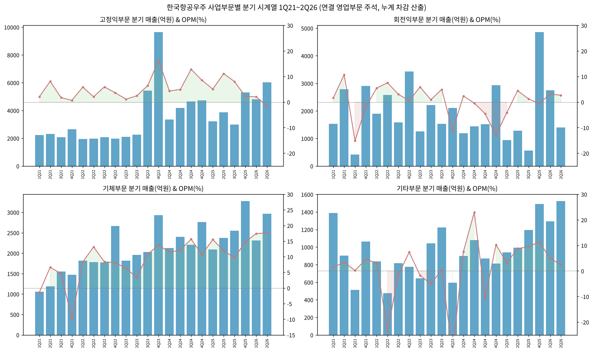

(4-1) 분기 시계열 — IR 3분류 매출 · 신규수주 · 수주잔고 (연결, 억원, 1Q21~3Q26 — 각 분기 IR 실적발표 자료)

| 분기 | 국내사업 | 완제기수출 | 기체구조물 | 연결조정 | 매출 합계 | 수출 비중 | 신규수주 (국내 / 완제기 / 기체) | 수주잔고 분기말 (국내 / 완제기 / 기체) |
|---|---|---|---|---|---|---|---|---|
| 1Q21 | 4,106 | 990 | 981 | 40 | 6,117 | 32% | 1,156 (79 / 132 / 945) | — |
| 2Q21 | 5,516 | 365 | 1,165 | 39 | 7,085 | 22% | 507 (57 / 13 / 437) | — |
| 3Q21 | 2,788 | 208 | 1,426 | 29 | 4,451 | 37% | 11,422 (971 / 3,503 / 6,948) | — |
| 4Q21 | 5,905 | 614 | 1,420 | 30 | 7,969 | 26% | 15,269 (9,736 / 4,012 / 1,521) | **186,562** (87,153 / 9,801 / 89,608) |
| 1Q22 | 4,051 | 559 | 1,765 | 32 | 6,407 | 36% | 2,296 (124 / 1,786 / 386) | — |
| 2Q22 | 4,920 | 24 | 1,713 | 28 | 6,685 | 26% | 1,334 (795 / 22 / 517) | — |
| 3Q22 | 4,118 | 253 | 1,705 | 13 | 6,089 | 32% | 34,952 (208 / 34,731 / 13) | **206,658** (75,458 / 45,645 / 85,555) |
| 4Q22 | 5,876 | 435 | 2,301 | 76 | 8,688 | 31% | 48,825 (13,589 / 62 / 35,174) | **245,961** (83,250 / 50,032 / 112,679) |
| 1Q23 | 3,636 | 272 | 1,748 | 31 | 5,687 | 36% | 13,775 (383 / 12,008 / 1,384) | — |
| 2Q23 | 4,865 | 534 | 1,886 | 50 | 7,335 | 33% | 2,479 (1,135 / 40 / 1,304) | — |
| 3Q23 | 4,966 | 3,114 | 1,953 | 38 | 10,071 | 50% | 2,108 (865 / 210 / 1,033) | **203,732** (72,979 / 58,369 / 72,384) |
| 4Q23 | 5,986 | 6,550 | 2,474 | 90 | 15,100 | 60% | 27,960 (23,787 / 145 / 4,028) | **217,759** (90,671 / 53,294 / 73,794) |
| 1Q24 | 4,386 | 906 | 2,050 | 57 | 7,399 | 40% | 2,141 (258 / 64 / 1,819) | **212,718** (86,623 / 52,471 / 73,624) |
| 2Q24 | 4,982 | 1,506 | 2,309 | 121 | 8,918 | 43% | 28,548 (15,738 / 50 / 12,760) | **232,591** (97,436 / 51,017 / 84,138) |
| 3Q24 | 4,426 | 2,434 | 2,112 | 100 | 9,072 | 50% | 305 (303 / 2 / 0) | **224,080** (93,365 / 48,635 / 82,080) |
| 4Q24 | 7,274 | 1,558 | 2,041 | 75 | 10,948 | 33% | 18,025 (5,095 / 1,662 / 11,268) | **246,994** (91,127 / 52,919 / 102,948) |
| 1Q25 | 3,237 | 1,693 | 1,998 | 65 | 6,993 | 53% | 2,590 (1,257 / 1,220 / 113) | **242,569** (89,172 / 52,229 / 101,168) |
| 2Q25 | 3,632 | 2,273 | 2,268 | 110 | 8,283 | 55% | 31,622 (20,451 / 9,777 / 1,394) | **266,733** (106,384 / 59,934 / 100,415) |
| 3Q25 | 2,693 | 1,638 | 2,450 | 240 | 7,021 | 58% | 2,624 (1,352 / 120 / 1,152) | **262,673** (105,000 / 58,439 / 99,234) |
| 4Q25 | 7,554 | 3,650 | 3,166 | 297 | 14,667 | 46% | 27,107 (20,017 / 1,014 / 6,076) | **273,437** (117,705 / 55,232 / 100,500) |
| 1Q26 | 5,479 | 3,071 | 2,228 | 150 | 10,927 | 48% | 3,093 (1,776 / 1,291 / 26) | 265,532 (부문 미공개) |
| 2Q26 | 4,965 | 3,633 | 2,847 | 234 | 11,679 | 55% | 3,194 (549 / 218 / 2,427) | **257,502** (109,170 / 50,256 / 98,076) |
| 3Q26 | 4,937 | 2,914 | 2,628 | 164 | 10,643 | 52% | 15,806 (1,231 / 14,575 / 0) | **262,855** (105,381 / 61,930 / 95,544) |

→ 출처: 1Q21·2Q21 = 2022.1Q·2Q IR p3 전년동기 / 3Q21 = 2022.3Q IR p3 / 4Q21 = 2022.4Q IR p4 / 1Q22~2Q22 = 각 분기 IR p3 / 3Q22·4Q22 = 2023.3Q·2022.4Q IR / 1Q23·2Q23 = 2024.1Q·2Q IR 전년동기 / 3Q23~3Q25 = 각 분기 IR p4 / 4Q23·4Q24 = 각 연간 IR p4 / 1Q25~4Q25 = 2025.4Q IR p3 차트 / 1Q26·2Q26 = 2026.1Q·2Q IR p3 / 3Q26 = 2026.3Q IR p3(매출·수주·잔고 합계)·p4(부문 수주·잔고)·p5(부문 매출). 3Q25 비교치(2,693 / 1,638 / 2,450 / 240, 수주 1,352 / 120 / 1,152)는 2026.3Q IR과 일치. 2022년 이전·2023 1H 자료는 이미지 PDF — 페이지를 직접 판독
→ 재작성: **1Q25** 매출 원공시(2025.1Q IR) 3,221 / 1,711 / 1,996 → 2025.4Q IR 차트 3,237 / 1,693 / 1,998 (합계 6,993 불변, 연간 합계가 재작성치로 맞음 → 재작성치 사용). 1Q25 신규수주 원공시 2,390(완제기 1,021) → 2,590(완제기 1,220). **1Q26** 2Q26 누계로 역산 시 완제기 3,081·기체 2,217(원공시 3,071·2,228) — 원공시 유지. 2Q25 기체 2,268 vs 2026.2Q IR 2,269 (반올림)
→ 4Q25 수주잔고 부문값은 IR 미표기(합계 27.3조 차트만) → 2025 사업보고서 수주상황(국내 = 방산 109,868 + 위성 등 7,837) 사용. 1Q26은 합계 265,532만 공개 (2026.1Q IR p3)
→ 4Q21 영업이익은 DART 확정(-130) 사용 — IR 연간 578 기준 역산 시 -134
→ **분기 패턴** — 완제기수출은 진행률·인도 이벤트형: 3Q23~4Q23 폴란드 FA-50GF 인도로 3,114 → 6,550 급증 후 1Q24 906으로 급락. 2025 하반기부터 폴란드 FA-50PL·말레이시아 FA-50M 진행률 증가 + 인니 TA-50 납품으로 1H26 분기 3,000억대 안착 (2026.1Q·2Q IR p5)
→ **수주 패턴** — 대형 수주가 특정 분기에 몰림: 3Q22 폴란드 FA-50 3.47조, 4Q22 기체 3.52조(장기 기체 계약), 1Q23 말레이시아 FA-50 1.2조, 4Q23 국내 2.38조(LAH 2차 양산 등), 2Q24 KF-21 최초양산 1.57조 + 기체 1.28조, 2Q25 KF-21 잔여양산 2.05조 + 필리핀 FA-50 0.98조, 4Q25 KF-21 BLK2 추가무장시험·필리핀 FA-50PH 성능개량 등 2.0조 (각 분기 IR 수주 Breakdown)
→ **3Q26** — 매출: 국내 4,937(+83% YoY) 'KF-21 및 FA-50 상환기 기반의 납품 매출과 기존 개발 사업들의 진행률 매출', 완제기 2,914(+78%) '말레이시아/폴란드/필리핀 FA-50, 이라크 CLS 진행률 증가', 기체 2,628(+7%) '보잉 향 납품 증가'. 'KF-21 최초 납품 개시', '미르온 4분기 납품 정상화 예정' (2026.3Q IR p5). 수주: 완제기 14,575억(IR 표기 '해외 완제기 수리부속 등' — 리뷰 대조상 비공개 수출 계약 1조 4,527억 포함), 국내 1,231억(해경헬기 8차·경찰청헬기 9차·소형무장헬기 훈련체계 등), 기체 0 (2026.3Q IR p4). 잔고 검산: 2Q26 257,502 + 수주 15,806 − 매출 10,643 = 262,665 vs IR 262,855 (190억 차 — 환율·계약변경 등 조정 추정 ⚠️)
→ 2Q26 매출: '회전익 계열 납품 일정 조정으로 일부 영향', '하반기 KF-21 국내 납품 착수에 따라 양산 매출 본격 반영' (2026.2Q IR p5). 2Q26 매출총이익률 10.7%(-8.0%p YoY) — IR은 부문 이익을 공개하지 않아 원인 분해 불가 (부문 OP는 (4) DART 표)

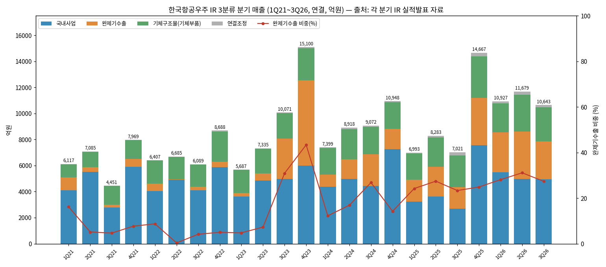

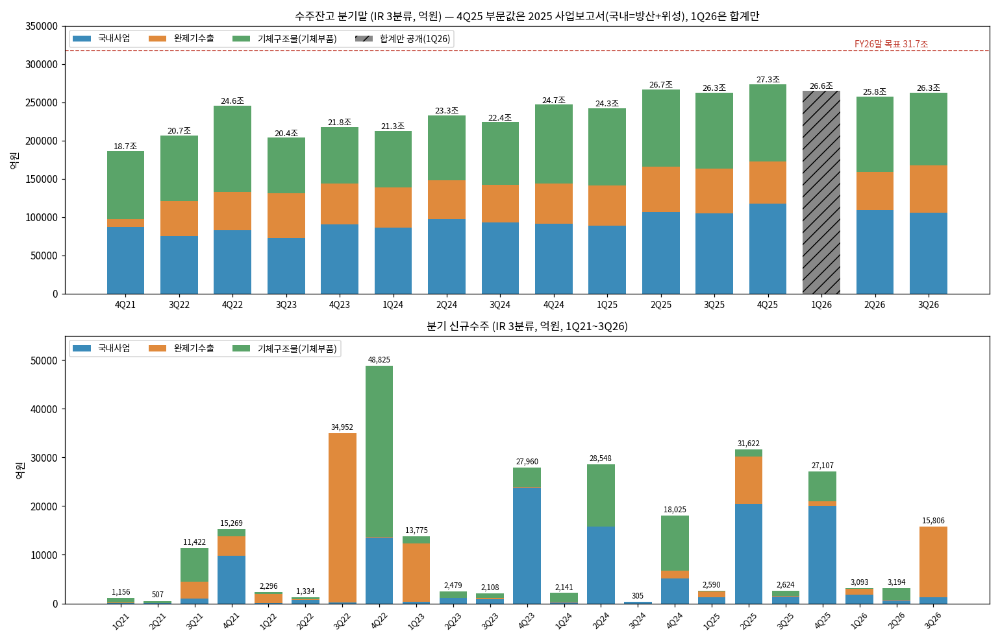

(5) 사업부별 디테일

(5-1) **고정익 — 매출 1위, 수출·KF-21의 driver**
→ T-50 계열: 고등훈련기 T-50, 전술입문기 TA-50, 경공격기 FA-50. 수출국 인도네시아·이라크·필리핀·태국·폴란드·말레이시아 (사업보고서 연혁)
→ KF-21: 2015.12 체계개발 → 2021.04 출고 → 2022.07 최초비행 → 2023.05 잠정 전투용 적합 → 2024.06 최초 양산계약 → 2025.06 잔여 양산계약. 2026 첫 인도 보도(sateconomy) — 세부 일자 확인 필요
→ 연간 생산능력: T-50/KF-21 계열 **60대** (2025 사업보고서)
→ 1H26 고정익 OP 10억(OPM 0.1%) — 매출 1.08조로 커졌지만 수익성 급락, 2Q26 OP -88억 적자. 원인(원가 추정 변경 등)은 반기보고서에서 부문별 설명 없음 → 확인 필요

(5-2) **회전익 — 매출 20%, 수익성 최저**
→ KUH 수리온(기동·의무후송·해경·산림청 파생형), LAH 미르온(소형무장), 상륙공격(MAH)·소해헬기(MCH) 체계개발. 연간 생산능력 **72대** (KUH+LAH/LCH)
→ 2023~2025 3년 연속 적자 또는 BEP(-64/-429/-3억) — 수리온 양산 종료(2024.06 최종호기)·LAH 양산 초기
→ 수출: KUH 이라크 수출 계약(2024.12)

(5-3) **기체 — 이익 1위, 민항 사이클 연동**
→ Boeing(B737MAX 미익, B787·B777X, 착륙장치 구조물), Airbus(A320 WBP/WTP·A350·Slat Track·엔진 낫셀), IAI·Embraer
→ FY25 OPM 13.0%, 1H26 17.5% — 민항기 증산 + 원화 약세 효과 추정 (환율 민감도: 2025 사업보고서 '위험관리' 참조)
→ 2020~2021 코로나로 매출 4,879억(2021, 별도)까지 급감 후 회복

(5-4) **기타 — 위성·UAV·MRO**
→ 425사업(군 정찰위성) 4호기(2025.04)·5호기(2025.11) 발사, 차세대중형위성 2호(2026.05)
→ 종속회사 한국항공서비스(MRO, 2025 매출 776억), 제노코(위성통신, 2025.07 편입)

(6) 주요 경쟁사 (사업부별)

| 부문 | 국내 | 글로벌 |
|---|---|---|
| 고정익 전투기·훈련기 | (국내 독점) | Lockheed Martin(F-16/F-35), Saab(Gripen), Leonardo(M-346), Boeing(T-7A), Aero Vodochody(L-39NG) |
| 회전익 | (국내 독점, 엔진은 한화에어로스페이스 국산화 추진) | Airbus Helicopters, Leonardo, Bell, Sikorsky |
| 기체구조물 | 대한항공 항공우주사업부 | Spirit AeroSystems, 일본 MHI·KHI·SUBARU, 중국 AVIC 계열 |
| 위성·UAV | 한화시스템, 쎄트렉아이(한화 계열), LIG넥스원 | — |

→ 시장 데이터: Forecast International 전망 — 2025~2034 전투기 3,989대(3,068억 달러), 훈련기 1,530대(271억 달러), 군용 회전익기 약 3,700대(1,074억 달러) (2025 사업보고서 II.7 인용)

(7) 주요 매출처

→ **방위사업청** — 연결 매출 1조 4,005억 (FY25, 주석 36 '주요 고객', 38%) / 전기 1조 7,038억
→ **A 고객 4,866억 / B 고객 4,392억 (FY25, 익명 공시)** — 매출처 표와 대조 시 폴란드 국방부(완제기) 및 Airbus 계열로 추정 (추정)
→ 지역별(연결, FY25): 국내 18,202 / 유럽 9,987 / 아시아·중동 6,034 / 북미 2,500 / 남미 239 억원

(8) 생산 CAPA + 임직원 추이

→ 생산능력: 고정익 60대 + 회전익 72대 / 2025 평균가동률 **87.91%** (가동가능 1,772,859h 중 1,558,591h)
→ 설비투자 계획: 2025~2027 합계 5,415억 (2026 1,673억, 2027 2,399억 — 건·구축물 1,934억 중심)
→ 생산실적(당기제품제조원가, 별도): 2023 33,375 / 2024 31,379 / 2025 30,207억 (수출 비중 2025 50%)

| 연도 | R&D 합계(억원, 별도) | R&D/매출 | 임직원(별도, 명) | 1인 평균급여(백만원) |
|---|---|---|---|---|
| 2013 | 405 | 2.01% | 3,144 | 78 |
| 2014 | 확인 불가 | — | 3,231 | 81 |
| 2015 | 594 | 2.0% | 3,530 | 86 |
| 2016 | 832 | 2.8% | 3,905 | 90 |
| 2017 | 2,090 | 10.1% | 4,156 | 77 |
| 2018 | 2,350 | 11.85% | 4,621 | 81 |
| 2019 | 2,129 | 6.85% | 4,945 | 91 |
| 2020 | 2,359 | 8.39% | 5,028 | 89 |
| 2021 | 2,089 | 8.2% | 5,012 | 97 |
| 2022 | 2,069 | 7.46% | 5,079 | 102 |
| 2023 | 1,632 | 4.3% | 5,098 | 110 |
| 2024 | 1,430 | 3.97% | 5,093 | 116 |
| 2025 | 1,640 | 4.52% | 5,241 | 120 |

---

## ④ 재무 구조 (13년 연결 시계열, OpenDART 연결 재무제표)

(1) 손익계산서 (억원)

| 연도 | 매출 | 매출원가 | 매출총이익 | GPM | 판관비 | 판관비율 | 영업이익 | OPM | 세전이익 | 지배순이익 |
|---|---|---|---|---|---|---|---|---|---|---|
| 2013 | 19,833 | 17,946 | 1,887 | 9.5% | 1,179 | 5.9% | 707 | 3.6% | 212 | 362 |
| 2014 | 23,286 | 20,124 | 3,162 | 13.6% | 1,269 | 5.4% | 1,893 | 8.1% | 1,688 | 1,324 |
| 2015 | 30,397 | 25,314 | 5,084 | 16.7% | 1,287 | 4.2% | 3,797 | 12.5% | 3,431 | 2,592 |
| 2016 | 29,463 | 24,897 | 4,566 | 15.5% | 1,365 | 4.6% | 3,201 | 10.9% | 3,171 | 2,648 |
| 2017 | 20,722 | 20,972 | -249 | -1.2% | 1,839 | 8.9% | -2,089 | -10.1% | -3,203 | -2,352 |
| 2018 | 27,860 | 24,115 | 3,745 | 13.4% | 2,281 | 8.2% | 1,464 | 5.3% | 797 | 572 |
| 2019 | 31,102 | 26,302 | 4,800 | 15.4% | 2,044 | 6.6% | 2,756 | 8.9% | 1,295 | 1,704 |
| 2020 | 28,251 | 24,933 | 3,319 | 11.7% | 1,924 | 6.8% | 1,395 | 4.9% | 825 | 746 |
| 2021 | 25,623 | 22,553 | 3,070 | 12.0% | 2,487 | 9.7% | 583 | 2.3% | 544 | 639 |
| 2022 | 27,869 | 24,131 | 3,738 | 13.4% | 2,322 | 8.3% | 1,416 | 5.1% | 1,221 | 1,185 |
| 2023 | 38,193 | 33,555 | 4,639 | 12.1% | 2,163 | 5.7% | 2,475 | 6.5% | 2,687 | 2,240 |
| 2024 | 36,337 | 31,523 | 4,815 | 13.3% | 2,408 | 6.6% | 2,407 | 6.6% | 1,971 | 1,721 |
| 2025 | 36,964 | 30,883 | 6,081 | 16.5% | 3,389 | 9.2% | 2,692 | 7.3% | 2,023 | 1,859 |

(2) 재무상태표 (억원)

| 연도 | 자산총계 | 유동자산 | 재고자산 | 현금성자산 | 부채총계 | 유동부채 | 차입금+사채 | 순차입금(근사) | 자본총계 | 지배자본 | 부채비율 |
|---|---|---|---|---|---|---|---|---|---|---|---|
| 2013 | 19,515 | 11,177 | 3,593 | 1,375 | 10,473 | 7,545 | 확인 불가 | 확인 불가 | 9,042 | 9,042 | 116% |
| 2014 | 21,090 | 12,503 | 4,331 | 126 | 11,082 | 5,866 | 3,645 | 3,519 | 10,007 | 10,007 | 111% |
| 2015 | 28,082 | 19,127 | 4,668 | 107 | 15,937 | 9,214 | 4,509 | 4,402 | 12,144 | 12,144 | 131% |
| 2016 | 29,808 | 20,239 | 5,063 | 536 | 15,353 | 9,399 | 5,447 | 4,911 | 14,456 | 14,456 | 106% |
| 2017 | 31,662 | 19,745 | 4,641 | 2,271 | 20,258 | 12,078 | 8,998 | 6,727 | 11,404 | 11,404 | 178% |
| 2018 | 37,559 | 24,095 | 12,909 | 1,438 | 27,030 | 16,678 | 7,213 | 5,775 | 10,529 | 10,094 | 257% |
| 2019 | 43,671 | 26,548 | 12,004 | 694 | 31,840 | 22,029 | 7,188 | 6,494 | 11,832 | 11,419 | 269% |
| 2020 | 51,591 | 31,523 | 11,971 | 6,619 | 39,248 | 26,234 | 9,802 | 3,183 | 12,343 | 11,954 | 318% |
| 2021 | 58,552 | 36,810 | 13,247 | 8,866 | 45,578 | 28,001 | 12,032 | 3,166 | 12,974 | 12,694 | 351% |
| 2022 | 77,724 | 53,892 | 15,931 | 20,237 | 63,192 | 50,554 | 11,237 | -9,000 | 14,532 | 14,278 | 435% |
| 2023 | 71,396 | 46,810 | 17,365 | 6,581 | 55,196 | 44,003 | 6,082 | -499 | 16,199 | 15,974 | 341% |
| 2024 | 80,255 | 54,390 | 23,590 | 1,147 | 62,984 | 49,147 | 10,357 | 9,210 | 17,272 | 17,059 | 365% |
| 2025 | 103,703 | 75,952 | 36,370 | 609 | 84,729 | 63,513 | 21,470 | 20,861 | 18,973 | 18,302 | 447% |
| **2Q26** | 115,827 | 85,678 | 39,926 | 1,636 | 96,000 | 68,174 | (주석 미집계) | — | 19,827 | 18,999 | 484% |

→ 차입금+사채 = 단기차입금·유동성장기차입금·유동성사채·장기차입금·사채 합 (리스부채 제외). 순차입금 = 차입금+사채 − 현금성자산 (단기금융상품·FVPL 미차감 근사)
→ 재고자산 2017 4,641 → 2025 36,370억 (8배) — 2018 IFRS 15로 '미청구공사'가 재고·계약자산으로 재분류된 효과 + 수출 선투입

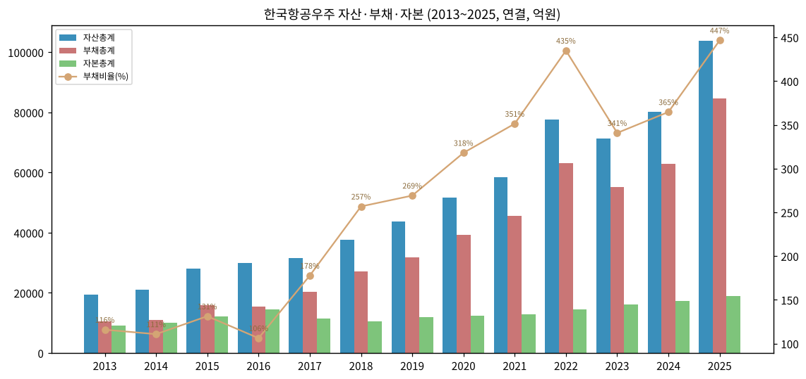

(3) 현금흐름표 (억원)

| 연도 | 영업CF | 투자CF | 재무CF | 유형 취득 | 무형 취득 | FCF | 배당 지급 |
|---|---|---|---|---|---|---|---|
| 2013 | 2,015 | -2,405 | -470 | 1,417 | 607 | -8 | 195 |
| 2014 | -1,135 | -799 | 685 | 515 | 545 | -2,194 | 195 |
| 2015 | 599 | -1,232 | 613 | 653 | 738 | -792 | 244 |
| 2016 | 1,453 | -1,587 | 561 | 819 | 1,006 | -372 | 390 |
| 2017 | 1,046 | -2,158 | 2,868 | 789 | 1,954 | -1,697 | 663 |
| 2018 | 1,377 | -882 | -1,346 | 514 | 230 | 632 | 0 |
| 2019 | 3,545 | -3,866 | -442 | 1,873 | 1,957 | -284 | 195 |
| 2020 | 7,324 | -3,533 | 2,165 | 2,530 | 2,088 | 2,707 | 390 |
| 2021 | 4,400 | -4,160 | 2,007 | 839 | 1,853 | 1,707 | 195 |
| 2022 | 14,926 | -2,041 | -1,028 | 690 | 1,607 | 12,630 | 195 |
| 2023 | -7,004 | -1,079 | -5,464 | 779 | 979 | -8,762 | 244 |
| 2024 | -7,282 | -1,890 | 3,695 | 1,613 | 860 | -9,755 | 487 |
| 2025 | -9,033 | -1,858 | 10,299 | 1,286 | 612 | -10,931 | 487 |
| 1H26 | -3,800 | -3,977 | 8,785 | 667 | 2,553 | -7,020 | 487 |

→ 2022 영업CF +1조 4,926억 = 폴란드 FA-50 선수금 유입, 2023~2025 3년 누적 -2조 3,319억 = 수출·KF-21 양산 선투입 (계약부채 FY25말 2.14조, 계약자산 8,410억)
→ 2025 재무CF +1조 299억 = 사채 순증 9,978억 (연결 현금흐름표)

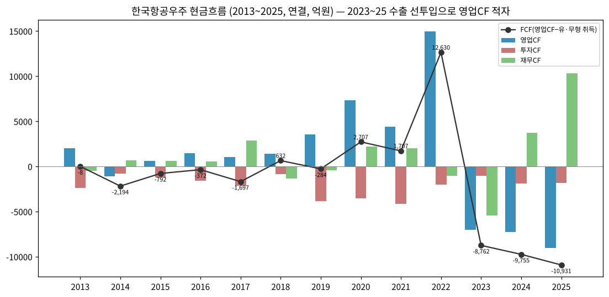

(4) CapEx (억원, 연결 현금흐름표 유·무형 취득)

| 연도 | 유형자산 취득 | 무형자산 취득 | 합계 | CapEx/매출 | 감가상각(참고) |
|---|---|---|---|---|---|
| 2013 | 1,417 | 607 | 2,023 | 10.2% | — |
| 2014 | 515 | 545 | 1,059 | 4.5% | — |
| 2015 | 653 | 738 | 1,390 | 4.6% | — |
| 2016 | 819 | 1,006 | 1,825 | 6.2% | — |
| 2017 | 789 | 1,954 | 2,743 | 13.2% | — |
| 2018 | 514 | 230 | 745 | 2.7% | — |
| 2019 | 1,873 | 1,957 | 3,829 | 12.3% | — |
| 2020 | 2,530 | 2,088 | 4,617 | 16.3% | — |
| 2021 | 839 | 1,853 | 2,692 | 10.5% | — |
| 2022 | 690 | 1,607 | 2,297 | 8.2% | — |
| 2023 | 779 | 979 | 1,758 | 4.6% | — |
| 2024 | 1,613 | 860 | 2,473 | 6.8% | 821 (FY24) |
| 2025 | 1,286 | 612 | 1,898 | 5.1% | 935 (FY25 부문주석) |

→ 무형자산 취득 = 주로 개발비 자산화 (KF-21·LAH·소형민수헬기 등). 2017~2022 R&D 피크와 동행

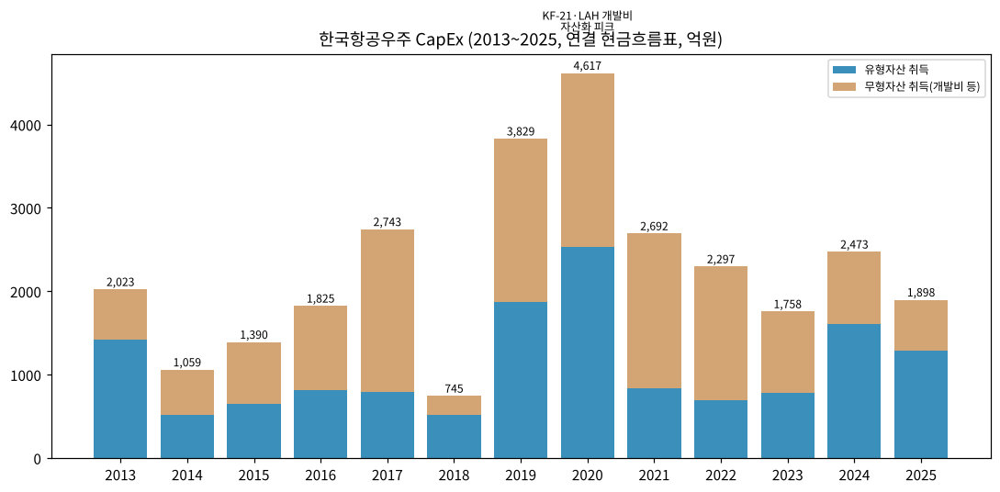

(5) 부채구조 + 채무증권 발행

→ FY25말 사채 1조 5,663억(유동성 2,999억 포함), 단기차입금 4,928억, 장기차입금 879억 (유동성 포함) — 2025 사채 발행 9,978억 (연결 CF)
→ 2026.01.27 공모사채 30-1회 4,200억(3년, 3.480%)·30-2회 800억(5년, 3.675%)
→ 2026.03.04 사모 전환사채 5,000억 (표면 0%, 만기 2031.03.04, 전환가 185,165원, 전환 2027.03.04~, 조기상환청구권 발행 36개월 후) — 2025 사업보고서 주석 38
→ 신용등급 AA-/A1 (2023~2025 유지)

(6) 배당·자사주

| 귀속연도 | DPS(원) | 배당총액(억원) | 지배순이익 | 배당성향 | 비고 |
|---|---|---|---|---|---|
| 2013 | 200 | 195 | 362 | 53.8% |  |
| 2014 | 250 | 244 | 1,324 | 18.4% |  |
| 2015 | 400 | 390 | 2,592 | 15.0% |  |
| 2016 | 680 | 663 | 2,648 | 25.0% |  |
| 2017 | 0 | 0 | -2,352 | — | 무배당 (적자) |
| 2018 | 200 | 195 | 572 | 34.1% |  |
| 2019 | 400 | 390 | 1,704 | 22.9% |  |
| 2020 | 200 | 195 | 746 | 26.1% |  |
| 2021 | 200 | 195 | 639 | 30.5% |  |
| 2022 | 250 | 244 | 1,185 | 20.6% |  |
| 2023 | 500 | 487 | 2,240 | 21.8% |  |
| 2024 | 500 | 487 | 1,721 | 28.3% |  |
| 2025 | 500 | 487 | 1,859 | 26.2% | DPS 500원 3년 유지 |

→ 자기주식 보유·취득·소각 이력 없음 (2025 사업보고서). 2025.04 기업가치제고 계획 공시
→ 배당금 지급(현금흐름표)은 전년 귀속분 지급 기준이라 귀속 연도 DPS와 1년 시차

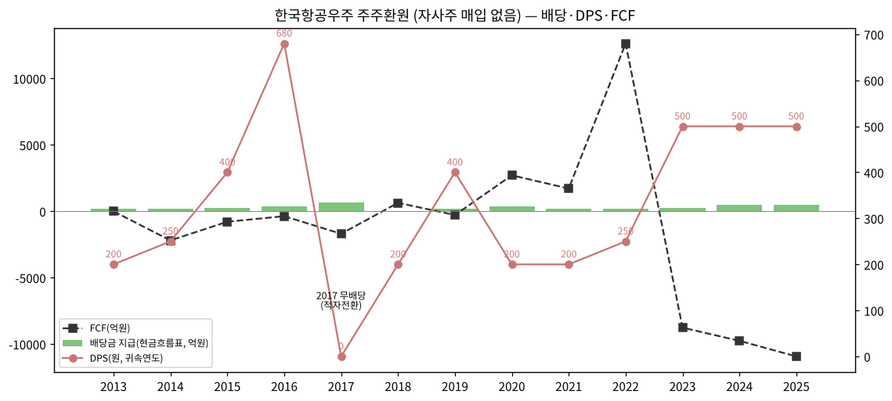

(7) 재무비율 (연결)

| 연도 | ROE(지배) | ROA | 부채비율 | 유동비율 | OP/금융원가 |
|---|---|---|---|---|---|
| 2013 | 4.0% | 1.9% | 116% | 148% | 1.5x |
| 2014 | 13.2% | 6.3% | 111% | 213% | 3.8x |
| 2015 | 21.3% | 9.2% | 131% | 208% | 6.3x |
| 2016 | 18.3% | 8.9% | 106% | 215% | 4.3x |
| 2017 | -20.6% | -7.4% | 178% | 163% | -1.7x |
| 2018 | 5.7% | 1.5% | 257% | 144% | 2.9x |
| 2019 | 14.9% | 3.9% | 269% | 121% | 5.8x |
| 2020 | 6.2% | 1.4% | 318% | 120% | 1.7x |
| 2021 | 5.0% | 1.1% | 351% | 131% | 1.2x |
| 2022 | 8.3% | 1.5% | 435% | 107% | 1.1x |
| 2023 | 14.0% | 3.1% | 341% | 106% | 2.8x |
| 2024 | 10.1% | 2.1% | 365% | 111% | 1.7x |
| 2025 | 10.2% | 1.8% | 447% | 120% | 1.5x |

→ 'OP/금융원가'는 이자보상배율 대용 (금융원가에 외환손실·파생손실 포함 → 실제 이자보상배율보다 낮게 표시). FY25 이자지급(영업CF) 507억 기준 OP/이자 = 5.3배

---

## ⑤ 지배 구조

(1) 그룹·계열 관계

→ **공기업형 소유구조** — 최대주주 한국수출입은행(26.41%), 수은의 최대주주는 정부(76.79%) → 사실상 정부 통제. 대표이사 선임에 정부 영향력 (역대 대표 다수가 방사청·관료 출신 — 현 김종출 대표 방사청 무인사업부장 출신)
→ 공시대상기간(2021~2026 반기) 최대주주 변동 없음
→ **한화그룹 지분 확대 경과** (보도 기준)

| 일자 | 한화 합산 지분 | 내용 | 출처 |
|---|---|---|---|
| 2026.05.04 | 5.09% | 보유목적 '단순투자' → **'경영참여'** 변경 | 뉴시스 2026.05.26 |
| 2026.05.26 | 6.17% | 장내 104.8만주 추가 (약 1,716억) | 뉴시스 |
| 2026.06.16 | 9.04% | 2대 주주 등극 | 스마트투데이 |
| 2026.07.08 | 12.44% | 에어로 9.90%·시스템 1.53%·USA 1.01%, 한화시스템 5,000억 한도 추가 매입 계획 | 시대 |
| **2026.08.10** | **15.89%** | 한화시스템 4.98%로 확대, **공정위 기업결합 신고 예정** | 한국경제 |

→ 시장 해석: 정부의 민영화 결정 없이는 경영권 확보 어려움 (뉴시스). LIG D&A도 관심 보도(머니투데이방송 2026.06.25) — 확인 수준
→ 이후(2026.08.10~11.03) 추가 변동 여부는 확인 불가

(2) 주주 구분

| 주주 | 주식수 | 지분율 | 기준 |
|---|---|---|---|
| 한국수출입은행 | 25,745,964 | 26.41% | 2026.06.30 반기보고서 |
| 한화그룹 합산 | 약 15.49백만 (추정) | 15.89% | 2026.08.10 보도 |
| ㄴ한화에어로스페이스 | 9,652,845 | 9.90% | 반기보고서 |
| 국민연금공단 | 7,507,081 | 7.70% | 반기보고서 |
| Fidelity Management Company | 6,491,965 | 6.66% | 2026.07.27 대량보유보고 |
| 우리사주조합 | 844,024 | 0.87% | 반기보고서 |
| 외국인 합계 | — | 23.76% | stockhub 2026.10.23 (Fidelity 포함, 중복) |

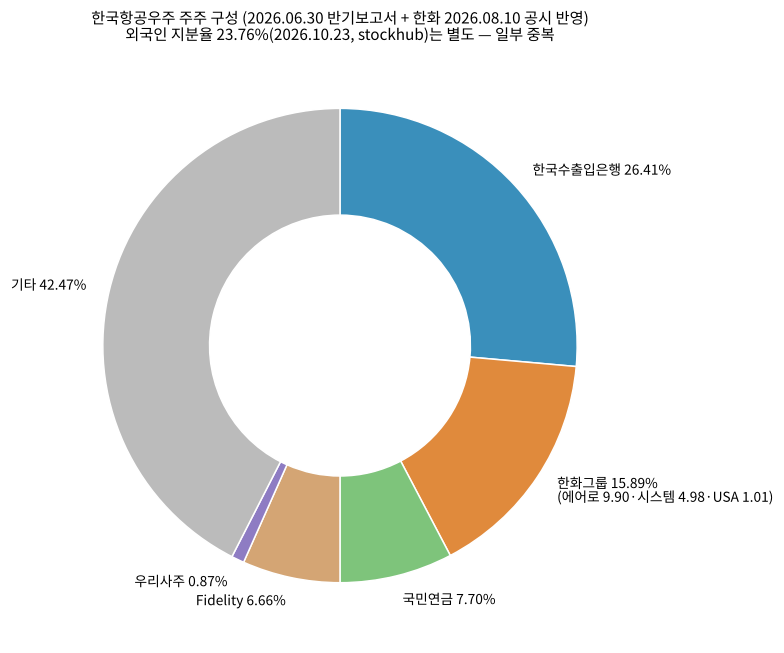

(3) 임원·이사회 (2026.06.30 반기보고서)

| 성명 | 직위 | 담당 | 주요 경력 | 임기만료 |
|---|---|---|---|---|
| **김종출** | 사장(대표이사, 이사회 의장) | 경영총괄 | 숭실대 경영학 박사, 방위사업청 무인사업부장, 광운대 겸임교수, 한국방산혁신기업협회 부회장 | 2029.03.18 |
| 차재병 | 부사장(사내이사) | 개발부문장 | 한양대 기계공학 석사, 훈련기개발실장, KFX체계실장 (2025.07~2026.03 대표) | 2027.03.30 |
| 송호철 | 부사장(사내이사) | 생산운영부문장 | 충남대 재료공학, MRO실장·경영기획실장 | 2029.03.25 |
| 조진수 | 독립이사 | 이사후보추천위원장 | 서울대 항공우주공학 박사, 한국항공우주학회장 | — |
| 이상원 | 독립이사 | 보상위원장 | 기재부 예산실 복지예산심의관, 교육부 차관보 | 2028.03.30 |
| 홍철규 | 독립이사 | 감사위원장 | LSE 회계학 박사, 한국관리회계학회장 | 2028.03.30 |
| (외) 이태영·홍순영 | 독립이사 | — | 2026.03.26 정기주총 신규 선임 안건 (2025 사업보고서) | — |

→ 대표이사 변천: 하성용(2013.05~2017.07) → (김조원 2017.10~) → 안현호(~2022.09) → 강구영(2022.09~2025.07 사임) → 차재병(2025.07 직무) → 김종출(2026.03~). 김조원 재임기간은 원문 미확인

---

## ⑥ 기타 팩트

(1) R&D 인프라

→ 연구개발 인력 약 **2,250명** — "대한민국 유일의 항공기 시스템 설계 엔지니어 그룹" (2025 사업보고서)
→ 특허: 국내 등록 751·출원 80, 해외 등록 8건
→ 대전연구센터(2025.03), AI-전자기전 특화연구센터(2025.08) 개소
→ R&D 비용은 위 ③-(8) 표 참조 — 2018 2,350억(매출 대비 11.85%) 피크, 2025 1,640억(4.52%). 정부보조금 2025 253억

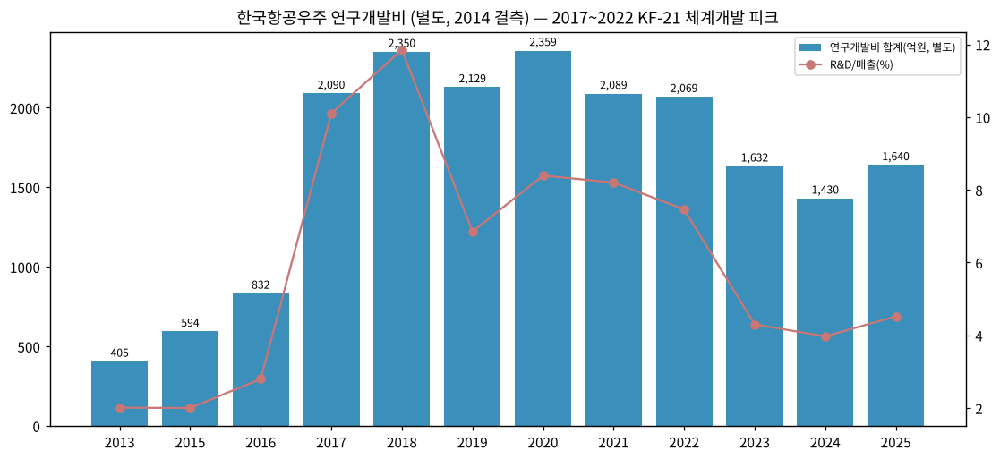

(2) 진행 중 / 최근 corporate action (10년)

→ 2018.06 에비오시스테크놀러지스 100% 인수, 2018.07 한국항공서비스 설립(66.4%), 2019.12 에스앤케이항공 지분 70.59% 추가 취득·편입
→ 2024.11 제노코 경영권 인수 계약 → 2025.07 취득(37.95%), 2025.4Q 한국표면처리 풋옵션 행사로 편입
→ 2025.04 젠젠에이아이(9.87%), 2025.06 디브레인(14.75%) 지분 취득
→ 2026 자금조달: 공모사채 5,000억 + CB 5,000억
→ **한화그룹 지분 15.89%·경영참여 목적** — 민영화·인수합병 시나리오의 핵심 변수

(3) R&D·사업 마일스톤 (10년)

→ KF-21: 체계개발 착수(2015.12) → 출고(2021.04) → 최초비행(2022.07) → 잠정 전투용 적합(2023.05) → 양산 계약(2024.06·2025.06) → 추가무장시험 계약(2025.12)
→ LAH: 체계개발 → 최초양산(2022.12) → 2차양산(2023.12) → 양산 1호기 납품(2024.12)
→ 상륙공격헬기 체계개발(2022.10) → 초도비행(2025.01), 소해헬기 체계개발(2022.12)
→ 위성: 425사업 4·5호기 발사(2025), 차세대중형위성 2호(2026.05, 민간 주도)

(4) 주요 리스크

→ **회계 추정 리스크 (진행기준)** — 매출 47%가 기간에 걸쳐 인식. 2017.08 재작성(2014~2016) + 2018.05 재작성(2017.1Q) 이력. 2017.08 재작성 사유: "방산협력업체 외주계약에 대한 원가인식방법, 총계약원가의 추정 및 발생원가의 귀속시기 등을 수정" (2016 기재정정 주석 33)
→ **2017 분식회계 의혹 경과** — 검찰: 2013~2017 원가·매출 부풀리기 혐의(5년 매출 5,358억 과대 주장, Korea Times 2019.01.29), 금감원 감리 후 증선위 심의 상정(2019.01) — 증선위 최종 제재 내용은 본 작업에서 확인 불가. 하성용 전 대표 항소심에서 분식회계 혐의 무죄(2024.07, 아시아경제)
→ **감사의견 이력** — 2015~2017 회계연도 감사의견 모두 **적정**(삼일회계법인), 2017.3Q 검토의견 정상, 2018부터 감사인 한영회계법인 (2017 기재정정·2018.1Q 분기보고서). '한정'·'의견거절' 이력 없음 (원문 확인 범위 2014~2026)
→ **운전자본·유동성** — 영업CF 3년 연속 적자, FY25 순차입금 약 2.1조, 부채비율 447% (2Q26 484%)
→ **정부 의존** — 방사청 매출 38%(FY25 연결), 국방예산·사업 일정 지연 리스크
→ **환율** — 수출(완제기·기체) 매출 52%(별도), 원가의 상당 부분 외화(LRU·엔진 수입)
→ **소송** — 쎄트렉아이 관련 공정위·손해배상 소송 이력(2011~), 현재 계류 소송은 2025 사업보고서 주석 34 참조(본 문서 미정리)
→ **지배구조 불확실성** — 한화 지분 확대, 민영화 여부

(5) ESG 등급

→ 한국ESG기준원 종합 **A** (2024·2025 2년 연속, 2025.11) / 2021 이전 4년 연속 종합 A (2021.10) — 사업보고서 연혁
→ 온실가스 배출 2024 67,159 tCO2-eq, 에너지 1,391TJ

(6) 인증·라이선스

→ 방산업체 지정, AS9100 계열(한국항공서비스), FAA 정비조직 인증(한국항공서비스 2019.09), KC-100 FAA 형식증명(2021.05), 수리온 제한형식증명·제작증명(2022)
→ 2026.03 유가증권시장 공시우수법인, 2026.05 밸류업 우수기업(경제부총리상)

---

## 데이터 Audit (v1.2)

| 소스 | 상태 | 비고 |
|---|---|---|
| OpenDART 연결 재무제표 API (2015~2Q26, 43건) | ✅ | 2013·2014는 2015 FY 파일 전기·전전기값 |
| DART 원문 XML 51건 (본문 + 감사보고서 첨부) | ✅ | 2019 이전 다수가 EUC-KR 인코딩(선언은 utf-8) — 변환 후 파싱 |
| OpenDART 별도 재무제표(OFS) | ⚪ 미사용 | 매출처·수주·R&D는 원문(별도 기준) 표 사용으로 충분 |
| 3Q26 잠정실적 | ✅ | 회사 3Q26 IR(2026.11.03, 6p) — 매출·OP·순이익·IR 3분류 매출·신규수주·수주잔고·재무상태 반영. 부문(고정익·회전익·기체·기타) OP·지배순이익은 3Q26 분기보고서 미확보 |
| Yahoo 월간 주가 (2011.07~2026.11) | ✅ | 월 타임스탬프 KST 기준 보정 |
| 회사 IR 자료 (분기 실적발표 PDF) | ✅ | 30건 수집(irgo, 2019.2Q~2026.2Q, 중복 제외 19건) + 2026.3Q IR(2026.11.03, BT 제공). 4Q21~3Q26 연속, 2023.3Q 이후 텍스트 PDF·이전은 이미지 PDF 판독. IR 3분류 매출·신규수주 1Q21~3Q26, 수주잔고 16개 분기말, 가이던스 2021~2026(9M 진척률) 반영. 2019.2Q 자료는 회사소개형(분기 표 없음) — 미사용 |

## Version Log

- **v1.0 (2026-11-03)** — 신규 작성. 13년 연결 + 43분기 + 22분기 부문 + 13종 차트
- **v1.1 (2026-11-04)** — 회사 IR 실적발표 PDF 30건 반영(실질 19건, 2021.4Q~2026.2Q). 보강: ③-(2-1) IR 3분류 연간 매출(2020~1H26)·연간 가이던스 vs 실적(2021~2026) 신설, ③-(4-1) IR 3분류 분기 매출·신규수주·수주잔고(1Q21~2Q26) 신설, chart2b·chart2c 신규, chart10을 IR 3분류 스택으로 교체, ① 수출 비중 근거를 IR 기준으로 교체, 자료 audit IR 행 ✅. DART 매출처 표(별도)는 비교용으로 유지
- **v1.2 (2026-11-14)** — 회사 3Q26 잠정실적 IR(2026.11.03) 반영. 3Q26P → 3Q26 표기 전환. 채움: ③-(3) 3Q26 당기순이익 190억, ③-(4-1) 3Q26 IR 3분류 매출(4,937 / 2,914 / 2,628 / 164)·신규수주 15,806·수주잔고 262,855, ③-(2-1) 9M26 행 신설, 연간 가이던스 표 2026 진척률 1H → 9M(매출 58.0%·수주 21.2%), ① 1H26 행 주석 9M26 추가. chart10·chart2b·chart2c 3Q26 반영 재생성. Fact verify cutoff 2026-11-14
- 잔여 보완 후보: ① 완제기 인도 대수(IR 미공개 — 보도 기반 정리) ② 3Q26 분기보고서(11월 중순)로 부문별 OP·지배순이익·별도 수주잔고(방산·위성 분리) 반영 ③ 증선위 2019 제재 결론 확인 ④ 2020 이전 분기 2부문 시계열(정정 반영) 정리 ⑤ 한화 지분 2026.08 이후 변동 확인
