# 한온시스템 — 기업 개요 (v1.0)

> 마지막 update: 2026-11-25 (3Q26 분기보고서 2026-11-12 + 3Q26 IR 2026-11-05 반영)
> 입력 source: OpenDART fnlttSinglAcntAll (연결, 2015 FY\~3Q26, 44개 JSON — 2014는 2015 사업보고서 전기 비교치) + DART 정기공시 원문 XML 44건 (사업보고서 2015\~2025, 분기·반기 1Q16\~3Q26, corp_code 00161125) + OpenDART 기업개황·주요정보 6종 (2025 사업보고서) + 한온시스템 IR 실적자료 8건 (3Q19 런던 NDR, 2Q25·3Q25·4Q25·1Q26·2Q26·3Q26, 2026-09 경영현황 — irgo 경유) + Yahoo Finance (018880.KS 월간 2000-01\~2026-11, 일간 2024-11\~2026-11-25) + 보도 (한국경제 2025-09-23, 머니투데이방송 2026-02-20, 헤럴드경제 2026-11-05, 이데일리 2026-06-10, KPI뉴스 등)
> 갱신 주기: 매분기 (실적 리뷰 모드 호출 시)
> 워치리스트: 자동차 섹터 / 서브섹터: **부품** (대분류 모빌리티·에너지전환, 2026-11-23 추가 섹터 — 4Q26부터 리뷰)
> **Fact verify cutoff**: 2026-11-25 (주가·시총 = 2026-11-25 종가 3,105원, Yahoo. 지분율 = 2026-09-30 분기보고서 / 5% 주주 = 2025-12-31 사업보고서. 3Q26은 분기보고서 확정치)

---

## 1. 기업 분류

- **Primary 분류: 사이클** (Cyclical — 완성차 생산량 + 원가 전가 시차에 묶인 OEM 1차 부품사. 다만 2017년 이후 "사이클 + 구조적 마진 하락" 형태)
- **Secondary 노트: 턴어라운드 + 꿈(비자동차 열관리) 일부** — 2025\~2026은 유상증자 2회(총 1.58조)로 재무 리스크를 걷어낸 뒤 OPM 1% → 4%대 회복 국면. ESS·SST·AI 데이터센터 냉각은 2026년 진입 단계 옵션 (매출 기여 미미)

### ① 정량 근거

**📊 Summary Box (12년, 2014\~2025 연결):**

| 지표 | 값 |
|------|-----|
| 매출 CAGR (2014→2025, 11년) | **+6.5%** (5.45조 → 10.88조, 2배) |
| OPM 평균 | **5.1%** (2014\~2019 평균 7.2% → 2020\~2025 평균 3.1%) |
| OPM 정점 평균 | **5.2%** (2017 8.4% · 2021 4.4% · 2023 2.9% — 정점 자체가 계단식 하락) |
| OPM 저점 평균 | **2.9%** (2020 4.6% · 2022 3.0% · 2024 1.0%) |
| 사이클 주기 | 약 2\~4년 (peak-to-peak 2017→2021 4년, 2021→2023 2년) |
| 사이클 회수 (12년) | 정점 3회 / 저점 3회 (+ 하향 추세선) |

```
[전사 OPM 시계열 (12년, 연결, DART)]
2014  6.8% ┃█████████████▌
2015  6.5% ┃█████████████
2016  7.4% ┃██████████████▊
2017  8.4% ┃████████████████▊   ← 정점 (GPM 16.9%)
2018  7.3% ┃██████████████▌
2019  6.8% ┃█████████████▌      ← Magna FP&C 인수 (매출 +20.5%)
2020  4.6% ┃█████████▏          ← 코로나 저점 (2Q20 OPM -4.8%)
2021  4.4% ┃████████▊           ← 반도체 부족
2022  3.0% ┃██████              ← 원자재·물류·에너지 원가 쇼크
2023  2.9% ┃█████▊
2024  1.0% ┃██                  ← 저점 (4Q24 OPM -5.4%, 일회성 비용)
2025  2.5% ┃█████               ← 한국타이어 편입·회복 1년차
3Q26누적 3.9% ┃███████▊        ← 회복 (3Q26 단일 분기 4.5%)
```

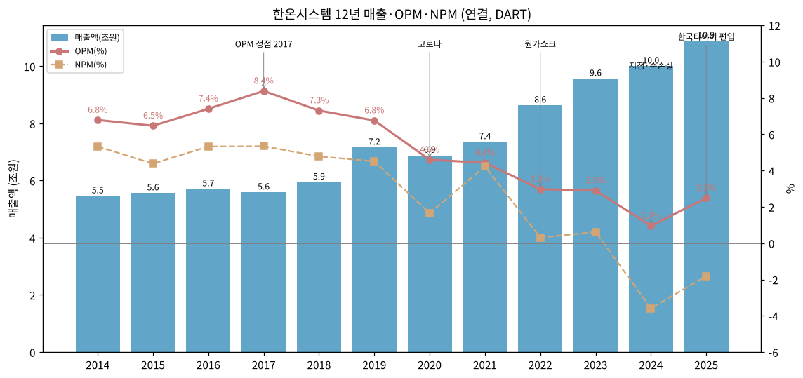

**최근 2분기 YoY (분류 재평가 입력값):**

| 분기 | 매출액(억원) | YoY | 영업이익(억원) | YoY | OPM |
|---|---|---|---|---|---|
| 2Q26 | 28,752 | +0.6% | 1,037 | +61.2% | 3.6% |
| 3Q26 | 26,569 | -1.8% | 1,206 | +26.6% | 4.5% |

→ 매출은 정체(완성차 물량 조정·환율), 이익은 원가율 개선으로 회복 — 전형적인 "외형 정체 + 마진 회복" 국면. 3Q26 순이익은 외화환산손실 등 영업외 환손실로 -1,422억 (영업 체력과 무관한 비현금성)

### ② 산업 분류

- DART 업종: 29172 (자동차 차체용 신품 부품 제조업 — 공조·열관리)
- 사업 정의: **자동차 열관리(Thermal Management) 시스템 단일 사업부문** — HVAC(공조), PTC(파워트레인 쿨링), COMP(압축기, 전동 컴프레서 포함), FT(냉매·냉각수 배관), E&FP(전동·유압 펌프, 2019 Magna FP&C 인수)
- 글로벌 위치: Automotive News 2024 매출 기준 세계 39위 부품사 ($7.3B), 자동차 공조 글로벌 2위 (회사 주장, 1위 Denso)
- 워치리스트: 자동차 섹터 / 부품 서브섹터 (현대모비스·HL만도·현대위아와 동일 칸). 섹터 내 유일한 **비(非)현대차그룹 계열 부품사** — 최대주주 한국타이어앤테크놀로지

### ③ 분류 결정 논리

(1) 가장 매출 큰 사업부 기준 적용 시: 단일 부문(열관리 100%) → 자동차 생산량·차종 믹스에 연동되는 **사이클**. 고객 상위 3사(현대차그룹 47% · 폭스바겐그룹 12% · 포드 11%, 3Q26 누적 IR)가 70% — 고객 생산 계획이 곧 매출

(2) 영업이익 sub-rule: 이익의 방향을 결정하는 것은 물량이 아니라 **원가 전가 시차**. 납품가는 차종 개발 시점에 결정돼 단종까지 고정(DART "판매전략") → 원자재·인건비·에너지 급등기(2021\~2022)에 마진이 먼저 깎이고, 리커버리(판가 재협상)는 1\~2년 후행. 따라서 OPM 사이클은 완성차 사이클보다 **원가 사이클**에 더 민감

(3) Boundary case 처리: 2017\~2024 OPM이 8.4% → 1.0%로 7년간 계단식 하락 — 사이클이 아니라 **구조 변화**(전동화 전환기 R&D·CapEx 선투자, 2019 인수 레버리지, 유럽 저수익) 성격이 섞임. 2025년부터는 지배주주 변경(PE → 전략적 투자자)과 2회 증자로 "턴어라운드"가 겹친 Boundary → **Primary 사이클 + Secondary 턴어라운드** 표기. xEV 매출 비중(3Q26 33%)이 늘어도 전기차 역시 같은 OEM 사이클을 타므로 분류는 유지

(4) 피어 대비: 현대모비스(모듈·A/S 고마진 혼합 → 지속성장 성격), HL만도(제동·조향·ADAS — 사이클, OPM 3\~5%)와 같은 OEM 부품 사이클군. 글로벌 열관리 피어 Denso(Thermal 부문)·Valeo(Thermal Systems)·MAHLE도 2022\~2024 열관리 부문 저마진(한 자릿수 초반) 공통 — 한온의 마진 하락은 회사 고유 + 업종 공통이 섞인 현상

### ④ 적정 밸류에이션 방법

- **PBR 1순위 (사이클 + 적자 이력)** — 2024\~2025 지배순손실, 3Q26 누적 순이익 101억으로 PER 무의미. 현재 PBR **0.90x** (시총 3.19조 ÷ 3Q26 지배자본 3.55조)
  → 밴드: 정점 2017 말 \~3.5x (OPM 8.4%) / 2021-02 \~4x (전기차 열관리 기대, 2020 말 지배자본 기준 4.4x) / 저점 2024 말 \~1.0x, 2025-11 \~0.7x (증자 전 지배자본 기준)
- **EV/EBITDA 공동 1순위 (고정비·감가상각 큰 구조)** — D&A가 연 7,400억 수준(FY25, 매출의 6.8%)이라 영업이익보다 EBITDA가 체력을 더 잘 반영. 3Q26 TTM EBITDA 1.16조(IR) / EV \~6.0조(시총 3.19조 + IR 순차입금 2.64조 + 비지배 0.14조) → **\~5.2x**
- PER 보조 — 회사 가이던스 2026 OP 4,500억(OPM 4%+) 달성 및 금융비용 축소(증자로 차입금 8,830억 상환) 후 순이익 정상화 시 사용
- 피어 차별화: 현대모비스(순현금·PER)와 달리 한온은 **레버리지(IR 순차입금/EBITDA 2.28x, 3Q26)** 가 밸류를 좌우 → EV 기반 지표가 우선. 한국타이어-한앤코 풋옵션(주당 5,200원, 2027-01-11\~02-11 행사, 5,871.8만주)은 단기 수급 기준점으로 별도 인지

### ⑤ 분기 재평가 트리거 (분류 변경 조건)

- OPM **6%+ 4개 분기 연속** 시 → "턴어라운드" 노트 삭제, 2014\~2019형 순수 사이클로 복귀
- OPM 2% 이하로 재하락 2개 분기 연속 시 → "구조적 저수익(Value trap)" 재분류 검토
- 비자동차 열관리(ESS PCS·SST·AI DC CDU) 매출 비중 **5%+** 도달 시 → Secondary "꿈" 노트를 "고성장 옵션"으로 격상
- 최대주주 한국타이어와 합병·지분 추가 취득(풋옵션 행사 포함)으로 지배구조 변경 시 → 그룹 가치 기준 재검토

---

## 2. 회사 개요

### ① 기본 사항

| 항목 | 내용 |
|---|---|
| 회사명 | 한온시스템 주식회사 (Hanon Systems) |
| 설립 / 상장 | 1986-03-11 (만도기계·Ford 합작) / 1996-07-31 유가증권시장 |
| 본사 | 대전광역시 대덕구 신일서로 95 |
| 대표이사 | 이수일 (2025-01-03 선임, 전 한국타이어앤테크놀로지 대표이사 부회장) |
| 최대주주 | 한국타이어앤테크놀로지(주) 51.07% (2026-09-30) |
| 사업 | 자동차 열관리 시스템 단일 부문 (HVAC·PTC·COMP·FT·E&FP) |
| 글로벌 거점 | 국내 5개 공장(대전·평택·울산·아산·경주) + 해외 법인 47개 계열 |
| 발행주식 | 1,026,262,552주 (액면 100원, 2025-12 유증 후) |
| 시가총액 | **3.19조원** (2026-11-25 종가 3,105원) |
| 신용등급 | AA- (한신평·한기평·나이스, 2025) |
| 국내 임직원 | 2,223명 (2025-12, 평균근속 18.6년 — 해외 포함 전체 임직원은 DART 미기재) |

> **한 줄 정의:** 엔진 시대엔 "에어컨·라디에이터 회사", 전기차 시대엔 "배터리·모터·실내를 함께 데우고 식히는 히트펌프 회사". 현대차그룹이 매출의 절반인 공조 2위 업체가 PE(한앤코) 10년을 지나 한국타이어 계열로 편입된 상태

### ② 최근 12년 손익·자본 추이 (조원, 연결, DART)

| 연도 | 매출액 | 영업이익 | OPM | 순이익 | 자본총계 | 자본 YoY% | 비고 |
|---|---|---|---|---|---|---|---|
| 2014 | 5.45 | 0.37 | 6.8% | 0.29 | 1.67 | - | Visteon 체제 마지막 해 |
| 2015 | 5.56 | 0.36 | 6.5% | 0.24 | 1.80 | 7.8 | 한앤코·한국타이어 인수 |
| 2016 | 5.70 | 0.42 | 7.4% | 0.30 | 1.88 | 4.7 |  |
| 2017 | 5.59 | 0.47 | 8.4% | 0.30 | 2.03 | 7.8 | ← OPM 정점 8.4% |
| 2018 | 5.94 | 0.43 | 7.3% | 0.28 | 2.13 | 4.9 |  |
| 2019 | 7.15 | 0.48 | 6.8% | 0.32 | 2.34 | 9.7 | Magna FP&C 인수 (매출 +20.5%) |
| 2020 | 6.87 | 0.32 | 4.6% | 0.11 | 2.24 | -4.2 | ← 코로나 저점 |
| 2021 | 7.35 | 0.33 | 4.4% | 0.31 | 2.48 | 10.6 | 반도체 부족 |
| 2022 | 8.63 | 0.26 | 3.0% | 0.03 | 2.37 | -4.3 | ← 원가 쇼크 (GPM 9.8%) |
| 2023 | 9.56 | 0.28 | 2.9% | 0.06 | 2.51 | 5.8 |  |
| 2024 | 10.00 | 0.10 | 1.0% | -0.36 | 3.00 | 19.5 | ← 저점 (OPM 1.0%, 순손실), 3자배정 유증 |
| 2025 | 10.88 | 0.27 | 2.5% | -0.20 | 3.91 | 30.5 | 한국타이어 편입, 9,834억 유증 |

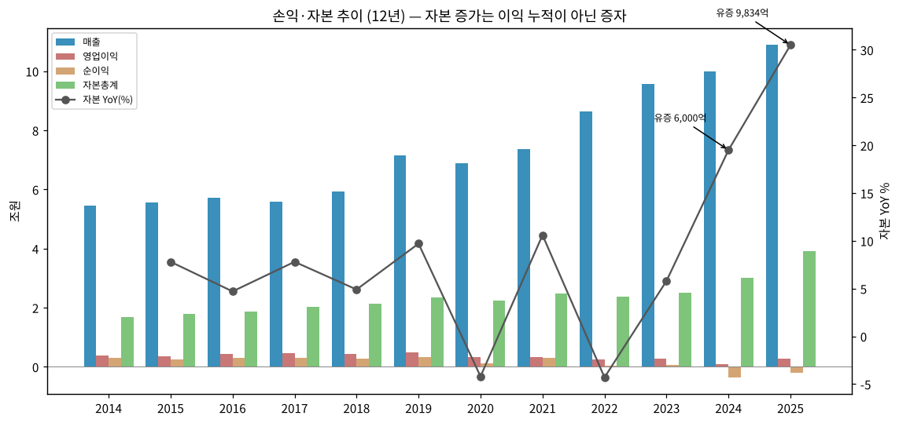

→ 매출은 11년간 2배(5.5조 → 10.9조)가 됐지만 영업이익은 3,703억 → 2,704억으로 오히려 감소. 자본은 2014 1.67조 → 2025 3.91조로 늘었으나 2024\~2025 증가분(+1.6조)의 대부분은 유상증자(2024-12 6,000억, 2025-12 9,834억) — 이익 누적이 아님

### ③ 회사 주가 역사 ★ narrative 영역

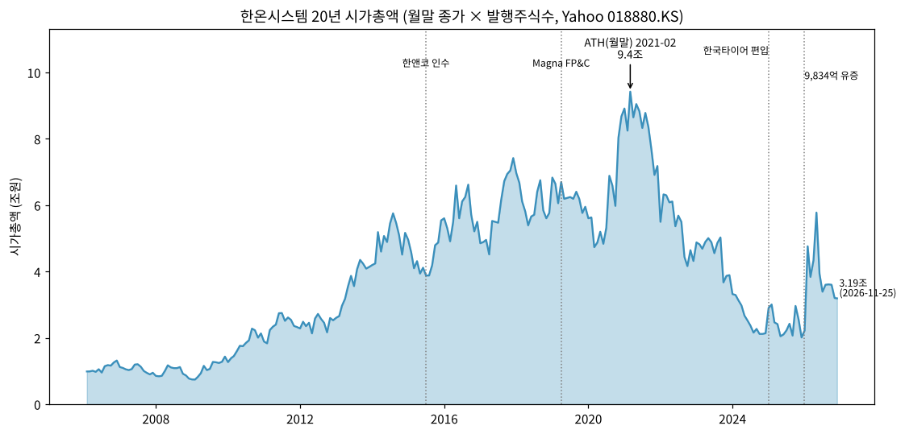

**(1) 2006\~2014 — 한라공조/한라비스테온공조: 현대차 성장의 수혜 (시총 \~1조 → \~5조)**
→ 현대·기아의 글로벌 증설과 함께 공조 국내 1위 지위 확보. 2013 Visteon 글로벌 공조 자회사 인수로 글로벌 2위권 진입
→ 2014-12 월말 종가 9,290원 (수정주가, 현 액면 기준) ≈ 시총 5.0조

**(2) 2015\~2017 — 한앤코·한국타이어 인수, 배당주 + 전기차 히트펌프 기대 (\~5조 → \~7조)**
→ 2015-06 한앤코(50.5%)와 한국타이어(19.49%)가 Visteon 보유 지분 70% 인수, 2015-07 "한온시스템"으로 사명 변경
→ 2017 OPM 8.4% 정점 + 배당 성향 60% 안팎 → 2017-12 월말 13,050원 ≈ 시총 7.0조

**(3) 2018\~2021 — Magna FP&C 인수와 전기차 열관리 프리미엄 (ATH)**
→ 2019-03 Magna Fluid Pressure & Controls 인수 (회사채·차입 조달 → 차입금 2018 1.5조 → 2021 3.7조)
→ 2020 하반기 전기차 랠리에서 "전기차 히트펌프 글로벌 선두" 프리미엄 → **2021-02 월말 종가 17,650원, 시총 \~9.4조 (월말 기준 ATH)** [Yahoo Finance 018880.KS]

**(4) 2021\~2025 — 마진 붕괴·PE 엑시트 지연·증자 (9.4조 → 2.0조, -79%)**
→ 2022 원가 쇼크(OPM 3.0%), 2024 OPM 1.0%·순손실 3,586억, 무배당 전환
→ 2024-10 한국타이어가 한앤코 지분 1.2277억주를 주당 9,904원(총 1.22조)에 매수 계약 + 2024-12 제3자배정 1.4496억주(주당 4,139원) 인수 → 2025-01-03 최대주주 변경
→ 2025-09 9,000억 주주배정 유증 결의 → 주가 하락, **2025-11 월말 2,965원 (5년 최저 구간)**

**(5) 2026 — 재무구조 개선 + 비자동차 열관리 테마 (변동성 큰 반등)**
→ 2025-12 유증 확정(주당 2,830원, 3.475억주, 9,834억) → 2026-01-12 신주 상장
→ 2026-02-19 장중 5,700원(52주 신고가, 외국인 순매수 584만주 — 머니투데이방송), 2026-04 월말 5,630원 (1Q26 OP +361% YoY)
→ 이후 되밀려 **2026-11-25 종가 3,105원, 시총 3.19조** (유증으로 주식수 1.51배 증가 — 주가 회복이 시총 회복보다 어려운 구조)

### ④ 회사의 주요 연혁

| 시점 | 이벤트 |
|---|---|
| 1986-03 | 만도기계-Ford 합작으로 한라공조 설립 (라디에이터·공조장치) |
| 1996-07 | 유가증권시장 상장 |
| 1999 | 외환위기 후 Ford 계열 Visteon이 지분 70% 확보 (만도 지분 매각) |
| 2013 | Visteon 글로벌 공조 자회사 인수 → 한라비스테온공조, 글로벌 공조 2위권 |
| 2015-06 | 한앤코(50.5%)·한국타이어(19.49%), Visteon 지분 70% 인수 |
| 2015-07 | 사명 한온시스템으로 변경 |
| 2019-03-29 | Magna Fluid Pressure & Controls(E&FP) 인수 — 전동 펌프·변속기 유압 |
| 2021 | 인도 Bangalore 법인 매각, 체코 Hanon Thermal Technology·멕시코 Powertrain Cooling 인수 |
| 2023-08 | 공동대표집행임원 체제(쿠추카야·라마찬드란) |
| 2024-10-31 | 한앤코↔한국타이어 지분 매매계약 (1.2277억주) |
| 2024-12-24 | 한국타이어 대상 제3자배정 유증 1.4496억주 @4,139원 (6,000억) |
| 2025-01-03 | 거래 종결, 최대주주 한국타이어앤테크놀로지(54.77%), 대표집행임원제 폐지 → 이수일 대표이사 |
| 2025-09-23 | 임시주총: 수권주식 15억주 확대, 9,000억 주주배정 유증 |
| 2025-12-31 | 유증 3.475억주 @2,830원 (9,834억) 납입 — 2026-01-12 상장, 한국타이어 지분 51.07% |
| 2026 | 신사업(ESS PCS·SST·AI DC 냉각) 1단계 진입, Aftermarket 매출 비중 10% 중장기 목표 (3Q26 IR) |

---

## 3. 비즈니스 모델

### ① 실적 추이 (전사 → 지역 → 고객·파워트레인 3단계 위계)

**(1) 5년 연간 통합 표 (억원, DART)**

| 구분 | 2021 | 2022 | 2023 | 2024 | 2025 |
|---|---|---|---|---|---|
| **전사 매출액** | 73,514 | 86,277 | 95,593 | 99,987 | 108,837 |
| YoY | +7.0% | +17.4% | +10.8% | +4.6% | +8.9% |
| **전사 영업이익** | 3,258 | 2,566 | 2,773 | 955 | 2,704 |
| OPM | 4.4% | 3.0% | 2.9% | 1.0% | 2.5% |
| ├ 아시아 매출 (내부거래 전) | 44,842 | 50,107 | 53,449 | 53,936 | 58,151 |
| │ └ 영업이익 / 이익률 | 1,219 / 2.7% | 567 / 1.1% | 1,798 / 3.4% | 440 / 0.8% | 2,072 / 3.6% |
| ├ 미주 매출 | 16,446 | 22,306 | 25,025 | 29,094 | 31,668 |
| │ └ 영업이익 / 이익률 | 29 / 0.2% | 493 / 2.2% | 516 / 2.1% | 487 / 1.7% | 643 / 2.0% |
| ├ 유럽 매출 | 36,803 | 44,804 | 50,652 | 51,081 | 57,333 |
| │ └ 영업이익 / 이익률 | 1,818 / 4.9% | 1,749 / 3.9% | 966 / 1.9% | 524 / 1.0% | 216 / 0.4% |
| └ 내부거래·연결조정 매출 | -24,577 | -30,940 | -33,909 | -34,124 | -38,315 |
| **고객별 비중 (IR)** | | | | | |
| 현대차그룹 | - | - | - | - | 48% |
| 포드 / 폭스바겐그룹 / GM | - | - | - | - | 13% / 12% / 7% |
| **xEV 매출 비중 (IR)** | - | - | - | - | 28% |
| **DART 10% 이상 고객** | | | | | |
| 현대자동차 / 현대모비스 / Ford | - | - | 23.5% / 15.0% / 12.7% | 21.1% / 19.5% / 12.6% | 21.4% / 19.3% / 12.5% |

> ※ 지역 매출은 소재지 기준 내부거래 제거 전 금액 (2023은 2025 사업보고서 재작성치 — 연결 합계 95,216억으로 2023 원보고 95,593억과 차이). 2021\~2022는 2022 사업보고서 기준. 고객별·xEV 비중은 IR(2025 연간). 현대모비스 매출은 모비스 모듈에 들어가는 HVAC·쿨링 모듈 납품분 → 실질 현대차그룹 의존도는 DART 2개사 합 40.7% + 기아 등 = IR 48%

**(2) 지역별 12년 매출·이익률**

| 연도 | 아시아 매출 | 아시아 OPM | 미주 매출 | 미주 OPM | 유럽 매출 | 유럽 OPM |
|---|---|---|---|---|---|---|
| 2014 | 40,700 | 5.3% | 8,507 | 4.5% | 22,796 | 0.8% |
| 2015 | 40,136 | 5.2% | 9,738 | 3.5% | 23,717 | 0.2% |
| 2016 | 41,260 | 6.3% | 10,511 | 6.0% | 24,969 | 1.5% |
| 2017 | 39,220 | 8.6% | 10,815 | 3.9% | 26,055 | 3.1% |
| 2018 | 40,281 | 4.8% | 11,498 | 2.9% | 28,272 | 7.0% |
| 2019 | 42,805 | 5.1% | 16,894 | 3.1% | 34,531 | 6.1% |
| 2020 | 41,733 | 2.4% | 15,294 | 4.8% | 33,219 | 4.7% |
| 2021 | 44,842 | 2.7% | 16,446 | 0.2% | 36,803 | 4.9% |
| 2022 | 50,107 | 1.1% | 22,306 | 2.2% | 44,804 | 3.9% |
| 2023 | 53,449 | 3.4% | 25,025 | 2.1% | 50,652 | 1.9% |
| 2024 | 53,936 | 0.8% | 29,094 | 1.7% | 51,081 | 1.0% |
| 2025 | 58,151 | 3.6% | 31,668 | 2.0% | 57,333 | 0.4% |

> 억원, 내부거래 제거 전 소재지 기준 (DART 사업보고서 2016·2019·2022·2025 각 3개년). 2023은 2025 사업보고서 재작성치

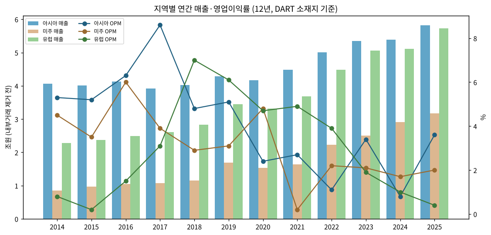

→ 2014\~2017 연결 영업이익의 58\~72%를 아시아(한국·중국)가 벌었고 유럽은 0\~3% 저마진. 2018\~2019 유럽 이익률 6\~7%로 개선(프리미엄 OEM 전동화 수주), 2020\~2021 5%대 → 2023 이후 2% 이하, 2025 0.4%로 재악화(에너지·인건비, 전기차 물량 미달). 미주는 12년 내내 0\~6% — **"아시아가 벌고 미·유럽이 까먹는 구조"** 가 OPM 하락의 지역적 원인

**(3) 전사 분기 시계열 — 43분기 (1Q16\~3Q26, 연결, OpenDART)**

> 단일 사업부문이라 사업부별 분기 시계열은 존재하지 않음 → 전사 분기 시계열로 대체 (DART 지역 정보는 연간만 공시)

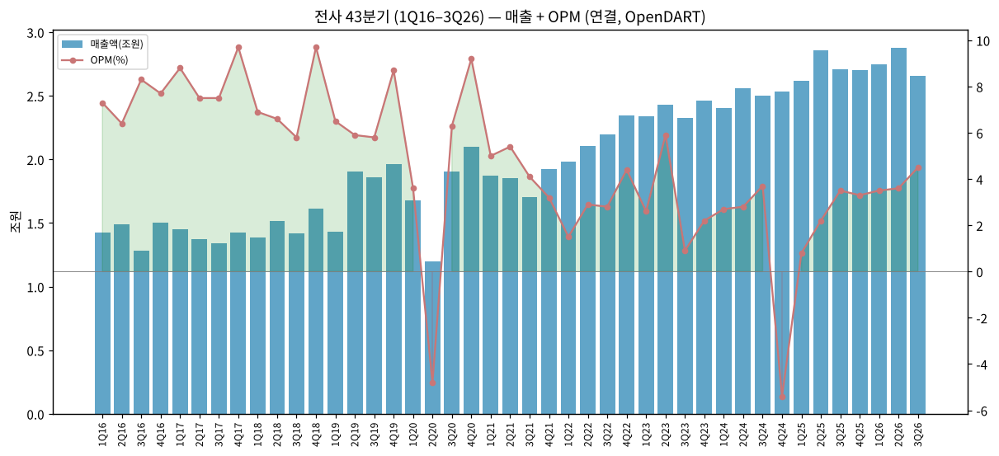

| 분기 | 매출액 | 영업이익 | OPM | 매출 YoY | 영업이익 YoY | 순이익 | 비고 |
|---|---|---|---|---|---|---|---|
| 1Q16 | 14,281 | 1,048 | 7.3% |  |  | 723 |  |
| 2Q16 | 14,908 | 950 | 6.4% |  |  | 639 |  |
| 3Q16 | 12,831 | 1,067 | 8.3% |  |  | 736 |  |
| 4Q16 | 15,017 | 1,160 | 7.7% |  |  | 939 |  |
| 1Q17 | 14,490 | 1,272 | 8.8% | +1.5% | +21.3% | 742 |  |
| 2Q17 | 13,733 | 1,027 | 7.5% | -7.9% | +8.1% | 693 |  |
| 3Q17 | 13,389 | 1,007 | 7.5% | +4.4% | -5.6% | 762 |  |
| 4Q17 | 14,245 | 1,379 | 9.7% | -5.1% | +18.8% | 787 |  |
| 1Q18 | 13,869 | 952 | 6.9% | -4.3% | -25.1% | 656 |  |
| 2Q18 | 15,184 | 1,008 | 6.6% | +10.6% | -1.8% | 728 |  |
| 3Q18 | 14,198 | 820 | 5.8% | +6.0% | -18.6% | 554 |  |
| 4Q18 | 16,125 | 1,558 | 9.7% | +13.2% | +13.0% | 899 |  |
| 1Q19 | 14,291 | 935 | 6.5% | +3.0% | -1.8% | 565 |  |
| 2Q19 | 19,041 | 1,123 | 5.9% | +25.4% | +11.4% | 711 |  |
| 3Q19 | 18,599 | 1,070 | 5.8% | +31.0% | +30.5% | 757 |  |
| 4Q19 | 19,611 | 1,711 | 8.7% | +21.6% | +9.9% | 1,193 |  |
| 1Q20 | 16,748 | 597 | 3.6% | +17.2% | -36.1% | 332 |  |
| 2Q20 | 11,954 | -578 | -4.8% | -37.2% | 적전 | -604 | 코로나 셧다운 |
| 3Q20 | 19,014 | 1,196 | 6.3% | +2.2% | +11.8% | 509 |  |
| 4Q20 | 21,012 | 1,943 | 9.2% | +7.1% | +13.6% | 897 |  |
| 1Q21 | 18,690 | 940 | 5.0% | +11.6% | +57.5% | 601 |  |
| 2Q21 | 18,521 | 1,004 | 5.4% | +54.9% | 흑전 | 997 |  |
| 3Q21 | 17,042 | 706 | 4.1% | -10.4% | -41.0% | 526 |  |
| 4Q21 | 19,261 | 607 | 3.2% | -8.3% | -68.7% | 984 |  |
| 1Q22 | 19,802 | 305 | 1.5% | +5.9% | -67.6% | 223 |  |
| 2Q22 | 21,067 | 601 | 2.9% | +13.8% | -40.2% | 146 |  |
| 3Q22 | 21,956 | 618 | 2.8% | +28.8% | -12.5% | 191 |  |
| 4Q22 | 23,453 | 1,043 | 4.4% | +21.8% | +71.7% | -292 | 순손실(일회성) |
| 1Q23 | 23,404 | 602 | 2.6% | +18.2% | +97.7% | 452 |  |
| 2Q23 | 24,291 | 1,435 | 5.9% | +15.3% | +138.8% | 1,106 |  |
| 3Q23 | 23,274 | 203 | 0.9% | +6.0% | -67.2% | -424 | OPM 0.9% |
| 4Q23 | 24,625 | 533 | 2.2% | +5.0% | -48.9% | -546 |  |
| 1Q24 | 24,046 | 653 | 2.7% | +2.7% | +8.5% | 101 |  |
| 2Q24 | 25,599 | 716 | 2.8% | +5.4% | -50.1% | -312 |  |
| 3Q24 | 24,998 | 937 | 3.7% | +7.4% | +361.9% | -194 |  |
| 4Q24 | 25,356 | -1,376 | -5.4% | +3.0% | 적전 | -3,181 | 일회성 비용·순손실 3,181억 |
| 1Q25 | 26,173 | 211 | 0.8% | +8.8% | -67.7% | -226 | 한국타이어 편입 첫 분기 |
| 2Q25 | 28,582 | 643 | 2.2% | +11.7% | -10.2% | -151 |  |
| 3Q25 | 27,057 | 953 | 3.5% | +8.2% | +1.7% | 553 |  |
| 4Q25 | 27,025 | 897 | 3.3% | +6.6% | 흑전 | -2,149 | 순손실(영업외) |
| 1Q26 | 27,482 | 972 | 3.5% | +5.0% | +361.1% | 675 |  |
| 2Q26 | 28,752 | 1,037 | 3.6% | +0.6% | +61.2% | 873 |  |
| 3Q26 | 26,569 | 1,206 | 4.5% | -1.8% | +26.6% | -1,422 | OPM 4.5%, 외화환산손실로 순손실 |

> 억원

> 1Q\~3Q = 해당 분기 3개월, 4Q = 연간 − 3Q 누적 (dart_quarterly_summary). IR 수치와 일부 분기 ±1\~15억 차이(예: 4Q25 영업이익 IR 912억 vs DART 897억 — 연간 IR 2,718억 vs DART 2,704억)

**(4) 3Q26 핵심 박스**

> - **매출 2.66조 (-1.8% YoY, -7.6% QoQ)** — 국내 주요 고객사 생산 차질·물량 조정 + 환율. 유럽 비중 34%(3Q26 누적, +3%p YoY)
> - **영업이익 1,206억 (+26.6% YoY), OPM 4.5%** — 원가율 88.5%(-0.9%p YoY, -0.6%p QoQ), 판관비율 7.0%. 3Q26 누적 OP 3,215억(+77.9%), OPM 3.9% → 연간 가이던스 4,500억(4%+) 달성에는 4Q 1,285억 필요
> - **xEV 비중 33%** (2Q26 31%, 3Q25 28%) — 유럽 고객사향 전동화 물량 증가
> - **순이익 -1,422억** — 영업외 외화환산손실(787억)·순외환차손(327억) 등 기타손실 1,279억 + 금융수익 마이너스(-436억). 비현금성 환 손실
> - **재무**: IR 순차입금 2.645조(1H25 3.88조 → -32%), 순차입금/EBITDA 2.28x, 부채비율 165%
> - **수주**: 2026 신규수주 목표 $1.3B, 3Q 누적 $703M(Re-win 453 + New-win 250) — 4Q 대형 프로그램 기대

**(5) 12분기 시계열 (rolling, 4Q23\~3Q26)**

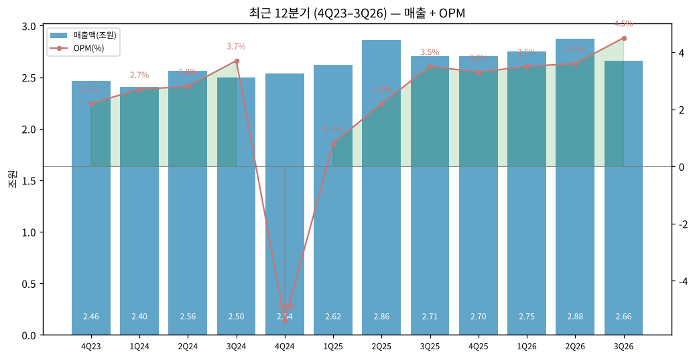

### ② 사업부별 개요 (제품군 — 매출 비중은 미공시, 평균 판가·CAPA로 크기 가늠)

| 제품군 | 내용 | 평균 판가 (2025, 원/대) | 2025 생산 (천개, 3개 지역 합) |
|---|---|---|---|
| HVAC (에이치백) | 실내 공조 모듈 — 블로워·증발기·히터코어 일체 | 237,388 | 12,999 |
| COMP (압축기) | 기계식·**전동 컴프레서**(전기차 핵심) | 122,267 | 11,204 |
| PTC (파워트레인 쿨링) | 라디에이터·쿨링팬·**배터리 칠러** | 122,050 | 11,889 |
| FT (플루이드 트랜스포트) | 냉매·냉각수 호스·파이프 | 65,794 | 29,497 |
| E&FP (유압제어) | 전동 워터펌프·오일펌프 (Magna FP&C) | 22,564 | 25,304 |

> 판가 = 대표 차종 단순평균 (친환경차 제외, DART). 생산 = 2025 실제생산수량

### ③ 사업부별 디테일

- **Top-seller — HVAC·COMP**: 대당 단가가 가장 높은 두 제품. 전동 컴프레서는 전기차 히트펌프의 심장으로 한온의 기술 차별점 (R744·R290 자연냉매 히트펌프 개발, PFAS 규제 대응)
- **Growth — xEV 열관리**: xEV 매출 비중 3Q24 26% → 3Q26 33%. 신규수주 중 xEV 비중 2022 88% → 2025 65% (완성차 전동화 속도 조절로 ICE/HEV 프로그램 수명 연장 수주 증가)
- **이익 outlier — 유럽**: 매출 5.7조(내부거래 전, 아시아와 비슷)인데 영업이익 216억(0.4%) — 2025 OP 개선(+1,749억)의 대부분이 아시아(+1,632억)에서 나옴 (유럽은 -308억)
- **신사업 (3Q26 IR)**: ESS PCS용 냉각(라디에이터·eCF·eWP, 개발 중), SST(반도체 변압기) 냉각 모듈 샘플 공급 완료, AI DC CDU용 열교환기·고신뢰성 eWP 검토(2027 고객 홍보용 시제품), R290 가정용 히트펌프·오프로드(일본 트랙터 OEM에 라디에이터 14만개, 2025) 검토 — 2026 진입, 2027\~2029 확대, 2030+ 핵심 성장축 목표
- **Aftermarket**: 매출 비중 중장기 10% 목표 (피어 10\~13%), 한국타이어 AM 유통망 시너지 — 유럽 Intercars 초도 오더, 국내 T-station 공급 개시

### ④ 주요 경쟁사

| 영역 | 경쟁사 |
|---|---|
| 글로벌 공조·열관리 | Denso(일, 1위), Valeo(프), MAHLE(독, 구 Behr), Sanden(일, 압축기), Hanon(2위권) |
| 중국 열관리 | Sanhua(삼화지능), Yinlun(은륜), Aotecar(오텍카) — 밸브·칠러·전동 컴프레서 원가 경쟁 |
| 국내 공조 | 두원공조 (국내 점유율 35%, 2025), 에스트라오토모티브(구 한국델파이, 8%) — 한온 50% (IHS + 회사 추정) |
| 피어 cross-ref | 현대모비스(고객 겸 부품 피어, AN 6위), HL만도(40위, $6.5B), 현대위아(45위, $5.9B) — 한온 39위 ($7.3B) |

> 국내 공조 점유율: 한온 46%(2023) → 48%(2024) → 50%(2025) [DART 사업보고서, IHS + 한온시스템]

### ⑤ 주요 매출처

- **DART 10% 이상 고객 (2025)**: 현대자동차 2.33조(21.4%), 현대모비스 2.10조(19.3%), Ford 1.36조(12.5%) — 3사 합 53.2%
- **IR 고객별 (3Q26 누적)**: 현대차그룹 47% · 폭스바겐그룹 12% · 포드 11% · GM 6% · BMW 5% · 메르세데스-벤츠 5% · 스텔란티스 3% · 기타 11%
- 변화: 현대차그룹 49% → 47%, 포드 13% → 11% (YoY) / 메르세데스 +3%p, BMW·VW +1%p — **유럽 프리미엄 비중 확대**
- 리스크: Ford 차세대 EV 프로젝트 중단 → 일부 현금 보상·대체 수주 협상 중 (이데일리 2026-06-10, 상상인증권 리포트 인용)

### ⑥ 생산 CAPA + 임직원

| 지역 | HVAC 가동률 | PTC | COMP | FT | E&FP |
|---|---|---|---|---|---|
| 아시아 | 77% | 77% | 78% | 66% | 56% |
| 미주 | 82% | 83% | - | 71% | 60% |
| 유럽 | 82% | 75% | 63% | 60% | 62% |

> 2025-12-31 기준, Bottle Neck 공정 × 240일 × 10시간 × 2교대 (DART). E&FP 가동률 56\~62% — 인수 자산의 유휴 CAPA

- 국내 임직원: 2016 2,158명 → 2024 2,219명 → 2025 2,223명 (남 2,092 / 여 131, 1인 평균급여 1.06억 — 남 기준) — 국내 인원은 10년간 정체, 성장은 해외 법인
- R&D 인력: 국내외 약 1,500명 (DART)

---

## 4. 재무 구조 (12년 시계열)

> 출처: OpenDART 연결 재무제표 (2014 = 2015 사업보고서 전기 비교치, 2017·2018 일부 계정 = 다음 해 사업보고서 전기치, 2017 차입금 = 2017 사업보고서 유동성위험 주석). 단위 억원

### ① 손익계산서 (12년 연결)

| 연도 | 매출액 | YoY% | 매출총이익 | GPM% | 판관비 | 영업이익 | OPM% | 세전이익 | 순이익 | NPM% | 지배순이익 | 비고 |
|---|---|---|---|---|---|---|---|---|---|---|---|---|
| 2014 | 54,549 | - | 9,088 | 16.7 | 5,385 | 3,703 | 6.8 | 3,709 | 2,904 | 5.3 | 2,754 | Visteon 체제 마지막 해 |
| 2015 | 55,581 | 1.9 | 8,611 | 15.5 | 5,015 | 3,596 | 6.5 | 3,457 | 2,434 | 4.4 | 2,305 | 한앤코·한국타이어 인수 |
| 2016 | 57,037 | 2.6 | 8,989 | 15.8 | 4,763 | 4,225 | 7.4 | 4,157 | 3,038 | 5.3 | 2,921 |  |
| 2017 | 55,857 | -2.1 | 9,462 | 16.9 | 4,778 | 4,684 | 8.4 | 4,215 | 2,984 | 5.3 | 2,886 | ← OPM 정점 8.4% |
| 2018 | 59,376 | 6.3 | 9,127 | 15.4 | 4,789 | 4,338 | 7.3 | 3,796 | 2,837 | 4.8 | 2,776 |  |
| 2019 | 71,542 | 20.5 | 10,343 | 14.5 | 5,505 | 4,838 | 6.8 | 4,073 | 3,226 | 4.5 | 3,185 | Magna FP&C 인수 (매출 +20.5%) |
| 2020 | 68,728 | -3.9 | 8,644 | 12.6 | 5,486 | 3,158 | 4.6 | 1,398 | 1,135 | 1.7 | 1,104 | ← 코로나 저점 |
| 2021 | 73,514 | 7.0 | 8,490 | 11.5 | 5,232 | 3,258 | 4.4 | 3,546 | 3,107 | 4.2 | 3,085 | 반도체 부족 |
| 2022 | 86,277 | 17.4 | 8,471 | 9.8 | 5,905 | 2,566 | 3.0 | 972 | 267 | 0.3 | 204 | ← 원가 쇼크 (GPM 9.8%) |
| 2023 | 95,593 | 10.8 | 9,082 | 9.5 | 6,309 | 2,773 | 2.9 | 1,446 | 589 | 0.6 | 510 |  |
| 2024 | 99,987 | 4.6 | 8,122 | 8.1 | 7,166 | 955 | 1.0 | -3,297 | -3,586 | -3.6 | -3,633 | ← 저점 (OPM 1.0%, 순손실), 3자배정 유증 |
| 2025 | 108,837 | 8.9 | 10,099 | 9.3 | 7,395 | 2,704 | 2.5 | -1,349 | -1,973 | -1.8 | -1,985 | 한국타이어 편입, 9,834억 유증 |

> 3Q26 누적: 매출 82,804 / 매출총이익 9,058 (GPM 10.9%) / 판관비 5,844 / 영업이익 3,215 (OPM 3.9%) / 세전 377 / 순이익 125 / 지배순이익 101

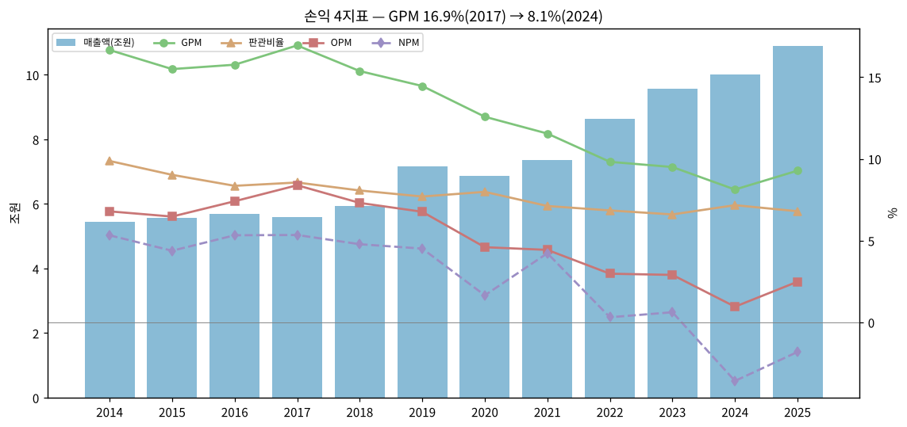

→ 핵심은 **GPM 하락**: 2017 16.9% → 2024 8.1% (-8.8%p). 판관비율은 9\~10%(2014\~2015) → 7%대로 오히려 하락 — 문제는 공장 원가(원자재·에너지·인건비·감가상각)였고, 판가 전가가 구조적으로 늦음. 2024 판관비 급증(7,166억)은 R&D 자산화 기준 강화로 비용 인식 확대(IR: 2025 영향 -1,626억, 자산화 영향 제외 시 2025 OPM 4.0%)

### ② 재무상태표 (12년 연결)

| 연도 | 자산총계 | 현금 | 매출채권 | 재고 | 유형자산 | 무형자산 | 부채총계 | 차입금(사채포함) | 리스부채 | 자본총계 | 지배자본 |
|---|---|---|---|---|---|---|---|---|---|---|---|
| 2014 | 32,400 | 3,813 | 9,279 | 3,718 | 10,528 | 1,718 | 15,700 | 4,014 | - | 16,700 | 16,185 |
| 2015 | 34,594 | 4,471 | 9,991 | 3,822 | 10,927 | 2,074 | 16,599 | 4,011 | - | 17,994 | 17,447 |
| 2016 | 38,597 | 4,252 | 9,309 | 4,297 | 11,781 | 3,503 | 19,748 | 6,462 | - | 18,849 | 18,276 |
| 2017 | 41,196 | 5,673 | - | 4,686 | 12,620 | 2,292 | 20,881 | 7,569 | - | 20,314 | 19,787 |
| 2018 | 53,558 | 10,178 | 9,689 | 5,058 | 15,515 | 3,511 | 32,241 | 15,228 | - | 21,317 | 20,367 |
| 2019 | 70,824 | 6,867 | 11,733 | 6,128 | 21,304 | 15,928 | 47,449 | 20,111 | - | 23,375 | 22,168 |
| 2020 | 78,074 | 13,254 | 10,973 | 6,304 | 22,236 | 16,219 | 55,680 | 25,490 | - | 22,394 | 21,174 |
| 2021 | 82,337 | 14,038 | 8,827 | 8,101 | 23,363 | 17,902 | 57,571 | 37,228 | - | 24,767 | 23,432 |
| 2022 | 90,988 | 14,291 | 11,361 | 9,719 | 23,714 | 19,231 | 67,289 | 42,801 | - | 23,699 | 22,360 |
| 2023 | 92,444 | 7,786 | 11,960 | 11,404 | 27,165 | 21,260 | 67,359 | 41,465 | - | 25,085 | 23,717 |
| 2024 | 106,203 | 13,465 | 12,590 | 12,412 | 28,637 | 23,514 | 76,215 | 45,675 | 4,792 | 29,987 | 28,535 |
| 2025 | 104,922 | 9,248 | 14,370 | 14,047 | 27,244 | 21,846 | 65,793 | 32,376 | 6,221 | 39,130 | 37,678 |

> 3Q26: 자산 97,711 / 현금 8,730 / 부채 60,807 / 차입금(사채 포함) 29,778 + 리스 5,401 / 자본 36,904 (지배 35,532)

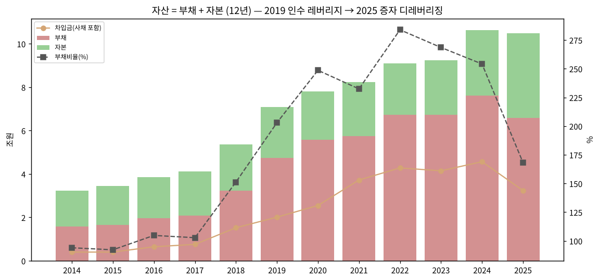

### ③ 현금흐름표 (12년 연결)

| 연도 | OCF | ICF | CFF | 유형 CapEx | 무형 CapEx | 총 CapEx | CapEx/매출% | FCF(OCF-CapEx) |
|---|---|---|---|---|---|---|---|---|
| 2014 | 3,468 | -2,820 | -440 | 2,694 | 47 | 2,740 | 5.0 | 728 |
| 2015 | 4,475 | -2,559 | -1,118 | 2,269 | 409 | 2,679 | 4.8 | 1,796 |
| 2016 | 3,892 | -4,519 | 483 | 2,497 | 857 | 3,354 | 5.9 | 537 |
| 2017 | 5,667 | -3,465 | -562 | 3,221 | 1,051 | 4,272 | 7.6 | 1,394 |
| 2018 | 4,713 | -5,767 | 5,637 | 4,197 | 1,454 | 5,651 | 9.5 | -938 |
| 2019 | 7,784 | -19,353 | 8,294 | 4,414 | 2,095 | 6,508 | 9.1 | 1,276 |
| 2020 | 7,956 | -5,945 | 4,846 | 4,020 | 2,002 | 6,022 | 8.8 | 1,933 |
| 2021 | 6,363 | -5,573 | -242 | 3,877 | 2,163 | 6,040 | 8.2 | 323 |
| 2022 | 3,783 | -6,433 | 2,620 | 3,851 | 2,566 | 6,417 | 7.4 | -2,633 |
| 2023 | 5,174 | -6,773 | -4,803 | 4,812 | 3,183 | 7,995 | 8.4 | -2,822 |
| 2024 | 5,693 | -7,327 | 6,506 | 3,856 | 3,477 | 7,333 | 7.3 | -1,640 |
| 2025 | 1,123 | -5,470 | 9 | 2,931 | 1,871 | 4,802 | 4.4 | -3,678 |

> 3Q26 누적: OCF 6,254 / ICF -2,996 / CFF -2,977 / 유형 CapEx 1,594 + 무형 774 → FCF 약 +3,886억 (2021 이후 처음 플러스 전환 — 회사 "2026년 FCF 창출 국면 진입" 가이던스와 부합)

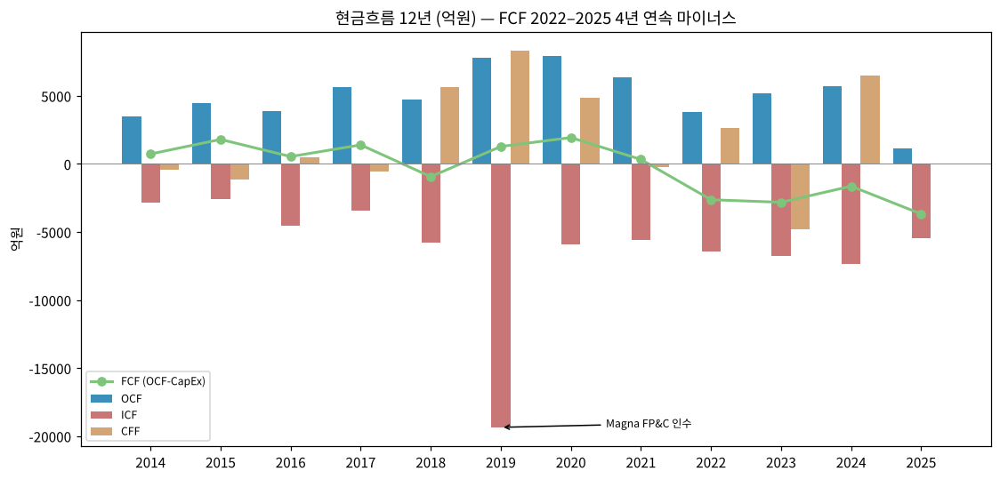

### ④ CapEx 추이 (12년)

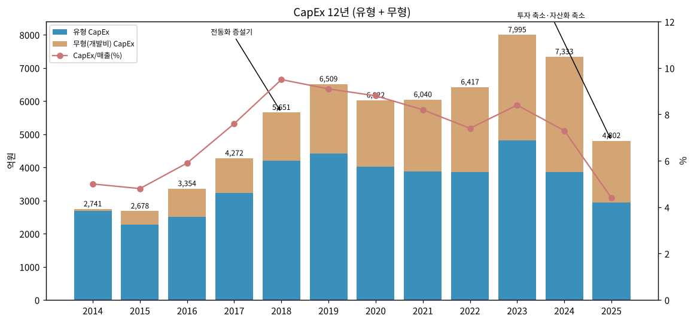

- 2017\~2024 총 CapEx 매출비 7\~10% — 전동화 수주(전동 컴프레서·히트펌프 라인) 대응 증설 + 개발비 자산화(무형 1,000억 → 3,477억)
- 2025 4,802억(4.4%)으로 급감: 투자 계획 3,150억 대비 실적 2,099억(설비, DART) + R&D 자산화 범위 축소. IR 순설비투자(유형) 2024 3,720억 → 2025 2,440억 → 2026E 3,000억 (3Q 누적 1,450억)
- D&A: 2022 5,580억 → 2025 7,420억 → 2026E 7,500억 (정점 예상, IR) — 과거 CapEx가 감가상각으로 이익을 누르는 시차 구조

### ⑤ 부채구조 + 채무증권 발행 history

| 항목 | 2018 | 2019 | 2021 | 2023 | 2024 | 2025 | 3Q26 |
|---|---|---|---|---|---|---|---|
| 차입금(사채 포함, 억원) | 15,228 | 20,111 | 37,228 | 41,465 | 45,675 | 32,376 | 29,778 |
| 리스부채 | - | - | - | - | 4,792 | 6,221 | 5,401 |
| 순차입금 (DART, 리스 제외) | 5,050 | 13,244 | 23,190 | 33,679 | 32,210 | 23,128 | 21,048 |
| IR 순차입금 (회사 발표) | - | - | - | 33,680 | 32,210 | 29,350 | 26,449 |
| IR 순차입금/EBITDA | - | - | - | 3.84x | 4.31x | 2.90x | 2.28x |
| 금융비용 | 402 | 826 | 1,196 | 2,184 | 4,696 | 3,379 | 2,559 (누적) |

- 2018-11 공모 회사채 (2.999% 7년 800억 상환 / 3.422% 10년 500억 미상환, 당시 등급 AA) → 2019 Magna 인수 자금 → 2023-04 회사채 14-1·14-2 (3,000억 시설자금)
- 신용등급: 2018 공모채 발행 당시 AA → 2025 현재 **AA-** (한신평·한기평·나이스)
- 변동금리 차입금 9,855억 (2025-12, 전년 7,997억)
- 2025-12 유증 9,834억 중 8,830억을 차입금 상환에 사용 (이데일리 2026-06-10)

### ⑥ 배당·자사주 추이 (12년)

| 연도 | DPS(원) | 배당금 지급(CF) | 지급액/지배순이익% | FCF | 비고 |
|---|---|---|---|---|---|
| 2014 | 194 | 1,036 | 38 | 728 |  |
| 2015 | 194 | 1,036 | 45 | 1,796 |  |
| 2016 | 225 | 1,836 | 63 | 537 |  |
| 2017 | 305 | 1,715 | 59 | 1,394 |  |
| 2018 | 320 | 1,725 | 62 | -938 |  |
| 2019 | 320 | 1,708 | 54 | 1,276 |  |
| 2020 | 320 | 1,516 | 137 | 1,933 |  |
| 2021 | 360 | 2,060 | 67 | 323 |  |
| 2022 | 360 | 1,921 | 940 | -2,633 | DART 현금배당성향 940% |
| 2023 | 316 | 1,804 | 354 | -2,822 | DART 배당성향 331% |
| 2024 | 0 | 363 | - | -1,640 | 무배당 |
| 2025 | 0 | 0 | - | -3,678 | 무배당 |

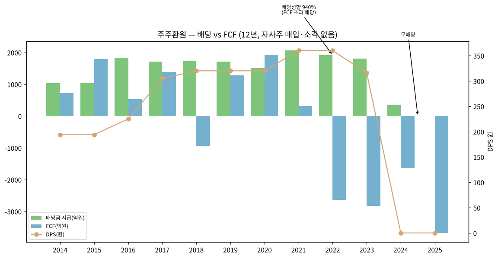

- 한앤코 시절(2015\~2023) **고배당 정책**: DPS 194 → 360원, FCF를 넘는 배당(2022 배당성향 940%) — PE 배당 회수 구조가 재무를 약화시킨 한 요인
- 2023 DPS 316원 후 **2024\~2025 무배당**. 자사주 매입·소각 이력 없음 (2025 신탁 보유분 12만주 처분, 잔여 11,210주)

### ⑦ 재무 비율 (12년)

| 연도 | ROE% | ROA% | 부채비율% | 유동비율% | 순차입금(리스 제외) | 순차입/자본% | 이자보상(배) |
|---|---|---|---|---|---|---|---|
| 2014 | - | - | 94 | 165 | 200 | 1 | 28.0 |
| 2015 | 13.7 | 7.3 | 92 | 139 | -460 | -3 | 26.7 |
| 2016 | 16.4 | 8.3 | 105 | 147 | 2,211 | 12 | 21.5 |
| 2017 | 15.2 | 7.5 | 103 | 172 | 1,896 | 9 | 28.9 |
| 2018 | 13.8 | 6.0 | 151 | 153 | 5,050 | 24 | 32.8 |
| 2019 | 15.0 | 5.2 | 203 | 140 | 13,244 | 57 | 8.7 |
| 2020 | 5.1 | 1.5 | 249 | 127 | 12,237 | 55 | 3.8 |
| 2021 | 13.8 | 3.9 | 232 | 126 | 23,190 | 94 | 3.6 |
| 2022 | 0.9 | 0.3 | 284 | 104 | 28,510 | 120 | 2.6 |
| 2023 | 2.2 | 0.6 | 269 | 103 | 33,679 | 134 | 1.5 |
| 2024 | -13.9 | -3.6 | 254 | 88 | 32,210 | 107 | 0.4 |
| 2025 | -6.0 | -1.9 | 168 | 111 | 23,128 | 59 | 1.1 |

> 이자보상 = 영업이익 / 이자지급(현금흐름표). IR 기준 EBITDA/순이자비용: 2024 3.23x → 2025 5.00x → 3Q26 TTM 7.47x

---

## 5. 지배 구조

### ① 그룹·계열 관계

- **한국앤컴퍼니그룹 편입 (2025-01-03)**: 지주사 한국앤컴퍼니 → 한국타이어앤테크놀로지(51.07%) → 한온시스템. 대표이사·사내이사·기타비상무이사 3인 모두 한국타이어 출신
- 해외 47개 계열사 (중국 대련·북경·상해, 미국 앨라배마, 캐나다, 멕시코, 포르투갈, 튀르키예, 슬로바키아, 헝가리, 체코, 태국, 인도 등)
- 2025 Hanon Systems Hubei 청산, 2024 Hanon Russia 청산

### ② 주주 구분

| 주주 | 주식수 | 지분율 | 비고 |
|---|---|---|---|
| 한국타이어앤테크놀로지 | 524,061,482 | 51.07% | 최대주주 (2026-09-30) |
| 한앤코오토홀딩스 | 146,795,000 | 14.30% | 2025-12 유증 미참여 (보유주식 불변, 21.6% → 14.30% 희석). 일부 5,871.8만주는 한국타이어 대상 풋옵션 (5,200원, 2027-01-11\~02-11) |
| NH투자증권 | 74,044,734 | 7.22% | 보유 사유 미공시 (2025-12 유증 이후 등장) |
| 국민연금 | 54,400,689 | 5.30% | |
| 우리사주조합 | 13,977,196 | 1.36% | 유증 20% 우선배정 |
| 소액주주 | - | - | 141,458명 (주주의 99.99%) |

> 5% 주주 = 2025-12-31 사업보고서. 외국인 지분율은 DART 미공시 (KRX 조회 필요 — 잔여 보완)

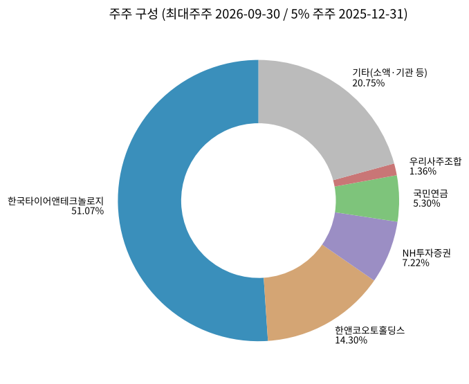

**최대주주 변동 이력:**

| 시점 | 최대주주 | 지분 |
|---|---|---|
| 1986\~1999 | 만도기계·Ford 합작 | - |
| 1999\~2015 | Ford 계열 Visteon | 70% |
| 2015-06\~2025-01 | 한앤코오토홀딩스 (+ 한국타이어 19.49%) | 50.5% |
| 2024-12-24 | 한국타이어 제3자배정 1.4496억주 — 한앤코 39.7% / 한국타이어 36.7% (추정) | - |
| 2025-01-03 | **한국타이어앤테크놀로지** (한앤코 1.2277억주 인수) | 54.77% |
| 2025-12-31 | 한국타이어 (유증 1.523억주 인수) | 51.07% |

### ③ 임원·이사회

| 성명 | 직위 | 주요 경력 |
|---|---|---|
| 이수일 (1962) | 대표이사·이사회 의장 | 한국타이어앤테크놀로지 대표이사 부회장, 미주·중국지역본부장 |
| 박정호 (1963) | 사내이사 | 한국타이어앤테크놀로지 마케팅총괄·OE부문장 부사장 |
| 박종호 | 기타비상무이사 | 한국타이어앤테크놀로지 경영지원총괄 사장 |
| 박찬석 | 사외이사·감사위원 | 감사원 제1사무차장, 삼일회계법인 |
| 허보희 | 사외이사·감사위원 | Sheppard Mullin 금융부문 고문 |
| 홍석철 | 사외이사·감사위원 | 서울대 경제학부 교수 |
| 김혜경 | 사외이사·감사위원 | 이화여대 국제대학원 초빙교수 |

- 이사회 7인 (사내 2 · 기타비상무 1 · 사외 4), 위원회: 사외이사후보추천·감사·ESG·내부거래·경영
- 2025-01 대표집행임원제 폐지 → 대표이사 체제. 2026-03 주총: 집중투표 배제 조항 삭제·독립이사제·분리선출 감사위원 확대 정관 상정

---

## 6. 기타 팩트

### ① R&D 인프라

| 연도 | 2014 | 2016 | 2018 | 2019 | 2021 | 2022 | 2023 | 2024 | 2025 |
|---|---|---|---|---|---|---|---|---|---|
| 연구개발비용(억원, 자산화 포함) | 2,166 | 2,342 | 2,983 | 3,613 | 3,440 | 3,903 | 4,419 | 4,893 | 4,136 |
| 매출 대비 | 3.9% | 4.1% | 5.0% | 5.1% | 4.7% | 4.5% | 4.6% | 4.9% | 3.8% |

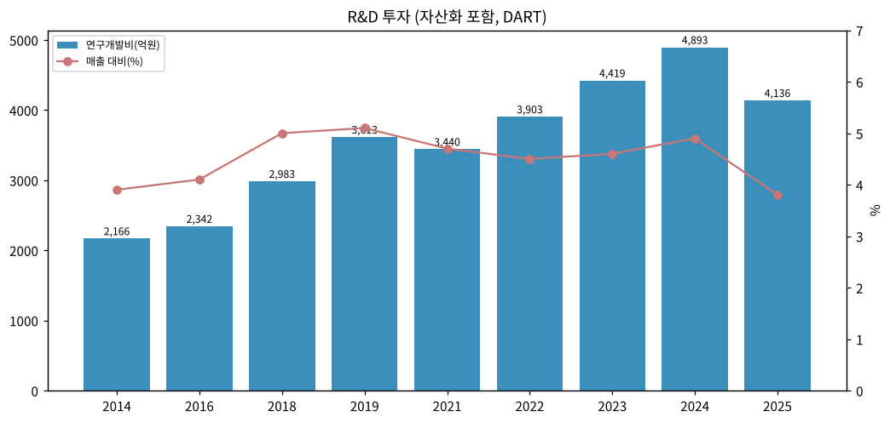

- 국내(대전 기술연구소) + 북미·유럽·아시아 R&D 거점, 연구인력 약 1,500명
- 2026E R&D 4,100억 (3Q 누적 2,860억), 3Q26 R&D 자산화율 24% (4Q25 31%) — 자산화 축소로 비용 인식 증가가 OPM을 누르는 요인

### ② 진행 중 corporate action — 10년치 주요 이벤트

| 시점 | 이벤트 |
|---|---|
| 2015-06 | 한앤코·한국타이어, Visteon 지분 70% 인수 |
| 2019-03 | Magna FP&C 인수 (E&FP 사업부 편입) |
| 2021-02\~05 | 인도 Bangalore 매각 / 체코·멕시코 법인 인수 |
| 2024-10\~2025-01 | 한국타이어 경영권 인수 (구주 1.22조 + 신주 6,000억) |
| 2025-09\~12 | 9,000억 주주배정 유증 → 확정 9,834억 |
| 2025-12 | 자기주식 12만주 처분 |
| 2027-01\~02 (예정) | 한앤코 풋옵션 행사 기간 (5,871.8만주 × 5,200원 ≈ 3,053억) |

### ③ 기술 마일스톤 — 10년치

| 시점 | 마일스톤 |
|---|---|
| 2012\~2015 | 전장폐열 이용 EV 히트펌프 — 신기술(NET) 인증(2012), IR52 장영실상(2015) |
| 2017 | CO2 센서 실내공기질 제어 IR52 장영실상 |
| 2022 | 컨덴서 모듈 일체형 히트펌프 시스템 NET 인증 |
| 2024 | SBTi 감축목표 승인 (2050 넷제로, 2040 Scope 1·2·3 절대배출 90% 감축) |
| 2025\~2026 | R290·R744 자연냉매 히트펌프 (EU PFAS 규제 대응), PFAS-Free 냉매 백서(2026-07) |
| 2026 | ESS PCS·SST 냉각 모듈 샘플 공급, AI DC CDU 선행 개발 착수 |

### ④ 주요 리스크

- **고객 집중**: 현대차그룹 47%, 상위 3사 70% — 3Q26 매출 감소도 국내 고객사 생산 차질 영향
- **전기차 속도 조절**: 신규수주 2022 $1.9B → 2025 $0.89B (목표 미달), Ford 차세대 EV 프로젝트 중단
- **유럽 저수익**: 유럽 영업이익률 0.4% (2025) — 구조조정 여부가 OPM 회복의 핵심 변수
- **환율**: USD·EUR 노출, 3Q26 외화환산손실로 순손실. 통화선도 최장 38개월 헤지
- **관세**: 한-미 무역협상(2025-07) 한국산 부품 대미 관세 25% → 15%, 정책 재조정 가능성
- **레버리지·금리**: 순차입금/EBITDA 2.28x, 변동금리 차입금 \~1조
- **R&D 회계**: 개발비 자산화 축소 → 비용 인식 증가 (2025 OP 영향 -1,626억)
- **지분 오버행**: 한앤코 14.30% 잔여 지분 (풋옵션 2027-01\~02 또는 시장 매각)

### ⑤ ESG 등급

| 항목 | 내용 |
|---|---|
| S&P Global 지속가능경영 연례보고서 (Sustainability Yearbook) | 2년 연속 등재 (2024 CSA 기준, KPI뉴스) |
| SBTi | 감축목표 승인 (2024) |
| 지속가능경영보고서 | 2018년부터 연간 발간 (2026-06 9번째) |
| 거버넌스 | 2022 ESG위원회 신설, 2026 하반기 ESG운영위원회 체계로 전환 예정 |

> KCGS·MSCI 등급은 미확인 (잔여 보완)

### ⑥ 인증·라이선스

- 신기술(NET) 인증: CO2 센서 공기질 제어(2013), 연료전지차 고전압 쿨링팬 모터·인버터(2012), EV 히트펌프(2012), 컨덴서 일체형 히트펌프(2022)
- 美 PACE Award (Metal Seal Fitting, 2013)
- 신사업 대응: UL 778 등 UL 인증 충족 설계 (ESS·SST 냉각)

---

## Version Log

| 버전 | 일자 | 내역 |
|---|---|---|
| v1.0 | 2026-11-25 | 최초 작성 — v4.8 표준 6개 섹션 + 13개 차트 (chart2 = 전사 43분기 + 지역별 연간 2종). OpenDART 재무 JSON 44건·공시원문 44건·IR 8건 일괄 수집 |

**잔여 보완 후보 (v1.1):**
- 외국인 지분율 시계열 (KRX) — chart5는 5% 주주 기준
- 2016 이전 분기 시계열 (OpenDART 미제공 → 2015 이전 분기보고서 원문)
- 제품군별(HVAC·COMP 등) 매출 비중 — DART·IR 미공시, 셀사이드 리포트로 보강
- 고객별·xEV 비중 2021\~2024 연간 (과거 IR — irgo에 2020\~2024 IR 미게시, 회사 IR 사이트 확인)
- 전체(해외 포함) 임직원 수 — 지속가능경영보고서
- KCGS·MSCI ESG 등급
- 2024-12 제3자배정 직후 한앤코·한국타이어 지분율 (추정치 → 공시 확인)
