# 한전KPS — 기업 개요 (v1.1)

> 마지막 update: 2026-11-03 (2Q26 실적까지 반영 — **3Q26 실적은 미발표**, 발표 예정일 2026-11-14로 알려짐 (미검증 — 비공식 출처: alphadistill.com 2026-09-08, DART 공시로 재확인 필요))
> 입력 source: **OpenDART fnlttSinglAcntAll 연결재무제표 직접 조회(2014-2026.2Q, 2026-11-03)** + **DART 정기공시 원문 XML 43건(사업·반기·분기보고서 2015.12~2026.06, 기재정정 우선)** + 회사 IR Newsletter(2Q24) + 셀사이드 리포트 13건(메리츠·이베스트/LS·유진·하나·교보·삼성 등, 2022-11 ~ 2026-05) + Naver/WiseReport 시세·컨센서스 + Yahoo Finance v8 월간 주가·배당(2007-12 ~ 2026-11)
> ✅ v1.1: DART 원문(document.xml) 확보 → 재무제표·사업부문 매출·임직원·R&D·매출처·이사회·소송·정비호기를 DART 공시치로 교체·보강 (v1.0의 ⚠ DART 미확보 항목 해소)
> 갱신 주기: 매분기 (실적 리뷰 모드 호출 시)
> **Fact verify cutoff**: 2026-11-03 (주가·시총·52주 고저·지분율 = WiseReport 2026-11-02 / Yahoo 2026-11-03 종가 기준)

---

## 1. 기업 분류

- **Primary 분류: 지속성장 (Defensive / 규제형 정비 서비스)**
- **Secondary 노트: 꿈(옵션) 일부 — 해외 원전 O&M·원전 해체·신규 원전(체코·미국) 수주 optionality**

### ① 정량 근거

**📊 Summary Box (11년 평균, 2015-2025):**

| 지표 | 값 |
|------|-----|
| 매출 CAGR (10년, 2015→2025) | **+2.9%** |
| OPM 평균 | **12.0%** |
| OPM 정점 평균 | **15.3%** (2015·2018·2019, 2024 13.5% 포함 시 14.8%) |
| OPM 저점 평균 | **8.8%** (2016·2021·2025) |
| 사이클 주기 | N/A — 업황 사이클이 아닌 **노무비(경영평가 성과급)·정비 호기수 주기** (약 3~5년 이익 굴곡) |
| 사이클 회수 (11년) | 이익 고점 2회(2018-19, 2023-24) / 저점 3회(2016, 2021-22, 2025) |

```
[전사 OPM 시계열 (11년, 억원, 연결)]
연도   매출      영업이익  순이익   OPM    NPM
2015  11,797    1,752    1,699   14.8%  14.4%   ← 이익 고점권, 주가 사상 최고(2015-08~09)
2016  12,231    1,058      883    8.6%   7.2%   ← 이익 저점 (DPS 680원으로 축소)
2017  12,368    1,641    1,360   13.3%  11.0%
2018  12,425    1,915    1,613   15.4%  13.0%
2019  12,469    1,939    1,533   15.6%  12.3%   ← OPM 고점 / UAE 바라카 LTMSA 체결(2019-06)
2020  13,032    1,354      871   10.4%   6.7%   ← 이익 하락 국면 진입
2021  13,806    1,240      987    9.0%   7.1%   ← 영업이익 저점권 (이베스트: "2021년까지 감소세")
2022  14,291    1,306    1,002    9.1%   7.0%   ← 구조적 인건비 절감 → 턴어라운드 시작
2023  15,339    1,994    1,627   13.0%  10.6%   ← 노무비 감소 + 4Q23 화력 37호기 준공
2024  15,571    2,095    1,724   13.5%  11.1%   ← 사상 최대 영업이익
2025  15,765    1,401    1,243    8.9%   7.9%   ← 4Q25 OP 192억(-53% YoY): 수명연장 자재비·외주비 급증

OPM range: 8.6% ~ 15.6% = 7.0%pt  → 사이클 cutoff(±10%pt) 미충족 → 비사이클
매출 YoY: 2015-2025 전 기간 플러스(최저 +0.4% 2019, 최고 +7.3% 2023) → 매출 안정성 매우 높음
```

(출처: OpenDART fnlttSinglAcntAll 연결재무제표 직접 조회, 2026-11-03 — v1.0의 bullstory.io 경유 수치와 대조: 2018·2019 매출 반올림 차이(±1억)만 존재. 2014: 매출 10,855 / 영업이익 2,158 / 순이익 1,683 (2015 사업보고서 전기 컬럼))

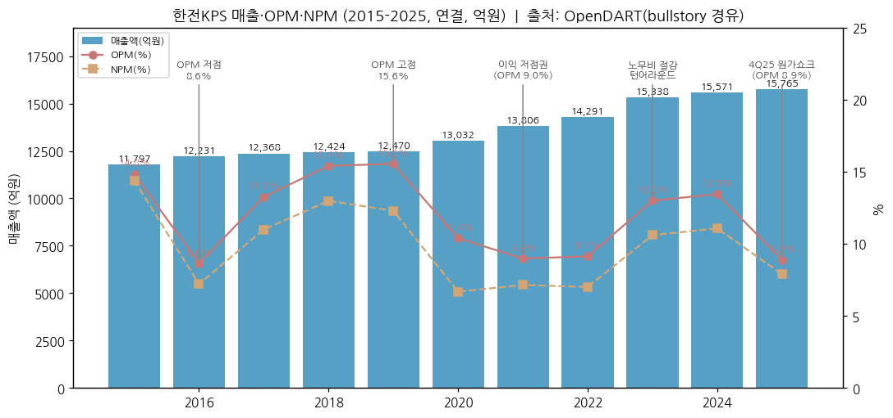

### ② 산업 분류

- 산업: **발전설비 정비(O&M) 서비스** — 원자력·화력·양수·송변전·해외 발전소 정비
- 거래소 업종: KOSPI 건설 / WICS: 전기유틸리티 (WiseReport, 2026-11-02)
- 워치리스트 섹터: **원전 섹터 (T2) — 서브섹터: 원전 정비(O&M)** — ⚠ watchlist.md 미등록 (메인 세션에서 추가 예정)

### ③ 분류 결정 논리

(1) **가장 매출 큰 사업부 기준**: 원자력/양수 40.0% + 화력 34.2% (DART 사업보고서(2025.12) 매출실적 기준) — 둘 다 **발전사(한수원·발전5사)와의 장기 정비계약 기반 반복 매출** → 지속성장
(2) **이익 변동 요인 sub-rule**: OPM 변동의 주원인은 업황(가격)이 아니라 ① 노무비(매출원가의 40%대, 공공기관 경영평가 등급 → 성과급 충당금), ② 계획예방정비 준공 호기수·수명연장 자재비 → **비용측 변동** → 사이클 분류 X
(3) **Boundary case 처리**: 해외(체코 두코바니 5·6호기 시운전정비, 루마니아 체르나보다 4,850억, 미국 원전) 매출 비중이 확대되면 "꿈/고성장" 성격 가미 → 현재는 Secondary 노트로만 표기
(4) **피어 cross-reference**: 한전기술(052690, 원전 설계 — 신규 원전 건설 사이클 노출 큼) / 두산에너빌리티(주기기 — 수주 사이클) / 현대건설(시공) 대비, 한전KPS는 **운영 중 원전·발전소 기수에 비례하는 annuity형 정비 매출** → 원전 밸류체인 중 가장 방어적. (같은 폴더 `한전기술_기업개요.md`, `두산에너빌리티_기업개요.md`, `현대건설_기업개요.md` 병행 작성 중)

### ④ 적정 밸류에이션 방법

- **PER (1순위)** — 이익 안정성 높고 무차입·순현금(2025말 순금융자산 약 3,840억, 하나증권). 셀사이드 표준: 12M fwd EPS × PER 15~17x (유진·교보·하나 PER 방식; 알파증류소(비공식 출처)도 동일)
- **배당수익률 (2순위, 하방 지지)** — 배당성향 8년 연속 50%+ (2018 49.9% 경계), 2025 DPS 1,651원 / 2026-11-03 주가 41,600원 → 배당수익률 4.0%
- **PBR 보조** — ROE 9~13%대 → PBR 1.2~1.7x 밴드 (2023 1.2x, 2025 1.65x, 2026-11 1.39x)
- 피어 차별화: 한전기술·두산에너빌리티는 신규 원전 수주 기대가 PER 40~80x로 반영 vs 한전KPS는 PER 13~15x — **해외 수주가 실적으로 확인될 때만 multiple 재평가**

### ⑤ 분기 재평가 트리거

- 해외 부문(해외+대외 중 원전 해외 정비) 매출 비중이 **20%+로 2개 분기 연속** 상승 시 → Secondary "고성장" 격상 검토 (2025 해외 비중 11.0% — DART 사업보고서(2025.12), 내부거래조정 전)
- 체코 두코바니 정비 본계약·미국 원전 정비 계약 **수주 공시** 시 → 꿈 성격 확대, PER 기준 재설정
- 공공기관 지정 해제/지배구조 변경(한전 지분 매각 등) 시 → 노무비·배당정책 구조 변화 → 분류 재검토
- 역으로 2개 분기 연속 OPM 5% 미만(원가 구조 악화 고착) 시 → "저성장 유틸리티"로 하향 검토

---

## 2. 회사 개요

### ① 기본 사항

- **회사명**: 한전KPS주식회사 (KEPCO Plant Service & Engineering Co., Ltd.) — KRX 051600
- **설립**: 1984년 한국전력공사 전액 출자로 설립된 발전설비 정비 전문회사 (WiseReport 기업개요, 2026-08-31 기준)
- **사업 한 줄 정의**: 국내외 원자력·화력·수력/양수·송변전 설비의 경상정비·계획예방정비·개보수를 수행하는 **한전 자회사(공기업) 정비 전문기업**. UAE·남아공 등 해외 발전설비 정비, 원전 해체·신재생 정비로 확장 중
- **지배구조 성격**: 한국전력공사 외 1인 51.02% 보유 → **공공기관(시장형/준시장형 공기업)** — 경영평가·인사(사장 임명)·배당이 정부 정책 영향권
- **발행주식수**: 45,000,000주 (보통주, 액면 200원) / 자본금 90억원

### ② 최근 11년 손익·자본 추이 (억원, 좌→우 시간순)

| 연도 | 매출 | YoY | 영업이익 | 순이익(지배) | 자본총계 | 자본 YoY |
|------|------|-----|----------|--------|----------|----------|
| 2015 | 11,797 | - | 1,752 | 1,699 | 7,863 | +12.6% |
| 2016 | 12,231 | +3.7% | 1,058 | 883 | 7,898 | +0.4% |
| 2017 | 12,368 | +1.1% | 1,641 | 1,360 | 9,051 | +14.6% |
| 2018 | 12,425 | +0.5% | 1,915 | 1,613 | 9,841 | +8.7% |
| 2019 | 12,469 | +0.4% | 1,939 | 1,533 | 10,634 | +8.1% |
| 2020 | 13,032 | +4.5% | 1,354 | 871 | 10,517 | -1.1% |
| 2021 | 13,806 | +5.9% | 1,240 | 987 | 11,120 | +5.7% |
| 2022 | 14,291 | +3.5% | 1,306 | 1,002 | 12,157 | +9.3% |
| 2023 | 15,339 | +7.3% | 1,994 | 1,627 | 12,726 | +4.7% |
| 2024 | 15,571 | +1.5% | 2,095 | 1,724 | 13,285 | +4.4% |
| 2025 | 15,765 | +1.2% | 1,401 | 1,242 | 13,459 | +1.3% |

(연결, 전 항목 OpenDART fnlttSinglAcntAll 2026-11-03 조회. 2015 자본 YoY는 2014말 자본 6,980억 대비. v1.0의 2015-2020 자본총계 n/a → DART로 보강)

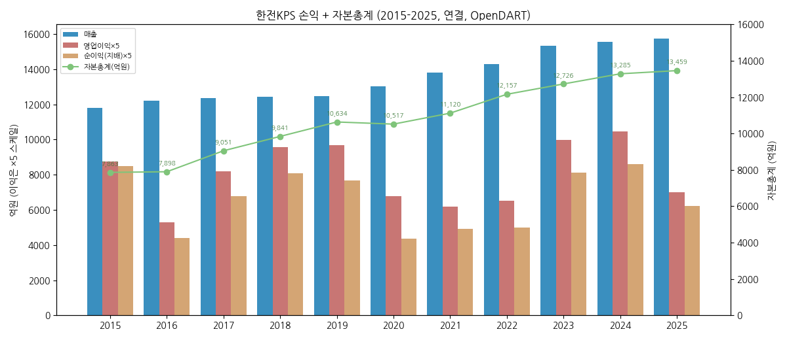

### ③ 회사 주가 역사 ★ 유일한 narrative 영역

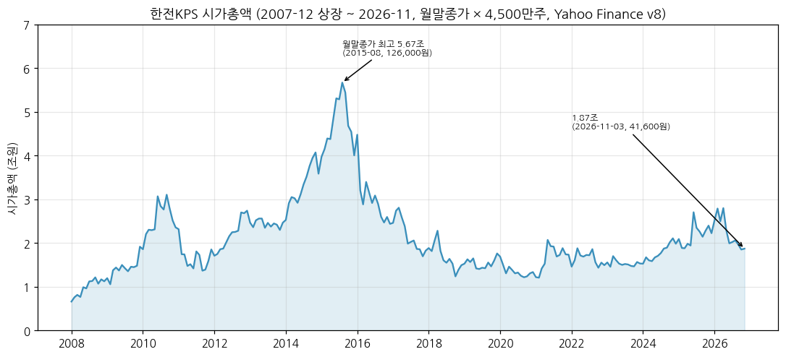

**시가총액 데이터:** Yahoo Finance v8 월간(051600.KS), 2007-12 ~ 2026-11-03 × 45,000,000주 (상장 이후 주식수 변동 없음 — DART 사업보고서(2025.12) 증자(감자)현황상 2002-01 무상증자 이후 발행·감자 이력 없음, 발행주식 45,000,000주 확인)
- 상장 직후: 2007-12 월말 14,700원 → 시총 약 0.66조원
- **사상 최고: 2015년 8~9월** — 월말종가 최고 126,000원(2015-08, 시총 약 5.67조), 월중 고가 135,500원(시총 약 6.10조) [Yahoo v8]
- 장기 하락: 2016~2020 (이익 정체 + 탈원전 정책기) → 2020-12 월말 27,100원(시총 1.22조) 저점권
- 2025-06 고점 65,400원(월중) — 체코 두코바니 본계약·원전 정책 기대
- **52주 최고 69,000원(2026-03) / 최저 39,850원(2026-10)** [WiseReport 2026-11-02]
- **현재: 41,600원 (2026-11-03 종가) → 시총 약 1.87조원** [Yahoo v8]; WiseReport 2026-11-02 41,500원 / 시총 18,675억원
- 수익률(2026-11-02, WiseReport): 1M -7.7% / 3M -7.7% / 6M -33.3% / 1Y -18.2%

**원전 정책·정비 사이클 history:**

```
[2007-12] KOSPI 상장 (한전 자회사 IPO)
[2009-12] UAE 바라카 원전 4기 수주(한전 컨소시엄) → 정비 수혜 기대, 주가 4만원대
[2013-2015] 이익 고점권 + 고밸류 구간 → 2015-08~09 사상 최고(월중 135,500원)
[2016] 영업이익 1,058억(-40%) 급감, DPS 1,690 → 680원 → 주가 반토막(2016-12 54,700원)
[2017-2021] 탈원전 정책기 + 노무비 부담 → 이익 정체, 2020-12 27,100원 저점권
[2019-06] UAE 바라카 장기정비사업계약(LTMSA, 한수원·한전KPS 컨소시엄, 5년+연장 가능) 체결
[2022-2024] 원전 정책 전환 + 인건비 구조 절감 → 2024 사상 최대 OP 2,095억
[2025-06] 체코 두코바니 5·6호기 최종계약(한수원) → KPS 시운전정비·가동전검사 기대, 주가 6만원대
[2025-08] 루마니아 체르나보다 1호기 설비개선 4,850억 계약(한수원으로부터, ~2030-06)
[4Q25] 영업이익 192억(-53%) 원가 쇼크 → 2025 DPS 2,469 → 1,651원 감소
[2026-03] 52주 최고 69,000원 → 2Q26 OP 436억(컨센 620억 -30%) 쇼크 후 4만원대 초반
```

### ④ 회사의 주요 연혁

```
1984         한국전력공사 전액 출자로 설립 (발전설비 정비 전문회사)
2007-12      KOSPI 상장
2009-12      UAE 바라카 원전 수주(팀코리아) — 이후 바라카 정비 참여
2019-06-23   UAE Nawah Energy와 바라카 1~4호기 장기정비사업계약(LTMSA) 체결 (한수원·한전KPS 컨소시엄, 5년)
2024-12      차기 사장 후보(허상국 전 부사장) 주총 승인 → 대통령 임명 미완료
2025-06      체코 두코바니 5·6호기 최종계약(한수원) — KPS 시운전정비·가동전검사 역할
2025-08-21   루마니아 체르나보다 1호기 압력관 교체 등 설비개선 4,850억원 계약 (한수원, 2025-08-21~2030-06-30)
2026-04      창립 42주년
2026-05~07   정부 요청 사장 재공모 → 법원 재공모 중지 결정(2026-07) → 김홍연 사장(2021-06 취임, 임기 2024-06 만료) 체제 지속
```

(DART 사업보고서(2025.12) "회사의 연혁" 보강: **2007-01-01 상호 변경 「한전기공㈜」→「한전KPS㈜」**, 2010-08-31 영문명 KEPCO KPS로 변경, **2014-12-05 본점 전라남도 나주시 문화로 211 이전**, 합병 이력 해당사항 없음. 종속회사: KEPCO KPS PHILIPPINES(2013-04 설립)·KPS파트너스(2020-06)·KEPCO KPS SOUTH AFRICA(2023-01))

---

## 3. 비즈니스 모델

### ① 실적 추이 (사업부별·지역별)

**연간 4년 통합 표 (억원, DART 사업보고서 "매출실적(연결기준)" — 3단계 위계):**

| 항목 | 2022 | 2023 | 2024 | 2025 |
|------|------|------|------|------|
| **매출액** | **14,291** | **15,339** | **15,571** | **15,765** |
| └ 사업부별 |  |  |  |  |
| &nbsp;&nbsp;&nbsp;&nbsp;└ 원자력/양수 | 5,169 | 5,355 | 6,498 | 6,306 |
| &nbsp;&nbsp;&nbsp;&nbsp;└ 화력 | 4,681 | 5,605 | 5,087 | 5,390 |
| &nbsp;&nbsp;&nbsp;&nbsp;└ 해외 | 2,495 | 1,977 | 1,871 | 1,730 |
| &nbsp;&nbsp;&nbsp;&nbsp;└ 대외 (국내 민간·산업설비) | 1,073 | 1,420 | 1,082 | 1,292 |
| &nbsp;&nbsp;&nbsp;&nbsp;└ 송변전 | 894 | 1,004 | 1,120 | 1,124 |
| &nbsp;&nbsp;&nbsp;&nbsp;└ 기타(종속회사)·내부거래조정 | -21 | -23 | -86 | -78 |
| └ 지역별 |  |  |  |  |
| &nbsp;&nbsp;&nbsp;&nbsp;└ 국내 (해외 외 4개 부문) | 11,817 | 13,384 | 13,787 | 14,113 |
| &nbsp;&nbsp;&nbsp;&nbsp;└ 해외 | 2,495 | 1,977 | 1,871 | 1,730 |
| **영업이익** | **1,306** | **1,994** | **2,095** | **1,401** |
| └ 사업부별 | 미공시 | 미공시 | 미공시 | 미공시 |
| **매출 YoY (%)** | **+3.5** | **+7.3** | **+1.5** | **+1.2** |
| &nbsp;&nbsp;&nbsp;&nbsp;└ 원자력/양수 YoY | +1.8 | +3.6 | +21.3 | -2.9 |
| &nbsp;&nbsp;&nbsp;&nbsp;└ 화력 YoY | -3.2 | +19.8 | -9.2 | +6.0 |
| &nbsp;&nbsp;&nbsp;&nbsp;└ 해외 YoY | +16.5 | -20.8 | -5.4 | -7.5 |
| &nbsp;&nbsp;&nbsp;&nbsp;└ 대외 YoY | +17.1 | +32.4 | -23.8 | +19.4 |
| &nbsp;&nbsp;&nbsp;&nbsp;└ 송변전 YoY | +1.4 | +12.3 | +11.6 | +0.4 |
| **영업이익 YoY (%)** | **+5.3** | **+52.7** | **+5.1** | **-33.1** |
| **OPM 전사 (%)** | **9.1** | **13.0** | **13.5** | **8.9** |
| └ 부문 비중 (2025) |  |  |  |  |
| &nbsp;&nbsp;&nbsp;&nbsp;└ 원자력/양수 40.0% · 화력 34.2% · 해외 11.0% · 대외 8.2% · 송변전 7.1% (매출액 대비) | | | | |

(부문 매출 출처: DART 사업보고서(2023.12·2024.12 기재정정·2025.12) II-4 "매출실적(연결기준)", 백만원→억원. 기타·조정 = 연결 매출 − 5개 부문 합(종속회사 KPS파트너스·필리핀·남아공 매출 + 내부거래조정). v1.0은 IR Newsletter·셀사이드 집계를 사용했으며 국내 4개 부문은 DART와 ±1억 일치, **해외는 v1.0이 기타·내부거래조정을 합산한 잔여값**(예: 2025 1,653억)이었음 → v1.1에서 DART 해외(1,730억)로 교체)

**사업부별 장기 연간 시계열 (2015~2025, 11년, DART):**

| 연도 | 화력 | 원자력/양수 | 송변전 | 대외 | 해외 | 기타·조정 | 매출액 | 원자력 비중 |
|------|------|------|------|------|------|------|------|------|
| 2015 | 4,706 | 4,382 | 689 | 728 | 1,350 | -57 | 11,797 | 37.1% |
| 2016 | 4,885 | 4,685 | 736 | 858 | 1,107 | -40 | 12,231 | 38.3% |
| 2017 | 4,766 | 4,724 | 810 | 780 | 1,310 | -22 | 12,368 | 38.2% |
| 2018 | 4,264 | 4,903 | 829 | 986 | 1,462 | -20 | 12,425 | 39.5% |
| 2019 | 4,388 | 4,827 | 797 | 988 | 1,508 | -39 | 12,469 | 38.7% |
| 2020 | 4,659 | 4,318 | 810 | 1,650 | 1,607 | -11 | 13,032 | 33.1% |
| 2021 | 4,836 | 5,078 | 882 | 916 | 2,142 | -49 | 13,806 | 36.8% |
| 2022 | 4,681 | 5,169 | 894 | 1,073 | 2,495 | -21 | 14,291 | 36.2% |
| 2023 | 5,605 | 5,355 | 1,004 | 1,420 | 1,977 | -23 | 15,339 | 34.9% |
| 2024 | 5,087 | 6,498 | 1,120 | 1,082 | 1,871 | -86 | 15,571 | 41.7% |
| 2025 | 5,390 | 6,306 | 1,124 | 1,292 | 1,730 | -78 | 15,765 | 40.0% |

(DART 각 연도 사업보고서 "매출실적(연결기준)" 당기 컬럼(기재정정 우선). 매출액 = OpenDART 연결 매출. 기타·조정 = 매출액 − 5개 부문 합. 부문 구분은 수주사업장(발주처) 기준)

> ⚠ **부문 분류 주의**: 회사 IR 주석 — "매출액은 설비부문에 따라 분류한 것으로, 수주사업장을 기준으로 매출액을 분류한 사업보고서상 수치와 차이가 있을 수 있음" (IR Newsletter 2Q24). v1.1 대조 결과 2022-2025 국내 4개 부문은 DART와 사실상 동일. 본 문서는 **DART 사업보고서(수주사업장) 기준으로 통일**.
> ⚠ **부문별 영업이익 미공시** (DART 주석: "연결실체 전체를 단일 보고부문으로 결정") → chart2는 부문 매출 stacked bar + 전사 OPM line으로 대체.

**부문별 분기 시계열 (1Q16 ~ 2Q26, 42분기, DART):**

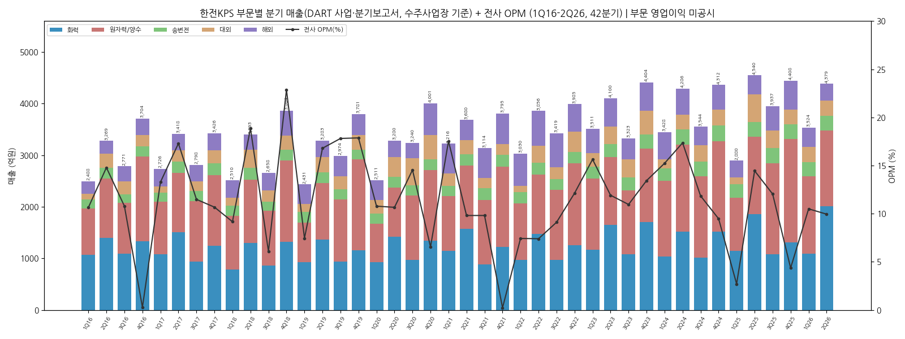
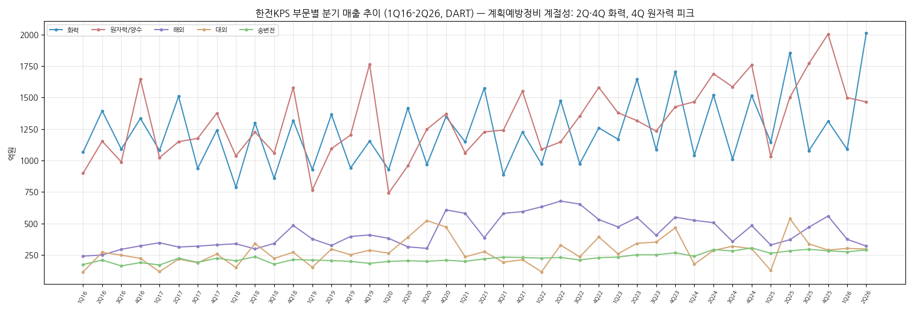

| 분기 | 화력 | 원자력/양수 | 송변전 | 대외 | 해외 | 기타·조정 | 매출 | 영업이익 | OPM |
|------|------|------|------|------|------|------|------|------|------|
| 1Q16 | 1,066 | 899 | 174 | 116 | 241 | -9 | 2,488 | 265 | 10.6% |
| 2Q16 | 1,394 | 1,153 | 209 | 271 | 249 | -8 | 3,269 | 483 | 14.8% |
| 3Q16 | 1,090 | 989 | 163 | 249 | 295 | -15 | 2,771 | 299 | 10.8% |
| 4Q16 | 1,334 | 1,644 | 189 | 223 | 322 | -8 | 3,704 | 10 | 0.3% |
| 1Q17 | 1,080 | 1,023 | 170 | 117 | 347 | -11 | 2,726 | 362 | 13.3% |
| 2Q17 | 1,509 | 1,149 | 224 | 217 | 313 | 6 | 3,418 | 591 | 17.3% |
| 3Q17 | 937 | 1,176 | 191 | 188 | 320 | -14 | 2,798 | 321 | 11.5% |
| 4Q17 | 1,240 | 1,376 | 225 | 257 | 330 | -2 | 3,426 | 366 | 10.7% |
| 1Q18 | 787 | 1,037 | 203 | 150 | 339 | -7 | 2,510 | 230 | 9.2% |
| 2Q18 | 1,300 | 1,226 | 236 | 342 | 298 | -8 | 3,393 | 640 | 18.9% |
| 3Q18 | 859 | 1,060 | 177 | 223 | 342 | -2 | 2,658 | 162 | 6.1% |
| 4Q18 | 1,318 | 1,580 | 214 | 271 | 484 | -2 | 3,864 | 884 | 22.9% |
| 1Q19 | 928 | 766 | 209 | 152 | 377 | -2 | 2,431 | 181 | 7.5% |
| 2Q19 | 1,365 | 1,094 | 205 | 297 | 325 | -3 | 3,283 | 552 | 16.8% |
| 3Q19 | 940 | 1,202 | 199 | 252 | 397 | -16 | 2,974 | 530 | 17.8% |
| 4Q19 | 1,154 | 1,765 | 183 | 288 | 409 | -18 | 3,781 | 676 | 17.9% |
| 1Q20 | 927 | 742 | 199 | 264 | 382 | -3 | 2,511 | 271 | 10.8% |
| 2Q20 | 1,416 | 957 | 204 | 391 | 315 | -3 | 3,280 | 350 | 10.7% |
| 3Q20 | 969 | 1,249 | 200 | 523 | 302 | -3 | 3,240 | 471 | 14.5% |
| 4Q20 | 1,347 | 1,370 | 208 | 471 | 608 | -3 | 4,001 | 262 | 6.6% |
| 1Q21 | 1,147 | 1,061 | 200 | 235 | 580 | -7 | 3,216 | 564 | 17.5% |
| 2Q21 | 1,575 | 1,227 | 219 | 276 | 387 | -4 | 3,680 | 361 | 9.8% |
| 3Q21 | 887 | 1,241 | 233 | 193 | 580 | -20 | 3,114 | 306 | 9.8% |
| 4Q21 | 1,227 | 1,550 | 230 | 212 | 594 | -17 | 3,795 | 9 | 0.2% |
| 1Q22 | 972 | 1,089 | 225 | 117 | 632 | -5 | 3,030 | 225 | 7.4% |
| 2Q22 | 1,475 | 1,147 | 230 | 329 | 678 | -3 | 3,856 | 285 | 7.4% |
| 3Q22 | 975 | 1,353 | 211 | 235 | 654 | -7 | 3,419 | 312 | 9.1% |
| 4Q22 | 1,259 | 1,580 | 229 | 393 | 531 | -6 | 3,985 | 483 | 12.1% |
| 1Q23 | 1,169 | 1,379 | 234 | 259 | 473 | -3 | 3,511 | 549 | 15.6% |
| 2Q23 | 1,645 | 1,316 | 252 | 342 | 548 | -3 | 4,100 | 488 | 11.9% |
| 3Q23 | 1,085 | 1,233 | 251 | 352 | 406 | -6 | 3,323 | 364 | 11.0% |
| 4Q23 | 1,705 | 1,427 | 267 | 466 | 550 | -11 | 4,404 | 592 | 13.4% |
| 1Q24 | 1,041 | 1,466 | 240 | 177 | 524 | -20 | 3,428 | 522 | 15.2% |
| 2Q24 | 1,519 | 1,689 | 293 | 286 | 507 | -7 | 4,286 | 744 | 17.4% |
| 3Q24 | 1,010 | 1,585 | 281 | 320 | 357 | -8 | 3,544 | 420 | 11.8% |
| 4Q24 | 1,516 | 1,758 | 306 | 300 | 483 | -51 | 4,312 | 409 | 9.5% |
| 1Q25 | 1,145 | 1,031 | 263 | 127 | 329 | -16 | 2,880 | 78 | 2.7% |
| 2Q25 | 1,855 | 1,501 | 283 | 538 | 371 | -8 | 4,540 | 656 | 14.5% |
| 3Q25 | 1,079 | 1,771 | 295 | 338 | 471 | -16 | 3,937 | 474 | 12.0% |
| 4Q25 | 1,312 | 2,003 | 283 | 289 | 559 | -37 | 4,408 | 193 | 4.4% |
| 1Q26 | 1,088 | 1,499 | 275 | 302 | 374 | -15 | 3,524 | 370 | 10.5% |
| **2Q26** | **2,011** | **1,465** | **290** | **297** | **320** | **-4** | **4,379** | **436** | **10.0%** |

(단위 억원. 부문 매출 = DART 분기·반기·사업보고서 "매출실적(연결기준)" 누적치 차감(2Q = 반기 − 1Q, 3Q = 9M − 반기, 4Q = 연간 − 9M). 매출·영업이익 = OpenDART fnlttSinglAcntAll 분기 3개월 금액, 4Q = 연간 − 3Q 누적. 기타·조정 = 매출 − 5개 부문 합. v1.0 대비: 2Q23 영업이익 489 → 488억(DART 488.5억), 4Q25 영업이익 DART 192.5억(반올림 193억), 해외 분기값은 기타·조정 분리로 v1.0 대비 소폭 상향)

**2Q26 핵심 (최신 분기, 연간 표는 2025 결산 유지):**
- 매출 **4,379억원** (YoY -3.5%, QoQ +24.3%) / 영업이익 **436억원** (YoY -33.6%) / OPM 10.0% [DART 반기보고서(2026.06) — OpenDART 2Q 3개월 금액]. 컨센서스 620억 대비 -29.7% (이데일리 2026-08-11 보도 인용, 컨센서스는 DART 외 수치)
- 부문(DART 반기보고서(2026.06) 누적 − 1분기보고서): 화력 2,011억(+8.4% YoY)만 성장, **대외 297억(-44.7%)** / 원자력 1,465억(-2.4%) / 해외 320억(-13.7%). 대외 감소 사유(동두천드림파워·GS복합화력 정비 종료, 포스코 포항 성능개선 중단)는 비공식 출처(alphadistill.com 2026-08-12) 기재 — **미검증**
- 1Q26: 매출 3,524억(+22.4%), OP 370억(+374%, 컨센 446억 하회) — 원자력 계획예방정비 수행호기 5→13기, 포스코 광양 합리화(약 201억) 기자재 매출로 재료비 증가 [유진 2026-05-13 IR Q&A]
- **3Q26 컨센서스** (WiseReport, 2026-11-02): 매출 3,938억 / 영업이익 470억 — 실적 발표 전

**12분기 시계열 (3Q23 ~ 2Q26):**

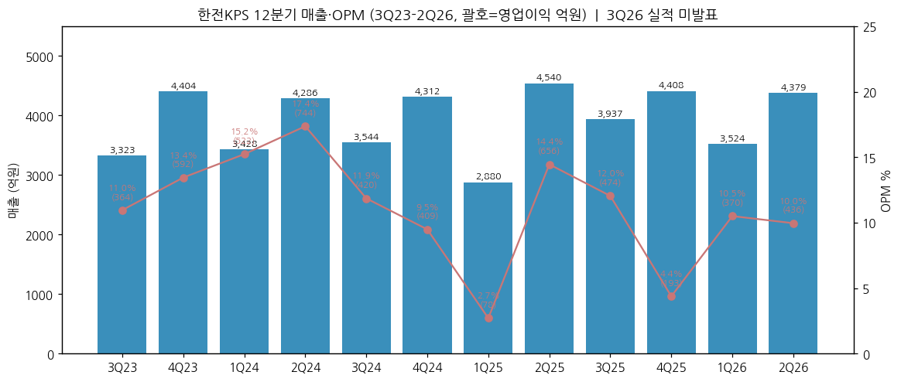

| 분기 | 매출 | 영업이익 | OPM | 메모 |
|------|------|---------|-----|------|
| 3Q23 | 3,323 | 364 | 11.0% |  |
| 4Q23 | 4,404 | 592 | 13.4% | 화력 계획예방정비 준공 37호기(이례적 급증) |
| 1Q24 | 3,428 | 522 | 15.2% |  |
| 2Q24 | 4,286 | 744 | 17.4% | 분기 최대 OP — 원자력 +28.3% (IR) |
| 3Q24 | 3,544 | 420 | 11.8% |  |
| 4Q24 | 4,312 | 409 | 9.5% | 성과급 충당금 4Q 집중 |
| 1Q25 | 2,880 | 78 | 2.7% | 원자력 1,031억 (-29.7% YoY) |
| 2Q25 | 4,540 | 656 | 14.5% | 화력 1,855억(+22.4%) + 대외 537억 |
| 3Q25 | 3,937 | 474 | 12.0% |  |
| 4Q25 | 4,408 | 193 | 4.4% | 수명연장 자재비·외주비·퇴직급여 (DART OP 192.5억) |
| 1Q26 | 3,524 | 370 | 10.5% | 원자력 +45.4%, 대외 기자재 재료비 |
| **2Q26** | **4,379** | **436** | **10.0%** | **대외 -44.7%, 컨센 -30%** |

### ② 사업부별 개요 (매출 비중 큰 순서, 2025 DART 사업보고서 기준)

**원자력/양수 — 매출 비중 40.0% (6,306억)**

"한수원이 운영하는 원전·양수발전소를 고치고 점검하는 사업."
- 경상정비(상시 유지보수) + **계획예방정비**(원전별 약 2년 주기 정지 후 정밀 점검·교체, 이베스트) + 개보수·수명연장 공사
- 운영 원전 대상 순환 정비 (이베스트 2024-02: 운영 24기, 각 원전별 2년 주기 계획예방정비; 신규 원전은 상업운전 1년 후부터 주기 진입 — 신한울 1·2, 새울 3·4호기 순차 편입)
- 원전 수명연장 공사: 호기당 약 150억원, 과거 3~4년 → 최근 1년 이내로 단축 (유진 2026-05 IR Q&A)

**화력 — 매출 비중 34.2% (5,390억)**

"발전5사(남동·중부·서부·남부·동서)의 석탄·LNG복합 발전소 정비."
- 계획예방정비 준공: 2023 95기 → 2024 71기 → 2025 87기 → 2026 계획 97기 (2월 101기에서 하향)
- 2Q·4Q 집중 → 분기 매출 계절성(2Q/4Q 피크)의 주원인
- 장기적으로 석탄 감축(전력수급기본계획) → 구조적 감소 리스크, LNG 복합 전환분은 일부 상쇄

**해외 — 매출 비중 11.0% (1,730억, DART 사업보고서(2025.12))**

"해외 발전소 정비 — UAE 바라카 원전, 파키스탄·남아공 등."
- UAE 바라카 1~4호기 장기정비(LTMSA, 2019-06 체결, 한수원 컨소시엄)
- 파키스탄 공사 종료로 2024 감소 (IR 2Q24)
- 파이프라인: 루마니아 체르나보다 1호기(4,850억, 매출 2027-09~2030-06 예상), 체코 두코바니 5·6호기 시운전정비·가동전검사(본계약 협의 중, 2026-11 체결 예상 보도), 미국 원전(대미투자 프레임 내 APR1400 — 미확정)

**대외 — 매출 비중 8.2% (1,292억)**

"한전 그룹 외 민간 발전사·산업설비 정비 (포스코 성능개선, 민자 복합화력 등)."
- 프로젝트성 변동 큼: 2Q25 537억 → 2Q26 297억 (계약 종료)

**송변전 — 매출 비중 7.1% (1,124억)**

"한전 송전선로·변전소 설비 정비." 연 1,100억대 안정적 (YoY 0~12%)

### ③ 사업부별 디테일

- **Top-seller**: 원자력/양수 — 2024 +21.3%로 최대 부문 등극 (2023까지는 화력 1위). 원전 계획예방정비 = 상대적 고마진 (교보 2026-05)
- **Growth 엔진(중장기)**: 해외 원전 — 루마니아 4,850억 — 공시 계약기간(2025-08~2030-06) 균등 시 연 약 1,000억, 실매출이 2027-09 착공 이후 집중되면 연 1,700억대 → 2025 해외 매출(1,730억, DART)과 맞먹는 규모
- **이익 outlier**: 4Q25 OP 192억 — 매출 +2.2% 증가에도 영업비용 +8%: 재료비 +39.1%(수명연장 자재), 외주비, 퇴직급여 (2026-02 리포트)
- **비용 구조**: 2Q24 IR 기준 영업비용 3,542억 = 재료비 256억(7%) + 노무비 1,443억(41%) + 경비 1,843억(52%) → **노무비가 핵심 레버**. 공공기관 경영평가 등급 → 성과급 충당금이 2Q(6월 하순 등급 발표)·4Q에 반영 (하나 2026-05)

### ④ 주요 경쟁사 (부문별)

| 부문 | 경쟁 구도 |
|------|----------|
| 원자력 | 한수원 원자력 정비 점유율(경상정비·설비용량 기준) **68.0% (2025)** / 68.6% (2024) / 70.6% (2023). 상업운전 26기 중 **16기 단독**(한울5,6·신고리1,2 1차측 포함), **10기 공동수급** [DART 사업보고서(2025.12)] |
| 화력 | 발전5사 정비 점유율 **48.2% (2025)** / 46.9% (2024·2023) — 당사 수행분 24,538MW / 발전5사 50,946MW. 1997년 이후 정부 민간정비업체 육성, 2013-2017 1단계 경쟁 도입(2단계 정책결정 유보), 민간업체는 태안·하동·당진·영흥 등 참여 [DART 사업보고서(2025.12)] |
| 해외 | 팀코리아(한수원) 컨소시엄 일원 / 바라카는 두산에너빌리티(주기기 MSA)와 병행 |
| 원전 해체 | 고리1호기 해체 승인 의결 일정(2025-06-26 예정, LS증권 2025-06) — 해체 공정 참여 기대 |

### ⑤ 주요 매출처

**DART 사업보고서(2025.12) X. 대주주 등과의 거래 — 별도 매출 15,453억 대비 5% 이상 거래처:**

| 거래상대방 | 관계 | 2025 매출 (억원) | 비중 |
|------|------|------|------|
| 한국수력원자력 | 최대주주의 특수관계인 | 6,644 | 43.0% |
| 한국중부발전 | 〃 | 1,293 | 8.4% |
| 한국서부발전 | 〃 | 1,292 | 8.4% |
| 한국전력공사 | 최대주주 | 1,151 | 7.4% |
| 한국남동발전 | 〃 | 1,069 | 6.9% |
| 한국남부발전 | 〃 | 883 | 5.7% |
| **합계 (5% 이상 6개사)** | | **12,332** | **79.8%** |

- 한수원 비중 추이 (각 연도 사업보고서 동일 항목): 2022 4,429억(31.1%) → 2023 4,536억(29.8%) → 2024 7,175억(46.8%) → 2025 6,644억(43.0%) — 2024년부터 집계 대상 계약 범위 차이 가능성 있어 연속 비교 시 주의
- 그 외: Nawah Energy(UAE 바라카, 한수원 컨소시엄 경유), 포스코·광양그린에너지 등 민간(대외) — 5% 미만
- 장기공급계약(5% 이상): 한전 「2025년 가공송전 순시점검 위탁공사」 976억(6.32%)

### ⑥ 생산 CAPA + 임직원

- 정비 사업 특성상 CAPA = **정비 인력**

**임직원 수 추이 (DART 사업보고서 VIII. 직원 등 현황, 기말, 소속 외 근로자 제외):**

| 연도 | 직원 수 | 평균 근속 (년) | 1인 평균 급여 (백만원) |
|------|---------|---------------|----------------------|
| 2019 | 6,624 | 14.1 | 72 |
| 2020 | 6,578 | 14.1 | 76 |
| 2021 | 6,686 | 13.6 | 80 |
| 2022 | 6,576 | 13.8 | 79 |
| 2023 | 6,560 | 13.9 | 80 |
| 2024 | 6,579 | 13.8 | 84 |
| 2025 | 6,485 | 13.6 | 83 |

(2015-2018은 사업보고서 표 양식 상이로 미추출. 2025 연간급여총액 5,344억 — 매출원가 13,387억의 약 40%)
- 노무비 자연감소(퇴직) → 2026 상반기 신규 채용 예정 (유진 2026-05 IR Q&A)

**계획예방정비 준공호기 (영업 CAPA 지표, DART 사업보고서 II-2 "계획예방정비공사 수행 현황"):**

| 연도 | 원자력 | 화력 (기력+복합+내연) | 양수 |
|------|------|------|------|
| 2015 | 16 | 80* | - |
| 2016 | 13 | 44* | - |
| 2017 | 9 | 84 | - |
| 2018 | 18 | 80 | - |
| 2019 | 13 | 73 | - |
| 2020 | 13 | 82 | - |
| 2021 | 18** | 83 | - |
| 2022 | 14 | 74 | - |
| 2023 | 18 | 93 | 3 |
| 2024 | 19 | 71 | 8 |
| 2025 | 13 | 86 | 4 |
| 2026(계획) | 20 | 97 | - |

(각 연도 값 = 해당 연도를 포함하는 가장 최근 사업보고서 수치. *2015·2016 화력은 IPP 제외 발전5사만(2017 사업보고서 주석). **2021 원자력: 2021 사업보고서 16기(준공 기준) vs 2023 사업보고서 18기(이월·착수 기준) — 후자 채택. 2026 계획 = 하나·교보 2026-05 리포트(DART 외). v1.0 대비 변경: 원자력 2022 13→14, 2023 14→18 / 화력 2022 75→74, 2023 95→93, 2025 87→86 (v1.0은 이베스트·2026-02 리포트 인용치))

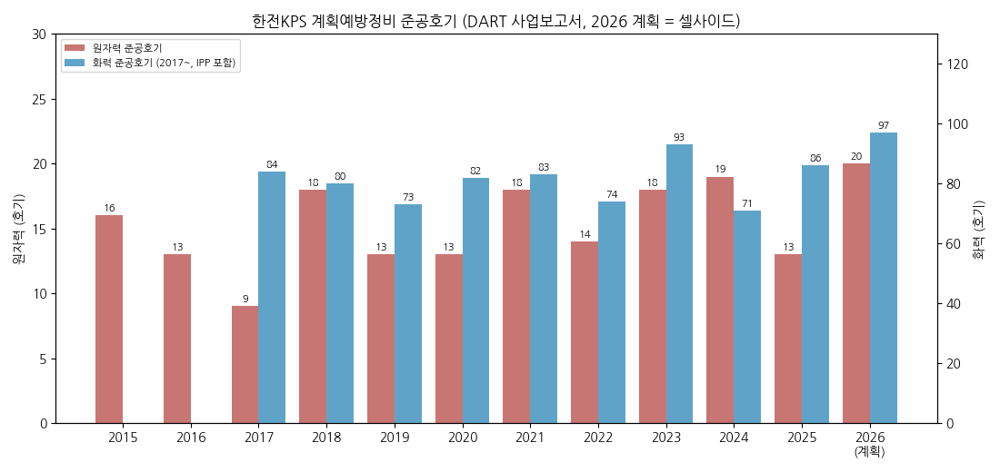

---

## 4. 재무 구조

> **재무제표 수치: OpenDART fnlttSinglAcntAll (연결재무제표, CFS), 2026-11-03 조회.** 각 연도 값은 해당 연도를 포함하는 가장 최근 공시(차기 사업보고서 전기 컬럼 우선) 기준. 단위 억원(원 단위 반올림)

### ① 손익계산서 (억원, 연결)

| 연도 | 매출 | 매출원가 | 매출총이익 | GPM | 판관비 | 판관비율 | 영업이익 | OPM | 순이익(지배) | NPM | EPS(원) |
|------|------|----------|-----------|-----|--------|-----|----------|-----|--------|-----|---------|
| 2015 | 11,797 | 9,310 | 2,487 | 21.1% | 735 | 6.2% | 1,752 | 14.8% | 1,699 | 14.4% | 3,776 |
| 2016 | 12,231 | 10,304 | 1,927 | 15.8% | 869 | 7.1% | 1,058 | 8.6% | 883 | 7.2% | 1,962 |
| 2017 | 12,368 | 9,860 | 2,508 | 20.3% | 868 | 7.0% | 1,641 | 13.3% | 1,360 | 11.0% | 3,021 |
| 2018 | 12,425 | 9,736 | 2,688 | 21.6% | 773 | 6.2% | 1,915 | 15.4% | 1,613 | 13.0% | 3,585 |
| 2019 | 12,469 | 9,719 | 2,750 | 22.1% | 811 | 6.5% | 1,939 | 15.6% | 1,533 | 12.3% | 3,407 |
| 2020 | 13,032 | 10,917 | 2,115 | 16.2% | 761 | 5.8% | 1,354 | 10.4% | 871 | 6.7% | 1,935 |
| 2021 | 13,806 | 11,635 | 2,171 | 15.7% | 931 | 6.7% | 1,240 | 9.0% | 987 | 7.1% | 2,193 |
| 2022 | 14,291 | 12,035 | 2,256 | 15.8% | 950 | 6.7% | 1,306 | 9.1% | 1,002 | 7.0% | 2,226 |
| 2023 | 15,339 | 12,509 | 2,829 | 18.4% | 835 | 5.4% | 1,994 | 13.0% | 1,627 | 10.6% | 3,615 |
| 2024 | 15,571 | 12,617 | 2,954 | 19.0% | 859 | 5.5% | 2,095 | 13.5% | 1,724 | 11.1% | 3,832 |
| 2025 | 15,765 | 13,387 | 2,378 | 15.1% | 977 | 6.2% | 1,401 | 8.9% | 1,242 | 7.9% | 2,761 |

(전 항목 OpenDART 연결. EPS = 기본주당이익(DART). v1.0 대비: 2015-2021 매출원가·매출총이익·판관비 신규 보강, 2015-2020 EPS 단순계산치 → DART 공시치(2015 3,777→3,776원), 2023 판관비 836→835억, 2025 순이익(지배) 1,243→1,242억(연결 당기순이익 1,243억 중 비지배 0.2억 차감))

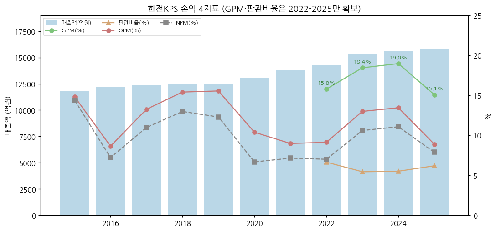

### ② 재무상태표 (억원, 연결)

| 연도 | 자산총계 | 유동자산 | 부채총계 | 유동부채 | 비유동부채 | 자본총계 | 자본 YoY | 부채비율 |
|------|---------|---------|---------|---------|---------|---------|----------|----------|
| 2015 | 10,336 | 5,526 | 2,473 | 1,960 | 513 | 7,863 | +12.6% | 31.5% |
| 2016 | 10,925 | 5,616 | 3,027 | 2,657 | 371 | 7,898 | +0.4% | 38.3% |
| 2017 | 12,000 | 6,304 | 2,949 | 2,788 | 161 | 9,051 | +14.6% | 32.6% |
| 2018 | 12,809 | 6,361 | 2,968 | 2,704 | 264 | 9,841 | +8.7% | 30.2% |
| 2019 | 13,594 | 7,834 | 2,960 | 2,490 | 470 | 10,634 | +8.1% | 27.8% |
| 2020 | 13,499 | 7,600 | 2,982 | 2,556 | 426 | 10,517 | -1.1% | 28.4% |
| 2021 | 14,269 | 8,001 | 3,149 | 2,677 | 472 | 11,120 | +5.7% | 28.3% |
| 2022 | 15,620 | 8,681 | 3,463 | 3,176 | 287 | 12,157 | +9.3% | 28.5% |
| 2023 | 15,973 | 9,685 | 3,247 | 3,189 | 59 | 12,726 | +4.7% | 25.5% |
| 2024 | 16,902 | 10,512 | 3,617 | 3,474 | 143 | 13,285 | +4.4% | 27.2% |
| 2025 | 17,036 | 10,058 | 3,577 | 3,499 | 78 | 13,459 | +1.3% | 26.6% |

(OpenDART 연결 재무상태표. 2015-2020 신규 보강, 2021-2025는 v1.0(이베스트·IR·하나증권 인용)과 전 항목 일치 확인. 1H26말: 자산 16,845 / 부채 3,377 / 자본 13,468억 [DART 반기보고서(2026.06)])

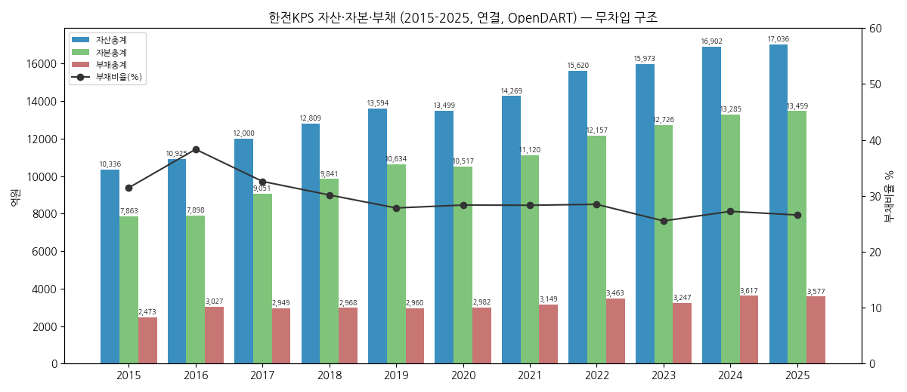

### ③ 현금흐름표 (억원)

| 연도 | 영업CF | 투자CF | 재무CF | CapEx (유형) | 배당지급 | FCF |
|------|--------|--------|--------|--------------|----------|-----|
| 2015 | 1,398 | -1,046 | -752 | 592 | 752 | 806 |
| 2016 | 1,234 | 798 | -760 | 584 | 760 | 650 |
| 2017 | 1,328 | -1,934 | -306 | 722 | 306 | 607 |
| 2018 | 1,301 | -1,237 | -662 | 484 | 662 | 817 |
| 2019 | 1,606 | -887 | -838 | 288 | 806 | 1,317 |
| 2020 | 746 | 270 | -902 | 495 | 864 | 250 |
| 2021 | 1,333 | -398 | -559 | 301 | 516 | 1,032 |
| 2022 | 813 | 273 | -597 | 379 | 540 | 434 |
| 2023 | **-381** | 303 | -653 | 412 | 587 | **-793** |
| 2024 | **5,405** | **-3,803** | -1,112 | 496 | 971 | 4,909 |
| 2025 | 1,357 | 357 | -1,248 | 618 | 1,111 | 739 |

(전 항목 OpenDART 연결 현금흐름표. CapEx = 유형자산의 취득(2015는 건설중인자산 증가 122억 포함 — 2016 사업보고서 전기 컬럼 재분류치 592억). FCF = 영업CF − 유형 CapEx. 배당지급 = 당해 연도 현금 지급액(전년도 결산배당). v1.0 대비: 2015-2020 투자·재무CF·CapEx·배당 신규 보강, **2021 CapEx 238(유무형, 셀사이드) → 301억(유형, DART)**, **2025 CapEx 595 → 618억**, FCF 2021 1,095→1,032억, 2025 762→739억)

**특이점:**
- 2023 영업CF -381억: 운전자본 -3,633억 (매출채권 1,117억 → 2,128억, 메리츠) — 이익과 현금 괴리
- 2024 영업CF 5,405억: 운전자본 +1,542억 환원, 동시에 투자CF -3,803억(금융상품 등 기타 투자활동 추정)
- 2025 재무CF -1,248억 중 배당 1,111억 (2024 DPS 2,469원 지급분)

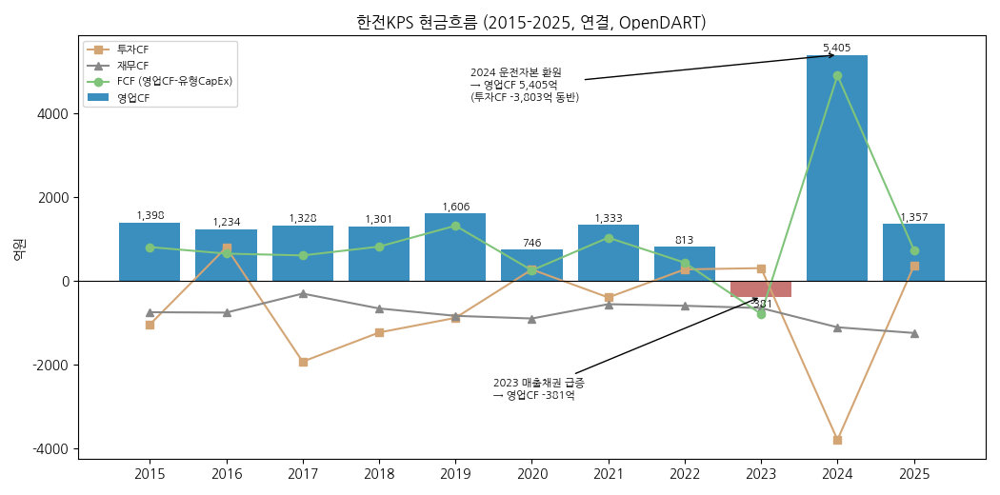

### ④ CapEx 추이

| 연도 | 유형 CapEx (억) | CapEx/매출 | 감가상각비 (유·무형, 억) |
|------|-----------------|------------|-----------------|
| 2015 | 592 | 5.0% | 341 |
| 2016 | 584 | 4.8% | 358 |
| 2017 | 722 | 5.8% | 371 |
| 2018 | 484 | 3.9% | 395 |
| 2019 | 288 | 2.3% | 438 |
| 2020 | 495 | 3.8% | 430 |
| 2021 | 301 | 2.2% | 445 |
| 2022 | 379 | 2.7% | 476 |
| 2023 | 412 | 2.7% | 519 |
| 2024 | 496 | 3.2% | 643 |
| 2025 | 618 | 3.9% | 651 |

(OpenDART 연결 현금흐름표: CapEx = 유형자산의 취득, 감가상각비 = 영업CF 조정항목 감가상각비 + 무형자산상각비(사용권자산 포함). 2015-2020 신규 보강)

- 장치산업이 아닌 **인력 서비스업** → CapEx 매출 대비 2~6% (정비 장비·공구, 교육훈련시설, 사옥). 2015-2017 CapEx 매출 대비 5~6%는 나주 본사 이전(2014-12) 전후 투자기
- 2026E 640억(하나), 2026E 628억(메리츠)

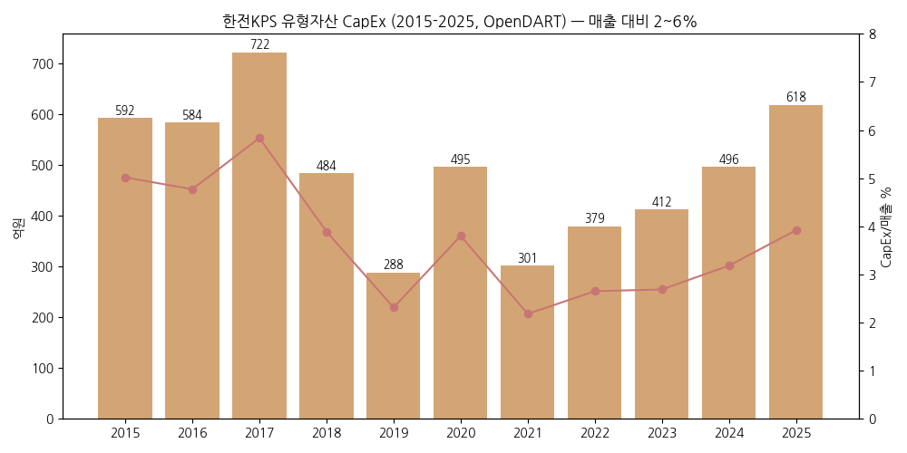

### ⑤ 부채구조

- **무차입 경영**: 총차입금 0 (이베스트 2024-02, 2021-2023). 부채의 대부분은 미지급비용·종업원급여충당부채·선수금 등 영업부채, 금융부채 2025말 유동 109억 + 비유동 37억 (대부분 리스부채, 하나)
- 순금융자산(순현금) 2024 4,295억 → 2025 3,840억 (하나증권 2026-05)
- 이자보상배율 ~299x (2024-25, 하나)
- 채무증권 발행 이력: **없음** — DART 사업보고서(2025.12) "채무증권 발행실적 해당사항 없음", 기업어음·단기사채 미상환 잔액 없음

### ⑥ 배당·자사주 추이 (12년)

| 연도(FY) | 주당배당 (원) | 배당총액 (억) | 배당성향 (%) | 비고 |
|------|------|------|------|------|
| 2014 | 1,670 | 752 | 44.7 | |
| 2015 | 1,690 | 761 | 44.8 | |
| 2016 | **680** | 306 | 34.7 | 이익 급감 → 감배 |
| 2017 | 1,470 | 662 | 48.7 | |
| 2018 | 1,790 | 806 | 49.9 | |
| 2019 | 1,920 | 864 | 56.3 | |
| 2020 | 1,146 | 516 | 59.2 | |
| 2021 | 1,199 | 540 | 54.7 | |
| 2022 | 1,305 | 587 | 58.6 | |
| 2023 | 2,158 | 971 | 59.7 | +65% 증배 |
| 2024 | **2,469** | 1,111 | 64.4 | 최고 DPS |
| 2025 | 1,651 | 743 | 59.8 | 4Q25 부진으로 감배 |

(DPS = Yahoo Finance v8 배당 이벤트(결산 연 1회). **배당총액은 OpenDART 연결 현금흐름표 "배당금지급"(익년 지급액)과 2014-2025 전 연도 ±1억 이내 일치 확인** (예: FY2024분 1,111억 = 2025 지급, FY2025분 743억 = 2026 상반기 지급[DART 반기보고서(2026.06)]). 배당성향 = 배당총액/OpenDART 지배주주 순이익. 2014 배당성향 신규 = 752/1,683억)

- **배당 정책**: 결산배당 연 1회, 반기·분기 배당 계획 없음, 추가 밸류업 계획 없음 (유진 2026-05 IR Q&A). 최대주주 한전의 배당 수입원 → 배당성향 50~60%대 관행
- **자사주**: 약 0.2% 보유(이베스트 2024-02), 매입·소각 이력 없음
- 컨센서스 2026E DPS: 2,030원 (WiseReport) / 2,150원(알파증류소 — 미검증·비공식 출처) / 2,330원(하나)

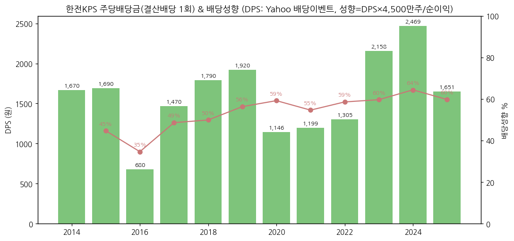

### ⑦ 재무 비율 (11년)

| 연도 | ROE | ROA | 부채비율 | 유동비율 | 영업이익/금융원가 (DART) | 이자보상배율 (셀사이드) |
|------|-----|-----|----------|----------|--------------|--------------|
| 2015 | 21.6% | 16.4% | 31.5% | 281.9% | - | - |
| 2016 | 11.2% | 8.1% | 38.3% | 211.4% | - | - |
| 2017 | 15.0% | 11.3% | 32.6% | 226.1% | - | - |
| 2018 | 16.4% | 12.6% | 30.2% | 235.3% | 249x | - |
| 2019 | 14.4% | 11.3% | 27.8% | 314.6% | 93x | - |
| 2020 | 8.3% | 6.4% | 28.4% | 297.3% | 28x | - |
| 2021 | 8.9% | 6.9% | 28.3% | 298.9% | 33x | 183x |
| 2022 | 8.2% | 6.4% | 28.5% | 273.3% | 41x | 151x |
| 2023 | 12.8% | 10.2% | 25.5% | 303.7% | 95x | 244x |
| 2024 | 13.0% | 10.2% | 27.2% | 302.6% | 125x | 299x |
| 2025 | 9.2% | 7.3% | 26.6% | 287.4% | 47x | 299x |

(ROE·ROA = 지배주주 순이익/기말 자본·자산 단순 계산(OpenDART) — 평균잔액 기준 셀사이드 수치(2024 13.3%, 2025 9.3%)와 소폭 차이. 영업이익/금융원가 = DART 연결 손익계산서 금융원가(리스이자·외환손실 등 포함) 기준, 2015-2017은 금융원가 계정 미분리로 산출 불가. 셀사이드 이자보상배율(이베스트·메리츠·하나)은 이자비용 기준이라 크게 높음 — 무차입이라 실질 의미는 제한적)

---

## 5. 지배 구조

### ① 그룹·계열 관계

- **최대주주: 한국전력공사** (한전 그룹 정비 자회사) — 한수원·발전5사·한전기술 등과 계열 관계. 최대 매출처 다수가 계열사 → **특수관계자 거래 비중 높음**: 한수원·발전4사·한전 6개사 매출 12,332억 = 별도 매출의 79.8% (DART 사업보고서(2025.12) X. 대주주 등과의 거래, 3-⑤ 참조)
- 공공기관 → 사장은 공모·임원추천위원회·주총 → 산업부 장관 제청·대통령 임명. 경영평가 등급이 성과급(노무비)에 직결
- 연결 종속기업 3개 (DART 사업보고서(2025.12) XII-1): KEPCO KPS PHILIPPINES(2013-04 설립, 자산 79억) / KPS파트너스(2020-06, 시설관리 자회사, 자산 43억) / KEPCO KPS SOUTH AFRICA(2023-01, 자산 190억) — 모두 주요종속회사 해당없음. 2025 종속회사 매출 합 538억(내부거래 전)

### ② 주주 구분 (2026-11-02 기준, WiseReport)

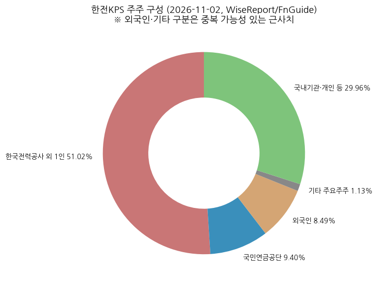

**5% 이상 주주:**

| 주주명 | 보유 주식수 | 지분율 | 비고 |
|--------|-------------|--------|------|
| 한국전력공사 외 1인 | 22,958,790 | 51.02% | 최대주주 + 특수관계인 |
| 국민연금공단 | 4,228,926 | 9.40% | (2024-02 이베스트 표기 11.0% → 감소) |

**전체 주주 구분:**

| 구분 | 지분율 | 비고 |
|------|--------|------|
| 최대주주 + 특수관계인 | 51.02% | |
| 국민연금 | 9.40% | |
| 외국인 | 8.49% | 2026-02 11.2% → 2026-11 8.49% (6개월 외국인 순매도) |
| 기타 주요주주 (2명) | 1.13% | |
| 국내기관·개인 등 | ~30% | 잔여 (유동주식비율 47.85%) |

### ③ 임원·이사회

- **대표이사: 김홍연 사장** — 2021-06 취임, 임기 2024-06 만료 후 후임 미임명으로 직무 지속 (MTN 2026-07-20)
- **사장 선임 표류**: 2024-12 허상국 전 부사장 최종 후보 주총 승인 → 계엄·탄핵 정국으로 임명 미완료 → 정부 재공모 요청(2026-05) → 광주지법·서울행정법원 재공모 중지/효력정지 결정(2026-07) → **2년 넘게 표류 중** (MTN 2026-07-20)
- **이사회 구성** (DART 사업보고서(2025.12) VI): 이사 9명 중 **사외이사(비상임) 5명** + 상임감사 1명. 임원정원 = 기관장 1·상임감사 1·상임이사 3·비상임이사 5. 이사회 의장 = 사장(공운법 제18조). 2024-04 상임이사 김도윤·사외이사 신민순 선임, 2024-10 사외이사 김정현·박정숙 선임. 2024-12-12 임시주총 허상국 대표이사 선임 원안가결 → "임명절차 진행 중"(공시 기준)

---

## 6. 기타 팩트

### ① R&D 인프라

- 조직: **종합기술원 + 원자력정비기술센터 + 발전정비기술센터** — 『KPS 2030 중장기 기술개발 Road Map』 3대 전략·8대 분야·115개 세부과제 (DART 사업보고서(2025.12) II-6)
- 기술협력: Westinghouse(원전 1차측 주요기기 정비기술, 2025-12-31~2035-12-30 10년 갱신), 한수원(소구경배관 초음파검사, ~2027-12), 한전(가스터빈 계측·연소튜닝, ~2028-12)

**연구개발비용 추이 (DART 사업보고서 II-6, 경상개발비 + 인건비, 정부보조금 차감 전):**

| 연도 | 연구개발비용 (억원) | 매출 대비 |
|------|------|------|
| 2016 | 287 | 2.4% |
| 2017 | 297 | 2.4% |
| 2018 | 279 | 2.2% |
| 2019 | 255 | 2.1% |
| 2020 | 247 | 1.9% |
| 2021 | 296 | 2.1% |
| 2022 | 325 | 2.3% |
| 2023 | 345 | 2.3% |
| 2024 | 343 | 2.2% |
| 2025 | 342 | 2.2% |

(각 연도 = 가장 최근 사업보고서 수치 — 2021·2022는 2023 사업보고서 재집계치(v원 공시 254·314억). 2014·2015(153·234억)는 인건비 제외 구 기준이라 제외. v1.0의 "판관비 내 연구개발비 35~50억(valueline)"은 판관비 계상분만의 비공식 추정 → DART 총액으로 교체)
- 2025 내부 연구과제 수행 41건 (2024 39건)
- R&D 시계열 확보했으나 chart7은 핵심 영업 변수(계획예방정비 준공호기, DART)로 유지

### ② 진행 중 corporate action / 주요 계약 (10년치)

```
2026  · 체코 두코바니 5·6호기 정비(시운전정비·가동전검사) 본계약 협의 — 2026-11 체결 예상 (미검증 — 비공식 출처: alphadistill.com 2026-09)
      · 미국 원전 프레임(대미투자 내 원전, APR1400 포함) 논의 — 정비 참여 여부 미정
      · 해상풍력 정비: 단지 개발 단계, 본격 장기 유지보수 매출 2030년 이후 (유진 2026-05 IR Q&A)
2025  · 루마니아 체르나보다 1호기 설비개선(압력관 교체) 4,850억원 계약 (2025-08-21 공시, 상대방 한수원, ~2030-06-30, 2024 매출 대비 31.1%)
      · 포스코 광양 합리화 공사 약 201억 수주 (대외)
      · 체코 두코바니 5·6호기 최종계약(한수원, 2025-06) → KPS 시운전정비 역할
      · 고리1호기 해체 승인 의결 예정(2025-06-26) — 해체 시장 진입 기대 (LS증권 2025-06)
2019  · UAE 바라카 1~4호기 LTMSA 체결 (2019-06-23, 한수원·한전KPS 컨소시엄, 5년 + 상호합의 연장 가능)
```

(M&A 이력: **합병 등 해당사항 없음** — DART 사업보고서(2025.12) I-2. 바라카 LTMSA 연장 계약(2024 만기 이후) 여부는 DART 본문에서 미확인 — TODO)

### ③ 마일스톤

```
2026  · 2026 계획예방정비 목표: 원자력 20기 / 화력 97기 (역대 최대 수준 원자력)
      · 새울 3호기 시운전정비 → 2027-1Q 상업운전 예정
2025  · 원자력 계획예방정비 13기 (2024 19기 → 감소), 화력 86기 (71기 → 증가) [DART]
2024  · 사상 최대 영업이익 2,095억, 최고 DPS 2,469원
2023  · 화력 계획예방정비 93기 [DART] (4Q23 37기 집중 — 셀사이드)
2022  · 구조적 인건비 절감 → 이익 턴어라운드
2019  · UAE 바라카 장기정비계약
```

### ④ 주요 리스크

- **노무비·경영평가 리스크**: 공공기관 경영평가 등급(2025년 B등급 유지)에 따라 성과급 충당금 변동 → 2Q·4Q 이익 변동성 (하나증권; 알파증류소(비공식) 동일 언급)
- **정비 매출 인식 시차**: 계획예방정비 매출 인식 기간 확대(평균 3개월 → 1년 이상, 대신증권 분석 인용) → 분기 실적 예측 난이도↑ (하나: "추정 근거와 결과의 상관성 낮음")
- **수명연장 자재비**: 원전 수명연장 공사 확대 시 재료비 선반영 → 4Q25형 원가 쇼크 재발 가능
- **화력 구조적 축소**: 석탄화력 감축 정책 → 화력 부문(매출 34%) 중장기 감소
- **지배구조 리스크**: 사장 선임 2년 이상 표류 → 해외 수주·배당 정책 의사결정 지연 가능
- **해외 수주 타이밍**: 체코 본계약 시점 불확실, 루마니아 매출은 2027-09 이후
- **운전자본 변동**: 2023 매출채권 급증으로 영업CF 적자 — 계열 매출처 대금 지급 시점 영향
- **계류 소송** (DART 사업보고서(2025.12) XI-2, 2025-12-31 기준): 제소 4건(지체상금 20.7억 2심, 철근 입찰담합 손해배상 2건(소가 추후 산정), 인도 공사대금 중재) / 피소 7건(근로자지위확인 16.3억 2심, 산불사고 손해배상 5.7억, 화재사고 5.0억 — 2026-01 패소 확정, 특수지근무수당 2.2억 등) → **소가 기준 재무 영향 미미**

### ⑤ ESG 등급

- KCGS·MSCI 등 등급: TODO (DART/지속가능경영보고서 미확보)
- 지속가능경영보고서로 美 LACP 비전 어워드 대상 수상 (한국경제 2025-02-24 보도 제목 기준)

### ⑥ 인증·라이선스

- 원자력 정비 관련 인허가·ASME 등 인증 현황 — 지속가능경영보고서 TODO. 정관상 목적사업: 전력설비 개보수공사업·전기공사업·전력시설물 설계·감리업·건설업 등 (DART 사업보고서(2025.12) I-2)

---

## Version Log

**v1.1 (2026-11-03)** — DART 팩트 검증·보강
- **재무제표 전면 DART 교체**: OpenDART fnlttSinglAcntAll(연결) 2014~2026.2Q로 손익·재무상태·현금흐름 전 수치 대조 → 4-①~④·⑦, 2-②, 1-① 재작성. 검증 항목 약 420개, 불일치 수정: 2021 CapEx 238→301억, 2025 CapEx 595→618억(FCF 762→739억), 2Q23 OP 489→488억, 2015 EPS 3,777→3,776원, 2023 판관비 836→835억, 2018·2019 매출 ±1억(반올림), 2025 지배순이익 1,243→1,242억
- **신규 보강(DART)**: 2015-2020 재무상태표·투자/재무CF·CapEx·배당지급·감가상각비, 2015-2021 매출원가·매출총이익·판관비, 2014 손익·배당성향, 영업이익/금융원가
- **사업부문 매출 DART 기준 통일**: 사업보고서·분기보고서 "매출실적(연결기준)" 2015~2026.2Q 파싱 → 연간 11년 + 분기 42분기(1Q16~2Q26) 시계열. 해외 = DART 해외(v1.0은 기타·내부거래 합산 잔여값), 기타·조정 행 분리. 2Q26 부문 수치 출처 alphadistill.com → DART 반기보고서(2026.06)
- **DART 원문 보강**: 임직원 2019-2025, R&D 비용 2016-2025, 주요 매출처(5% 이상 6개사 79.8%), 정비 점유율(화력 48.2%·원자력 68.0%), 계획예방정비 준공호기 2015-2025(원자력 2022·2023, 화력 2022·2023·2025 수정), 이사회 구성, 종속회사 3개, 소송, 채무증권·합병 이력, 상호·본점 연혁
- **차트 재생성**: chart1b(2015-2025 GPM·판관비율), chart2×2(42분기), chart4(11년), chart6(11년 전 CF), chart7(DART 호기), chart8(11년), chart9(2014 성향), chart12(자본 11년) — 파일명 유지
- **비공식 출처 표기**: alphadistill.com 인용(3Q26 발표일, 체코 본계약 시점, 2Q26 대외 감소 사유, 2026E DPS 2,150원)에 "미검증 — 비공식 출처" 표기

**v1.0 (2026-11-03)** — 최초 작성
- OpenDART 연간 손익·영업CF 11년(2015-2025), IR 설비부문 기준 부문별 분기 매출 18분기(1Q22-2Q26, 분기합=연간 검증), 재무상태표·CF·CapEx 5년(2021-2025), DPS 12년(2014-2025), 주가·시총 2007-12~2026-11
- 차트 13종 생성 (chart1, 1b, 2×2, 4, 5, 6, 7(R&D 대체: 계획예방정비 호기), 8, 9, 10, 11, 12)

**잔여 보완 후보 (v1.2):**
1. ~~DART 사업보고서 본문 확보~~ → v1.1 완료 (2015-2018 임직원 수는 표 양식 상이로 미추출)
2. ~~사업보고서 부문 vs IR 설비부문 대조~~ → v1.1 완료 (국내 4개 부문 일치, DART 기준 통일)
3. ~~부문별 분기 시계열 2016~2021 확장~~ → v1.1 완료 (DART 1Q16~)
4. 3Q26 실적(2026-11-14 예정) 반영 → chart2·chart10 rolling
5. 바라카 LTMSA 연장 여부, 체코 정비 본계약 체결 여부, ESG 등급, 3Q26 발표일 DART 공시 확인
