# 한전기술 (한국전력기술, KRX 052690) — 기업 개요 (v1.1)

> 마지막 update: 2026-11-03 작성 (2Q26 IR 실적자료 + 2026 반기보고서까지 반영, **3Q26 실적은 미발표** — 예년 패턴상 11월 7~10일 전후 IR 게시 예상)
> 입력 source: **OpenDART fnlttSinglAcntAll 재무제표(2014~2019 별도 OFS / 2020~ 연결 CFS, 2026-11-03 조회)** + **DART 정기공시 원문 XML(사업·반기·분기보고서 2015.12~2026.06, 기재정정 우선)** + 회사 IR 「분기별 실적자료」 62개 PDF (2011Q1~2026Q2, 결측 0) + 회사 IR 「정기보고서」 사업보고서 12개 (제40기 2014 ~ 제51기 2025, [정정] 포함) + 2026 반기보고서 + Yahoo Finance v8 (2009-12 상장 ~ 2026-11-03 주간·일간 시세)
> ✅ v1.1: 재무제표 전 수치를 OpenDART와 대조 — 2015·2016은 DART 기재정정 사업보고서(2020-03-30 제출, 감리 재작성치)로 교체. v1.0의 IR 사업보고서 PDF 기반 수치는 2017~2025 전 항목 DART와 일치
> 갱신 주기: 매분기 (실적 리뷰 모드 호출 시)
> **Fact verify cutoff**: 2026-11-03 (주가 84,500원 = 2026-11-03 종가, Yahoo Finance / 52주 고가 198,000원 = 2026-04-16 장중, stockhub·investing.com 교차확인)
> 워치리스트: **원전 섹터 (T2) / 서브섹터 원전 설계** (watchlist.md 등록 완료, 메인 세션)

---

## 1. 기업 분류

- **Primary 분류: 사이클 (정책·수주 사이클)** — 원전 건설 프로그램(국내 신규 호기·해외 수출)의 착수→설계 피크→준공 흐름에 매출·OPM이 연동
- **Secondary 노트: 꿈 (해외 원전 수출·SMR 옵션)** — 체코 두코바니 이후 테멀린·미국·베트남·i-SMR 등 미래 수주 옵션이 시가총액의 대부분을 설명 (현재 PER 약 90배)

### ① 정량 근거

**📊 Summary Box (12년, 2014~2025):**

| 지표 | 값 |
|------|-----|
| 매출 CAGR (2014→2025, 11년) | **-4.3%** (2014 EPC 정점 기저) / 2018→2025 **+2.6%** |
| OPM 평균 (12년) | **6.0%** |
| OPM 정점 평균 | **10.1%** (2014 7.9% · 2019 9.8% · 2024 12.5%) |
| OPM 저점 평균 | **2.3%** (2015 2.2% · 2016 2.4% · 2021 2.3%) |
| 사이클 주기 | 약 **5년** (peak-to-peak 2014→2019→2024) |
| 사이클 회수 (12년) | 정점 3회 / 저점 2회 |

```
[전사 손익 시계열 (12년, 억원)]
연도   매출    영업이익  순이익   OPM    NPM
2014  8,419    666     548    7.9%   6.5%   ← 정점① UAE 바라카 + 화력 EPC 피크
2015  6,576    143     150    2.2%   2.3%   ← 저점① 화력 EPC 축소 (DART 감리 재작성치)
2016  5,060    123     226    2.4%   4.5%   ← 저점① 플랜트(EPC) 매출 급감 (DART 감리 재작성치)
2017  4,902    329     325    6.7%   6.6%   ← 탈원전 정책 발표 (2017.06), 감리 재작성 반영
2018  4,337    215     129    5.0%   3.0%   ← 신규 원전 백지화, 매출 12년 최저권
2019  4,486    441     264    9.8%   5.9%   ← 정점② 원가 효율화 (판관비 -30%)
2020  4,317    296     202    6.8%   4.7%
2021  4,331    101     165    2.3%   3.8%   ← 저점② 탈원전 말기 + EPC 손실 (3Q21 -83억)
2022  5,053    139     180    2.8%   3.6%   ← 원전 정책 전환 (신한울3,4 재개 결정)
2023  5,544    378     327    6.8%   5.9%   ← 2025 회계정책 변경 소급 반영
2024  5,695    709     585   12.5%  10.3%   ← 정점③ 신한울3,4 설계 본격화
2025  5,188    355     854    6.8%  16.5%   ← 체코 두코바니 수주 (2025.12), 기타이익 704억 (구사옥 매각 처분이익 포함)

OPM range: 2.2% ~ 12.5% = 10.3%pt
전형적 사이클 기준(±10%pt) 충족(경계선) — 다만 고정비형 엔지니어링이라 진폭이 메모리·조선보다 작음
```

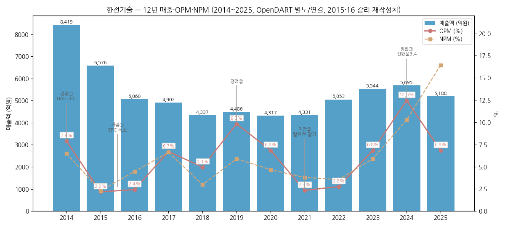

> ⚠️ 데이터 정합성 메모
> → 2015~2017: 증권선물위원회 감리 조치로 제41~43기 재무제표 재작성. **v1.1부터 2015·2016도 재작성치 사용** — DART 기재정정 사업보고서(2015.12·2016.12, 2020-03-30 제출) 기준: 2015 OP 347→143억·순이익 310→150억, 2016 OP 59→123억·순이익 178→226억 (괄호 앞 = v1.0 원 공시치). 매출액은 재작성 영향 없음. 2017은 재작성치(OP 329억, 동일)
> → 분기 시계열(chart2 전사 58분기)의 2015~2016 분기는 원 분기 공시 기준(재작성 미반영) — 연간 합과 차이
> → 2023~2024: 2025년 회계정책 자발적 변경(위탁연구과제 비용 관련 보조금을 영업수익으로 인식, R&D비 판관비→원가 재분류) 소급 반영치. 원 공시치: 2023 매출 5,451억/OP 286억, 2024 매출 5,534억/OP 548억
> → 2014~2019: 종속기업 없음 → 별도 = 연결(DART OFS). 2020 반기부터 한전기술서비스(주) 연결 편입(DART CFS)

### ② 산업 분류

- 산업: **원자력발전 엔지니어링 (A/E 종합설계 + NSSS 원자로계통설계)** — 정책·수주 사이클 산업
- 표준산업분류: 엔지니어링 서비스업 (발전소 설계·건설기술용역)
- 워치리스트 섹터: **원전 (T2)** / 서브섹터 **원전 설계·엔지니어링**
- 동일 섹터 cross-ref: 두산에너빌리티(주기기), 현대건설(시공), 한전KPS(정비 O&M)

### ③ 분류 결정 논리

(1) **가장 매출 큰 사업부 기준** 적용 시: 원자력(A/E) 66.9% + 원자로(NSSS) 18.1% = 원전 85.0% (2025) → 원전 건설 사이클 종속
(2) **사이클 사업부 영업이익 비중 우선 sub-rule**: 사업부별 영업이익은 미공시 (단일 보고부문). 다만 IR 코멘트상 "수익성 높은 원자력 설계 매출" 비중 확대가 OPM을 결정 → 원전 설계 = 이익 엔진, 에너지신사업(EPC) = 저마진·손실 변동 요인
(3) **Boundary case 처리**: 국내 원전 설계는 사실상 독점(국내 원전 설계 전담)이라 **점유율 사이클이 아닌 물량(호기 수) 사이클**. 수주잔고 장기화(두코바니 ~2038, 신한울3,4 ~2033)로 매출 가시성이 높아지면 지속성장 성격이 섞임 → Primary 사이클 + Secondary 꿈
(4) **글로벌 피어 대비**: 미국 Westinghouse(비상장, AP1000 설계·연료), 프랑스 EDF/Framatome, 캐나다 AtkinsRéalis(구 SNC-Lavalin, Candu) 대비 순수 원전 설계 상장사로 희소 → 피어 밸류 비교 어려움, 국내 원전 밸류체인(두산에너빌리티·한전KPS) 대비 프리미엄 구조

### ④ 적정 밸류에이션 방법

- **PER (장기 Forward, 2028~2029E)** 우선 — 현 시점 이익(TTM 순이익 약 360억)으로는 PER 약 90배라 설명 불가. 셀사이드는 수주 파이프라인이 매출로 전환되는 2028~2029E 이익/EBITDA에 멀티플 적용 (예: SK증권 2026-05-22, 2029E EBITDA 1,440억 × 48배)
- **PBR 보조** — 자본 5,927억(1H26) 대비 시총 3.23조 = PBR 약 5.4배. 탈원전기(2017~2020) 저점 PBR 약 1.2~1.5배 / 재평가기(2021~2026) 4~12배 밴드
- **수주잔고/시총 (Backlog coverage)** — 계약잔액 3.1조(1H26) vs 시총 3.23조 ≈ 1.0배. 신규 해외 수주(테멀린·미국 APR1400 등) 시 리레이팅 트리거
- 두산에너빌리티(주기기, EV/EBITDA·SOTP) 대비 **한전기술은 설계 = 선행 지표(설계 → 기자재 → 시공 순)**이라 수주 뉴스에 가장 먼저·크게 반응 → 동일 PER로 비교 불가, 옵션 가치 별도

### ⑤ 분기 재평가 트리거

- 원전(원자력+원자로) 매출 비중이 **70% 미만**으로 하락 시 → 에너지신사업(EPC) 사이클 비중 확대로 Secondary "꿈" 격하 검토 (2014~2016 플랜트 50%+ 시기 사례)
- 해외 원전 설계 매출이 전사 **30%+** 정착 시 (2025: 9.5%) → 국내 정책 사이클 의존 탈피, "지속성장" Secondary 격상 검토
- 2개 연도 연속 OPM **10%+** 유지 시 → 사이클 → 지속성장 transition 후보 (12년간 1회도 없음)
- 미국 대형원전 노형이 **AP1000 위주로 확정**되어 한전기술 역할(NSSS 설계)이 배제될 경우 → "꿈" 프리미엄 축소, 국내 사이클 단독으로 재분류

---

## 2. 회사 개요

### ① 기본 사항

- **회사명**: 한국전력기술주식회사 (KEPCO Engineering & Construction Company, Inc. / KEPCO E&C)
- **설립**: 1975-10-01 (㈜코리아아토믹번즈앤드로, Burns & Roe 社) → 1978-10 한국전력 최대주주 편입
- **본사**: 경상북도 김천시 혁신로 269 (2015-08 용인 → 김천 혁신도시 이전)
- **상장**: 유가증권시장 2009-12-14
- **비전**: "Technology for Earth, Energy for Human" (Vision 2035)
- **사업 한 줄 정의**: 원전 **종합설계(A/E, 2차 계통·BOP)와 원자로계통설계(NSSS, 1차 계통)를 동시에 보유**한 국내 유일 원전 설계 전문 공기업 — 국내 원전 설계 전담, UAE·체코 등 수출 원전 설계 수행
- **기업 성격**: 「공공기관의 운영에 관한 법률」상 공공기관 (한국전력공사 51% 자회사)

### ② 최근 12년 손익·자본 추이 (억원, 좌→우 시간순)

| 연도 | 매출 | YoY | 영업이익 | 순이익 | 자본총계 | 자본 YoY |
|------|------|-----|----------|--------|----------|----------|
| 2014 | 8,419 | - | 666 | 548 | 4,071 | - |
| 2015 | 6,576 | -21.9% | 143 | 150 | 4,007 | -1.6% |
| 2016 | 5,060 | -23.1% | 123 | 226 | 4,107 | +2.5% |
| 2017 | 4,902 | -3.1% | 329 | 325 | 4,570 | +11.3% |
| 2018 | 4,337 | -11.5% | 215 | 129 | 4,614 | +1.0% |
| 2019 | 4,486 | +3.4% | 441 | 264 | 4,922 | +6.7% |
| 2020 | 4,317 | -3.8% | 296 | 202 | 4,991 | +1.4% |
| 2021 | 4,331 | +0.3% | 101 | 165 | 5,135 | +2.9% |
| 2022 | 5,053 | +16.7% | 139 | 180 | 5,434 | +5.8% |
| 2023 | 5,544 | +9.7% | 378 | 327 | 5,473 | +0.7% |
| 2024 | 5,695 | +2.7% | 709 | 585 | 5,775 | +5.5% |
| 2025 | 5,188 | -8.9% | 355 | 854 | 6,250 | +8.2% |

(출처: OpenDART fnlttSinglAcntAll 2026-11-03 조회 — 2014~2019 별도(OFS), 2020~ 연결(CFS), 각 연도 최신 공시(차기·차차기 사업보고서 전기 컬럼 우선). 2015·2016 = 감리 재작성치, 2023·2024 = 2025 회계정책 변경 소급치(2025 사업보고서 전전기·전기 컬럼))

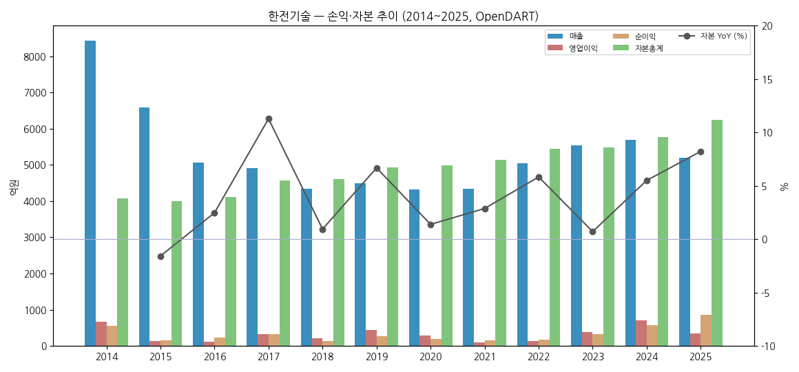

### ③ 회사 주가 역사 ★ narrative 영역

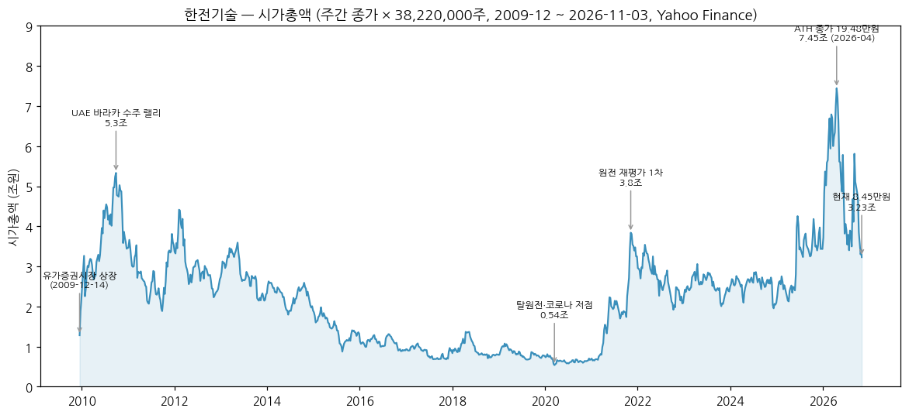

**시가총액 데이터:** 2009-12-14 상장 ~ 2026-11-03 (Yahoo Finance v8 주간·일간, 발행주식수 38,220,000주 — 상장 이후 증자·분할 없음)
- 현재: **84,500원 / 시총 3.23조원** (2026-11-03 종가)
- **ATH: 장중 198,000원 (2026-04-16) / 종가 194,800원 (2026-04-24) → 시총 7.45조원** [Yahoo Finance 일간, 52주 고가 stockhub.kr·investing.com 교차확인]
- 역대 저점: 종가 14,000원 (2020-03-16 주간, 코로나 + 탈원전) → 시총 0.54조원
- ATH 대비 현재 **-57%** (2026-04 → 2026-11)
- 소액주주 110,437명 (2026-06-30), 외국인 지분율 약 13% (stockhub.kr, 2026-10 기준 시장데이터)

**원전 정책·수주 사이클 history:**

```
[2009-12 ~ 2010-09] 상장 + UAE 바라카 수출 랠리
  · 2009-12 UAE 바라카 4기 수주 (팀코리아), 2010-06 A/E·NSSS 용역 계약
  · 2010-09 주간 종가 139,500원 (시총 5.3조, 2026년 전까지 ATH)

[2011-03 ~ 2016] 후쿠시마 + 매출 정점 후 하락
  · 2011-03 후쿠시마 사고 → 글로벌 원전 위축
  · 2014 매출 8,419억 (역대 최고, 화력 EPC 피크) 이후 EPC 축소로 2016 5,060억

[2017-06 ~ 2020-03] 탈원전 정책기
  · 2017-06 탈원전 선언 → 신한울3,4 등 신규 원전 백지화
  · 2018 매출 4,337억 (12년 최저), 2020-03-16 주간 종가 14,000원 (시총 0.54조, 역대 최저)

[2021 ~ 2022] 원전 재평가 1차
  · 2021 SMR·원전 수출 기대 + 2022 정권교체 → 원전 정책 전환
  · 2021-11 주간 종가 100,500원 (시총 3.8조)

[2023 ~ 2025] 신한울3,4 재개 + 체코 수주
  · 2023-03 신한울3,4 NSSS 계약, 2024-07 체코 우선협상대상자, 2024-09 신한울3,4 건설허가
  · 2025-12 체코 두코바니 5·6호기 A/E(1.24조)·NSSS(0.37조) 계약 체결

[2026-01 ~ 04] AI 전력수요 + 해외원전 기대 → ATH
  · 2026-02-27 i-SMR 표준설계인가 신청 (사업단), 미국 대형원전 협력 기대
  · 2026-04-16 장중 198,000원 / 04-24 종가 194,800원 (시총 7.45조)

[2026-05 ~ 11] 급락 조정
  · 2Q26 영업이익 30억 (OPM 2.9%) 컨센서스 크게 하회 → 대신증권 목표가 16만원 하향 (메트로신문 2026-09-10)
  · 한미 미국 내 대형원전 8기 논의 — 6기 AP1000 / 2기 APR1400 보도, 노형 미확정 → 설계 수혜 불확실성
  · 2026-09 초 7~8일 이틀간 약 +30%p 반등 후 10월 재차 급락 → 2026-11-03 84,500원
  · (10월 급락의 직접 원인 기사는 미확보 — 다음 갱신 시 verify 필요)
```

### ④ 회사의 주요 연혁

```
1975-10-01   ㈜코리아아토믹번즈앤드로 설립 (Burns & Roe 합작)
1976-11      한국원자력기술㈜로 상호 변경 (KNE)
1978-10      한국전력주식회사(現 한국전력공사) 최대주주 편입
1982-07      한국전력기술㈜ (KOPEC)로 상호 변경
1980~90년대   한빛3,4호기 설계 자립 → OPR1000 (한국표준형) → APR1400 개발
2009-12-14   유가증권시장 상장
2010-06      UAE 원전 A/E 및 원자로계통설계 용역 계약 (바라카 1~4호기)
2010-07      영문 KEPCO E&C로 변경
2012-12      미국 ENR지 원자력발전 해외설계 매출 세계 1위
2014-04      신고리5,6호기(현 새울3,4) 종합설계용역 계약 (5,174억)
2015-08      경북 김천 혁신도시 사옥 이전
2016-03      신한울3,4호기 종합설계용역 계약 (4,681억) → 2017~2022 탈원전기 중단
2017-11      EU-APR 유럽사업자요건(EUR) 인증
2018-01      Barakah 가동원전 LTEA 장기 엔지니어링 지원 계약 (Nawah)
2018-10      APR1400 미국 NRC 표준설계승인(DC) 취득
2021-03      제주한림해상풍력 EPC 수주 (2024-11 준공, 국내 최대 100MW)
2022-04      용인 구사옥 매각 계약 (957.6억) → 2025-02 최종 권리양도
2023-03      신한울3,4호기 원자로계통설계사업 계약 (두산에너빌리티 발주, 1,651억)
2023-05      APR1000 유럽사업자협회 EUR Rev.E 인증
2023-07      i-SMR 기술개발사업단 출범·참여 (계통설계·BOP 종합설계 주관)
2024-07      팀코리아 체코 신규원전 우선협상대상자 선정
2025-04-15   김태균 대표이사 취임 (前 한전 기술혁신본부장)
2025-10      창립 50주년
2025-12      체코 두코바니 5·6호기 A/E(12,395억)·NSSS(3,718억) 용역계약 체결
2026-02-27   i-SMR 170MWe 표준설계인가 신청 (i-SMR 기술개발사업단 → 원안위)
```

---

## 3. 비즈니스 모델

### ① 실적 추이 (사업부별·유형별·내수/수출)

**연간 5년 통합 표 (억원, 3단계 위계):**

| 항목 | 2021 | 2022 | 2023 | 2024 | 2025 |
|------|------|------|------|------|------|
| **매출액 (억원)** | **4,331** | **5,053** | **5,544** | **5,695** | **5,188** |
| └ 사업부별 | | | | | |
| &nbsp;&nbsp;&nbsp;&nbsp;└ 원자력 (A/E 종합설계 + O&M) | 2,516 | 2,713 | 2,827 | 3,396 | 3,470 |
| &nbsp;&nbsp;&nbsp;&nbsp;└ 원자로 (NSSS 계통설계 + O&M) | 689 | 728 | 968 | 1,035 | 940 |
| &nbsp;&nbsp;&nbsp;&nbsp;└ 에너지신사업 (화력·환경·신재생·EPC) | 1,127 | 1,611 | 1,748 | 1,264 | 778 |
| └ 유형별 (2023~2025) | | | | | |
| &nbsp;&nbsp;&nbsp;&nbsp;└ 원자력 설계 | - | - | 1,956 | 2,552 | 2,488 |
| &nbsp;&nbsp;&nbsp;&nbsp;└ 원자력 O&M | - | - | 871 | 844 | 982 |
| &nbsp;&nbsp;&nbsp;&nbsp;└ 원자로 설계 | - | - | 766 | 870 | 809 |
| &nbsp;&nbsp;&nbsp;&nbsp;└ 원자로 O&M | - | - | 203 | 165 | 131 |
| &nbsp;&nbsp;&nbsp;&nbsp;└ 에너지 설계(석탄·복합) | - | - | 698 | 488 | 403 |
| &nbsp;&nbsp;&nbsp;&nbsp;└ 에너지 환경·신재생 | - | - | 729 | 237 | 210 |
| └ 내수/수출 (설계기술+건설공사) | | | | | |
| &nbsp;&nbsp;&nbsp;&nbsp;└ 내수 | - | - | 4,733 | 4,561 | 4,427 |
| &nbsp;&nbsp;&nbsp;&nbsp;└ 수출 | - | - | 811 | 1,134 | 761 |
| **영업이익 (억원)** | **101** | **139** | **378** | **709** | **355** |
| └ 사업부별 | (미공시 — 단일 보고부문) | | | | |
| **매출 YoY (%)** | **+0.3** | **+16.7** | **+9.7** | **+2.7** | **-8.9** |
| &nbsp;&nbsp;&nbsp;&nbsp;└ 원자력 YoY | -5.7 | +7.8 | +4.2 | +20.1 | +2.2 |
| &nbsp;&nbsp;&nbsp;&nbsp;└ 원자로 YoY | -10.4 | +5.8 | +33.0 | +6.9 | -9.2 |
| &nbsp;&nbsp;&nbsp;&nbsp;└ 에너지신사업 YoY | +27.9 | +43.0 | +8.5 | -27.7 | -38.5 |
| **영업이익 YoY (%)** | **-65.8** | **+37.6** | **+171.4** | **+87.5** | **-50.0** |
| **OPM 전사 (%)** | **2.3** | **2.8** | **6.8** | **12.5** | **6.8** |

(출처: 2023·2025 사업보고서 II. 사업의 내용. 2023~2024는 2025 회계정책 변경 소급 기준 — 원 공시 사업부 매출: 2023 원자력 2,811/원자로 964/에너지 1,676, 2024 3,314/999/1,221)

**사업부별 장기 연간 시계열 (2012~2025, 14년):**

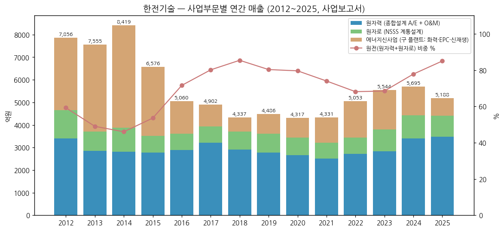

| 연도 | 원자력 | 원자로 | 에너지신사업(구 플랜트) | 합계 | 원전 비중 |
|------|--------|--------|------------------------|------|-----------|
| 2012 | 3,400 | 1,253 | 3,203 | 7,856 | 59.2% |
| 2013 | 2,861 | 841 | 3,853 | 7,555 | 49.0% |
| 2014 | 2,818 | 1,055 | 4,546 | 8,419 | 46.0% |
| 2015 | 2,783 | 739 | 3,054 | 6,576 | 53.6% |
| 2016 | 2,883 | 737 | 1,440 | 5,060 | 71.5% |
| 2017 | 3,212 | 716 | 974 | 4,902 | 80.1% |
| 2018 | 2,906 | 797 | 634 | 4,337 | 85.4% |
| 2019 | 2,771 | 831 | 884 | 4,486 | 80.3% |
| 2020 | 2,667 | 769 | 881 | 4,317 | 79.6% |
| 2021 | 2,516 | 689 | 1,127 | 4,331 | 74.0% |
| 2022 | 2,713 | 728 | 1,611 | 5,053 | 68.1% |
| 2023 | 2,827 | 968 | 1,748 | 5,544 | 68.5% |
| 2024 | 3,396 | 1,035 | 1,264 | 5,695 | 77.8% |
| 2025 | 3,470 | 940 | 778 | 5,188 | 85.0% |

(사업부 명칭 매핑: 2016 이전 "플랜트" → 2017~ "에너지신사업". 원자로 = 구 "원자로설계개발단". 각 연도 사업보고서)

**전사 분기 시계열 (2012Q1 ~ 2026Q2, 58분기 완전체):**

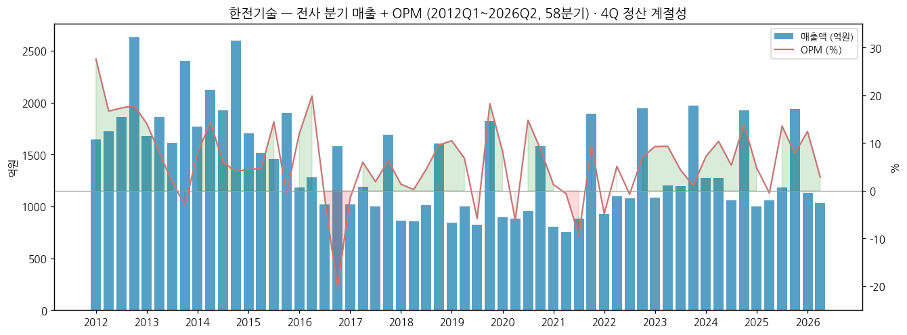

→ **4Q 정산 계절성 뚜렷**: 진행률 정산·연말 준공 인식으로 4Q 매출이 1~3Q 평균 대비 1.6~1.9배 (2021~2025 매년 반복)
→ 2012~2016은 누계 공시 → 차감으로 분기 환산, 2017~는 분기 공시. 2017 분기는 재작성 전 기준 (분기 합 OP 181억 vs 재작성 연간 329억)

**사업부별 분기 시계열 (2021Q1 ~ 2026Q2, 22분기):**

각 차트 = 사업부 매출 (bar, 좌축) + 전사 매출 내 비중 (line, 우축). **사업부별 영업이익은 회사가 공시하지 않아 OPM line 대신 비중 line 사용**

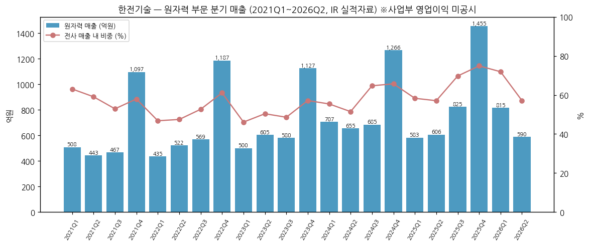
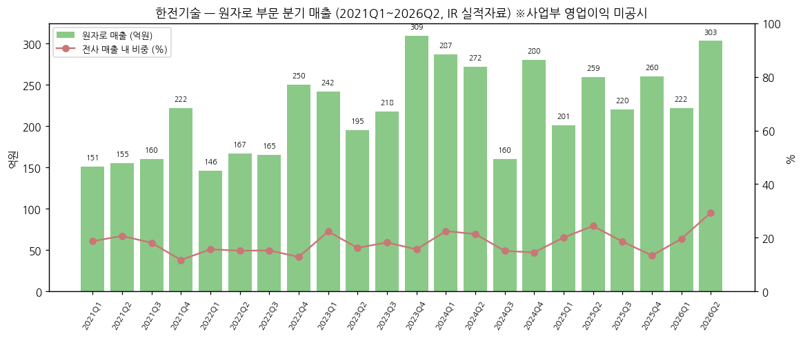
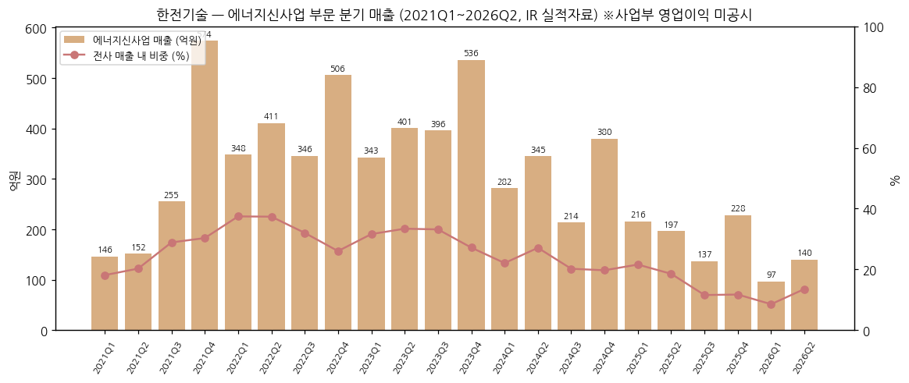

(출처: 각 분기 IR 실적자료 "본부별 매출 실적". 2025Q1·Q2·Q4는 2026 IR의 회계정책 변경 반영 비교치, 2025Q3는 2025 연간 − 3개 분기로 산출. 2021Q1~2024Q4는 원 공시 기준)

**2Q26 핵심 (최신 분기, 2026-08-07 IR):**
- 매출 **1,033억원** (QoQ -8.9%, YoY -2.7%) / 영업이익 **30억원** (OPM 2.9%, YoY 흑자전환) / 순이익 27억원
- 사업부: 원자력 590억 / 원자로 303억 / 에너지신사업 140억
- 증감 사유 (회사): 새울3,4호기 준공 임박 매출 감소 ↔ **체코 두코바니·신한울3,4 용역매출 본격화**, 인도네시아 EPC 준공 임박 감소, i-SMR 등 정부과제 2단계 진입으로 과제매출 감소
- 판관비 188억 (QoQ +29.3%) → OP 급감 (1Q26 141억 → 2Q26 30억)
- 1H26 누계: 매출 2,166억 (YoY +5.1%), 원자력 설계 1,070억 (YoY +22.2%)

**12분기 시계열 (2023Q3 ~ 2026Q2):**

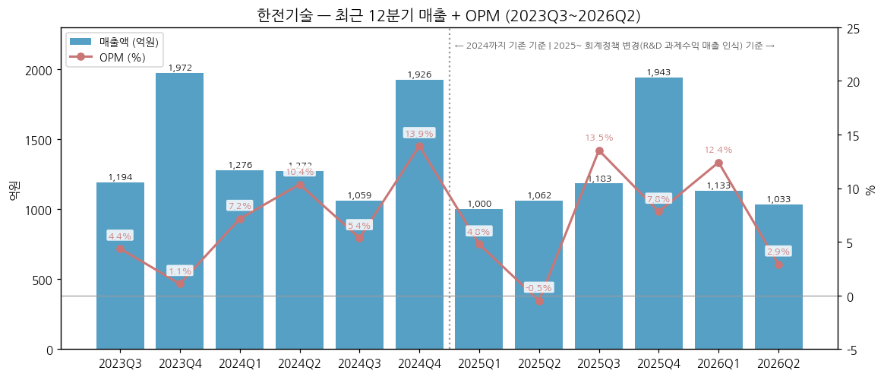

| 분기 | 매출 | 영업이익 | OPM | 메모 |
|------|------|---------|-----|------|
| 2023-Q3 | 1,194 | 52 | 4.4% | 신한울3,4 종합설계·O&M 견인 |
| 2023-Q4 | 1,972 | 21 | 1.1% | 4Q 정산 매출 vs 비용 집중 |
| 2024-Q1 | 1,276 | 91 | 7.2% | 신한울3,4 매출 인식 본격화 |
| 2024-Q2 | 1,272 | 132 | 10.4% | |
| 2024-Q3 | 1,059 | 57 | 5.4% | 에너지신사업 매출 감소 |
| 2024-Q4 | 1,926 | 268 | 13.9% | 연간 OP 정점 (원 공시 548억) |
| 2025-Q1 | 1,000 | 48 | 4.8% | 정책변경 기준 (원 공시 964/12) · 구사옥 매각이익 792억 → 순이익 659억 |
| 2025-Q2 | 1,062 | -5 | -0.5% | 원 공시 1,023/-44 · 사업공정 지연 |
| 2025-Q3 | 1,183 | 160 | 13.5% | 산출치 (원 공시 1,146/123) |
| 2025-Q4 | 1,943 | 152 | 7.8% | 체코 두코바니 계약 (2025-12) |
| 2026-Q1 | 1,133 | 141 | 12.4% | 두코바니·신한울3,4 설계 매출 증가 |
| **2026-Q2** | **1,033** | **30** | **2.9%** | **판관비 증가, 새울3,4 준공 임박** |

(단위: 억원. 2025 분기는 2025.12 회계정책 변경 기준 — 연간 합 5,188억/355억 일치 확인. 2023~2024 분기는 원 공시 기준이라 연간 소급치와 차이)

### ② 사업부별 개요 (매출 비중 큰 순서)

**원자력 부문 (종합설계, A/E) — 매출 비중 66.9% (2025)**

"원전의 '건물 전체 설계도'를 그리는 사업 — 터빈·발전·냉각 등 2차 계통과 BOP(보조설비)까지 발전소를 하나로 엮는 설계."

- **신규 원전 종합설계**: 신한울3,4 (4,681억, ~2033), 새울3,4 (구 신고리5,6, 5,174억, ~2026-11 준공 임박), **체코 두코바니5,6 (12,395억, 2025-12 ~ 2038-04)**
- **수출 원전**: UAE 바라카 종합설계 (8,493억, 완료 단계), Barakah LTEA 장기 엔지니어링 지원 (3,400억, ~2031), 루마니아 CTRF(삼중수소제거설비) 종합설계 (393억)
- **가동원전 O&M**: 주기적 안전성평가, 성능개선, 가동원전 긴급지원 기술용역 (2025 310억)
- **사후관리**: 원전 해체, 방사성폐기물 처분 설계

**원자로 부문 (원자로계통설계, NSSS) — 매출 비중 18.1% (2025)**

"원자로 '심장부'(1차 계통: 원자로·증기발생기·냉각재 계통) 설계 — 국내에서 한전기술만 보유한 역량."

- **신규 원전 NSSS**: 새울3,4 (1,953억), 신한울3,4 (1,651억, 두산에너빌리티 발주), **체코 두코바니5,6 (3,718억, 2025-12)**, UAE 원자로계통설계 (1,902억)
- **SMR**: i-SMR (혁신형 SMR, 170MWe) 계통설계·BOP 종합설계 주관 참여, 자체 해양부유식 SMR "BANDI" 개발, SMART·SFR
- **가동원전 O&M**: 원자로 계통 설비 개선, 자재 구매 지원

**에너지신사업 부문 (비원전) — 매출 비중 15.0% (2025, 2023 31.5%에서 급감)**

"원전 외 발전소 설계와 EPC(설계·구매·시공 일괄) — 수주 따라 매출 변동이 큰 저마진 사업."

- **화력·복합 설계**: 신호남·신일산 복합 (366억, 2025-07), 음성복합, 고성 천연가스, 신서천화력(일시중지)
- **신재생 EPC**: 제주한림해상풍력 (100MW, 2024-11 준공), 완도금일 풍력 EPC, 신안 읍동 ESS EPC (427억, NTP 대기)
- **해외 EPC**: 인도네시아 PLN 가스엔진 발전소 (Sumbawa-2, Tobelo) — 준공 임박·기간 연장 협의
- **수소·연료전지**: 왕신 연료전지 발전 EPC (1,997억, NTP 미교부)

### ③ 사업부별 디테일

**현재 가장 잘나가는 사업 (top-seller):**

- **원자력 설계 (A/E)**
    - 2025 매출 2,488억 (전사 48.0%), 1H26 1,070억 (YoY +22.2%)
    - 체코 두코바니 + 신한울3,4 설계 동시 진행 → 고마진 설계 매출 비중 상승
    - 해외(체코) 원자력 매출 495억 (2025, 전사 9.5%)

**향후 큰 매출 기대 사업 (growth):**

- **체코 두코바니 5·6호기 (A/E + NSSS 합계 1.61조, ~2038)**
    - 2025 인식 226억 → 잔액 15,887억 (A/E 12,176억 + NSSS 3,711억)
    - 연평균 약 1,200억 수준 매출 기여 가능 (계약기간 12.3년 단순 안분 기준, 추정)
- **후속 해외 원전 (미확정 파이프라인)**
    - 체코 테멀린 3·4호기 (2027 건설 여부 결정 예정), 베트남 닌투언 2호기 (2027 중순 본계약 기대), 튀르키예 시노프 (2026 하반기 우선협상 전망), UAE 바라카 5~8호기 [SK증권 2026-05-22, 키움증권 2026-10-16 리포트]
    - 미국 대형원전 8기 논의: 6기 AP1000 / 2기 APR1400 보도 (메트로신문 2026-09-10) — **APR1400 채택 시 기당 설계 6,000~8,000억 (키움증권 추정)**
- **i-SMR**
    - 2026-02-27 표준설계인가 신청 (i-SMR 기술개발사업단), 2028 인가 목표, 2035 1호기 준공 목표, R&D 총 3,992억 (2023~2028) [한국경제 2026-03-04]

**이익 outlier (회사 공시 기준):**

- 사업부 영업이익 미공시. 2025 연간 매출총이익률: 용역 23.5% vs 공사(EPC) 7.3% (용역매출 4,624억/원가 3,538억, 공사매출 564억/원가 522억) → **설계 용역 = 이익원, EPC 공사 = 마진 희석**
- 2024 공사매출원가(863억) > 공사매출(756억) → EPC 원가율 114% 손실 (인도네시아·한주 가스복합 등)
- 2025 순이익 854억 중 용인 구사옥 매각 처분이익 약 792억(1Q25, 기타이익) 포함 → 일회성 제외 경상 순이익 약 250억 수준 (추정)

### ④ 주요 경쟁사 (사업부별)

| 사업부 | 국내 | 해외 |
|--------|------|------|
| 원자력 A/E | (국내 전담 — 사실상 경쟁 없음) | Bechtel, Sargent & Lundy, AtkinsRéalis, Jacobs, EDF(Edvance) |
| 원자로 NSSS | (국내 유일) | Westinghouse (AP1000), Framatome (EPR), Rosatom (VVER), CNNC (Hualong One) |
| SMR | (i-SMR 사업단 내 협력: 한수원·두산에너빌리티·원자력연구원) | NuScale, GE-Hitachi (BWRX-300), Rolls-Royce SMR, Holtec |
| 화력·신재생 EPC | 두산에너빌리티, 현대건설, 삼성E&A, DL이앤씨, 한국종합기술 | - |

### ⑤ 주요 매출처

> ⚠️ 사업보고서는 5% 이상 단일 거래처만 공시. 아래는 2025 사업보고서 X. 대주주 등과의 거래 + 수주상황 기준.

| 순위 | 매출처 | 관계 | 2025 규모 |
|------|--------|------|-----------|
| 1 | **한국수력원자력㈜** | 한전 자회사 (이해관계자) | 기술용역 **2,635억 (매출 50.8%)** |
| 2 | **한국전력공사** | 최대주주 | UAE ENP 1~4호기 종합설계 (장기계약 8,159억, 진행 중) |
| 3 | **두산에너빌리티㈜** | 주기기사 (NSSS 하도급 발주) | 신한울3,4·체코 NSSS (계약 1,651억 + 3,718억) |
| 4 | **Nawah Energy (UAE)** | 바라카 운영사 | LTEA 장기 엔지니어링 (A/E 3,400억 + NSSS 900억) |
| 5 | 발전공기업 (동서·중부·남동발전) | 한전 계열 | 복합·화력 설계 |
| - | **KHNP Czech / EDU II** (체코 두코바니) | 해외 | 두코바니 5·6호기 A/E 계약 (2025-12-12, 한수원 발주 구조) |

→ **한전 그룹 내부 매출 의존도 매우 높음** (한수원 단독 50%+, 한전·발전사·두산 경유 포함 시 80%+ 추정)

### ⑥ 생산 CAPA + 임직원 추이

**설비:** 엔지니어링 업종 특성상 생산설비 없음 — 김천 본사 (토지 131,144㎡, 건물 연 164,143㎡, 장부가 2,273억, 2025말). 용인 구사옥은 2025-02 매각 완료

**수주 CAPA = 계약잔액 (당기 수익발생 사업 기준):**

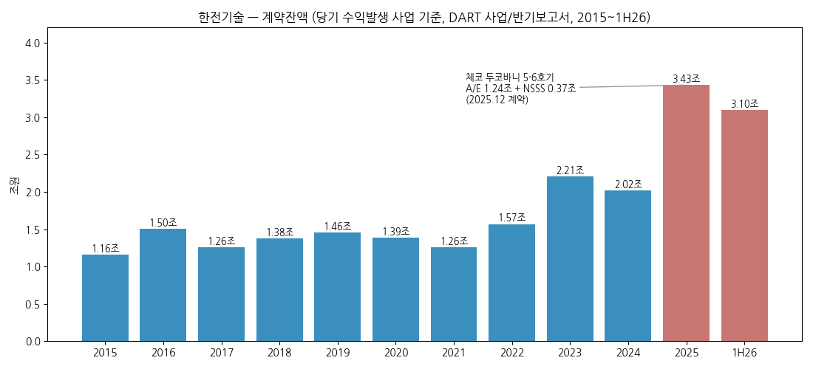

| 기준일 | 계약잔액 (억원) | 원도급액 합계 (억원) | 비고 |
|--------|----------------|---------------------|------|
| 2015말 | 11,557 | 49,781 | 국내 9,944 / 해외 1,613 |
| 2016말 | 15,037 | 53,106 | 국내 12,313 / 해외 2,724 |
| 2017말 | 12,572 | 55,728 | 국내 10,724 / 해외 1,848 |
| 2018말 | 13,784 | 49,822 | 국내 9,546 / 해외 4,238 |
| 2019말 | 14,579 | 52,817 | 국내 9,965 / 해외 4,614 |
| 2020말 | 13,898 | 47,403 | 국내 9,049 / 해외 4,848 |
| 2021말 | 12,556 | 45,421 | 국내 8,079 / 해외 4,477 |
| 2022말 | 15,691 | 50,969 | |
| 2023말 | 22,092 | 57,137 | 신한울3,4 NSSS·인니 EPC 추가 |
| 2024말 | 20,209 | 59,877 | |
| **2025말** | **34,323** | **70,688** | **체코 두코바니 반영 (해외 원자력 20,090억)** |
| 1H26 | 30,991 | 66,841 | 해외 원자력 15,221억 |

(출처: DART 사업/반기보고서 II "프로젝트 종류별 완성도 현황" 국내·해외 소계 합 — 당기 매출 발생 사업만 집계, 회사 전체 수주잔고와 다름. 2015~2021 v1.1 신규(2015~2018은 기재정정 사업보고서 2020-03-30), 2022~1H26 DART와 일치 확인)

**임직원 수 추이 (사업보고서 VIII, 기말 현원):**

| 연도 | 직원 수 | 평균 근속 (년) | 1인 평균 급여 (백만원) |
|------|---------|---------------|----------------------|
| 2014 | 2,297 | 15.9 | 76 |
| 2015 | 2,260 | 17.0 | 85 |
| 2016 | 2,329 | 16.6 | 84 |
| 2017 | 2,233 | 17.3 | 87 |
| 2018 | 2,386 | 16.7 | 79 |
| 2019 | 2,332 | 16.0 | 74 |
| 2020 | 2,426 | 16.1 | 77 |
| 2021 | 2,398 | 16.1 | 90 |
| 2022 | 2,298 | 16.6 | 93 |
| 2023 | 2,356 | 15.6 | 92 |
| 2024 | 2,407 | 14.4 | 94 |
| 2025 | 2,466 | 13.0 | 92 |
| 1H26 | 2,506 | 12.3 | (반기 45) |

→ 인건비 = 원가의 핵심 (엔지니어 2,500명 규모). 매출/인 2025 약 2.1억원

---

## 4. 재무 구조

> **재무제표 수치: OpenDART fnlttSinglAcntAll (2014~2019 별도재무제표 OFS — 종속기업 없어 별도=연결 / 2020~ 연결재무제표 CFS), 2026-11-03 조회.** 각 연도 값은 해당 연도를 포함하는 가장 최근 공시 기준(정정·소급 반영). 단위 억원

### ① 손익계산서 (12년, 억원, 좌→우 시간순)

| 연도 | 매출 | 매출원가 | 매출총이익 | GPM | 판관비 | CIR | 영업이익 | OPM | 순이익 | NPM | EPS(원) |
|------|------|----------|-----------|-----|--------|-----|----------|-----|--------|-----|---------|
| 2014 | 8,419 | 6,697 | 1,722 | 20.5% | 1,056 | 12.5% | 666 | 7.9% | 548 | 6.5% | 1,439 |
| 2015 | 6,576 | 5,164 | 1,412 | 21.5% | 1,269 | 19.3% | 143 | 2.2% | 150 | 2.3% | 395 |
| 2016 | 5,060 | 3,344 | 1,716 | 33.9% | 1,593 | 31.5% | 123 | 2.4% | 226 | 4.5% | 594 |
| 2017 | 4,902 | 3,381 | 1,521 | 31.0% | 1,192 | 24.3% | 329 | 6.7% | 325 | 6.6% | 853 |
| 2018 | 4,337 | 2,969 | 1,368 | 31.5% | 1,153 | 26.6% | 215 | 5.0% | 129 | 3.0% | 340 |
| 2019 | 4,486 | 3,245 | 1,241 | 27.7% | 801 | 17.8% | 441 | 9.8% | 264 | 5.9% | 694 |
| 2020 | 4,317 | 3,097 | 1,220 | 28.3% | 924 | 21.4% | 296 | 6.8% | 202 | 4.7% | 530 |
| 2021 | 4,331 | 3,262 | 1,069 | 24.7% | 968 | 22.4% | 101 | 2.3% | 165 | 3.8% | 432 |
| 2022 | 5,053 | 3,943 | 1,110 | 22.0% | 970 | 19.2% | 139 | 2.8% | 180 | 3.6% | 472 |
| 2023 | 5,544 | 4,425 | 1,118 | 20.2% | 740 | 13.3% | 378 | 6.8% | 327 | 5.9% | 858 |
| 2024 | 5,695 | 4,195 | 1,499 | 26.3% | 790 | 13.9% | 709 | 12.5% | 585 | 10.3% | 1,538 |
| 2025 | 5,188 | 4,061 | 1,127 | 21.7% | 772 | 14.9% | 355 | 6.8% | 854 | 16.5% | 2,244 |

(전 항목 OpenDART: 2014~2019 별도, 2020~ 연결. 2015~2017 감리 재작성치(DART 기재정정 2020-03-30) / 2023·2024 회계정책 변경 소급. v1.0 대비 2015: 매출원가 4,960→5,164, 매출총이익 1,616→1,412, OP 347→143, 순이익 310→150억, EPS 816→395원 / 2016: 매출원가 3,196→3,344, 매출총이익 1,864→1,716, 판관비 1,804→1,593, OP 59→123, 순이익 178→226억, EPS 468→594원. 2016 GPM 33.9%·CIR 31.5%는 당시 원가·판관비 분류 방식 영향 — 시계열 비교 시 OPM 중심으로 볼 것)

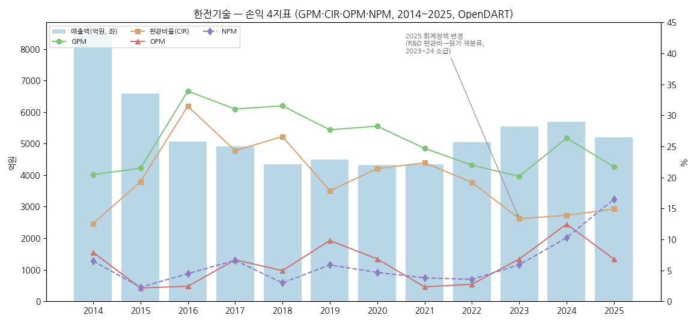

### ② 재무상태표 (12년, 억원)

| 연도 | 자산총계 | 부채총계 | 자본총계 | 자본 YoY | 부채비율 | 현금성자산 |
|------|---------|---------|---------|----------|----------|-----------|
| 2014 | 7,776 | 3,705 | 4,071 | - | 91.0% | 763 |
| 2015 | 8,391 | 4,384 | 4,007 | -1.6% | 109.4% | 153 |
| 2016 | 7,755 | 3,648 | 4,107 | +2.5% | 88.8% | 215 |
| 2017 | 7,622 | 3,051 | 4,570 | +11.3% | 66.8% | 184 |
| 2018 | 7,715 | 3,101 | 4,614 | +1.0% | 67.2% | 315 |
| 2019 | 7,352 | 2,430 | 4,922 | +6.7% | 49.4% | 693 |
| 2020 | 7,003 | 2,012 | 4,991 | +1.4% | 40.3% | 391 |
| 2021 | 7,055 | 1,921 | 5,135 | +2.9% | 37.4% | 302 |
| 2022 | 8,165 | 2,731 | 5,434 | +5.8% | 50.3% | 453 |
| 2023 | 8,550 | 3,077 | 5,473 | +0.7% | 56.2% | 522 |
| 2024 | 9,468 | 3,694 | 5,775 | +5.5% | 64.0% | 465 |
| 2025 | 8,855 | 2,606 | 6,250 | +8.2% | 41.7% | 273 |
| 1H26 | 7,915 | 1,988 | 5,927 | (-5.2% vs 25말) | 33.5% | - |

(OpenDART. v1.0 대비 2015 자산 8,552→8,391·자본 4,168→4,007억, 2016 자산 7,866→7,755·부채 3,647→3,648·자본 4,219→4,107억 — 감리 재작성 반영. 2014·2017~1H26 일치)

→ 자산의 핵심은 **미청구공사 2,724억 (2025말, 자산 30.8%)** — 진행률 수익 인식 후 미청구분. 유동금융자산 1,438억
→ 부채 대부분은 매입채무·초과청구공사·퇴직급여 관련. **차입금 0** (2025말)

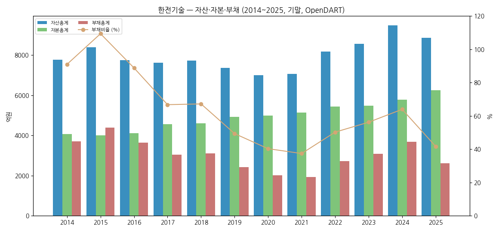

### ③ 현금흐름표 (12년, 억원)

| 연도 | 영업CF | 투자CF | 재무CF | CapEx (유형) | 배당지급 | FCF |
|------|--------|--------|--------|--------------|----------|-----|
| 2014 | 167 | -141 | -242 | 1,462 | 155 | -1,295 |
| 2015 | 113 | -1,349 | +627 | 820 | 219 | -707 |
| 2016 | 187 | -76 | -42 | 58 | 76 | 129 |
| 2017 | 626 | -86 | -569 | 14 | 42 | 612 |
| 2018 | 810 | -506 | -174 | 12 | 84 | 799 |
| 2019 | 271 | +472 | -364 | 24 | 53 | 247 |
| 2020 | 168 | -339 | -131 | 42 | 118 | 126 |
| 2021 | -158 | +190 | -121 | 16 | 107 | -174 |
| 2022 | 68 | +187 | -103 | 14 | 91 | 54 |
| 2023 | 408 | -220 | -119 | 28 | 108 | 380 |
| 2024 | 490 | -344 | -207 | 46 | 196 | 444 |
| 2025 | 293 | -95 | -390 | 46 | 380 | 247 |

(OpenDART 현금흐름표 — 2014~2025 전 항목 v1.0과 일치 확인. FCF = 영업CF − 유형자산 취득. 2014~2015 김천 사옥 건설, 2015 재무CF +627억은 사옥 관련 차입 추정. 영업CF는 미청구공사 증감에 크게 좌우)

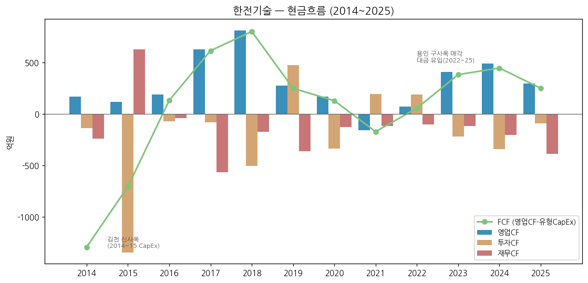

### ④ CapEx 추이 (12년, 억원)

| 연도 | CapEx 유형 | CapEx 무형 | 총 CapEx | 감가상각비 |
|------|-----------|-----------|----------|-----------|
| 2014 | 1,462 | 77 | 1,538 | 60 |
| 2015 | 820 | 80 | 900 | 107 |
| 2016 | 58 | 145 | 203 | 155 |
| 2017 | 14 | 39 | 53 | 152 |
| 2018 | 12 | 67 | 79 | 149 |
| 2019 | 24 | 34 | 58 | 197 |
| 2020 | 42 | 28 | 70 | 159 |
| 2021 | 16 | 11 | 28 | 163 |
| 2022 | 14 | 14 | 28 | 153 |
| 2023 | 28 | 44 | 72 | 155 |
| 2024 | 46 | 26 | 71 | 157 |
| 2025 | 46 | 31 | 77 | 159 |

**주요 CapEx 항목:**
- 2013~2015 김천 혁신도시 본사 신축 (2015-08 이전) — 이후 CapEx는 연 100억 미만 (IT·설계 SW 위주)
- 엔지니어링 = **경자산(asset-light)** 모델: CapEx/매출 1~2%

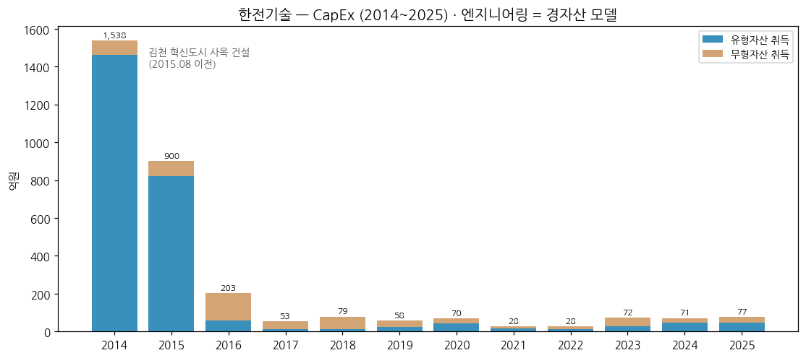

### ⑤ 부채구조 (12년, 억원)

| 연도 | 유동부채 | 비유동부채 | 부채총계 | 부채비율 | 유동비율 |
|------|----------|------------|----------|----------|----------|
| 2014 | 3,158 | 547 | 3,705 | 91.0% | 112.5% |
| 2015 | 3,423 | 961 | 4,384 | 109.4% | 93.6% |
| 2016 | 2,866 | 782 | 3,648 | 88.8% | 89.3% |
| 2017 | 2,219 | 833 | 3,051 | 66.8% | 116.1% |
| 2018 | 2,484 | 617 | 3,101 | 67.2% | 113.3% |
| 2019 | 2,235 | 195 | 2,430 | 49.4% | 115.2% |
| 2020 | 1,873 | 139 | 2,012 | 40.3% | 127.0% |
| 2021 | 1,836 | 86 | 1,921 | 37.4% | 139.7% |
| 2022 | 2,448 | 284 | 2,731 | 50.3% | 153.8% |
| 2023 | 2,502 | 575 | 3,077 | 56.2% | 180.7% |
| 2024 | 3,610 | 83 | 3,694 | 64.0% | 159.5% |
| 2025 | 2,560 | 46 | 2,606 | 41.7% | 214.8% |

(OpenDART. 2015·2016 감리 재작성 반영: 부채비율 2015 105.2→109.4%, 2016 86.4→88.8% / 유동비율 2015 99.8→93.6%, 2016 94.5→89.3%)

**채무증권·차입:** 2025말 차입금 없음 (이자율 위험 없음, 사업보고서). 2023년 중 단기차입 717억 차입·전액 상환. 신용등급 **AA (NICE·한기평, 2025-05) / Moody's A2 (2025-12)**

### ⑥ 배당·자사주 추이 (12년)

| 연도 | 현금배당총액 (억원) | 주당배당 (원) | 배당성향 (%) | 자사주 취득 |
|------|-------------------|--------------|--------------|------------|
| 2014 | 219 | 575 | 40.0 | 52억 (2014) |
| 2015 | 76 | 200 | 50.7 | - |
| 2016 | 42 | 110 | 18.5 | - |
| 2017 | 84 | 220 | 25.8 | - |
| 2018 | 53 | 140 | 41.2 | - |
| 2019 | 118 | 310 | 44.7 | - |
| 2020 | 107 | 282 | 53.2 | - |
| 2021 | 91 | 238 | 55.0 | - |
| 2022 | 108 | 283 | 60.0 | - |
| 2023 | 196 | 515 | 60.0 | - |
| 2024 | 380 | 999 | 65.0 | - |
| 2025 | 512 | 1,347 | 60.0 | - |

(해당 연도 결산배당 기준 — 배당총액은 OpenDART 현금흐름표 익년 "배당금지급"과 2014~2024분 전 연도 일치 확인, FY2025분 512억 = 2026 상반기 지급[DART 반기보고서(2026.06)]. 배당성향 2015·2016은 재작성 순이익 기준으로 재계산(v1.0 24.5%·23.5% → 50.7%·18.5%). 자기주식 176,495주(0.46%) 보유 — 2013~2014 취득분, 이후 변동 없음)

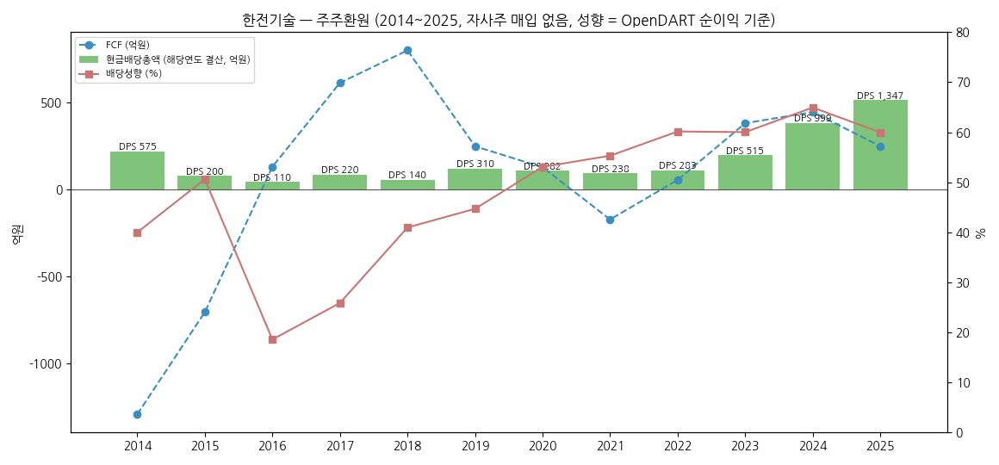

→ **배당정책: 모회사 한국전력공사의 배당결정에 따라 당기순이익 일부 배당** (사업보고서). 2022~ 배당성향 60~65%로 상향 정착, 2025 DPS 1,347원 (역대 최대, 구사옥 매각이익 포함 순이익 기준)

### ⑦ 재무 비율 (12년)

| 연도 | ROE | ROA | 부채비율 | 유동비율 | 이자보상배율 (OP/금융원가) |
|------|-----|-----|----------|----------|---------------------------|
| 2014 | 13.4% | 7.0% | 91.0% | 112.5% | 53x |
| 2015 | 3.7% | 1.9% | 109.4% | 93.6% | 14x |
| 2016 | 5.6% | 2.8% | 88.8% | 89.3% | 5.0x |
| 2017 | 7.5% | 4.2% | 66.8% | 116.1% | 77x |
| 2018 | 2.8% | 1.7% | 67.2% | 113.3% | 29x |
| 2019 | 5.5% | 3.5% | 49.4% | 115.2% | 472x |
| 2020 | 4.1% | 2.8% | 40.3% | 127.0% | 309x |
| 2021 | 3.2% | 2.3% | 37.4% | 139.7% | 211x |
| 2022 | 3.4% | 2.4% | 50.3% | 153.8% | 33x |
| 2023 | 6.0% | 3.9% | 56.2% | 180.7% | 258x |
| 2024 | 10.4% | 6.5% | 64.0% | 159.5% | 873x |
| 2025 | 14.2% | 9.3% | 41.7% | 214.8% | 264x |

(OpenDART 기반 재계산 — 2015~2017은 감리 재작성 반영으로 v1.0 대비 변경(2015 ROE 7.5→3.7%, 2016 4.2→5.6%), 이자보상배율은 DART 금융원가 기준으로 전 연도 재산출. ROE·ROA = 순이익 / 기초·기말 평균. 2014 ROE는 기말 기준. 회사 IR 공시 ROE: 2021 3.2 / 2022 3.3 / 2023 6.0 / 2024 10.1 / 2025 13.7)

**밸류에이션 스냅샷 (2026-11-03, 주가 84,500원):**
- 시가총액 3.23조원 / PBR 약 5.4배 (1H26 자본 5,927억)
- TTM (3Q25~2Q26) 매출 5,292억 / 영업이익 482억 / 순이익 360억 (OpenDART: 2025 연간 − 1H25(2026 반기보고서 전기 소급 컬럼) + 1H26) → **TTM PER 약 90배**
- 배당수익률 약 1.6% (2025 DPS 1,347원 기준)

---

## 5. 지배 구조

### ① 그룹·계열 관계

- **본사**: 경상북도 김천시 혁신로 269 (율곡동)
- **기업집단**: 한국전력공사 계열 (공기업 집단). 한전은 정부(산업은행 32.9% + 정부 18.2%, 총 51.1%)가 지배
- **연결 종속기업**: 1개사 — **한전기술서비스㈜** (비상장, 2020 반기 편입, 시설·용역 자회사)
- **관계 계열사 (한전 그룹)**: 한국수력원자력(최대 고객), 한전KPS(원전 정비), 한전원자력연료, 발전공기업 5사 등
- **공공기관 지배구조**: 대표이사(사장)·상임이사는 공운법상 임명 절차(주총 → 상급기관), 노동이사제 도입 (2023-01 정관)

### ② 주주 구분 (2026-06-30 기준, 반기보고서)

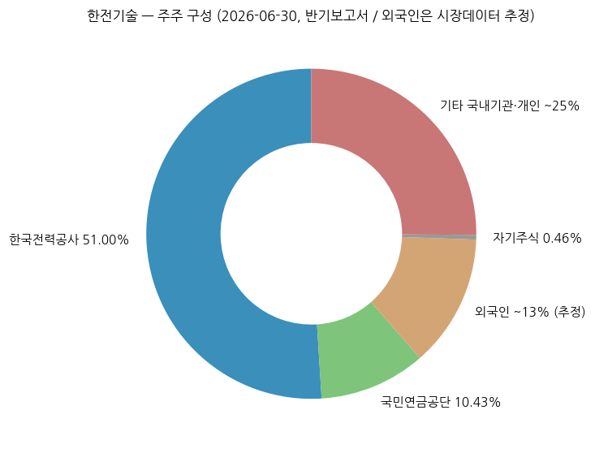

**5% 이상 주주:**

| 주주명 | 보유 주식수 | 지분율 | 비고 |
|--------|-------------|--------|------|
| 한국전력공사 | 19,493,600 | **51.00%** | 최대주주 (총발행주식 기준) |
| 국민연금공단 | 3,987,674 | **10.43%** | (의결권 주식 기준 10.48%) |

**전체 주주 구분:**

| 구분 | 지분율 | 비고 |
|------|--------|------|
| 한국전력공사 | 51.00% | DART 공시 |
| 국민연금공단 | 10.43% | 2026-06-30 |
| 외국인 | ~13% | 시장데이터 (stockhub.kr, 2026-10) — 추정 |
| 자기주식 | 0.46% | 176,495주 |
| 기타 (국내 기관·개인) | ~25% | 소액주주 110,437명이 의결권 주식 27.97% 보유 |

→ 유통주식 비율이 약 38% 수준 (한전+국민연금+자사주 제외)으로 낮음 → 수급 변동성 확대 요인

### ③ 임원·이사회 (2026-06-30 기준)

**대표이사:**

- **김태균 사장** (1964.11생, 2025-04-15 취임, 임기 ~2028-04-14)
    - 약력: 한양대 전기공학 박사, 前 한국전력공사 기술혁신본부장
    - 제22대 대표이사 (전임 김성암 2021-05 ~ 2025-04)

**상임이사 (사내):** 김종민 (전략기획본부장, 前 한전 전력기금사업단장), 박기조 (원자력사업본부장, 내부), 장병용 (에너지신사업본부장, 내부)

**상임감사:** 윤상일 (前 제18대 국회의원)

**비상임이사 (사외):** 이수경, 이동진(노동이사, 원전기술연구소), 장재권, 고필호, 안상준(UNIST 원자력공학과 부교수), 심선영(성신여대 경영학과 교수)

**이사회 내 위원회:** 경영전략혁신위원회, ESG위원회 등

**외부 감사:** 사업보고서 V. 참조 (적정의견)

---

## 6. 기타 팩트

### ① R&D 인프라

| 연도 | 연구개발비용 (억원) | R&D / 매출 |
|------|-------------------|-----------|
| 2014 | 634 | 7.5% |
| 2015 | 724 | 11.0% |
| 2016 | 619 | 12.2% |
| 2017 | 603 | 12.3% |
| 2018 | 474 | 10.9% |
| 2019 | 431 | 9.6% |
| 2020 | 425 | 9.8% |
| 2021 | 517 | 11.9% |
| 2022 | 549 | 10.9% |
| 2023 | 500 | 9.0% |
| 2024 | 590 | 10.4% |
| 2025 | 621 | 12.0% |

(정부보조금 차감 전 지출총액 기준. 2025 정부보조금 235억 — i-SMR 등 정부과제 확대)

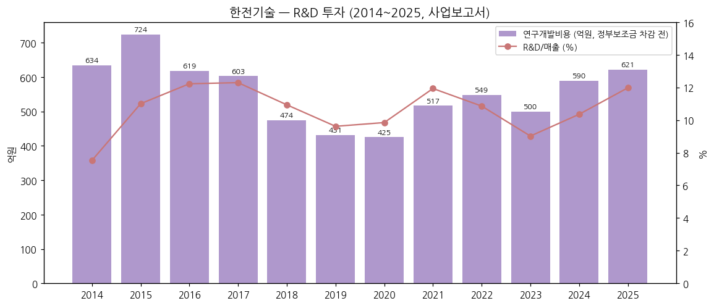

**R&D 체제:** 연구/사업 동시수행 체제 (전담 연구소 없이 본부·원전기술연구소 운영). 2025 진행 과제 93건 (자체 51 / 정부 42)

### ② 진행 중 corporate action — 10년치

```
2025-12  · 체코 두코바니 5·6호기 A/E·NSSS 계약 (합계 1.61조) ★
2025-12  · 정관 목적사업에 '연구 및 기술개발' 추가 + 회계정책 변경 (R&D 과제수익 매출 인식)
2025-02  · 용인 구사옥 매각 최종 권리양도 (957.6억, 처분이익 약 792억 인식)
2023-03  · 신한울3,4 NSSS 계약 (탈원전 중단 후 재개)
2022-04  · 용인 구사옥 매각 계약 체결 (블루코브3호 → 솔루엠 승계)
2020-H1  · 한전기술서비스㈜ 자회사 설립·연결 편입
2019     · 증선위 감리 조치 → 2015~2017 재무제표 재작성
(M&A 이력 없음 — 공기업 특성상 인수합병 없이 수주 중심 성장)
```

### ③ R&D·기술 마일스톤 — 10년치

```
2026-02  · i-SMR (170MWe) 표준설계인가 신청 (사업단) — 2028 인가 목표
2025     · 폐지 화력 동기조상설비 전환, ITER TBM 시스템 설계 등 과제 종결
2024-06  · 혁신형 SMR 정부 R&D 과제 착수
2023-07  · i-SMR 기술개발사업단 출범·참여
2023-05  · APR1000 EUR Rev.E 인증
2021-02  · ITER 기자재 공급 사업 수주
2020     · 한국형 표준복합화력 모델 개발 과제 주관
2018-10  · APR1400 미국 NRC 표준설계승인 (DC)
2017-11  · EU-APR 유럽사업자요건(EUR) 인증
2016     · 신한울3,4 종합설계 계약 (APR1400)
```

### ④ 주요 리스크

- **정책 리스크**: 매출의 80%+가 한전 그룹·정부 정책(전력수급기본계획) 연동 — 2017~2021 탈원전기 매출 정체 사례. 12차 전력수급기본계획 연말 발표 예정
- **노형 리스크 (미국)**: 미국 대형원전이 AP1000(Westinghouse) 위주로 확정 시 한전기술의 NSSS 설계 역할 제한 — 키움증권은 APR1400 채택 시에만 기당 6,000~8,000억 설계 수주 추정 (메트로신문 2026-09-10)
- **Westinghouse 지재권 이슈**: 팀코리아 해외 수출 시 Westinghouse와의 합의 조건이 수익성·시장 범위에 영향 (상세 조건 비공개 — 확인 필요)
- **EPC 손실 리스크**: 인도네시아 PLN 엔진발전소 EPC 기간 연장 협의, 왕신 연료전지·신안 ESS NTP 미교부, 신서천화력 일시중지
- **분기 변동성**: 4Q 정산 계절성 + 판관비 분기 편차로 분기 OPM -1%~14% 진폭 → 컨센서스 미스 빈번 (2Q26 사례)
- **환율**: 외화 순자산 소규모 (10% 변동 시 세전이익 ±3.3억, 2025말). 체코 계약(EUR 추정) 확대로 향후 노출 증가 가능
- **소송**: 제소 5건 (최대 296억 중재), 피소 5건 (최대 194억 손해배상), 소송충당부채 11.7억 (2025말)
- **밸류에이션**: TTM PER 약 90배 — 수주 기대 소멸 시 하방 변동성 (2026-04 → 11 -57%)

### ⑤ ESG 등급

| 평가기관 | 등급 | 비고 |
|---------|------|------|
| KCGS (한국ESG기준원) | 확인 필요 | 다음 갱신 시 verify |
| 「대한민국 공공기관 ESG평가」 | **1위** | 2024-09 수상 (회사 연혁) |
| 신용등급 | **AA (NICE·한기평) / A2 (Moody's)** | 2025 |

- ISO 37001 부패방지경영시스템 (2022-11), ISO 37301 규범준수경영시스템 (2023-06), ISO 14001 환경경영 (2015~)
- 2024-12 공공부문 온실가스 목표관리 환경부 장관 표창

### ⑥ 인증·라이선스

- **노형 설계 인증**: APR1400 미국 NRC DC (2018-10), EU-APR EUR (2017-11), APR1000 EUR Rev.E (2023-05)
- **품질**: 원자력 품질보증 체계 (KEPIC·ASME 기반 — 세부 인증 목록 확인 필요), ISO 9001 계열
- **사업면허**: 엔지니어링 용역, 건설업·건설기술용역업, 전기공사업, 소방시설 설계업 (정관 사업목적)

---

## Version Log

**v1.1 (2026-11-03) — DART 팩트 검증·보강:**
- **재무제표 DART 대조**: OpenDART fnlttSinglAcntAll(2014~2019 별도 OFS / 2020~ 연결 CFS) 연간 12년 × 손익·재무상태·현금흐름 약 300개 항목 + 분기 12분기 대조. 2017~2025 전 항목 일치(반올림 ±1억 이내), 2023·2024 소급치도 DART 2025 사업보고서 전기·전전기 컬럼과 일치
- **불일치 수정 (2015·2016 감리 재작성)**: DART 기재정정 사업보고서(2020-03-30)로 교체 — 2015 OP 347→143억·순이익 310→150억·자본 4,168→4,007억, 2016 OP 59→123억·순이익 178→226억·자본 4,219→4,107억 등. 파생 지표(OPM 평균 6.2→6.0%, 저점 평균, OPM range 10.3%pt, 배당성향, ROE·ROA, 유동비율, 이자보상배율) 재계산
- **TTM 매출** 5,293→5,292억 (DART 재계산)
- **계약잔액 2015~2021 신규** (DART 사업보고서 "프로젝트 종류별 완성도 현황") → chart13 확장
- **차트 재생성**: chart1·1b·4·9·12·13 (파일명 유지)
- 사업부(원자력·원자로·에너지신사업) 분기 매출 2021 이전: DART 분기보고서에는 본부별 분류가 없고 사업유형별(원자력 설계·석탄화력·O&M 등)로만 공시 → IR PDF 판독 필요 (잔여)
- 임직원·R&D·매출처·이사회·소송은 v1.0이 동일 사업보고서 원문(회사 IR 사이트 PDF)에서 작성 — DART 원문과 출처 동일

**v1.0 (2026-11-03) — 첫 작성:**
- ① source: 회사 IR 분기실적자료 62개 PDF (2011Q1~2026Q2) + 사업보고서 12개 (2014~2025) + 2026 반기보고서 + Yahoo Finance (상장~2026-11-03)
- ② DART OpenAPI `dart_download_reports` 43건 전부 실패 (dart.fss.or.kr 접속 차단/응답 없음) → 회사 IR 사이트 사업보고서 PDF로 대체
- ③ 2021Q2~2025Q3 IR PDF는 이미지 스캔본 → 페이지 이미지 판독으로 P&L·사업부 매출 수기 추출 (9개 PDF)
- ④ 차트 17종: chart1·1b·2(연간·전사58Q·원자력·원자로·에너지신사업)·4·5·6·7·8·9·10·11·12·13(계약잔액)

**v1.2 보완 후보 (잔여):**
- 3Q26 실적 (11월 초 IR 예정) → 12분기 시계열·사업부 분기 갱신
- 사업부 분기 매출 2012~2020 확장 (IR PDF 본부별 매출 도넛 차트 판독)
- 2023~2024 분기를 회계정책 변경 기준으로 재작성 (2025 IR 비교 컬럼 미제공 — 분기보고서 확인)
- 2026-10 주가 급락(-30%) 직접 원인 뉴스 verify, KCGS ESG 등급, Westinghouse 합의 조건
