# 한화솔루션 — 기업 개요 (v1.0)

> 마지막 update: 2026-11-25 (v1.0 — 첫 작성. 3Q26 분기보고서(2026-11-12 제출)·IR 3Q26 실적발표(2026-10-29)·2025 사업보고서 기재정정(2026-11-12) 반영)
> 입력 source: OpenDART fnlttSinglAcntAll (연결 CFS, 2015 사업보고서\~3Q26, 44개 JSON — 2014는 2015 사업보고서 전기 컬럼 + 2014 사업보고서 원문 요약재무, 2015 1Q\~3Q는 API 미제공 → 분기보고서 원문 XML) + DART 정기공시 원문 XML 64건 (사업·반기·분기보고서 2013.12\~2026.09, 감사보고서 첨부 포함, 기재정정본 우선 — 2013\~2020 원문은 EUC-KR 디코딩) + OpenDART 기업개황·최대주주·임원·직원·배당·자기주식·주식총수 (2025 사업보고서) + 한화솔루션(한화케미칼) IR 실적발표 PDF 35건 (1Q18\~3Q26, irgo 경유 — 2Q21·3Q21 및 2017년 PDF 4건 다운로드 실패, 4Q19\~4Q20 5건은 이미지 PDF라 후속 분기 PDF의 '사업부문별 실적-종합' 표로 대체) + Yahoo Finance (009830.KS 월간 2000-02\~2026-11, 일간 2020-01\~2023-12·2024-11\~2026-11-25, 009835.KS 우선주 일간) + 언론·신용평가 (아시아경제·서울신문·뉴스와이어·SBS Biz·이투데이·머니투데이·뉴시스·IB토마토·비즈워치·CEO스코어데일리, 2026-02\~2026-10)
> 갱신 주기: 매분기 (실적 리뷰 모드 호출 시)
> 워치리스트: **소재 / 정유·화학 섹터 / 서브섹터: 화학 (label = 케미칼 부문)** (`earnings/watchlist.md` 84\~86행·137행) — 2026-11-23 추가 섹터, 4Q26부터 리뷰. 기업 개요는 연결 전체(케미칼 + 신재생에너지 + 첨단소재 + 기타)를 다룸
> **Fact verify cutoff**: 2026-11-24 (보통주 2026-11-24 종가 **19,980원** [Yahoo 009830.KS 일간], 우선주 13,310원 [Yahoo 009835.KS]. 발행주식 보통주 **224,892,536주** (2025말 171,892,536주 + 2026-08 유상증자 신주 53,000,000주 [DART 분기보고서(2026.09) VII, 계산]) · 우선주 2,544,616주 (2026-08 자기 우선주 30,733주 소각 후) → 시가총액 **4.49조원(보통주) / 4.53조원(우선주 포함)** [계산]. **사상 최고 종가 58,500원 (2026-02-19)** [Yahoo 일간 — 이투데이 2026-02-20 "전 거래일 5만8천원대" 교차 확인] → 당시 보통주 시총 **10.06조원** (171,892,536주) [계산]. 단, **시가총액 기준 최고는 2022-09-15 약 10.39조원** (원주가 환산 54,326원 × 191,278,497주 — DART 2022 사업보고서 9월 종가 최고 54,600원과 일치) [계산]. 고점(종가) 대비 **-65.8%**, YTD **-25.4%** (2025-12-30 26,800원), 1년 **-24.5%** (2025-11-24 26,450원) — 2026-08 유상증자(발행가 22,100원) 권리락은 Yahoo 가격에 미조정. 2026-03-26 유상증자 공시 당일 -18.2% [서울신문 2026-03-27])

---

## 1. 기업 분류

- **Primary 분류: 사이클 — 석유화학 스프레드 + 태양광 모듈 가격의 이중(二重) 사이클** — 12년 OPM이 -2.7\~8.4% 범위에서 두 번의 정점(2016·2022)과 세 번의 저점(2014·2018\~19·2024\~25)을 그림. 손익을 흔드는 변수는 PE·PVC·가성소다·TDI 스프레드(중국 증설)와 모듈 판가·미국 정책(관세·IRA)이며, 둘 다 회사가 통제할 수 없는 외생 가격 변수
- **Secondary 노트: 정책 레버리지형 미국 태양광 (AMPC 보조금 의존) + 재무 레버리지 리스크** — 2025\~2026 신재생에너지 영업이익의 상당 부분이 미국 IRA 첨단제조세액공제(AMPC, 45X)에서 나옴 (3Q26 신재생 OP 1,051억 vs AMPC 2,118억 반영 — AMPC 제외 시 적자). 부채비율 196%(2025말) → 유상증자 1.17조 후 161%(3Q26)

### ① 정량 근거

**📊 Summary Box (12년, 2014\~2025 연결):**

| 지표 | 값 |
|------|-----|
| 매출 CAGR (2014→2025, 11년) | **+4.7%** (8.06조 → 13.33조) — 2020 한화큐셀앤드첨단소재 합병, 2021-04 갤러리아 합병, 2023-03 갤러리아 인적분할 등 사업 범위 변동 포함 |
| OPM 평균 | **4.2%** (12년 단순평균, 최고 8.4% 2016 · 최저 -2.7% 2025) |
| OPM 정점 평균 | **7.8%** (정점 2016 8.4% · 2022 7.1%) |
| OPM 저점 평균 | **1.0%** (저점 2014 1.8% · 2018 3.9% · 2025 -2.7%) |
| 사이클 주기 | **약 4\~6년** (저점→저점: 2014 → 2018\~19 → 2024\~25 / 정점→정점: 2016 → 2021\~22). 케미칼 부문 단독 OPM은 정점 2017(14.6%) → 2021(19.5%) 4년 주기 |
| 사이클 회수 (12년) | **2회 완결 + 3번째 저점 진행 중** (2014→2018, 2018→2024, 2024\~ 회복 초입) |
| 최근 2분기 | 2Q26 매출 45,827억(+47.0% YoY)·OPM 6.7% / 3Q26 매출 39,486억(+17.4% YoY)·OPM 2.3% [DART] — 회복 초입이나 케미칼은 3Q26 재적자 |

```
[전사 손익 시계열 (12년, 연결, DART 보고 기준)]
연도   매출(조)  영업이익  순이익   OPM    NPM   지배순이익  비고
2014     8.06     0.141    0.011    1.8    0.1     0.057   ← 한화케미칼. 태양광(SolarOne) 적자·유가 급락 역래깅, OPM 1.8% 저점①
2015     8.04     0.337    0.180    4.2    2.2     0.188   ← Q CELLS 통합(2015-02), 태양광 흑자 전환
2016     9.26     0.779    0.771    8.4    8.3     0.755   ← PVC·가성소다·TDI 호황 + 태양광 이익, OPM 8.4% 정점①
2017     9.34     0.756    0.835    8.1    8.9     0.825   ← 지분법(한화토탈·YNCC) 호조, 순이익 8,345억 (12년 최고)
2018     9.05     0.354    0.160    3.9    1.8     0.187   ← 中 PVC·TDI 증설·유가 하락, 4Q 적자전환
2019     9.50     0.378   -0.249    4.0   -2.6    -0.238   ← 폴리실리콘 철수(손상), 순손실 −2,489억 저점②
2020     9.20     0.594    0.302    6.5    3.3     0.309   ← 큐셀앤드첨단소재 합병(1월) → 한화솔루션
2021    10.73     0.738    0.616    6.9    5.7     0.619   ← 케미칼 OP 1.05조 슈퍼사이클(IR), 태양광 원가 급등 적자
2022    13.65     0.966    0.366    7.1    2.7     0.359   ← 매출 13.7조 정점, IRA 통과(8월)
2023    13.29     0.605   -0.155    4.5   -1.2    -0.208   ← 모듈가 하락·케미칼 스프레드 축소, 순손실
2024    12.39    -0.300   -1.369   -2.4  -11.0    -1.404   ← 모듈가 폭락·유통재고, 영업손실 −3,002억 저점③
2025    13.33    -0.365   -0.615   -2.7   -4.6    -0.650   ← AMPC에도 통관 지연·4Q 일회성(-4,898억), 2년 연속 적자

OPM range: -2.7 ~ 8.4% = 11.1%p  /  NPM range: -11.0 ~ 8.9% = 19.9%p  (순이익은 지분법·손상·중단사업으로 영업이익보다 진폭이 큼)
```

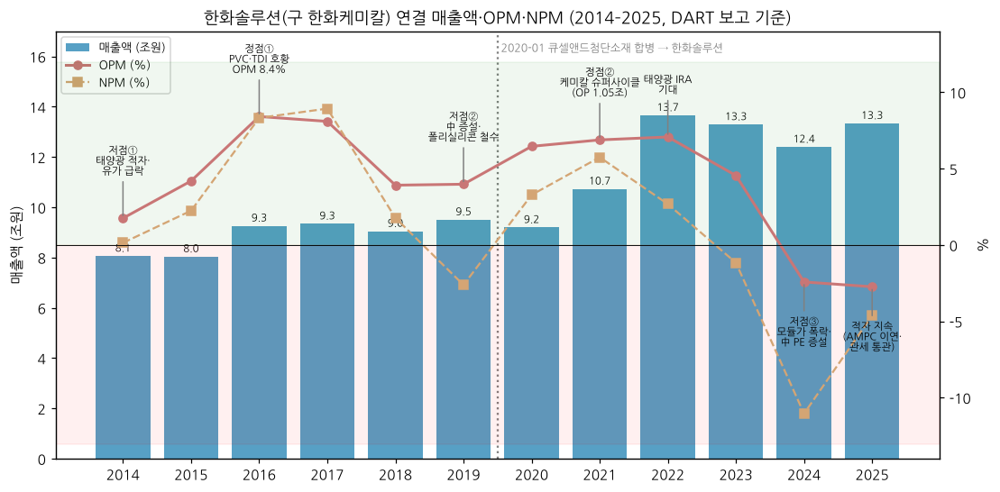

**사이클 변곡점 annotation (손익 표 연동):**

| 구간 | 연도 | 전사 OPM | 케미칼 OPM | 태양광 OPM | 무엇이 움직였나 (원인) |
|---|---|---|---|---|---|
| 저점① | 2014 | 1.8% | 원료 -0.4% | 0.4% | 하반기 유가 급락 → 원재료 재고손실(역래깅), 원료부문 영업손실 -160억 [DART 사업보고서(2014.12) II] |
| 회복 | 2015 | 4.2% | 4.3% | 2.7% | 2015-02 Hanwha Q CELLS 통합 출범, 저유가로 PE 스프레드 확대 |
| 정점① | 2016\~2017 | 8.4%·8.1% | 12.2%·14.6% | 5.4%·0.4% | PVC·가성소다·TDI 동반 호황 + 2016 태양광 2,125억 이익 [IR 2018-05 종합표] |
| 하강 | 2018 | 3.9% | 9.2% | -0.9% | 중국 TDI·PVC 증설, 유가 하락 역래깅 → 4Q18 연결 영업손실 -959억, 미국 세이프가드(2018-02) |
| 저점② | 2019 | 4.0% | 7.4% | 5.1% | 폴리실리콘 사업 철수 결정(2020-02, 중단사업) → 4Q19 순손실 -5,031억, 연간 순손실 -2,489억 |
| 상승 | 2020\~2021 | 6.5%·6.9% | 11.5%·19.5% | 5.1%·-9.2% | 코로나 후 PVC·가성소다 슈퍼사이클 — 케미칼 OP 1.05조(2021). 반대로 태양광은 폴리실리콘·물류비 급등으로 적자 → **두 사이클이 서로 상쇄** |
| 정점② | 2022 | 7.1% | 10.0% | 6.8% | 매출 13.65조 정점, 2022-08 미국 IRA 통과 → 4Q22 신재생 OP 2,319억 (케미칼은 4Q22 적자 전환) |
| 하강 | 2023 | 4.5% | 1.2% | 8.3% | 태양광 정점(신재생 OP 5,398억) vs 케미칼 붕괴(중국 PE 대규모 증설) |
| 저점③ | 2024\~2025 | -2.4%·-2.7% | -2.5%·-5.4% | -4.5%·-1.4% | 모듈가 폭락·미국 유통재고, 2025 미국 세관 통관 지연(한국산 셀 억류)으로 조지아 공장 저가동 → 4Q25 영업손실 -4,898억 [IR] / [CEO스코어데일리 2026-02-05] |
| 회복 초입 | 9M26 | 3.9% | 1.8% | 4.9% | 카터스빌 솔라허브 가동 + AMPC + 2Q26 관세 환급 일회성. 케미칼은 중동 리스크 프리미엄 소멸·역래깅으로 3Q26 재적자 [IR 3Q26] |

(부문 OPM: 2015\~2017 IR 구양식(연결조정 별도), 2018\~ IR 신양식(연결조정 배분) [IR 2018-05·2026-10 '사업부문별 실적-종합'], 2014는 DART 사업의 내용 원료·태양광 부문. 9M26 전사 OPM은 DART 9M 누적 4,896억 / 124,132억)

### ② 산업 분류

- 산업: **석유화학 (PE·PVC·가성소다·TDI, NCC는 합작사 여천NCC) + 태양광 (셀·모듈 제조, 미국 다운스트림·EPC·에너지 서비스) + 소재 (자동차 경량복합소재·태양광 EVA시트)**
- DART 업종: 20111 석유화학계 기초화학물질 제조업 [OpenDART 기업개황] / KRX 화학
- DART 보고부문 (3Q26): **기초소재**(케미칼 부문·닝보 PVC) / **신재생에너지**(큐셀 부문·Hanwha Q CELLS Americas 등) / **가공소재**(한화첨단소재) / **기타**(한화이센셜 전자소재·한화도시개발, 인사이트 부문) [DART 분기보고서(2026.09) II]. IR은 같은 범위를 "신재생에너지·케미칼·첨단소재·기타"로 부르고 연결조정을 부문에 배분해서 보여줌
- 워치리스트: 대분류 **소재** / 섹터 **정유·화학** / 서브섹터 **화학** (`watchlist.md` 84\~86행) 및 **정유·화학** (137행). label = 케미칼 부문 → 섹터 리뷰에서는 케미칼 부문 숫자를 피어(LG화학 석유화학·롯데케미칼·금호석유화학)와 나란히 본다
- 시장 지위: 국내 PVC·가성소다 1위권 (PVC 117.3만톤·가성소다 446.5만톤 CAPA, 2025 [DART 사업보고서(2025.12) II-3]), 미국 최대 태양광 모듈 생산자 중 하나 (2026말 셀 11.0GW·모듈 11.4GW [IR 3Q26 p.18])

### ③ 분류 결정 논리

(1) **가장 매출 큰 사업부 기준** 적용 시: 신재생에너지 = 외부매출의 **51%** (2025, 68,381억), 케미칼 35% (46,241억), 첨단소재 8%, 기타 6% [DART 사업보고서(2025.12) I-1, 외부매출 기준]. 9M26 신재생 54%. → 매출 기준으로는 **태양광 회사**. 태양광 매출은 모듈 판가(중국 FOB 모듈 9\~10¢/W 수준, IR 3Q26 p.17)와 미국 정책에 연동되는 **가격 사이클형** → 사이클
(2) **이익 비중 sub-rule**: 12년 중 영업이익의 주 공급원이 바뀜 — 2016\~2021은 케미칼이 부문 OP 합의 56\~142% (2021은 태양광 적자를 케미칼이 메움), 2022\~2023은 신재생 비중이 40%(2022)→93%(2023)로 급등, 2024\~2025는 둘 다 적자. 어느 쪽이 이익을 내든 **두 부문 모두 스프레드·판가 사이클 산업** → 사이클 유지. 지속성장 기준(OPM 변동폭 좁고 매출 꾸준히 증가)에 부합하는 연도 구간 없음
(3) **Boundary case 처리 — 혼합 구조 5개 요소**:
→ **케미칼 사이클 (Primary 핵심)**: 워치리스트 label. 2025 케미칼 매출 4.62조·OP -2,491억, 9M26 OP +765억. 원료 에틸렌·프로필렌은 여천NCC(지분 50%)에서 받음 → NCC 마진은 지분법손익으로 들어옴 (3Q26 지분법 -880억) [IR 3Q26 p.13]
→ **신재생에너지 (한화큐셀) = 정책 레버리지 사이클**: 미국 조지아 달튼(모듈)·카터스빌(잉곳·웨이퍼·셀·모듈 일관 "솔라허브") 공장. AMPC(45X, 셀·모듈·웨이퍼 생산량 비례 세액공제)가 영업이익에 인식 — 2Q26 IR "AMPC 분기별 전망은 3분기 2300억원, 4분기 3100억원 수준"(큐셀 전략실 김태웅 [머니투데이 2026-07-29]) → 실제 3Q26 반영 2,118억 [IR 3Q26 p.8]. 보조금이 이익의 대부분이므로 "사이클 + 정책" 이중 노출. **Primary를 '정책 의존 성장주'로 바꾸지 않는 이유**: AMPC를 빼면 2024\~3Q26 신재생 부문은 누적 적자이고, 모듈 판가 사이클이 그대로 남아 있음
→ **첨단소재**: 매출 1.1조·OPM 0.6\~9.1% — 비중 8%로 분류에 영향 없음 (경량복합소재 북미 고객 + 태양광 EVA시트) [IR 3Q26 p.12]
→ **갤러리아 (2021-04 합병 → 2023-03 인적분할)**: 2021\~2022 리테일 매출 5천억대·OPM 5\~6%의 안정 사업이었지만 분할로 이탈. 2022 이후 IR은 중단사업으로 재분류 → 12년 연속성에서 2021 이전 "리테일" 매출이 섞여 있음을 명시 (분류에는 영향 미미)
→ **인사이트 (부동산 개발, 기타 부문)**: 2024\~2026 개발자산 매각이익이 분기 이익을 흔듦 (4Q24 기타 OP 1,028억, 2Q26 기타 242억 + 신재생 '개발자산 매각' 기저효과) — 일회성으로 취급
(4) **국내·글로벌 피어 cross-ref** (정유·화학 6종목 동시 작성 — 각 사 기업개요와 교차 확인 필요):
→ **LG화학**: 석유화학 + 첨단소재 + LG에너지솔루션 지분(배터리). 석유화학 사이클은 같지만 이익 체력이 배터리 지분가치에 좌우 → "사이클 + 지분가치(SOTP)" 구조가 한화솔루션(사이클 + 미국 태양광 정책)과 유사한 혼합형. 신용등급은 2026 상반기 AA+ → AA 하향 [머니투데이 2026-07-23]
→ **롯데케미칼**: 순수 NCC·범용 석유화학 비중이 가장 큼 → **가장 순수한 석유화학 사이클주**. 여수 사업재편(여천NCC와 통합)의 직접 파트너 — 재편 후 여천NCC 지분을 한화솔루션·DL케미칼·롯데케미칼이 1/3씩 보유 예정 [IB토마토 2026-07-27]. 신용등급 AA-, 2026 상반기 전망 '안정 → 부정적' [머니투데이 2026-07-23]
→ **금호석유화학**: 합성고무·페놀·에폭시 등 다운스트림 + 상대적으로 건전한 재무 (A+ 안정 [머니투데이 2026-07-23]) → 같은 사이클이지만 재무 레버리지가 낮은 쪽
→ **S-Oil / SK이노베이션**: 정유 마진(크랙) 사이클이 핵심 — 한화솔루션은 정유를 하지 않아 유가는 "원료비·래깅" 경로로만 영향. SK이노베이션은 배터리(SK온) 적자·투자 부담이 한화솔루션의 태양광 투자 부담과 구조적으로 닮음 (대규모 미국 CapEx → 차입 증가)
→ **글로벌 태양광**: First Solar(미국 CdTe 박막, 미국 내 생산으로 45X 수혜 — 한화큐셀의 가장 직접적인 미국 내 경쟁자), JinkoSolar(중국 결정질 실리콘 최대 업체군 — 미국 관세·FEOC(금지외국기관) 규정으로 미국 시장 접근 제약). 한화큐셀은 "중국 외 공급망을 갖춘 결정질 실리콘 업체"라는 포지션 [CEO스코어데일리 2026-02-05 "탈중국 서플라이체인을 갖춘 기업으로서 ASP에서 프리미엄"]
→ **글로벌 PVC·가성소다**: Westlake(미국)·Formosa Plastics(대만) — 미국 셰일가스 기반 에탄 원가 우위의 PVC·가성소다 업체. 한화솔루션은 나프타 기반(여천NCC 원료) + 중국 닝보 PVC로 원가 열위 (이번 버전에서는 피어 수치 미검증 — 다음 버전 보강)

### ④ 적정 밸류에이션 방법

- **1순위: PBR (사이클 저점 기준 밴드) + SOTP 보조** — 이익이 적자·흑자를 오가 PER은 쓸 수 없고, EBITDA도 2024\~2025 급감해 EV/EBITDA가 왜곡됨. 사이클 산업 표준대로 **자본(장부가) 대비 몇 배에 거래되는지**를 사이클 위치와 함께 본다
→ 연말 PBR (보통주 시총 / 지배지분, [계산]): 사이클 저점 **0.29\~0.52배** (2014 0.46 · 2018 0.52 · 2019 0.51 · 2024 0.29 · 2025 0.51) / 정점·기대 구간 **0.84\~1.25배** (2017 0.84 · 2020 1.25 · 2022 0.92)
→ **현재 PBR 0.45배** (시총 4.53조 / 3Q26 지배지분 10.07조, 신종자본증권 0.70조 포함) — 유상증자로 자본이 1.17조 늘어난 뒤에도 저점 밴드 하단
- **SOTP (사업부별 합산)가 필요한 이유**: 사업부 mix가 이질적 — ① 신재생(미국 태양광, AMPC 현금흐름 = 정책 기간이 정해진 연금형 보조금), ② 케미칼(범용 석유화학, 사이클 저점), ③ 첨단소재(경량복합소재), ④ 인사이트 부동산(개발자산 장부가), ⑤ 지분법 자산(여천NCC 50%·한화토탈에너지스·한화임팩트 지분). 증권사들은 태양광에 멀티플을 따로 적용 — 예: iM증권은 2026-02 태양광 부문 멀티플을 10.1배 → 12.2배로 올려 적정주가 5만원 산정 [이투데이 2026-02-20]
- **EV/EBITDA는 보조 (정상화 이익 기준)**: 연말 EV/EBITDA (= (보통주 시총 + 순차입금 + 비지배지분) / IR EBITDA, [계산]) 2018\~2022 **8.0\~10.3배** → 2024 36.3배·2025 44.6배 (EBITDA 붕괴로 의미 상실). 현재 LTM 약 **20.9배** (시총 4.53조 + IR 순차입금 11.23조 + 비지배지분 2.71조 = EV 18.47조 / 4Q25\~3Q26 IR EBITDA 합 0.88조) → 정상화 EBITDA(2018\~2022 평균 1.2조) 적용 시 약 15배
- **PER은 사용 불가**: 2023\~2025 지배순이익 적자, LTM 연결순이익 -880억 (4Q25 -4,112 + 1Q26 -382 + 2Q26 2,929 + 3Q26 685, [계산])
- **피어 차별화**: 롯데케미칼·금호석유화학과는 PBR 밴드로 비교 가능하지만, 한화솔루션은 이익의 절반 이상이 미국 태양광(정책)에서 나와 순수 화학주보다 이벤트(관세·FEOC·45X 개정) 민감도가 큼 → 2026 주가 변동폭 58,500원 → 19,980원

### ⑤ 분기 재평가 트리거 (분류 변경 조건)

- **AMPC 제외 신재생 OPM 2개 연도 연속 흑자(+5%↑)** + 모듈 판가 하락 구간에서도 흑자 유지 시 → "정책 의존 사이클" → **구조적 성장(미국 에너지 솔루션)** 으로 Secondary 승격 검토 (현재 AMPC 제외 적자)
- **45X(AMPC) 축소·조기 폐지 또는 FEOC 요건 미충족** (2026 비금지외국기관 부품비율 40% → 2030 60% 상향 [이투데이 2026-02-20]) 시 → 신재생 이익 체력 하향, 사이클 저점 분류 유지·PBR 밴드 하단 적용
- **케미칼 OPM 2개 분기 연속 10%+ 회복** (2021 이후 없음) 시 → 화학 사이클 상승 국면 진입으로 판단, PBR 상단(0.8배+) 밴드 재적용. 반대로 여수 사업재편 후 PE·접착수지가 여천NCC로 현물출자되면 케미칼 부문의 범용 비중 축소 → 부문 정의 변경 체크
- **부채비율 200% 재돌파 또는 신용등급 AA- → A+ 하향** (현재 AA- 부정적, 한기평·NICE 2026-06 정기평정 [뉴시스 2026-07-16]) 시 → "재무 리스크형" 디스카운트 추가, 밸류에이션 1순위를 PBR → 순차입금/EBITDA(재무 지속가능성) 병행으로 전환
- **사업 구조 변경** (태양광 지분 매각·분할, 인사이트 부동산 대규모 매각 등) 시 → SOTP 구성 재편

---
## 2. 회사 개요

### ① 기본 사항

- **회사명**: 한화솔루션(주) (HANWHA SOLUTIONS CORPORATION) / KRX 009830 (보통주), 009835 (우선주) — 유가증권시장 1974-06 상장 [DART 사업보고서(2025.12) I]
- **본사**: 서울특별시 중구 청계천로 86 (한화빌딩)
- **설립**: 1965-08 한국화성공업 전신 → 1974-04-27 한양화학지주(주) 설립 → 한화석유화학 → 한화케미칼 → **2020-01 한화큐셀앤드첨단소재 흡수합병과 함께 한화솔루션으로 사명 변경** [DART 사업보고서(2025.12) I-2]
- **사업 한 줄 정의**: 여수·울산의 PVC·가성소다·PE·TDI 석유화학(케미칼)을 뿌리로, 한화큐셀 브랜드의 태양광 셀·모듈을 한국·말레이시아·미국(조지아 달튼·카터스빌)에서 만들어 미국 주택용·상업용·유틸리티 시장에 팔고 EPC·발전소 개발·에너지 서비스까지 하는 "에너지 + 소재" 복합 기업
- **대표이사 (3인 각자대표)**: 김동관 (전략 부문, 부회장 — (주)한화·한화에어로스페이스 대표이사 겸직), 남정운 (케미칼 부문, 前 여천NCC 대표), 박승덕 (큐셀 부문, 2025-07-24 선임, 前 한화종합화학 대표) [DART 분기보고서(2026.09) VIII]
- **지배구조**: (주)한화 35.73% 최대주주 (보통주 80,357,854주, 3Q26말 — 유상증자 120% 초과청약 참여 후) [DART 분기보고서(2026.09) VII]
- **신용등급**: 회사채 **AA-** (한국기업평가·NICE, 전망 **부정적** — 2026-06 정기평정 유지 [뉴시스 2026-07-16]) / 기업어음 A1 (2025-12) [DART 사업보고서(2025.12) I-1]
- **임직원**: 별도 5,503명 (케미칼 2,322 · 큐셀 2,615 · 인사이트 315 · 전략 206 · W&C 45, 2025말) [OpenDART 직원현황]

### ② 최근 12년 손익·자본 추이 (조원, 연결, DART)

| 연도 | 매출액 | YoY | 영업이익 | 순이익 | 지배순이익 | 자본총계 | 자본 YoY |
|---|---|---|---|---|---|---|---|
| 2014 | 8.06 | - | 0.14 | 0.01 | 0.06 | 4.78 | - |
| 2015 | 8.04 | -0.2% | 0.34 | 0.18 | 0.19 | 4.93 | +3.2% |
| 2016 | 9.26 | +15.2% | 0.78 | 0.77 | 0.76 | 5.47 | +10.9% |
| 2017 | 9.34 | +0.9% | 0.76 | 0.83 | 0.82 | 6.19 | +13.2% |
| 2018 | 9.05 | -3.2% | 0.35 | 0.16 | 0.19 | 6.23 | +0.6% |
| 2019 | 9.50 | +5.1% | 0.38 | -0.25 | -0.24 | 5.81 | -6.8% |
| 2020 | 9.20 | -3.2% | 0.59 | 0.30 | 0.31 | 5.97 | +2.8% |
| 2021 | 10.73 | +16.6% | 0.74 | 0.62 | 0.62 | 8.20 | +37.4% |
| 2022 | 13.65 | +27.3% | 0.97 | 0.37 | 0.36 | 9.90 | +20.7% |
| 2023 | 13.29 | -2.7% | 0.60 | -0.16 | -0.21 | 9.01 | -9.0% |
| 2024 | 12.39 | -6.7% | -0.30 | -1.37 | -1.40 | 10.61 | +17.7% |
| 2025 | 13.33 | +7.6% | -0.36 | -0.62 | -0.65 | 11.19 | +5.5% |

(연결 기준, OpenDART fnlttSinglAcntAll — 2014는 2015 사업보고서 전기 비교 컬럼 + 2014 사업보고서 요약재무. 보고 당시 수치 그대로이며, 이후 재작성(2019 폴리실리콘·2022 갤러리아·2023 치동공장 및 한화저축은행 중단사업, 2023 투자부동산 회계정책 변경, 2025 종속회사 배당금 영업수익화)은 IR 부문 표에만 반영됨 — 예: 2023 매출 보고 13.29조 vs IR 재작성 13.08조. 9M26: 매출 12.41조 (+29.6% YoY), 영업이익 4,896억 (9M25 1,250억), 순이익 3,232억 [DART 분기보고서(2026.09)])

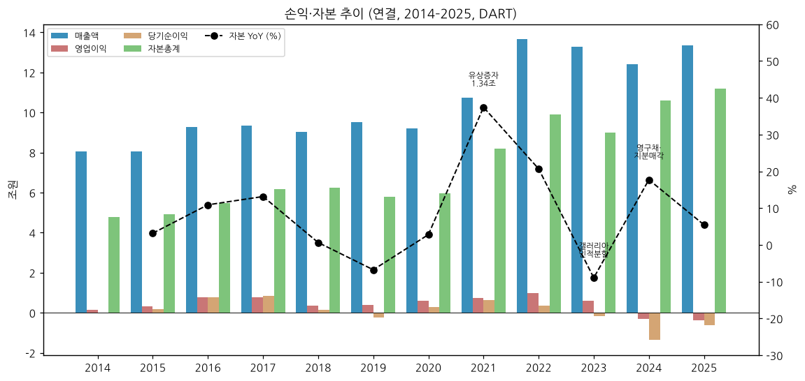

### ③ 회사 주가 역사 ★ narrative 영역

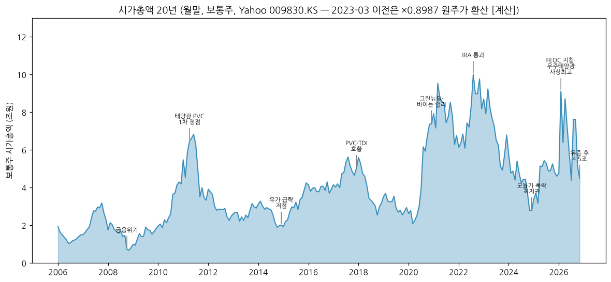

> 가격 처리: Yahoo 009830.KS의 2023-03 이전 가격은 2023-03 갤러리아 인적분할을 **반대 방향(원주가보다 높게)** 으로 조정한 값으로 확인됨 — DART 사업보고서 "최근 6개월 주가" 월간 최고가와 Yahoo 월간 고가 대조 시 비율 0.87\~0.93 (2014\~2015·2020·2022). 분할 전후 주식수 비율 0.8987 (191,278,497 → 171,892,536주)을 계수로 써서 **원주가 ≈ Yahoo × 0.8987** 로 환산 [계산, 오차 ±3%]. 2014-12는 DART 12월 평균주가 12,424원으로 대체. 2026-08 유상증자 권리락은 Yahoo에 미조정(원주가 그대로). 시가총액은 보통주 기준(우선주 제외), 주식수는 DART 각 연도 사업보고서 발행주식총수

(1) 2006\~2011: 한화석유화학 → 한화케미칼, PVC·태양광 1차 붐
→ 2007-12 월말 보통주 시총 약 2.3조 [계산] → 2008 금융위기로 2008-12 약 0.8조
→ 2010\~2011 중국 수요 회복·태양광(2010 한화솔라원 인수, 2012 독일 Q.CELLS 인수) 기대 → 2010-12 월말 원주가 약 29,900원 (시총 4.2조, 2013 주식수 적용 [계산])

(2) 2012\~2015: 태양광 공급과잉 + 유가 급락 → 저점①
→ 2012\~2013 태양광 적자(2013 태양광 OP -1,040억 [DART 사업보고서(2013.12) II]) → 2014-12 시총 약 2.0조 (DART 12월 평균 12,424원) — 20년 최저권
→ 2015 Q CELLS 통합·저유가 PE 스프레드 → 2015말 26,234원 (시총 4.25조, PBR 0.92배)

(3) 2016\~2019: PVC·TDI 호황(정점①) → 중국 증설·폴리실리콘 철수(저점②)
→ 2017말 시총 5.02조 (PBR 0.84배, 순이익 8,345억 12년 최고)
→ 2018 미국 세이프가드·중국 TDI 증설, 4Q18 적자 → 2019말 2.94조 (PBR 0.51배)

(4) 2020\~2022: 한화솔루션 출범 + "그린뉴딜·바이든" 태양광 랠리 + 케미칼 슈퍼사이클
→ 2020-01 합병·사명 변경, 2020 하반기 미국 대선(친환경 정책 기대) → 2020-11 월중 종가 최고 환산 50,346원 [Yahoo×0.8987], 2020말 시총 7.39조 (PBR 1.25배 — 12년 최고)
→ 2021-01-20 종가 환산 56,913원 (시총 9.10조) [계산] → 2021-03 유상증자 31,414,000주 상장 (1.34조 [DART CF 2021]) → 2021말 6.76조
→ 2022-08 미국 IRA 통과 → **2022-09-15 종가 환산 54,326원, 보통주 시총 약 10.39조 — 시가총액 기준 사상 최고** [계산]

(5) 2023\~2025: 갤러리아 분할 → 태양광·화학 동반 침체 (저점③)
→ 2023-03-01 갤러리아 인적분할 (보통주 191,278,497 → 171,892,536주)
→ 2024 모듈가 폭락·영업손실 -3,002억 → **2024-12 월말 16,120원, 시총 2.77조, PBR 0.29배 (12년 최저)**
→ 2025-07 월중 종가 최고 39,000원 [DART 사업보고서(2025.12) VI] → 미국 세관 통관 지연 등으로 2025말 26,800원 (시총 4.61조)

(6) 2026: FEOC 지침·우주태양광 랠리 → 사상 최고가 → 유상증자 → 급락
→ 2026-02-04 4Q25 실적 발표 전후 하루 +29.9% (28,050원 → 36,450원), 2026-02-09 47,700원 — 증권사 목표가 상향(유진 5만원 등) + 일론 머스크 우주 데이터센터·우주태양광 언급 [아시아경제 2026-02-10]
→ 2026-02-12 미국 재무부·IRS FEOC(금지외국기관) 중간 지침 발표 → **2026-02-19 종가 58,500원 (장중 59,300원) — 사상 최고 종가** [Yahoo, 이투데이 2026-02-20]
→ 2026-03-26 **유상증자 2.4조원(7,200만주) 공시** → 당일 -18.2%, 이틀간 약 -24% / DS투자증권 '매도' 하향(목표 2.5만원) [서울신문 2026-03-27]. 같은 날 "향후 5년간 연결 순이익의 10% 배당·자사주 소각" 주주환원 정책 발표
→ 2026-04-17 유증 규모 1.8조(5,600만주)로 축소, 부족분 6천억은 투자자산 매각·해외법인 자본조달로 보충 [뉴스와이어 2026-04-17] → 2026-07-30 최종 발행가 22,100원, 조달 약 1.17조, 구주주 청약률 102.68%·일반공모 126.88%, 2026-08-11 신주 상장 [SBS Biz 2026-07-29]
→ 2026-10-29 3Q26 실적(영업이익 905억, 컨센서스 2,034억의 절반 이하 [비즈워치 2026-10-29]) 당일 -11.6% → 2026-11-24 19,980원 (보통주 시총 4.49조)

### ④ 회사의 주요 연혁

```
1965-08      한국화성공업 설립 (전신)
1974-04-27   한양화학지주(주) 설립, 1974-06 유가증권시장 상장
2010-03      한화석유화학 → 한화케미칼 사명 변경 (미검증 — 일반 연혁)
2010-08      중국 Solarfun 지분 인수 → 한화솔라원 (미검증 — 일반 연혁)
2012-10      독일 Q.CELLS 인수 → 한화큐셀 (미검증 — 일반 연혁)
2015-02      한화솔라원·한화큐셀 통합 Hanwha Q CELLS 출범 (나스닥)
2019         미국 조지아 달튼 모듈공장(1.7GW) 가동 (미검증 — 언론 일반)
2020-01-01   한화케미칼 → 한화큐셀앤드첨단소재 흡수합병, 사명 한화솔루션 [DART]
2020-02      폴리실리콘 사업 철수 결정 (2019·2020 중단사업 재분류) [IR 2021-05]
2021-03      유상증자 31,414,000주 상장 (약 1.34조) [DART 사업보고서(2020.12)]
2021-04-01   한화갤러리아·한화도시개발 자산개발 사업부문 흡수합병 [DART]
2022-04      에이치씨씨홀딩스 지분 49% 헤겔 유한회사에 매각 [DART 분기보고서(2026.09) 주석]
2022-12-01   첨단소재 부문 물적분할 → 한화첨단소재(주), 39.7% 만다린홀딩스·BCC에 매각(최종 47.24%) [DART]
2023-03-01   갤러리아 부문 인적분할 → 한화갤러리아(주) [DART]
2024-06      중국 치동 공장 영업정지 (2023~ 중단사업 재분류) [IR 3Q26 p.14 주석]
2024-10      한화저축은행 지분 매각 (중단사업) [IR 3Q26 p.14 주석]
2024-12-31   한화글로벌에셋 흡수합병 [DART]
2025-12      카터스빌 잉곳 양산 시작 → 2026-02 웨이퍼, 2026-3Q 셀 공장 가동 목표 [CEO스코어데일리 2026-02-05]
2026-03-26   유상증자 2.4조 결정 → 2026-04-17 1.8조로 축소 → 2026-07 확정 1.17조(53,000,000주)
2026-07-20   여수 석유화학 사업재편 승인 (여천NCC·롯데케미칼 여수 통합, 나프타 40% 감축) [머니투데이 2026-07-22]
2026-08      우선주 자기주식 30,733주 소각, 유상증자 신주 상장 [DART 분기보고서(2026.09)]
```

(출처: DART 사업보고서(2025.12) I-2 연혁·합병 등에 관한 사항 / 분기보고서(2026.09) / 언론. "미검증" 표시는 DART 원문(공시대상기간 5년)에 없어 일반 연혁에 의존한 항목)

---
## 3. 비즈니스 모델

### ① 실적 추이 (연결 → 부문 → 제품군 3단계 위계)

**부문 명칭·범위 매핑 (12년 연속성):**

| 기간 | 회사·보고 | 케미칼 계열 | 태양광 계열 | 소재 계열 | 리테일 | 기타 | 비고 |
|---|---|---|---|---|---|---|---|
| 2014\~2015 | 한화케미칼 / DART 사업의 내용 | 원료 (한화케미칼·닝보) | 태양광 (한화솔라원·Q CELLS) | 가공 (한화L&C 등) | 유통 (한화갤러리아·타임월드) | 기타 (드림파마·도시개발) | 부문 매출 = 부문간 거래 포함, 연결조정 별도 |
| 2016\~2018 | 한화케미칼 / IR 구양식 | 기초소재 | 태양광 | 가공소재 | 리테일 | 기타 | 연결조정 별도 행 |
| 2019\~2021 | 한화솔루션(2020\~) / IR 신양식 | 케미칼 | 큐셀 | 첨단소재 | 갤러리아 | 기타 | **연결조정을 부문에 배분**, 폴리실리콘 중단사업 재분류(2019\~) |
| 2022\~ | IR | 케미칼 | 신재생에너지 | 첨단소재 | (2023-03 분할, 2022\~ 중단사업) | 기타 (인사이트·한화이센셜) | 치동공장·한화저축은행 중단사업(2023\~ 소급) |
| DART (2022\~) | 분기·사업보고서 | 기초소재 | 신재생에너지 | 가공소재 | - | 기타 | 연결조정 별도 — IR 수치와 부문 단위로 다름 |

→ **케미칼·태양광·소재 3축은 2014\~2026 내내 같은 사업 실체로 연결 가능**. 다만 ① 2019 IR 양식 변경(연결조정 배분) 지점에서 부문 매출이 계단식으로 낮아지고(예: 2018 기초소재 43,722억(구) vs 케미칼 40,221억(신) [IR 2019-05·2022-04]), ② 2014 가공 부문은 한화L&C 건축자재 매각 전후로 매출이 반토막 나 단절이 있음

**연간 부문 통합 표 (억원, IR '사업부문별 실적-종합' — 2015\~2017 구양식, 2018\~ 신양식·재작성 최신본):**

| 항목 | 2015 | 2016 | 2017 | 2018 | 2019 | 2020 | 2021 | 2022 | 2023 | 2024 | 2025 | 9M26 |
|---|---|---|---|---|---|---|---|---|---|---|---|---|
| 케미칼 (구 기초소재) 매출 | 38,308 | 38,718 | 43,276 | 40,221 | 34,805 | 33,265 | 53,640 | 59,092 | 50,974 | 48,172 | 46,241 | 41,477 |
| 신재생에너지 (구 태양광·큐셀) 매출 | 28,710 | 39,120 | 34,147 | 25,216 | 35,552 | 37,023 | 35,685 | 54,604 | 65,255 | 57,658 | 68,381 | 67,564 |
| 첨단소재 (구 가공소재) 매출 | 9,458 | 10,240 | 9,824 | 8,538 | 8,081 | 7,519 | 9,389 | 11,522 | 9,889 | 10,376 | 11,109 | 8,778 |
| 리테일·갤러리아 매출 | 5,854 | 6,734 | 7,154 | 6,636 | 5,936 | 4,527 | 5,147 | - | - | - | - | - |
| 기타 매출 | 15,824 | 15,160 | 14,803 | 9,849 | 10,200 | 9,616 | 3,391 | 4,104 | 4,667 | 7,734 | 7,600 | 6,313 |
| 연결조정 (구양식) 매출 | -17,784 | -17,384 | -15,786 | - | - | - | - | - | - | - | - | - |
| **연결 합계** 매출 | 80,370 | 92,588 | 93,418 | 90,460 | 94,574 | 91,950 | 107,252 | 129,322 | 130,785 | 123,940 | 133,331 | 124,132 |
| 케미칼 OP | 1,666 | 4,710 | 6,311 | 3,696 | 2,584 | 3,812 | 10,468 | 5,900 | 607 | -1,213 | -2,491 | 765 |
| 신재생에너지 OP | 784 | 2,125 | 143 | -215 | 1,810 | 1,904 | -3,285 | 3,686 | 5,398 | -2,575 | -957 | 3,337 |
| 첨단소재 OP | 366 | 359 | 22 | -105 | -298 | -76 | 97 | 352 | 643 | 235 | 62 | 799 |
| 리테일·갤러리아 OP | 174 | -10 | 229 | 191 | 76 | 28 | 289 | - | - | - | - | - |
| 기타 OP | 586 | 704 | 754 | -24 | 420 | 274 | -186 | -713 | -856 | 551 | -262 | -5 |
| 연결조정 (구양식) OP | -206 | -96 | 105 | - | - | - | - | - | - | - | - | - |
| **연결 영업이익** OP | 3,370 | 7,792 | 7,564 | 3,543 | 4,592 | 5,942 | 7,383 | 9,225 | 5,792 | -3,002 | -3,648 | 4,896 |
| 케미칼 OPM | 4.3% | 12.2% | 14.6% | 9.2% | 7.4% | 11.5% | 19.5% | 10.0% | 1.2% | -2.5% | -5.4% | 1.8% |
| 신재생에너지 OPM | 2.7% | 5.4% | 0.4% | -0.9% | 5.1% | 5.1% | -9.2% | 6.8% | 8.3% | -4.5% | -1.4% | 4.9% |
| 첨단소재 OPM | 3.9% | 3.5% | 0.2% | -1.2% | -3.7% | -1.0% | 1.0% | 3.1% | 6.5% | 2.3% | 0.6% | 9.1% |
| 케미칼 OP 비중 (부문 OP 합 대비) | 47% | 60% | 85% | 104% | 56% | 64% | 142% | 64% | 10% | 적자 | 적자 | - |

(출처: 2015\~2017 = IR 2018-05-14 / 2018\~2019 = IR 2022-04-28·2022-10-27 / 2020\~2021 = IR 2023-10-31·2024-10-30 / 2022 = IR 2025-11-05 (갤러리아 중단사업 제외) / 2023\~2025 = IR 2026-10-29 (치동·저축은행 중단, 투자부동산 정책변경 소급). 9M26 = IR 1Q26\~3Q26 합산 (DART 9M26 부문 OP는 기초소재 827억·신재생 3,740억·가공소재 857억·기타 878억·조정 -1,406억 — 연결조정 미배분 [DART 분기보고서(2026.09) II]). OP 비중 = 케미칼 / (케미칼+신재생+첨단+리테일+기타))

**주요 제품 가격·원가 (Fact):**

| 항목 | 2023 | 2024 | 2025 | 출처 |
|---|---|---|---|---|
| 에틸렌 매입가 (USD/톤) | 852 | 878 | 812 | DART 사업보고서(2025.12) II-2 주요 원재료 (여천NCC 등) |
| 프로필렌 매입가 (USD/톤) | 828 | 858 | 793 | 〃 |
| M10 N형 웨이퍼 (USD/장) | - | 0.170 | 0.148 | 〃 (LONGi 등) |
| M10 N형 외부 셀 (USD/Wp) | - | 0.058 | 0.038 | 〃 (Aiko 등) |
| N형 모듈 FOB China (¢/W, 3Q26) | | | 약 9\~10 | IR 3Q26 p.17 (Infolink) |

**사업부별 분기 시계열 (억원, 1Q14\~3Q26 51개 분기):**

> 2014\~2015 = DART 분기·반기·사업보고서 "사업의 내용 – 사업부문별 요약재무현황"의 누적값을 분기로 차감 [계산] / 1Q16\~4Q18 = IR 2018-05·2019-05 '사업부문별 매출 및 손익' 구양식 (연결조정 별도) / 1Q19\~3Q26 = 각 분기를 포함하는 가장 최근 IR의 '사업부문별 실적-종합' 신양식 (연결조정 배분, 중단사업 재분류 최신본). 합계 매출·OP는 IR 기준이라 DART 보고치와 일부 분기 다름 (예: 4Q24 IR 46,429억 vs DART 45,629억)

| 분기 | 합계 매출 | 케미칼 매출 | 케미칼 OP | 케미칼 OPM | 신재생 매출 | 신재생 OP | 신재생 OPM | 첨단소재 매출 | 첨단소재 OP | 리테일 매출 | 리테일 OP | 기타 매출 | 기타 OP | 연결조정 OP | 합계 OP | 양식 |
|---|---|---|---|---|---|---|---|---|---|---|---|---|---|---|---|---|
| 1Q14 | 19,573 | 9,366 | 159 | 1.7% | 4,991 | 241 | 4.8% | 4,064 | 248 | 1,174 | 120 | 3,005 | 93 | -31 | 830 | XML |
| 2Q14 | 21,039 | 10,313 | -158 | -1.5% | 5,016 | 14 | 0.3% | 4,470 | 153 | 1,386 | 106 | 3,120 | 103 | 1 | 219 | XML |
| 3Q14 | 19,759 | 10,088 | -24 | -0.2% | 4,752 | -2 | -0.0% | 3,017 | 49 | 1,416 | 93 | 3,549 | 163 | -43 | 236 | XML |
| 4Q14 | 20,182 | 10,023 | -137 | -1.4% | 5,539 | -167 | -3.0% | 2,394 | 68 | 1,656 | 229 | 4,209 | 182 | -47 | 128 | XML |
| 1Q15 | 18,369 | 9,267 | 229 | 2.5% | 5,226 | -327 | -6.3% | 2,385 | 143 | 1,411 | 74 | 3,894 | 136 | 1 | 256 | XML |
| 2Q15 | 20,087 | 9,890 | 609 | 6.2% | 5,829 | 70 | 1.2% | 2,260 | 71 | 1,435 | 9 | 4,283 | 220 | -41 | 938 | XML |
| 3Q15 | 18,868 | 9,923 | 628 | 6.3% | 7,069 | 545 | 7.7% | 2,254 | 103 | 1,343 | 6 | 3,760 | 186 | -135 | 1,333 | XML |
| 4Q15 | 23,046 | 9,227 | 200 | 2.2% | 10,586 | 496 | 4.7% | 2,559 | 49 | 1,666 | 85 | 3,887 | 44 | -31 | 843 | XML |
| 1Q16 | 21,637 | 8,842 | 651 | 7.4% | 8,531 | 605 | 7.1% | 2,546 | 162 | 1,587 | 11 | 4,015 | 284 | -285 | 1,428 | IR구 |
| 2Q16 | 23,922 | 9,595 | 1,429 | 14.9% | 10,263 | 1,110 | 10.8% | 2,581 | 125 | 1,652 | -55 | 4,405 | 224 | 103 | 2,936 | IR구 |
| 3Q16 | 23,856 | 9,671 | 1,253 | 13.0% | 10,872 | 775 | 7.1% | 2,467 | 72 | 1,584 | -69 | 3,509 | 147 | -131 | 2,047 | IR구 |
| 4Q16 | 23,173 | 10,610 | 1,377 | 13.0% | 9,454 | -365 | -3.9% | 2,646 | 0 | 1,911 | 103 | 3,231 | 49 | 217 | 1,381 | IR구 |
| 1Q17 | 21,913 | 10,527 | 1,673 | 15.9% | 7,515 | 107 | 1.4% | 2,630 | 75 | 1,672 | -13 | 3,748 | 174 | -50 | 1,966 | IR구 |
| 2Q17 | 24,856 | 10,645 | 1,612 | 15.1% | 8,724 | 153 | 1.8% | 2,323 | -13 | 1,598 | -113 | 5,215 | 521 | 27 | 2,187 | IR구 |
| 3Q17 | 23,130 | 11,025 | 1,822 | 16.5% | 8,375 | 52 | 0.6% | 2,434 | 28 | 1,846 | 167 | 3,291 | 119 | -35 | 2,153 | IR구 |
| 4Q17 | 23,519 | 11,079 | 1,204 | 10.9% | 9,533 | -169 | -1.8% | 2,437 | -68 | 2,038 | 188 | 2,549 | -60 | 163 | 1,258 | IR구 |
| 1Q18 | 20,761 | 10,941 | 1,483 | 13.6% | 8,274 | 350 | 4.2% | 2,312 | -61 | 1,775 | 48 | 2,428 | 18 | -117 | 1,721 | IR구 |
| 2Q18 | 22,505 | 11,537 | 1,817 | 15.7% | 8,064 | -43 | -0.5% | 2,571 | 20 | 1,776 | 13 | 2,699 | 72 | -36 | 1,843 | IR구 |
| 3Q18 | 23,119 | 11,303 | 879 | 7.8% | 8,177 | -3 | -0.0% | 2,744 | -15 | 1,597 | 15 | 2,682 | 79 | -17 | 938 | IR구 |
| 4Q18 | 24,075 | 9,941 | -507 | -5.1% | 11,713 | -411 | -3.5% | 2,849 | -78 | 1,894 | 115 | 2,427 | -123 | 45 | -959 | IR구 |
| 1Q19 | 22,332 | 8,429 | 792 | 9.4% | 7,948 | 297 | 3.7% | 1,917 | -75 | 1,616 | 69 | 2,422 | 129 | (배분) | 1,212 | IR신 |
| 2Q19 | 23,640 | 9,008 | 716 | 7.9% | 7,891 | 309 | 3.9% | 2,121 | -19 | 1,664 | -66 | 2,956 | 251 | (배분) | 1,191 | IR신 |
| 3Q19 | 24,257 | 9,077 | 952 | 10.5% | 9,223 | 675 | 7.3% | 2,040 | -10 | 1,276 | -7 | 2,641 | 109 | (배분) | 1,719 | IR신 |
| 4Q19 | 24,345 | 8,291 | 124 | 1.5% | 10,490 | 529 | 5.0% | 2,003 | -194 | 1,380 | 80 | 2,181 | -69 | (배분) | 470 | IR신 |
| 1Q20 | 22,484 | 8,304 | 636 | 7.7% | 9,058 | 1,046 | 11.5% | 1,905 | -42 | 959 | -51 | 2,258 | 82 | (배분) | 1,671 | IR신 |
| 2Q20 | 19,564 | 7,811 | 928 | 11.9% | 7,428 | 524 | 7.1% | 1,492 | -82 | 1,098 | -38 | 1,735 | -47 | (배분) | 1,285 | IR신 |
| 3Q20 | 24,284 | 8,831 | 1,588 | 18.0% | 8,913 | 358 | 4.0% | 2,068 | 76 | 1,093 | 13 | 3,379 | 297 | (배분) | 2,332 | IR신 |
| 4Q20 | 25,618 | 8,319 | 660 | 7.9% | 11,624 | -24 | -0.2% | 2,054 | -28 | 1,377 | 104 | 2,244 | -58 | (배분) | 654 | IR신 |
| 1Q21 | 24,043 | 12,484 | 2,548 | 20.4% | 7,447 | -149 | -2.0% | 2,255 | 72 | 1,213 | 121 | 644 | -46 | (배분) | 2,546 | IR신 |
| 2Q21 | 27,775 | 13,331 | 2,930 | 22.0% | 10,065 | -646 | -6.4% | 2,243 | 22 | 1,266 | 22 | 870 | -117 | (배분) | 2,211 | IR신 |
| 3Q21 | 25,803 | 13,110 | 2,668 | 20.4% | 8,273 | -957 | -11.6% | 2,265 | 23 | 1,205 | 68 | 950 | -18 | (배분) | 1,784 | IR신 |
| 4Q21 | 29,631 | 14,715 | 2,322 | 15.8% | 9,900 | -1,533 | -15.5% | 2,626 | -20 | 1,463 | 78 | 927 | -5 | (배분) | 842 | IR신 |
| 1Q22 | 28,488 | 15,492 | 2,576 | 16.6% | 9,206 | -1,142 | -12.4% | 2,623 | 30 | - | - | 1,167 | 3 | (배분) | 1,467 | IR신 |
| 2Q22 | 32,590 | 15,992 | 2,354 | 14.7% | 12,343 | 352 | 2.9% | 2,996 | 166 | - | - | 1,259 | -150 | (배분) | 2,722 | IR신 |
| 3Q22 | 32,398 | 14,662 | 1,280 | 8.7% | 13,316 | 1,972 | 14.8% | 3,127 | 198 | - | - | 1,293 | -81 | (배분) | 3,369 | IR신 |
| 4Q22 | 37,832 | 12,946 | -321 | -2.5% | 20,820 | 2,319 | 11.1% | 2,776 | -41 | - | - | 1,290 | -278 | (배분) | 1,679 | IR신 |
| 1Q23 | 30,533 | 13,475 | 340 | 2.5% | 13,483 | 2,299 | 17.1% | 2,535 | 217 | - | - | 1,040 | -278 | (배분) | 2,578 | IR신 |
| 2Q23 | 33,327 | 13,413 | 495 | 3.7% | 16,002 | 1,258 | 7.9% | 2,642 | 212 | - | - | 1,270 | -238 | (배분) | 1,727 | IR신 |
| 3Q23 | 28,740 | 12,859 | 562 | 4.4% | 12,585 | 254 | 2.0% | 2,354 | 161 | - | - | 942 | -116 | (배분) | 861 | IR신 |
| 4Q23 | 38,185 | 11,227 | -790 | -7.0% | 23,185 | 1,587 | 6.8% | 2,358 | 53 | - | - | 1,415 | -224 | (배분) | 626 | IR신 |
| 1Q24 | 23,534 | 12,223 | -187 | -1.5% | 7,641 | -1,853 | -24.3% | 2,496 | 106 | - | - | 1,174 | -212 | (배분) | -2,146 | IR신 |
| 2Q24 | 26,518 | 12,224 | -174 | -1.4% | 9,802 | -918 | -9.4% | 2,659 | 90 | - | - | 1,833 | -121 | (배분) | -1,123 | IR신 |
| 3Q24 | 27,459 | 11,886 | -310 | -2.6% | 11,525 | -410 | -3.6% | 2,546 | 61 | - | - | 1,502 | -144 | (배분) | -803 | IR신 |
| 4Q24 | 46,429 | 11,839 | -542 | -4.6% | 28,690 | 606 | 2.1% | 2,675 | -22 | - | - | 3,225 | 1,028 | (배분) | 1,070 | IR신 |
| 1Q25 | 30,945 | 10,736 | -912 | -8.5% | 15,992 | 1,362 | 8.5% | 2,738 | -18 | - | - | 1,479 | -129 | (배분) | 303 | IR신 |
| 2Q25 | 31,172 | 12,390 | -468 | -3.8% | 14,464 | 1,562 | 10.8% | 3,079 | 98 | - | - | 1,239 | -171 | (배분) | 1,021 | IR신 |
| 3Q25 | 33,644 | 11,603 | -90 | -0.8% | 17,515 | 79 | 0.5% | 2,579 | 36 | - | - | 1,947 | -99 | (배분) | -74 | IR신 |
| 4Q25 | 37,570 | 11,512 | -1,021 | -8.9% | 20,410 | -3,960 | -19.4% | 2,713 | -54 | - | - | 2,935 | 137 | (배분) | -4,898 | IR신 |
| 1Q26 | 38,820 | 13,401 | 341 | 2.5% | 21,109 | 622 | 2.9% | 2,856 | 122 | - | - | 1,454 | -159 | (배분) | 926 | IR신 |
| 2Q26 | 45,826 | 14,650 | 871 | 5.9% | 24,823 | 1,664 | 6.7% | 3,003 | 288 | - | - | 3,350 | 242 | (배분) | 3,065 | IR신 |
| 3Q26 | 39,486 | 13,426 | -447 | -3.3% | 21,632 | 1,051 | 4.9% | 2,919 | 389 | - | - | 1,509 | -88 | (배분) | 905 | IR신 |

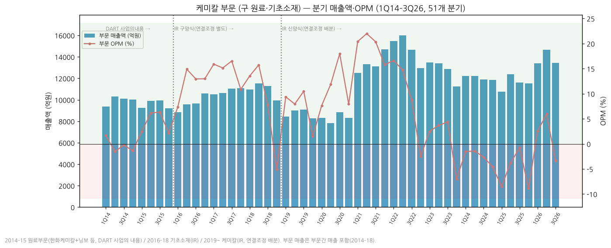
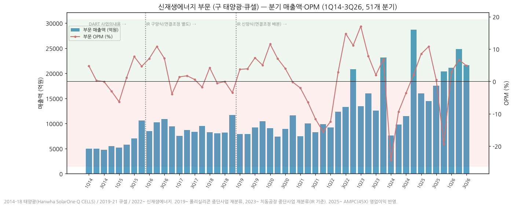
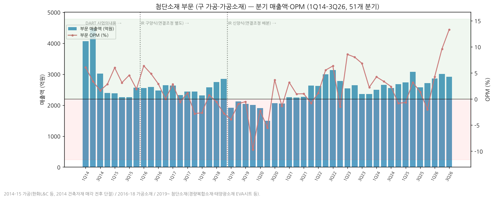
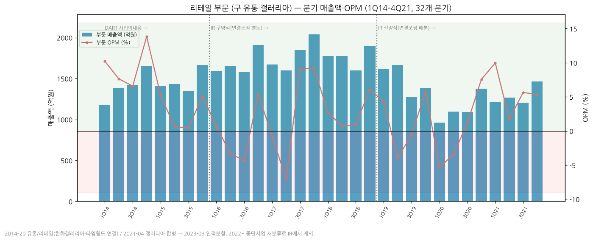

**연결 분기 시계열 (억원, DART, 1Q14\~3Q26 51개 분기):**

> 1Q16\~ = OpenDART 분기 3개월 금액, 4Q = 사업보고서 연간 − 3분기 누적 / 2014\~2015 = 분기보고서 원문 XML 요약연결재무 누적값 차감 [계산]. 보고 당시 기준(재작성 미반영) — 2024 1Q\~3Q는 치동공장 중단사업 분류 전 수치라 4Q24(45,629억)가 커 보임

| 분기 | 매출액 | 영업이익 | OPM | 순이익 | 매출 YoY | OP YoY | 출처 |
|---|---|---|---|---|---|---|---|
| 1Q14 | 19,573 | 830 | 4.2% | 64 | - | - | XML |
| 2Q14 | 21,039 | 219 | 1.0% | 12 | - | - | XML |
| 3Q14 | 19,759 | 235 | 1.2% | 14 | - | - | XML |
| 4Q14 | 20,182 | 128 | 0.6% | 23 | - | - | XML |
| 1Q15 | 18,369 | 256 | 1.4% | -187 | -6.2% | -69.1% | XML |
| 2Q15 | 20,087 | 937 | 4.7% | 332 | -4.5% | +327.4% | XML |
| 3Q15 | 18,868 | 1,333 | 7.1% | 1,520 | -4.5% | +466.8% | XML |
| 4Q15 | 23,046 | 843 | 3.7% | 139 | +14.2% | +558.6% | XML |
| 1Q16 | 21,637 | 1,428 | 6.6% | 1,135 | +17.8% | +456.8% | DART |
| 2Q16 | 23,922 | 2,936 | 12.3% | 3,102 | +19.1% | +213.2% | DART |
| 3Q16 | 23,856 | 2,047 | 8.6% | 2,022 | +26.4% | +53.5% | DART |
| 4Q16 | 23,173 | 1,381 | 6.0% | 1,451 | +0.6% | +63.9% | DART FY-3Q |
| 1Q17 | 21,913 | 1,966 | 9.0% | 3,242 | +1.3% | +37.6% | DART |
| 2Q17 | 24,855 | 2,188 | 8.8% | 2,494 | +3.9% | -25.5% | DART |
| 3Q17 | 23,130 | 2,152 | 9.3% | 2,521 | -3.0% | +5.1% | DART |
| 4Q17 | 23,519 | 1,258 | 5.4% | 89 | +1.5% | -8.9% | DART FY-3Q |
| 1Q18 | 20,761 | 1,721 | 8.3% | 2,925 | -5.3% | -12.5% | DART |
| 2Q18 | 22,505 | 1,844 | 8.2% | 1,851 | -9.5% | -15.7% | DART |
| 3Q18 | 23,119 | 938 | 4.1% | -347 | -0.1% | -56.4% | DART |
| 4Q18 | 24,076 | -959 | -4.0% | -2,824 | +2.4% | - | DART FY-3Q |
| 1Q19 | 22,362 | 983 | 4.4% | 1,198 | +7.7% | -42.8% | DART |
| 2Q19 | 23,741 | 975 | 4.1% | 230 | +5.5% | -47.1% | DART |
| 3Q19 | 24,412 | 1,525 | 6.2% | 1,115 | +5.6% | +62.6% | DART |
| 4Q19 | 24,517 | 300 | 1.2% | -5,031 | +1.8% | - | DART FY-3Q |
| 1Q20 | 22,484 | 1,590 | 7.1% | 640 | +0.5% | +61.7% | DART |
| 2Q20 | 19,564 | 1,285 | 6.6% | 1,473 | -17.6% | +31.7% | DART |
| 3Q20 | 24,284 | 2,332 | 9.6% | 1,897 | -0.5% | +52.9% | DART |
| 4Q20 | 25,618 | 654 | 2.6% | -993 | +4.5% | +118.1% | DART FY-3Q |
| 1Q21 | 24,043 | 2,546 | 10.6% | 3,852 | +6.9% | +60.1% | DART |
| 2Q21 | 27,775 | 2,211 | 8.0% | 2,228 | +42.0% | +72.1% | DART |
| 3Q21 | 25,803 | 1,784 | 6.9% | 1,934 | +6.3% | -23.5% | DART |
| 4Q21 | 29,631 | 843 | 2.8% | -1,851 | +15.7% | +28.9% | DART FY-3Q |
| 1Q22 | 29,703 | 1,579 | 5.3% | 1,031 | +23.5% | -38.0% | DART |
| 2Q22 | 33,891 | 2,778 | 8.2% | 2,445 | +22.0% | +25.6% | DART |
| 3Q22 | 33,657 | 3,484 | 10.4% | 1,386 | +30.4% | +95.3% | DART |
| 4Q22 | 39,289 | 1,822 | 4.6% | -1,202 | +32.6% | +116.3% | DART FY-3Q |
| 1Q23 | 31,002 | 2,714 | 8.8% | 1,334 | +4.4% | +71.9% | DART |
| 2Q23 | 33,930 | 1,941 | 5.7% | 208 | +0.1% | -30.1% | DART |
| 3Q23 | 29,258 | 983 | 3.4% | 206 | -13.1% | -71.8% | DART |
| 4Q23 | 38,697 | 407 | 1.1% | -3,301 | -1.5% | -77.7% | DART FY-3Q |
| 1Q24 | 23,929 | -2,166 | -9.1% | -4,484 | -22.8% | - | DART |
| 2Q24 | 26,793 | -1,078 | -4.0% | -3,297 | -21.0% | - | DART |
| 3Q24 | 27,732 | -810 | -2.9% | -3,876 | -5.2% | - | DART |
| 4Q24 | 45,629 | 1,029 | 2.3% | -2,036 | +17.9% | +152.9% | DART FY-3Q |
| 1Q25 | 30,945 | 303 | 1.0% | -302 | +29.3% | - | DART |
| 2Q25 | 31,173 | 1,021 | 3.3% | -1,784 | +16.3% | - | DART |
| 3Q25 | 33,643 | -74 | -0.2% | 45 | +21.3% | - | DART |
| 4Q25 | 37,570 | -4,897 | -13.0% | -4,112 | -17.7% | - | DART FY-3Q |
| 1Q26 | 38,820 | 926 | 2.4% | -382 | +25.4% | +205.5% | DART |
| 2Q26 | 45,827 | 3,065 | 6.7% | 2,929 | +47.0% | +200.3% | DART |
| 3Q26 | 39,486 | 905 | 2.3% | 685 | +17.4% | - | DART |

**최근 분기 EBITDA (IR, 억원):** 1Q25 2,228 · 2Q25 2,918 · 3Q25 1,866 · 4Q25 -2,705 · 1Q26 3,075 · 2Q26 5,241 · 3Q26 3,226 (EBITDA 마진 8.2%) [IR 각 분기 손익현황]

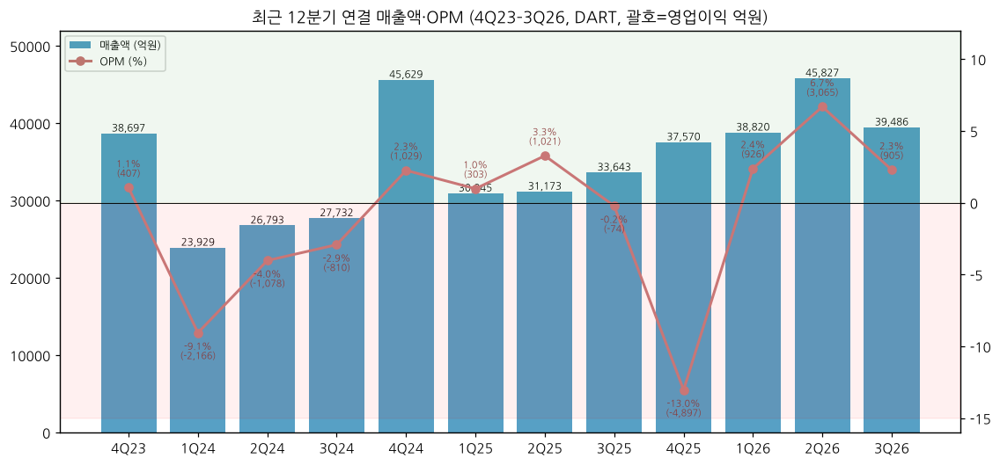

### ② 사업부별 개요 (매출 비중 큰 순서, 2025 외부매출 기준)

| 부문 | 2025 매출 (억원) | 비중 | 2025 OP | 9M26 OP | 핵심 제품·사업 | 사이클 변수 |
|---|---|---|---|---|---|---|
| **신재생에너지** (큐셀) | 68,381 | 51% | -957 | 3,337 | 셀·모듈 (한국 진천·음성, 말레이시아, 미국 달튼·카터스빌), 미국 주택용 에너지(리스·PPA·ESS), EPC·발전소 개발자산 매각 | 모듈 판가, 미국 관세(AD/CVD·Section 232)·IRA(45X·48E/45Y·25D), 금리 |
| **케미칼** (기초소재) | 46,241 | 35% | -2,491 | 765 | PVC·가성소다·염소(화성), LDPE·LLDPE·EVA·W&C(유화), TDI, CA, 중국 닝보 PVC 36만톤 | PE·PVC 스프레드(중국 증설), 유가 래깅, 여천NCC 원료가 |
| **첨단소재** | 11,109 | 8% | 62 | 799 | 자동차 경량복합소재(GMT·LWRT·EPP·SMC), 태양광 EVA시트, 미국 조지아 EVA시트 공장 | 북미 완성차 생산, 태양광 모듈 생산량 |
| **기타** (인사이트·한화이센셜 등) | 7,600 | 6% | -262 | -5 | 부동산 개발(산업단지 분양), FCCL 전자소재 | 개발자산 매각 시점 (일회성) |

(IR 2026-10-29 종합표, DART 사업보고서(2025.12) I-1 외부매출 기준. 유화 = LDPE/LLDPE/EVA/W&C, 화성 = CA/PVC/TDI [IR 3Q26 p.11])

### ③ 사업부별 디테일

(1) **신재생에너지 — "미국 솔라허브" 전략과 AMPC 의존**
→ CAPA: 2026말 **셀 11.0GW · 모듈 11.4GW** [IR 3Q26 p.18]. 한국 큐셀 모듈 공장 생산능력 2,569(단위 MW 추정)·실적 610, 가동률 20% (2025) — 생산이 미국으로 이전 중 [DART 사업보고서(2025.12) II-3]
→ 미국 카터스빌 일관 공장: 2025-12 잉곳 양산 → 2026-02 웨이퍼 양산 → 2026-3Q 셀 공장 가동 목표. 그 전까지는 미국산 웨이퍼를 한국에서 셀로 만들어 미국 모듈공장에 공급 [CEO스코어데일리 2026-02-05]
→ AMPC(45X) 영업이익 반영: 3Q26 **2,118억** (연결 영업이익 905억의 2.3배) [IR 3Q26 p.8]. 회사 전망 "3분기 2300억원, 4분기 3100억원 수준인데 풀 램프업(완전 가동)에 도달하면 약 1000억원의 추가 효과" [머니투데이 2026-07-29]
→ 경영진 코멘터리 (3Q26): "솔라허브 가동이 본격화되면서 신재생에너지 부문을 중심으로 3분기 연속 흑자를 달성했다" / "4분기에는 미국 통상정책 변화에 따라 모듈 판매가격 상승세가 지속될 전망이지만" (이재빈 CFO [비즈워치 2026-10-29])
→ 시사점: 이익의 원천이 "모듈 판매 마진"이 아니라 "미국 내 생산량 × 세액공제 단가"로 바뀜 → 가동률(카터스빌 셀 램프업)과 정책 지속성이 1차 변수
→ 미국 정책 팩트: ① **Section 232** — 2026-08 미국 상무부가 폴리실리콘·웨이퍼 최저수입가격과 파생제품(웨이퍼·셀·모듈) 15% 추가관세 결정, 2026-12-04 시행 [비즈워치 2026-10-29] ② **FEOC(금지외국기관)** — 2026-02-12 재무부·IRS 중간지침, 비금지외국기관 부품 비율 2026 40% → 2030 60% [이투데이 2026-02-20] ③ **OBBBA** (One Big Beautiful Bill Act, 2025-07-04 서명) — 45X는 FEOC 제한을 붙여 유지(태양광 부품은 2030부터 단계 축소), 주택용 25D 세액공제는 2025말 종료, 48E/45Y 발전 세액공제는 착공·가동 기한 단축 (법문 요약 — 세부 수치는 다음 버전 1차 자료 확인 필요). IR 3Q26도 "금리 및 25D 종료 영향으로 [주택용] 수요 조정"과 "Safe Harbor 요건을 확보한 200GW 이상의 프로젝트 파이프라인"을 함께 언급 [IR 3Q26 p.7]
→ 2025 통관 이슈: 3Q25부터 한국산 셀 일부가 미국 세관에 억류 → 조지아 모듈공장 저가동 → 4Q25 신재생 영업손실 [CEO스코어데일리 2026-02-05]. 2026 "통관 문제가 해소되는 동시에, 탈중국 서플라이체인을 갖춘 기업으로서 ASP에서 프리미엄을 갖출 수 있게 됐다" (회사 관계자)

(2) **케미칼 — 범용 석유화학 사이클 저점 + 여수 구조조정**
→ CAPA (2025): LDPE 등 93.2만톤, PVC 등 117.3만톤, 가성소다 등 446.5만톤, TDI 등 51.4만톤, 닝보 PVC 36만톤 — 가동률 여수 99.1%·울산 99.8%·닝보 98.2% [DART 사업보고서(2025.12) II-3] (IR 기준 CAPA: PE 1,135천톤, PVC 780, 가성소다 1,120, TDI 150 천톤 [IR 3Q26 p.18] — 산출 기준 차이)
→ 원료: 에틸렌·프로필렌을 합작사 여천NCC(지분 50%)에서 조달 → NCC 마진은 지분법으로 인식 (3Q26 지분법 합계 -880억 — "일회성효과 소멸 및 고가원료 투입효과" [IR 3Q26 p.13])
→ **여수 사업재편 (2026-07-20 산업부 승인)**: 여천NCC 1·2·3호기(나프타 229만톤) + 롯데케미칼 여수(123만톤) = 352만톤 → 통합 후 213만톤(-40%), 여천NCC 2·3호기 가동 중단. 한화솔루션은 PE·접착/도료용 수지 등 다운스트림을 여천NCC에 **현물출자**하고, DL케미칼과 각 2,725억(총 5,450억) 유상증자로 여천NCC 부채 상환. 재편 후 여천NCC 지분은 한화·DL·롯데 1/3씩. 정부 지원 7천억+ (채권단 4,500억 신규자금·상환유예, 무역보험 2,000억) [머니투데이 2026-07-22, IB토마토 2026-07-27]
→ 여천NCC 신용등급 A0(2024) → A-(2025) → BBB+(2026) 하락, 재무약정 위반으로 사모사채 400억 조기상환(2026-06-22) [IB토마토 2026-07-27]
→ 경영진 코멘터리 (3Q26 IR): "리스크 프리미엄 축소 및 유가 하락으로 인한 역래깅 영향으로 적자 전환" / 4Q 전망 "수요 부진한 가운데, 유가 재상승으로 원가 부담 가중되며 적자 지속 전망" [IR 3Q26 p.11]
→ 시사점: 1H26 흑자(341억·871억)는 호르무즈 봉쇄 우려에 따른 일시적 가격 급등 효과 — 구조적 회복(중국 증설 소화)의 증거는 아직 없음

(3) **첨단소재 — 작지만 9M26 최고 이익률**
→ 3Q26 OP 389억, OPM 13.3% (12년 분기 최고) — "경량복합소재 북미 고객사 하반기 생산량 증가와 북미 태양광 소재의 안정적 판매유지" [IR 3Q26 p.12]
→ 한화첨단소재는 사모펀드(만다린홀딩스·BCC) 47.24% 보유, 주주간 계약에 투자자 동반매각권·페널티풋옵션 존재 [DART 분기보고서(2026.09) 주석] → 지배지분 귀속 이익은 일부

(4) **지분법 (YNCC·한화토탈에너지스·한화임팩트)** — 분기 -2,024억(4Q25)\~+1,490억(2Q26) 진폭, 케미칼 사이클의 2차 레버리지 [IR 3Q26 p.13]

### ④ 주요 경쟁사 (사업부별)

| 부문 | 국내 | 글로벌 | 비고 |
|---|---|---|---|
| 신재생에너지 | OCI홀딩스(폴리실리콘·말레이시아), HD현대에너지솔루션 | First Solar(미국 CdTe), Canadian Solar, JinkoSolar·LONGi·Trina·JA Solar(중국) | 미국 내 결정질 셀·모듈 일관 생산 경쟁: First Solar(박막)와 직접 경쟁 |
| 케미칼 PVC·가성소다 | LG화학, 롯데케미칼(롯데정밀화학 가성소다) | Westlake, Formosa Plastics, Shin-Etsu, 중국 카바이드 PVC | 중국 PVC는 석탄 기반(카바이드)으로 원가 구조 상이 |
| 케미칼 PE·EVA | LG화학, 롯데케미칼, 한화토탈에너지스, 대한유화 | Dow, ExxonMobil, SABIC, 중국 신규 크래커 | EVA는 태양광 봉지재 수요와 연동 |
| 케미칼 TDI | (국내 단독 수준) | BASF, Covestro, Wanhua(중국) | Wanhua 증설이 2018 TDI 하락 요인 |
| 첨단소재 | 롯데케미칼 첨단소재, LX하우시스 | Hanwha Azdel 경쟁군 (북미 경량소재) | |

(경쟁사 목록은 업계 일반 — DART 원문에 경쟁사 명시 없음. 다음 버전에서 IR·산업 리포트로 점유율 보강)

### ⑤ 주요 매출처

| 부문 | 주요 매출처 (DART 공시 비중) | 판매 구조 |
|---|---|---|
| 케미칼 | 내수: 한국바스프 4% 등 / 수출: HANWHA EUROPE GMBH 4% 등 | 내수 직판 70%·대리점 28%, 수출 직수출 66%·로컬 34% |
| 첨단소재 | 내수: 아이아 7%·덕진 7%·서연이화 6%·동국실업 6% / 수출: 관계사 54% (HAM Europe 19%·America 17%·Mexico 8%·Hanwha Q CELLS USA 5%), Rayzon Solar 4% | 완성차 1차 협력사 경유 (현대기아·현대모비스) |
| 신재생 (큐셀 부문 별도) | 내수: 프라임에너지 11%·대청솔라팜 8%·테스코에너지 5% / 수출: 관계사 100% (Hanwha Q CELLS USA 36%·Georgia 4%·Malaysia 2%) | 한국 큐셀 부문은 미국 법인에 셀·모듈을 넘기는 내부 공급기지 |
| 미국 다운스트림 | Microsoft 등 대형 수요처와 장기 공급계약 (미검증 — 2024 언론 12GW) | 주택용(리스·TPO·Prepaid Lease), 상업·커뮤니티 솔라, 유틸리티 EPC |

(출처: DART 사업보고서(2025.12) II-4 매출 및 수주상황. 수주잔고 공시 없음 — "판매규모를 예측하여 계획, 생산")

### ⑥ 생산 CAPA + 임직원 추이

- 태양광 (IR, 2026말): 셀 11.0GW / 모듈 11.4GW. 지분법사 CAPA — 한화토탈에너지스 에틸렌 152.5만톤·PX 200만톤, 여천NCC 에틸렌 228.5만톤 (2025말, 재편 전), 한화임팩트 PTA 200만톤 [IR 3Q26 p.18]
- 케미칼 (DART 2025): 위 ③(2) 참조 / 첨단소재 10.0만톤 (가동률 57%) / 한화이센셜 FCCL 2,090만㎡
- 임직원 (별도, 2025말): **5,503명** — 큐셀 2,615 · 케미칼 2,322 · 인사이트 315 · 전략 206 · W&C 45. 평균 근속 케미칼 17.5년(남) vs 큐셀 5.0년(남), 1인 평균 급여 케미칼 1.22억 vs 큐셀 0.68억(남) [OpenDART 직원현황 2025]

---
## 4. 재무 구조 (12년 시계열)

### ① 손익계산서 (12년 연결, 억원)

| 연도 | 매출액 | 매출원가 | 매출총이익 | 판관비 | 영업이익 | 금융원가 | 지분법손익 | 세전이익 | 당기순이익 | 지배순이익 | GPM | CIR | OPM | NPM |
|---|---|---|---|---|---|---|---|---|---|---|---|---|---|---|
| 2014 | 80,553 | 67,771 | 12,782 | 11,369 | 1,413 | 2,134 | - | 509 | 114 | 567 | 15.9% | 14.1% | 1.8% | 0.1% |
| 2015 | 80,370 | 65,406 | 14,964 | 11,593 | 3,370 | 1,797 | - | 2,284 | 1,804 | 1,882 | 18.6% | 14.4% | 4.2% | 2.2% |
| 2016 | 92,588 | 72,112 | 20,476 | 12,684 | 7,792 | 1,733 | - | 8,864 | 7,709 | 7,553 | 22.1% | 13.7% | 8.4% | 8.3% |
| 2017 | 93,418 | 73,863 | 19,555 | 11,991 | 7,564 | 1,488 | - | 10,659 | 8,345 | 8,247 | 20.9% | 12.8% | 8.1% | 8.9% |
| 2018 | 90,460 | 74,586 | 15,875 | 12,331 | 3,543 | 1,603 | - | 2,883 | 1,604 | 1,867 | 17.5% | 13.6% | 3.9% | 1.8% |
| 2019 | 95,033 | 77,321 | 17,712 | 13,928 | 3,783 | 2,259 | - | -2,174 | -2,489 | -2,376 | 18.6% | 14.7% | 4.0% | -2.6% |
| 2020 | 91,950 | 72,691 | 19,259 | 13,317 | 5,942 | 2,053 | - | 4,515 | 3,017 | 3,091 | 20.9% | 14.5% | 6.5% | 3.3% |
| 2021 | 107,252 | 85,290 | 21,962 | 14,578 | 7,383 | 1,475 | - | 8,553 | 6,163 | 6,191 | 20.5% | 13.6% | 6.9% | 5.7% |
| 2022 | 136,539 | 108,526 | 28,014 | 18,351 | 9,662 | 2,262 | - | 5,692 | 3,660 | 3,591 | 20.5% | 13.4% | 7.1% | 2.7% |
| 2023 | 132,887 | 110,499 | 22,389 | 16,343 | 6,045 | 4,161 | - | -1,020 | -1,553 | -2,081 | 16.8% | 12.3% | 4.5% | -1.2% |
| 2024 | 123,940 | 110,082 | 13,859 | 16,861 | -3,002 | 5,484 | -3,267 | -14,237 | -13,690 | -14,044 | 11.2% | 13.6% | -2.4% | -11.0% |
| 2025 | 133,331 | 118,451 | 14,879 | 18,527 | -3,648 | 5,394 | 345 | -8,380 | -6,153 | -6,504 | 11.2% | 13.9% | -2.7% | -4.6% |

(OpenDART fnlttSinglAcntAll 연결. 금융원가는 절대값. 지분법손익은 2024년 이후만 표준계정으로 제공 — 2023 이전은 IR '지분법손익' 행 참고 (2017 IR 종합 기준 지분법이익 등). 2019 순손실은 폴리실리콘 중단사업 손실 포함, 2024 순손실 -1.37조는 영업손실 + 지분법 -3,267억 + 기타손익 -3,518억 [IR])

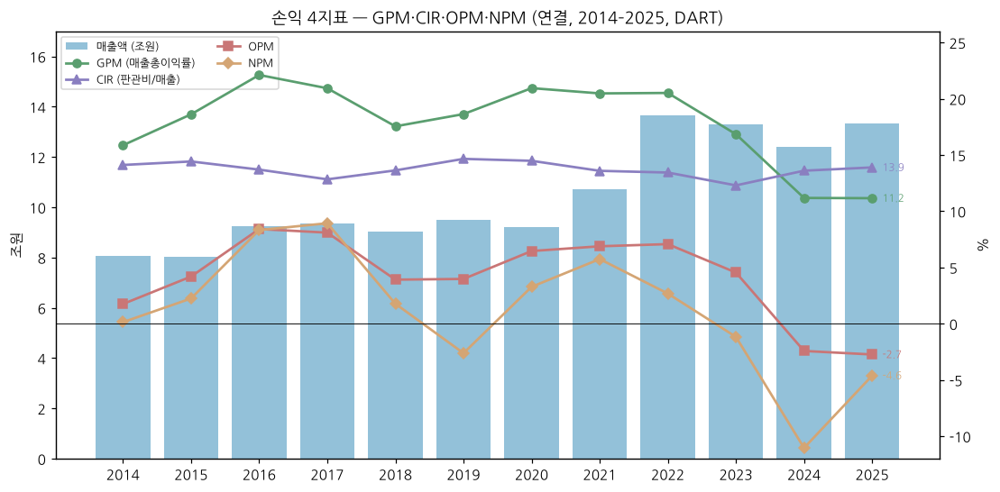

→ GPM은 2016 22.1% 정점 → 2024 11.2%·2025 11.2% 저점. 판관비율(CIR)은 2014 14.1% → 2025 13.9%로 큰 변화 없음 → **이익 변동은 거의 전부 매출총이익(스프레드·판가)에서 발생** = 전형적 사이클 산업 구조

### ② 재무상태표 (12년 연결 + 3Q26, 조원)

| 연도말 | 자산총계 | 유동자산 | 유형자산 | 재고자산 | 부채총계 | 유동부채 | 총차입금 | 현금성자산 | 순차입금 | 자본총계 | 지배지분 | 신종자본증권 | 부채비율 |
|---|---|---|---|---|---|---|---|---|---|---|---|---|---|
| 2014 | 12.60 | 4.27 | 6.04 | 1.87 | 7.82 | 4.44 | 4.95 | 0.55 | 4.40 | 4.78 | 4.37 | - | 164% |
| 2015 | 13.85 | 4.78 | 6.05 | 1.83 | 8.92 | 5.42 | 5.04 | 0.64 | 4.40 | 4.93 | 4.63 | - | 181% |
| 2016 | 13.82 | 4.52 | 5.76 | 1.42 | 8.35 | 4.96 | 4.83 | 1.01 | 3.82 | 5.47 | 5.28 | - | 153% |
| 2017 | 13.65 | 4.22 | 5.59 | 1.14 | 7.46 | 4.89 | 4.42 | 0.80 | 3.61 | 6.19 | 6.02 | - | 121% |
| 2018 | 15.23 | 5.01 | 6.68 | 1.47 | 9.00 | 5.13 | 5.89 | 1.02 | 4.86 | 6.23 | 6.09 | - | 145% |
| 2019 | 15.68 | 5.32 | 6.59 | 1.48 | 9.88 | 5.83 | 6.37 | 1.08 | 5.28 | 5.81 | 5.73 | - | 170% |
| 2020 | 15.14 | 4.96 | 6.42 | 1.43 | 9.17 | 5.25 | 5.69 | 1.20 | 4.49 | 5.97 | 5.93 | - | 154% |
| 2021 | 20.01 | 6.07 | 6.45 | 2.23 | 11.81 | 5.79 | 5.87 | 1.57 | 4.31 | 8.20 | 8.16 | - | 144% |
| 2022 | 23.83 | 8.57 | 6.88 | 3.06 | 13.93 | 6.81 | 7.21 | 2.55 | 4.66 | 9.90 | 8.92 | - | 141% |
| 2023 | 24.49 | 8.70 | 7.05 | 3.30 | 15.48 | 7.69 | 9.35 | 1.96 | 7.39 | 9.01 | 7.85 | - | 172% |
| 2024 | 30.04 | 10.88 | 10.73 | 4.26 | 19.43 | 11.71 | 12.72 | 2.18 | 10.54 | 10.61 | 9.45 | 0.70 | 183% |
| 2025 | 33.14 | 12.64 | 11.18 | 5.68 | 21.96 | 12.74 | 14.98 | 2.47 | 12.51 | 11.19 | 9.10 | 0.70 | 196% |
| 3Q26 | 33.32 | 13.20 | 10.97 | 5.82 | 20.55 | 12.71 | 13.56 | 2.47 | 11.09 | 12.78 | 10.07 | 0.70 | 161% |

(총차입금 = DART 재무상태표 '차입금'(유동, 사채·유동성장기부채 포함) + '장기차입금'(비유동, 사채 포함) 합계, 리스부채 제외. IR 기준 차입금은 2025말 15.29조·3Q26 13.83조, 순차입금(현금+단기금융상품 차감) 12.63조 → 11.23조, 순차입금비율 113% → 88% [IR 3Q26 p.9])

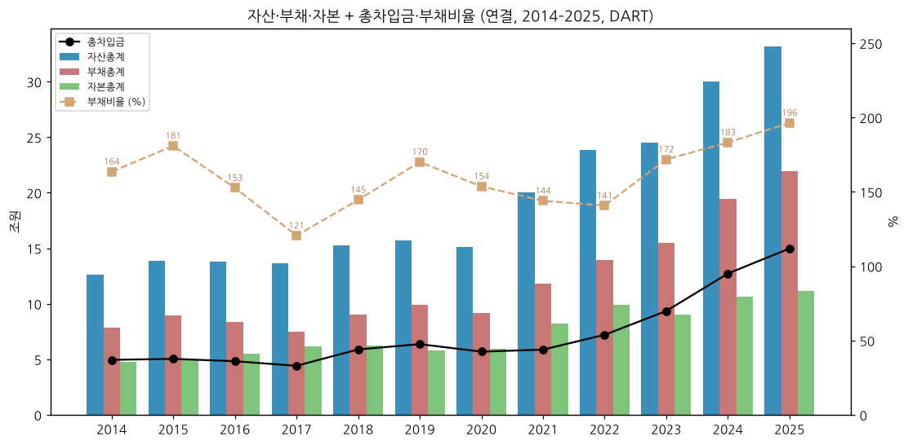

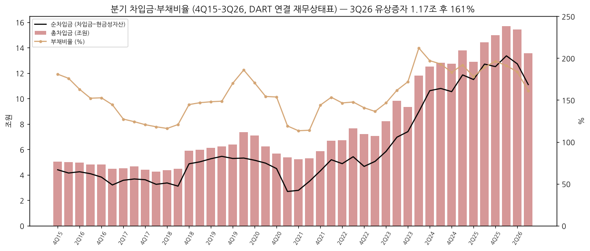

→ 2022말 → 2025말 총차입금 7.21조 → 14.98조 (**2.1배**), 순차입금 4.66조 → 12.51조 — 미국 솔라허브 투자(2023\~2025 CapEx 7.8조)를 차입으로 조달. 2026 유상증자 1.17조 + 투자자산 매각으로 3Q26 총차입금 13.56조로 감소 [DART, 계산]

### ③ 현금흐름표 (12년 연결, 억원)

| 연도 | 영업CF | 투자CF | 재무CF | 유형자산 취득 | 무형자산 취득 | CapEx 합계 | FCF | CapEx/매출 | 이자 지급 | 배당 지급 | 유상증자 유입 |
|---|---|---|---|---|---|---|---|---|---|---|---|
| 2014 | 3,625 | -2,850 | -4,517 | 4,657 | 85 | 4,742 | -1,118 | 5.9% | 2,316 | 213 | 3,411 |
| 2015 | 12,093 | -9,526 | -1,540 | 7,592 | 75 | 7,667 | 4,426 | 9.5% | 1,849 | 245 | - |
| 2016 | 11,510 | -4,601 | -3,182 | 6,148 | 165 | 6,312 | 5,198 | 6.8% | 1,844 | 245 | - |
| 2017 | 9,162 | -4,032 | -6,856 | 4,924 | 121 | 5,044 | 4,118 | 5.4% | 1,637 | 575 | - |
| 2018 | 7,267 | -4,346 | -696 | 7,201 | 195 | 7,395 | -128 | 8.2% | 1,828 | 575 | - |
| 2019 | 12,061 | -11,107 | -426 | 11,653 | 92 | 11,745 | 316 | 12.4% | 2,288 | 329 | - |
| 2020 | 10,695 | -427 | -8,868 | 8,838 | 82 | 8,920 | 1,775 | 9.7% | 1,763 | 326 | - |
| 2021 | 9,909 | -16,550 | 10,763 | 8,127 | 100 | 8,227 | 1,682 | 7.7% | 879 | - | 13,387 |
| 2022 | 1,157 | -14,766 | 23,223 | 9,029 | 391 | 9,420 | -8,263 | 6.9% | 1,545 | - | - |
| 2023 | 5,180 | -27,991 | 16,087 | 23,905 | 206 | 24,111 | -18,931 | 18.1% | 3,638 | - | 493 |
| 2024 | 6,385 | -32,874 | 26,759 | 33,976 | 214 | 34,190 | -27,805 | 27.6% | 5,348 | 1,276 | - |
| 2025 | -6,550 | -17,486 | 27,142 | 20,105 | 70 | 20,175 | -26,725 | 15.1% | 5,089 | 911 | - |
| 9M26 | -159 | -778 | 2,021 | 6,447 | 40 | 6,487 | -6,646 | 5.2% | 5,705 | 478 | 11,638 |

(OpenDART 연결 현금흐름표. CapEx = 유형자산 취득 + 무형자산 취득. FCF = 영업CF − CapEx [계산]. 9M26 = 3Q26 분기보고서 누적. 2021 배당 지급은 표준계정 미매핑으로 공란(2020 사업연도 무배당))

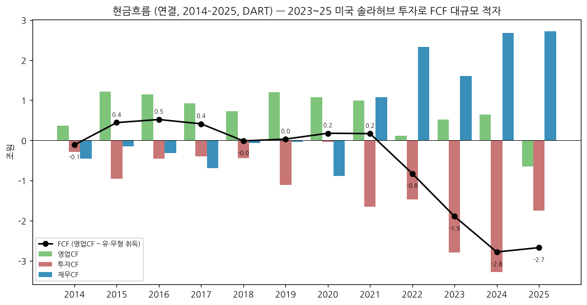

→ **2022\~2025 4년 누적 FCF 약 -8.2조** (영업CF 합 0.62조 vs CapEx 합 8.79조 [계산]) → 같은 기간 차입금 +7.8조·신종자본증권 0.70조·자회사 지분 매각으로 메움. 2025는 영업CF 자체가 -6,550억 (재고 증가 — 재고자산 2023말 3.30조 → 2025말 5.68조)

### ④ CapEx 추이 (12년, 억원)

| 연도 | 유형자산 취득 | 무형자산 취득 | 합계 | CapEx/매출 | 감가 대비 | 사이클 annotation |
|---|---|---|---|---|---|---|
| 2014 | 4,657 | - | 4,657+ | 5.8% | - | 저점①, 투자 억제 |
| 2015 | 7,592 | 75 | 7,667 | 9.5% | - | Q CELLS 통합·말레이시아 셀 |
| 2016 | 6,148 | 165 | 6,313 | 6.8% | - | |
| 2017 | 4,924 | 121 | 5,045 | 5.4% | - | 정점①, 유지보수 수준 |
| 2018 | 7,201 | 195 | 7,396 | 8.2% | - | 태양광 증설(진천·미국 결정) |
| 2019 | 11,653 | 92 | 11,745 | 12.4% | - | 미국 달튼 1.7GW 모듈 |
| 2020 | 8,838 | 82 | 8,920 | 9.7% | - | |
| 2021 | 8,127 | 100 | 8,227 | 7.7% | - | |
| 2022 | 9,029 | 391 | 9,420 | 6.9% | - | IRA 통과, 카터스빌 투자 결정 |
| 2023 | 23,905 | 206 | 24,111 | 18.1% | - | 카터스빌 솔라허브 본격 집행 |
| 2024 | 33,976 | 214 | 34,190 | 27.6% | - | **CapEx 정점 3.42조** |
| 2025 | 20,105 | 70 | 20,175 | 15.1% | - | 카터스빌 잉곳 양산(12월) |
| 9M26 | 6,447 | 40 | 6,487 | 5.2% | - | 투자 사이클 종료 국면 |

(OpenDART 연결 CF. 2014 무형자산 취득 미추출. IR '재무지표' CAPEX(십억원): 2021 834 · 2022 942 · 2023 2,411 · 2024 3,419 · 2025 2,018 [IR 3Q26 p.16] — DART와 거의 일치. 감가상각비는 OpenDART 표준계정 미제공 → 다음 버전 주석 보강)

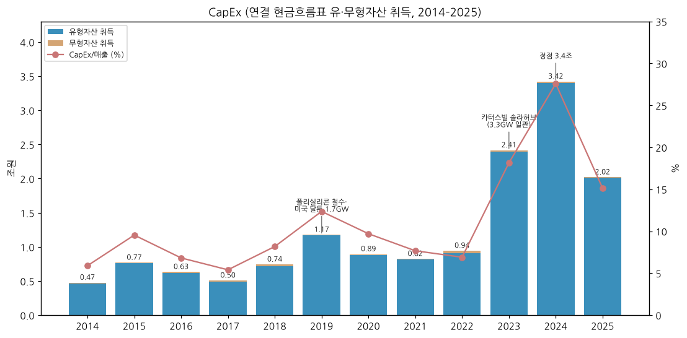

### ⑤ 부채구조 + 자본조달 history

- **차입 구조 (3Q26)**: 총차입금 13.56조 중 유동성 차입금 비중이 높음 — 1Q26 단기성차입금 8조 6,537억 [IB토마토 2026-07-27]. 유동비율 2025말 99% (100% 미만)
- **신종자본증권 (영구채)**: 6,968억 (2024-3Q 이후 자본 계상) [DART]. 2025 신종자본증권 배당(이자) 748억 [DART CF 2025]
- **이자 부담**: 이자 지급 2022 1,545억 → 2024 5,348억 → 2025 5,089억 → 9M26 5,705억 (9개월에 이미 2025 연간 초과) [DART CF]. 이자보상배율(영업이익/이자지급) 2024 -0.6배·2025 -0.7배
- **자본 조달·자산 유동화 (2022\~2026)**:
→ 2022-04 에이치씨씨홀딩스 49% 매각 (헤겔 유한회사) / 2022-12 한화첨단소재 39.7% 매각 (만다린홀딩스·BCC, 최종 47.24%) [DART 주석]
→ 2024 신종자본증권 약 7천억 발행 [DART BS]
→ 회사 설명 "지난 2년간 2.3조원 규모의 구조조정(재무 개선)"을 이미 실행 [뉴스와이어 2026-04-17]
→ 2026-03 유상증자 2.4조 결정 → 1.8조 축소 → 확정 1.17조 (22,100원 × 53,000,000주) [SBS Biz 2026-07-29]. 축소분은 투자자산 매각·구조화 상품 유동화·해외법인 자본조달로 2026년 내 보충 예정 — 2026-07-16 미국 벤처펀드 지분 $84.3M(약 1,255억) 매각, 잔여 투자자산 약 3천억 추가 유동화 계획 [뉴시스 2026-07-16]
→ 2026-07 여천NCC 유상증자 2,725억 출자 의무 (재편 계획) [IB토마토 2026-07-27]
- **신용등급**: 회사채 AA- 유지 (한기평 2023-02\~2025-06, NICE 2023-01\~2025-05 매 평정 AA-) [DART 사업보고서(2025.12) I-1] → 2026-06 정기평정에서 AA- (전망 부정적) 유지 [뉴시스 2026-07-16]. 2024-06 롯데케미칼과 함께 전망 '부정적' 조정 [CEO스코어데일리 2024-06-28]

### ⑥ 배당·자사주 추이 (12년)

| 사업연도 | 보통주 DPS (원) | 배당총액 (억원) | 연결 배당성향 | 시가배당률 | 자사주 | 비고 |
|---|---|---|---|---|---|---|
| 2014 | 150 (추정) | 약 245 | - | - | - | 2015 CF 배당 지급 245억 기준 추정 |
| 2015 | 150 | 245 | 13.0% | 0.6% | - | |
| 2016 | 350 | 575 | 7.6% | 1.4% | 1,698,965주 보유 | |
| 2017 | 350 | 575 | 7.0% | 1.2% | | |
| 2018 | 200 | 329 | 17.6% | 1.0% | 1.70M주 소각 (발행 164.8M → 163.1M) | |
| 2019 | 200 | 326 | -13.7% | 1.1% | 2019\~2020 매입 (CF 372억·290억) | 순손실에도 배당 |
| 2020 | 0 | 0 | - | - | | 합병·유증 국면 |
| 2021 | 0 | 0 | - | - | | |
| 2022 | 0 | 0 | - | - | 2022 매입 909억 (CF) | |
| 2023 | 300 | 517 | -24.8% | 0.8% | | 3년 만에 배당 재개 |
| 2024 | 300 | 517 | -3.7% | 1.9% | | 순손실에도 배당 |
| 2025 | 0 | 0 | - | - | | 무배당 → 우선주 의결권 부활(2026-03-24 주총) |

(출처: DART 사업보고서 '배당에 관한 사항' 2017·2018·2019·2021·2023·2025 및 OpenDART alotMatter(2025). 2014 DPS는 공시 원문 미확인 — 추정. 자사주는 DART 발행주식총수·CF 자기주식 취득)

- **2026-03-26 신규 주주환원 정책**: 향후 5년간 연결 당기순이익의 10%를 배당 또는 자사주 매입·소각 [서울신문 2026-03-27]

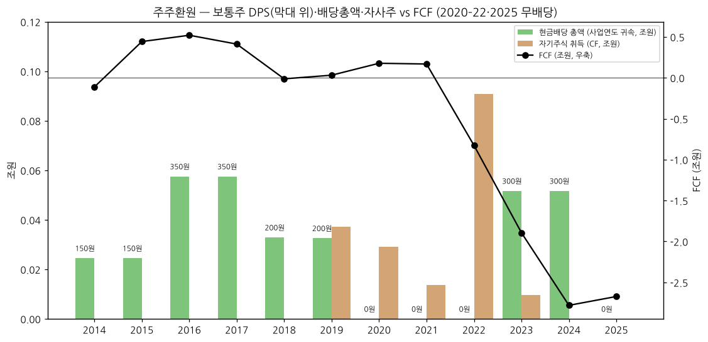

### ⑦ 재무 비율 + 밸류에이션 (12년)

| 연도 | ROE (지배) | ROA | 부채비율 | 유동비율 | 이자보상배율 (OP/이자지급) | 연말 보통주 시총(조) | PBR | PER | EV/EBITDA | 순차입금/EBITDA | DPS(원) |
|---|---|---|---|---|---|---|---|---|---|---|---|
| 2014 | 1.3% | 0.1% | 164% | 96% | 0.6배 | 2.01 | 0.46 | 35.5 | N/A | N/A | 150 |
| 2015 | 4.1% | 1.3% | 181% | 88% | 1.8배 | 4.25 | 0.92 | 22.6 | N/A | N/A | 150 |
| 2016 | 14.3% | 5.6% | 153% | 91% | 4.2배 | 3.93 | 0.74 | 5.2 | N/A | N/A | 350 |
| 2017 | 13.7% | 6.1% | 121% | 86% | 4.6배 | 5.02 | 0.84 | 6.1 | N/A | N/A | 350 |
| 2018 | 3.1% | 1.1% | 145% | 98% | 1.9배 | 3.18 | 0.52 | 17.0 | 10.3 | 6.1 | 200 |
| 2019 | -4.1% | -1.6% | 170% | 91% | 1.7배 | 2.94 | 0.51 | 적자 | 8.4 | 5.4 | 200 |
| 2020 | 5.2% | 2.0% | 154% | 94% | 3.4배 | 7.39 | 1.25 | 23.9 | 10.0 | 3.8 | 0 |
| 2021 | 7.6% | 3.1% | 144% | 105% | 8.4배 | 6.76 | 0.83 | 10.9 | 8.0 | 3.1 | 0 |
| 2022 | 4.0% | 1.5% | 141% | 126% | 6.3배 | 8.18 | 0.92 | 22.8 | 8.4 | 2.8 | 0 |
| 2023 | -2.7% | -0.6% | 172% | 113% | 1.7배 | 6.79 | 0.87 | 적자 | 12.1 | 5.8 | 300 |
| 2024 | -14.9% | -4.6% | 183% | 93% | -0.6배 | 2.77 | 0.29 | 적자 | 36.3 | 26.5 | 300 |
| 2025 | -7.1% | -1.9% | 196% | 99% | -0.7배 | 4.61 | 0.51 | 적자 | 44.6 | 29.0 | 0 |

(ROE = 지배순이익 / 기말 지배지분, ROA = 연결순이익 / 기말 자산. 연말 시총 = 12월 월말 원주가(2023-03 이전 Yahoo × 0.8987, 2014는 DART 12월 평균) × 보통주 발행주식수 [계산]. EV/EBITDA = (시총 + 순차입금 + 비지배지분) / IR EBITDA (2018\~2025, 각 연도 4Q IR 최초 공시치), 2014\~2017은 EBITDA 미확보로 N/A. 이자보상배율 = 영업이익 / CF 이자지급. 모두 [계산])

→ **현재 (2026-11-24, 3Q26말 장부)**: PBR **0.45배** (시총 4.53조 / 지배지분 10.07조), EV/EBITDA(LTM) **약 20.9배**, PER 산출 불가 (LTM 순손실 -880억), 부채비율 161%, 순차입금비율 88% (IR)

---

## 5. 지배 구조

### ① 그룹·계열 관계

- **한화그룹**: 김승연 회장 → 지주 역할의 **(주)한화** (출자자 62,068명, 대표이사 김동관 보통주 10.38% 보유, 최대주주 한화에너지(주) 보통주 23.55% [DART 분기보고서(2026.09) VII-나 최대주주에 관한 사항]) → 한화솔루션 35.73%
- 한화솔루션의 주요 종속·관계회사:
→ 신재생: Hanwha Q CELLS Americas Holdings·Hanwha Q CELLS USA·Hanwha Q Cells Georgia(카터스빌), Hanwha Q CELLS Malaysia, Hanwha Q CELLS GmbH(독일), Q Energy Solutions SE(유럽 발전소 개발), REC Silicon (미국 폴리실리콘, 미검증 — 2024 공개매수로 지분 확대 보도)
→ 케미칼: Hanwha Chemical (Ningbo), 여천NCC(50%, 공동기업), 한화토탈에너지스·한화임팩트 (관계기업·지분법)
→ 소재·기타: 한화첨단소재 (지분 52.76%, PEF 47.24%), 에이치씨씨홀딩스 (51%), 한화이센셜, 한화도시개발, 한화인베스트먼트
- 2023-03 분할된 **한화갤러리아**는 별도 상장사(계열사)로 분리

### ② 주주 구분

| 주주 | 보통주 (3Q26말) | 지분율 | 2026-01-01 | 비고 |
|---|---|---|---|---|
| (주)한화 | 80,357,854 | 35.73% | 62,420,460 (36.31%) | 유상증자 초과청약 (120% 이상 참여 계획 [뉴스와이어 2026-04-17]) |
| 북일학원 | 260,362 | 0.12% | 0.15% | 재단 |
| 김동관 (부회장·대표이사) | 104,553 | 0.05% | 0 | 2026 신규 취득 |
| 등기임원·독립이사 | 77,741 | 0.03% | | 남정운 28,577·박승덕 34,892 등 |
| 최대주주 등 합계 | 80,796,510 | **35.93%** | 36.47% | |
| 자기주식 | 2,544,257 (2025말) | 1.13% | | 우선주 자기주식 30,733주는 2026-08 소각 |
| 기타 (외국인·기관·개인) | 약 141.6M | 약 62.9% | | 외국인 지분율 시계열은 미확보 (KRX) |
| 우선주 (주)한화 | 641,746 | 25.22% (우선주 중) | | 2025 무배당으로 의결권 일시 부활 |

(출처: DART 분기보고서(2026.09) VII, OpenDART hyslrSttus·tesstkAcqsDspsSttus(2025). 5% 이상 주주 공시는 분기보고서 생략 — 국민연금 등 기관 지분은 다음 버전 보강)

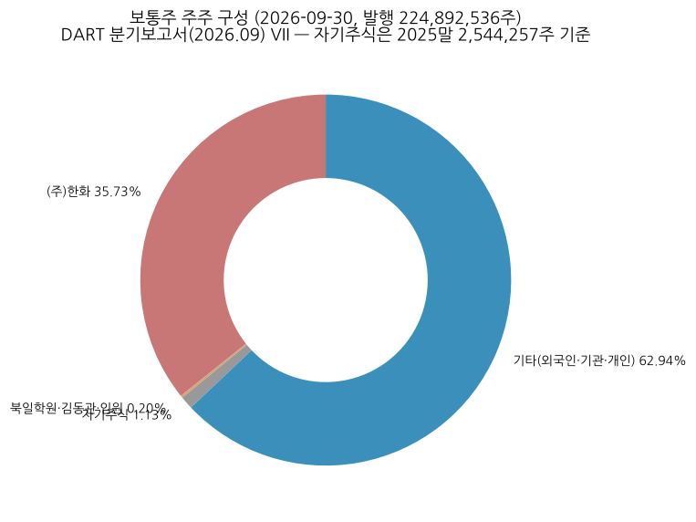

### ③ 임원·이사회

- **사내이사(대표이사) 3인**: 김동관 (1983년생, Harvard 정치학, 전략 부문 대표 — (주)한화·한화에어로스페이스 대표이사, 한화오션 기타비상무이사, 한화임팩트 대표 겸직, 재직 6년 9개월, 임기 2029-03) / 남정운 (1967년생, 연세대 경영, 케미칼 부문, 前 YNCC 대표, 임기 2029-03) / 박승덕 (1970년생, 포항공대 화공 석사, 큐셀 부문, 前 한화종합화학 대표, 임기 2027-03)
- **사외이사(독립이사) 4인**: 송광호 (고려대 화공생명공학 교수), 배성호 (경북대 경영학부 교수, 감사위원), 이아영 (강원대 경영회계학부 교수, 감사위원), 장재수 (세마인베스트먼트 사외이사, 감사위원)
- **미등기 회장**: 김승연 ((주)한화 회장)
- 대표이사 변동 (2020\~2025): 김희철·류두형(2020) → 김동관(2020-10) → 김은수·남이현·김인환·이구영 → 남정운·홍정권(2024-09) → 박승덕(2025-07, 홍정권 사임) [DART 사업보고서(2025.12) I-2]

(출처: DART 분기보고서(2026.09) VIII 임원 현황)

---

## 6. 기타 팩트

### ① R&D 인프라

| 연도 | 연구개발비용 (억원, 별도) | 별도 매출 대비 | 비고 |
|---|---|---|---|
| 2014 | 482 | 1.3% | 한화케미칼 별도 (케미칼 중심) |
| 2015 | 400 | 1.2% | |
| 2016 | 510 | 1.5% | |
| 2017 | 539 | 1.4% | |
| 2018 | 518 | 1.3% | |
| 2019 | 531 | 1.5% | |
| 2020 | 1,249 | 2.2% | 큐셀앤드첨단소재 합병으로 별도 범위 확대 |
| 2021 | 1,398 | 1.89% | 갤러리아·도시개발 합병 |
| 2022 | 1,978 | 2.04% | |
| 2023 | 2,150 | 2.93% | |
| 2024 | 2,138 | 3.46% | |
| 2025 | 2,004 | 3.49% | |
| 9M26 | 1,549 | 2.86% | |

(출처: DART 사업보고서 각 연도 II-6 연구개발 활동, 분기보고서(2026.09). 별도(한화솔루션 법인) 기준 — 미국 큐셀 법인·한화첨단소재 R&D는 미포함)

- 연구 거점: 대전 중앙연구소(케미칼), 큐셀 진천·독일 탈하임 R&D (탠덤셀) [DART 사업보고서(2025.12) II]
- 주요 과제: 페로브스카이트-실리콘 **탠덤 셀** 양산 검증 (진천), 수전해 음이온교환막(AEM), CPVC 컴파운드, PCR PO, 배양육 핵심기술 [DART 분기보고서(2026.09) II-6, 아시아경제 2026-02-10]

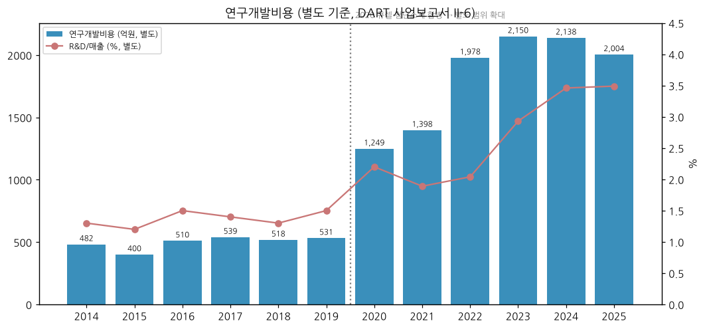

### ② 진행 중 corporate action — 10년치 주요 이벤트

| 시점 | 이벤트 | 출처 |
|---|---|---|
| 2018 | 자기주식 1,698,965주 소각 | DART 발행주식총수 변동 |
| 2020-01-01 | 한화큐셀앤드첨단소재 흡수합병 → 한화솔루션 | DART 사업보고서(2025.12) I-2 |
| 2020-02 | 폴리실리콘 사업 철수 결정 | IR 2021-05 주석 |
| 2021-03 | 유상증자 31,414,000주 (약 1.34조) | DART 사업보고서(2020.12) |
| 2021-04-01 | 한화갤러리아·한화도시개발 자산개발 부문 흡수합병 | DART |
| 2022-04 | 에이치씨씨홀딩스 49% 매각 | DART 주석 |
| 2022-12 | 첨단소재 물적분할 + 지분 39.7%(최종 47.24%) PEF 매각 | DART 주석 |
| 2023-03-01 | 갤러리아 인적분할 | DART |
| 2024-06 | 중국 치동 공장 영업정지 | IR 주석 |
| 2024-10 | 한화저축은행 지분 매각 | IR 주석 |
| 2026-03\~07 | 유상증자 2.4조 → 1.8조 → 확정 1.17조 | 서울신문·뉴스와이어·SBS Biz |
| 2026-07 | 미국 벤처펀드 지분 $84.3M 매각, 투자자산 약 3천억 추가 매각 계획 | 뉴시스 2026-07-16 |
| 2026-07-20 | 여수 사업재편 승인 — PE·수지 사업 여천NCC 현물출자 + 2,725억 출자 | 머니투데이 2026-07-22, IB토마토 2026-07-27 |
| 2026-12-04 (예정) | 미국 Section 232 폴리실리콘·파생제품 관세 시행 | 비즈워치 2026-10-29 |

### ③ 기술·생산 마일스톤 — 10년치

- 2019 미국 조지아 달튼 모듈 공장 가동 (미검증 — 언론 일반) → 이후 증설
- 2023\~2025 카터스빌 "솔라허브" 건설 (잉곳-웨이퍼-셀-모듈 일관, 북미 최대 태양광 생산단지 [IR 3Q26 p.19])
- 2025-12 카터스빌 잉곳 양산 → 2026-02 웨이퍼 양산 → 2026-3Q 셀 공장 가동 목표 [CEO스코어데일리 2026-02-05]
- 2026말 셀 11.0GW·모듈 11.4GW [IR 3Q26 p.18]
- 탠덤 셀(페로브스카이트) 양산 검증 중 [아시아경제 2026-02-10]
- 케미칼: XDI(Specialty isocyanate) 상업화(2023), PVC 반응기 대형화 상업화 성공(2023) [DART 사업보고서(2023.12) II-6]

### ④ 주요 리스크

(1) **미국 정책 리스크 (최대)** — 신재생 이익 = AMPC 의존. 45X 개정·FEOC 요건(비금지외국기관 부품비율 2030 60%), Section 232 관세 범위, 25D 종료에 따른 주택용 수요 감소, 미국 경쟁사의 "한국산 셀 우회수출" 청원(회사는 "영향 없을 것" — 2023 말레이시아 청원 기각 선례 [머니투데이 2026-07-29])
(2) **재무 리스크** — 순차입금 11.23조, 이자 9M26 5,705억, AA- 부정적. 유상증자 후에도 순차입금/EBITDA 10배 이상 (LTM EBITDA 0.88조 기준 [계산])
(3) **화학 구조적 공급과잉** — 중국 대규모 PE·PVC 증설, 여천NCC 신용 악화(BBB+)와 추가 자금 투입 가능성 ("향후 추가 자금 투입 여부와 규모는 아직 정해지지 않았다" — 회사 [IB토마토 2026-07-27])
(4) **통관·공급망** — 2025 한국산 셀 미국 세관 억류로 4Q25 적자 [CEO스코어데일리 2026-02-05]. UFLPA(위구르 강제노동방지법)류 공급망 추적 요구
(5) **이익의 일회성 비중** — 2Q26 관세 환급·개발자산 매각, 4Q24 기타부문 1,028억 등 분기 이익을 일회성이 좌우
(6) **주주가치 희석** — 2026 유증 희석률 30.8% (신주 53,000,000주 / 기존 보통주 171,892,536주 [계산], 계획 단계 공시 32.1%), 한화첨단소재 PEF 풋옵션 등 자회사 지분 약정 [DART 주석]
(7) **환율** — USD·EUR·JPY·THB·CNY 노출 (미국 매출 비중 높음) [DART 사업보고서(2025.12) II-5]

### ⑤ ESG 등급

- 이번 버전에서는 MSCI·KCGS 최신 등급 미확보 (지속가능경영보고서 미수집 — 아래 source audit 참조). 다음 버전 보강
- 회사 사업 자체가 재생에너지(태양광)·순환경제(PCR PO, 폐모듈 재활용 Hanwha Qcells EcoRecycle) 중심 [DART 사업보고서(2025.12) I]

### ⑥ 인증·라이선스

- 화학물질관리법·고압가스안전관리법 등 석유화학 설비 인허가 (여수·울산) — 일반
- 미국: IRA 45X 적격 제조시설(조지아), DCA(Domestic Content) 적격 모듈 판매 — "완공된 공장에서 국내 콘텐츠 보너스(DCA)가 판매가에 반영 … 상당한 프리미엄을 받고 있다" [머니투데이 2026-07-29]

---

## Version Log

- **v1.0 (2026-11-25)**: 첫 작성 — Phase 1 source 점검 (OpenDART 재무 JSON 44개(2015\~3Q26, 2015 1Q\~3Q 미제공분은 원문 XML), 정기공시 원문 XML 64건(본문+감사보고서 첨부, 2013\~2020 EUC-KR 디코딩 확인), 기업개황·주주·임원·직원·배당·자기주식·주식총수, IR PDF 35건(1Q18\~3Q26 — 2Q21·3Q21 다운로드 실패, 이미지 PDF 5건은 후속 분기 표로 대체), Yahoo 월간·일간(보통주·우선주), 언론·신용평가) + v4.8 6개 섹션 + 차트 16종 (12종 표준 + chart2 부문 4종(케미칼·신재생·첨단소재·리테일) + chart13 분기 차입금·부채비율)
- **데이터 처리 결정**: ① 12년 연간은 DART 보고 당시 기준(재작성 미반영), 부문 연간·분기는 IR 최신 재작성본 ② 분기 부문 시계열은 3개 양식 연결(2014\~15 DART 사업의 내용 / 2016\~18 IR 구양식 / 2019\~ IR 신양식) ③ 2023-03 이전 주가 = Yahoo × 0.8987 원주가 환산 (Yahoo 역방향 분할조정 확인), 2014-12는 DART 월평균 ④ 시가총액은 보통주 기준(현재 시총만 우선주 포함 병기) ⑤ EBITDA는 IR 공시치(2018\~), 감가상각비 원값은 미추출 ⑥ 3Q26은 분기보고서 확정치 (잠정 아님)
- 잔여 보완 후보: ① 2011\~2013 분기 시계열 (60+분기 표준 미달 — 현재 51개 분기) ② 2014\~2017 EBITDA·감가상각비 (연결 주석) ③ 지속가능경영보고서·MSCI/KCGS ESG 등급 ④ 외국인 지분율 시계열 (KRX) ⑤ OBBBA 45X·48E 세부 조항 1차 자료 검증 ⑥ 글로벌 피어(First Solar·Westlake 등) 수치 비교 ⑦ 2017년 IR PDF 4건·2Q21·3Q21 IR 재수집 ⑧ PE·PVC·가성소다 스프레드 장기 시계열 차트 ⑨ 정유·화학 6종목(S-Oil·롯데케미칼·금호석유화학·SK이노베이션·LG화학) 기업개요와 분류·밸류 프레임 교차 검수
