> 종목: 한화시스템 (272210.KS / 한화시스템 주식회사 / Hanwha Systems Co., Ltd.)
> 섹터: 방산 (워치리스트 T2)
> 작성 시각: 2026-11-03 KST (v1.0 최초 작성) → **2026-11-04 KST v1.1** (회사 IR 실적발표 PDF 46건 반영, 사업부별 분기 시계열 IR 기준 교체)
> 적용 구조: v4.8 (6개 섹션 + 12종 차트 표준. chart2는 방산·ICT·기타필리·수주잔고 4종, chart3 제품 매트릭스는 미작성)
> 데이터: 연결 연간 9년(2017~2025, 2017·2018은 2019 사업보고서 요약재무) + 분기 32개(4Q18~3Q26, **회사 IR 별첨 분기표 기준**, 1Q24~3Q26은 필리조선소 중단영업 재작성치) 사업부별(방산·ICT·기타) + Yahoo 월간 주가(2019.11 상장~2026.11.03)
> 출처: DART 사업보고서 7건(2019.12 rcept 20200327002114 · 2020.12 20210511000265 · 2021.12 20220516000217 · 2022.12 20230411001656 · 2023.12 20240516000399 · 2024.12 20250314001773 · 2025.12 정정 20260513000644), 2026 반기보고서 정정(20260820000123), 분기·반기보고서 19건, OpenDART 연결재무 JSON 27건(2019 FY~2026 2Q), **한화시스템 IR 실적발표 PDF 46건(4Q19 2020-02-21 ~ 3Q26 2026-10-27, 고유 분기 26개)**, 3Q26 잠정실적 보도(MTN·지디넷 2026-10-27), 한화에어로스페이스 3Q26 IR(BT 리뷰 파일 경유), Yahoo Finance v8 272210.KS
> 상장 전(2015~2016) 연결 재무: OpenDART 미제공 + 2019 사업보고서 요약재무도 3개년(2017~2019)만 수록 → **확인 불가**

# 한화시스템 기업 개요 (v1.1 — 방산 T2, 방산전자 + ICT, 필리조선소 편입·매각으로 2025~26 연결 범위 급변)
> **Fact verify cutoff**: 2026-11-04 (IR 수치는 2026-10-27 3Q26 IR까지. 시가총액·52주 고저·ATH는 2026-11-03 Yahoo Finance meta·DART 2026 반기보고서·stockhub 확인, 아래 ②-(3) 참조)


## ① 기업 분류

(1) Primary / Secondary 분류

**Primary 분류: 지속성장 (방산전자 수주잔고형)**

→ 9년(2017~2025) 연결 OPM range 1.1%~7.8% = **6.7%pt** — 사이클 cutoff(±10%pt) 미충족. 마진이 낮고 좁은 범위에서 움직이는 정부 조달형 이익 구조

→ 매출은 9년 중 **9년 연속 증가**(8,586억 → 36,642억). 방산 수주잔고 4.07조(2020말) → 9.30조(2025말) → 8.40조(3Q26말, 3Q26 IR p.10)로 2배 이상 확대

**Secondary 노트: ① 방산 수출 레버리지(최근 6분기 방산 OPM 10~15%) ② 지분투자 보유회사 성격(한화오션 지분 등 FVOCI 4.43조, 2025말) ③ 신사업(우주·위성·UAM·디지털플랫폼·필리조선소) 손실이 연결 OPM을 깎는 구조**

→ 연결 OPM은 '기타' 부문 손실에 좌우됨: 2022 기타 OP -697억(연결 OPM 1.1%), 2025 기타 OP -1,601억(필리조선소, 연결 OPM 3.3%). **방산 단독 OPM은 2025년 9.4%, 2026 1H 14.7%**

**Entity 구조 (2025말, 연결 종속 10개사)**

→ **(1) 방산** — FY25 매출 24,389억 (66.6%) — 레이다(다기능레이다·AESA), 전자광학, 지휘통제통신, 함정 전투체계, 항공전자, 위성

→ **(2) ICT** — FY25 매출 6,526억 (17.8%) — 한화그룹 계열 SI·ITO (주요 매출처 한화에어로스페이스)

→ **(3) 기타** — FY25 매출 5,755억 (15.7%) — Hanwha Philly Shipyard(상선·지원함, 2024.12.31 지분 60% 취득), H FOUNDATION, Hanwha Systems USA/UK, 바닐라스튜디오 등. **3Q26부터 필리조선소는 중단영업 분류**(2026.9 지분 매각 결정)

(2) Summary Box (9년 연결 시계열 + 사이클 통계)

| 지표 | 9년 평균 (2017~2025) | 정점 | 저점 | 2025년 |
|---|---|---|---|---|
| 매출 (연결, 억원) | 20,417 | **36,642 (2025)** | 8,586 (2017) | **36,642** |
| OP (연결, 억원) | 914 | **2,193 (2024)** | 240 (2022) | **1,199** |
| NI (연결, 억원) | 1,374 | **4,454 (2024)** | -808 (2022) | **2,091** |
| OPM (연결, %) | 4.5% | **7.8% (2024)** | 1.1% (2022) | **3.3%** |

```
[한화시스템 9년 연결 손익 시계열 (억원)]
연도   매출     OP     OPM    NI      비고
2017   8,586    309   3.6%    141   ← 방산 단일 사업(별도=연결), 상장 전
2018  11,289    448   4.0%    412   ← 2018.08.01 한화S&C 흡수합병, ICT 5개월 편입 (시계열 단절 1)
2019  15,460    858   5.5%    729   ← ICT 풀이어 편입 + 2019.11.13 유가증권시장 상장
2020  16,429    929   5.7%    936   ← 1차 OPM 고점 (방산 6.0% / ICT 6.2%)
2021  20,895  1,120   5.4%    979   ← 2021.06 유상증자 1.2조 규모, 신사업(위성·UAM) 투자 시작 (기타 OP -233억)
2022  21,880    240   1.1%   -808   ← OPM 9년 최저: 신사업 손실 -697억 + ICT OPM 0.7% (사이클 저점)
2023  24,531    929   3.8%  3,431   ← 한화오션 인수 참여(2023.5) — NI는 지분 관련 금융이익으로 급증
2024  28,037  2,193   7.8%  4,454   ← OPM 9년 정점: 방산 OPM 8.1%, 수주잔고 8.34조
2025  36,642  1,199   3.3%  2,091   ← 필리조선소 연결(시계열 단절 2): 기타 OP -1,601억. 방산 단독 OPM 9.4%

OPM range: 1.1% ~ 7.8% = 6.7%pt (cutoff ±10%pt 미충족 → 사이클 분류 아님)
사이클 회수: 1회 (2020 고점 → 2022 저점 → 2024 고점), 단 원인은 업황이 아니라 신사업 투자·연결 범위
```

**📊 사이클 통계 (9년 연결)**

| 지표 | 값 |
|---|---|
| 매출 CAGR (8년, 2017→2025) | **+19.9%** (2018 합병 효과 포함) |
| 매출 CAGR (6년, 2019→2025, 합병 후 동일 범위) | **+15.5%** (2025 필리 매출 5,755억 포함. 제외 시 2019→2025 방산+ICT CAGR 약 +12.6%) |
| OPM 평균 | **4.5%** |
| OPM 정점 평균 | **6.8%** (2020 5.7%, 2024 7.8%) |
| OPM 저점 평균 | **2.7%** (2017 3.6%, 2022 1.1%, 2025 3.3%) |
| OPM range | **6.7%pt** |
| 사이클 주기 | 약 4년 (고점 2020 → 2024) |
| 사이클 회수 (9년) | **1회** (2022 저점) |

**방산 피어 맥락 (정성)**

→ 한화시스템 방산 부문은 레이다·전자광학·전투체계 등 **'센서·두뇌' 하도급형 구조** — 체계종합(K9·천궁 체계)은 한화에어로스페이스·LIG넥스원이 맡고 한화시스템은 다기능레이다(MFR)·사격통제 등 핵심 서브시스템을 납품

→ 3Q26 한화에어로스페이스 IR 기준 사업부 OPM: 한화시스템 11.9% vs 지상방산 1.7% vs 한화오션 14.2% (출처: BT 리뷰 `2026-Q3_한화에어로스페이스_리뷰.md`, 한화에어로스페이스 3Q26 IR p.6~7)

→ 국내 피어(LIG넥스원·현대로템·KAI)·글로벌 피어(Thales·L3Harris)의 수치 비교는 같은 배치의 각 사 기업개요 참조 — 본 문서에서는 미검증 수치를 넣지 않음

(3) 정량적 분류 근거

→ **수주잔고 배수**: 방산 수주잔고 9.30조 / FY25 방산 매출 2.44조 = **약 3.8년치** (2025 사업보고서). 3Q26말 8.40조 (3Q26 IR p.10)

→ **방산 매출 9년 CAGR**: 8,586억(2017) → 24,389억(2025) = 연 +13.9%

→ **방산 OPM 분기 가속**: 2023년 평균 5.4% → 2024년 8.1% → 2025년 9.4% → 1H26 14.7% → 3Q26 12.3% (3Q26 IR p.6)

→ **연구개발비/매출 15~20%** (2025 6,978억, 19.0%) — 개발사업(국과연·방사청 개발 과제) 비중이 높아 R&D가 매출로 인식되는 구조

→ **ICT는 저성장·저마진**: 2019~2025 매출 4,490 → 6,526억(CAGR 6.4%), OPM 0.7~9.0%

(4) 산업 분류

→ **DART 업종** — 기타 정보기술 및 컴퓨터운영 관련 서비스업이 아닌 방산 주력(사업보고서 주요 사업: 군사장비(방산품) 제조·판매 66.6%)

→ **KRX 업종** — 유가증권시장 상장 (2019.11.13), 업종 분류 원문 확인 불가

→ **워치리스트 섹터** — 방산 T2

(5) 분류 결정 논리

(1) **가장 매출 큰 사업부 기준** — 방산 66.6% (FY25), OP는 방산 2,292억이 연결 OP 1,199억의 191% (기타 손실을 방산이 메움) → 방산이 Primary driver

(2) **사이클 vs 지속성장 sub-rule** — OPM range 6.7%pt < cutoff 10%pt, 매출 9년 연속 증가 → **지속성장**. 2022 저점은 업황이 아닌 신사업 투자 손실이 원인

(3) **Boundary case** — ① 2025~1H26 연결 OPM이 필리조선소 손실로 3%대에 머물러 '이익 성장' 판정이 어려움 ② 3Q26부터 필리 중단영업 분류로 연결 범위가 다시 바뀜 → **필리 제외 기준(방산+ICT) 손익으로 재판정** 필요. 계속영업(필리 제외) 연결 OPM 3Q26 11.9%, 2Q26 13.8% (3Q26 IR p.9)

(4) **피어 비교** — 체계종합사(한화에어로스페이스 지상방산)보다 수출 인도 시점 변동이 작고, 레이다 등 고부가 서브시스템 마진이 높음. 대신 국내 개발사업 비중이 커서 매출 성장률은 체계종합사보다 낮은 편 (정성 판단)

(6) 적정 밸류에이션 방법

→ **1차 — Forward PER (방산+ICT 이익 기준)**: 필리 중단영업 분류 후 계속영업 이익이 깨끗해지므로 12MF 지배주주 순이익 기준 PER. 단 순이익에 한화오션 지분 관련 금융손익·PRS 손익이 섞이므로 **영업이익 기반 EV/EBIT 병행**

→ **2차 — SOTP (사업가치 + 보유지분)**: 2025말 FVOCI 금융자산 4.43조(한화오션 지분 비중이 큰 것으로 추정)는 시가총액(12.0조, 2026-11-03)의 약 37% → 보유지분 가치를 따로 더하는 방식이 필요. 2026.4 한화오션 주식 13,923,011주(약 1.7조원) PRS 양도 이후 잔여 지분은 3Q26 보고서로 확인 필요

→ **3차 — P/B**: 자본 5.0조(2025말) 중 기타포괄손익누계액 2.1조가 지분 평가이익이라 P/B 단독 사용 부적합

→ **PER 우선 이유**: 사이클 분류가 아니고(정점 마진 평균 회귀 리스크 작음), 수주잔고로 2~3년 매출 가시성이 높음

(7) 분기 재평가 트리거 (**분류 변경 조건**)

→ ① **방산 OPM 4분기 연속 12%+ & 방산 수출 비중(3Q26 22%) 30%+** → Secondary 수출 레버리지를 **Primary 고성장**으로 격상 (중동 M-SAM/천궁-II MFR·KF-21 AESA 양산이 매출로 전환되는 국면)

→ ② **방산 수주잔고 2분기 연속 감소 + 연결 OPM 5% 미만 지속** → 지속성장 유지 불가, **저성장 방산전자**로 하향 (1H26 잔고 8.54조, 3Q26 8.40조로 2025말 9.30조 대비 감소 중 — 감시 대상)

→ ③ **우주(저궤도 통신·SAR 위성) 매출이 연결 10%+ 또는 별도 부문 공시** → '꿈' Secondary를 정식 사업부로 반영, SOTP 구성 변경

---

## ② 회사 개요

(1) 기본 사항

| 항목 | 내용 |
|---|---|
| 회사명 (한글) | 한화시스템 주식회사 |
| 회사명 (영문) | Hanwha Systems Co., Ltd. |
| 종목코드 | 272210 (KRX 유가증권시장, 2019.11.13 상장) |
| 설립일 | 2000년 1월 11일 (삼성톰슨CSF㈜). 뿌리는 1977년 삼성정밀 방산사업 (1978 1급 방산업체 지정) |
| 사명 변천 | 삼성톰슨CSF(2000) → 삼성탈레스(2001) → 한화탈레스(2015.6) → 한화시스템(2016.10) |
| 본사 주소 | 경상북도 구미시 산호대로 264-60 (2025.8.1 구미 신사업장으로 이전) |
| 홈페이지 | https://www.hanwhasystems.com |
| 대표이사 | 손재일 (1965.03, 고려대 경영학, 現 한화에어로스페이스 대표이사 겸직, 前 한화디펜스·㈜한화방산 대표이사, 2024.10.22 선임) |
| 발행주식수 | 188,919,389주 (자기주식 1,926,128주 = 1.02%, 2026.06.30) |
| 연결 종속회사 수 | 10개 (2025말, 2025 사업보고서) |
| 최대주주 | **한화에어로스페이스 46.73%** (88,289,321주) + 한화에너지 12.80% = 특수관계인 합 **59.53%** (2026.06.30, DART 2026 반기보고서) |
| 외국인지분율 | 9.28% (stockhub, 기준일 미표기 — 참고치) |
| 신용등급 | 회사채 AA (한국기업평가·한국신용평가·NICE, 2025.11 AA-→AA 상향), CP A1 (2026.06 정기평정) |
| 임직원 | 5,033명 (2026.06.30, 방산 3,419·ICT 1,614) |

(2) 9년 손익·자본 추이 (연결)

| 연도 | 매출 (억) | OP (억) | OPM | NI (억) | NI 지배 (억) | 자본총계 (억) | 자산총계 (억) | 출처 rcept |
|---|---|---|---|---|---|---|---|---|
| 2017 | 8,586 | 309 | 3.6% | 141 | 141 | 3,168 | 9,010 | 20200327002114 (요약재무, 별도=연결) |
| 2018 | 11,289 | 448 | 4.0% | 412 | 412 | 8,210 | 19,015 | 20200327002114 (요약재무) |
| 2019 | 15,460 | 858 | 5.5% | 729 | 729 | 9,684 | 24,092 | 20200327002114 |
| 2020 | 16,429 | 929 | 5.7% | 936 | 936 | 10,327 | 26,951 | 20210511000265 |
| 2021 | 20,895 | 1,120 | 5.4% | 979 | 983 | 22,398 | 38,943 | 20220516000217 |
| 2022 | 21,880 | 240 | 1.1% | -808 | -766 | 20,190 | 39,456 | 20230411001656 |
| 2023 | 24,531 | 929 | 3.8% | 3,431 | 3,492 | 21,541 | 44,832 | 20240516000399 |
| 2024 | 28,037 | 2,193 | 7.8% | 4,454 | 4,543 | 24,164 | 57,240 | 20250314001773 |
| **2025** | **36,642** | **1,199** | **3.3%** | **2,091** | **2,422** | **50,010** | **103,273** | 20260513000644 |

→ 각 연도 **당기 보고값** 기준. 이후 보고서에서 중단영업 재분류로 재작성된 값: 2022 OP 240→623억(2024 사업보고서), 2023 OP 929→1,226억(2024·2025 사업보고서). 재작성은 '기타(신사업)' 부문에서만 발생, 방산·ICT 값은 동일
→ 2015~2016: **확인 불가** (상장 전, OpenDART 미제공, 2019 사업보고서 요약재무는 2017~2019만 수록)
→ 2025 자본 +107%: 이익 증가가 아니라 기타포괄손익-공정가치 금융자산(한화오션 지분 등) 평가이익 2.15조가 기타포괄손익으로 반영된 영향 (2025 연결 포괄손익계산서)
→ ROE (지배, 기말자본 기준): 2023 16.3% / 2024 18.2% / 2025 5.0%

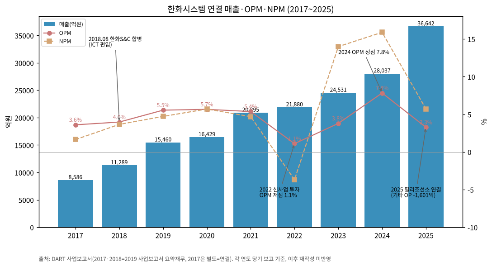

→ (출처: DART 사업보고서. 2017·2018은 2019 사업보고서 요약재무정보)
→ **사이클 위치**: 2018 합병 → 2020 OPM 5.7% 1차 고점 → 2021~2022 신사업(위성·UAM·디지털플랫폼) 투자로 2022 OPM 1.1% 저점 → 2024 방산 수출·KF-21 양산으로 7.8% 정점 → 2025 필리조선소 연결로 3.3% 하락 → 3Q26 필리 제외 11.9% (3Q26 IR). 필리 제외 재작성 기준 2025 연결 OPM은 8.9% (3Q26 IR 분기값 합산, 매출 30,987억·OP 2,755억)

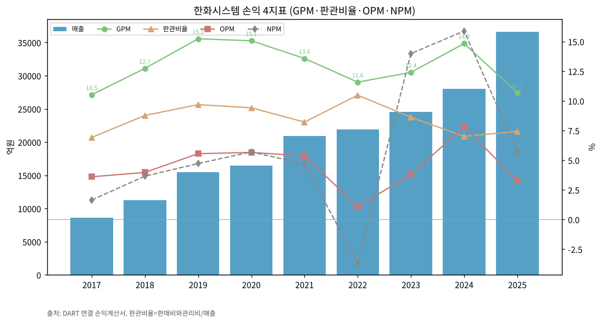

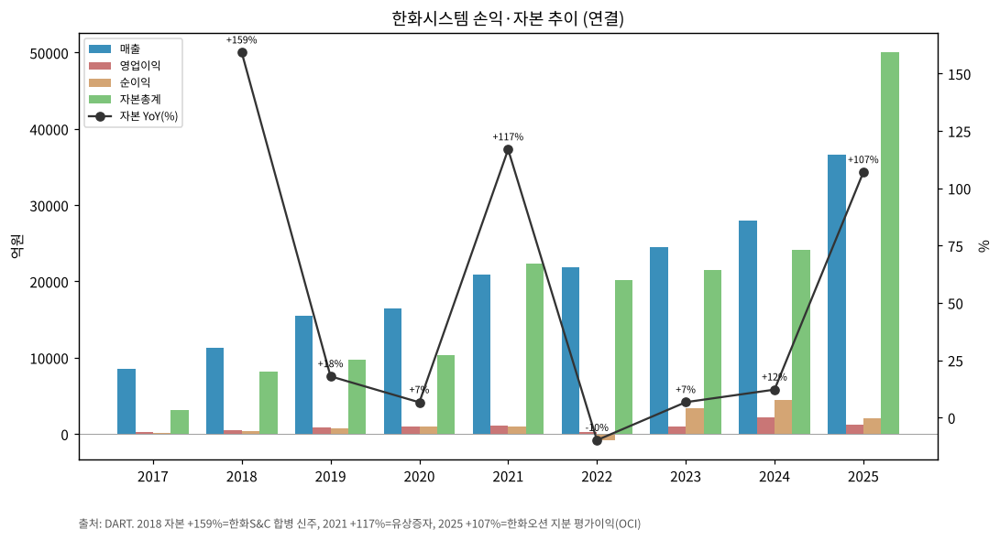

(3) 주가 역사

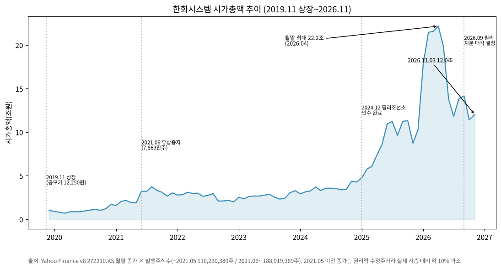

→ (출처: Yahoo Finance v8 월말 종가 × 발행주식수. 상장 2019.11이라 20년 대신 7년)

**시장 데이터 (2026-11-03 확인)**

| 항목 | 값 | 출처 |
|---|---|---|
| 종가 | 63,600원 (-2.75%) | Yahoo Finance meta / bullstory (2026-11-03 16:25) |
| 시가총액 | **약 12.0조원** (63,600원 × 188,919,389주) | 계산 |
| 52주 최고 | 184,000원 (장중, 2026.03) | Yahoo meta fiftyTwoWeekHigh, stockhub |
| 52주 최저 | 44,750원 (장중, 2025.12) | Yahoo meta, stockhub |
| 상장 후 최고 종가 | **162,700원 (2026.03)** — 시총 약 30.7조 | DART 2026 반기보고서 '주가 및 주식거래실적'(일일종가 기준) |
| 월말 종가 기준 최대 시총 | 22.2조 (2026.04말 117,300원) | Yahoo 월간 |
| 공모가 | 12,250원 (2019.11) | 일반 공지 정보, 원문 미확인 |

→ 장중 184,000원과 종가 최고 162,700원은 같은 달(2026.03)이나, 장중 고가는 단일 출처(Yahoo 계열)라 KRX 원자료 재확인 권장
→ **주가 변천사 요약**:
- 2019.11 상장 → 2020 코로나 저점 (시총 1조 미만)
- 2020.12~2021.03: 위성통신·UAM 신사업 기대로 급등 → 2021.06 유상증자(신주 78,689,000주)
- 2022~2024 중반: 신사업 손실·ICT 부진으로 시총 2~4조 박스권
- 2024.10~: 방산 수출(사우디 M-SAM MFR)·필리조선소 인수(미 해군 MRO 기대) → 2025.06 이스라엘-이란 충돌로 장중 사상 최고(당시 65,000원, 데일리안 2025-06-16)
- 2025.12~2026.03: 중동 방공 수요 급증 기대로 3개월 만에 3배 (종가 최고 162,700원)
- 2026.05~: 중동 긴장 완화·차익실현으로 급락, 2026.11.03 시총 12.0조 (고점 대비 -61%)

(4) 주요 연혁

- **1977**: 삼성정밀 방산사업 시작 → 1978 1급 방산업체 지정
- **2000.01**: 삼성톰슨CSF㈜ 설립 (삼성전자-프랑스 Thomson-CSF JV)
- **2001**: 삼성탈레스로 사명 변경
- **2015.06**: 삼성-한화 빅딜로 한화 계열 편입, 한화탈레스로 사명 변경
- **2016.10**: 한화시스템으로 사명 변경
- **2018.04**: 최대주주 한화테크윈 물적분할로 한화에어로스페이스(100%)로 변경
- **2018.08.01**: **한화S&C 흡수합병** (합병 신주 24,033,562주, 한화에어로스페이스 지분 100%→52.91%) — ICT 사업 편입
- **2019.11.13**: 유가증권시장 상장 (공모 신주 8,163,265주, 최대주주 지분 48.98%)
- **2021.05~06**: 미국 Kymeta 지분 취득, 유상증자 78,689,000주 (최대주주 46.73%로 변동)
- **2022.01~02**: UAE M-SAM 수출, 영국 OneWeb 지분 취득 완료
- **2023.05**: 한화오션(구 대우조선해양) 인수 참여 완료 (2023.09 한화오션 유상증자 참여)
- **2023.12**: 소형 SAR 위성 발사 성공
- **2024.06~07**: KF-21 최초양산 AESA 레이다 양산 계약, 사우디 M-SAM용 다기능레이다 양산 계약
- **2024.10**: 대표이사 어성철 → 손재일
- **2024.12.31**: **미국 Philly Shipyard 지분 60% 취득** (이전대가 881.6억원, 영업권 1,500억원 — PPA 확정 후)
- **2025.03**: 호주 Austal Ltd. 지분 취득, 한화인텔리전스 엣지파운드리에 흡수합병(연결 제외)
- **2025.06**: 기업가치제고계획 공시 (2027년까지 최소 DPS 350원)
- **2025.10~12**: L-SAM MFR 양산·이라크 M-SAM 수출·폴란드 K2 수출·M-SAM Block-III MFR 시제 계약
- **2025.11**: 회사채 신용등급 AA-→AA 상향
- **2026.03.06**: 한화오션 주식 13,923,011주(약 1.7조원) 양도 결정 (2026.04.06, PRS 계약)
- **2026.09**: 필리조선소 지분 60%를 한화디펜스USA·한화퓨처프루프 JV에 매각 결정 → 3Q26부터 중단영업 (MTN 2026-10-27)
- **2026.10.27**: 3Q26 잠정실적 — 매출 8,316억(+30.1%), OP 991억(+60.5%), 컨센서스(658억) 대비 +50.8%

---

## ③ 비즈니스 모델

(1) 실적 추이 통합 표 (5년 연간, 사업부별)

| 사업부 (억원) | 2021 | 2022 | 2023 | 2024 | 2025 | 1H26 |
|---|---|---|---|---|---|---|
| **방산 매출** | 15,135 | 16,408 | 18,170 | 20,988 | 24,389 | 11,718 |
| 방산 OP | 926 | 898 | 985 | 1,690 | 2,292 | 1,727 |
| 방산 OPM | 6.1% | 5.5% | 5.4% | 8.1% | 9.4% | 14.7% |
| **ICT 매출** | 5,760 | 5,466 | 6,356 | 6,948 | 6,526 | 3,596 |
| ICT OP | 431 | 39 | 271 | 561 | 508 | 342 |
| ICT OPM | 7.5% | 0.7% | 4.3% | 8.1% | 7.8% | 9.5% |
| **기타 매출** | 0 | 39 | 59 | 105 | 5,755 | 3,954 |
| 기타 OP | -233 | -697 | -320 | -63 | -1,601 | -691 |
| **연결 매출** | 20,895 | 21,880 | 24,531 | 28,037 | 36,642 | 19,247 |
| **연결 OP** | 1,120 | 240 | 929 | 2,193 | 1,199 | 1,379 |

→ (출처: 각 연도 사업보고서·2026 반기보고서 'I. 회사의 개요 — 사업부문별 손익내역'. 당기 보고값, 연결조정 별도)
→ **부문 구분 변경 이력**: 2019 '시스템부문'→'방산부문' 명칭 변경 / 2019~2020 '기타부문'(일본·베트남 물류 BPO) → 2021~2023 '신사업'(위성안테나 Phasor·디지털플랫폼·UAM 등) → 2024~ '기타'(필리조선소 포함) → **3Q26~ 필리조선소 중단영업, 기타 = 잔여 신사업 법인**
→ 기타 부문 재작성: 2023 신사업 OP -320억(당기 보고) → -53억(2024 보고서 재작성, 엔터프라이즈블록체인·한화인텔리전스 등 중단영업 재분류). 1H25 기타 OP -331억 → -586억(2026 반기보고서, 필리조선소 PPA 소급조정)

**방산 매출 구성 (3Q26)**: 수출 22% / 국내 개발 29% / 양산 33% / 유지보수(PBL·MRO) 16% (지디넷 2026-10-27 — 회사 컨콜 발언. IR PDF에는 비중 수치 미기재)

**IR 기준 연간 사업부 손익 (회사 발표치, 억원)**

| 사업부 | 2018 | 2019 | 2020 | 2021 | 2022 | 2023 | 2024 | 2025 (필리 포함) | 2025 (필리 제외) | 9M26 (필리 제외) |
|---|---|---|---|---|---|---|---|---|---|---|
| 방산 매출 | 9,470 | 10,705 | 11,567 | 15,135 | 16,408 | 18,170 | 20,988 | 24,388 | 24,388 | 17,892 |
| 방산 OP | 369 | 455 | 700 | 926 | 898 | 985 | 1,690 | 2,275 | 2,291 | 2,487 |
| 방산 OPM | 3.9% | 4.3% | 6.1% | 6.1% | 5.5% | 5.4% | 8.1% | 9.3% | 9.4% | **13.9%** |
| ICT 매출 | 1,819 | 4,755 | 4,862 | 5,760 | 5,466 | 6,355 | 6,948 | 6,526 | 6,526 | 5,722 |
| ICT OP | 79 | 403 | 291 | 431 | 39 | 269 | 561 | 560 | 508 | 582 |
| ICT OPM | 4.3% | 8.5% | 6.0% | 7.5% | 0.7% | 4.2% | 8.1% | 8.6% | 7.8% | 10.2% |
| 기타 매출 | - | - | - | - | 6 | - | 101 | 5,727 | 73 | 23 |
| 기타 OP | - | 0 | -62 | -237 | -546 | -28 | -58 | -1,600 | -44 | -45 |
| **연결 매출** | 11,289 | 15,460 | 16,429 | 20,895 | 21,880 | 24,525 | 28,037 | 36,641 | 30,987 | 23,637 |
| **연결 OP** | 448 | 858 | 929 | 1,120 | 391 | 1,226 | 2,193 | 1,235 | 2,755 | 3,024 |
| 연결 OPM | 4.0% | 5.5% | 5.7% | 5.4% | 1.8% | 5.0% | 7.8% | 3.4% | 8.9% | 12.8% |

→ (출처: 2018·2019 = 4Q19 IR p.5, 2020 = 4Q20 IR p.2, 2021~2025(필리 포함) = 4Q25 IR p.5, 2025(필리 제외)·9M26 = 3Q26 IR p.9 분기값 합산. 2018 ICT는 한화S&C 합병(2018.08) 후 5개월분)
→ IR은 중단사업을 소급 재분류해 발표: 2022 OP는 DART 당기 보고 240억 → IR 391억, 2023은 929억 → 1,226억. 방산·ICT는 거의 동일하고 차이는 '기타'에서 발생
→ **2026 회사 전망 (4Q25 IR p.7~9, 2026-02-06)**: 방산 매출 20% 이상 성장·자체투자 증가로 이익 성장 제한적 / ICT 매출 20%대 이상 성장·이익 성장 / 기타(필리) 매출 20%대 이상 성장·영업이익 턴어라운드 기대 → 9M26 실적: 방산 매출 +29% YoY(9M25 13,819억 대비), OP +63%, ICT 매출 +29%

(2) 사업부별 분기 시계열 (4Q18~3Q26, 32분기, 회사 IR 기준)

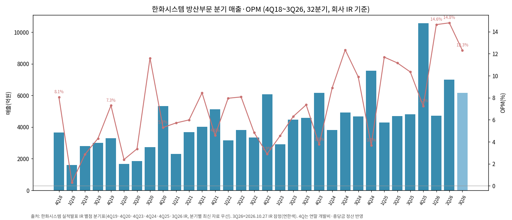

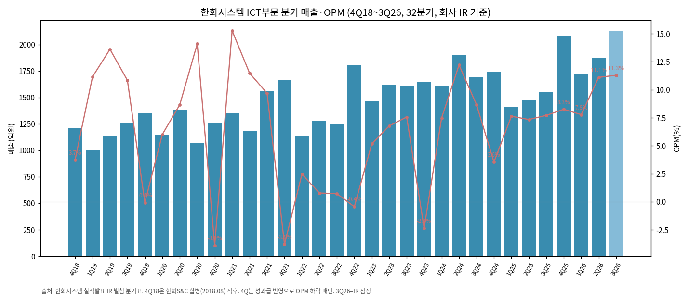

**(2-1) 최근 11분기 — 필리조선소 중단영업 재작성 기준 (3Q26 IR p.9)**

| 분기 (억원) | 방산 매출 | 방산 OP | 방산 OPM | ICT 매출 | ICT OP | ICT OPM | 기타 매출 | 기타 OP | 연결 매출 | 연결 OP | 연결 OPM | 출처 |
|---|---|---|---|---|---|---|---|---|---|---|---|---|
| 1Q24 | 3,817 | 340 | 8.9% | 1,605 | 120 | 7.5% | 20 | -5 | 5,442 | 455 | 8.4% | 3Q26 IR p.9 |
| 2Q24 | 4,932 | 609 | 12.3% | 1,901 | 232 | 12.2% | 37 | 3 | 6,870 | 844 | 12.3% | 3Q26 IR p.9 |
| 3Q24 | 4,678 | 463 | 9.9% | 1,696 | 147 | 8.7% | 16 | -7 | 6,390 | 603 | 9.4% | 3Q26 IR p.9 |
| 4Q24 | 7,561 | 278 | 3.7% | 1,746 | 62 | 3.6% | 28 | -49 | 9,335 | 291 | 3.1% | 3Q26 IR p.9 |
| 1Q25 | 4,303 | 503 | 11.7% | 1,415 | 108 | 7.6% | 19 | -11 | 5,737 | 600 | 10.5% | 3Q26 IR p.9 |
| 2Q25 | 4,702 | 525 | 11.2% | 1,471 | 108 | 7.3% | 22 | -14 | 6,195 | 619 | 10.0% | 3Q26 IR p.9 |
| 3Q25 | 4,814 | 498 | 10.3% | 1,556 | 120 | 7.7% | 22 | 0 | 6,392 | 618 | 9.7% | 3Q26 IR p.9 |
| 4Q25 | 10,569 | 765 | 7.2% | 2,084 | 172 | 8.3% | 10 | -19 | 12,663 | 918 | 7.2% | 3Q26 IR p.9 |
| 1Q26 | 4,712 | 690 | 14.6% | 1,723 | 134 | 7.8% | 14 | -17 | 6,449 | 807 | 12.5% | 3Q26 IR p.9 |
| 2Q26 | 7,006 | 1,037 | 14.8% | 1,873 | 208 | 11.1% | -7 | -19 | 8,872 | 1,226 | 13.8% | 3Q26 IR p.9 |
| **3Q26** | **6,174** | **760** | **12.3%** | **2,126** | **240** | **11.3%** | **16** | **-9** | **8,316** | **991** | **11.9%** | 3Q26 IR p.9 |

→ (출처: 한화시스템 3Q26 실적발표 IR(2026-10-27) p.9 별첨 분기표. 3Q26은 IR 잠정(외부감사 검토 전). 기타 = 필리 제외 잔여 자회사(Hanwha Systems USA 등))
→ v1.0의 3Q26P '기타 16억/-9억(역산 추정)'은 IR 원본 값과 일치 → ⚠️ 표기 해제
→ 회사 발표 YoY(+30%/+60%)의 기준 3Q25 = 매출 6,392억·OP 618억 (필리 제외 재작성, 3Q26 IR p.5)

**(2-2) 필리조선소 포함 보고치 vs 계속영업 (2025~2Q26)**

| 분기 | 필리 포함 연결 매출 | 필리 포함 연결 OP | OPM | 계속영업 매출 | 계속영업 OP | 필리 매출 (근사) | 필리 OP (근사) |
|---|---|---|---|---|---|---|---|
| 1Q25 | 6,901 | 336 | 4.9% | 5,737 | 600 | 1,164 | -264 |
| 2Q25 | 7,682 | 325 | 4.2% | 6,195 | 619 | 1,487 | -294 |
| 3Q25 | 8,077 | 206 | 2.6% | 6,392 | 618 | 1,685 | -412 |
| 4Q25 | 13,981 | 332 | 2.4% | 12,663 | 918 | 1,318 | -586 |
| 1Q26 | 8,071 | 343 | 4.2% | 6,449 | 807 | 1,622 | -464 |
| 2Q26 | 11,176 | 1,037 | 9.3% | 8,872 | 1,226 | 2,304 | -189 |

→ (출처: 필리 포함 = 2Q26 IR p.10 (2025분기는 필리 PPA 상각비 소급 조정치), 계속영업 = 3Q26 IR p.9. 필리 = 두 값의 차이 ⚠️ 근사 — 내부거래·연결조정 포함)
→ 2025 필리 누계 근사: 매출 약 5,654억, OP 약 -1,556억 / 1H26 매출 약 3,926억, OP 약 -653억

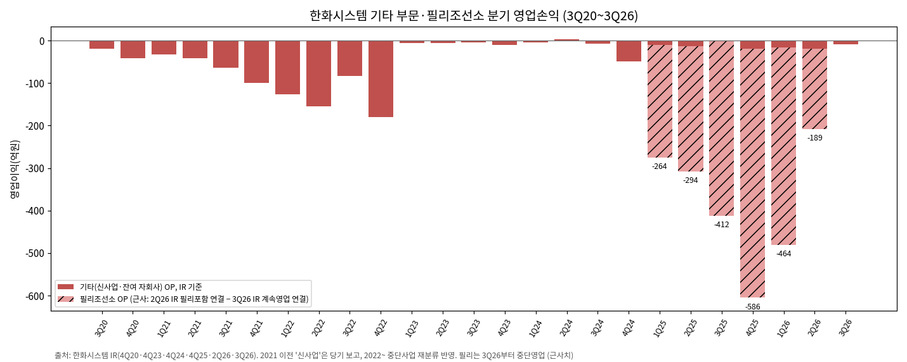

**(2-3) 4Q18~4Q23 (21분기, IR 별첨 기준)**

| 분기 (억원) | 방산 매출 | 방산 OP | 방산 OPM | ICT 매출 | ICT OP | ICT OPM | 기타 매출 | 기타 OP | 연결 매출 | 연결 OP | 연결 OPM | 출처 |
|---|---|---|---|---|---|---|---|---|---|---|---|---|
| 4Q18 | 3,652 | 294 | 8.1% | 1,207 | 45 | 3.7% | - | - | 4,859 | 339 | 7.0% | 4Q19 IR p.5 |
| 1Q19 | 1,602 | 5 | 0.3% | 1,004 | 112 | 11.2% | - | - | 2,606 | 117 | 4.5% | 4Q20 IR p.7 |
| 2Q19 | 2,802 | 80 | 2.9% | 1,139 | 155 | 13.6% | - | - | 3,941 | 235 | 6.0% | 4Q20 IR p.7 |
| 3Q19 | 2,998 | 129 | 4.3% | 1,264 | 137 | 10.8% | - | - | 4,262 | 266 | 6.2% | 4Q20 IR p.7 |
| 4Q19 | 3,303 | 241 | 7.3% | 1,348 | -1 | -0.1% | - | - | 4,651 | 240 | 5.2% | 4Q20 IR p.7 |
| 1Q20 | 1,675 | 40 | 2.4% | 1,148 | 69 | 6.0% | - | - | 2,823 | 109 | 3.9% | 4Q20 IR p.7 |
| 2Q20 | 1,846 | 62 | 3.4% | 1,385 | 120 | 8.7% | - | - | 3,231 | 182 | 5.6% | 4Q20 IR p.7 |
| 3Q20 | 2,724 | 316 | 11.6% | 1,072 | 151 | 14.1% | 0 | -20 | 3,796 | 447 | 11.8% | 4Q20 IR p.7 |
| 4Q20 | 5,322 | 282 | 5.3% | 1,257 | -49 | -3.9% | 0 | -42 | 6,579 | 190 | 2.9% | 4Q20 IR p.7 |
| 1Q21 | 2,311 | 132 | 5.7% | 1,356 | 207 | 15.3% | 0 | -32 | 3,667 | 307 | 8.4% | 4Q23 IR 별첨 |
| 2Q21 | 3,674 | 220 | 6.0% | 1,185 | 136 | 11.5% | 0 | -42 | 4,859 | 314 | 6.5% | 4Q23 IR 별첨 |
| 3Q21 | 4,016 | 339 | 8.4% | 1,558 | 151 | 9.7% | 0 | -64 | 5,574 | 426 | 7.6% | 4Q23 IR 별첨 |
| 4Q21 | 5,134 | 235 | 4.6% | 1,661 | -63 | -3.8% | 0 | -99 | 6,795 | 73 | 1.1% | 4Q23 IR 별첨 |
| 1Q22 | 3,156 | 251 | 8.0% | 1,139 | 28 | 2.5% | 1 | -127 | 4,296 | 152 | 3.5% | 4Q24 IR 별첨 |
| 2Q22 | 3,827 | 309 | 8.1% | 1,276 | 10 | 0.8% | 2 | -155 | 5,105 | 164 | 3.2% | 4Q24 IR 별첨 |
| 3Q22 | 3,348 | 162 | 4.8% | 1,243 | 9 | 0.7% | 3 | -84 | 4,594 | 87 | 1.9% | 4Q24 IR 별첨 |
| 4Q22 | 6,077 | 176 | 2.9% | 1,808 | -8 | -0.4% | 0 | -180 | 7,885 | -12 | -0.2% | 4Q24 IR 별첨 |
| 1Q23 | 2,924 | 133 | 4.5% | 1,469 | 76 | 5.2% | 0 | -6 | 4,393 | 203 | 4.6% | 4Q25 IR p.11 |
| 2Q23 | 4,481 | 282 | 6.3% | 1,624 | 110 | 6.8% | 0 | -6 | 6,105 | 386 | 6.3% | 4Q25 IR p.11 |
| 3Q23 | 4,594 | 338 | 7.4% | 1,613 | 122 | 7.6% | 0 | -5 | 6,207 | 455 | 7.3% | 4Q25 IR p.11 |
| 4Q23 | 6,171 | 232 | 3.8% | 1,649 | -39 | -2.4% | 0 | -11 | 7,820 | 182 | 2.3% | 4Q25 IR p.11 |

→ (출처: 각 분기를 포함한 가장 최신 IR 별첨 분기표 — 4Q18: 4Q19 IR p.5 / 2019~2020: 4Q20 IR p.7 / 2021: 4Q23 IR 별첨 / 2022: 4Q24 IR 별첨 / 2023: 4Q25 IR p.11)
→ 기준 차이: 2021 이전 '신사업'은 당기 보고값, 2022·2023은 중단사업(엔터프라이즈블록체인·바닐라스튜디오·한화인텔리전스) 재분류 반영 → 2023 신사업 OP는 당기 보고(4Q23 IR) -326억 → 재작성(4Q25 IR) -28억
→ IR 자료 간 재작성 사례: 1Q23 연결 OP 123억(4Q23 IR) → 203억(4Q25 IR), 4Q25 방산 OP 749억(4Q25 IR) → 765억(1Q26 IR 이후), 4Q25 ICT OP 224억 → 172억. 표는 최신값
→ 4Q는 연말 개발비·충당금·성과급이 몰려 OPM이 낮음: 방산 4Q OPM 4Q20 5.3% / 4Q21 4.6% / 4Q22 2.9% / 4Q23 3.8% / 4Q24 3.7% / 4Q25 7.2%

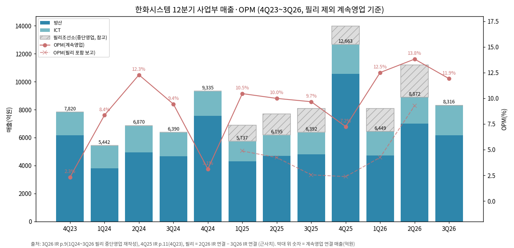

→ chart10은 v1.1부터 **필리 제외 계속영업 기준**(3Q26 IR)으로 통일 → 3Q26과 이전 분기 직접 비교 가능. 빗금 = 필리조선소 매출(참고), 점선 = 필리 포함 보고 OPM

(3) 사업부별 개요 (매출 비중 큰 순서, FY25)

| 사업부 | 비중 | FY25 매출 (억) | 핵심 제품·서비스 | 주요 매출처 |
|---|---|---|---|---|
| 방산 | 66.6% | 24,389 | 다기능레이다(M-SAM·L-SAM MFR, 천궁-II 수출형), KF-21 AESA 레이다·IRST·EOTGP, 전자광학 조준경(K2·K21), 함정 전투체계(울산급 Batch-III/IV, KDX-II 성능개량), 전술통신(TICN·KVMF), 연합지휘통제체계, SAR 위성 | 방위사업청, 국방과학연구소, 한화에어로스페이스·현대로템 등 체계업체, 해외(UAE·사우디·이라크·폴란드·이집트) |
| ICT | 17.8% | 6,526 | SI·ITO(한화그룹 계열 전산 구축·운영), 데이터센터(용인), AI 에이전트 플랫폼(AgentOne), 스마트팩토리·스마트야드 | 한화에어로스페이스 등 한화 계열 |
| 기타 | 15.7% | 5,755 | 필리조선소(상선·미 해양청 지원함, 2026.9 매각 결정), 위성통신·디지털플랫폼 법인 | Matson, Inc.(1H26 연결 매출 15.6%) 등 |

(4) 사업부별 디테일

(4-1) **방산 — 레이다가 수출·이익의 중심**
→ 중동 천궁-II(M-SAM) 다기능레이다 수출이 3Q26 매출·이익 증가를 견인 (지디넷 2026-10-27). 사우디向 M-SAM MFR 양산 계약(2024.7), 이라크 M-SAM 수출 계약(2025.10)
→ KF-21 AESA 레이다 최초양산(2024.6, 잔여분 2025.6) → 2026~2027 양산 매출 본격화
→ 정부 조달 원가보상 구조: 실발생 원가 + 적정 이윤, 착수금·중도금 계약금액의 50~70% 수령 (2026 반기보고서) → 마진 상단 제한, 대신 손실 위험 낮음
→ 구미사업장 생산능력(금액 기준) 2023 1.17조 → 2025 1.73조, 가동률 90.9% → 83.7% (신사업장 증설로 능력 증가가 앞섬)
→ 2026 자체 투자개발비: 2025(200억대 중후반)의 3~4배 계획, 3Q 누적 380억만 집행 → **4Q26 집중** (회사 컨콜, 지디넷)

(4-2) **ICT — 그룹 캡티브 SI, 저마진·저성장**
→ 2018 한화S&C 합병으로 편입. 매출 대부분 한화 계열 IT 아웃소싱(월정액·사용량 과금) + SI
→ OPM 변동 큼: 2022 0.7%(일회성 비용) → 2024 8.1% → 3Q26 11.3% (전년 7.7%, 3Q26 IR p.7). 4Q마다 성과급 반영으로 OPM 급락 패턴 (4Q20 -3.9%, 4Q21 -3.8%, 4Q23 -2.4%, 4Q24 3.6% — IR 각 분기)

(4-3) **기타 — 신사업 손실의 저장소**
→ 2021~2023 위성통신 안테나(Phasor, Kymeta 지분)·UAM·디지털플랫폼 투자로 연 -233억~-697억 손실
→ 2025 필리조선소 연결: 매출 5,755억, OP -1,601억 → 2026.9 매각 결정, 3Q26부터 중단영업. 3Q26 당기순이익이 38억에 그친 원인 (중단영업손실)
→ 3Q26 한화에어로스페이스 IR: 필리조선소 3Q 매출 1,318억·영업손실 936억 (기타로 분류)

(5) 주요 경쟁사 (사업부별, 정성)

→ **방산 레이다·전자**: LIG넥스원(유도무기 체계·레이다 일부 경쟁 겸 고객), 국내 레이다 전문 중소업체; 해외는 Thales(구 합작 파트너)·Leonardo·Hensoldt·IAI Elta 등과 수출 경쟁
→ **함정 전투체계**: LIG넥스원(일부 수중무기), 해외 Lockheed Martin(Aegis)
→ **ICT**: 삼성SDS·LG CNS·SK C&C 등 그룹 계열 SI (각 그룹 캡티브 구조라 직접 경쟁 제한적)
→ 수치 비교는 확인 불가 (본 문서 범위 외)

(6) 주요 매출처

→ 방산: **방위사업청** (1H26 연결 매출의 20.1%), **Matson, Inc.** 15.6% (필리조선소 상선 고객) — 2026 반기보고서 '판매경로와 방법 및 주요 매출처'
→ 2025 연결 영업부문 주석: 매출 10% 이상 고객 A사 (9M25 3,220억) — 방산·ICT·기타 공통 (실명 비공개, 방위사업청으로 추정)
→ ICT: 한화에어로스페이스 등 한화 계열 (2025 사업보고서)
→ 2021 상반기 방위사업청 비중 26% (2021 반기보고서)

(7) 수주잔고·생산 CAPA·임직원 추이

| 연도말 | 방산 수주잔고 (억) | ICT 수주잔고 (억) | 기타 (억) | 합계 (억) | 방산 잔고/방산 매출 | 임직원 (명) |
|---|---|---|---|---|---|---|
| 2020 | 40,697 | 2,946 | - | 43,643 | 3.5배 | 확인 불가 |
| 2021 | 55,262 | 2,968 | - | 58,229 | 3.7배 | 3,938 |
| 2022 | 56,221 | 3,649 | - | 59,869 | 3.4배 | 4,307 |
| 2023 | 68,733 | 4,175 | - | 72,908 | 3.8배 | 4,741 |
| 2024 | 83,417 | 2,155 | 20,007 (필리) | 105,579 | 4.0배 | 4,751 |
| 2025 | 93,027 | 3,486 | 25,650 (필리) | 122,163 | 3.8배 | 4,855 |
| 1H26 | 85,379 | 4,376 | 23,432 | 113,186 | - | 5,033 |
| **3Q26** | **83,956** | **4,697** | 중단영업 | **88,653** | - | - |

→ (출처: 각 사업보고서 II-4 '수주 상황', 3Q26은 3Q26 IR p.10. 2019말 잔고: 2019 사업보고서에 '수주' 항목 자체가 없고 IR(4Q19~4Q20)에도 수주잔고 미공시 → **확인 불가 유지**. 임직원은 2019·2020 사업보고서 파싱 실패 → 확인 불가 (IR 미기재))

**분기 수주잔고 (3Q26 IR p.10, 필리 제외, 억원)**

| 분기말 | 합계 | 방산 | ICT | 방산 QoQ |
|---|---|---|---|---|
| 1Q25 | 86,403 | 84,275 | 2,128 | - |
| 2Q25 | 87,964 | 84,589 | 3,375 | +0.4% |
| 3Q25 | 85,419 | 81,851 | 3,568 | -3.2% |
| 4Q25 | 96,513 | 93,027 | 3,486 | +13.7% |
| 1Q26 | 96,628 | 92,457 | 4,171 | -0.6% |
| 2Q26 | 89,755 | 85,379 | 4,376 | -7.7% |
| 3Q26 | 88,653 | 83,956 | 4,697 | -1.7% |

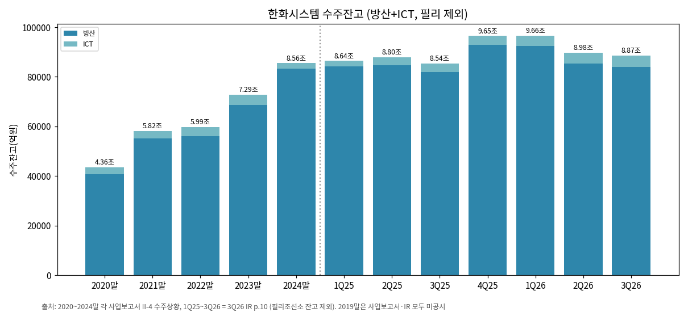

→ 방산 잔고는 4Q25 9.30조 정점 후 3분기 연속 감소(-0.6% → -7.7% → -1.7%). 1Q26 기준 방산 잔고/최근 4분기 방산 매출 = 약 3.7배 → 3Q26 약 2.9배 (9M26+4Q25 방산 매출 28,461억 기준)
→ **방산 잔고 감소 주목**: 2025말 9.30조 → 3Q26 8.40조 (-9.7%, 3Q26 IR p.10). IR에는 분기 신규수주 금액 미공시. 대형 수출 계약(중동 통합방공 등) 미반영 상태 — UAE EDGE 그룹과 통합방공망 termsheet(2026.9, 한화에어로스페이스 3Q26 컨콜)

---

## ④ 재무 구조 (연결, 2017~2025)

(1) 손익계산서

| 연도 | 매출 (억) | GPM | 판관비율 | OPM | NPM | 금융원가 (억) |
|---|---|---|---|---|---|---|
| 2017 | 8,586 | 10.5% | 6.9% | 3.6% | 1.6% | 확인 불가 |
| 2018 | 11,289 | 12.7% | 8.8% | 4.0% | 3.7% | 확인 불가 |
| 2019 | 15,460 | 15.2% | 9.7% | 5.5% | 4.7% | 51 |
| 2020 | 16,429 | 15.1% | 9.4% | 5.7% | 5.7% | 87 |
| 2021 | 20,895 | 13.6% | 8.2% | 5.4% | 4.7% | 44 |
| 2022 | 21,880 | 11.6% | 10.5% | 1.1% | -3.7% | 126 |
| 2023 | 24,531 | 12.4% | 8.6% | 3.8% | 14.0% | 178 |
| 2024 | 28,037 | 14.8% | 7.0% | 7.8% | 15.9% | 394 |
| 2025 | 36,642 | 10.7% | 7.4% | 3.3% | 5.7% | 465 |

→ 2023·2024 NPM이 OPM을 크게 웃도는 이유: 한화오션 관련 파생상품(인수 관련) 평가이익·지분 처분이익 등 영업외 금융이익 (2023 연결 CF 조정: 파생금융자산평가이익 2,572억)
→ 2025 중단영업이익 +84억 (엔터프라이즈블록체인 사업 양도 등), 2024 -318억, 2023 -434억(재작성 기준)

(2) 재무상태표

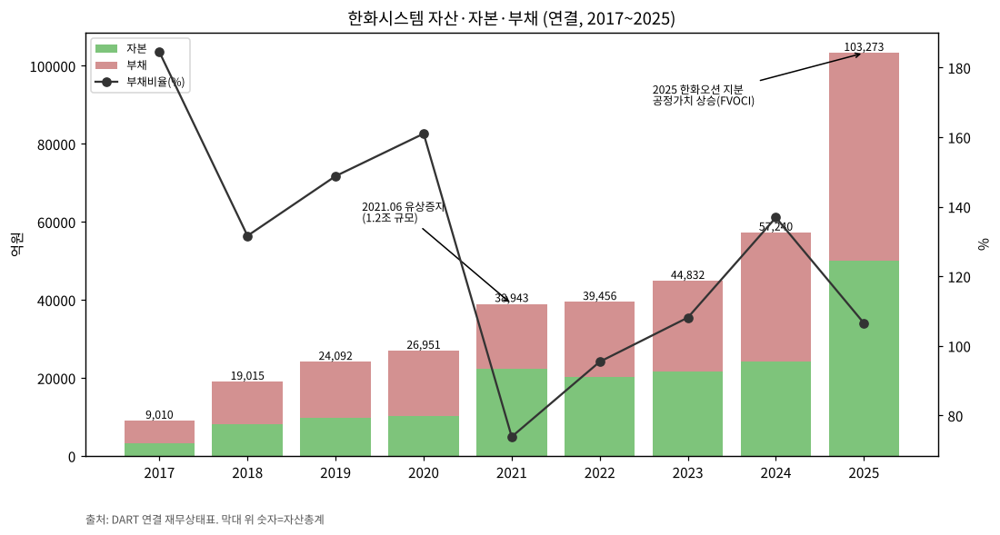

| 연도말 | 자산 (억) | 부채 (억) | 자본 (억) | 부채비율 | 현금 (억) | 차입금·사채 (억) | FVOCI 금융자산 (억) |
|---|---|---|---|---|---|---|---|
| 2019 | 24,092 | 14,408 | 9,684 | 149% | 5,640 | 1,399 | 2 |
| 2020 | 26,951 | 16,624 | 10,327 | 161% | 5,399 | 999 | 0 |
| 2021 | 38,943 | 16,545 | 22,398 | 74% | 16,368 | 600 | 615 |
| 2022 | 39,456 | 19,267 | 20,190 | 95% | 12,282 | 1,100 | 3,026 |
| 2023 | 44,832 | 23,291 | 21,541 | 108% | 4,761 | 2,122 | 1,805 |
| 2024 | 57,240 | 33,076 | 24,164 | 137% | 1,998 | 3,293 | 14,380 |
| 2025 | 103,273 | 53,263 | 50,010 | 107% | 3,255 | 14,744 | 44,313 |
| 1H26 | 118,473 | 72,757 | 45,717 | 159% | 15,913 | 32,608 | 확인 불가(JSON 미추출) |
| 3Q26 (IR) | 99,581 | 58,155 | 41,427 | 141% | 확인 불가 | 21,660 | 확인 불가 |

→ (출처: OpenDART 연결 재무상태표. 2024 한화오션 지분 관계기업→FVOCI 재분류(이사선임권 상실), 2025 주가 상승으로 평가액 급증)
→ 3Q26말 차입금 2조 1,660억 — 한화오션 주식 PRS 정산으로 QoQ 1조 948억 감소 (3Q26 IR p.8 재무상태표, 지디넷 2026-10-27). 3Q26말 자산 감소(-1.89조 QoQ)는 필리 매각예정 분류·FVOCI 지분 축소 영향으로 추정 ⚠️

(3) 현금흐름표

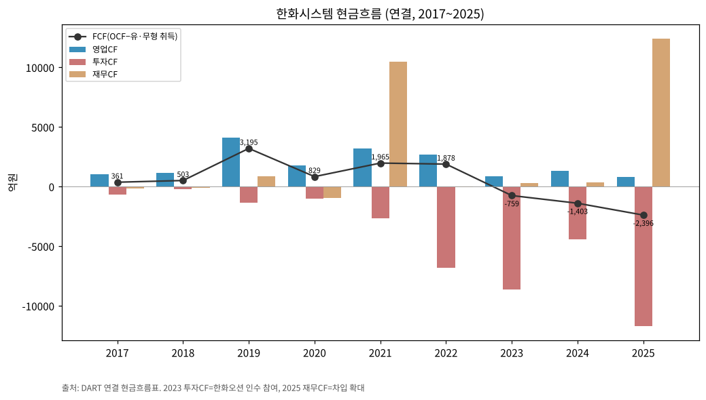

| 연도 | OCF (억) | ICF (억) | CFF (억) | CapEx 유형 (억) | CapEx 무형 (억) | FCF (억) |
|---|---|---|---|---|---|---|
| 2017 | 1,028 | -701 | -173 | 386 | 281 | 361 |
| 2018 | 1,130 | -225 | -111 | 356 | 272 | 503 |
| 2019 | 4,086 | -1,334 | 846 | 425 | 467 | 3,195 |
| 2020 | 1,748 | -996 | -976 | 456 | 463 | 829 |
| 2021 | 3,165 | -2,680 | 10,483 | 801 | 399 | 1,965 |
| 2022 | 2,686 | -6,794 | -27 | 483 | 325 | 1,878 |
| 2023 | 834 | -8,637 | 267 | 1,323 | 270 | -759 |
| 2024 | 1,326 | -4,420 | 351 | 2,398 | 331 | -1,403 |
| 2025 | 787 | -11,704 | 12,373 | 2,989 | 194 | -2,396 |

→ FCF = OCF − 유형·무형자산 취득 (연결 현금흐름표). 2023~2025 3년 연속 FCF 적자: 구미 신사업장 건설 + 운전자본(재고·계약자산) 증가 + 필리조선소 설비투자
→ ICF 대형 유출: 2022~2023 한화오션 인수 참여, 2025 종속·관계기업 투자 5,344억·FVOCI 금융자산 취득 2,441억 (Austal 등)

(4) CapEx

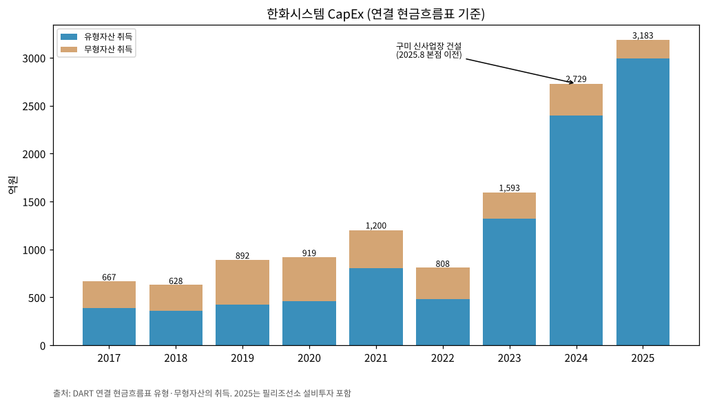

→ 2017~2022 연 600~1,200억 → 2023 1,593억 → 2024 2,729억 → 2025 3,183억 (구미 신사업장 2025.8 본점 이전, 필리조선소 포함)

(5) 부채구조

→ 차입금·사채 2025말 1조 4,744억 (유동 4,012 / 비유동 10,732) → 1H26 3조 2,608억 → 3Q26 2조 1,660억
→ 2026.02.11 회사채 4,000억원 발행 (2025 사업보고서 보고기간 후 사건)
→ 우발: Hanwha Futureproof 차입 관련 보증분담 USD 90백만(약 1,306억원, 2026.02.20~2027.01.28), 한화오션 채무보증 실질지분율(60%) 분담 계약 (2025 사업보고서 주석)
→ 이자보상배율(OP/금융원가): 2024 5.6배 → 2025 2.6배

(6) 배당·자사주

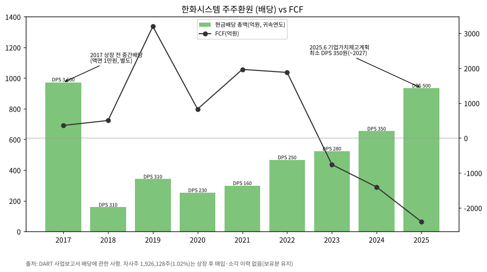

| 귀속연도 | DPS (원) | 배당총액 (억) | 연결 배당성향 | 비고 |
|---|---|---|---|---|
| 2017 | 3,600 | 972 | - | 상장 전 중간배당, 액면 10,000원 |
| 2018 | 310 | 158 | 38.4% | |
| 2019 | 310 | 342 | 46.9% | 상장 첫해 |
| 2020 | 230 | 253 | 27.1% | |
| 2021 | 160 | 299 | 30.6% | 유상증자로 주식수 증가 |
| 2022 | 250 | 467 | 적자 | |
| 2023 | 280 | 524 | 15.3% | |
| 2024 | 350 | 654 | 14.7% | |
| 2025 | 500 | 935 | 44.7% | 최소 DPS 350원(2025~2027) 정책 |

→ (출처: 각 사업보고서 '배당에 관한 사항'. 2025 DPS 500원·총액 935억·배당성향 44.7%는 3Q26 IR p.12와 일치. IR 기준 TSR: 2020 69.6% / 2021 4.5% / 2022 -32.5% / 2023 67.2% / 2024 32.2%, 5년 평균 28% — 3Q26 IR p.11). 자기주식 1,926,128주(1.02%) 보유 — 공시대상기간 중 취득·처분·소각 없음 (2026 반기보고서)

(7) 재무비율

| 지표 | 2023 | 2024 | 2025 |
|---|---|---|---|
| ROE (지배, 기말) | 16.3% | 18.2% | 5.0% |
| ROA | 7.7% | 7.8% | 2.0% |
| 부채비율 | 108% | 137% | 107% |
| 유동비율 | 97% | 85% | 88% |
| 이자보상배율 (OP/금융원가) | 5.2배 | 5.6배 | 2.6배 |

---

## ⑤ 지배 구조

(1) 그룹·계열 관계

→ 한화그룹 방산 수직계열: ㈜한화(한화에어로스페이스 지분 32.18%) → **한화에어로스페이스(한화시스템 46.73%)** → 한화시스템
→ 한화시스템 → 한화오션 지분 보유(2023.5 인수 참여, 2026.4 일부 PRS 양도) / 필리조선소 60%(2026.9 매각 결정) / Austal 지분(2025.3)
→ 한화에어로스페이스 IR에서 한화시스템은 별도 사업부로 연결 보고

(2) 주주 구성 (2026.06.30, DART 2026 반기보고서)

| 주주 | 주식수 | 지분율 |
|---|---|---|
| 한화에어로스페이스㈜ | 88,289,321 | 46.73% |
| 한화에너지㈜ | 24,174,187 | 12.80% |
| 손재일(대표이사)·김승모(기타비상무) | 374 | 0.00% |
| **특수관계인 합계** | **112,463,882** | **59.53%** |
| 우리사주조합 | 790,730 | 0.42% |
| 자기주식 | 1,926,128 | 1.02% |
| 소액주주 (394,085명) | 66,426,838 | 35.16% |

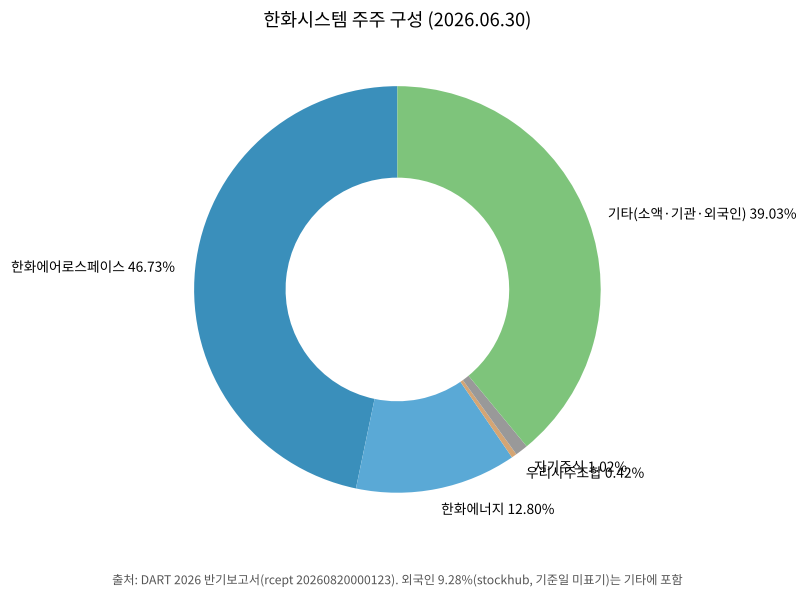

→ 최대주주 지분 변동: 100%(2018.04) → 52.91%(2018.08 합병) → 48.98%(2019.11 상장) → 46.73%(2021.06 유상증자 참여)
→ 외국인 지분율: 9.28% (stockhub, 기준일 미표기). 국내기관·개인 분리 데이터는 확인 불가 → chart5는 DART 5% 주주 기준으로 작성

(3) 임원·이사회 (2026.06.30)

| 성명 | 직위 | 주요 경력 |
|---|---|---|
| 손재일 | 대표이사 (사내이사, 임기 2029.03) | 고려대 경영학, 前 한화디펜스·㈜한화방산 대표, 現 한화에어로스페이스 대표이사 겸 쎄트렉아이 기타비상무 |
| 김승모 | 기타비상무이사 (2026.03 선임) | 前 ㈜한화방산 대표·㈜한화 건설부문 대표, 現 한화에어로스페이스 사내이사 |
| 구본선 | 독립이사·감사위원 | 前 대검찰청 차장검사 |
| 이우종 | 독립이사·감사위원장 | 서울대 경영대학 교수(회계학) |
| 황형주 | 독립이사·감사위원 | POSTECH 수학과 석좌교수 |
| 김승연 | 회장 (미등기) | ㈜한화·한화에어로스페이스·한화시스템 회장 |

→ 대표이사 변천: 김연철(~2021.09) → 어성철(2021.09~2024.10) → 손재일(2024.10~)
→ 대표이사·기타비상무가 모두 최대주주(한화에어로스페이스) 임원 겸직 — 모회사 의사결정 연동성 높음

---

## ⑥ 기타 팩트

(1) R&D 인프라

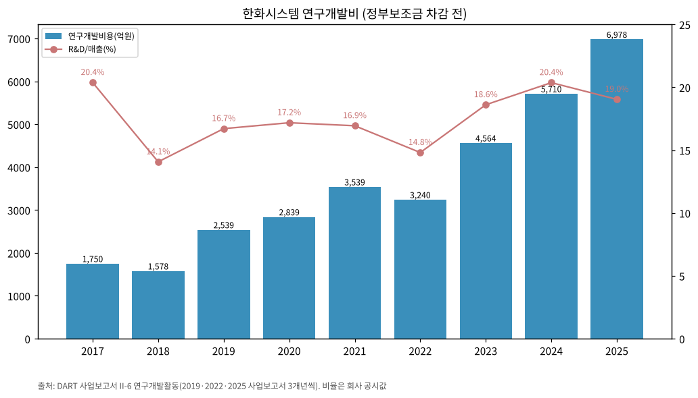

| 연도 | 연구개발비용 (억, 보조금 차감 전) | R&D/매출 |
|---|---|---|
| 2017 | 1,750 | 20.38% |
| 2018 | 1,578 | 14.07% |
| 2019 | 2,539 | 16.71% |
| 2020 | 2,839 | 17.18% |
| 2021 | 3,539 | 16.94% |
| 2022 | 3,240 | 14.81% |
| 2023 | 4,564 | 18.61% |
| 2024 | 5,711 | 20.37% |
| 2025 | 6,978 | 19.04% |

→ (출처: 2019·2022·2025 사업보고서 II-6 '연구개발활동', 회사 공시 비율)
→ 방산 연구 분야: 레이다·전자광학 감시정찰, 지휘통제통신, 항공전자, 해양시스템, 위성 (세부는 보안상 비공개)
→ ICT 과제(2024~2025): AgentOne(LLM·RAG·멀티에이전트 플랫폼, MCP Server), QuokkA Studio, 조선소 스마트야드 최적화

(2) 진행 중 corporate action (최근 10년)

→ 2018.08 한화S&C 흡수합병 / 2019.11 IPO / 2021.06 유상증자 78,689,000주 / 2021~2022 Kymeta·OneWeb 지분 / 2023.05 한화오션 인수 참여 / 2024.12 필리조선소 60% 인수 / 2025.03 Austal 지분 / 2025.03 한화인텔리전스 피합병(엣지파운드리) / 2026.04 한화오션 주식 1,392만주 PRS 양도 / **2026.09 필리조선소 지분 매각 결정(10월 말 종결 예정 — 한화에어로스페이스 3Q26 리뷰, 종결 여부 확인 필요)**
→ 매각 대금·처분손익: 확인 불가 (4Q26 실적 발표 2027.2에 신사업(우주·방산 AI) 투자 계획과 함께 공개 예정, 지디넷)

(3) R&D·사업 마일스톤

→ 2023.12 소형 SAR 위성 발사 / 2024.06 KF-21 AESA 레이다 최초양산 계약 / 2025.04 장사정포요격체계 MFR 체계개발 / 2025.10 L-SAM MFR 양산 / 2025.12 M-SAM Block-III MFR 시제 / 2026.04 KF-21 EOTGP 최초양산

(4) 주요 리스크

→ **연결 범위 변동**: 2024.12 필리 편입 → 2026.9 매각 결정. 2025~2026 시계열 비교 시 기준(필리 포함/제외) 확인 필수
→ **4Q 개발비 집중**: 2026 자체 투자개발비 2025의 3~4배, 3Q 누적 380억 → 4Q26 이익 하향 요인 (회사 언급)
→ **방산 수주잔고 감소**: 2025말 9.30조 → 3Q26 8.40조. 중동 대형 수출 계약 지연 시(사우디는 역내 군사 행동으로 지연, JPM) 2027 매출 가시성 저하
→ **보유지분 가격 변동**: 자본·순이익이 한화오션 주가·PRS 정산에 연동
→ **계열 보증·자금 지원**: Hanwha Futureproof 보증분담 1,306억 등 계열 거래
→ **환율**: 수출 비중 확대로 원화 강세 시 이익 감소 (한화에어로스페이스는 3Q26 원화 강세 영향을 언급)

(5) ESG 등급

→ 확인 불가 (원문 자료 미확보). 지배구조: 독립이사 3인 전원 감사위원, 2026 정관 개정으로 집중투표·독립이사 조항 신설 (2025 사업보고서 정관)

(6) 인증·라이선스

→ 1급 방산업체(1978 지정), PMS(생산성 경영 시스템) Level 8+ 재인증(2025.3), ISO 37301·ISO 37001(2022), 기간통신사업자 등록(2023.7, 저궤도 위성통신)

---

## 데이터 audit

| 자료 | 상태 | 비고 |
|---|---|---|
| OpenDART 연결 재무 JSON 27건 (2019 FY~2026 2Q) | ✅ 사용 | 손익·재무상태·현금흐름 |
| DART 사업·분기·반기보고서 원문 XML 27건 | ✅ 사용 | 부문별 손익, 수주잔고, R&D, 배당, 주주, 임원, 연혁 (2019~2021 일부 파일 cp949 인코딩) |
| 2019 사업보고서 요약재무 (2017~2018) | ✅ 사용 | 2015~2016은 미수록 → 확인 불가 |
| OpenDART 별도 OFS JSON | ❌ 미사용 | 연결 기준으로 충분, 2017은 별도=연결 |
| 3Q26 잠정실적 | ✅ 회사 IR(2026-10-27) + 웹(MTN·지디넷) | v1.1부터 IR 원본 수치 사용, 웹은 컨콜 발언(방산 매출 구성·투자개발비)만 |
| 한화에어로스페이스 3Q26 IR | ✅ BT 리뷰 파일 경유 | 필리 제외 분기 매출 대조 |
| Yahoo Finance 월간 주가 | ✅ 사용 | 월 타임스탬프 KST 보정, 2021.05 이전 권리락 수정주가 |
| 회사 IR PDF 46건 (4Q19~3Q26, 고유 분기 26개) | ✅ 사용 (v1.1) | 사업부별 분기 손익 32분기, 연간 사업부 2018~2025, 분기 수주잔고 7분기, 2026 전망, 3Q26 재무상태표. 2Q21·3Q21·2Q23 IR은 미보유 → 후속 IR 별첨표로 충당. 방산 수출/개발/양산/MRO 비중·신규수주는 IR에 미기재 |
| 증권사 리포트 PDF | ❌ 접근 실패 | stock.pstatic.net 프록시 차단 |

---

## Version Log

- **v1.0 (2026-11-03)**: 최초 작성. 9년 연결 + 31분기 사업부별 + 3Q26P 잠정. 차트 13장(chart2 방산·ICT 2종)
- **v1.1 (2026-11-04)**: 회사 IR 실적발표 PDF 46건 반영 (4Q19 2020-02-21 ~ 3Q26 2026-10-27). 보강: ① 사업부별 분기 시계열을 DART 누적 차감치 → IR 별첨 분기표로 교체, 4Q18 추가(32분기) ② 1Q24~3Q26 필리 중단영업 재작성 기준 표 + 필리 포함 보고치 대비표 ③ IR 기준 연간 사업부 손익 2018~2025·9M26 ④ 3Q26 수치를 보도 → IR 원본으로 교체(기타 추정 해제) ⑤ 분기 수주잔고 7분기(1Q25~3Q26) ⑥ 2026 회사 전망 ⑦ 3Q26말 재무상태표. 차트: chart2_방산·chart2_ICT·chart10 IR 기준 재생성, chart2_기타필리·chart2_수주잔고 신규(총 15장)
- 잔여 보완 후보: ① 3Q26 분기보고서(11월 중순) 공시 후 확정치 대조 ② 필리 매각 대금·처분손익 반영 ③ 방산 수출/개발/양산/MRO 비중 시계열(IR 미기재 → 컨콜 트랜스크립트 필요) ④ 2019~2020 임직원·2019말 수주잔고(IR·사업보고서 모두 미공시) ⑤ chart3 제품 매트릭스 ⑥ 피어 OPM 수치 비교
