> 종목: 한화에어로스페이스 (012450.KS / 한화에어로스페이스 주식회사 / Hanwha Aerospace Co., Ltd., DART corp_code 00126566)
> 섹터: 방산 (워치리스트 섹터 T2)
> 작성 시각: 2026-11-03 KST (**v1.0** — 첫 작성. DART 원문 14건 + OpenDART 연결·별도 재무 86건 + dart_api 5종 + 회사 3Q26 IR(BT 리뷰 파일 경유) + Yahoo 20년 주가 일괄 반영)
> 적용 구조: v4.8 (6개 섹션 + 12종 차트 표준, chart2는 2·2b·2c·2d 4종 분할)
> 데이터: 11년 연결 연간(2015~2025, DART) + 43분기 연결(1Q16~3Q26P) + 11분기 사업부별(1Q24~3Q26P, 회사 IR 재작성 기준) + DART 영업부문 연간(2019~1H26) + 별도(본체) 11년·6분기 + 20년 Yahoo 시가총액
> 출처: **DART 사업보고서 2025(rcept 20260316001112, 최우선 정성자료)·2024(20250317000990)·2023 정정(20240329000902)·2022 정정(20230321001337)·2021 정정(20220812000030)·2020(20210319000790)·2019(20200330004485)·2018(20190329003444)·2017 정정(20180725000277)·2016(20170331003924)·2015 정정(20160516002683), 반기보고서 2026.06(20260814003198), 분기보고서 2025.09(20251113000661)** / OpenDART 전체재무제표 연결(CFS)·별도(OFS) 2015~2Q26 / OpenDART 2025 FY 최대주주·배당·직원·임원·주식총수 / 회사 3Q26 IR(2026-10-29, BT `earnings-review/2026-Q3_한화에어로스페이스_리뷰.md` 정리본) / Yahoo Finance v8 012450.KS 월간 20년 / alphasquare 시세(2026-11-03 17:09)
> **Fact verify cutoff**: 2026-11-03

# 한화에어로스페이스 기업 개요 (v1.0 — 방산 T2, 지상방산 + 항공엔진 + 한화시스템 + 한화오션 복합 방산·조선 지주형 사업회사)

> ⚠️ **시계열 단절 4회 — 모든 표·차트 해석 시 주의**
> ① **2015.06** 삼성테크윈 → 한화테크윈 (한화그룹 편입, 시큐리티·산업장비·에너지장비·항공엔진 복합기업)
> ② **2022.11~2023.04** 한화디펜스 흡수합병(2022.11.01) + ㈜한화 방산부문(㈜한화방산) 인수(2022.12.29)·흡수합병(2023.04.01) → 지상방산 본체화. 2023 사업보고서가 2022년을 동일지배 소급 재작성(65,396 → **70,604억**)
> ③ **2024.09.01** 인적분할 (한화인더스트리얼솔루션즈 → 한화비전·한화세미텍 분리) → 2023년을 중단영업 재작성(93,590 → **78,897억**)
> ④ **2024.12** 한화오션 지배력 획득(이사선임권 추가 확보, 단계적 취득) → 2024년은 재무상태표만 연결, **손익은 1Q25부터** 연결. 2024년 관계기업투자 처분이익 **1조 1,432억**(일회성) 인식
> 부가: 2022 사업보고서는 2021년을 한화파워시스템(2022.08 매각) 중단영업 재작성(64,151 → 55,414억). 본 리포트 연간 표는 회사 「기업가치 제고 계획」과 같은 기준(2021 당시 보고, 2022·2023 재작성)을 사용

---

## ① 기업 분류

(1) Primary / Secondary 분류

**⚠️ Boundary Case — 정량 룰은 사이클, 실체는 M&A로 업종이 바뀐 구조 전환형**

11년 OPM range -2.3%~15.4% = **+17.7%pt (cutoff ±10%pt의 1.8배)** → 정량 룰상 사이클 분류. 그러나 진폭의 대부분은 수요 사이클이 아니라 **포트폴리오 교체**(테크윈 복합기업 → 지상방산 본체화 → 조선 연결)에서 나왔다.

**Primary 분류: 사이클 (수주·인도 사이클 + 조선 업황 사이클 내재)**

→ 매출 56%(3Q26P)가 한화오션 — 조선은 전형적 선가·수주 사이클 업종

→ 지상방산은 수출 인도 기준 매출 인식 → 폴란드 인도 타이밍에 따라 분기 OPM 7.4%~18.6% 출렁임 (1Q24~3Q26P)

**Secondary 노트: 고성장 (K-방산 수출 secular)**

→ 지상방산 매출 2023 4.13조 → 2025 8.13조 (2년 2배, 회사 IR), 수주잔고 35.0조(3Q26, 수출 74%)

→ 회사 가이던스 2027~29년 지상방산 매출 연 +15% (3Q26 컨콜, BT 리뷰 정리)

**Entity 구조 (2026.06말, DART 반기보고서 — 연결 종속회사 70개, 상장 3사)**

→ **(1) 지상방산** (에어로 본체 방산부문) — K9 자주포·천무·레드백·탄약·유도무기·발사대

→ **(2) 항공우주** (에어로 본체 항공부문 + 우주) — 군용·민수 엔진, 엔진부품 RSP(P&W GTF), 누리호 체계종합, 쎄트렉아이(33.63%)

→ **(3) 한화시스템** (47.22%, 상장) — 방산전자(레이더·전투체계)·ICT

→ **(4) 한화오션** (본체 30.44% 직접 보유, 연결 종속, 상장) — 상선·특수선(잠수함)·해양플랜트, 필리조선소

→ **(5) 기타** — 쎄트렉아이, Hanwha Philly Shipyard 관련 조정, PPA 상각, 연결조정

(2) Summary Box (11년 연결 시계열 + 사이클 통계)

| 지표 | 11년 평균 (2015~2025) | 정점 | 저점 | 2025년 |
|---|---|---|---|---|
| 매출 (연결, 억원) | 76,995 | **267,029 (2025)** | 26,134 (2015) | **267,029** |
| 영업이익 (연결, 억원) | 6,214 | **30,893 (2025)** | -596 (2015) | **30,893** |
| 지배순이익 (억원) | 5,053 | **22,989 (2024, 오션 처분이익 1.14조 포함)** | -482 (2017) | **14,050** |
| OPM (연결, %) | 5.4% | **15.4% (2024)** | -2.3% (2015) | **11.6%** |

```
[한화에어로스페이스 11년 연결 손익 시계열 (억원, DART 연결)]
연도     매출       OP       OPM     지배NI
2015    26,134     -596    -2.3%       57   ← OPM 11년 최저 (6월 한화 편입, 테크윈 시큐리티·에너지장비 부진) — 저점①
2016    35,189    1,507     4.3%    3,452   ← 회복 국지 정점 (한화디펜스(구 두산DST) 인수 2016.10)
2017    42,155      829     2.0%     -482   ← 물적분할(지상방산·파워시스템·정밀기계 자회사화), 항공엔진 적자
2018    44,532      532     1.2%      323   ← 저점② (사명 한화에어로스페이스로 변경, 시큐리티 분할)
2019    52,641    1,652     3.1%    1,322   ← EDAC 인수 효과, 방산 OPM 4.7%
2020    53,214    2,439     4.6%    1,214   ← 코로나로 항공엔진 적자, 방산이 이익 견인
2021    64,151    3,830     6.0%    2,526   ← 쎄트렉아이 편입, 방산 수출(호주 K9) 시작
2022R   70,604    4,003     5.7%    1,954   ← 폴란드 K9·천무 Framework/EC1 체결, ㈜한화방산 인수 (동일지배 재작성)
2023R   78,897    5,943     7.5%    8,175   ← 인적분할 재작성 기준, 폴란드 K9 인도 본격화
2024    112,401  17,319    15.4%   22,989   ← OPM 정점 (지상방산 수출 폴란드 1차) + 12월 오션 지배력 획득(처분이익 1.14조)
2025    267,029  30,893    11.6%   14,050   ← 한화오션 손익 연결(희석), 매출 2.4배·OP 1.8배, 유상증자 4.2조

OPM range: -2.3% ~ 15.4% = +17.7%pt (cutoff ±10%pt의 1.8배 → 정량 룰상 사이클)
사이클 회수: 1회 진행 중 (저점 2015·2018 → 정점 2024 → 2025 오션 희석)
단, 진폭의 주원인은 포트폴리오 교체(구조 전환) — Boundary case
```

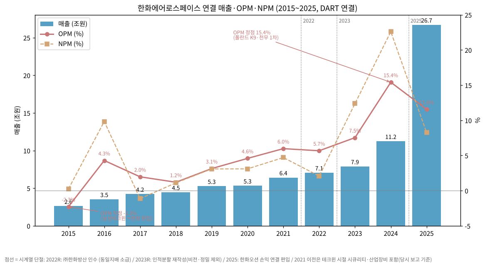

**📊 사이클 통계 (11년 연결)**

| 지표 | 값 |
|---|---|
| 매출 CAGR (10년, 2015→2025) | **+26.2%** (M&A·연결 편입 포함, 유기적 성장 아님) |
| 매출 CAGR (9년, 2015→2024, 오션 손익 연결 전) | **+17.6%** |
| OPM 평균 | **5.4%** |
| OPM 정점 평균 | **9.9%** (2016 4.3%, 2024 15.4%) |
| OPM 저점 평균 | **-0.6%** (2015 -2.3%, 2018 1.2%) |
| OPM range | **+17.7%pt** |
| 사이클 주기 | 저점→저점 3년(2015→2018), 저점→정점 6년(2018→2024) |
| 사이클 회수 (11년) | **1회 진행 중** |

**국내외 방산 피어 마진 비교 (3Q26, 출처: BT 3Q26 리뷰 — LMT·RTX 8-K, Rheinmetall H1 실적)**

→ **한화에어로 지상방산** — OPM **1.7%** (3Q26, 일회성 460억 포함) / 2025 연간 약 **24.6%**(유안타 추정)

→ **Lockheed Martin MFC(미사일)** — OPM 14.0% (3Q26)

→ **RTX Raytheon** — OPM 14.1% (3Q26)

→ **Rheinmetall** — Q2 OI €562M / 매출 €3.29B = 약 17.1% (2Q26)

→ **한화에어로 연결** — OPM 7.4% (3Q26P) / 11.6% (2025)

(3) 정량적 분류 근거

→ **매출 구성의 급변** — 2024 DART 영업부문 기준 방산 71% → 2025 해양 55%·방산 39% (연결조정 전 비중, DART 2025·2026 반기보고서) — 1년 만에 최대 사업부가 바뀜

→ **이익 구성은 방산 중심 유지** — 2025 영업이익 기여 방산 73.6% / 해양 36.1% / 항공 0.4% (DART 부문 OP, 연결조정 전)

→ **수출 비중** — 2025 연결 수출 17.63조 / 매출 26.70조 = **66.0%** (DART 2025 사업보고서 매출실적), 1H26 **71.5%**

→ **수주잔고 116.8조(2025말, 연결 합계)** = 2025 매출의 4.4배 — 방산 37.2조·한화시스템 방산 9.3조·IT 2.9조·한화오션 34.5조·항공(엔진부품 장기계약) 32.4조 등 (DART 2025 사업보고서 수주상황)

→ **본체(별도) 마진 레벨업** — 별도 OPM 2021 -1.5% → 2023 10.4% → 2025 21.2% (OpenDART OFS) — 지상방산 수출이 본체 이익 체질을 바꿈

(4) 산업 분류

→ **한국표준산업분류(DART 기재)** — 항공기용 엔진 제조업 계열 (본체), 방산·조선 복합

→ **KRX 업종** — 기계·장비 (유가증권시장)

→ **워치리스트 섹터** — 방산 T2

→ **사업 성격** — 방산 (지상무기·유도무기·방산전자) + 항공엔진 + 조선(한화오션) + 우주

(5) 분류 결정 논리

(1) **가장 매출 큰 사업부 기준** — 2025 매출은 해양(한화오션) 55%가 최대 → 조선 사이클 → 사이클 분류 근거

(2) **이익 비중 sub-rule** — 영업이익은 방산이 74%(2025) → 이익의 주인은 지상방산. 방산 OPM 2019 4.7% → 2025 21.9% 단조 상승(DART 부문) = secular 성장 근거

(3) **Boundary case 처리** — 매출 기준(조선 사이클) vs 이익 기준(방산 고성장)이 충돌. 정량 룰(range 17.7pp) 우선 적용 → **Primary 사이클 + Secondary 고성장**. 대안: Primary 고성장(지상방산 수출) + Secondary 사이클(오션 연결)

(4) **국내외 피어 비교** — 미국 피어(LMT·RTX)는 국방예산 다년 계약형으로 분기 매출이 평탄, 한화는 수출 인도 기준이라 분기 변동성이 구조적으로 큼 → Rheinmetall형(유럽 재무장 수혜, 고성장 + 인도 변동성) 피어에 가장 가까움

(6) 적정 밸류에이션 방법

→ **1차 — Forward PER (12MF, 지배순이익)**: 이익의 74%가 수주잔고 기반 방산 → 이익 가시성 높음. 참고: 2026-10-30 종가 696,000원 기준 2027E P/E 14.6배(유진 EPS 47,524원)~18.4배(신한 37,782원), Rheinmetall 2027E 22.5배(한화투자) (BT 3Q26 인뎁스 정리)

→ **2차 — SOTP (지분가치 합산)**: 상장 자회사 2개(한화시스템 47.22%, 한화오션 30.44% 직접 보유) + 쎄트렉아이 33.63% + KAI 8.67%(2026.06말) → 본체(지상방산+항공) 가치 = 시총 − 상장 지분가치 × (1 − 할인율). 지주형 구조라 SOTP 병행 필수

→ **3차 — P/B**: 한화오션 연결분(조선 사이클)에 대한 보조 지표. 2026.06말 지배주주지분 11.999조 기준 현 시총 38.2조 → PBR 약 3.2배 [계산]

→ **삼성전자 대비**: 삼성전자는 PBR 사이클 밴드, 한화에어로는 PER + SOTP (자회사 2개 상장으로 중복상장 할인 이슈)

(7) 분기 재평가 트리거 (**분류 변경 조건** — 실적 추적 변수는 6번 섹션)

→ ① **한화오션 매출 비중 40% 미만 + 지상방산 OPM 4분기 연속 20% 이상** → Primary **고성장(방산 secular)** 격상, 조선은 Secondary 강등

→ ② **지상방산 수주잔고 2분기 연속 감소 + 신규 대형 수주(폴란드 3차·중동) 공백 지속** → **Pure 사이클** 강등 (수출 1차 사이클 종료 판단)

→ ③ **한화오션 지분 매각·지배력 상실 또는 지주사 체계 재편(인적분할 등)** → 분류 전면 재작성 (본체 방산 단일 분류)

---

## ② 회사 개요

(1) 기본 사항

| 항목 | 내용 |
|---|---|
| 회사명 (한글) | 한화에어로스페이스 주식회사 |
| 회사명 (영문) | Hanwha Aerospace Co., Ltd. |
| 종목코드 | 012450 (KRX 유가증권시장, 1987.05.27 상장) |
| **설립일** | **1977년 8월 1일** (삼성정밀공업 → 1987 삼성항공산업 → 2000 삼성테크윈 → 2015 한화테크윈 → 2018.04 한화에어로스페이스) |
| 본사 주소 | 경상남도 창원시 성산구 창원대로 1204 (성주동) |
| **대표이사** | **김동관** (전략부문, 1983.10, Harvard 정치학, ㈜한화·한화솔루션 대표이사 겸임) / **손재일** (사업부문, 1965.03, 고려대, 전 한화디펜스·㈜한화방산 대표, 한화시스템 대표 겸임) — 2026.06말 DART |
| 발행주식수 | **51,563,401주** (자기주식 114,613주, 유통 51,448,788주) — 2025말·2026.06말 동일 (DART, dart_api 주식총수) |
| 주요주주 | ㈜한화 32.18% + 계열·임원 = 최대주주 등 **35.55%**(2025말) / 국민연금 **7.91%**(2025말) → 7.98%(2026.06말) |
| 연결 종속회사 | **70개** (상장 3: 한화시스템·한화오션·쎄트렉아이) — 2026.06말 DART |
| **신용등급** | 회사채 **AA** / 기업어음 **A1** (한국기업평가·NICE·한국신용평가, 2026 반기보고서 기재) |
| 임직원 (별도) | **8,168명** (2025말, dart_api 직원 — 항공 2,488 / 방산 5,680) → 8,682명 (2026.06말) |
| 시가총액 | **38조 1,569억원** (alphasquare, 2026-11-03 17:09 / 현재가 743,000원) — Yahoo 종가 740,000원 × 51,563,401주 = 38.2조 |
| 52주 범위 | **662,000 ~ 1,655,000원** (alphasquare·Yahoo meta 일치, 고점 2026.03 장중). ※ stockhub는 52주 최고 1,713,000원으로 표기 — 출처 간 불일치, 확인 필요 |
| 외국인 지분율 | **45.12%** (alphasquare, 2026-11-03) |

(2) 11년 손익·자본 추이 (연결 — OpenDART 전체재무제표)

| 연도 | 매출 (억) | OP (억) | OPM | 순이익 (억) | 지배NI (억) | 자본총계 (억) | 자산총계 (억) | 기준 |
|---|---|---|---|---|---|---|---|---|
| 2015 | 26,134 | -596 | -2.3% | 62 | 57 | 22,451 | 41,079 | 당시 보고 (rcept 20160516002683) |
| 2016 | 35,189 | 1,507 | 4.3% | 3,459 | 3,452 | 23,408 | 56,524 | 당시 보고 |
| 2017 | 42,155 | 829 | 2.0% | -477 | -482 | 21,810 | 57,476 | 당시 보고 (정정) |
| 2018 | 44,532 | 532 | 1.2% | 493 | 323 | 26,358 | 73,967 | 당시 보고 |
| 2019 | 52,641 | 1,652 | 3.1% | 1,624 | 1,322 | 28,554 | 87,084 | 당시 보고 |
| 2020 | 53,214 | 2,439 | 4.6% | 1,647 | 1,214 | 29,897 | 94,648 | 당시 보고 |
| 2021 | 64,151 | 3,830 | 6.0% | 3,018 | 2,526 | 39,316 | 110,458 | 당시 보고 (재작성 55,414/2,771은 파워시스템 중단영업) |
| **2022R** | **70,604** | **4,003** | 5.7% | 1,466 | 1,954 | 39,183 | 151,518 | 2023 사업보고서 재작성 (㈜한화방산 동일지배 소급) |
| **2023R** | **78,897** | **5,943** | 7.5% | 9,769 | 8,175 | 46,842 | 195,429 | 2024 사업보고서 재작성 (인적분할 중단영업) — 당시 보고 93,590/6,911 |
| 2024 | 112,401 | 17,319 | 15.4% | 25,399 | 22,989 | 113,643 | 433,369 | 당시 보고 (BS는 오션 연결, 2025 보고서에서 PPA로 자산 435,619·자본 114,920 소폭 재작성) |
| **2025** | **267,029** | **30,893** | **11.6%** | **22,020** | **14,050** | **167,882** | **539,537** | 2025 사업보고서 (20260316001112) |

→ 10년 매출 CAGR **+26.2%** / 자본총계 CAGR **+22.3%** (2015→2025) — 대부분 M&A·연결 편입 효과
→ 2025 ROE(지배, 평균자본) 약 **19.1%** [계산: 14,050 / ((49,951+96,849)/2)]
→ 2025 자본 +5.4조 증가 중 4.2조는 유상증자(제3자배정 2025.04.29 1,715,040주 + 주주배정 2025.07.10 4,267,200주, DART 2026 반기보고서 자본금 변동)

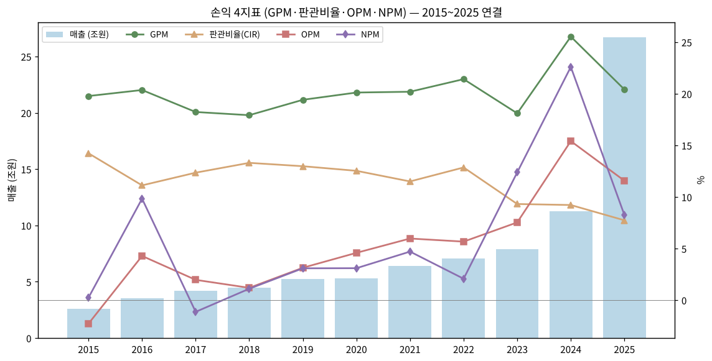

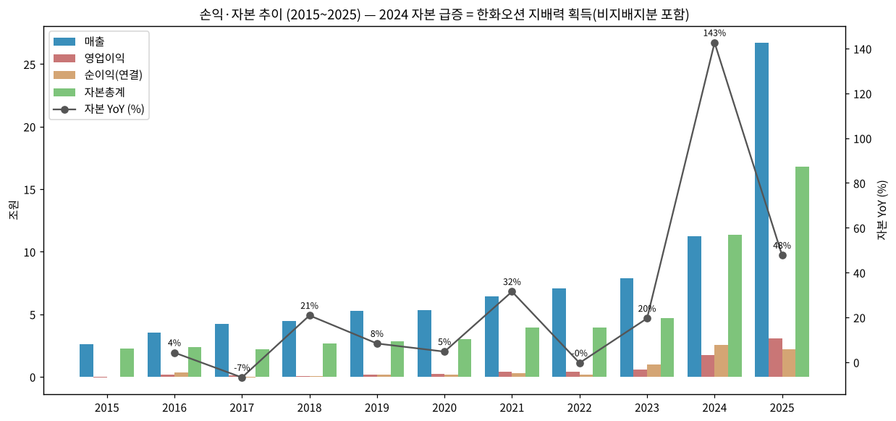

(3) 주가 역사 (20년)

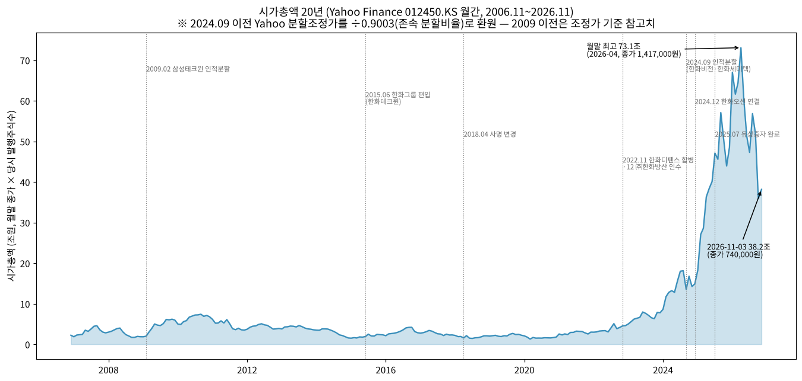

→ (출처: Yahoo Finance v8 012450.KS 월간 2006.11~2026.11 × DART 발행주식수 이력. 2024.09 이전은 Yahoo 분할조정 종가를 존속 분할비율 0.9003(45,581,161/50,630,000)으로 나눠 실제 주가로 환원 — **Yahoo 조정계수와의 정확한 일치는 확인 불가, 추정**)

→ **2006~2014 삼성테크윈 시절** — 시총 2~7조 박스권 (카메라·반도체장비·CCTV 복합기업)

→ **2015~2021 한화테크윈·에어로 초기** — 시총 1.6~5조. 항공엔진 적자·시큐리티 부진으로 장기 정체 (2020.12 1.78조 저점권)

→ **2022~2024 K-방산 1차 랠리** — 폴란드 K9·천무 계약(2022.7~11) 후 재평가 시작. 2022말 4.6조 → 2023말 7.8조 → 2024 오션 연결

→ **2025~2026.04 슈퍼 랠리** — 유럽 재무장 + 오션 연결 + 유상증자. 월말 최고 **73.1조**(2026.04, 종가 1,417,000원), 장중 ATH **1,655,000원**(2026.03, Yahoo)

→ **2026.10 급락** — 3Q26 어닝 쇼크(OP 4,520억, 컨센 -61%) 전후 10월 말 종가 696,000원, 시총 35.9조. 2026-11-03 종가 740,000원·시총 약 38.2조 (고점 대비 -48%)

(4) 주요 연혁 (DART 사업보고서 연혁·합병 등에 관한 사항)

| 시기 | 내용 |
|---|---|
| 1977.08 | 삼성정밀공업 설립 |
| 1987.02 / 05 | 삼성항공산업 상호 변경 / 유가증권시장 상장 |
| 2000.03 | 삼성테크윈 상호 변경 |
| 2009.02 | 인적분할 (보통주 2,387만주 감소, 디지털카메라 분리) |
| **2015.06** | **한화그룹 편입** (최대주주 삼성전자 → ㈜한화), 한화테크윈 상호 변경 |
| 2016.10 | 두산DST 인수 → 한화디펜스 |
| 2017.04 | 지상방산·파워시스템·정밀기계 물적분할 (자회사화) |
| **2018.04** | **한화에어로스페이스 상호 변경**, 시큐리티(한화테크윈) 물적분할 |
| 2019 | 한화지상방산 → 한화디펜스 상호 변경, EDAC(미국 엔진부품) 인수 |
| 2021~2022.01 | 쎄트렉아이 지분 인수·연결 편입 |
| 2022.07~11 | 폴란드 K9 Framework·EC1, 천무 Framework·EC1 체결 |
| **2022.11.01** | **한화디펜스 흡수합병** |
| 2022.08 / 12.29 | 한화파워시스템 매각(2,100억) / **㈜한화방산 인수(8,521억)** |
| **2023.04.01** | **㈜한화방산 흡수합병** → 통합법인 출범 |
| 2023.05 | 한화오션(구 대우조선해양) 유상증자 참여 지분 취득 (관계기업) |
| 2023.12 | 호주 Land 400 Ph.3 레드백 공급계약, 폴란드 K9 EC2 |
| 2024.04 / 07 | 폴란드 천무 EC2 / 루마니아 K9 공급계약 |
| **2024.09.01** | **인적분할** (한화인더스트리얼솔루션즈 신설 → 한화비전·한화세미텍) |
| **2024.12** | **한화오션 지배력 획득·연결 편입** (처분이익 1조 1,432억), Philly Shipyard·Dyna-Mac 인수 |
| 2025.03 / 04 / 07 | 한화오션 지분 추가 취득 / 제3자배정 유상증자 / 주주배정 유상증자 완료 (합계 약 4.2조) |
| 2025.11 | 누리호 4차 발사 성공 (체계종합기업 최초 제작 주관) |
| 2025.12 | 폴란드 천무 EC3, 에스토니아 천무 G2G 이행약정, T-50 수출용 엔진 공급계약 |
| 2026.01 / 04 | 노르웨이 천무 수출계약 / 핀란드 K9 G2G 이행약정 |
| 2026.02 | 미국 Venture Global LNG 구매계약(1.5MTPA×20년) — 에너지사업 목적 추가(2026.03 주총) |
| 2026.06~07 | 한국항공우주산업(KAI) 장내매수 → 8.67% |
| 2026.08 | 스페인 K9 계약 (수주잔고 미반영, BT 리뷰) |

---

## ③ 비즈니스 모델

(1) 실적 추이 통합 표 (5년 연간 — 3단계 위계: 사업부 / 지상방산 수출·내수 / 지역)

**(1-1) 회사 IR 사업부 기준 (억원)**

| 사업부 | 2023* | 2024 | 2025 | 1Q26~3Q26P 누적 |
|---|---|---|---|---|
| 연결 매출 | 78,897 | 112,401 | 267,029 | 211,382 |
| 지상방산 매출 | 41,300 | 70,063 | 81,331 | 45,741 |
| 항공우주 매출 | 확인 불가 | 20,448 | 25,206 | 20,811 |
| 한화시스템 매출 | 확인 불가 | 28,037 | 30,987 | 23,637 |
| 한화오션 매출 | - | - | 127,837 | 120,670 |
| 연결 영업이익 | 5,943 | 17,319 | 30,892 | 24,564 |
| 연결 OPM | 7.5% | 15.4% | 11.6% | 11.6% |

→ (출처: 2023* 지상방산 4.13조는 BT 리뷰 연간표(인적분할 재작성), 2024~3Q26 분기 합산은 회사 3Q26 IR p.14 재작성 기준(BT 리뷰 정리). 3Q26P = 잠정)
→ 한화시스템은 3Q26 IR에서 필리조선소 중단영업 분류로 과거 분기 재작성됨 → 언론 보도치(예: 2Q26 1조 1,176억)와 IR 재작성치(8,872억) 차이 주의

**(1-2) DART 영업부문 기준 (연결조정 전, 억원 / OPM)**

| 부문 | 2021 | 2022 | 2023 | 2024 | 2025 | 1H26 |
|---|---|---|---|---|---|---|
| 방산 (에어로+시스템 방산) | 28,843 / 5.5% | 37,203 / 7.1% | 58,813 / 10.7% | 88,234 / 18.7% | **103,832 / 21.9%** | 44,652 / 20.2% |
| 항공 (엔진) | 14,497 / 0.1% | 14,584 / 1.8% | 17,397 / 0.6% | 19,906 / -1.0% | 25,197 / 0.5% | 14,590 / 4.6% |
| 해양 (한화오션) | - | - | - | 730 / 47%** | **145,584 / 7.7%** | 96,142 / 12.0% |
| IT서비스 등 (시스템 ICT) | 5,281 / 7.7% | 5,505 / -5.5% | 6,415 / -1.1% | 7,059 / 6.5% | 6,627 / 7.7% | 3,624 / 8.8% |
| 항공우주 (우주) | - | 914 / -18.7% | 1,254 / -9.6% | 1,713 / -7.4% | 3,350 / -2.9% | 1,244 / -5.9% |
| 시큐리티 (~2024.08) | 6,794 / 11.3% | 19,417 / 8.7% | 18,399 / 5.5% | 15,768 / 7.9% | - | - |
| 산업용장비 (~2024.08) | 5,917 / 14.9% | 5,705 / 4.2% | 4,768 / -8.3% | 3,508 / -8.6% | - | - |
| 연결 합계 | 64,151 | 71,814 | 93,590 | 123,891 | 267,029 | 150,439 |

→ (출처: 2021 = 2021 사업보고서 / 2022·2023·2024 = 2024 사업보고서(제46~48기) / 2025·1H26 = 2026 반기보고서. 2022~2024 합계는 중단사업 포함 부문 합(연결조정 후)으로 손익계산서 재작성치와 다름. **2024 해양은 12월 한화오션 외 Dyna-Mac 등 일부 편입분)
→ 2025·1H26 항공 영업이익에는 P&W GTF RSP 엔진빌드 초기 투자비용(2025 937억, 1H26 263억) 포함 (DART 반기보고서 주석)
→ 2021 이전 부문 구성: 항공엔진·방산·시큐리티·파워시스템·산업용장비·ICT (2019 방산 24,531/1,161, 2020 25,040/1,493 — 2021 사업보고서)

**(1-3) 수출·내수 (DART 매출실적, 억원)**

| 부문 | 2024 수출 / 내수 | 2025 수출 / 내수 | 1H26 수출 / 내수 |
|---|---|---|---|
| 방산 | 36,369 / 49,715 | **46,725 / 52,091** | 19,483 / 22,816 |
| 항공 | 10,097 / 7,916 | 11,707 / 11,126 | 5,964 / 7,456 |
| 해양 | 731 / - | 117,038 / 20,147 | 80,651 / 10,478 |
| IT서비스 | 878 / 4,995 | 713 / 4,530 | 261 / 2,366 |
| 항공우주 | 141 / 1,559 | 162 / 2,790 | 134 / 829 |
| **연결 합계** | **57,848 / 66,043** | **176,345 / 90,684 (수출 66.0%)** | **107,616 / 42,822 (71.5%)** |

→ (출처: DART 2026 반기보고서 매출실적 표(2024·2025·1H26 3개년), 2024 합계는 시큐리티·산업용장비 포함 12.39조 기준)
→ **지상방산 수출·내수 (회사 IR, 분기)**: 1Q26 수출 6,514 / 내수 5,697 (OP 2,087, OPM 17.1%) · 2Q26 수출 비중 58% · 3Q26P 수출 5,936 / 내수 6,519 (수출 비중 48%, YoY -50% / -29%) (BT 리뷰·인뎁스, 회사 IR p.9)

(2) 사업부별 분기 시계열

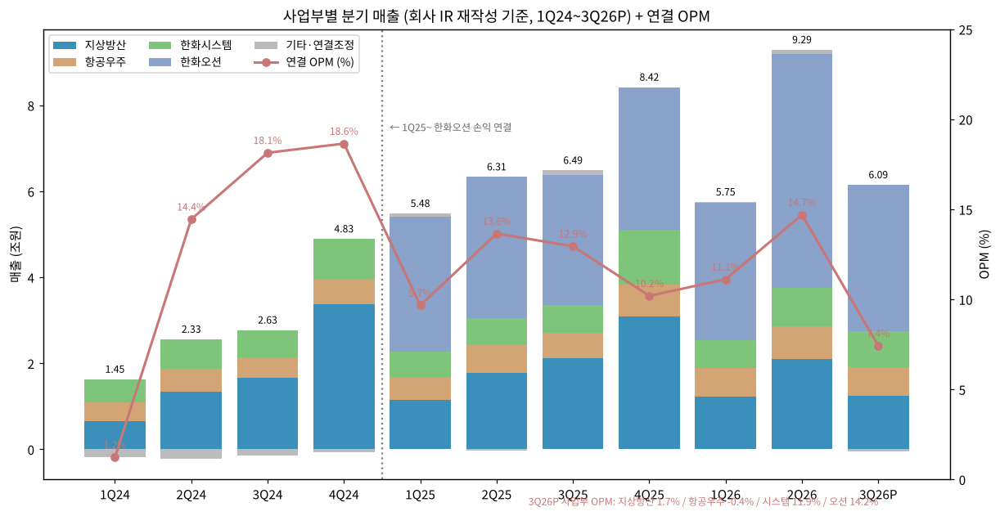

| 분기 (억원) | 1Q24 | 2Q24 | 3Q24 | 4Q24 | 1Q25 | 2Q25 | 3Q25 | 4Q25 | 1Q26 | 2Q26 | **3Q26P** |
|---|---|---|---|---|---|---|---|---|---|---|---|
| 연결 매출 | 14,491 | 23,347 | 26,312 | 48,250 | 54,842 | 63,110 | 64,865 | 84,212 | 57,510 | 92,929 | **60,943** |
| 연결 OP | 177 | 3,372 | 4,772 | 8,997 | 5,299 | 8,614 | 8,396 | 8,583 | 6,389 | 13,655 | **4,520** |
| OPM | 1.2% | 14.4% | 18.1% | 18.6% | 9.7% | 13.6% | 12.9% | 10.2% | 11.1% | 14.7% | **7.4%** |
| 순이익 | 26 | 1,599 | 3,304 | 20,469 | 1,829 | 2,862 | 6,990 | 10,339 | 5,263 | 10,805 | **-367** |
| 지상방산 | 6,553 | 13,296 | 16,560 | 33,654 | 11,575 | 17,732 | 21,098 | 30,926 | 12,211 | 21,075 | **12,455** |
| 항공우주 | 4,297 | 5,427 | 4,779 | 5,945 | 5,309 | 6,489 | 6,040 | 7,368 | 6,612 | 7,600 | **6,599** |
| 한화시스템 | 5,442 | 6,870 | 6,390 | 9,335 | 5,737 | 6,195 | 6,392 | 12,663 | 6,449 | 8,872 | **8,316** |
| 한화오션 | - | - | - | - | 31,432 | 32,941 | 30,234 | 33,230 | 32,099 | 54,432 | **34,139** |

→ (출처: 회사 3Q26 IR p.14 재작성 기준 — BT 리뷰 정리. 3Q26P는 2026-10-29 잠정, SBS Biz 보도 "한화에어로 3분기 영업익 4천520억원…물량인도 지연에 46%↓"로 교차 확인)
→ **3Q26P 사업부 영업이익**: 지상방산 217 (OPM 1.7%) / 항공우주 -24 (-0.4%) / 한화시스템 991 (11.9%) / 한화오션 4,857 (14.2%) / 기타 -1,521 (회사 IR)
→ **2Q26 사업부 영업이익 (언론 보도, 재작성 전)**: 지상방산 5,330 (25.3%) / 항공우주 370 (4.9%) / 한화오션 7,361 (13.5%) / 한화시스템 1,037 (매출 1조 1,176억 기준) — 머니투데이 2026-07-31
→ 사업부별 분기 영업이익 1Q24~1Q26은 IR 원본 미확보로 **확인 불가** (다음 버전 보완)
→ DART 분기보고서 IS와 IR 분기치 차이: 1Q24·2Q24 DART는 인적분할 전 보고(18,483/374, 27,860/3,588), 1~3Q25는 PPA 확정으로 IR이 재작성(예 1Q25 DART OP 5,607 vs IR 5,299)

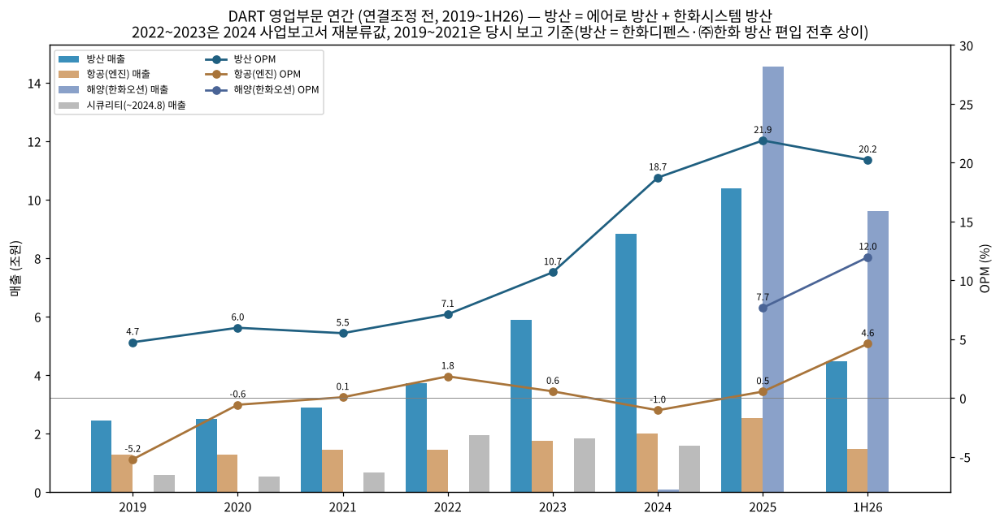

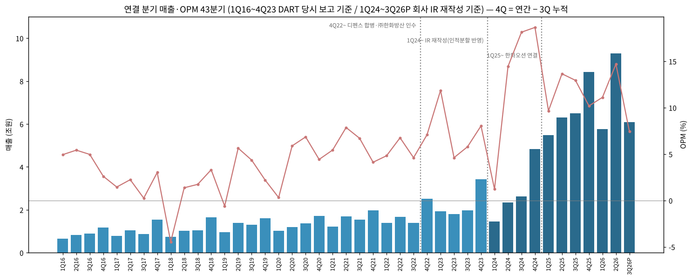

→ (출처: 1Q16~4Q23 OpenDART 분기 연결 IS 3개월값, 4Q = 연간 − 3Q 누적(당시 보고 기준). 1Q24~3Q26P 회사 IR 재작성. 4Q22·4Q23은 합병·결산 조정이 몰려 높게 나타남)

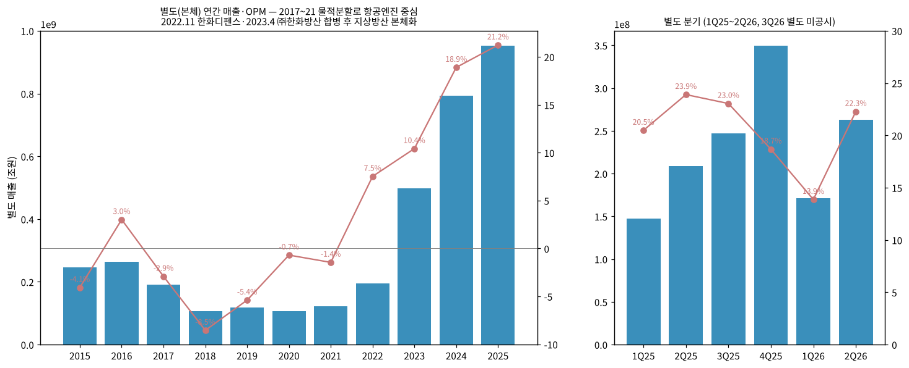

**(2-1) 별도(본체 = 지상방산 + 항공 + 우주, 연결 자회사 제외) 시계열 — OpenDART OFS**

| 연도 | 2015 | 2016 | 2017 | 2018 | 2019 | 2020 | 2021 | 2022 | 2023 | 2024 | 2025 |
|---|---|---|---|---|---|---|---|---|---|---|---|
| 별도 매출 (억) | 24,653 | 26,287 | 19,139 | 10,658 | 11,909 | 10,599 | 12,248 | 19,567 | 49,790 | 79,351 | **95,251** |
| 별도 OP (억) | -1,003 | 793 | -557 | -910 | -642 | -73 | -178 | 1,473 | 5,191 | 14,997 | **20,226** |
| 별도 OPM | -4.1% | 3.0% | -2.9% | -8.5% | -5.4% | -0.7% | -1.5% | 7.5% | 10.4% | 18.9% | **21.2%** |

| 분기 | 1Q25 | 2Q25 | 3Q25 | 4Q25 | 1Q26 | 2Q26 |
|---|---|---|---|---|---|---|
| 별도 매출 (억) | 14,747 | 20,881 | 24,675 | 34,948 | 17,113 | 26,316 |
| 별도 OP (억) | 3,020 | 4,990 | 5,687 | 6,529 | 2,373 | 5,864 |
| 별도 OPM | 20.5% | 23.9% | 23.0% | 18.7% | 13.9% | 22.3% |

→ 2017~2021 별도는 지상방산·시큐리티 등이 자회사로 빠진 항공엔진 중심 본체 → 연결과 성격이 전혀 다름. 2022(11월 한화디펜스 합병 2개월분)·2023(4월 ㈜한화방산 합병)부터 지상방산 본체화. 4Q25 = 연간 − 3Q 누적. 3Q26 별도는 분기보고서 미공시 (11월 중순 예정)

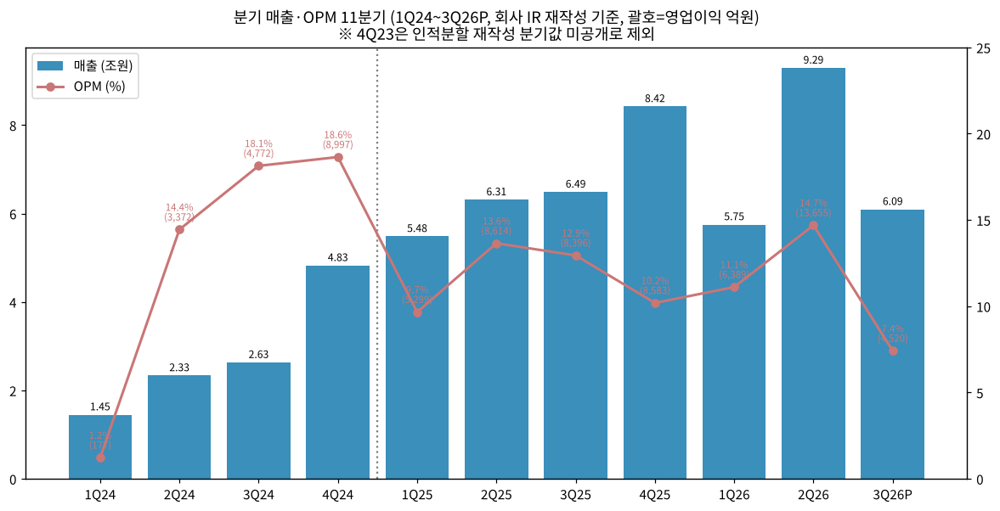

(3) 사업부별 디테일 (매출 비중 큰 순서 — 1H26 DART 연결조정 전 기준)

(3-1) **해양 — 한화오션 (1H26 매출 비중 63.9%, OP 57.4%)**
→ LNGC·VLCC·컨테이너선·FPSO/FLNG·잠수함·수상함. 1H26 매출 9.61조 / OP 1.15조 (OPM 12.0%), 수출 89%
→ 수주잔고 34.5조(2025말) → 33.0조(2026.06말) (DART)
→ 3Q26P 매출 3조 4,139억 / OP 4,857억 (14.2%) — 고선가 인식 + FPSO 변경계약 효과. 오션 외화환산손실이 3Q26 연결 세전 적자(-1,896억) 주원인 (회사 컨콜, BT 리뷰)
→ 에어로 본체 직접 지분 30.44%(2026.06말) — 비지배지분 비중이 커 연결 순이익과 지배순이익 괴리 확대(2025 연결 NI 2.20조 vs 지배 1.40조)

(3-2) **방산 — 지상방산 + 한화시스템 방산 (1H26 매출 29.7%, OP 45.1%)**
→ 지상방산(본체): K9 자주포·K10·천무·레드백·탄약·유도무기·발사대(천궁-II, L-SAM). 2025 IR 매출 8.13조, OPM 약 24.6%(유안타 추정)
→ 수주잔고 **35.0조(3Q26, 수출 74%)** — 2024말 32.4조 → 2025말 37.2조 → 감소 전환 (회사 IR, DART 방산 37.2조와 일치)
→ 수출 고객: 폴란드(K9 EC1·2, 천무 EC1~3), 루마니아 K9, 호주(K9·레드백 현지 생산), 이집트 K9, 인도 K9, 노르웨이·에스토니아·핀란드·스페인 신규 (DART 연혁·BT 리뷰)
→ 한화시스템 방산: 다기능레이더(천궁-II·L-SAM MFR), KF-21 AESA 레이더, 함정 전투체계. 3Q26P 매출 8,316억 / OP 991억 (11.9%)

(3-3) **항공 — 엔진 (1H26 매출 9.7%, OP 3.4%)**
→ 군용 엔진 면허생산(F404·F414 계열 KF-21 엔진, T-50/FA-50), 민수 엔진부품 RSP(P&W GTF·GE·RR), 정비
→ 구조적 저마진: GTF RSP 인도 증가에 비례해 초기 손실 확대 (3Q26 RSP 손실 227억, RSP 제외 OP 203억 — 회사 IR p.11)
→ 수주잔고 32.4조(2025말) → 31.7조(2026.06말) — 엔진부품 장기공급계약 포함 (DART)

(3-4) **IT서비스 등 — 한화시스템 ICT (2.4%) / 항공우주 — 우주 (0.8%)**
→ ICT: 그룹 전산·IT 융합 엔지니어링, 1H26 OPM 8.8%
→ 우주: 누리호 고도화·차세대발사체 체계종합, 쎄트렉아이 위성(SpaceEye-T 0.25m, 2025.03 발사) — 적자 지속(1H26 OPM -5.9%). 자체 소형발사체 개발 중 (DART 2026 반기 신규사업)

(4) 주요 경쟁사 (사업부별)

| 사업부 | 국내 | 해외 |
|---|---|---|
| 지상방산 | 현대로템(K2 전차), LIG디펜스앤에어로스페이스(유도무기), 풍산(탄약) | Rheinmetall, KNDS(PzH2000·CAESAR), BAE Systems(M109), General Dynamics Land Systems, Lockheed Martin(HIMARS) |
| 항공엔진 | (국내 엔진 단독) / KAI는 기체 | GE Aerospace, Pratt & Whitney(RTX), Rolls-Royce, Safran, MTU·IHI(RSP 동종) |
| 방산전자 (한화시스템) | LIG디펜스앤에어로스페이스 | Thales, Leonardo, Raytheon |
| 조선 (한화오션) | HD한국조선해양·HD현대중공업, 삼성중공업 | 중국 CSSC 계열 |
| 우주 | KAI(위성), 이노스페이스(발사체) | SpaceX, Rocket Lab |

→ (BT 3Q26 리뷰의 글로벌 피어 비교: LMT·RTX·Rheinmetall. 점유율 수치는 확인 불가)

(5) 주요 매출처

→ DART 2025 사업보고서 판매경로 표 기재: **해외 거래처 12.42%, 방위사업청 12.30%** (연결 매출 대비 비중으로 판단, 표 배치상 사업부 귀속 불명확)
→ DART 2026 반기보고서: **PETROBRAS 10.24%** (FPSO 발주처, 해양 부문으로 추정 — 표 배치상 귀속 확인 필요)
→ 지상방산 수출 주요 고객(정성): 폴란드 군비청, 루마니아·호주·이집트·인도·노르웨이 국방부 (DART 연혁). 국가별 매출 비중은 미공시 — 회사는 "보안 관계상" 기재 생략

(6) 생산 CAPA + 임직원 추이

**생산능력·가동률 (DART 2025 사업보고서, 백만원 기준 생산능력)**

| 부문 / 사업장 | 2023 | 2024 | 2025 | 2025 가동률 |
|---|---|---|---|---|
| 방산 (창원2·3, 여수, 대전, 보은, 화순) | 3,190,416 | 4,596,404 | 3,325,411 | 88.4% |
| 항공 (창원1, 아산, 베트남, 미 코네티컷) | 2,159,431 | 2,071,383 | 3,388,806 | 71.0% |
| 한화시스템 방산 (구미) | 1,166,248 | 1,289,684 | 1,729,388 | 83.7% |
| 한화오션 (옥포 등, 가동시간) | - | 38.19백만MH | 34.86백만MH | 100.2% |
| Philly Shipyard (가동시간) | - | 2.31백만MH | 3.07백만MH | 102.7% |

→ 해외 생산 확대: 폴란드(Hanwha WB Advanced System, 2025.09)·루마니아·호주(질롱 H-ACE)·미국(Hanwha Defense USA) 법인 (DART 연혁). 2028년까지 11조원+ 투자 계획(해외 6.27조, 신규시장 R&D 1.56조, 지상방산 인프라 2.29조, 항공우주 0.95조 — 회사 3Q26 IR p.27)
→ 대전 사업장 사고(2026) → 2027 상반기 정상화 목표 (회사 컨콜)

**임직원 (별도, DART 각 연도 사업보고서)**

| 연도 | 2016 | 2017 | 2018 | 2019 | 2020 | 2021 | 2022 | 2023 | 2024 | 2025 | 2026.06 |
|---|---|---|---|---|---|---|---|---|---|---|---|
| 직원 수 | 4,334 | 2,559 | 1,564 | 2,036 | 2,012 | 1,953 | 3,690 | 6,816 | 7,659 | **8,168** | 8,682 |

→ 2017~2018 감소 = 물적분할, 2022~2023 증가 = 한화디펜스·㈜한화방산 합병. 2025 평균 근속: 항공 남 17년 / 방산 남 12년, 1인 평균 급여 약 1.0~1.3억원 (dart_api 직원)

---

## ④ 재무 구조 (11년 연결, OpenDART)

(1) 손익계산서

| 연도 | 매출 | 매출총이익 | 판관비 | 영업이익 | 세전이익 | 순이익 | GPM | 판관비율 | OPM | NPM |
|---|---|---|---|---|---|---|---|---|---|---|
| 2015 | 26,134 | 5,168 | 3,719 | -596 | -191 | 62 | 19.8% | 14.2% | -2.3% | 0.2% |
| 2016 | 35,189 | 7,164 | 3,913 | 1,507 | 4,185 | 3,459 | 20.4% | 11.1% | 4.3% | 9.8% |
| 2017 | 42,155 | 7,684 | 5,207 | 829 | 178 | -477 | 18.2% | 12.4% | 2.0% | -1.1% |
| 2018 | 44,532 | 7,980 | 5,924 | 532 | 535 | 493 | 17.9% | 13.3% | 1.2% | 1.1% |
| 2019 | 52,641 | 10,218 | 6,831 | 1,652 | 1,563 | 1,624 | 19.4% | 13.0% | 3.1% | 3.1% |
| 2020 | 53,214 | 10,703 | 6,668 | 2,439 | 1,718 | 1,647 | 20.1% | 12.5% | 4.6% | 3.1% |
| 2021 | 64,151 | 12,953 | 7,378 | 3,830 | 4,053 | 3,018 | 20.2% | 11.5% | 6.0% | 4.7% |
| 2022R | 70,604 | 15,118 | 9,077 | 4,003 | 1,954 | 1,466 | 21.4% | 12.9% | 5.7% | 2.1% |
| 2023R | 78,897 | 14,282 | 7,348 | 5,943 | 11,308 | 9,769 | 18.1% | 9.3% | 7.5% | 12.4% |
| 2024 | 112,401 | 28,699 | 10,360 | 17,319 | 26,474 | 25,399 | 25.5% | 9.2% | 15.4% | 22.6% |
| 2025 | 267,029 | 54,505 | 20,657 | 30,893 | 22,099 | 22,020 | 20.4% | 7.7% | 11.6% | 8.2% |

→ 단위 억원. 2023R 순이익은 중단영업(한화비전·세미텍) 포함, 2024 순이익은 한화오션 관계기업투자 처분이익 1조 1,432억 포함 (DART 2024 사업보고서 주석 기타수익 "종속및관계기업처분이익 1,143,106백만원")
→ 2016 순이익 3,459억은 한화디펜스 인수·지분 처분 관련 영업외이익 영향(세부 확인 불가)

(2) 재무상태표

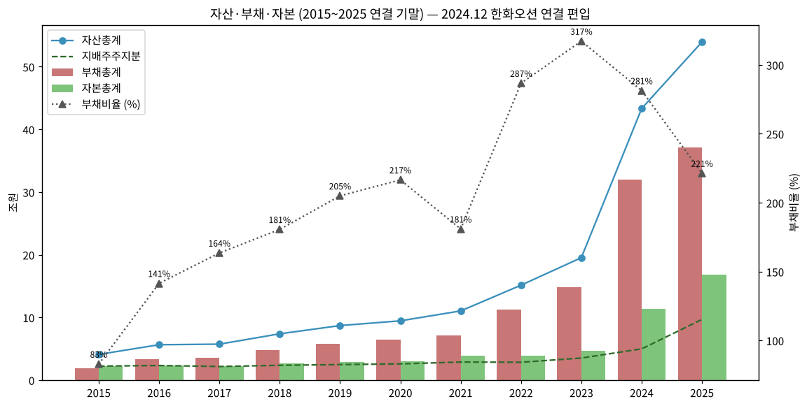

| 연도 | 자산 | 부채 | 자본 | 지배주주지분 | 현금성자산 | 부채비율 | 유동비율 |
|---|---|---|---|---|---|---|---|
| 2015 | 41,079 | 18,628 | 22,451 | 22,434 | 1,427 | 83% | 148% |
| 2016 | 56,524 | 33,117 | 23,408 | 23,390 | 2,574 | 141% | 141% |
| 2017 | 57,476 | 35,666 | 21,810 | 21,794 | 4,614 | 164% | 132% |
| 2018 | 73,967 | 47,609 | 26,358 | 23,696 | 6,367 | 181% | 123% |
| 2019 | 87,084 | 58,531 | 28,554 | 24,861 | 10,001 | 205% | 137% |
| 2020 | 94,648 | 64,751 | 29,897 | 25,977 | 13,307 | 217% | 131% |
| 2021 | 110,458 | 71,143 | 39,316 | 28,892 | 25,281 | 181% | 145% |
| 2022 | 151,518 | 112,335 | 39,183 | 28,574 | 30,698 | 287% | 103% |
| 2023 | 195,429 | 148,587 | 46,842 | 35,284 | 18,064 | 317% | 76% |
| 2024 | 433,369 | 319,726 | 113,643 | 49,951 | 29,677 | 281% | 90% |
| 2025 | 539,537 | 371,655 | 167,882 | 96,849 | 77,134 | 221% | 102% |
| **2026.06** | **587,420** | **385,049** | **202,371** | **119,989** | **80,482** | **190%** | **108%** |

→ 단위 억원. 2023 유동비율 76%: 폴란드 선수금(계약부채) 급증 — 방산 수출은 선수금 구조라 유동부채가 커짐 (2025말 계약부채 15.99조)
→ 2024 자산 2.2배 = 한화오션 연결 편입

(3) 현금흐름표

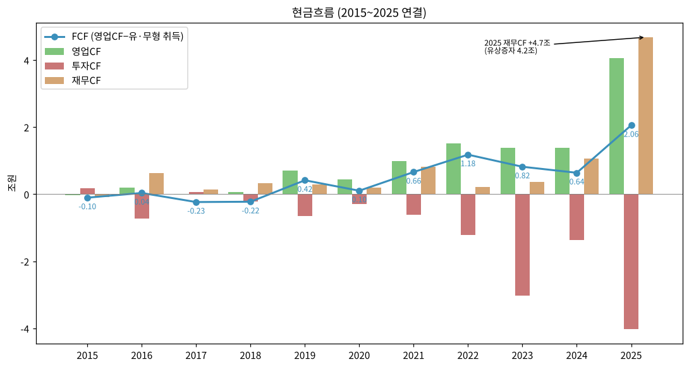

| 연도 | 영업CF | 투자CF | 재무CF | CapEx | FCF |
|---|---|---|---|---|---|
| 2015 | -375 | 1,776 | -918 | 647 | -1,022 |
| 2016 | 1,961 | -7,183 | 6,379 | 1,586 | 375 |
| 2017 | -97 | 726 | 1,404 | 2,236 | -2,333 |
| 2018 | 563 | -2,131 | 3,327 | 2,802 | -2,239 |
| 2019 | 7,151 | -6,435 | 2,894 | 2,992 | 4,159 |
| 2020 | 4,347 | -2,987 | 1,990 | 3,306 | 1,041 |
| 2021 | 9,900 | -6,071 | 8,131 | 3,283 | 6,617 |
| 2022 | 15,243 | -12,249 | 2,161 | 3,448 | 11,795 |
| 2023 | 13,902 | -30,291 | 3,678 | 5,712 | 8,190 |
| 2024 | 13,930 | -13,673 | 10,657 | 7,536 | 6,394 |
| 2025 | 40,498 | -40,208 | 46,816 | 19,941 | 20,557 |
| 1H26 | -3,707 | -34,030 | 39,663 | 8,114 | -11,821 |

→ 단위 억원. CapEx = 유형자산 취득 + 무형자산 취득. FCF = 영업CF − CapEx
→ 2023 투자CF -3.03조 = 한화오션 유상증자 참여·㈜한화방산 인수 / 2025 재무CF +4.68조 = 유상증자 4.21조 + 차입
→ 1H26 영업CF 적자 전환 + 3Q26 순차입금 9조 8,527억(2025말 4조 4,931억 대비 +5.36조, 순차입금비율 51%) (회사 3Q26 IR p.8·16)

(4) CapEx

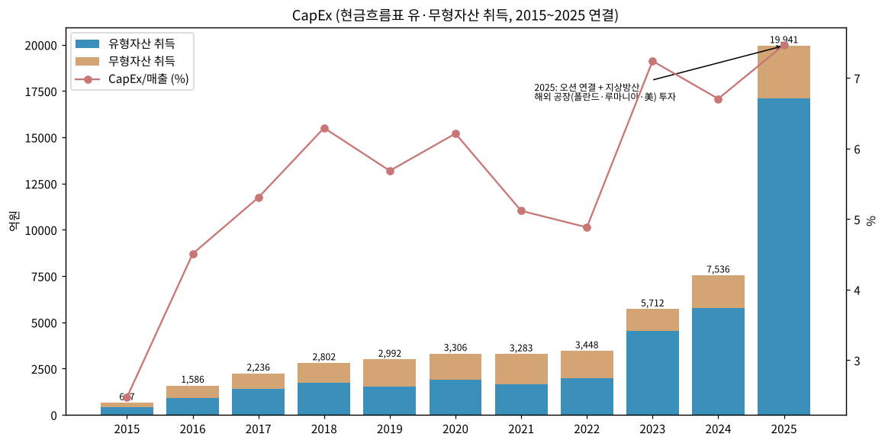

→ 2015~2022 연 0.6~3.4천억 → 2023 5.7천억 → 2025 **1조 9,941억** (유형 1조 7,105억 + 무형 2,836억)
→ 사이클 annotation: 2017~2019 EDAC 등 항공 증설 / 2023~ 지상방산 증설·해외 공장 / 2025 오션 연결분 포함
→ 회사 계획: 2028년까지 11조원+ 투자·R&D (회사 3Q26 IR p.27)

(5) 부채구조

| 항목 | 2022 | 2023 | 2024 | 2025 | 2026.06 |
|---|---|---|---|---|---|
| 차입금및사채 (유동+비유동, 억) | 34,477 | 39,391 | 102,825 | 123,949 | 154,448 |
| 현금성자산 (억) | 30,698 | 18,064 | 29,677 | 77,134 | 80,482 |
| 이자비용 (억) | 확인 불가 | 확인 불가 | 2,425 | 4,897 | - |
| 이자보상배율 (OP/이자비용) | - | - | 7.1배 | 6.3배 | - |

→ (출처: OpenDART 연결 BS '차입금및사채' 계정. 2021 이전은 표준계정 분리가 불완전해 단기차입금 누락 가능성으로 **표기 생략**)
→ 신용등급 회사채 AA (2024.06 AA- → AA 상향 이력 있음, DART 반기보고서 신용등급 표)
→ 2026 반기보고서 기준 회사채 다수 발행 중 (AA, 3사) — 회차별 상세는 다음 버전 보완

(6) 배당·자사주

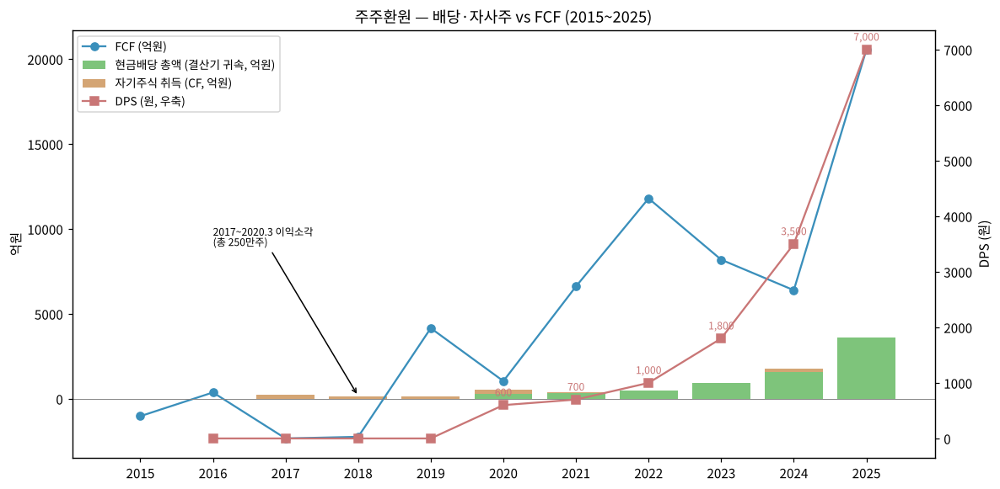

| 결산기 | DPS (원) | 배당총액 (억) | 배당성향 (연결) | 배당수익률 | 자사주 |
|---|---|---|---|---|---|
| 2016~2019 | 무배당 | - | - | - | 2017.05·2018.05·2019.05·2020.03 이익소각 총 250만주 |
| 2020 | 600 | 304 | 25.01% | 2.15% | - |
| 2021 | 700 | 354 | 14.01% | 1.50% | 2021 자사주 4만주 취득 |
| 2022 | 1,000 | 506 | 29.84% | 1.40% | - |
| 2023 | 1,800 | 910 | 11.13% | 1.40% | - |
| 2024 | 3,500 | 1,591 | 6.92% | 1.10% | 분할 단주 6만주 취득 |
| **2025** | **7,000** | **3,601** | **25.63%** | **0.70%** | - |

→ (출처: DART 2018·2021·2024 사업보고서 주요배당지표, dart_api 2025 FY 배당. 2016~2019 무배당은 2018·2021 보고서 기재)
→ DPS 5년 11.7배 (2020 600원 → 2025 7,000원). 최근 5년 평균 배당수익률 1.22% (DART 2026 반기)
→ 2025 유상증자 4.2조로 주주 희석 — 주주환원은 배당 중심, 자사주 매입 없음

(7) 재무비율 (연결)

| 지표 | 2023 | 2024 | 2025 | 2026.06 |
|---|---|---|---|---|
| ROE (지배, 평균자본) | 25.5% | 54.0%* | 19.1% | - |
| ROA (연결 NI/평균자산) | 5.6% | 8.1% | 4.5% | - |
| 부채비율 | 317% | 281% | 221% | 190% |
| 유동비율 | 76% | 90% | 102% | 108% |
| 이자보상배율 | 확인 불가 | 7.1배 | 6.3배 | - |
| 순차입금 | - | - | 4.49조 (IR) | 9.85조 (3Q26, IR) |

→ [계산] *2024 ROE는 오션 처분이익 1.14조 포함 — 일회성 제외 시 약 30% 수준 [추정]

---

## ⑤ 지배 구조

(1) 그룹·계열 관계

```
김동관 (한화에너지 50%) ──▶ 한화에너지㈜ ──(23.55% 보통주)──▶ ㈜한화 (김동관 개인 9.76% 보통주)
                                                                │ 32.18%
                                                                ▼
                                              한화에어로스페이스 (최대주주 등 35.55%)
                    ┌──────────────┬───────────────┼───────────────┬─────────────┐
                 한화시스템      한화오션        쎄트렉아이        KAI          해외법인 다수
                 47.22%         30.44%*         33.63%           8.67%      (USA·Poland·Romania·Australia 등)
                 (상장)         (상장)          (상장)          (관계·투자)
```

→ (출처: DART 2026 반기보고서 최대주주·타법인출자 현황. *한화오션은 에어로 직접 30.44% + 한화시스템·계열 보유분으로 지배력 확보, 2024.12 이사선임권 추가 확보로 연결 편입)
→ 김동관 ㈜한화 지분: 2025.04.30 김승연 회장 증여로 4.91% → 9.76% (보통주)

(2) 주주 구분

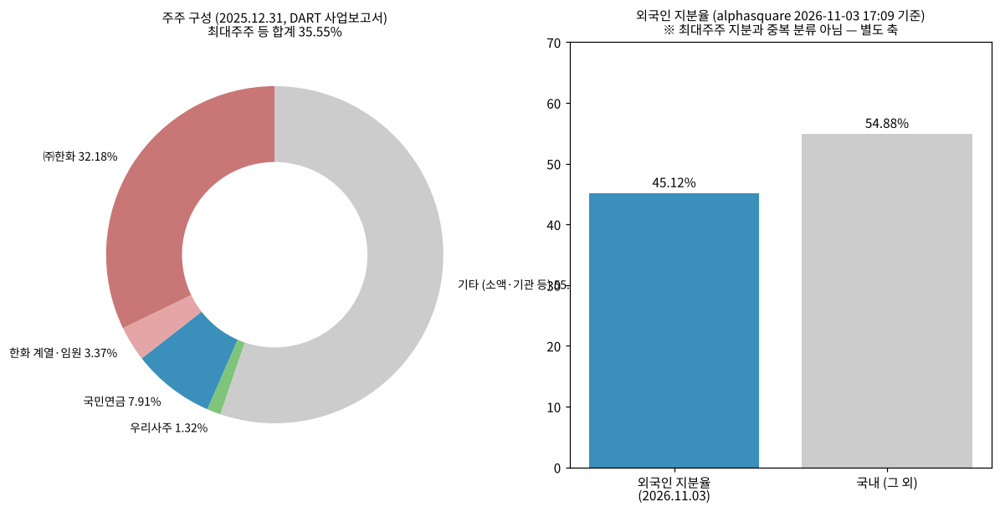

| 주주 | 2024말 | **2025말** | 2026.06말 | 비고 |
|---|---|---|---|---|
| ㈜한화 | 33.95% | **32.18%** | 32.18% | 주주배정 유증 참여 (15,475,456 → 16,595,161주) |
| Hanwha Impact Partners | - | 2.27% | 2.27% | 제3자배정 유증 |
| Hanwha Energy Corp. Singapore | - | 0.74% | 0.74% | 제3자배정 유증 |
| 한화에너지㈜ | - | 0.32% | 0.32% | 제3자배정 유증 |
| 임원 (손재일·김동관·안병철 등) | 0.03% | 0.04% | 0.03% | 안병철 2025.12.31 사임 |
| **최대주주 등 합계** | **33.98%** | **35.55%** | **35.54%** | |
| 국민연금공단 | 확인 불가 | **7.91%** | 7.98% | 5% 이상 주주 |
| 우리사주조합 | - | 1.32% | 1.26% | |
| 소액주주 | - | 51.80% (174,413명) | 47.17% (226,814명) | 1% 미만 주주 |
| 외국인 | - | - | - | **45.12%** (2026-11-03, alphasquare) |

→ (출처: dart_api 2025 FY 최대주주, DART 2025 사업보고서·2026 반기보고서. 브리프의 "특수관계인 약 35.8%"는 원문 확인 결과 **35.55%(2025말)/35.54%(2026.06말)**, 국민연금 "7.9%"는 **7.91%/7.98%**로 확인)

(3) 임원·이사회 (2026.06말, DART 반기보고서)

| 성명 | 직위 | 출생 | 담당 | 주요 경력 |
|---|---|---|---|---|
| **김동관** | 대표이사 (사내) | 1983.10 | 전략부문 대표 | Harvard 정치학, 現 ㈜한화·한화솔루션·한화임팩트 대표이사, 한화오션 기타비상무 |
| **손재일** | 대표이사 (사내) | 1965.03 | 사업부문 대표, 집행위원장 | 고려대, 前 한화디펜스·㈜한화방산 대표, 現 한화시스템 대표 |
| 김승모 | 사내이사, 이사회 의장 | 1967.08 | 전략실 방산전략담당 | 前 ㈜한화/방산·건설부문 대표 (2026.03 신규) |
| Michael Coulter | 사내이사 | 1975.02 | 미국법인장 | 前 미 합참, GD·Leonardo DRS, 現 Hanwha Defense USA 대표 (2025.11 대표이사 사임) |
| 김현진 | 독립이사 | 1975.03 | ESG위원장 | 서울대 항공우주공학과 교수 |
| 이정근 | 독립이사 | 1961.04 | 보상위원장 | 前 육군 군수사령관 |
| 전우홍 | 독립이사 | 1965.11 | 감사위원장 | 前 하나은행 부행장 (2026.03 신규) |
| 전진구 | 독립이사 | 1962.08 | 독립이사후보추천위원장 | 前 해병대 사령관 |
| 전휴재 | 독립이사 | 1974.12 | 내부거래위원장 | 前 서울고법 판사, 성균관대 로스쿨 교수 |

→ 이사회 9인 (사내 4 / 독립 5). 미등기 회장 김승연, 부회장 여승주 (DART)

---

## ⑥ 기타 팩트

(1) R&D 인프라

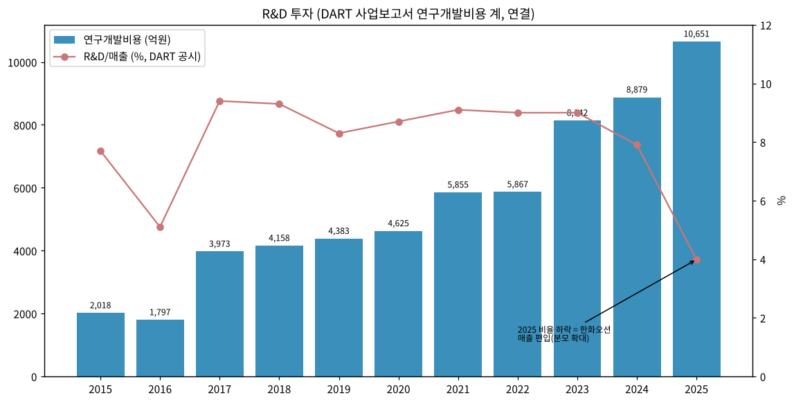

| 연도 | 2015 | 2016 | 2017 | 2018 | 2019 | 2020 | 2021 | 2022 | 2023 | 2024 | 2025 | 1H26 |
|---|---|---|---|---|---|---|---|---|---|---|---|---|
| 연구개발비용 (억) | 2,018 | 1,797 | 3,973 | 4,158 | 4,383 | 4,625 | 5,855 | 5,867 | 8,142 | 8,879 | **10,651** | 5,593 |
| R&D/매출 | 7.7% | 5.1% | 9.4% | 9.3% | 8.3% | 8.7% | 9.1% | 9.0% | 9.0% | 7.9% | 3.99% | 3.72% |

→ (출처: DART 각 사업보고서 연구개발비용 표(연결), 2015·2016은 2015·2016 보고서, 2017~2019는 2018·2019 보고서, 2020~2025는 2021·2023·2026 반기 보고서 3개년 비교표. 2025 비율 급락은 한화오션 매출 편입으로 분모 확대)
→ 연구조직: 항공 R&D(창원·판교), 방산 연구소(PGM·LS 사업부 연구소), 미국 코네티컷 Manufacture Engineering, 우주 발사체연구센터(스페이스허브), 쎄트렉아이(대전) (DART)

(2) 진행 중 corporate action (10년치 M&A)

| 시기 | 내용 | 규모 |
|---|---|---|
| 2016.10 | 두산DST 인수 → 한화디펜스 | 확인 불가 |
| 2017.04 / 2018.04 | 지상방산·파워·정밀기계 / 시큐리티 물적분할 | - |
| 2019 | EDAC Technologies(미국 엔진부품) 인수 | 확인 불가 |
| 2021~22 | 쎄트렉아이 지분 취득·연결 | 확인 불가 |
| 2022.08 | 한화파워시스템 매각 | 2,100억 |
| 2022.11 | 한화디펜스 흡수합병 (1:0) | - |
| 2022.12 | ㈜한화방산 인수 → 2023.04 흡수합병 | 8,521억 |
| 2023.05·11 | 한화오션 유상증자 참여 | 확인 불가 |
| 2024.09 | 인적분할 (한화인더스트리얼솔루션즈) | 발행주식 5,048,839주 감소 |
| 2024.12 | 한화오션 지배력 획득, Philly Shipyard·Dyna-Mac 인수 | 처분이익 1조 1,432억 |
| 2025.04 / 07 | 제3자배정 + 주주배정 유상증자 | 약 4.21조 (CF 유상증자 4,208,788백만) |
| 2025.03 | 한화오션 지분 추가 취득 (비지배지분 감소 1.34조) | 1조 3,429억 (CF) |
| 2026.06~07 | KAI 장내매수 8.67% / 한화시스템, ㈜한화 미래기술연구소 양수 2,878억 | - |
| 2026.10 | 필리조선소 지분 매각(한화시스템 보유분, 10월 말 종결 예정) | 확인 불가 |

(3) R&D·사업 마일스톤 (10년치)

→ 2022.12 누리호 고도화 체계종합기업 선정 / 2024.05 차세대발사체 총괄 주관 제작 계약 / 2025.11 누리호 4차 발사 성공
→ 2024.06 KF-21 최초양산 엔진 공급계약, 2025.06 잔여 엔진 계약 / 2025.12 T-50 수출용 엔진 계약
→ 2024.12 SA-MSAM 발사대 양산, 2025.10 IM3(MSAM) 양산, 2025.11 L-SAM 발사대·ABM 양산
→ 2025.03 쎄트렉아이 SpaceEye-T(0.25m 초고해상도) 발사 성공
→ 독자 첨단 항공엔진 개발 추진 (DART 판매전략 기재)

(4) 주요 리스크

→ **수출 인도 타이밍 리스크** — 최근 4개 분기 중 3개 영업이익 Miss, 공통 원인 폴란드 인도 타이밍 (BT 3Q26 리뷰)
→ **수출 마진 구조 변화** — 폴란드 직수출(30%대) → 현지 생산형(20% 전후)·초기 사업(10% 안팎) 전환, 3Q26 비폴란드 수출 OPM 10%대 노출 (BT 인뎁스)
→ **수주 공백** — 지상방산 잔고 37.2조(2025말) → 35.0조(3Q26) 감소, 폴란드 K9 EC3·중동 대형 수주 지연
→ **재무 레버리지** — 순차입금 9.85조(3Q26), 1H26 영업CF 적자, 2028년까지 11조원+ 투자 계획
→ **환율** — 연결 수출 비중 66%(2025). 3Q26 원화 강세가 영업이익 약 10% 감소 요인 (회사 설명)
→ **조선 사이클 / 오션 외화환산** — 3Q26 세전 적자 주원인. 선가 피크 구간 (Clarksons LNGC 174K 248.5백만달러, 2026.06 — DART)
→ **지배구조 / 중복상장** — 상장 자회사 2사(한화시스템·한화오션) 연결로 지주 할인, 2025 대규모 유상증자 이력
→ **사업장 안전** — 대전 사업장 사고(2026) 복구비 약 300억, 정상화 2027 상반기
→ **소송** — 본체 원고 6건 169억 / 피고 14건 45억 (2025말 별도 주석). 삼성SDS 과천센터 화재 관련 소송 종결 (DART 2025)
→ **항공 RSP** — GTF 인도 증가에 비례한 초기 손실 확대 구조

(5) ESG 등급

→ **확인 불가** — 본 작업에서 KCGS/MSCI 등급 미조회 (다음 버전 보완). 이사회 내 ESG위원회 운영 (DART)

(6) 인증·라이선스

→ 방위사업청 방산업체 지정 (자주포·장갑차·유도무기·탄약 등, DART 사업의 내용)
→ 항공엔진: GE·P&W·RR 엔진부품 공급 자격, P&W GTF RSP 참여 (DART 판매전략)
→ 한화시스템 기간통신사업자 등록(2023.07), PMS Level 8, ISO 37301·37001 (DART 연혁)
→ 세부 인증 목록은 확인 불가

---

## Version Log

| 버전 | 일자 | 내역 |
|---|---|---|
| v1.0 | 2026-11-03 | 첫 작성. DART 사업보고서 11건(2015~2025) + 2026 반기 + 2025.09 분기 원문, OpenDART CFS 43건·OFS 17건, dart_api 2025 FY 5종, 회사 3Q26 IR(BT 리뷰 정리본), Yahoo 20년 주가 반영. 차트 15종(12종 표준 + chart2 확장 2b·2c·2d) |

**잔여 보완 후보 (v1.1)**
→ 사업부별 분기 영업이익 1Q24~1Q26 (회사 IR PDF 원본 확보 필요) — chart2에 사업부 OPM line 추가
→ 지상방산 수출·내수 분기 전 구간 (IR p.9)
→ 3Q26 분기보고서(11월 중순) 공시 후 3Q26P → 확정 교체, 별도 3Q26 추가
→ 회사채 회차별 발행 내역, ESG 등급, 2016 두산DST·2019 EDAC 인수가액
→ 52주 최고가 출처 불일치(1,655,000 vs 1,713,000) 재확인
